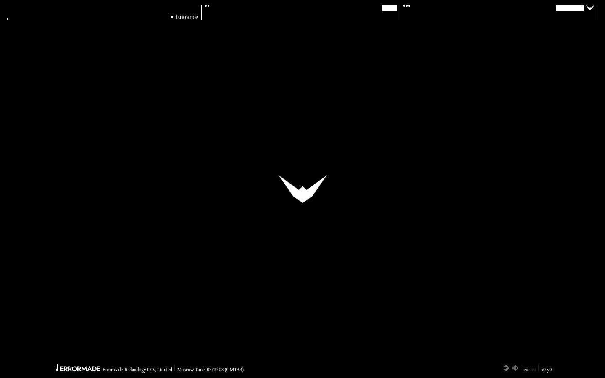
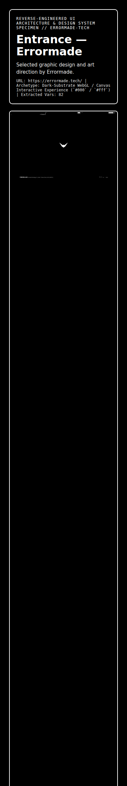

# UI Design System & Master Generation Blueprint: errormade-tech

> **Entrance — Errormade** (https://errormade.tech/) — Selected graphic design and art direction by Errormade.



---

## 1. Executive Visual Persona & Design Archetype

- **Brand Essence & Persona**: **Entrance — Errormade** (`https://errormade.tech/`). Selected graphic design and art direction by Errormade.
- **Visual Archetype**: **Dark-Substrate WebGL / Canvas Interactive Experience (`#000` / `#fff`)**.
- **Anti-AI-Slop Differentiators**:
  - **Source-Grounded Chromatic Polarity**: Anchors the viewport in `#000` (`var(--viewport-background)` in `:root`) paired with `#fff` primary typography and `#fff` accents.
  - **Extracted Typographic Hierarchy**: Pairs `end` for display copy (`Entrance — Errormade`) with `Times New Roman` and not declared in static CSS (uses primary stack / `ui-monospace`).
  - **Calibrated Spatial Grid & Motion**: Combines `47%` container bounds (`gap: 12px`, padding `9px`) with `cubic-bezier(.22,1,.36,1)` easing and Lenis Smooth Scroll (`data-lenis`), HTML5 `<canvas>` Interactive Viewport Surface.

---

## 2. Spatial Architecture & Modular Grid Mathematics



### Viewport Allocation & Container Geometry
- **Captured Viewport Dimensions**: Desktop `1440×11365px` (`assets/desktop.png`, full-page scroll capture), Mobile `390×2400px` (`assets/mobile.png`, capped at 2400px multi-section capture).
- **Master Container Bounds**: `47%` extracted from `errormade-tech` stylesheet.
- **Canvas Lateral Padding & Spacing**: `9px` lateral canvas padding with `12px` grid gap.
- **Border Radius Scale**: `14px`, `6px`, `8px`, `5px`.

### Responsive Breakpoint Architecture
- **Desktop Layout**: Multi-column CSS Grid / Flexbox layout at `1440px` (`max-width: 47%`, `gap: 12px`).
- **Mobile Layout**: Single-column vertical stack at `390px` viewport width with `9px` horizontal padding.
- **Extracted CSS Media Queries**: `@media (max-width: 560px)`, `@media (prefers-reduced-motion: reduce)`, `@media (min-width: 761px) and (max-width: 1200px)`, `@media (min-width: 761px) and (max-width: 1100px)`.

---

## 3. Color System, Materiality & Atmospheric Lighting

### Semantic Palette & Source Grounding
| Semantic Role | Ground-Truth Value | Extracted CSS Source / Selector |
|---|---|---|
| **Primary Canvas Substrate** | `#000` | `var(--viewport-background)` in `:root` |
| **Primary Typography Ink** | `#d8d8d8` | `var(--tools-line)` in `:root` |
| **Elevated Surface / Card Substrate** | `#747474` | `var(--tools-muted)` in `:root` |
| **Interactive Accent / Highlight** | `#fff` | `var(--ink)` in `:root` |
| **Secondary / Muted Copy** | `#1a1a1a` | `var(--media-hover-outline)` in `:root` |
| **Structural Hairline Border** | `#eeeeed` | `.about-tools-launcher { color: #eeeeed }` |

### Sanitized Root CSS Variables (`ui-ux.md` Ground Truth)
| Variable Name | Extracted Value | Semantic Role |
|---|---|---|
| `--grid-gap` | `6px` | Layout / Spatial Grid Token |
| `--column` | `calc((100vw - 2 * var(--page-margin) - 5 * var(--grid-gap)) / 6)` | Layout / Spatial Grid Token |
| `--about-overview-top` | `calc(var(--site-header-bottom) + 12px)` | Dimension / Scale Token |
| `--book-spread-columns` | `10` | Layout / Spatial Grid Token |
| `--book-tick-active` | `1` | Design System Custom Token |
| `--case-ruler-top` | `calc(115px + var(--safe-top))` | Dimension / Scale Token |
| `--case-end-gap` | `200px` | Layout / Spatial Grid Token |
| `--case-step-height` | `200px` | Layout / Spatial Grid Token |
| `--case-header-width` | `calc((100vw - 2 * var(--page-margin) - 2 * var(--grid-gap)) / 3)` | Layout / Spatial Grid Token |
| `--case-progress-ease` | `cubic-bezier(.22, 1, .36, 1)` | Motion / Easing Token |
| `--case-divider-color` | `rgb(255 255 255 / 15%)` | Brand / Palette Token |
| `--case-preview-width` | `48px` | Layout / Spatial Grid Token |
| `--case-preview-duration` | `450ms` | Motion / Easing Token |
| `--case-preview-hidden` | `inset(100% 0 0 0)` | Dimension / Scale Token |
| `--case-ruler-weight` | `2` | Design System Custom Token |
| `--case-step-duration` | `420ms` | Motion / Easing Token |

---

## 4. Typographic Scale & Editorial Hierarchy

### Font Family Stacks
- **Display Typography**: `end`.
- **Primary Body Stack**: `Times New Roman`.
- **Technical / Metadata Stack**: not declared in static CSS (uses primary stack / `ui-monospace`).

### Typographic Scale & Rules (Extracted from Stylesheet & Variables)
- **Hero Display (`H1`)**: rule `h1` (`letter-spacing: inherit`).
- **Section Heading (`H2`)**: rule `h2` (`letter-spacing: -.48px`).
- **Body Copy**: rule `p` (`font-size: 11px`, `line-height: 1.5`).
- **Metadata & Navigation Labels**: CSS variables `--object-caption-height: 36.5px`, `--object-caption-bottom: calc(var(--mobile-footer-bottom) + 25px)`; rule `small` (`font-size: 9px`, `line-height: 1.4`).

---

## 5. Choreographed Motion & Interaction Physics

### Primary Easing Curves
- **Extracted Timing Functions**: `cubic-bezier(.22,1,.36,1)`, `cubic-bezier(0.42,0,0.5800000000000001,1)`.

### Per-Element Transition & Choreography Rules
- **Selector `.about-dossier::after`**: `transition: width 280ms cubic-bezier(.22,1,.36,1)` extracted from `errormade-tech` stylesheet.
- **Selector `media (prefers-reduced-motion: re...`**: `transition: none` extracted from `errormade-tech` stylesheet.
- **Selector `media (hover: hover) and (pointer...`**: `transition: color var(--media-hover-transition, 0s)` extracted from `errormade-tech` stylesheet.
- **Extracted Easing Curve (`cubic-bezier(.22,1,.36,1)`)**: Governs interactive state transitions across `<header.site-header>` and `<article.project>`.
- **Runtime Interaction Engine**: Integrates Lenis Smooth Scroll (`data-lenis`), HTML5 `<canvas>` Interactive Viewport Surface with `prefers-reduced-motion: reduce` fallback guards.

---

## 6. Component Wireframe & Structural DOM Map

### Visual Layout Schematic (Grounded in `dom.html` — `1440px` Desktop & `390px` Mobile Reflow)
```
┌────────────────────────────────────────────────────────────────────────┐
│ DESKTOP VIEWPORT (1440px) — Entrance — Errormade                       │
│ ====================================================================== │
│ [ <header.site-header>     | Entrance · Work · Errormade · About ·  ]  │
│ ---------------------------------------------------------------------- │
│ | HERO STAGE: <section.home-intro>                                 |   │
│ | H1: Entrance — Errormade                                         |   │
│ | Substrate: #000       | Ink: #fff       | Accent: #fff           |   │
│ ---------------------------------------------------------------------- │
│ | SHOWCASE GRID (<article.project>         ) max-w: 47%            |   │
│ | +------------------------------+  +------------------------------+ | │
│ | | Bushido Zho S&T              |  | Krakatau                     | | │
│ | +------------------------------+  +------------------------------+ | │
│ ---------------------------------------------------------------------- │
│ | MOBILE VIEWPORT REFLOW (390px) — Single-Column Stack (gap: 12px  ) | │
│ | [<header.site-heade] -> [<section.home-intr] -> [<article.project>]  │
│ ---------------------------------------------------------------------- │
│ [ FOOTER (<footer.site-footer>  ) | https://errormade.tech/            │
└────────────────────────────────────────────────────────────────────────┘
```

### Granular DOM Region Breakdown
1. **Brand Header & Navigation Bar (<header.site-header> — `errormade-tech`)**:
   - Landmark `<header class="site-header header-motion-ready">` hosting `Entrance — Errormade` navigation (`Entrance · Work · Errormade · About · .obj`), DOM attributes (`data-read-only-preview`, `data-static-export="959f9f266ae66e5a"`, `data-theme="light"`, `data-mobile-glass="webgl"`), and stylesheet rule `.about-tools-launcher { font: 12px/1.4 Arial, Helvetica, sans-serif; color: eeeeed; box-sizing:... }`.
2. **Hero Stage & Focal Lead (<section.home-intro> — `Entrance — Errormade`)**:
   - Landmark `<section class="home-intro">` presenting display lead `Entrance — Errormade` and copy excerpt *"Visual, Art direction, Motion Design"* over `#000` canvas and `#fff` ink.
3. **Primary Showcase & Content Grid (<article.project> — `Bushido Zho S&T`)**:
   - Landmark `<article class="project has-custom-layout">` rendering section `Bushido Zho S&T` with copy *"Digital, Art direction"*, asset references (`favicon.svg`, `5by7-bold.ttf`, `lenis.css`, `styles.css`), and grid rule `after { box-sizing: border-box; }`.
4. **Interactive Detail & Feature Matrix (<article.project> — `Krakatau`)**:
   - Landmark `<article class="project has-custom-layout">` framing `Krakatau` and `Memoria` (*"Visual, Art direction, Merchandise Design, Graphic Design, AI Cam"*) with `#747474` surface cards, `#fff` accents, and `.about-tools-drag { display: flex; align-items: center; gap: 10px; cursor: grab; touch-actio... }`.
5. **Colophon & Global Directory Footer (<footer.site-footer> — `https://errormade.tech/`)**:
   - Landmark `<footer class="site-footer">` anchoring `Entrance — Errormade` footer links (`Entrance · Work · Errormade · About · .obj`), copy *"Visual, Art direction"*, and `#eeeeed` structural dividers.

---

## 7. Master Zero-Shot AI Generation Prompt

```markdown
# Master Zero-Shot Frontend Generation Prompt: errormade-tech (Entrance — Errormade)

You are a principal frontend architect and design systems engineer. Build a complete, production-ready web application replicating the exact design system, DOM landmarks, typographic hierarchy, color tokens, and motion physics of `errormade-tech` (**Entrance — Errormade** — `https://errormade.tech/`).

### 1. Visual Archetype & Anti-AI-Slop Mandates
- **Archetype**: Dark-Substrate WebGL / Canvas Interactive Experience (`#000` / `#fff`).
- **Identity & Domain Context**: Selected graphic design and art direction by Errormade.
- **Primary Substrate**: `#000` (`var(--viewport-background)` in `:root`), **Primary Ink**: `#fff`, **Accent / Highlight**: `#fff`.
- **Site-Specific Differentiators**:
  - **Source-Grounded Chromatic Polarity**: Anchors the viewport in `#000` (`var(--viewport-background)` in `:root`) paired with `#fff` primary typography and `#fff` accents.
  - **Extracted Typographic Hierarchy**: Pairs `end` for display copy (`Entrance — Errormade`) with `Times New Roman` and not declared in static CSS (uses primary stack / `ui-monospace`).
  - **Calibrated Spatial Grid & Motion**: Combines `47%` container bounds (`gap: 12px`, padding `9px`) with `cubic-bezier(.22,1,.36,1)` easing and Lenis Smooth Scroll (`data-lenis`), HTML5 `<canvas>` Interactive Viewport Surface.

### 2. Ground-Truth CSS Variables (`:root` Token Contract)
Declare and consume these exact custom properties extracted from `errormade-tech` in your global stylesheet:

:root {
  /* Entrance — Errormade (errormade-tech) — Ground-Truth Extracted CSS Variables */
  --grid-gap: 6px; /* Layout / Spatial Grid Token (errormade-tech) */
  --column: calc((100vw - 2 * var(--page-margin) - 5 * var(--grid-gap)) / 6); /* Layout / Spatial Grid Token (errormade-tech) */
  --about-overview-top: calc(var(--site-header-bottom) + 12px); /* Dimension / Scale Token (errormade-tech) */
  --book-spread-columns: 10; /* Layout / Spatial Grid Token (errormade-tech) */
  --book-tick-active: 1; /* Design System Custom Token (errormade-tech) */
  --case-ruler-top: calc(115px + var(--safe-top)); /* Dimension / Scale Token (errormade-tech) */
  --case-end-gap: 200px; /* Layout / Spatial Grid Token (errormade-tech) */
  --case-step-height: 200px; /* Layout / Spatial Grid Token (errormade-tech) */
  --case-header-width: calc((100vw - 2 * var(--page-margin) - 2 * var(--grid-gap)) / 3); /* Layout / Spatial Grid Token (errormade-tech) */
  --case-progress-ease: cubic-bezier(.22, 1, .36, 1); /* Motion / Easing Token (errormade-tech) */
  --case-divider-color: rgb(255 255 255 / 15%); /* Brand / Palette Token (errormade-tech) */
  --case-preview-width: 48px; /* Layout / Spatial Grid Token (errormade-tech) */
  --case-preview-duration: 450ms; /* Motion / Easing Token (errormade-tech) */
  --case-preview-hidden: inset(100% 0 0 0); /* Dimension / Scale Token (errormade-tech) */
  --case-ruler-weight: 2; /* Design System Custom Token (errormade-tech) */
  --case-step-duration: 420ms; /* Motion / Easing Token (errormade-tech) */
}

### 3. Semantic Color & Materiality Contract
Map every surface, ink, and border strictly to these source-grounded tokens:
- **Primary Canvas Substrate**: `#000` — grounded in `var(--viewport-background)` in `:root`
- **Primary Typography Ink**: `#d8d8d8` — grounded in `var(--tools-line)` in `:root`
- **Elevated Surface / Card Substrate**: `#747474` — grounded in `var(--tools-muted)` in `:root`
- **Interactive Accent / Highlight**: `#fff` — grounded in `var(--ink)` in `:root`
- **Secondary / Muted Copy**: `#1a1a1a` — grounded in `var(--media-hover-outline)` in `:root`
- **Structural Hairline Border**: `#eeeeed` — grounded in `.about-tools-launcher { color: #eeeeed }`

### 4. Spatial Grid, Container Bounds & Responsive Breakpoints
- **Desktop Viewport Reference**: `1440×11365px` (full-page scroll capture, `1440px` standard desktop width).
- **Mobile Viewport Reference**: `390×2400px` (capped at 2400px multi-section capture, `390px` standard mobile width).
- **Container Max-Width**: `47%` extracted from `errormade-tech` stylesheet
- **Padding & Gutters**: `9px` lateral canvas padding with `12px` grid gap
- **Desktop Grid**: Multi-column CSS Grid / Flexbox layout at `1440px` (`max-width: 47%`, `gap: 12px`)
- **Mobile Adaptation**: Single-column vertical stack at `390px` viewport width with `9px` horizontal padding
- **Media Queries**: `@media (max-width: 560px)`, `@media (prefers-reduced-motion: reduce)`, `@media (min-width: 761px) and (max-width: 1200px)`, `@media (min-width: 761px) and (max-width: 1100px)`
- **Corner Radii**: `14px`, `6px`, `8px`, `5px`

### 5. Typography & Editorial Scale Contract
- **Display Font Stack**: `end`
- **Body Font Stack**: `Times New Roman`
- **Monospace / Technical Font Stack**: not declared in static CSS (uses primary stack / `ui-monospace`)
- **H1 Display Rule**: rule `h1` (`letter-spacing: inherit`)
- **H2 Section Rule**: rule `h2` (`letter-spacing: -.48px`)
- **Body Copy Rule**: rule `p` (`font-size: 11px`, `line-height: 1.5`)
- **Metadata & Index Rule**: CSS variables `--object-caption-height: 36.5px`, `--object-caption-bottom: calc(var(--mobile-footer-bottom) + 25px)`; rule `small` (`font-size: 9px`, `line-height: 1.4`)

### 6. Component Hierarchy, Verbatim Copy & Real DOM Landmarks
Scaffold `errormade-tech` (`Entrance — Errormade`) with these exact structural regions, extracted copy, and CSS rules from `dom.html`:
1. **Brand Header & Navigation Bar (<header.site-header> — `errormade-tech`)**:
   - DOM & Selectors: Landmark `<header class="site-header header-motion-ready">` hosting `Entrance — Errormade` navigation (`Entrance · Work · Errormade · About · .obj`), DOM attributes (`data-read-only-preview`, `data-static-export="959f9f266ae66e5a"`, `data-theme="light"`, `data-mobile-glass="webgl"`), and stylesheet rule `.about-tools-launcher { font: 12px/1.4 Arial, Helvetica, sans-serif; color: eeeeed; box-sizing:... }`.
   - Responsive Contract: Header `Brand Header & Navigation Bar (<header.site-header> — `errormade-tech`)` (`errormade-tech`) adapts across `@media (max-width: 560px)`, `@media (prefers-reduced-motion: reduce)`, `@media (min-width: 761px) and (max-width: 1200px)`, `@media (min-width: 761px) and (max-width: 1100px)` with `cubic-bezier(.22,1,.36,1)`, `cubic-bezier(0.42,0,0.5800000000000001,1)` transitions and links `Entrance · Work · Errormade · About · .obj`.
2. **Hero Stage & Focal Lead (<section.home-intro> — `Entrance — Errormade`)**:
   - DOM & Selectors: Landmark `<section class="home-intro">` presenting display lead `Entrance — Errormade` and copy excerpt *"Visual, Art direction, Motion Design"* over `#000` canvas and `#fff` ink.
   - Responsive Contract: Hero stage (`1440×11365px` desktop / `390×2400px` mobile) sets `#000` background with `#fff` headline `Entrance — Errormade`.
3. **Primary Showcase & Content Grid (<article.project> — `Bushido Zho S&T`)**:
   - DOM & Selectors: Landmark `<article class="project has-custom-layout">` rendering section `Bushido Zho S&T` with copy *"Digital, Art direction"*, asset references (`favicon.svg`, `5by7-bold.ttf`, `lenis.css`, `styles.css`), and grid rule `after { box-sizing: border-box; }`.
   - Responsive Contract: Showcase grid `Primary Showcase & Content Grid (<article.project> — `Bushido Zho S&T`)` applies Multi-column CSS Grid / Flexbox layout at `1440px` (`max-width: 47%`, `gap: 12px`) on desktop and Single-column vertical stack at `390px` viewport width with `9px` horizontal padding on mobile.
4. **Interactive Detail & Feature Matrix (<article.project> — `Krakatau`)**:
   - DOM & Selectors: Landmark `<article class="project has-custom-layout">` framing `Krakatau` and `Memoria` (*"Visual, Art direction, Merchandise Design, Graphic Design, AI Cam"*) with `#747474` surface cards, `#fff` accents, and `.about-tools-drag { display: flex; align-items: center; gap: 10px; cursor: grab; touch-actio... }`.
   - Responsive Contract: Detail module `Interactive Detail & Feature Matrix (<article.project> — `Krakatau`)` uses `14px`, `6px`, `8px`, `5px` radii, `#fff` highlights, and assets (favicon.svg, 5by7-bold.ttf, lenis.css).
5. **Colophon & Global Directory Footer (<footer.site-footer> — `https://errormade.tech/`)**:
   - DOM & Selectors: Landmark `<footer class="site-footer">` anchoring `Entrance — Errormade` footer links (`Entrance · Work · Errormade · About · .obj`), copy *"Visual, Art direction"*, and `#eeeeed` structural dividers.
   - Responsive Contract: Footer `Colophon & Global Directory Footer (<footer.site-footer> — `https://errormade.tech/`)` aligns to `47%` extracted from `errormade-tech` stylesheet with `9px` lateral canvas padding with `12px` grid gap and attributes (data-read-only-preview, data-static-export="959f9f266ae66e5a", data-theme="light").

#### Verbatim DOM Copy Excerpts (`dom.html`)
- Copy Excerpt 1: *"Visual, Art direction, Motion Design"*
- Copy Excerpt 2: *"Digital, Art direction"*
- Copy Excerpt 3: *"Visual, Art direction, Merchandise Design, Graphic Design, AI Campaign"*
- Copy Excerpt 4: *"Visual, Art direction"*

### 7. Motion, Extracted Stylesheet Rules & Interaction Choreography
- **Primary Easing Functions**: `cubic-bezier(.22,1,.36,1)`, `cubic-bezier(0.42,0,0.5800000000000001,1)`
- **Extracted Stylesheet Rules (`errormade-tech`)**:
- `.about-tools-launcher { font: 12px/1.4 Arial, Helvetica, sans-serif; color: eeeeed; box-sizing:... }`
- `after { box-sizing: border-box; }`
- `.about-tools-drag { display: flex; align-items: center; gap: 10px; cursor: grab; touch-actio... }`
- `.about-tools-drag strong { font-size: 13px; font-weight: 500; }`
- `.about-tools-grip { color: 969696; font-size: 23px; line-height: 1; }`
- **Per-Selector Transition Rules**:
- **Selector `.about-dossier::after`**: `transition: width 280ms cubic-bezier(.22,1,.36,1)` extracted from `errormade-tech` stylesheet.
- **Selector `media (prefers-reduced-motion: re...`**: `transition: none` extracted from `errormade-tech` stylesheet.
- **Selector `media (hover: hover) and (pointer...`**: `transition: color var(--media-hover-transition, 0s)` extracted from `errormade-tech` stylesheet.
- **Extracted Easing Curve (`cubic-bezier(.22,1,.36,1)`)**: Governs interactive state transitions across `<header.site-header>` and `<article.project>`.
- **Runtime Interaction Engine**: Integrates Lenis Smooth Scroll (`data-lenis`), HTML5 `<canvas>` Interactive Viewport Surface with `prefers-reduced-motion: reduce` fallback guards.

### 8. Technical Deliverables
- Implement in Next.js (App Router) with TypeScript and Tailwind CSS consuming the `:root` custom properties defined above for `errormade-tech`.
- Reproduce both the `1440px` desktop architecture and `390px` mobile breakpoint transitions, preserving semantic HTML5 landmarks (`<header>`, `<nav>`, `<main>`, `<section>`, `<footer>`) and `prefers-reduced-motion` accessibility guards.
```
