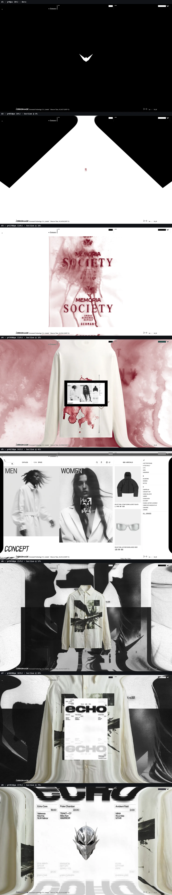
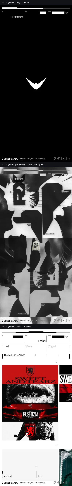

# UI Design System & Master Generation Blueprint: errormade-tech

> **Entrance — Errormade** (https://errormade.tech/) — Selected graphic design and art direction by Errormade.





---

## 1. Executive Visual Persona & Design Archetype

- **Brand Essence & Persona**: **Entrance — Errormade** (`https://errormade.tech/`). Selected graphic design and art direction by Errormade.
- **Capture Provenance**: Live browser capture (`tier2_webgl`, HTTP `200`, captured `2026-11-24`).
- **Visual Archetype**: **Dark-Substrate WebGL / Canvas Interactive Experience (`#000000` / `#777777`)**.
- **Anti-AI-Slop Differentiators**:
  - **Live-Computed Chromatic Polarity**: Anchors the viewport in `#000000` (live computed `body` `background-color` (`computed_styles.json`)) paired with `#ffffff` primary typography and `#777777` accents.
  - **Grounded Typographic Hierarchy**: Uses `end` across display (`Entrance — Errormade`) and body copy.
  - **Calibrated Spatial Grid & Motion**: Combines `1408px` container bounds (`gap: 24px 8px`, padding `12px`) with `cubic-bezier(.22,1,.36,1)` easing and Lenis Smooth Scroll (`data-lenis`), HTML5 `<canvas>` Interactive Viewport Surface.

---

## 2. Spatial Architecture & Modular Grid Mathematics

### Viewport Allocation & Container Geometry
- **Captured Journey Filmstrips**: Desktop `1280×6624px` (`assets/desktop-journey.webp`, `8` keyframes up to `y=7650px` / doc `11365px`), Mobile `390×2616px` (`assets/mobile-journey.webp`, `3` keyframes).
- **Master Container Bounds**: `1408px` (measured `<main>` bounding box width within `1440px` desktop viewport).
- **Canvas Lateral Padding & Spacing**: `12px` lateral canvas padding with `24px 8px` grid gap.
- **Border Radius Scale**: `50%`, `14px`, `6px`, `8px`.

### Responsive Breakpoint Architecture
- **Desktop Layout**: Multi-column CSS Grid / Flexbox layout at `1440px` (`max-width: 1408px`, `gap: 24px 8px`).
- **Mobile Layout**: Single-column vertical stack at `390px` viewport width with `12px` horizontal padding.
- **Extracted CSS Media Queries**: `@media (min-width: 1101px)`, `@media (max-width: 1599px)`, `@media (max-width: 1100px)`, `@media (max-width: 760px)`.

---

## 3. Color System, Materiality & Atmospheric Lighting

### Semantic Palette & Source Grounding
| Semantic Role | Ground-Truth Value | Extracted Live / CSS Source |
|---|---|---|
| **Primary Canvas Substrate** | `#000000` | live computed `body` `background-color` (`computed_styles.json`) |
| **Primary Typography Ink** | `#ffffff` | live computed `nav` `color` (`computed_styles.json`) |
| **Elevated Surface / Card Substrate** | `#262626` | `.footer-divider { background: #262626 }` |
| **Interactive Accent / Highlight** | `#777777` | `.tools-header > button { color: #777777 }` |
| **Secondary / Muted Copy** | `#747474` | `var(--tools-muted)` in `:root` |
| **Structural Hairline Border** | `#262626` | `var(--case-divider-color)` in `:root` (`rgb(255 255 255 / 15%)`) |
| **Variable Token (`--media-hover-outline`)** | `#e5e5e5` | `var(--media-hover-outline)` in `:root` |

### Sanitized Root CSS Variables (`ui-ux.md` Ground Truth)
| Variable Name | Extracted Value | Semantic Role |
|---|---|---|
| `--page-margin` | `16px` | Layout / Spatial Grid Token |
| `--safe-top` | `env(safe-area-inset-top, 0px)` | Dimension / Scale Token |
| `--safe-bottom` | `env(safe-area-inset-bottom, 0px)` | Dimension / Scale Token |
| `--grid-columns` | `12` | Layout / Spatial Grid Token |
| `--grid-gap` | `8px` | Layout / Spatial Grid Token |
| `--header-content-gap` | `84px` | Layout / Spatial Grid Token |
| `--site-header-bottom` | `82px` | Layout / Spatial Grid Token |
| `--ink` | `#000` | Typography Ink Token |
| `--muted` | `rgb(0 0 0 / 25%)` | Color / Atmospheric Token |
| `--rule` | `rgb(0 0 0 / 15%)` | Color / Atmospheric Token |
| `--page-background` | `#fff` | Canvas / Surface Token |
| `--media-hover-outline` | `#e5e5e5` | Elevation / Border Token |
| `--media-hover-icon-invert` | `0` | Design System Custom Token |
| `--row-motion-x` | `0px` | Motion / Easing Token |
| `--media-flip-angle` | `0deg` | Design System Custom Token |
| `--media-flip-opacity` | `1` | Design System Custom Token |

---

## 4. Typographic Scale & Editorial Hierarchy

### Font Family Stacks
- **Display Typography**: `end`.
- **Primary Body Stack**: `end`.
- **Technical / Metadata Stack**: not declared in live computed styles (uses primary stack / `ui-monospace`).

### Typographic Scale & Rules (Live Computed & Stylesheet Grounded)
- **Hero Display (`H1`)**: live computed `h1` (`font-size: 32px`, `line-height: 14px`, `font-weight: 700`, `letter-spacing: -0.48px`); rule `h1` (`letter-spacing: inherit`).
- **Section Heading (`H2`)**: live computed `h2` (`font-size: 16px`, `line-height: 14px`, `font-weight: 400`, `letter-spacing: -0.48px`); rule `h2` (`letter-spacing: inherit`).
- **Body Copy**: live computed `body` (`font-size: 16px`, `line-height: 14px`, `font-weight: 400`, `letter-spacing: -0.48px`); rule `p` (`font-size: 9px`, `line-height: 1.4`, `letter-spacing: .05em`).
- **Metadata & Navigation Labels**: live computed `nav/a` (`font-size: 16px`, `line-height: 14px`, `font-weight: 400`, `letter-spacing: -0.48px`); CSS variables `--object-caption-height: 36.5px`, `--object-caption-bottom: calc(var(--mobile-footer-bottom) + 25px)`; rule `small` (`font-size: 9px`, `line-height: 1.4`).

---

## 5. Choreographed Motion & Interaction Physics

### Primary Easing Curves
- **Extracted Timing Functions**: `cubic-bezier(.22,1,.36,1)`, `cubic-bezier(0.42,0,0.5800000000000001,1)`.

### Per-Element Transition & Choreography Rules
- **Selector `.lenis.lenis-autoToggle`**: `transition: 1ms` extracted from `errormade-tech` stylesheet.
- **Selector `.index-project-media)::before`**: `transition: transform var(--index-divider-duration) ease, background-color...` extracted from `errormade-tech` stylesheet.
- **Selector `dia (prefers-reduced-motion: no-p...`**: `transition: color 150ms ease, opacity 150ms ease` extracted from `errormade-tech` stylesheet.
- **Extracted Easing Curve (`cubic-bezier(.22,1,.36,1)`)**: Governs interactive state transitions across `<header.site-header>` and `<article.has-custom-layout>`.
- **Runtime Interaction Engine**: Integrates Lenis Smooth Scroll (`data-lenis`), HTML5 `<canvas>` Interactive Viewport Surface with `prefers-reduced-motion: reduce` fallback guards.
### Measured Runtime Scroll & Interaction Telemetry (`behavioral_journey_v2`)
- **Scroll Driver Mode**: `native` (max document height `11365px`, deepest scrollY reached `7650px` across `8` desktop keyframes).
- **Detected Scroll / Motion Libraries**: `Lenis`, `WebGL/Canvas`.
- **Hover Physics (`primary_cta` · `Entrance`)**: Computed transition `0s` / `ease` (no static color/transform shift captured at rest).
- **Theme Toggle Probe (`Switch to dark theme`)**: Toggled body background `rgb(0, 0, 0)` -> `rgb(0, 0, 0)` and ink `rgb(0, 0, 0)` -> `rgb(6, 6, 6)`.

---

## 6. Component Wireframe & Structural DOM Map

### Visual Layout Schematic — Desktop (`1440px`, Grounded in `dom.html` & Landmark Bounding Boxes)
```
┌────────────────────────────────────────────────────────────────────────┐
│ DESKTOP VIEWPORT (1440px) — Entrance — Errormade                       │
│ ====================================================================== │
│ [ <header.site-header> (1408x36px)    | Entrance · Work · Errormade  ] │
│ ---------------------------------------------------------------------- │
│ | HERO STAGE: <article.project> (w=1408px)                           | │
│ | H1: Entrance — Errormade                                           | │
│ | Substrate: #000000 | Ink: #ffffff | Accent: #777777                | │
│ ---------------------------------------------------------------------- │
│ | SHOWCASE GRID (<article.has-custom-layout) max-w: 1408px           | │
│ | +------------------------------+  +------------------------------+ | │
│ | | Bushido Zho S&T              |  | Forgotten Garden             | | │
│ | +------------------------------+  +------------------------------+ | │
│ ---------------------------------------------------------------------- │
│ | DETAIL MODULE (<article.project:nth(2)>) — 3 дня дождя "Алексити   | │
│ ---------------------------------------------------------------------- │
│ [ FOOTER (<footer.site-footer>) | https://errormade.tech/              │
└────────────────────────────────────────────────────────────────────────┘
```

### Visual Layout Schematic — Mobile Reflow (`390px`)
```
┌────────────────────────────────────────────────────────────────────────┐
│ MOBILE VIEWPORT REFLOW (390px) — Single-Column Stack (gap: 24px 8px)   │
│ ====================================================================== │
│ [ HEADER BAR (<header.site-header>    ) | Compact Menu (390px)         │
│ ---------------------------------------------------------------------- │
│ | HERO STAGE (<article.project>) — 390px Vertical Lead               | │
│ | H1: Entrance — Errormade                                           | │
│ ---------------------------------------------------------------------- │
│ | SHOWCASE STACK (<article.has-custom-la) — 1-Col Stack              | │
│ | [ Item 1: Bushido Zho S&T                                        ] | │
│ | [ Item 2: Forgotten Garden                                       ] | │
│ ---------------------------------------------------------------------- │
│ | DETAIL STACK (<article.project:nth(2)>) — 1-Col (3 дня дождя "Алекс) │
│ ---------------------------------------------------------------------- │
│ [ FOOTER (<footer.site-footer>) | Stacked 390px Colophon               │
└────────────────────────────────────────────────────────────────────────┘
```

### Granular DOM Region Breakdown
1. **Brand Header & Navigation Bar (<header.site-header> — `errormade-tech`)**:
   - Landmark `<header class="site-header header-motion-ready">` (`1408x36px`) hosting `Entrance — Errormade` navigation (`Entrance · Work · Errormade · About · .obj`), DOM attributes (`data-read-only-preview`, `data-static-export="959f9f266ae66e5a"`, `data-theme="light"`, `data-mobile-glass="webgl"`), and stylesheet rule `html.lenis body { height: auto; }`.
2. **Hero Stage & Focal Lead (<article.project> — `Entrance — Errormade`)**:
   - Landmark `<article class="project has-custom-layout">` presenting display lead `Entrance — Errormade` and copy excerpt *"Visual, Art direction, Motion Design"* over `#000000` canvas and `#ffffff` ink.
3. **Primary Showcase & Content Grid (<article.has-custom-layout> — `Bushido Zho S&T`)**:
   - Landmark `<article class="project has-custom-layout">` rendering section `Bushido Zho S&T` with copy *"Digital, Art direction"*, asset references (`favicon.svg`, `5by7-bold.ttf`, `lenis.css`, `styles.css`), and grid rule `.lenis-stopped { overflow: clip; }`.
4. **Interactive Detail & Feature Matrix (<article.project:nth(2)> — `Forgotten Garden`)**:
   - Landmark `<article class="project has-custom-layout">` framing `Forgotten Garden` and `3 дня дождя "Алекситимия"` (*"Visual, Art direction, Merchandise Design, Graphic Design, AI Cam"*) with `#262626` surface cards, `#777777` accents, and `.lenis.lenis-smooth iframe { pointer-events: none; }`.
5. **Colophon & Global Directory Footer (<footer.site-footer> — `https://errormade.tech/`)**:
   - Landmark `<footer class="site-footer">` anchoring `Entrance — Errormade` footer links (`Entrance · Work · Errormade · About · .obj`), copy *"Visual, Art direction"*, and `#262626` structural dividers.
### Full Vertical Scroll Sequence (Desktop `1440×900` Keyframes)
- **Step 01** (`y=0px`, `0%`): Active landmark `Hero` · sticky/fixed elements: `6`
- **Step 02** (`y=850px`, `8%`): Active landmark `Section @ 8%` · sticky/fixed elements: `6`
- **Step 03** (`y=1700px`, `16%`): Active landmark `Section @ 16%` · sticky/fixed elements: `6`
- **Step 04** (`y=3400px`, `32%`): Active landmark `Section @ 32%` · sticky/fixed elements: `6`
- **Step 05** (`y=4250px`, `41%`): Active landmark `Section @ 41%` · sticky/fixed elements: `6`
- **Step 06** (`y=5950px`, `57%`): Active landmark `Section @ 57%` · sticky/fixed elements: `6`
- **Step 07** (`y=6800px`, `65%`): Active landmark `Section @ 65%` · sticky/fixed elements: `6`
- **Step 08** (`y=7650px`, `73%`): Active landmark `Section @ 73%` · sticky/fixed elements: `6`

---

## 7. Master Zero-Shot AI Generation Prompt

```markdown
# Master Zero-Shot Frontend Generation Prompt: errormade-tech (Entrance — Errormade)

You are a principal frontend architect and design systems engineer. Build a complete, production-ready web application replicating the exact design system, DOM landmarks, typographic hierarchy, color tokens, and motion physics of `errormade-tech` (**Entrance — Errormade** — `https://errormade.tech/`).

### 1. Visual Archetype & Anti-AI-Slop Mandates
- **Archetype**: Dark-Substrate WebGL / Canvas Interactive Experience (`#000000` / `#777777`).
- **Identity & Domain Context**: Selected graphic design and art direction by Errormade.
- **Primary Substrate**: `#000000` (live computed `body` `background-color` (`computed_styles.json`)), **Primary Ink**: `#ffffff`, **Accent / Highlight**: `#777777`.
- **Site-Specific Differentiators**:
  - **Live-Computed Chromatic Polarity**: Anchors the viewport in `#000000` (live computed `body` `background-color` (`computed_styles.json`)) paired with `#ffffff` primary typography and `#777777` accents.
  - **Grounded Typographic Hierarchy**: Uses `end` across display (`Entrance — Errormade`) and body copy.
  - **Calibrated Spatial Grid & Motion**: Combines `1408px` container bounds (`gap: 24px 8px`, padding `12px`) with `cubic-bezier(.22,1,.36,1)` easing and Lenis Smooth Scroll (`data-lenis`), HTML5 `<canvas>` Interactive Viewport Surface.

### 2. Ground-Truth CSS Variables (`:root` Token Contract)
Declare and consume these exact custom properties extracted from `errormade-tech` in your global stylesheet:

:root {
  /* Entrance — Errormade (errormade-tech) — Live-Grounded CSS Variables */
  --page-margin: 16px; /* Layout / Spatial Grid Token (errormade-tech) */
  --safe-top: env(safe-area-inset-top, 0px); /* Dimension / Scale Token (errormade-tech) */
  --safe-bottom: env(safe-area-inset-bottom, 0px); /* Dimension / Scale Token (errormade-tech) */
  --grid-columns: 12; /* Layout / Spatial Grid Token (errormade-tech) */
  --grid-gap: 8px; /* Layout / Spatial Grid Token (errormade-tech) */
  --header-content-gap: 84px; /* Layout / Spatial Grid Token (errormade-tech) */
  --site-header-bottom: 82px; /* Layout / Spatial Grid Token (errormade-tech) */
  --ink: #000; /* Typography Ink Token (errormade-tech) */
  --muted: rgb(0 0 0 / 25%); /* Color / Atmospheric Token (errormade-tech) */
  --rule: rgb(0 0 0 / 15%); /* Color / Atmospheric Token (errormade-tech) */
  --page-background: #fff; /* Canvas / Surface Token (errormade-tech) */
  --media-hover-outline: #e5e5e5; /* Elevation / Border Token (errormade-tech) */
  --media-hover-icon-invert: 0; /* Design System Custom Token (errormade-tech) */
  --row-motion-x: 0px; /* Motion / Easing Token (errormade-tech) */
  --media-flip-angle: 0deg; /* Design System Custom Token (errormade-tech) */
  --media-flip-opacity: 1; /* Design System Custom Token (errormade-tech) */
}

### 3. Semantic Color & Materiality Contract
Map every surface, ink, and border strictly to these source-grounded tokens:
- **Primary Canvas Substrate**: `#000000` — grounded in live computed `body` `background-color` (`computed_styles.json`)
- **Primary Typography Ink**: `#ffffff` — grounded in live computed `nav` `color` (`computed_styles.json`)
- **Elevated Surface / Card Substrate**: `#262626` — grounded in `.footer-divider { background: #262626 }`
- **Interactive Accent / Highlight**: `#777777` — grounded in `.tools-header > button { color: #777777 }`
- **Secondary / Muted Copy**: `#747474` — grounded in `var(--tools-muted)` in `:root`
- **Structural Hairline Border**: `#262626` — grounded in `var(--case-divider-color)` in `:root` (`rgb(255 255 255 / 15%)`)
- **Variable Token (`--media-hover-outline`)**: `#e5e5e5` — grounded in `var(--media-hover-outline)` in `:root`

### 4. Spatial Grid, Container Bounds & Responsive Breakpoints
- **Desktop Viewport Reference**: `1280×6624px` (multi-frame vertical journey filmstrip (6624px), `1440px` standard desktop width).
- **Mobile Viewport Reference**: `390×2616px` (multi-frame vertical journey filmstrip (2616px), `390px` standard mobile width).
- **Container Max-Width**: `1408px` (measured `<main>` bounding box width within `1440px` desktop viewport)
- **Padding & Gutters**: `12px` lateral canvas padding with `24px 8px` grid gap
- **Desktop Grid**: Multi-column CSS Grid / Flexbox layout at `1440px` (`max-width: 1408px`, `gap: 24px 8px`)
- **Mobile Adaptation**: Single-column vertical stack at `390px` viewport width with `12px` horizontal padding
- **Media Queries**: `@media (min-width: 1101px)`, `@media (max-width: 1599px)`, `@media (max-width: 1100px)`, `@media (max-width: 760px)`
- **Corner Radii**: `50%`, `14px`, `6px`, `8px`

### 5. Typography & Editorial Scale Contract
- **Display Font Stack**: `end`
- **Body Font Stack**: `end`
- **Monospace / Technical Font Stack**: not declared in live computed styles (uses primary stack / `ui-monospace`)
- **H1 Display Rule**: live computed `h1` (`font-size: 32px`, `line-height: 14px`, `font-weight: 700`, `letter-spacing: -0.48px`); rule `h1` (`letter-spacing: inherit`)
- **H2 Section Rule**: live computed `h2` (`font-size: 16px`, `line-height: 14px`, `font-weight: 400`, `letter-spacing: -0.48px`); rule `h2` (`letter-spacing: inherit`)
- **Body Copy Rule**: live computed `body` (`font-size: 16px`, `line-height: 14px`, `font-weight: 400`, `letter-spacing: -0.48px`); rule `p` (`font-size: 9px`, `line-height: 1.4`, `letter-spacing: .05em`)
- **Metadata & Index Rule**: live computed `nav/a` (`font-size: 16px`, `line-height: 14px`, `font-weight: 400`, `letter-spacing: -0.48px`); CSS variables `--object-caption-height: 36.5px`, `--object-caption-bottom: calc(var(--mobile-footer-bottom) + 25px)`; rule `small` (`font-size: 9px`, `line-height: 1.4`)

### 6. Component Hierarchy, Verbatim Copy & Real DOM Landmarks
Scaffold `errormade-tech` (`Entrance — Errormade`) with these exact structural regions, extracted copy, and CSS rules from `dom.html`:
1. **Brand Header & Navigation Bar (<header.site-header> — `errormade-tech`)**:
   - DOM & Selectors: Landmark `<header class="site-header header-motion-ready">` (`1408x36px`) hosting `Entrance — Errormade` navigation (`Entrance · Work · Errormade · About · .obj`), DOM attributes (`data-read-only-preview`, `data-static-export="959f9f266ae66e5a"`, `data-theme="light"`, `data-mobile-glass="webgl"`), and stylesheet rule `html.lenis body { height: auto; }`.
   - Responsive Contract: Header `Brand Header & Navigation Bar (<header.site-header> — `errormade-tech`)` (`errormade-tech`) adapts across `@media (min-width: 1101px)`, `@media (max-width: 1599px)`, `@media (max-width: 1100px)`, `@media (max-width: 760px)` with `cubic-bezier(.22,1,.36,1)`, `cubic-bezier(0.42,0,0.5800000000000001,1)` transitions and links `Entrance · Work · Errormade · About · .obj`.
2. **Hero Stage & Focal Lead (<article.project> — `Entrance — Errormade`)**:
   - DOM & Selectors: Landmark `<article class="project has-custom-layout">` presenting display lead `Entrance — Errormade` and copy excerpt *"Visual, Art direction, Motion Design"* over `#000000` canvas and `#ffffff` ink.
   - Responsive Contract: Hero stage (`1280×6624px` desktop / `390×2616px` mobile) sets `#000000` background with `#ffffff` headline `Entrance — Errormade`.
3. **Primary Showcase & Content Grid (<article.has-custom-layout> — `Bushido Zho S&T`)**:
   - DOM & Selectors: Landmark `<article class="project has-custom-layout">` rendering section `Bushido Zho S&T` with copy *"Digital, Art direction"*, asset references (`favicon.svg`, `5by7-bold.ttf`, `lenis.css`, `styles.css`), and grid rule `.lenis-stopped { overflow: clip; }`.
   - Responsive Contract: Showcase grid `Primary Showcase & Content Grid (<article.has-custom-layout> — `Bushido Zho S&T`)` applies Multi-column CSS Grid / Flexbox layout at `1440px` (`max-width: 1408px`, `gap: 24px 8px`) on desktop and Single-column vertical stack at `390px` viewport width with `12px` horizontal padding on mobile.
4. **Interactive Detail & Feature Matrix (<article.project:nth(2)> — `Forgotten Garden`)**:
   - DOM & Selectors: Landmark `<article class="project has-custom-layout">` framing `Forgotten Garden` and `3 дня дождя "Алекситимия"` (*"Visual, Art direction, Merchandise Design, Graphic Design, AI Cam"*) with `#262626` surface cards, `#777777` accents, and `.lenis.lenis-smooth iframe { pointer-events: none; }`.
   - Responsive Contract: Detail module `Interactive Detail & Feature Matrix (<article.project:nth(2)> — `Forgotten Garden`)` uses `50%`, `14px`, `6px`, `8px` radii, `#777777` highlights, and assets (favicon.svg, 5by7-bold.ttf, lenis.css).
5. **Colophon & Global Directory Footer (<footer.site-footer> — `https://errormade.tech/`)**:
   - DOM & Selectors: Landmark `<footer class="site-footer">` anchoring `Entrance — Errormade` footer links (`Entrance · Work · Errormade · About · .obj`), copy *"Visual, Art direction"*, and `#262626` structural dividers.
   - Responsive Contract: Footer `Colophon & Global Directory Footer (<footer.site-footer> — `https://errormade.tech/`)` aligns to `1408px` (measured `<main>` bounding box width within `1440px` desktop viewport) with `12px` lateral canvas padding with `24px 8px` grid gap and attributes (data-read-only-preview, data-static-export="959f9f266ae66e5a", data-theme="light").

#### Verbatim DOM Copy Excerpts (`dom.html`)
- Copy Excerpt 1: *"Visual, Art direction, Motion Design"*
- Copy Excerpt 2: *"Digital, Art direction"*
- Copy Excerpt 3: *"Visual, Art direction, Merchandise Design, Graphic Design, AI Campaign"*
- Copy Excerpt 4: *"Visual, Art direction"*

### 7. Motion, Extracted Stylesheet Rules & Interaction Choreography
- **Primary Easing Functions**: `cubic-bezier(.22,1,.36,1)`, `cubic-bezier(0.42,0,0.5800000000000001,1)`
- **Extracted Stylesheet Rules (`errormade-tech`)**:
- `html.lenis body { height: auto; }`
- `.lenis-stopped { overflow: clip; }`
- `.lenis.lenis-smooth iframe { pointer-events: none; }`
- `.lenis.lenis-autoToggle { transition-property: overflow; transition-duration: 1ms; transition-beha... }`
- `html { scrollbar-width: none; background: var(--page-background); }`
- **Per-Selector Transition Rules**:
- **Selector `.lenis.lenis-autoToggle`**: `transition: 1ms` extracted from `errormade-tech` stylesheet.
- **Selector `.index-project-media)::before`**: `transition: transform var(--index-divider-duration) ease, background-color...` extracted from `errormade-tech` stylesheet.
- **Selector `dia (prefers-reduced-motion: no-p...`**: `transition: color 150ms ease, opacity 150ms ease` extracted from `errormade-tech` stylesheet.
- **Extracted Easing Curve (`cubic-bezier(.22,1,.36,1)`)**: Governs interactive state transitions across `<header.site-header>` and `<article.has-custom-layout>`.
- **Runtime Interaction Engine**: Integrates Lenis Smooth Scroll (`data-lenis`), HTML5 `<canvas>` Interactive Viewport Surface with `prefers-reduced-motion: reduce` fallback guards.
### 7b. Full-Page Scroll Choreography, Interactive States & Multi-Page Routes
- **Scroll Mechanics**: Implement `native` vertical progression up to `11365px` across 8 distinct viewport chapters using Lenis, WebGL/Canvas.
- **Vertical Chapter Sequence**: Hero (0%) -> Section @ 8% (8%) -> Section @ 16% (16%) -> Section @ 32% (32%) -> Section @ 41% (41%) -> Section @ 57% (57%) -> Section @ 65% (65%) -> Section @ 73% (73%).

### 8. Technical Deliverables
- Implement in Next.js (App Router) with TypeScript and Tailwind CSS consuming the `:root` custom properties defined above for `errormade-tech`.
- Reproduce both the `1440px` desktop architecture and `390px` mobile breakpoint transitions, preserving semantic HTML5 landmarks (`<header>`, `<nav>`, `<main>`, `<section>`, `<footer>`) and `prefers-reduced-motion` accessibility guards.
```
---

## 8. Full-Page Scroll Journey, Interactive States & Subpage Inventory

### Desktop Scroll Keyframes (`1440×900` WebP)
| Step | Scroll Y | Progress | Active Landmark / Section | Sticky/Fixed | Visual Asset |
| :---: | :---: | :---: | :--- | :---: | :--- |
| `#01` | `0px` | `0%` | Hero | `6` | [desktop-step-01.webp](assets/desktop-step-01.webp) |
| `#02` | `850px` | `8%` | Section @ 8% | `6` | [desktop-step-02.webp](assets/desktop-step-02.webp) |
| `#03` | `1700px` | `16%` | Section @ 16% | `6` | [desktop-step-03.webp](assets/desktop-step-03.webp) |
| `#04` | `3400px` | `32%` | Section @ 32% | `6` | [desktop-step-04.webp](assets/desktop-step-04.webp) |
| `#05` | `4250px` | `41%` | Section @ 41% | `6` | [desktop-step-05.webp](assets/desktop-step-05.webp) |
| `#06` | `5950px` | `57%` | Section @ 57% | `6` | [desktop-step-06.webp](assets/desktop-step-06.webp) |
| `#07` | `6800px` | `65%` | Section @ 65% | `6` | [desktop-step-07.webp](assets/desktop-step-07.webp) |
| `#08` | `7650px` | `73%` | Section @ 73% | `6` | [desktop-step-08.webp](assets/desktop-step-08.webp) |

### Mobile Condensed Keyframes (`390×844` WebP)
| Step | Scroll Y | Progress | Active Landmark | Visual Asset |
| :---: | :---: | :---: | :--- | :--- |
| `#01` | `0px` | `0%` | Hero | [mobile-step-01.webp](assets/mobile-step-01.webp) |
| `#02` | `4907px` | `50%` | Section @ 50% | [mobile-step-02.webp](assets/mobile-step-02.webp) |
| `#03` | `0px` | `100%` | Hero | [mobile-step-03.webp](assets/mobile-step-03.webp) |

