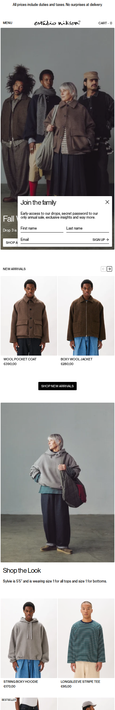

# UI Design System & Master Generation Blueprint: estudioniksen-com

> **Estudio Niksen** (https://estudioniksen.com/) — We are an independent lifestyle brand presenting elevated garments and living-space goods through a mix of influences.


---

## 1. Executive Visual Persona & Design Archetype

- **Brand Essence & Persona**: **Estudio Niksen** (`https://estudioniksen.com/`). We are an independent lifestyle brand presenting elevated garments and living-space goods through a mix of influences.
- **Capture Provenance**: Live browser capture (`tier1_fast`, HTTP `200`, captured `2026-11-23`).
- **Visual Archetype**: **Light-Substrate Editorial & Modular Grid System (`#ffffff` canvas, `#000000` ink, `#2e5fdc` accent)**.
- **Anti-AI-Slop Differentiators**:
  - **Live-Computed Chromatic Polarity**: Anchors the viewport in `#ffffff` (live computed `body` `background-color` (`computed_styles.json`)) paired with `#000000` primary typography and `#2e5fdc` accents.
  - **Grounded Typographic Hierarchy**: Pairs `PP Neue Montreal` for display copy (`Fall Winter '26`) with `PP Neue Montreal` and `SFMono-Regular`.
  - **Calibrated Spatial Grid & Motion**: Combines `1800px` container bounds (`gap: 56px`, padding `10px`) with `cubic-bezier(.4,0,.22,1)` easing and Lenis Smooth Scroll (`data-lenis`), Three.js / WebGL Canvas Pipeline.

---

## 2. Spatial Architecture & Modular Grid Mathematics



### Viewport Allocation & Container Geometry
- **Captured Viewport Dimensions**: Desktop `1440×900px` (`assets/desktop.png`, single-viewport 100vh live capture (900px)), Mobile `390×2400px` (`assets/mobile.png`, clamped at 2400px live multi-section capture).
- **Master Container Bounds**: `1800px` (non-`@media` desktop container stylesheet rule).
- **Canvas Lateral Padding & Spacing**: `10px` lateral canvas padding with `56px` grid gap.
- **Border Radius Scale**: `50%`, `var(--button-radius)`, `10px`, `.3125rem`.

### Responsive Breakpoint Architecture
- **Desktop Layout**: Multi-column CSS Grid / Flexbox layout at `1440px` (`max-width: 1800px`, `gap: 56px`).
- **Mobile Layout**: Single-column vertical stack at `390px` viewport width with `10px` horizontal padding.
- **Extracted CSS Media Queries**: `@media not all and (width>=700px)`, `@media (width>=1000px)`, `@media not all and (width>=1000px)`, `@media (width>=420px)`.

---

## 3. Color System, Materiality & Atmospheric Lighting

### Semantic Palette & Source Grounding
| Semantic Role | Ground-Truth Value | Extracted Live / CSS Source |
|---|---|---|
| **Primary Canvas Substrate** | `#ffffff` | live computed `body` `background-color` (`computed_styles.json`) |
| **Primary Typography Ink** | `#000000` | live computed `main` `color` (`computed_styles.json`) |
| **Elevated Surface / Card Substrate** | `#808080` | `.bg-gray { background-color: gray }` (`#808080`) |
| **Interactive Accent / Highlight** | `#2e5fdc` | `.grow_modal__btn-primary { background-color: #2e5fdc }` |
| **Secondary / Muted Copy** | `#4f4f4f` | `var(--pswp-icon-color-secondary)` in `:root` |
| **Structural Hairline Border** | `#4f4f4f` | `var(--pswp-icon-stroke-color)` in `:root` |
| **Variable Token (`--pswp-placeholder-bg`)** | `#222222` | `var(--pswp-placeholder-bg)` in `:root` |

### Sanitized Root CSS Variables (`ui-ux.md` Ground Truth)
| Variable Name | Extracted Value | Semantic Role |
|---|---|---|
| `--svh` | `1svh` | Layout / Spatial Grid Token |
| `--unit-sm` | `10px` | Dimension / Scale Token |
| `--unit-md` | `20px` | Dimension / Scale Token |
| `--grid-gutter` | `var(--spacing-gutter)` | Layout / Spatial Grid Token |
| `--grid-margin` | `var(--unit-sm)` | Layout / Spatial Grid Token |
| `--header-height` | `calc(var(--spacing) * 8.5)` | Layout / Spatial Grid Token |
| `--announcement-banner-height` | `calc(var(--spacing) * 15)` | Layout / Spatial Grid Token |
| `--pswp-bg` | `#000` | Canvas / Surface Token |
| `--pswp-placeholder-bg` | `#222` | Canvas / Surface Token |
| `--pswp-root-z-index` | `100000` | Elevation / Border Token |
| `--pswp-preloader-color` | `#4f4f4f66` | Brand / Palette Token |
| `--pswp-preloader-color-secondary` | `#ffffffe6` | Brand / Palette Token |
| `--pswp-icon-color` | `#fff` | Brand / Palette Token |
| `--pswp-icon-color-secondary` | `#4f4f4f` | Brand / Palette Token |
| `--pswp-icon-stroke-color` | `#4f4f4f` | Brand / Palette Token |
| `--pswp-icon-stroke-width` | `2px` | Layout / Spatial Grid Token |

---

## 4. Typographic Scale & Editorial Hierarchy

### Font Family Stacks
- **Display Typography**: `PP Neue Montreal`.
- **Primary Body Stack**: `PP Neue Montreal`.
- **Technical / Metadata Stack**: `SFMono-Regular`.

### Typographic Scale & Rules (Live Computed & Stylesheet Grounded)
- **Hero Display (`H1`)**: live computed `h1` (`font-size: 42px`, `line-height: 42px`, `font-weight: 400`, `letter-spacing: -1.47px`).
- **Section Heading (`H2`)**: live computed `h2` (`font-size: 24px`, `line-height: 24px`, `font-weight: 400`, `letter-spacing: -0.84px`); CSS variables `--text-2xl: 1.5rem`, `--text-2xl--line-height: calc(2 / 1.5)`; rule `h2` (`font-size: 120%`, `font-weight: bold`).
- **Body Copy**: live computed `body` (`font-size: 16px`, `line-height: 24px`, `font-weight: 400`); CSS variables `--text-base: 1rem`, `--text-base--line-height: calc(1.5 / 1)`; rule `p` (`font-size: var(--text-xxs)`, `line-height: 1.1`, `font-weight: var(--font-we...`).
- **Metadata & Navigation Labels**: live computed `nav/a` (`font-size: 16px`, `line-height: 24px`, `font-weight: 400`); CSS variables `--text-xs: 12px`, `--text-xs--line-height: calc(1 / .75)`, `--default-mono-font-family: var(--font-mono)`.

---

## 5. Choreographed Motion & Interaction Physics

### Primary Easing Curves
- **Extracted Timing Functions**: `cubic-bezier(.4,0,.22,1)`, `cubic-bezier(0,0,.2,1)`, `cubic-bezier(.4,0,.6,1)`.

### Per-Element Transition & Choreography Rules
- **Selector `.lenis.lenis-autoToggle`**: `transition: 1ms` extracted from `estudioniksen-com` stylesheet.
- **Selector `.swiper-wrapper`**: `transition: var(--swiper-wrapper-transition-timing-function,initial)` extracted from `estudioniksen-com` stylesheet.
- **Selector `.swiper-pagination`**: `transition: opacity .3s` extracted from `estudioniksen-com` stylesheet.
- **Extracted Easing Curve (`cubic-bezier(.4,0,.22,1)`)**: Governs interactive state transitions across `<header.c-header_inner>` and `<section.shopify-pc__banner__dialog:nth(2)>`.
- **Runtime Interaction Engine**: Integrates Lenis Smooth Scroll (`data-lenis`), Three.js / WebGL Canvas Pipeline, Swiper Touch Carousel Engine with `prefers-reduced-motion: reduce` fallback guards.

---

## 6. Component Wireframe & Structural DOM Map

### Visual Layout Schematic — Desktop (`1440px`, Grounded in `dom.html` & Landmark Bounding Boxes)
```
┌────────────────────────────────────────────────────────────────────────┐
│ DESKTOP VIEWPORT (1440px) — Estudio Niksen                             │
│ ====================================================================== │
│ [ <header.c-header_inner (1440x900px) | Shop All · Outerwear · All O ] │
│ ---------------------------------------------------------------------- │
│ | HERO STAGE: <section.shopify-pc__banner__dialog> (w=1440px)        | │
│ | H1: Fall Winter '26                                                | │
│ | Substrate: #ffffff | Ink: #000000 | Accent: #2e5fdc                | │
│ ---------------------------------------------------------------------- │
│ | SHOWCASE GRID (<section.shopify-pc__banne) max-w: 1800px           | │
│ | +------------------------------+  +------------------------------+ | │
│ | | New arrivals                 |  | Shop the Look                | | │
│ | +------------------------------+  +------------------------------+ | │
│ ---------------------------------------------------------------------- │
│ | DETAIL MODULE (<section.shopify-pc__banne) — Niksen Projects       | │
│ ---------------------------------------------------------------------- │
│ [ FOOTER (<footer.mt-fluid-3xl) | https://estudioniksen.com/           │
└────────────────────────────────────────────────────────────────────────┘
```

### Visual Layout Schematic — Mobile Reflow (`390px`)
```
┌────────────────────────────────────────────────────────────────────────┐
│ MOBILE VIEWPORT REFLOW (390px) — Single-Column Stack (gap: 56px)       │
│ ====================================================================== │
│ [ HEADER BAR (<header.c-header_inner> ) | Compact Menu (390px)         │
│ ---------------------------------------------------------------------- │
│ | HERO STAGE (<section.shopify-pc__ban) — 390px Vertical Lead        | │
│ | H1: Fall Winter '26                                                | │
│ ---------------------------------------------------------------------- │
│ | SHOWCASE STACK (<section.shopify-pc__b) — 1-Col Stack              | │
│ | [ Item 1: New arrivals                                           ] | │
│ | [ Item 2: Shop the Look                                          ] | │
│ ---------------------------------------------------------------------- │
│ | DETAIL STACK (<section.shopify-pc__ban) — 1-Col (Niksen Projects)  | │
│ ---------------------------------------------------------------------- │
│ [ FOOTER (<footer.mt-fluid-3xl) | Stacked 390px Colophon               │
└────────────────────────────────────────────────────────────────────────┘
```

### Granular DOM Region Breakdown
1. **Brand Header & Navigation Bar (<header.c-header_inner> — `estudioniksen-com`)**:
   - Landmark `<header class="c-header_inner">` (`1440x900px`) hosting `Estudio Niksen` navigation (`Shop All · Outerwear · All Outerwear · Coats · Jackets`), DOM attributes (`data-template="index"`, `data-smooth-scrolling="true"`, `data-scroll-orientation="vertical"`, `data-source-attribution="shopify.exit_intersti..."`), and stylesheet rule `html.lenis body { height:auto }`.
2. **Hero Stage & Focal Lead (<section.shopify-pc__banner__dialog> — `Fall Winter '26`)**:
   - Landmark `<section class="shopify-pc__banner__dialog">` presenting display lead `Fall Winter '26` and copy excerpt *"All prices include duties and taxes. No surprises at delivery."* over `#ffffff` canvas and `#000000` ink.
3. **Primary Showcase & Content Grid (<section.shopify-pc__banner__dialog:nth(2)> — `New arrivals`)**:
   - Landmark `<section class="shopify-pc__banner__dialog">` rendering section `New arrivals` with copy *"Shop all new arrivals"*, asset references (`1437315943278764`, `fbevents.js`, `a2f45e7b43c941fd84b3f91a8.js`, `favicon.svg`), and grid rule `.lenis-stopped { overflow:clip }`.
4. **Interactive Detail & Feature Matrix (<section.shopify-pc__banner__dialog:nth(3)> — `Shop the Look`)**:
   - Landmark `<section class="shopify-pc__banner__dialog">` framing `Shop the Look` and `Niksen Projects` (*"View Product : Wool Pocket Coat"*) with `#808080` surface cards, `#2e5fdc` accents, and `.lenis.lenis-smooth iframe { pointer-events:none }`.
5. **Colophon & Global Directory Footer (<footer.mt-fluid-3xl> — `https://estudioniksen.com/`)**:
   - Landmark `<footer class="mt-fluid-3xl pb-gutter">` anchoring `Estudio Niksen` footer links (`Shop All · Outerwear · All Outerwear · Coats · Jackets`), copy *"View Product : Boxy Wool Jacket"*, and `#4f4f4f` structural dividers.

---

## 7. Master Zero-Shot AI Generation Prompt

```markdown
# Master Zero-Shot Frontend Generation Prompt: estudioniksen-com (Estudio Niksen)

You are a principal frontend architect and design systems engineer. Build a complete, production-ready web application replicating the exact design system, DOM landmarks, typographic hierarchy, color tokens, and motion physics of `estudioniksen-com` (**Estudio Niksen** — `https://estudioniksen.com/`).

### 1. Visual Archetype & Anti-AI-Slop Mandates
- **Archetype**: Light-Substrate Editorial & Modular Grid System (`#ffffff` canvas, `#000000` ink, `#2e5fdc` accent).
- **Identity & Domain Context**: We are an independent lifestyle brand presenting elevated garments and living-space goods through a mix of influences.
- **Primary Substrate**: `#ffffff` (live computed `body` `background-color` (`computed_styles.json`)), **Primary Ink**: `#000000`, **Accent / Highlight**: `#2e5fdc`.
- **Site-Specific Differentiators**:
  - **Live-Computed Chromatic Polarity**: Anchors the viewport in `#ffffff` (live computed `body` `background-color` (`computed_styles.json`)) paired with `#000000` primary typography and `#2e5fdc` accents.
  - **Grounded Typographic Hierarchy**: Pairs `PP Neue Montreal` for display copy (`Fall Winter '26`) with `PP Neue Montreal` and `SFMono-Regular`.
  - **Calibrated Spatial Grid & Motion**: Combines `1800px` container bounds (`gap: 56px`, padding `10px`) with `cubic-bezier(.4,0,.22,1)` easing and Lenis Smooth Scroll (`data-lenis`), Three.js / WebGL Canvas Pipeline.

### 2. Ground-Truth CSS Variables (`:root` Token Contract)
Declare and consume these exact custom properties extracted from `estudioniksen-com` in your global stylesheet:

:root {
  /* Estudio Niksen (estudioniksen-com) — Live-Grounded CSS Variables */
  --svh: 1svh; /* Layout / Spatial Grid Token (estudioniksen-com) */
  --unit-sm: 10px; /* Dimension / Scale Token (estudioniksen-com) */
  --unit-md: 20px; /* Dimension / Scale Token (estudioniksen-com) */
  --grid-gutter: var(--spacing-gutter); /* Layout / Spatial Grid Token (estudioniksen-com) */
  --grid-margin: var(--unit-sm); /* Layout / Spatial Grid Token (estudioniksen-com) */
  --header-height: calc(var(--spacing) * 8.5); /* Layout / Spatial Grid Token (estudioniksen-com) */
  --announcement-banner-height: calc(var(--spacing) * 15); /* Layout / Spatial Grid Token (estudioniksen-com) */
  --pswp-bg: #000; /* Canvas / Surface Token (estudioniksen-com) */
  --pswp-placeholder-bg: #222; /* Canvas / Surface Token (estudioniksen-com) */
  --pswp-root-z-index: 100000; /* Elevation / Border Token (estudioniksen-com) */
  --pswp-preloader-color: #4f4f4f66; /* Brand / Palette Token (estudioniksen-com) */
  --pswp-preloader-color-secondary: #ffffffe6; /* Brand / Palette Token (estudioniksen-com) */
  --pswp-icon-color: #fff; /* Brand / Palette Token (estudioniksen-com) */
  --pswp-icon-color-secondary: #4f4f4f; /* Brand / Palette Token (estudioniksen-com) */
  --pswp-icon-stroke-color: #4f4f4f; /* Brand / Palette Token (estudioniksen-com) */
  --pswp-icon-stroke-width: 2px; /* Layout / Spatial Grid Token (estudioniksen-com) */
}

### 3. Semantic Color & Materiality Contract
Map every surface, ink, and border strictly to these source-grounded tokens:
- **Primary Canvas Substrate**: `#ffffff` — grounded in live computed `body` `background-color` (`computed_styles.json`)
- **Primary Typography Ink**: `#000000` — grounded in live computed `main` `color` (`computed_styles.json`)
- **Elevated Surface / Card Substrate**: `#808080` — grounded in `.bg-gray { background-color: gray }` (`#808080`)
- **Interactive Accent / Highlight**: `#2e5fdc` — grounded in `.grow_modal__btn-primary { background-color: #2e5fdc }`
- **Secondary / Muted Copy**: `#4f4f4f` — grounded in `var(--pswp-icon-color-secondary)` in `:root`
- **Structural Hairline Border**: `#4f4f4f` — grounded in `var(--pswp-icon-stroke-color)` in `:root`
- **Variable Token (`--pswp-placeholder-bg`)**: `#222222` — grounded in `var(--pswp-placeholder-bg)` in `:root`

### 4. Spatial Grid, Container Bounds & Responsive Breakpoints
- **Desktop Viewport Reference**: `1440×900px` (single-viewport 100vh live capture (900px), `1440px` standard desktop width).
- **Mobile Viewport Reference**: `390×2400px` (clamped at 2400px live multi-section capture, `390px` standard mobile width).
- **Container Max-Width**: `1800px` (non-`@media` desktop container stylesheet rule)
- **Padding & Gutters**: `10px` lateral canvas padding with `56px` grid gap
- **Desktop Grid**: Multi-column CSS Grid / Flexbox layout at `1440px` (`max-width: 1800px`, `gap: 56px`)
- **Mobile Adaptation**: Single-column vertical stack at `390px` viewport width with `10px` horizontal padding
- **Media Queries**: `@media not all and (width>=700px)`, `@media (width>=1000px)`, `@media not all and (width>=1000px)`, `@media (width>=420px)`
- **Corner Radii**: `50%`, `var(--button-radius)`, `10px`, `.3125rem`

### 5. Typography & Editorial Scale Contract
- **Display Font Stack**: `PP Neue Montreal`
- **Body Font Stack**: `PP Neue Montreal`
- **Monospace / Technical Font Stack**: `SFMono-Regular`
- **H1 Display Rule**: live computed `h1` (`font-size: 42px`, `line-height: 42px`, `font-weight: 400`, `letter-spacing: -1.47px`)
- **H2 Section Rule**: live computed `h2` (`font-size: 24px`, `line-height: 24px`, `font-weight: 400`, `letter-spacing: -0.84px`); CSS variables `--text-2xl: 1.5rem`, `--text-2xl--line-height: calc(2 / 1.5)`; rule `h2` (`font-size: 120%`, `font-weight: bold`)
- **Body Copy Rule**: live computed `body` (`font-size: 16px`, `line-height: 24px`, `font-weight: 400`); CSS variables `--text-base: 1rem`, `--text-base--line-height: calc(1.5 / 1)`; rule `p` (`font-size: var(--text-xxs)`, `line-height: 1.1`, `font-weight: var(--font-we...`)
- **Metadata & Index Rule**: live computed `nav/a` (`font-size: 16px`, `line-height: 24px`, `font-weight: 400`); CSS variables `--text-xs: 12px`, `--text-xs--line-height: calc(1 / .75)`, `--default-mono-font-family: var(--font-mono)`

### 6. Component Hierarchy, Verbatim Copy & Real DOM Landmarks
Scaffold `estudioniksen-com` (`Estudio Niksen`) with these exact structural regions, extracted copy, and CSS rules from `dom.html`:
1. **Brand Header & Navigation Bar (<header.c-header_inner> — `estudioniksen-com`)**:
   - DOM & Selectors: Landmark `<header class="c-header_inner">` (`1440x900px`) hosting `Estudio Niksen` navigation (`Shop All · Outerwear · All Outerwear · Coats · Jackets`), DOM attributes (`data-template="index"`, `data-smooth-scrolling="true"`, `data-scroll-orientation="vertical"`, `data-source-attribution="shopify.exit_intersti..."`), and stylesheet rule `html.lenis body { height:auto }`.
   - Responsive Contract: Header `Brand Header & Navigation Bar (<header.c-header_inner> — `estudioniksen-com`)` (`estudioniksen-com`) adapts across `@media not all and (width>=700px)`, `@media (width>=1000px)`, `@media not all and (width>=1000px)`, `@media (width>=420px)` with `cubic-bezier(.4,0,.22,1)`, `cubic-bezier(0,0,.2,1)`, `cubic-bezier(.4,0,.6,1)` transitions and links `Shop All · Outerwear · All Outerwear · Coats · Jackets`.
2. **Hero Stage & Focal Lead (<section.shopify-pc__banner__dialog> — `Fall Winter '26`)**:
   - DOM & Selectors: Landmark `<section class="shopify-pc__banner__dialog">` presenting display lead `Fall Winter '26` and copy excerpt *"All prices include duties and taxes. No surprises at delivery."* over `#ffffff` canvas and `#000000` ink.
   - Responsive Contract: Hero stage (`1440×900px` desktop / `390×2400px` mobile) sets `#ffffff` background with `#000000` headline `Fall Winter '26`.
3. **Primary Showcase & Content Grid (<section.shopify-pc__banner__dialog:nth(2)> — `New arrivals`)**:
   - DOM & Selectors: Landmark `<section class="shopify-pc__banner__dialog">` rendering section `New arrivals` with copy *"Shop all new arrivals"*, asset references (`1437315943278764`, `fbevents.js`, `a2f45e7b43c941fd84b3f91a8.js`, `favicon.svg`), and grid rule `.lenis-stopped { overflow:clip }`.
   - Responsive Contract: Showcase grid `Primary Showcase & Content Grid (<section.shopify-pc__banner__dialog:nth(2)> — `New arrivals`)` applies Multi-column CSS Grid / Flexbox layout at `1440px` (`max-width: 1800px`, `gap: 56px`) on desktop and Single-column vertical stack at `390px` viewport width with `10px` horizontal padding on mobile.
4. **Interactive Detail & Feature Matrix (<section.shopify-pc__banner__dialog:nth(3)> — `Shop the Look`)**:
   - DOM & Selectors: Landmark `<section class="shopify-pc__banner__dialog">` framing `Shop the Look` and `Niksen Projects` (*"View Product : Wool Pocket Coat"*) with `#808080` surface cards, `#2e5fdc` accents, and `.lenis.lenis-smooth iframe { pointer-events:none }`.
   - Responsive Contract: Detail module `Interactive Detail & Feature Matrix (<section.shopify-pc__banner__dialog:nth(3)> — `Shop the Look`)` uses `50%`, `var(--button-radius)`, `10px`, `.3125rem` radii, `#2e5fdc` highlights, and assets (1437315943278764, fbevents.js, a2f45e7b43c941fd84b3f91a8.js).
5. **Colophon & Global Directory Footer (<footer.mt-fluid-3xl> — `https://estudioniksen.com/`)**:
   - DOM & Selectors: Landmark `<footer class="mt-fluid-3xl pb-gutter">` anchoring `Estudio Niksen` footer links (`Shop All · Outerwear · All Outerwear · Coats · Jackets`), copy *"View Product : Boxy Wool Jacket"*, and `#4f4f4f` structural dividers.
   - Responsive Contract: Footer `Colophon & Global Directory Footer (<footer.mt-fluid-3xl> — `https://estudioniksen.com/`)` aligns to `1800px` (non-`@media` desktop container stylesheet rule) with `10px` lateral canvas padding with `56px` grid gap and attributes (data-template="index", data-smooth-scrolling="true", data-scroll-orientation="vertical").

#### Verbatim DOM Copy Excerpts (`dom.html`)
- Copy Excerpt 1: *"All prices include duties and taxes. No surprises at delivery."*
- Copy Excerpt 2: *"Shop all new arrivals"*
- Copy Excerpt 3: *"View Product : Wool Pocket Coat"*
- Copy Excerpt 4: *"View Product : Boxy Wool Jacket"*

### 7. Motion, Extracted Stylesheet Rules & Interaction Choreography
- **Primary Easing Functions**: `cubic-bezier(.4,0,.22,1)`, `cubic-bezier(0,0,.2,1)`, `cubic-bezier(.4,0,.6,1)`
- **Extracted Stylesheet Rules (`estudioniksen-com`)**:
- `html.lenis body { height:auto }`
- `.lenis-stopped { overflow:clip }`
- `.lenis.lenis-smooth iframe { pointer-events:none }`
- `.lenis.lenis-autoToggle { transition-behavior:allow-discrete;transition-property:overflow;transiti... }`
- `root { --swiper-theme-color:007aff }`
- **Per-Selector Transition Rules**:
- **Selector `.lenis.lenis-autoToggle`**: `transition: 1ms` extracted from `estudioniksen-com` stylesheet.
- **Selector `.swiper-wrapper`**: `transition: var(--swiper-wrapper-transition-timing-function,initial)` extracted from `estudioniksen-com` stylesheet.
- **Selector `.swiper-pagination`**: `transition: opacity .3s` extracted from `estudioniksen-com` stylesheet.
- **Extracted Easing Curve (`cubic-bezier(.4,0,.22,1)`)**: Governs interactive state transitions across `<header.c-header_inner>` and `<section.shopify-pc__banner__dialog:nth(2)>`.
- **Runtime Interaction Engine**: Integrates Lenis Smooth Scroll (`data-lenis`), Three.js / WebGL Canvas Pipeline, Swiper Touch Carousel Engine with `prefers-reduced-motion: reduce` fallback guards.

### 8. Technical Deliverables
- Implement in Next.js (App Router) with TypeScript and Tailwind CSS consuming the `:root` custom properties defined above for `estudioniksen-com`.
- Reproduce both the `1440px` desktop architecture and `390px` mobile breakpoint transitions, preserving semantic HTML5 landmarks (`<header>`, `<nav>`, `<main>`, `<section>`, `<footer>`) and `prefers-reduced-motion` accessibility guards.
```
