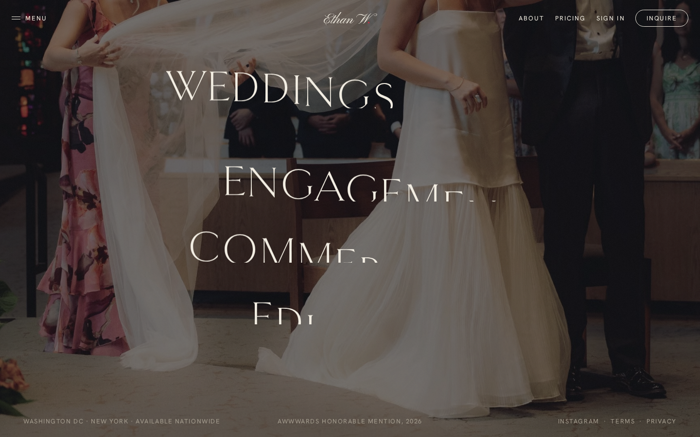
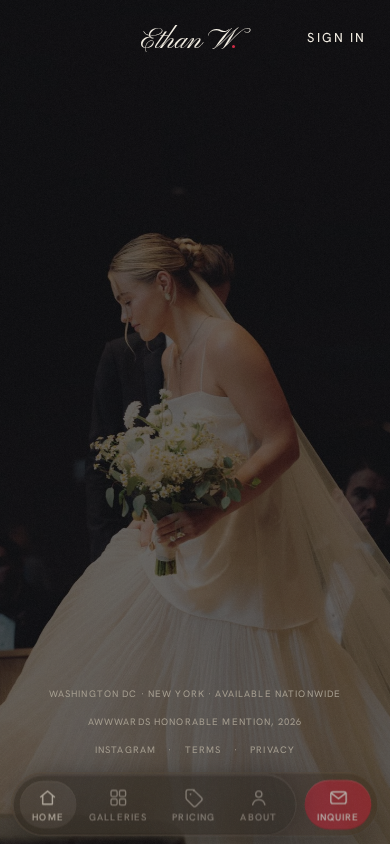

# UI Design System & Master Generation Blueprint: ethanwong-photography

> **Ethan W · Film-Inspired Wedding & Editorial Photographer · Washington DC...** (http://ethanwong.photography) — Documentary wedding, editorial, portrait and commercial photography by Ethan Wong of Ethan W Photography. Film-inspired, vintage-leaning...



---

## 1. Executive Visual Persona & Design Archetype

- **Brand Essence & Persona**: **Ethan W · Film-Inspired Wedding & Editorial Photographer · Washington DC...** (`http://ethanwong.photography`). Documentary wedding, editorial, portrait and commercial photography by Ethan Wong of Ethan W Photography. Film-inspired, vintage-leaning...
- **Capture Provenance**: Live browser capture (`tier1_fast`, HTTP `200`, captured `2026-11-23`).
- **Visual Archetype**: **Light-Substrate Editorial & Modular Grid System (`#efede7` canvas, `#1c1813` ink, `#ff0000` accent)**.
- **Anti-AI-Slop Differentiators**:
  - **Live-Computed Chromatic Polarity**: Anchors the viewport in `#efede7` (live computed `body` `background-color` (`computed_styles.json`)) paired with `#1c1813` primary typography and `#ff0000` accents.
  - **Grounded Typographic Hierarchy**: Pairs `Hanken Grotesk` for display copy (`Ethan W (Ethan Wong), film-inspired `) with `Hanken Grotesk` and not declared in live computed styles (uses primary stack / `ui-monospace`).
  - **Calibrated Spatial Grid & Motion**: Combines `1440px` container bounds (`gap: 8.64px`, padding `288px`) with `cubic-bezier(.65,0,.35,1)` easing and Lenis Smooth Scroll (`data-lenis`).

---

## 2. Spatial Architecture & Modular Grid Mathematics



### Viewport Allocation & Container Geometry
- **Captured Viewport Dimensions**: Desktop `1440×900px` (`assets/desktop.png`, single-viewport 100vh live capture (900px)), Mobile `390×844px` (`assets/mobile.png`, single-viewport 100vh live capture (844px)).
- **Master Container Bounds**: `1440px` (full-bleed `100%` desktop stage measured on `1440px` viewport).
- **Canvas Lateral Padding & Spacing**: `288px` lateral canvas padding with `8.64px` grid gap.
- **Border Radius Scale**: `999px`, `50%`, `2px`, `10px`.

### Responsive Breakpoint Architecture
- **Desktop Layout**: Multi-column CSS Grid / Flexbox layout at `1440px` (`max-width: 1440px`, `gap: 8.64px`).
- **Mobile Layout**: Single-column vertical stack at `390px` viewport width with `288px` horizontal padding.
- **Extracted CSS Media Queries**: `@media (prefers-reduced-motion:reduce)`, `@media (max-width:860px)`, `@media (max-width:540px)`, `@media (min-width:541px)and (max-width:860px)`.

---

## 3. Color System, Materiality & Atmospheric Lighting

### Semantic Palette & Source Grounding
| Semantic Role | Ground-Truth Value | Extracted Live / CSS Source |
|---|---|---|
| **Primary Canvas Substrate** | `#efede7` | live computed `body` `background-color` (`computed_styles.json`) |
| **Primary Typography Ink** | `#1c1813` | live computed `h1` `color` (`computed_styles.json`) |
| **Elevated Surface / Card Substrate** | `#f4efe4` | `.idx-slash { background: #f4efe4 }` |
| **Interactive Accent / Highlight** | `#ff0000` | `.cta-fill { background: red }` (`#ff0000`) |
| **Secondary / Muted Copy** | `#6a6154` | live computed `p` `color` (`computed_styles.json`) |
| **Structural Hairline Border** | `#d3cfc9` | `var(--sf-rule)` in `:root` (`rgba(36, 26, 16, .14)`) |
| **Variable Token (`--red`)** | `#9b1120` | `var(--red)` in `:root` |
| **Variable Token (`--red-hover`)** | `#b3162a` | `var(--red-hover)` in `:root` |
| **Variable Token (`--red-lift`)** | `#ab182c` | `var(--red-lift)` in `:root` |
| **Variable Token (`--red-lift-hover`)** | `#c01f34` | `var(--red-lift-hover)` in `:root` |
| **Variable Token (`--red-deep`)** | `#8a0f1e` | `var(--red-deep)` in `:root` |

### Sanitized Root CSS Variables (`ui-ux.md` Ground Truth)
| Variable Name | Extracted Value | Semantic Role |
|---|---|---|
| `--red` | `#9b1120` | Color / Atmospheric Token |
| `--red-hover` | `#b3162a` | Color / Atmospheric Token |
| `--red-lift` | `#ab182c` | Color / Atmospheric Token |
| `--red-lift-hover` | `#c01f34` | Color / Atmospheric Token |
| `--red-deep` | `#8a0f1e` | Color / Atmospheric Token |
| `--lab-nav` | `13px` | Layout / Spatial Grid Token |
| `--lab` | `12px` | Dimension / Scale Token |
| `--lab-sm` | `11px` | Dimension / Scale Token |
| `--lab-dock` | `9.5px` | Dimension / Scale Token |
| `--lab-quiet` | `10px` | Dimension / Scale Token |
| `--lab-w` | `400` | Design System Custom Token |
| `--lab-w-nav` | `400` | Layout / Spatial Grid Token |
| `--lab-w-dock` | `500` | Design System Custom Token |
| `--head-band` | `74px` | Dimension / Scale Token |
| `--foot-band` | `58px` | Dimension / Scale Token |
| `--lap-vh` | `100vw` | Layout / Spatial Grid Token |

---

## 4. Typographic Scale & Editorial Hierarchy

### Font Family Stacks
- **Display Typography**: `Hanken Grotesk`.
- **Primary Body Stack**: `Hanken Grotesk`.
- **Technical / Metadata Stack**: not declared in live computed styles (uses primary stack / `ui-monospace`).

### Typographic Scale & Rules (Live Computed & Stylesheet Grounded)
- **Hero Display (`H1`)**: live computed `h1` (`font-size: 32px`, `line-height: normal`, `font-weight: 700`).
- **Section Heading (`H2`)**: observed font-size ladder: `32px`, `16px`, `18px`, `29px`, `var(--lab-quiet)`.
- **Body Copy**: live computed `body` (`font-size: 16px`, `line-height: normal`, `font-weight: 400`).
- **Metadata & Navigation Labels**: live computed `nav/a` (`font-size: 16px`, `line-height: normal`, `font-weight: 400`).

---

## 5. Choreographed Motion & Interaction Physics

### Primary Easing Curves
- **Extracted Timing Functions**: `cubic-bezier(.65,0,.35,1)`, `cubic-bezier(.16,1,.3,1)`, `cubic-bezier(.55,0,1,.45)`.

### Per-Element Transition & Choreography Rules
- **Selector `.idx-bd-frame`**: `transition: opacity 1.1s ease` extracted from `ethanwong-photography` stylesheet.
- **Selector `.idx-num`**: `transition: color .9s ease` extracted from `ethanwong-photography` stylesheet.
- **Selector `.idx-meta`**: `transition: opacity .5s ease` extracted from `ethanwong-photography` stylesheet.
- **Extracted Easing Curve (`cubic-bezier(.65,0,.35,1)`)**: Governs interactive state transitions across `<header.site>` and `<main.idx-main:nth(2)>`.
- **Runtime Interaction Engine**: Integrates Lenis Smooth Scroll (`data-lenis`) with `prefers-reduced-motion: reduce` fallback guards.

---

## 6. Component Wireframe & Structural DOM Map

### Visual Layout Schematic — Desktop (`1440px`, Grounded in `dom.html` & Landmark Bounding Boxes)
```
┌────────────────────────────────────────────────────────────────────────┐
│ DESKTOP VIEWPORT (1440px) — Ethan W · Film-Inspired Wedding & Editoria │
│ ====================================================================== │
│ [ <header.site> (1440x74px)           | Editorial Exchange           ] │
│ ---------------------------------------------------------------------- │
│ | HERO STAGE: <main.idx-main> (w=1440px)                             | │
│ | H1: Ethan W (Ethan Wong), film-inspired documentary w...           | │
│ | Substrate: #efede7 | Ink: #1c1813 | Accent: #ff0000                | │
│ ---------------------------------------------------------------------- │
│ | SHOWCASE GRID (<main.idx-main:nth(2)>) max-w: 1440px               | │
│ | +------------------------------+  +------------------------------+ | │
│ | | The full collection in one g |  | W e d d i n g s W e d d i n  | | │
│ | +------------------------------+  +------------------------------+ | │
│ ---------------------------------------------------------------------- │
│ | DETAIL MODULE (<main.idx-main:nth(3)>) — Stories & galleries       | │
│ ---------------------------------------------------------------------- │
│ [ FOOTER (<footer.sf>         ) | http://ethanwong.photography         │
└────────────────────────────────────────────────────────────────────────┘
```

### Visual Layout Schematic — Mobile Reflow (`390px`)
```
┌────────────────────────────────────────────────────────────────────────┐
│ MOBILE VIEWPORT REFLOW (390px) — Single-Column Stack (gap: 8.64px)     │
│ ====================================================================== │
│ [ HEADER BAR (<header.site>           ) | Compact Menu (390px)         │
│ ---------------------------------------------------------------------- │
│ | HERO STAGE (<main.idx-main>) — 390px Vertical Lead                 | │
│ | H1: Ethan W (Ethan Wong), film-inspired documentary w...           | │
│ ---------------------------------------------------------------------- │
│ | SHOWCASE STACK (<main.idx-main:nth(2)>) — 1-Col Stack              | │
│ | [ Item 1: The full collection in one grid. Any frame opens       ] | │
│ | [ Item 2: W e d d i n g s W e d d i n g s                        ] | │
│ ---------------------------------------------------------------------- │
│ | DETAIL STACK (<main.idx-main:nth(3)>) — 1-Col (Stories & gallerie) | │
│ ---------------------------------------------------------------------- │
│ [ FOOTER (<footer.sf>         ) | Stacked 390px Colophon               │
└────────────────────────────────────────────────────────────────────────┘
```

### Granular DOM Region Breakdown
1. **Brand Header & Navigation Bar (<header.site> — `ethanwong-photography`)**:
   - Landmark `<header class="site nav-on-dark">` (`1440x74px`) hosting `Ethan W · Film-Inspired Wedding & Ed` navigation (`Editorial Exchange`), DOM attributes (`data-cursor="always"`, `data-nav`, `data-cta-ink`, `data-nav-theme="dark"`), and stylesheet rule `body { --red: var(--red-lift);--red-hover: var(--red-lift-hover) }`.
2. **Hero Stage & Focal Lead (<main.idx-main> — `Ethan W (Ethan Wong), film-inspire`)**:
   - Landmark `<main class="idx-main">` presenting display lead `Ethan W (Ethan Wong), film-inspired documentary w...` and copy excerpt *"The full collection in one grid. Any frame opens large."* over `#efede7` canvas and `#1c1813` ink.
3. **Primary Showcase & Content Grid (<main.idx-main:nth(2)> — `The full collection in one grid. A`)**:
   - Landmark `<main class="idx-main">` rendering section `The full collection in one grid. Any frame opens` with copy *"W e d d i n g s W e d d i n g s"*, asset references (`favicon-32.png`, `favicon-16.png`, `favicon-32-dark.png`, `favicon-16-dark.png`), and grid rule `.idx-wrap { position:relative;min-height:100vh;min-height:100svh;background:0f0e0c }`.
4. **Interactive Detail & Feature Matrix (<main.idx-main:nth(3)> — `W e d d i n g s W e d d i n g s`)**:
   - Landmark `<main class="idx-main">` framing `W e d d i n g s W e d d i n g s` and `Stories & galleries` (*"Stories & galleries"*) with `#f4efe4` surface cards, `#ff0000` accents, and `.idx-backdrop { position:absolute;inset:0;z-index:0;overflow:hidden }`.
5. **Colophon & Global Directory Footer (<footer.sf> — `http://ethanwong.photography`)**:
   - Landmark `<footer class="sf sf--fixed">` anchoring `Ethan W · Film-Inspired Wedding ` footer links (`Editorial Exchange`), copy *"All visual stories"*, and `#d3cfc9` structural dividers.

---

## 7. Master Zero-Shot AI Generation Prompt

```markdown
# Master Zero-Shot Frontend Generation Prompt: ethanwong-photography (Ethan W · Film-Inspired Wedding & Editorial Photographer · Washington DC...)

You are a principal frontend architect and design systems engineer. Build a complete, production-ready web application replicating the exact design system, DOM landmarks, typographic hierarchy, color tokens, and motion physics of `ethanwong-photography` (**Ethan W · Film-Inspired Wedding & Editorial Photographer · Washington DC...** — `http://ethanwong.photography`).

### 1. Visual Archetype & Anti-AI-Slop Mandates
- **Archetype**: Light-Substrate Editorial & Modular Grid System (`#efede7` canvas, `#1c1813` ink, `#ff0000` accent).
- **Identity & Domain Context**: Documentary wedding, editorial, portrait and commercial photography by Ethan Wong of Ethan W Photography. Film-inspired, vintage-leaning...
- **Primary Substrate**: `#efede7` (live computed `body` `background-color` (`computed_styles.json`)), **Primary Ink**: `#1c1813`, **Accent / Highlight**: `#ff0000`.
- **Site-Specific Differentiators**:
  - **Live-Computed Chromatic Polarity**: Anchors the viewport in `#efede7` (live computed `body` `background-color` (`computed_styles.json`)) paired with `#1c1813` primary typography and `#ff0000` accents.
  - **Grounded Typographic Hierarchy**: Pairs `Hanken Grotesk` for display copy (`Ethan W (Ethan Wong), film-inspired `) with `Hanken Grotesk` and not declared in live computed styles (uses primary stack / `ui-monospace`).
  - **Calibrated Spatial Grid & Motion**: Combines `1440px` container bounds (`gap: 8.64px`, padding `288px`) with `cubic-bezier(.65,0,.35,1)` easing and Lenis Smooth Scroll (`data-lenis`).

### 2. Ground-Truth CSS Variables (`:root` Token Contract)
Declare and consume these exact custom properties extracted from `ethanwong-photography` in your global stylesheet:

:root {
  /* Ethan W · Film-Inspired Wedding & Editorial Photographer · Washington DC... (ethanwong-photography) — Live-Grounded CSS Variables */
  --red: #9b1120; /* Color / Atmospheric Token (ethanwong-photography) */
  --red-hover: #b3162a; /* Color / Atmospheric Token (ethanwong-photography) */
  --red-lift: #ab182c; /* Color / Atmospheric Token (ethanwong-photography) */
  --red-lift-hover: #c01f34; /* Color / Atmospheric Token (ethanwong-photography) */
  --red-deep: #8a0f1e; /* Color / Atmospheric Token (ethanwong-photography) */
  --lab-nav: 13px; /* Layout / Spatial Grid Token (ethanwong-photography) */
  --lab: 12px; /* Dimension / Scale Token (ethanwong-photography) */
  --lab-sm: 11px; /* Dimension / Scale Token (ethanwong-photography) */
  --lab-dock: 9.5px; /* Dimension / Scale Token (ethanwong-photography) */
  --lab-quiet: 10px; /* Dimension / Scale Token (ethanwong-photography) */
  --lab-w: 400; /* Design System Custom Token (ethanwong-photography) */
  --lab-w-nav: 400; /* Layout / Spatial Grid Token (ethanwong-photography) */
  --lab-w-dock: 500; /* Design System Custom Token (ethanwong-photography) */
  --head-band: 74px; /* Dimension / Scale Token (ethanwong-photography) */
  --foot-band: 58px; /* Dimension / Scale Token (ethanwong-photography) */
  --lap-vh: 100vw; /* Layout / Spatial Grid Token (ethanwong-photography) */
}

### 3. Semantic Color & Materiality Contract
Map every surface, ink, and border strictly to these source-grounded tokens:
- **Primary Canvas Substrate**: `#efede7` — grounded in live computed `body` `background-color` (`computed_styles.json`)
- **Primary Typography Ink**: `#1c1813` — grounded in live computed `h1` `color` (`computed_styles.json`)
- **Elevated Surface / Card Substrate**: `#f4efe4` — grounded in `.idx-slash { background: #f4efe4 }`
- **Interactive Accent / Highlight**: `#ff0000` — grounded in `.cta-fill { background: red }` (`#ff0000`)
- **Secondary / Muted Copy**: `#6a6154` — grounded in live computed `p` `color` (`computed_styles.json`)
- **Structural Hairline Border**: `#d3cfc9` — grounded in `var(--sf-rule)` in `:root` (`rgba(36, 26, 16, .14)`)
- **Variable Token (`--red`)**: `#9b1120` — grounded in `var(--red)` in `:root`
- **Variable Token (`--red-hover`)**: `#b3162a` — grounded in `var(--red-hover)` in `:root`
- **Variable Token (`--red-lift`)**: `#ab182c` — grounded in `var(--red-lift)` in `:root`
- **Variable Token (`--red-lift-hover`)**: `#c01f34` — grounded in `var(--red-lift-hover)` in `:root`
- **Variable Token (`--red-deep`)**: `#8a0f1e` — grounded in `var(--red-deep)` in `:root`

### 4. Spatial Grid, Container Bounds & Responsive Breakpoints
- **Desktop Viewport Reference**: `1440×900px` (single-viewport 100vh live capture (900px), `1440px` standard desktop width).
- **Mobile Viewport Reference**: `390×844px` (single-viewport 100vh live capture (844px), `390px` standard mobile width).
- **Container Max-Width**: `1440px` (full-bleed `100%` desktop stage measured on `1440px` viewport)
- **Padding & Gutters**: `288px` lateral canvas padding with `8.64px` grid gap
- **Desktop Grid**: Multi-column CSS Grid / Flexbox layout at `1440px` (`max-width: 1440px`, `gap: 8.64px`)
- **Mobile Adaptation**: Single-column vertical stack at `390px` viewport width with `288px` horizontal padding
- **Media Queries**: `@media (prefers-reduced-motion:reduce)`, `@media (max-width:860px)`, `@media (max-width:540px)`, `@media (min-width:541px)and (max-width:860px)`
- **Corner Radii**: `999px`, `50%`, `2px`, `10px`

### 5. Typography & Editorial Scale Contract
- **Display Font Stack**: `Hanken Grotesk`
- **Body Font Stack**: `Hanken Grotesk`
- **Monospace / Technical Font Stack**: not declared in live computed styles (uses primary stack / `ui-monospace`)
- **H1 Display Rule**: live computed `h1` (`font-size: 32px`, `line-height: normal`, `font-weight: 700`)
- **H2 Section Rule**: observed font-size ladder: `32px`, `16px`, `18px`, `29px`, `var(--lab-quiet)`
- **Body Copy Rule**: live computed `body` (`font-size: 16px`, `line-height: normal`, `font-weight: 400`)
- **Metadata & Index Rule**: live computed `nav/a` (`font-size: 16px`, `line-height: normal`, `font-weight: 400`)

### 6. Component Hierarchy, Verbatim Copy & Real DOM Landmarks
Scaffold `ethanwong-photography` (`Ethan W · Film-Inspired Wedding & Editorial Photographer · Washington DC...`) with these exact structural regions, extracted copy, and CSS rules from `dom.html`:
1. **Brand Header & Navigation Bar (<header.site> — `ethanwong-photography`)**:
   - DOM & Selectors: Landmark `<header class="site nav-on-dark">` (`1440x74px`) hosting `Ethan W · Film-Inspired Wedding & Ed` navigation (`Editorial Exchange`), DOM attributes (`data-cursor="always"`, `data-nav`, `data-cta-ink`, `data-nav-theme="dark"`), and stylesheet rule `body { --red: var(--red-lift);--red-hover: var(--red-lift-hover) }`.
   - Responsive Contract: Header `Brand Header & Navigation Bar (<header.site> — `ethanwong-photography`)` (`ethanwong-photography`) adapts across `@media (prefers-reduced-motion:reduce)`, `@media (max-width:860px)`, `@media (max-width:540px)`, `@media (min-width:541px)and (max-width:860px)` with `cubic-bezier(.65,0,.35,1)`, `cubic-bezier(.16,1,.3,1)`, `cubic-bezier(.55,0,1,.45)` transitions and links `Editorial Exchange`.
2. **Hero Stage & Focal Lead (<main.idx-main> — `Ethan W (Ethan Wong), film-inspire`)**:
   - DOM & Selectors: Landmark `<main class="idx-main">` presenting display lead `Ethan W (Ethan Wong), film-inspired documentary w...` and copy excerpt *"The full collection in one grid. Any frame opens large."* over `#efede7` canvas and `#1c1813` ink.
   - Responsive Contract: Hero stage (`1440×900px` desktop / `390×844px` mobile) sets `#efede7` background with `#1c1813` headline `Ethan W (Ethan Wong), film-inspired documentary w...`.
3. **Primary Showcase & Content Grid (<main.idx-main:nth(2)> — `The full collection in one grid. A`)**:
   - DOM & Selectors: Landmark `<main class="idx-main">` rendering section `The full collection in one grid. Any frame opens` with copy *"W e d d i n g s W e d d i n g s"*, asset references (`favicon-32.png`, `favicon-16.png`, `favicon-32-dark.png`, `favicon-16-dark.png`), and grid rule `.idx-wrap { position:relative;min-height:100vh;min-height:100svh;background:0f0e0c }`.
   - Responsive Contract: Showcase grid `Primary Showcase & Content Grid (<main.idx-main:nth(2)> — `The full collection in one grid. A`)` applies Multi-column CSS Grid / Flexbox layout at `1440px` (`max-width: 1440px`, `gap: 8.64px`) on desktop and Single-column vertical stack at `390px` viewport width with `288px` horizontal padding on mobile.
4. **Interactive Detail & Feature Matrix (<main.idx-main:nth(3)> — `W e d d i n g s W e d d i n g s`)**:
   - DOM & Selectors: Landmark `<main class="idx-main">` framing `W e d d i n g s W e d d i n g s` and `Stories & galleries` (*"Stories & galleries"*) with `#f4efe4` surface cards, `#ff0000` accents, and `.idx-backdrop { position:absolute;inset:0;z-index:0;overflow:hidden }`.
   - Responsive Contract: Detail module `Interactive Detail & Feature Matrix (<main.idx-main:nth(3)> — `W e d d i n g s W e d d i n g s`)` uses `999px`, `50%`, `2px`, `10px` radii, `#ff0000` highlights, and assets (favicon-32.png, favicon-16.png, favicon-32-dark.png).
5. **Colophon & Global Directory Footer (<footer.sf> — `http://ethanwong.photography`)**:
   - DOM & Selectors: Landmark `<footer class="sf sf--fixed">` anchoring `Ethan W · Film-Inspired Wedding ` footer links (`Editorial Exchange`), copy *"All visual stories"*, and `#d3cfc9` structural dividers.
   - Responsive Contract: Footer `Colophon & Global Directory Footer (<footer.sf> — `http://ethanwong.photography`)` aligns to `1440px` (full-bleed `100%` desktop stage measured on `1440px` viewport) with `288px` lateral canvas padding with `8.64px` grid gap and attributes (data-cursor="always", data-nav, data-cta-ink).

#### Verbatim DOM Copy Excerpts (`dom.html`)
- Copy Excerpt 1: *"The full collection in one grid. Any frame opens large."*
- Copy Excerpt 2: *"W e d d i n g s W e d d i n g s"*
- Copy Excerpt 3: *"Stories & galleries"*
- Copy Excerpt 4: *"All visual stories"*

### 7. Motion, Extracted Stylesheet Rules & Interaction Choreography
- **Primary Easing Functions**: `cubic-bezier(.65,0,.35,1)`, `cubic-bezier(.16,1,.3,1)`, `cubic-bezier(.55,0,1,.45)`
- **Extracted Stylesheet Rules (`ethanwong-photography`)**:
- `body { --red: var(--red-lift);--red-hover: var(--red-lift-hover) }`
- `.idx-wrap { position:relative;min-height:100vh;min-height:100svh;background:0f0e0c }`
- `.idx-backdrop { position:absolute;inset:0;z-index:0;overflow:hidden }`
- `.idx-scrim { position:absolute;inset:0;background:0c0b0a94 }`
- `.idx-main { position:relative;z-index:2 }`
- **Per-Selector Transition Rules**:
- **Selector `.idx-bd-frame`**: `transition: opacity 1.1s ease` extracted from `ethanwong-photography` stylesheet.
- **Selector `.idx-num`**: `transition: color .9s ease` extracted from `ethanwong-photography` stylesheet.
- **Selector `.idx-meta`**: `transition: opacity .5s ease` extracted from `ethanwong-photography` stylesheet.
- **Extracted Easing Curve (`cubic-bezier(.65,0,.35,1)`)**: Governs interactive state transitions across `<header.site>` and `<main.idx-main:nth(2)>`.
- **Runtime Interaction Engine**: Integrates Lenis Smooth Scroll (`data-lenis`) with `prefers-reduced-motion: reduce` fallback guards.

### 8. Technical Deliverables
- Implement in Next.js (App Router) with TypeScript and Tailwind CSS consuming the `:root` custom properties defined above for `ethanwong-photography`.
- Reproduce both the `1440px` desktop architecture and `390px` mobile breakpoint transitions, preserving semantic HTML5 landmarks (`<header>`, `<nav>`, `<main>`, `<section>`, `<footer>`) and `prefers-reduced-motion` accessibility guards.
```
