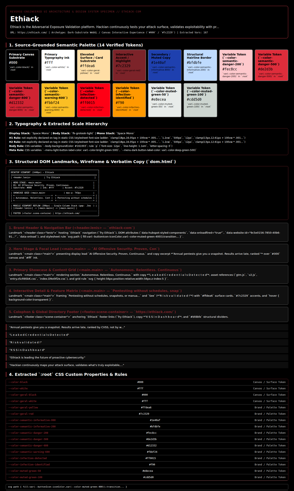
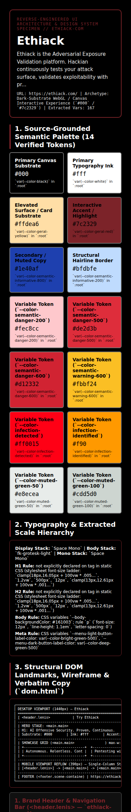

# UI Design System & Master Generation Blueprint: ethiack-com

> **Ethiack** (https://ethiack.com/) — Ethiack is the Adversarial Exposure Validation platform. Hackian continuously tests your attack surface, validates exploitability with pr...



---

## 1. Executive Visual Persona & Design Archetype

- **Brand Essence & Persona**: **Ethiack** (`https://ethiack.com/`). Ethiack is the Adversarial Exposure Validation platform. Hackian continuously tests your attack surface, validates exploitability with pr...
- **Visual Archetype**: **Dark-Substrate WebGL / Canvas Interactive Experience (`#000` / `#7c2329`)**.
- **Anti-AI-Slop Differentiators**:
  - **Source-Grounded Chromatic Polarity**: Anchors the viewport in `#000` (`var(--color-black)` in `:root`) paired with `#fff` primary typography and `#7c2329` accents.
  - **Extracted Typographic Hierarchy**: Pairs `Space Mono` for display copy (`AI Offensive Security. Proven, Conti`) with `fk-grotesk-light` and `Space Mono`.
  - **Calibrated Spatial Grid & Motion**: Combines `743px` container bounds (`gap: .3vw`, padding `7px`) with `cubic-bezier(.23,1,.32,1)` easing and Lenis Smooth Scroll (`data-lenis`), Three.js / WebGL Canvas Pipeline.

---

## 2. Spatial Architecture & Modular Grid Mathematics



### Viewport Allocation & Container Geometry
- **Captured Viewport Dimensions**: Desktop `1440×2400px` (`assets/desktop.png`, capped at 2400px multi-section capture), Mobile `390×2400px` (`assets/mobile.png`, capped at 2400px multi-section capture).
- **Master Container Bounds**: `743px` extracted from `ethiack-com` stylesheet.
- **Canvas Lateral Padding & Spacing**: `7px` lateral canvas padding with `.3vw` grid gap.
- **Border Radius Scale**: `12px`, `16px`, `8px`, `9px`.

### Responsive Breakpoint Architecture
- **Desktop Layout**: Multi-column CSS Grid / Flexbox layout at `1440px` (`max-width: 743px`, `gap: .3vw`).
- **Mobile Layout**: Single-column vertical stack at `390px` viewport width with `7px` horizontal padding.
- **Extracted CSS Media Queries**: `@media only screen and (min-width:2000px)`, `@media only screen and (max-width:743px)`, `@media only screen and (max-width:1700px)`, `@media only screen and (max-width:1290px)`.

---

## 3. Color System, Materiality & Atmospheric Lighting

### Semantic Palette & Source Grounding
| Semantic Role | Ground-Truth Value | Extracted CSS Source / Selector |
|---|---|---|
| **Primary Canvas Substrate** | `#000` | `var(--color-black)` in `:root` |
| **Primary Typography Ink** | `#fff` | `var(--color-white)` in `:root` |
| **Elevated Surface / Card Substrate** | `#ffdea6` | `var(--color-geral-yellow)` in `:root` |
| **Interactive Accent / Highlight** | `#7c2329` | `var(--color-geral-red)` in `:root` |
| **Secondary / Muted Copy** | `#1e40af` | `var(--color-semantic-informative-800)` in `:root` |
| **Structural Hairline Border** | `#bfdbfe` | `var(--color-semantic-informative-200)` in `:root` |
| **Variable Token (`--color-semantic-danger-200`)** | `#fec8cc` | `var(--color-semantic-danger-200)` in `:root` |
| **Variable Token (`--color-semantic-danger-500`)** | `#de2d3b` | `var(--color-semantic-danger-500)` in `:root` |
| **Variable Token (`--color-semantic-danger-600`)** | `#d12332` | `var(--color-semantic-danger-600)` in `:root` |
| **Variable Token (`--color-semantic-warning-600`)** | `#fbbf24` | `var(--color-semantic-warning-600)` in `:root` |
| **Variable Token (`--color-infection-detected`)** | `#ff0015` | `var(--color-infection-detected)` in `:root` |
| **Variable Token (`--color-infection-identified`)** | `#f90` | `var(--color-infection-identified)` in `:root` |
| **Variable Token (`--color-muted-green-50`)** | `#e8ecea` | `var(--color-muted-green-50)` in `:root` |
| **Variable Token (`--color-muted-green-100`)** | `#cdd5d0` | `var(--color-muted-green-100)` in `:root` |

### Sanitized Root CSS Variables (`ui-ux.md` Ground Truth)
| Variable Name | Extracted Value | Semantic Role |
|---|---|---|
| `--color-black` | `#000` | Canvas / Surface Token |
| `--color-white` | `#fff` | Canvas / Surface Token |
| `--color-geral-black` | `#000` | Canvas / Surface Token |
| `--color-geral-white` | `#fff` | Canvas / Surface Token |
| `--color-geral-yellow` | `#ffdea6` | Brand / Palette Token |
| `--color-geral-red` | `#7c2329` | Brand / Palette Token |
| `--color-semantic-informative-800` | `#1e40af` | Brand / Palette Token |
| `--color-semantic-informative-200` | `#bfdbfe` | Brand / Palette Token |
| `--color-semantic-danger-200` | `#fec8cc` | Brand / Palette Token |
| `--color-semantic-danger-500` | `#de2d3b` | Brand / Palette Token |
| `--color-semantic-danger-600` | `#d12332` | Brand / Palette Token |
| `--color-semantic-warning-600` | `#fbbf24` | Brand / Palette Token |
| `--color-infection-detected` | `#ff0015` | Brand / Palette Token |
| `--color-infection-identified` | `#f90` | Brand / Palette Token |
| `--color-muted-green-50` | `#e8ecea` | Brand / Palette Token |
| `--color-muted-green-100` | `#cdd5d0` | Brand / Palette Token |

---

## 4. Typographic Scale & Editorial Hierarchy

### Font Family Stacks
- **Display Typography**: `Space Mono`.
- **Primary Body Stack**: `fk-grotesk-light`.
- **Technical / Metadata Stack**: `Space Mono`.

### Typographic Scale & Rules (Extracted from Stylesheet & Variables)
- **Hero Display (`H1`)**: not explicitly declared on tag in static CSS (stylesheet font-size ladder: `clamp(18px,16.05px + 100vw * .005...`, `1.2vw`, `500px`, `12px`, `clamp(13px,12.61px + 100vw * .001...`).
- **Section Heading (`H2`)**: not explicitly declared on tag in static CSS (stylesheet font-size ladder: `clamp(18px,16.05px + 100vw * .005...`, `1.2vw`, `500px`, `12px`, `clamp(13px,12.61px + 100vw * .001...`).
- **Body Copy**: CSS variables `--body-backgroundColor: #161003`; rule `p` (`font-size: 12px`, `line-height: 1.1em`, `letter-spacing: 0`).
- **Metadata & Navigation Labels**: CSS variables `--menu-light-button-label-color: var(--color-bright-green-500)`, `--menu-dark-button-label-color: var(--color-deep-green-500)`.

---

## 5. Choreographed Motion & Interaction Physics

### Primary Easing Curves
- **Extracted Timing Functions**: `cubic-bezier(.23,1,.32,1)`, `cubic-bezier(.645,.045,.355,1)`, `cubic-bezier(.215,.61,.355,1)`.

### Per-Element Transition & Choreography Rules
- **Selector `ata-component=button-icon][data-v...`**: `transition: background-color .3s cubic-bezier(.23,1,.32,1),border-color .3...` extracted from `ethiack-com` stylesheet.
- **Selector `nent=button-icon][data-v-ec6ade9e...`**: `transition: fill .3s cubic-bezier(.23,1,.32,1)` extracted from `ethiack-com` stylesheet.
- **Selector `a-component=solution-card][data-v...`**: `transition: background-color .5s cubic-bezier(.23,1,.32,1)` extracted from `ethiack-com` stylesheet.
- **Extracted Easing Curve (`cubic-bezier(.23,1,.32,1)`)**: Governs interactive state transitions across `<header.lenis>` and `<main.main>`.
- **Runtime Interaction Engine**: Integrates Lenis Smooth Scroll (`data-lenis`), Three.js / WebGL Canvas Pipeline with `prefers-reduced-motion: reduce` fallback guards.

---

## 6. Component Wireframe & Structural DOM Map

### Visual Layout Schematic (Grounded in `dom.html` — `1440px` Desktop & `390px` Mobile Reflow)
```
┌────────────────────────────────────────────────────────────────────────┐
│ DESKTOP VIEWPORT (1440px) — Ethiack                                    │
│ ====================================================================== │
│ [ <header.lenis>           | Try Ethiack                            ]  │
│ ---------------------------------------------------------------------- │
│ | HERO STAGE: <main.main>                                          |   │
│ | H1: AI Offensive Security. Proven, Continuous.                   |   │
│ | Substrate: #000       | Ink: #fff       | Accent: #7c2329        |   │
│ ---------------------------------------------------------------------- │
│ | SHOWCASE GRID (<main.main>               ) max-w: 743px          |   │
│ | +------------------------------+  +------------------------------+ | │
│ | | Autonomous. Relentless. Cont |  | Pentesting without schedules | | │
│ | +------------------------------+  +------------------------------+ | │
│ ---------------------------------------------------------------------- │
│ | MOBILE VIEWPORT REFLOW (390px) — Single-Column Stack (gap: .3vw  ) | │
│ | [<header.lenis>] -> [<main.main>] -> [<main.main>] |                 │
│ ---------------------------------------------------------------------- │
│ [ FOOTER (<footer.scene-containe) | https://ethiack.com/               │
└────────────────────────────────────────────────────────────────────────┘
```

### Granular DOM Region Breakdown
1. **Brand Header & Navigation Bar (<header.lenis> — `ethiack-com`)**:
   - Landmark `<header class="lenis">` hosting `Ethiack` navigation (`Try Ethiack`), DOM attributes (`data-hubspot-styled-components`, `data-onloadfired="true"`, `data-website-id="9c5e0156-7850-40b6-91..."`, `data-onload`), and stylesheet rule `svg path { fill:var(--buttonIcon-iconColor,var(--color-muted-green-400));transition... }`.
2. **Hero Stage & Focal Lead (<main.main> — `AI Offensive Security. Proven, Con`)**:
   - Landmark `<main class="main">` presenting display lead `AI Offensive Security. Proven, Continuous.` and copy excerpt *"Annual pentests give you a snapshot. Results arrive late, ranked "* over `#000` canvas and `#fff` ink.
3. **Primary Showcase & Content Grid (<main.main> — `Autonomous. Relentless. Continuous`)**:
   - Landmark `<main class="main">` rendering section `Autonomous. Relentless. Continuous.` with copy *"L e a k e d C r e d e n t i a l s D e t e c t e d"*, asset references (`gtm.js`, `v2.js`, `entry.zScR8SkK.css`, `index.D9o0If2e.css`), and grid rule `svg { height:56px;position:relative;width:56px;z-index:5 }`.
4. **Interactive Detail & Feature Matrix (<main.main> — `Pentesting without schedules, snap`)**:
   - Landmark `<main class="main">` framing `Pentesting without schedules, snapshots, or manua...` and `See` (*"R i s k v a l i d a t e d !"*) with `#ffdea6` surface cards, `#7c2329` accents, and `hover { background-color:transparent }`.
5. **Colophon & Global Directory Footer (<footer.scene-container> — `https://ethiack.com/`)**:
   - Landmark `<footer class="scene-container">` anchoring `Ethiack` footer links (`Try Ethiack`), copy *"X S S i n D a s h b o a r d"*, and `#bfdbfe` structural dividers.

---

## 7. Master Zero-Shot AI Generation Prompt

```markdown
# Master Zero-Shot Frontend Generation Prompt: ethiack-com (Ethiack)

You are a principal frontend architect and design systems engineer. Build a complete, production-ready web application replicating the exact design system, DOM landmarks, typographic hierarchy, color tokens, and motion physics of `ethiack-com` (**Ethiack** — `https://ethiack.com/`).

### 1. Visual Archetype & Anti-AI-Slop Mandates
- **Archetype**: Dark-Substrate WebGL / Canvas Interactive Experience (`#000` / `#7c2329`).
- **Identity & Domain Context**: Ethiack is the Adversarial Exposure Validation platform. Hackian continuously tests your attack surface, validates exploitability with pr...
- **Primary Substrate**: `#000` (`var(--color-black)` in `:root`), **Primary Ink**: `#fff`, **Accent / Highlight**: `#7c2329`.
- **Site-Specific Differentiators**:
  - **Source-Grounded Chromatic Polarity**: Anchors the viewport in `#000` (`var(--color-black)` in `:root`) paired with `#fff` primary typography and `#7c2329` accents.
  - **Extracted Typographic Hierarchy**: Pairs `Space Mono` for display copy (`AI Offensive Security. Proven, Conti`) with `fk-grotesk-light` and `Space Mono`.
  - **Calibrated Spatial Grid & Motion**: Combines `743px` container bounds (`gap: .3vw`, padding `7px`) with `cubic-bezier(.23,1,.32,1)` easing and Lenis Smooth Scroll (`data-lenis`), Three.js / WebGL Canvas Pipeline.

### 2. Ground-Truth CSS Variables (`:root` Token Contract)
Declare and consume these exact custom properties extracted from `ethiack-com` in your global stylesheet:

:root {
  /* Ethiack (ethiack-com) — Ground-Truth Extracted CSS Variables */
  --color-black: #000; /* Canvas / Surface Token (ethiack-com) */
  --color-white: #fff; /* Canvas / Surface Token (ethiack-com) */
  --color-geral-black: #000; /* Canvas / Surface Token (ethiack-com) */
  --color-geral-white: #fff; /* Canvas / Surface Token (ethiack-com) */
  --color-geral-yellow: #ffdea6; /* Brand / Palette Token (ethiack-com) */
  --color-geral-red: #7c2329; /* Brand / Palette Token (ethiack-com) */
  --color-semantic-informative-800: #1e40af; /* Brand / Palette Token (ethiack-com) */
  --color-semantic-informative-200: #bfdbfe; /* Brand / Palette Token (ethiack-com) */
  --color-semantic-danger-200: #fec8cc; /* Brand / Palette Token (ethiack-com) */
  --color-semantic-danger-500: #de2d3b; /* Brand / Palette Token (ethiack-com) */
  --color-semantic-danger-600: #d12332; /* Brand / Palette Token (ethiack-com) */
  --color-semantic-warning-600: #fbbf24; /* Brand / Palette Token (ethiack-com) */
  --color-infection-detected: #ff0015; /* Brand / Palette Token (ethiack-com) */
  --color-infection-identified: #f90; /* Brand / Palette Token (ethiack-com) */
  --color-muted-green-50: #e8ecea; /* Brand / Palette Token (ethiack-com) */
  --color-muted-green-100: #cdd5d0; /* Brand / Palette Token (ethiack-com) */
}

### 3. Semantic Color & Materiality Contract
Map every surface, ink, and border strictly to these source-grounded tokens:
- **Primary Canvas Substrate**: `#000` — grounded in `var(--color-black)` in `:root`
- **Primary Typography Ink**: `#fff` — grounded in `var(--color-white)` in `:root`
- **Elevated Surface / Card Substrate**: `#ffdea6` — grounded in `var(--color-geral-yellow)` in `:root`
- **Interactive Accent / Highlight**: `#7c2329` — grounded in `var(--color-geral-red)` in `:root`
- **Secondary / Muted Copy**: `#1e40af` — grounded in `var(--color-semantic-informative-800)` in `:root`
- **Structural Hairline Border**: `#bfdbfe` — grounded in `var(--color-semantic-informative-200)` in `:root`
- **Variable Token (`--color-semantic-danger-200`)**: `#fec8cc` — grounded in `var(--color-semantic-danger-200)` in `:root`
- **Variable Token (`--color-semantic-danger-500`)**: `#de2d3b` — grounded in `var(--color-semantic-danger-500)` in `:root`
- **Variable Token (`--color-semantic-danger-600`)**: `#d12332` — grounded in `var(--color-semantic-danger-600)` in `:root`
- **Variable Token (`--color-semantic-warning-600`)**: `#fbbf24` — grounded in `var(--color-semantic-warning-600)` in `:root`
- **Variable Token (`--color-infection-detected`)**: `#ff0015` — grounded in `var(--color-infection-detected)` in `:root`
- **Variable Token (`--color-infection-identified`)**: `#f90` — grounded in `var(--color-infection-identified)` in `:root`
- **Variable Token (`--color-muted-green-50`)**: `#e8ecea` — grounded in `var(--color-muted-green-50)` in `:root`
- **Variable Token (`--color-muted-green-100`)**: `#cdd5d0` — grounded in `var(--color-muted-green-100)` in `:root`

### 4. Spatial Grid, Container Bounds & Responsive Breakpoints
- **Desktop Viewport Reference**: `1440×2400px` (capped at 2400px multi-section capture, `1440px` standard desktop width).
- **Mobile Viewport Reference**: `390×2400px` (capped at 2400px multi-section capture, `390px` standard mobile width).
- **Container Max-Width**: `743px` extracted from `ethiack-com` stylesheet
- **Padding & Gutters**: `7px` lateral canvas padding with `.3vw` grid gap
- **Desktop Grid**: Multi-column CSS Grid / Flexbox layout at `1440px` (`max-width: 743px`, `gap: .3vw`)
- **Mobile Adaptation**: Single-column vertical stack at `390px` viewport width with `7px` horizontal padding
- **Media Queries**: `@media only screen and (min-width:2000px)`, `@media only screen and (max-width:743px)`, `@media only screen and (max-width:1700px)`, `@media only screen and (max-width:1290px)`
- **Corner Radii**: `12px`, `16px`, `8px`, `9px`

### 5. Typography & Editorial Scale Contract
- **Display Font Stack**: `Space Mono`
- **Body Font Stack**: `fk-grotesk-light`
- **Monospace / Technical Font Stack**: `Space Mono`
- **H1 Display Rule**: not explicitly declared on tag in static CSS (stylesheet font-size ladder: `clamp(18px,16.05px + 100vw * .005...`, `1.2vw`, `500px`, `12px`, `clamp(13px,12.61px + 100vw * .001...`)
- **H2 Section Rule**: not explicitly declared on tag in static CSS (stylesheet font-size ladder: `clamp(18px,16.05px + 100vw * .005...`, `1.2vw`, `500px`, `12px`, `clamp(13px,12.61px + 100vw * .001...`)
- **Body Copy Rule**: CSS variables `--body-backgroundColor: #000`; rule `p` (`font-size: 12px`, `line-height: 1.1em`, `letter-spacing: 0`)
- **Metadata & Index Rule**: CSS variables `--menu-light-button-label-color: var(--color-bright-green-500)`, `--menu-dark-button-label-color: var(--color-deep-green-500)`

### 6. Component Hierarchy, Verbatim Copy & Real DOM Landmarks
Scaffold `ethiack-com` (`Ethiack`) with these exact structural regions, extracted copy, and CSS rules from `dom.html`:
1. **Brand Header & Navigation Bar (<header.lenis> — `ethiack-com`)**:
   - DOM & Selectors: Landmark `<header class="lenis">` hosting `Ethiack` navigation (`Try Ethiack`), DOM attributes (`data-hubspot-styled-components`, `data-onloadfired="true"`, `data-website-id="9c5e0156-7850-40b6-91..."`, `data-onload`), and stylesheet rule `svg path { fill:var(--buttonIcon-iconColor,var(--color-muted-green-400));transition... }`.
   - Responsive Contract: Header `Brand Header & Navigation Bar (<header.lenis> — `ethiack-com`)` (`ethiack-com`) adapts across `@media only screen and (min-width:2000px)`, `@media only screen and (max-width:743px)`, `@media only screen and (max-width:1700px)`, `@media only screen and (max-width:1290px)` with `cubic-bezier(.23,1,.32,1)`, `cubic-bezier(.645,.045,.355,1)`, `cubic-bezier(.215,.61,.355,1)` transitions and links `Try Ethiack`.
2. **Hero Stage & Focal Lead (<main.main> — `AI Offensive Security. Proven, Con`)**:
   - DOM & Selectors: Landmark `<main class="main">` presenting display lead `AI Offensive Security. Proven, Continuous.` and copy excerpt *"Annual pentests give you a snapshot. Results arrive late, ranked "* over `#000` canvas and `#fff` ink.
   - Responsive Contract: Hero stage (`1440×2400px` desktop / `390×2400px` mobile) sets `#000` background with `#fff` headline `AI Offensive Security. Proven, Continuous.`.
3. **Primary Showcase & Content Grid (<main.main> — `Autonomous. Relentless. Continuous`)**:
   - DOM & Selectors: Landmark `<main class="main">` rendering section `Autonomous. Relentless. Continuous.` with copy *"L e a k e d C r e d e n t i a l s D e t e c t e d"*, asset references (`gtm.js`, `v2.js`, `entry.zScR8SkK.css`, `index.D9o0If2e.css`), and grid rule `svg { height:56px;position:relative;width:56px;z-index:5 }`.
   - Responsive Contract: Showcase grid `Primary Showcase & Content Grid (<main.main> — `Autonomous. Relentless. Continuous`)` applies Multi-column CSS Grid / Flexbox layout at `1440px` (`max-width: 743px`, `gap: .3vw`) on desktop and Single-column vertical stack at `390px` viewport width with `7px` horizontal padding on mobile.
4. **Interactive Detail & Feature Matrix (<main.main> — `Pentesting without schedules, snap`)**:
   - DOM & Selectors: Landmark `<main class="main">` framing `Pentesting without schedules, snapshots, or manua...` and `See` (*"R i s k v a l i d a t e d !"*) with `#ffdea6` surface cards, `#7c2329` accents, and `hover { background-color:transparent }`.
   - Responsive Contract: Detail module `Interactive Detail & Feature Matrix (<main.main> — `Pentesting without schedules, snap`)` uses `12px`, `16px`, `8px`, `9px` radii, `#7c2329` highlights, and assets (gtm.js, v2.js, entry.zScR8SkK.css).
5. **Colophon & Global Directory Footer (<footer.scene-container> — `https://ethiack.com/`)**:
   - DOM & Selectors: Landmark `<footer class="scene-container">` anchoring `Ethiack` footer links (`Try Ethiack`), copy *"X S S i n D a s h b o a r d"*, and `#bfdbfe` structural dividers.
   - Responsive Contract: Footer `Colophon & Global Directory Footer (<footer.scene-container> — `https://ethiack.com/`)` aligns to `743px` extracted from `ethiack-com` stylesheet with `7px` lateral canvas padding with `.3vw` grid gap and attributes (data-hubspot-styled-components, data-onloadfired="true", data-website-id="9c5e0156-7850-40b6-91...").

#### Verbatim DOM Copy Excerpts (`dom.html`)
- Copy Excerpt 1: *"Annual pentests give you a snapshot. Results arrive late, ranked by CVSS, not by w..."*
- Copy Excerpt 2: *"L e a k e d C r e d e n t i a l s D e t e c t e d"*
- Copy Excerpt 3: *"R i s k v a l i d a t e d !"*
- Copy Excerpt 4: *"X S S i n D a s h b o a r d"*

### 7. Motion, Extracted Stylesheet Rules & Interaction Choreography
- **Primary Easing Functions**: `cubic-bezier(.23,1,.32,1)`, `cubic-bezier(.645,.045,.355,1)`, `cubic-bezier(.215,.61,.355,1)`
- **Extracted Stylesheet Rules (`ethiack-com`)**:
- `svg path { fill:var(--buttonIcon-iconColor,var(--color-muted-green-400));transition... }`
- `svg { height:56px;position:relative;width:56px;z-index:5 }`
- `hover { background-color:transparent }`
- `first-child { color:var(--titleWithSnippet-color-line-1,var(--color-bright-green-100)) }`
- `webkit-scrollbar { display:none }`
- **Per-Selector Transition Rules**:
- **Selector `ata-component=button-icon][data-v...`**: `transition: background-color .3s cubic-bezier(.23,1,.32,1),border-color .3...` extracted from `ethiack-com` stylesheet.
- **Selector `nent=button-icon][data-v-ec6ade9e...`**: `transition: fill .3s cubic-bezier(.23,1,.32,1)` extracted from `ethiack-com` stylesheet.
- **Selector `a-component=solution-card][data-v...`**: `transition: background-color .5s cubic-bezier(.23,1,.32,1)` extracted from `ethiack-com` stylesheet.
- **Extracted Easing Curve (`cubic-bezier(.23,1,.32,1)`)**: Governs interactive state transitions across `<header.lenis>` and `<main.main>`.
- **Runtime Interaction Engine**: Integrates Lenis Smooth Scroll (`data-lenis`), Three.js / WebGL Canvas Pipeline with `prefers-reduced-motion: reduce` fallback guards.

### 8. Technical Deliverables
- Implement in Next.js (App Router) with TypeScript and Tailwind CSS consuming the `:root` custom properties defined above for `ethiack-com`.
- Reproduce both the `1440px` desktop architecture and `390px` mobile breakpoint transitions, preserving semantic HTML5 landmarks (`<header>`, `<nav>`, `<main>`, `<section>`, `<footer>`) and `prefers-reduced-motion` accessibility guards.
```
