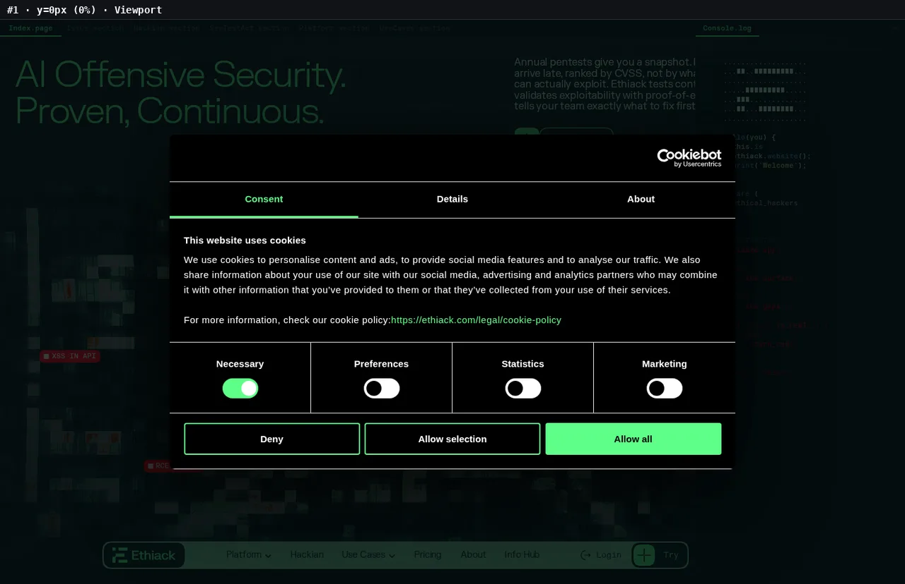
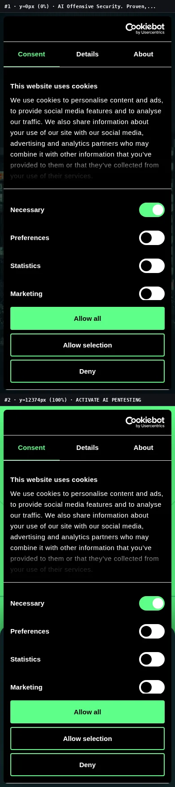

# UI Design System & Master Generation Blueprint: ethiack-com

> **Ethiack** (https://ethiack.com/) — Ethiack is the Adversarial Exposure Validation platform. Hackian continuously tests your attack surface, validates exploitability with pr...





---

## 1. Executive Visual Persona & Design Archetype

- **Brand Essence & Persona**: **Ethiack** (`https://ethiack.com/`). Ethiack is the Adversarial Exposure Validation platform. Hackian continuously tests your attack surface, validates exploitability with pr...
- **Capture Provenance**: Live browser capture (`tier1_fast`, HTTP `200`, captured `2026-11-24`).
- **Visual Archetype**: **Dark-Substrate WebGL / Canvas Interactive Experience (`#0b191b` / `#ff8000`)**.
- **Anti-AI-Slop Differentiators**:
  - **Live-Computed Chromatic Polarity**: Anchors the viewport in `#0b191b` (live computed `body` `background-color` (`computed_styles.json`)) paired with `#ffffff` primary typography and `#ff8000` accents.
  - **Grounded Typographic Hierarchy**: Pairs `fk-grotesk-light` for display copy (`AI Offensive Security. Proven, Conti`) with `fk-raster-blended` and `fk-grotesk-mono-medium`.
  - **Calibrated Spatial Grid & Motion**: Combines `1440px` container bounds (`gap: .3vw`, padding `.6vw`) with `cubic-bezier(.23,1,.32,1)` easing and Lenis Smooth Scroll (`data-lenis`), Three.js / WebGL Canvas Pipeline.

---

## 2. Spatial Architecture & Modular Grid Mathematics

### Viewport Allocation & Container Geometry
- **Captured Journey Filmstrips**: Desktop `1280×828px` (`assets/desktop-journey.webp`, `1` keyframes up to `y=0px` / doc `900px`), Mobile `390×1744px` (`assets/mobile-journey.webp`, `2` keyframes).
- **Master Container Bounds**: `1440px` (full-bleed `100%` desktop stage measured on `1440px` viewport).
- **Canvas Lateral Padding & Spacing**: `.6vw` lateral canvas padding with `.3vw` grid gap.
- **Border Radius Scale**: `16px`, `8px`, `12px`, `14px`.

### Responsive Breakpoint Architecture
- **Desktop Layout**: Multi-column CSS Grid / Flexbox layout at `1440px` (`max-width: 1440px`, `gap: .3vw`).
- **Mobile Layout**: Single-column vertical stack at `390px` viewport width with `.6vw` horizontal padding.
- **Extracted CSS Media Queries**: `@media only screen and (min-width:2000px)`, `@media only screen and (max-width:410px)`, `@media only screen and (max-width:1023px)`, `@media only screen and (max-width:743px)`.

---

## 3. Color System, Materiality & Atmospheric Lighting

### Semantic Palette & Source Grounding
| Semantic Role | Ground-Truth Value | Extracted Live / CSS Source |
|---|---|---|
| **Primary Canvas Substrate** | `#0b191b` | live computed `body` `background-color` (`computed_styles.json`) |
| **Primary Typography Ink** | `#ffffff` | live computed `main` `color` (`computed_styles.json`) |
| **Elevated Surface / Card Substrate** | `#161003` | `var(--body-backgroundColor)` in `:root` |
| **Interactive Accent / Highlight** | `#ff8000` | `.fn-date-picker .pika-button:hover { background: #ff8000 }` |
| **Secondary / Muted Copy** | `#82988b` | `var(--color-muted-green-300)` in `:root` |
| **Structural Hairline Border** | `#23403f` | `var(--line)` in `:root` |
| **Variable Token (`--color-black`)** | `#000000` | `var(--color-black)` in `:root` |
| **Variable Token (`--color-geral-yellow`)** | `#ffdea6` | `var(--color-geral-yellow)` in `:root` |
| **Variable Token (`--color-geral-red`)** | `#7c2329` | `var(--color-geral-red)` in `:root` |
| **Variable Token (`--color-semantic-informative-800`)** | `#1e40af` | `var(--color-semantic-informative-800)` in `:root` |
| **Variable Token (`--color-semantic-informative-200`)** | `#bfdbfe` | `var(--color-semantic-informative-200)` in `:root` |
| **Variable Token (`--color-semantic-danger-200`)** | `#fec8cc` | `var(--color-semantic-danger-200)` in `:root` |
| **Variable Token (`--color-semantic-danger-500`)** | `#de2d3b` | `var(--color-semantic-danger-500)` in `:root` |
| **Variable Token (`--color-semantic-danger-600`)** | `#d12332` | `var(--color-semantic-danger-600)` in `:root` |
| **Variable Token (`--color-semantic-warning-600`)** | `#fbbf24` | `var(--color-semantic-warning-600)` in `:root` |
| **Variable Token (`--color-infection-detected`)** | `#ff0015` | `var(--color-infection-detected)` in `:root` |
| **Variable Token (`--color-infection-identified`)** | `#ff9900` | `var(--color-infection-identified)` in `:root` |
| **Variable Token (`--color-muted-green-50`)** | `#e8ecea` | `var(--color-muted-green-50)` in `:root` |
| **Variable Token (`--color-muted-green-100`)** | `#cdd5d0` | `var(--color-muted-green-100)` in `:root` |

### Sanitized Root CSS Variables (`ui-ux.md` Ground Truth)
| Variable Name | Extracted Value | Semantic Role |
|---|---|---|
| `--color-black` | `#000` | Canvas / Surface Token |
| `--color-white` | `#fff` | Canvas / Surface Token |
| `--color-geral-black` | `#000` | Canvas / Surface Token |
| `--color-geral-white` | `#fff` | Canvas / Surface Token |
| `--color-geral-yellow` | `#ffdea6` | Brand / Palette Token |
| `--color-geral-red` | `#7c2329` | Brand / Palette Token |
| `--color-semantic-informative-800` | `#1e40af` | Brand / Palette Token |
| `--color-semantic-informative-200` | `#bfdbfe` | Brand / Palette Token |
| `--color-semantic-danger-200` | `#fec8cc` | Brand / Palette Token |
| `--color-semantic-danger-500` | `#de2d3b` | Brand / Palette Token |
| `--color-semantic-danger-600` | `#d12332` | Brand / Palette Token |
| `--color-semantic-warning-600` | `#fbbf24` | Brand / Palette Token |
| `--color-infection-detected` | `#ff0015` | Brand / Palette Token |
| `--color-infection-identified` | `#f90` | Brand / Palette Token |
| `--color-muted-green-50` | `#e8ecea` | Brand / Palette Token |
| `--color-muted-green-100` | `#cdd5d0` | Brand / Palette Token |

---

## 4. Typographic Scale & Editorial Hierarchy

### Font Family Stacks
- **Display Typography**: `fk-grotesk-light`.
- **Primary Body Stack**: `fk-raster-blended`.
- **Technical / Metadata Stack**: `fk-grotesk-mono-medium`.

### Typographic Scale & Rules (Live Computed & Stylesheet Grounded)
- **Hero Display (`H1`)**: live computed `h1` (`font-size: 58.05px`, `line-height: 58.05px`, `font-weight: 400`, `letter-spacing: -2.322px`).
- **Section Heading (`H2`)**: live computed `h2` (`font-size: 109.15px`, `line-height: 98.235px`, `font-weight: 400`, `letter-spacing: -4.366px`); rule `h2` (`font-size: 44px`, `line-height: 1.02`, `letter-spacing: -.03em`, `font-weight: 600`).
- **Body Copy**: live computed `body` (`font-size: 16px`, `line-height: 16px`, `font-weight: 400`); rule `p` (`font-size: clamp(64px,55.81px + 100vw *...`, `line-height: 1em`, `letter-spacing: -.1em`).
- **Metadata & Navigation Labels**: live computed `nav/a` (`font-size: 16px`, `line-height: 16px`, `font-weight: 400`); CSS variables `--mono: 'FK Grotesk Mono','fk-grotesk-mono',ui-monospace,monospace`.

---

## 5. Choreographed Motion & Interaction Physics

### Primary Easing Curves
- **Extracted Timing Functions**: `cubic-bezier(.23,1,.32,1)`, `cubic-bezier(.645,.045,.355,1)`, `cubic-bezier(.215,.61,.355,1)`.

### Per-Element Transition & Choreography Rules
- **Selector `ter-target .hs-email input:-webki...`**: `transition: background-color 9999s ease-in-out 0s` extracted from `ethiack-com` stylesheet.
- **Selector `error-msg) .hs-email input:-webki...`**: `transition: background-color 9999s ease-in-out 0s` extracted from `ethiack-com` stylesheet.
- **Selector `a-v-fc6eb133] .newsletter-target...`**: `transition: transform .5s cubic-bezier(.23,1,.32,1),opacity .5s cubic-bezi...` extracted from `ethiack-com` stylesheet.
- **Extracted Easing Curve (`cubic-bezier(.23,1,.32,1)`)**: Governs interactive state transitions across `<header.lenis>` and `<main.main:nth(2)>`.
- **Runtime Interaction Engine**: Integrates Lenis Smooth Scroll (`data-lenis`), Three.js / WebGL Canvas Pipeline with `prefers-reduced-motion: reduce` fallback guards.
### Measured Runtime Scroll & Interaction Telemetry (`behavioral_journey_v2`)
- **Scroll Driver Mode**: `wheel` (max document height `900px`, deepest scrollY reached `0px` across `1` desktop keyframes).
- **Detected Scroll / Motion Libraries**: `Lenis`, `WebGL/Canvas`.

---

## 6. Component Wireframe & Structural DOM Map

### Visual Layout Schematic — Desktop (`1440px`, Grounded in `dom.html` & Landmark Bounding Boxes)
```
┌────────────────────────────────────────────────────────────────────────┐
│ DESKTOP VIEWPORT (1440px) — Ethiack                                    │
│ ====================================================================== │
│ [ <header.lenis> (1440x900px)         | Try Ethiack                  ] │
│ ---------------------------------------------------------------------- │
│ | HERO STAGE: <main.main> (w=1440px)                                 | │
│ | H1: AI Offensive Security. Proven, Continuous.                     | │
│ | Substrate: #0b191b | Ink: #ffffff | Accent: #ff8000                | │
│ ---------------------------------------------------------------------- │
│ | SHOWCASE GRID (<main.main:nth(2)>) max-w: 1440px                   | │
│ | +------------------------------+  +------------------------------+ | │
│ | | Autonomous. Relentless. Cont |  | Pentesting without schedules | | │
│ | +------------------------------+  +------------------------------+ | │
│ ---------------------------------------------------------------------- │
│ | DETAIL MODULE (<main.main:nth(3)>) — Complete visibility o         | │
│ ---------------------------------------------------------------------- │
│ [ FOOTER (<footer.scene-contai) | https://ethiack.com/                 │
└────────────────────────────────────────────────────────────────────────┘
```

### Visual Layout Schematic — Mobile Reflow (`390px`)
```
┌────────────────────────────────────────────────────────────────────────┐
│ MOBILE VIEWPORT REFLOW (390px) — Single-Column Stack (gap: .3vw)       │
│ ====================================================================== │
│ [ HEADER BAR (<header.lenis>          ) | Compact Menu (390px)         │
│ ---------------------------------------------------------------------- │
│ | HERO STAGE (<main.main>) — 390px Vertical Lead                     | │
│ | H1: AI Offensive Security. Proven, Continuous.                     | │
│ ---------------------------------------------------------------------- │
│ | SHOWCASE STACK (<main.main:nth(2)>) — 1-Col Stack                  | │
│ | [ Item 1: Autonomous. Relentless. Continuous.                    ] | │
│ | [ Item 2: Pentesting without schedules, snapshots, or manua...   ] | │
│ ---------------------------------------------------------------------- │
│ | DETAIL STACK (<main.main:nth(3)>) — 1-Col (Complete visibilit)     | │
│ ---------------------------------------------------------------------- │
│ [ FOOTER (<footer.scene-contai) | Stacked 390px Colophon               │
└────────────────────────────────────────────────────────────────────────┘
```

### Granular DOM Region Breakdown
1. **Brand Header & Navigation Bar (<header.lenis> — `ethiack-com`)**:
   - Landmark `<header class="lenis">` (`1440x900px`) hosting `Ethiack` navigation (`Try Ethiack`), DOM attributes (`data-hubspot-styled-components`, `data-onloadfired="true"`, `data-website-id="9c5e0156-7850-40b6-91..."`, `data-onload`), and stylesheet rule `p em { font-size:2.1vw }`.
2. **Hero Stage & Focal Lead (<main.main> — `AI Offensive Security. Proven, Con`)**:
   - Landmark `<main class="main">` presenting display lead `AI Offensive Security. Proven, Continuous.` and copy excerpt *"Annual pentests give you a snapshot. Results arrive late, ranked "* over `#0b191b` canvas and `#ffffff` ink.
3. **Primary Showcase & Content Grid (<main.main:nth(2)> — `Autonomous. Relentless. Continuous`)**:
   - Landmark `<main class="main">` rendering section `Autonomous. Relentless. Continuous.` with copy *"R i s k v a l i d a t e d !"*, asset references (`analytics-browser-gtm-2.12.2-min....`, `cc.js`, `uwt.js`, `uc.js`), and grid rule `svg { height:clamp(80px,71.03px + 100vw * .023,110px) }`.
4. **Interactive Detail & Feature Matrix (<main.main:nth(3)> — `Pentesting without schedules, snap`)**:
   - Landmark `<main class="main">` framing `Pentesting without schedules, snapshots, or manua...` and `Complete visibility of your attack surface and su...` (*"X S S i n D a s h b o a r d"*) with `#161003` surface cards, `#ff8000` accents, and `svg path { fill:var(--carousel-logo-color,var(--color-muted-green-600)) }`.
5. **Colophon & Global Directory Footer (<footer.scene-container> — `https://ethiack.com/`)**:
   - Landmark `<footer class="scene-container">` anchoring `Ethiack` footer links (`Try Ethiack`), copy *"Ethiack is leading the future of proactive cybersecurity."*, and `#23403f` structural dividers.
### Full Vertical Scroll Sequence (Desktop `1440×900` Keyframes)
- **Step 01** (`y=0px`, `0%`): Active landmark `Viewport` · sticky/fixed elements: `0`

---

## 7. Master Zero-Shot AI Generation Prompt

```markdown
# Master Zero-Shot Frontend Generation Prompt: ethiack-com (Ethiack)

You are a principal frontend architect and design systems engineer. Build a complete, production-ready web application replicating the exact design system, DOM landmarks, typographic hierarchy, color tokens, and motion physics of `ethiack-com` (**Ethiack** — `https://ethiack.com/`).

### 1. Visual Archetype & Anti-AI-Slop Mandates
- **Archetype**: Dark-Substrate WebGL / Canvas Interactive Experience (`#0b191b` / `#ff8000`).
- **Identity & Domain Context**: Ethiack is the Adversarial Exposure Validation platform. Hackian continuously tests your attack surface, validates exploitability with pr...
- **Primary Substrate**: `#0b191b` (live computed `body` `background-color` (`computed_styles.json`)), **Primary Ink**: `#ffffff`, **Accent / Highlight**: `#ff8000`.
- **Site-Specific Differentiators**:
  - **Live-Computed Chromatic Polarity**: Anchors the viewport in `#0b191b` (live computed `body` `background-color` (`computed_styles.json`)) paired with `#ffffff` primary typography and `#ff8000` accents.
  - **Grounded Typographic Hierarchy**: Pairs `fk-grotesk-light` for display copy (`AI Offensive Security. Proven, Conti`) with `fk-raster-blended` and `fk-grotesk-mono-medium`.
  - **Calibrated Spatial Grid & Motion**: Combines `1440px` container bounds (`gap: .3vw`, padding `.6vw`) with `cubic-bezier(.23,1,.32,1)` easing and Lenis Smooth Scroll (`data-lenis`), Three.js / WebGL Canvas Pipeline.

### 2. Ground-Truth CSS Variables (`:root` Token Contract)
Declare and consume these exact custom properties extracted from `ethiack-com` in your global stylesheet:

:root {
  /* Ethiack (ethiack-com) — Live-Grounded CSS Variables */
  --color-black: #000; /* Canvas / Surface Token (ethiack-com) */
  --color-white: #fff; /* Canvas / Surface Token (ethiack-com) */
  --color-geral-black: #000; /* Canvas / Surface Token (ethiack-com) */
  --color-geral-white: #fff; /* Canvas / Surface Token (ethiack-com) */
  --color-geral-yellow: #ffdea6; /* Brand / Palette Token (ethiack-com) */
  --color-geral-red: #7c2329; /* Brand / Palette Token (ethiack-com) */
  --color-semantic-informative-800: #1e40af; /* Brand / Palette Token (ethiack-com) */
  --color-semantic-informative-200: #bfdbfe; /* Brand / Palette Token (ethiack-com) */
  --color-semantic-danger-200: #fec8cc; /* Brand / Palette Token (ethiack-com) */
  --color-semantic-danger-500: #de2d3b; /* Brand / Palette Token (ethiack-com) */
  --color-semantic-danger-600: #d12332; /* Brand / Palette Token (ethiack-com) */
  --color-semantic-warning-600: #fbbf24; /* Brand / Palette Token (ethiack-com) */
  --color-infection-detected: #ff0015; /* Brand / Palette Token (ethiack-com) */
  --color-infection-identified: #f90; /* Brand / Palette Token (ethiack-com) */
  --color-muted-green-50: #e8ecea; /* Brand / Palette Token (ethiack-com) */
  --color-muted-green-100: #cdd5d0; /* Brand / Palette Token (ethiack-com) */
}

### 3. Semantic Color & Materiality Contract
Map every surface, ink, and border strictly to these source-grounded tokens:
- **Primary Canvas Substrate**: `#0b191b` — grounded in live computed `body` `background-color` (`computed_styles.json`)
- **Primary Typography Ink**: `#ffffff` — grounded in live computed `main` `color` (`computed_styles.json`)
- **Elevated Surface / Card Substrate**: `#161003` — grounded in `var(--body-backgroundColor)` in `:root`
- **Interactive Accent / Highlight**: `#ff8000` — grounded in `.fn-date-picker .pika-button:hover { background: #ff8000 }`
- **Secondary / Muted Copy**: `#82988b` — grounded in `var(--color-muted-green-300)` in `:root`
- **Structural Hairline Border**: `#23403f` — grounded in `var(--line)` in `:root`
- **Variable Token (`--color-black`)**: `#000000` — grounded in `var(--color-black)` in `:root`
- **Variable Token (`--color-geral-yellow`)**: `#ffdea6` — grounded in `var(--color-geral-yellow)` in `:root`
- **Variable Token (`--color-geral-red`)**: `#7c2329` — grounded in `var(--color-geral-red)` in `:root`
- **Variable Token (`--color-semantic-informative-800`)**: `#1e40af` — grounded in `var(--color-semantic-informative-800)` in `:root`
- **Variable Token (`--color-semantic-informative-200`)**: `#bfdbfe` — grounded in `var(--color-semantic-informative-200)` in `:root`
- **Variable Token (`--color-semantic-danger-200`)**: `#fec8cc` — grounded in `var(--color-semantic-danger-200)` in `:root`
- **Variable Token (`--color-semantic-danger-500`)**: `#de2d3b` — grounded in `var(--color-semantic-danger-500)` in `:root`
- **Variable Token (`--color-semantic-danger-600`)**: `#d12332` — grounded in `var(--color-semantic-danger-600)` in `:root`
- **Variable Token (`--color-semantic-warning-600`)**: `#fbbf24` — grounded in `var(--color-semantic-warning-600)` in `:root`
- **Variable Token (`--color-infection-detected`)**: `#ff0015` — grounded in `var(--color-infection-detected)` in `:root`
- **Variable Token (`--color-infection-identified`)**: `#ff9900` — grounded in `var(--color-infection-identified)` in `:root`
- **Variable Token (`--color-muted-green-50`)**: `#e8ecea` — grounded in `var(--color-muted-green-50)` in `:root`
- **Variable Token (`--color-muted-green-100`)**: `#cdd5d0` — grounded in `var(--color-muted-green-100)` in `:root`

### 4. Spatial Grid, Container Bounds & Responsive Breakpoints
- **Desktop Viewport Reference**: `1280×828px` (single-viewport 100vh live capture (900px), `1440px` standard desktop width).
- **Mobile Viewport Reference**: `390×1744px` (full-page live capture (1744px), `390px` standard mobile width).
- **Container Max-Width**: `1440px` (full-bleed `100%` desktop stage measured on `1440px` viewport)
- **Padding & Gutters**: `.6vw` lateral canvas padding with `.3vw` grid gap
- **Desktop Grid**: Multi-column CSS Grid / Flexbox layout at `1440px` (`max-width: 1440px`, `gap: .3vw`)
- **Mobile Adaptation**: Single-column vertical stack at `390px` viewport width with `.6vw` horizontal padding
- **Media Queries**: `@media only screen and (min-width:2000px)`, `@media only screen and (max-width:410px)`, `@media only screen and (max-width:1023px)`, `@media only screen and (max-width:743px)`
- **Corner Radii**: `16px`, `8px`, `12px`, `14px`

### 5. Typography & Editorial Scale Contract
- **Display Font Stack**: `fk-grotesk-light`
- **Body Font Stack**: `fk-raster-blended`
- **Monospace / Technical Font Stack**: `fk-grotesk-mono-medium`
- **H1 Display Rule**: live computed `h1` (`font-size: 58.05px`, `line-height: 58.05px`, `font-weight: 400`, `letter-spacing: -2.322px`)
- **H2 Section Rule**: live computed `h2` (`font-size: 109.15px`, `line-height: 98.235px`, `font-weight: 400`, `letter-spacing: -4.366px`); rule `h2` (`font-size: 44px`, `line-height: 1.02`, `letter-spacing: -.03em`, `font-weight: 600`)
- **Body Copy Rule**: live computed `body` (`font-size: 16px`, `line-height: 16px`, `font-weight: 400`); rule `p` (`font-size: clamp(64px,55.81px + 100vw *...`, `line-height: 1em`, `letter-spacing: -.1em`)
- **Metadata & Index Rule**: live computed `nav/a` (`font-size: 16px`, `line-height: 16px`, `font-weight: 400`); CSS variables `--mono: 'FK Grotesk Mono','fk-grotesk-mono',ui-monospace,monospace`

### 6. Component Hierarchy, Verbatim Copy & Real DOM Landmarks
Scaffold `ethiack-com` (`Ethiack`) with these exact structural regions, extracted copy, and CSS rules from `dom.html`:
1. **Brand Header & Navigation Bar (<header.lenis> — `ethiack-com`)**:
   - DOM & Selectors: Landmark `<header class="lenis">` (`1440x900px`) hosting `Ethiack` navigation (`Try Ethiack`), DOM attributes (`data-hubspot-styled-components`, `data-onloadfired="true"`, `data-website-id="9c5e0156-7850-40b6-91..."`, `data-onload`), and stylesheet rule `p em { font-size:2.1vw }`.
   - Responsive Contract: Header `Brand Header & Navigation Bar (<header.lenis> — `ethiack-com`)` (`ethiack-com`) adapts across `@media only screen and (min-width:2000px)`, `@media only screen and (max-width:410px)`, `@media only screen and (max-width:1023px)`, `@media only screen and (max-width:743px)` with `cubic-bezier(.23,1,.32,1)`, `cubic-bezier(.645,.045,.355,1)`, `cubic-bezier(.215,.61,.355,1)` transitions and links `Try Ethiack`.
2. **Hero Stage & Focal Lead (<main.main> — `AI Offensive Security. Proven, Con`)**:
   - DOM & Selectors: Landmark `<main class="main">` presenting display lead `AI Offensive Security. Proven, Continuous.` and copy excerpt *"Annual pentests give you a snapshot. Results arrive late, ranked "* over `#0b191b` canvas and `#ffffff` ink.
   - Responsive Contract: Hero stage (`1280×828px` desktop / `390×1744px` mobile) sets `#0b191b` background with `#ffffff` headline `AI Offensive Security. Proven, Continuous.`.
3. **Primary Showcase & Content Grid (<main.main:nth(2)> — `Autonomous. Relentless. Continuous`)**:
   - DOM & Selectors: Landmark `<main class="main">` rendering section `Autonomous. Relentless. Continuous.` with copy *"R i s k v a l i d a t e d !"*, asset references (`analytics-browser-gtm-2.12.2-min....`, `cc.js`, `uwt.js`, `uc.js`), and grid rule `svg { height:clamp(80px,71.03px + 100vw * .023,110px) }`.
   - Responsive Contract: Showcase grid `Primary Showcase & Content Grid (<main.main:nth(2)> — `Autonomous. Relentless. Continuous`)` applies Multi-column CSS Grid / Flexbox layout at `1440px` (`max-width: 1440px`, `gap: .3vw`) on desktop and Single-column vertical stack at `390px` viewport width with `.6vw` horizontal padding on mobile.
4. **Interactive Detail & Feature Matrix (<main.main:nth(3)> — `Pentesting without schedules, snap`)**:
   - DOM & Selectors: Landmark `<main class="main">` framing `Pentesting without schedules, snapshots, or manua...` and `Complete visibility of your attack surface and su...` (*"X S S i n D a s h b o a r d"*) with `#161003` surface cards, `#ff8000` accents, and `svg path { fill:var(--carousel-logo-color,var(--color-muted-green-600)) }`.
   - Responsive Contract: Detail module `Interactive Detail & Feature Matrix (<main.main:nth(3)> — `Pentesting without schedules, snap`)` uses `16px`, `8px`, `12px`, `14px` radii, `#ff8000` highlights, and assets (analytics-browser-gtm-2.12.2-min...., cc.js, uwt.js).
5. **Colophon & Global Directory Footer (<footer.scene-container> — `https://ethiack.com/`)**:
   - DOM & Selectors: Landmark `<footer class="scene-container">` anchoring `Ethiack` footer links (`Try Ethiack`), copy *"Ethiack is leading the future of proactive cybersecurity."*, and `#23403f` structural dividers.
   - Responsive Contract: Footer `Colophon & Global Directory Footer (<footer.scene-container> — `https://ethiack.com/`)` aligns to `1440px` (full-bleed `100%` desktop stage measured on `1440px` viewport) with `.6vw` lateral canvas padding with `.3vw` grid gap and attributes (data-hubspot-styled-components, data-onloadfired="true", data-website-id="9c5e0156-7850-40b6-91...").

#### Verbatim DOM Copy Excerpts (`dom.html`)
- Copy Excerpt 1: *"Annual pentests give you a snapshot. Results arrive late, ranked by CVSS, not by w..."*
- Copy Excerpt 2: *"R i s k v a l i d a t e d !"*
- Copy Excerpt 3: *"X S S i n D a s h b o a r d"*
- Copy Excerpt 4: *"Ethiack is leading the future of proactive cybersecurity."*

### 7. Motion, Extracted Stylesheet Rules & Interaction Choreography
- **Primary Easing Functions**: `cubic-bezier(.23,1,.32,1)`, `cubic-bezier(.645,.045,.355,1)`, `cubic-bezier(.215,.61,.355,1)`
- **Extracted Stylesheet Rules (`ethiack-com`)**:
- `p em { font-size:2.1vw }`
- `svg { height:clamp(80px,71.03px + 100vw * .023,110px) }`
- `svg path { fill:var(--carousel-logo-color,var(--color-muted-green-600)) }`
- `focus-within { background-color:var(--newsletter-form-focusBgColor,rgb(from var(--color... }`
- `.newsletter-target form { align-items:center;display:flex;flex-direction:row;justify-content:space... }`
- **Per-Selector Transition Rules**:
- **Selector `ter-target .hs-email input:-webki...`**: `transition: background-color 9999s ease-in-out 0s` extracted from `ethiack-com` stylesheet.
- **Selector `error-msg) .hs-email input:-webki...`**: `transition: background-color 9999s ease-in-out 0s` extracted from `ethiack-com` stylesheet.
- **Selector `a-v-fc6eb133] .newsletter-target...`**: `transition: transform .5s cubic-bezier(.23,1,.32,1),opacity .5s cubic-bezi...` extracted from `ethiack-com` stylesheet.
- **Extracted Easing Curve (`cubic-bezier(.23,1,.32,1)`)**: Governs interactive state transitions across `<header.lenis>` and `<main.main:nth(2)>`.
- **Runtime Interaction Engine**: Integrates Lenis Smooth Scroll (`data-lenis`), Three.js / WebGL Canvas Pipeline with `prefers-reduced-motion: reduce` fallback guards.
### 7b. Full-Page Scroll Choreography, Interactive States & Multi-Page Routes
- **Scroll Mechanics**: Implement `wheel` vertical progression up to `900px` across 1 distinct viewport chapters using Lenis, WebGL/Canvas.
- **Vertical Chapter Sequence**: Viewport (0%).

### 8. Technical Deliverables
- Implement in Next.js (App Router) with TypeScript and Tailwind CSS consuming the `:root` custom properties defined above for `ethiack-com`.
- Reproduce both the `1440px` desktop architecture and `390px` mobile breakpoint transitions, preserving semantic HTML5 landmarks (`<header>`, `<nav>`, `<main>`, `<section>`, `<footer>`) and `prefers-reduced-motion` accessibility guards.
```
---

## 8. Full-Page Scroll Journey, Interactive States & Subpage Inventory

### Desktop Scroll Keyframes (`1440×900` WebP)
| Step | Scroll Y | Progress | Active Landmark / Section | Sticky/Fixed | Visual Asset |
| :---: | :---: | :---: | :--- | :---: | :--- |
| `#01` | `0px` | `0%` | Viewport | `0` | [desktop-step-01.webp](assets/desktop-step-01.webp) |

### Mobile Condensed Keyframes (`390×844` WebP)
| Step | Scroll Y | Progress | Active Landmark | Visual Asset |
| :---: | :---: | :---: | :--- | :--- |
| `#01` | `0px` | `0%` | AI Offensive Security. Proven, Continuous. | [mobile-step-01.webp](assets/mobile-step-01.webp) |
| `#02` | `12374px` | `100%` | ACTIVATE AI PENTESTING | [mobile-step-02.webp](assets/mobile-step-02.webp) |

