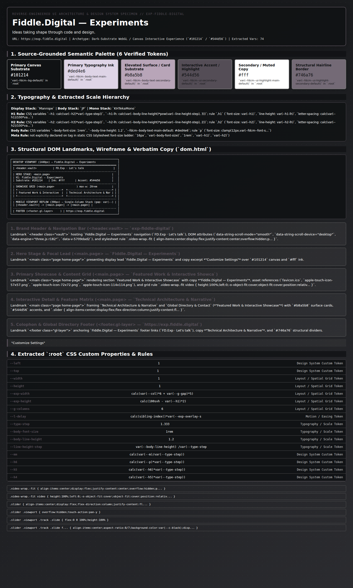
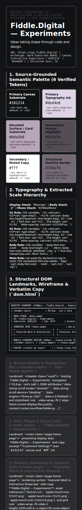

# UI Design System & Master Generation Blueprint: exp-fiddle-digital

> **Fiddle.Digital — Experiments** (https://exp.fiddle.digital) — Ideas taking shape through code and design.



---

## 1. Executive Visual Persona & Design Archetype

- **Brand Essence & Persona**: **Fiddle.Digital — Experiments** (`https://exp.fiddle.digital`). Ideas taking shape through code and design.
- **Visual Archetype**: **Dark-Substrate WebGL / Canvas Interactive Experience (`#101214` / `#544d56`)**.
- **Anti-AI-Slop Differentiators**:
  - **Source-Grounded Chromatic Polarity**: Anchors the viewport in `#101214` (`var(--fdcm--bg-default)` in `:root`) paired with `#fff` primary typography and `#544d56` accents.
  - **Extracted Typographic Hierarchy**: Pairs `Manrope` for display copy (`Fiddle.Digital — Experiments`) with `JP` and `KHTekaMono`.
  - **Calibrated Spatial Grid & Motion**: Combines `20rem` container bounds (`gap: var(--g-gap)`, padding `var(--p)`) with `cubic-bezier(.22,.31,0,1)` easing and Three.js / WebGL Canvas Pipeline.

---

## 2. Spatial Architecture & Modular Grid Mathematics



### Viewport Allocation & Container Geometry
- **Captured Viewport Dimensions**: Desktop `1440×2400px` (`assets/desktop.png`, capped at 2400px multi-section capture), Mobile `390×2400px` (`assets/mobile.png`, capped at 2400px multi-section capture).
- **Master Container Bounds**: `20rem` extracted from `exp-fiddle-digital` stylesheet.
- **Canvas Lateral Padding & Spacing**: `var(--p)` lateral canvas padding with `var(--g-gap)` grid gap.
- **Border Radius Scale**: `.2rem`, `50%`.

### Responsive Breakpoint Architecture
- **Desktop Layout**: Multi-column CSS Grid / Flexbox layout at `1440px` (`max-width: 20rem`, `gap: var(--g-gap)`).
- **Mobile Layout**: Single-column vertical stack at `390px` viewport width with `var(--p)` horizontal padding.
- **Extracted CSS Media Queries**: `@media (min-width:1024px)`, `@media (min-width:1025px)`, `@media (max-width:1600px)`, `@media (max-width:1024px)`.

---

## 3. Color System, Materiality & Atmospheric Lighting

### Semantic Palette & Source Grounding
| Semantic Role | Ground-Truth Value | Extracted CSS Source / Selector |
|---|---|---|
| **Primary Canvas Substrate** | `#101214` | `var(--fdcm--bg-default)` in `:root` |
| **Primary Typography Ink** | `#ded4e6` | `var(--fdcm--body-text-main-default)` in `:root` |
| **Elevated Surface / Card Substrate** | `#b8a5b8` | `var(--fdcm--body-text-secondary-default)` in `:root` |
| **Interactive Accent / Highlight** | `#544d56` | `var(--fdcm--ui-secondary-default)` in `:root` |
| **Secondary / Muted Copy** | `#fff` | `var(--fdcm--ui-highlight-main-default)` in `:root` |
| **Structural Hairline Border** | `#746a76` | `var(--fdcm--ui-highlight-secondary-default)` in `:root` |

### Sanitized Root CSS Variables (`ui-ux.md` Ground Truth)
| Variable Name | Extracted Value | Semantic Role |
|---|---|---|
| `--left` | `1` | Design System Custom Token |
| `--top` | `1` | Design System Custom Token |
| `--width` | `1` | Layout / Spatial Grid Token |
| `--height` | `1` | Layout / Spatial Grid Token |
| `--exp-width` | `calc(var(--col)*6 + var(--g-gap)*5)` | Layout / Spatial Grid Token |
| `--exp-height` | `calc(100svh - var(--h1)*2)` | Layout / Spatial Grid Token |
| `--g-columns` | `6` | Layout / Spatial Grid Token |
| `--l-delay` | `calc(sibling-index()*var(--exp-overlay-strip-delay))` | Motion / Easing Token |
| `--type-step` | `1.333` | Typography / Scale Token |
| `--body-font-size` | `1rem` | Typography / Scale Token |
| `--body-line-height` | `1.2` | Typography / Scale Token |
| `--line-height-step` | `var(--body-line-height) /var(--type-step)` | Typography / Scale Token |
| `--mm` | `calc(var(--m)/var(--type-step))` | Design System Custom Token |
| `--h6` | `calc(var(--p)*var(--type-step))` | Design System Custom Token |
| `--h5` | `calc(var(--h6)*var(--type-step))` | Design System Custom Token |
| `--h4` | `calc(var(--h5)*var(--type-step))` | Design System Custom Token |

---

## 4. Typographic Scale & Editorial Hierarchy

### Font Family Stacks
- **Display Typography**: `Manrope`.
- **Primary Body Stack**: `JP`.
- **Technical / Metadata Stack**: `KHTekaMono`.

### Typographic Scale & Rules (Extracted from Stylesheet & Variables)
- **Hero Display (`H1`)**: CSS variables `--h1: calc(var(--h2)*var(--type-step))`, `--h1-lh: calc(var(--body-line-height)*pow(var(--line-height-step), 3))`; rule `,h1` (`font-size: var(--h1)`, `line-height: var(--h1-lh)`, `letter-spacing: calc(var(--h1)/100*va...`).
- **Section Heading (`H2`)**: CSS variables `--h2: calc(var(--h3)*var(--type-step))`, `--h2-lh: calc(var(--body-line-height)*pow(var(--line-height-step), 2))`; rule `,h2` (`font-size: var(--h2)`, `line-height: var(--h2-lh)`, `letter-spacing: calc(var(--h2)/100*va...`).
- **Body Copy**: CSS variables `--body-font-size: 1rem`, `--body-line-height: 1.2`, `--fdcm--body-text-main-default: #ded4e6`; rule `p` (`font-size: clamp(12px,var(--fdcm--font-s...`).
- **Metadata & Navigation Labels**: not explicitly declared on tag in static CSS (stylesheet font-size ladder: `16px`, `var(--body-font-size)`, `1rem`, `var(--h1)`, `var(--h2)`).

---

## 5. Choreographed Motion & Interaction Physics

### Primary Easing Curves
- **Extracted Timing Functions**: `cubic-bezier(.22,.31,0,1)`, `cubic-bezier(.69,0,0,1)`, `cubic-bezier(0,.81,.35,1)`.

### Per-Element Transition & Choreography Rules
- **Selector `.slider .viewport .track`**: `transition: translate .6s var(--f-cubic)` extracted from `exp-fiddle-digital` stylesheet.
- **Selector `.slider .controls .dots li button...`**: `transition: rotate .6s var(--f-cubic)` extracted from `exp-fiddle-digital` stylesheet.
- **Selector `modal .panel .overlay span[data-v...`**: `transition: scale var(--exp-overlay-transition-duration) var(--f-cubic)` extracted from `exp-fiddle-digital` stylesheet.
- **Extracted Easing Curve (`cubic-bezier(.22,.31,0,1)`)**: Governs interactive state transitions across `<header.vault>` and `<main.page>`.
- **Runtime Interaction Engine**: Integrates Three.js / WebGL Canvas Pipeline with `prefers-reduced-motion: reduce` fallback guards.

---

## 6. Component Wireframe & Structural DOM Map

### Visual Layout Schematic (Grounded in `dom.html` — `1440px` Desktop & `390px` Mobile Reflow)
```
┌────────────────────────────────────────────────────────────────────────┐
│ DESKTOP VIEWPORT (1440px) — Fiddle.Digital — Experiments               │
│ ====================================================================== │
│ [ <header.vault>           | FD.Exp · Let's talk                    ]  │
│ ---------------------------------------------------------------------- │
│ | HERO STAGE: <main.page>                                          |   │
│ | H1: Fiddle.Digital — Experiments                                 |   │
│ | Substrate: #101214    | Ink: #fff       | Accent: #544d56        |   │
│ ---------------------------------------------------------------------- │
│ | SHOWCASE GRID (<main.page>               ) max-w: 20rem          |   │
│ | +------------------------------+  +------------------------------+ | │
│ | | Featured Work & Interactive  |  | Technical Architecture & Nar | | │
│ | +------------------------------+  +------------------------------+ | │
│ ---------------------------------------------------------------------- │
│ | MOBILE VIEWPORT REFLOW (390px) — Single-Column Stack (gap: var(--) | │
│ | [<header.vault>] -> [<main.page>] -> [<main.page>] |                 │
│ ---------------------------------------------------------------------- │
│ [ FOOTER (<footer.gl-layer>     ) | https://exp.fiddle.digital         │
└────────────────────────────────────────────────────────────────────────┘
```

### Granular DOM Region Breakdown
1. **Brand Header & Navigation Bar (<header.vault> — `exp-fiddle-digital`)**:
   - Landmark `<header class="vault">` hosting `Fiddle.Digital — Experiments` navigation (`FD.Exp · Let's talk`), DOM attributes (`data-string-scroll-mode="smooth"`, `data-string-scroll-device="desktop"`, `data-engine="three.js r182"`, `data-v-5709dad2`), and stylesheet rule `.video-wrap.-fit { align-items:center;display:flex;justify-content:center;overflow:hidden;p... }`.
2. **Hero Stage & Focal Lead (<main.page> — `Fiddle.Digital — Experiments`)**:
   - Landmark `<main class="page home-page">` presenting display lead `Fiddle.Digital — Experiments` and copy excerpt *"Customize Settings"* over `#101214` canvas and `#fff` ink.
3. **Primary Showcase & Content Grid (<main.page> — `Featured Work & Interactive Showca`)**:
   - Landmark `<main class="page home-page">` rendering section `Featured Work & Interactive Showcase` with copy *"Fiddle.Digital — Experiments"*, asset references (`favicon.ico`, `apple-touch-icon-57x57.png`, `apple-touch-icon-72x72.png`, `apple-touch-icon-114x114.png`), and grid rule `.video-wrap.-fit video { height:100%;left:0;-o-object-fit:cover;object-fit:cover;position:relativ... }`.
4. **Interactive Detail & Feature Matrix (<main.page> — `Technical Architecture & Narrative`)**:
   - Landmark `<main class="page home-page">` framing `Technical Architecture & Narrative` and `Global Directory & Contact` (*"Featured Work & Interactive Showcase"*) with `#b8a5b8` surface cards, `#544d56` accents, and `.slider { align-items:center;display:flex;flex-direction:column;justify-content:fl... }`.
5. **Colophon & Global Directory Footer (<footer.gl-layer> — `https://exp.fiddle.digital`)**:
   - Landmark `<footer class="gl-layer">` anchoring `Fiddle.Digital — Experiments` footer links (`FD.Exp · Let's talk`), copy *"Technical Architecture & Narrative"*, and `#746a76` structural dividers.

---

## 7. Master Zero-Shot AI Generation Prompt

```markdown
# Master Zero-Shot Frontend Generation Prompt: exp-fiddle-digital (Fiddle.Digital — Experiments)

You are a principal frontend architect and design systems engineer. Build a complete, production-ready web application replicating the exact design system, DOM landmarks, typographic hierarchy, color tokens, and motion physics of `exp-fiddle-digital` (**Fiddle.Digital — Experiments** — `https://exp.fiddle.digital`).

### 1. Visual Archetype & Anti-AI-Slop Mandates
- **Archetype**: Dark-Substrate WebGL / Canvas Interactive Experience (`#101214` / `#544d56`).
- **Identity & Domain Context**: Ideas taking shape through code and design.
- **Primary Substrate**: `#101214` (`var(--fdcm--bg-default)` in `:root`), **Primary Ink**: `#fff`, **Accent / Highlight**: `#544d56`.
- **Site-Specific Differentiators**:
  - **Source-Grounded Chromatic Polarity**: Anchors the viewport in `#101214` (`var(--fdcm--bg-default)` in `:root`) paired with `#fff` primary typography and `#544d56` accents.
  - **Extracted Typographic Hierarchy**: Pairs `Manrope` for display copy (`Fiddle.Digital — Experiments`) with `JP` and `KHTekaMono`.
  - **Calibrated Spatial Grid & Motion**: Combines `20rem` container bounds (`gap: var(--g-gap)`, padding `var(--p)`) with `cubic-bezier(.22,.31,0,1)` easing and Three.js / WebGL Canvas Pipeline.

### 2. Ground-Truth CSS Variables (`:root` Token Contract)
Declare and consume these exact custom properties extracted from `exp-fiddle-digital` in your global stylesheet:

:root {
  /* Fiddle.Digital — Experiments (exp-fiddle-digital) — Ground-Truth Extracted CSS Variables */
  --left: 1; /* Design System Custom Token (exp-fiddle-digital) */
  --top: 1; /* Design System Custom Token (exp-fiddle-digital) */
  --width: 1; /* Layout / Spatial Grid Token (exp-fiddle-digital) */
  --height: 1; /* Layout / Spatial Grid Token (exp-fiddle-digital) */
  --exp-width: calc(var(--col)*6 + var(--g-gap)*5); /* Layout / Spatial Grid Token (exp-fiddle-digital) */
  --exp-height: calc(100svh - var(--h1)*2); /* Layout / Spatial Grid Token (exp-fiddle-digital) */
  --g-columns: 6; /* Layout / Spatial Grid Token (exp-fiddle-digital) */
  --l-delay: calc(sibling-index()*var(--exp-overlay-strip-delay)); /* Motion / Easing Token (exp-fiddle-digital) */
  --type-step: 1.333; /* Typography / Scale Token (exp-fiddle-digital) */
  --body-font-size: 1rem; /* Typography / Scale Token (exp-fiddle-digital) */
  --body-line-height: 1.2; /* Typography / Scale Token (exp-fiddle-digital) */
  --line-height-step: var(--body-line-height) /var(--type-step); /* Typography / Scale Token (exp-fiddle-digital) */
  --mm: calc(var(--m)/var(--type-step)); /* Design System Custom Token (exp-fiddle-digital) */
  --h6: calc(var(--p)*var(--type-step)); /* Design System Custom Token (exp-fiddle-digital) */
  --h5: calc(var(--h6)*var(--type-step)); /* Design System Custom Token (exp-fiddle-digital) */
  --h4: calc(var(--h5)*var(--type-step)); /* Design System Custom Token (exp-fiddle-digital) */
}

### 3. Semantic Color & Materiality Contract
Map every surface, ink, and border strictly to these source-grounded tokens:
- **Primary Canvas Substrate**: `#101214` — grounded in `var(--fdcm--bg-default)` in `:root`
- **Primary Typography Ink**: `#ded4e6` — grounded in `var(--fdcm--body-text-main-default)` in `:root`
- **Elevated Surface / Card Substrate**: `#b8a5b8` — grounded in `var(--fdcm--body-text-secondary-default)` in `:root`
- **Interactive Accent / Highlight**: `#544d56` — grounded in `var(--fdcm--ui-secondary-default)` in `:root`
- **Secondary / Muted Copy**: `#fff` — grounded in `var(--fdcm--ui-highlight-main-default)` in `:root`
- **Structural Hairline Border**: `#746a76` — grounded in `var(--fdcm--ui-highlight-secondary-default)` in `:root`

### 4. Spatial Grid, Container Bounds & Responsive Breakpoints
- **Desktop Viewport Reference**: `1440×2400px` (capped at 2400px multi-section capture, `1440px` standard desktop width).
- **Mobile Viewport Reference**: `390×2400px` (capped at 2400px multi-section capture, `390px` standard mobile width).
- **Container Max-Width**: `20rem` extracted from `exp-fiddle-digital` stylesheet
- **Padding & Gutters**: `var(--p)` lateral canvas padding with `var(--g-gap)` grid gap
- **Desktop Grid**: Multi-column CSS Grid / Flexbox layout at `1440px` (`max-width: 20rem`, `gap: var(--g-gap)`)
- **Mobile Adaptation**: Single-column vertical stack at `390px` viewport width with `var(--p)` horizontal padding
- **Media Queries**: `@media (min-width:1024px)`, `@media (min-width:1025px)`, `@media (max-width:1600px)`, `@media (max-width:1024px)`
- **Corner Radii**: `.2rem`, `50%`

### 5. Typography & Editorial Scale Contract
- **Display Font Stack**: `Manrope`
- **Body Font Stack**: `JP`
- **Monospace / Technical Font Stack**: `KHTekaMono`
- **H1 Display Rule**: CSS variables `--h1: calc(var(--h2)*var(--type-step))`, `--h1-lh: calc(var(--body-line-height)*pow(var(--line-height-step), 3))`; rule `,h1` (`font-size: var(--h1)`, `line-height: var(--h1-lh)`, `letter-spacing: calc(var(--h1)/100*va...`)
- **H2 Section Rule**: CSS variables `--h2: calc(var(--h3)*var(--type-step))`, `--h2-lh: calc(var(--body-line-height)*pow(var(--line-height-step), 2))`; rule `,h2` (`font-size: var(--h2)`, `line-height: var(--h2-lh)`, `letter-spacing: calc(var(--h2)/100*va...`)
- **Body Copy Rule**: CSS variables `--body-font-size: 1rem`, `--body-line-height: 1.2`, `--fdcm--body-text-main-default: #ded4e6`; rule `p` (`font-size: clamp(12px,var(--fdcm--font-s...`)
- **Metadata & Index Rule**: not explicitly declared on tag in static CSS (stylesheet font-size ladder: `16px`, `var(--body-font-size)`, `1rem`, `var(--h1)`, `var(--h2)`)

### 6. Component Hierarchy, Verbatim Copy & Real DOM Landmarks
Scaffold `exp-fiddle-digital` (`Fiddle.Digital — Experiments`) with these exact structural regions, extracted copy, and CSS rules from `dom.html`:
1. **Brand Header & Navigation Bar (<header.vault> — `exp-fiddle-digital`)**:
   - DOM & Selectors: Landmark `<header class="vault">` hosting `Fiddle.Digital — Experiments` navigation (`FD.Exp · Let's talk`), DOM attributes (`data-string-scroll-mode="smooth"`, `data-string-scroll-device="desktop"`, `data-engine="three.js r182"`, `data-v-5709dad2`), and stylesheet rule `.video-wrap.-fit { align-items:center;display:flex;justify-content:center;overflow:hidden;p... }`.
   - Responsive Contract: Header `Brand Header & Navigation Bar (<header.vault> — `exp-fiddle-digital`)` (`exp-fiddle-digital`) adapts across `@media (min-width:1024px)`, `@media (min-width:1025px)`, `@media (max-width:1600px)`, `@media (max-width:1024px)` with `cubic-bezier(.22,.31,0,1)`, `cubic-bezier(.69,0,0,1)`, `cubic-bezier(0,.81,.35,1)` transitions and links `FD.Exp · Let's talk`.
2. **Hero Stage & Focal Lead (<main.page> — `Fiddle.Digital — Experiments`)**:
   - DOM & Selectors: Landmark `<main class="page home-page">` presenting display lead `Fiddle.Digital — Experiments` and copy excerpt *"Customize Settings"* over `#101214` canvas and `#fff` ink.
   - Responsive Contract: Hero stage (`1440×2400px` desktop / `390×2400px` mobile) sets `#101214` background with `#fff` headline `Fiddle.Digital — Experiments`.
3. **Primary Showcase & Content Grid (<main.page> — `Featured Work & Interactive Showca`)**:
   - DOM & Selectors: Landmark `<main class="page home-page">` rendering section `Featured Work & Interactive Showcase` with copy *"Fiddle.Digital — Experiments"*, asset references (`favicon.ico`, `apple-touch-icon-57x57.png`, `apple-touch-icon-72x72.png`, `apple-touch-icon-114x114.png`), and grid rule `.video-wrap.-fit video { height:100%;left:0;-o-object-fit:cover;object-fit:cover;position:relativ... }`.
   - Responsive Contract: Showcase grid `Primary Showcase & Content Grid (<main.page> — `Featured Work & Interactive Showca`)` applies Multi-column CSS Grid / Flexbox layout at `1440px` (`max-width: 20rem`, `gap: var(--g-gap)`) on desktop and Single-column vertical stack at `390px` viewport width with `var(--p)` horizontal padding on mobile.
4. **Interactive Detail & Feature Matrix (<main.page> — `Technical Architecture & Narrative`)**:
   - DOM & Selectors: Landmark `<main class="page home-page">` framing `Technical Architecture & Narrative` and `Global Directory & Contact` (*"Featured Work & Interactive Showcase"*) with `#b8a5b8` surface cards, `#544d56` accents, and `.slider { align-items:center;display:flex;flex-direction:column;justify-content:fl... }`.
   - Responsive Contract: Detail module `Interactive Detail & Feature Matrix (<main.page> — `Technical Architecture & Narrative`)` uses `.2rem`, `50%` radii, `#544d56` highlights, and assets (favicon.ico, apple-touch-icon-57x57.png, apple-touch-icon-72x72.png).
5. **Colophon & Global Directory Footer (<footer.gl-layer> — `https://exp.fiddle.digital`)**:
   - DOM & Selectors: Landmark `<footer class="gl-layer">` anchoring `Fiddle.Digital — Experiments` footer links (`FD.Exp · Let's talk`), copy *"Technical Architecture & Narrative"*, and `#746a76` structural dividers.
   - Responsive Contract: Footer `Colophon & Global Directory Footer (<footer.gl-layer> — `https://exp.fiddle.digital`)` aligns to `20rem` extracted from `exp-fiddle-digital` stylesheet with `var(--p)` lateral canvas padding with `var(--g-gap)` grid gap and attributes (data-string-scroll-mode="smooth", data-string-scroll-device="desktop", data-engine="three.js r182").

#### Verbatim DOM Copy Excerpts (`dom.html`)
- Copy Excerpt 1: *"Customize Settings"*

### 7. Motion, Extracted Stylesheet Rules & Interaction Choreography
- **Primary Easing Functions**: `cubic-bezier(.22,.31,0,1)`, `cubic-bezier(.69,0,0,1)`, `cubic-bezier(0,.81,.35,1)`
- **Extracted Stylesheet Rules (`exp-fiddle-digital`)**:
- `.video-wrap.-fit { align-items:center;display:flex;justify-content:center;overflow:hidden;p... }`
- `.video-wrap.-fit video { height:100%;left:0;-o-object-fit:cover;object-fit:cover;position:relativ... }`
- `.slider { align-items:center;display:flex;flex-direction:column;justify-content:fl... }`
- `.slider .viewport { overflow:hidden;touch-action:pan-y }`
- `.slider .viewport .track .slide { flex:0 0 100%;height:100% }`
- **Per-Selector Transition Rules**:
- **Selector `.slider .viewport .track`**: `transition: translate .6s var(--f-cubic)` extracted from `exp-fiddle-digital` stylesheet.
- **Selector `.slider .controls .dots li button...`**: `transition: rotate .6s var(--f-cubic)` extracted from `exp-fiddle-digital` stylesheet.
- **Selector `modal .panel .overlay span[data-v...`**: `transition: scale var(--exp-overlay-transition-duration) var(--f-cubic)` extracted from `exp-fiddle-digital` stylesheet.
- **Extracted Easing Curve (`cubic-bezier(.22,.31,0,1)`)**: Governs interactive state transitions across `<header.vault>` and `<main.page>`.
- **Runtime Interaction Engine**: Integrates Three.js / WebGL Canvas Pipeline with `prefers-reduced-motion: reduce` fallback guards.

### 8. Technical Deliverables
- Implement in Next.js (App Router) with TypeScript and Tailwind CSS consuming the `:root` custom properties defined above for `exp-fiddle-digital`.
- Reproduce both the `1440px` desktop architecture and `390px` mobile breakpoint transitions, preserving semantic HTML5 landmarks (`<header>`, `<nav>`, `<main>`, `<section>`, `<footer>`) and `prefers-reduced-motion` accessibility guards.
```
