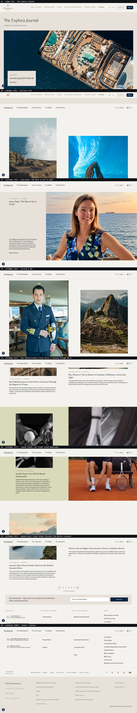
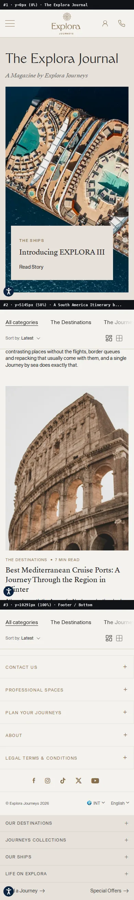

# UI Design System & Master Generation Blueprint: explorajourneys-com_int-en-explora-journal

> **The Explora Journal, A Magazine by Explora Journeys** (https://explorajourneys.com/int/en/explora-journal) — Step aboard The Explora Journal for stories of ships and destinations, from wellness and dining to ports and cultures, told through the O...





---

## 1. Executive Visual Persona & Design Archetype

- **Brand Essence & Persona**: **The Explora Journal, A Magazine by Explora Journeys** (`https://explorajourneys.com/int/en/explora-journal`). Step aboard The Explora Journal for stories of ships and destinations, from wellness and dining to ports and cultures, told through the O...
- **Capture Provenance**: Live browser capture (`tier1_fast`, HTTP `200`, captured `2026-11-24`).
- **Visual Archetype**: **Light-Substrate Editorial & Modular Grid System (`#f4f2ef` canvas, `#222222` ink, `#06b6d4` accent)**.
- **Anti-AI-Slop Differentiators**:
  - **Live-Computed Chromatic Polarity**: Anchors the viewport in `#f4f2ef` (live computed `body` `background-color` (`computed_styles.json`)) paired with `#222222` primary typography and `#06b6d4` accents.
  - **Grounded Typographic Hierarchy**: Pairs `WT Monarch Nova` for display copy (`The Explora Journal`) with `Shapiro`.
  - **Calibrated Spatial Grid & Motion**: Combines `1364px` container bounds (`gap: 30px`, padding `.5rem`) with `cubic-bezier(.215,.61,.355,1)` easing and Three.js / WebGL Canvas Pipeline, Swiper Touch Carousel Engine.

---

## 2. Spatial Architecture & Modular Grid Mathematics

### Viewport Allocation & Container Geometry
- **Captured Journey Filmstrips**: Desktop `1280×6624px` (`assets/desktop-journey.webp`, `8` keyframes up to `y=8421px` / doc `9321px`), Mobile `390×2616px` (`assets/mobile-journey.webp`, `3` keyframes).
- **Master Container Bounds**: `1364px` (non-`@media` desktop container stylesheet rule).
- **Canvas Lateral Padding & Spacing**: `.5rem` lateral canvas padding with `30px` grid gap.
- **Border Radius Scale**: `5px`, `50%`, `7px`, `3px`.

### Responsive Breakpoint Architecture
- **Desktop Layout**: Multi-column CSS Grid / Flexbox layout at `1440px` (`max-width: 1364px`, `gap: 30px`).
- **Mobile Layout**: Single-column vertical stack at `390px` viewport width with `.5rem` horizontal padding.
- **Extracted CSS Media Queries**: `@media (prefers-reduced-motion:reduce),print`, `@media only screen and (max-width:768px)`, `@media only screen and (max-width:360px)`, `@media only screen and (min-width:768px) and (max-width:1024px)`.

---

## 3. Color System, Materiality & Atmospheric Lighting

### Semantic Palette & Source Grounding
| Semantic Role | Ground-Truth Value | Extracted Live / CSS Source |
|---|---|---|
| **Primary Canvas Substrate** | `#f4f2ef` | live computed `body` `background-color` (`computed_styles.json`) |
| **Primary Typography Ink** | `#222222` | live computed `h1` `color` (`computed_styles.json`) |
| **Elevated Surface / Card Substrate** | `#e7e1da` | live computed `section` `background-color` (`computed_styles.json`) |
| **Interactive Accent / Highlight** | `#06b6d4` | `.vc-date__btn { color: #06b6d4 }` |
| **Secondary / Muted Copy** | `#666666` | live computed `p` `color` (`computed_styles.json`) |
| **Structural Hairline Border** | `#eeeeee` | `.fa-border { border: #eeeeee }` |
| **Variable Token (`--swiper-theme-color`)** | `#007aff` | `var(--swiper-theme-color)` in stylesheet |

### Sanitized Root CSS Variables (`ui-ux.md` Ground Truth)
| Variable Name | Extracted Value | Semantic Role |
|---|---|---|
| `--animate-duration` | `1s` | Motion / Easing Token |
| `--animate-delay` | `1s` | Motion / Easing Token |
| `--animate-repeat` | `1` | Motion / Easing Token |
| `--alert-height` | `0px` | Layout / Spatial Grid Token |
| `--menu-height-desktop` | `95px` | Layout / Spatial Grid Token |
| `--menu-height-mobile` | `80px` | Layout / Spatial Grid Token |
| `--partner-header-height` | `0px` | Layout / Spatial Grid Token |
| `--hero-component-height` | `calc(100svh - 80px)` | Layout / Spatial Grid Token |
| `--hero-component-height-full` | `var(--hero-component-height)` | Layout / Spatial Grid Token |
| `--gradient-angle` | `0deg` | Design System Custom Token |
| `--contact-banner-height` | `0px` | Layout / Spatial Grid Token |
| `--swiper-theme-color` | `#007aff` | Brand / Palette Token |
| `--tw-bg-opacity` | `1` | Canvas / Surface Token |
| `--tw-shadow` | `0 9px 20px rgba(0, 0, 0, .1)` | Elevation / Border Token |
| `--explorajourneys--bg` | `#f4f2ef` | Canvas Substrate (from live computed `body` `background-color` (`computed_styles.json`)) |
| `--explorajourneys--ink` | `#222222` | Primary Typography Ink (computed-derived) |

---

## 4. Typographic Scale & Editorial Hierarchy

### Font Family Stacks
- **Display Typography**: `WT Monarch Nova`.
- **Primary Body Stack**: `Shapiro`.
- **Technical / Metadata Stack**: not declared in live computed styles (uses primary stack / `ui-monospace`).

### Typographic Scale & Rules (Live Computed & Stylesheet Grounded)
- **Hero Display (`H1`)**: live computed `h1` (`font-size: 40.05px`, `line-height: 56.07px`, `font-weight: 400`); rule `.title` (`font-size: 24px`, `font-weight: 400`).
- **Section Heading (`H2`)**: live computed `h2` (`font-size: 20px`, `line-height: 28px`, `font-weight: 100`); rule `h2` (`font-size: 1.5em`, `font-weight: bold`).
- **Body Copy**: live computed `body` (`font-size: 15px`, `line-height: 26px`, `font-weight: 400`); rule `p` (`font-size: 13px`, `line-height: 20px`).
- **Metadata & Navigation Labels**: live computed `nav/a` (`font-size: 15px`, `line-height: 26px`, `font-weight: 400`); rule `.label` (`font-size: 9pt`).

---

## 5. Choreographed Motion & Interaction Physics

### Primary Easing Curves
- **Extracted Timing Functions**: `cubic-bezier(.215,.61,.355,1)`, `cubic-bezier(.755,.05,.855,.06)`, `cubic-bezier(.55,.055,.675,.19)`.

### Per-Element Transition & Choreography Rules
- **Selector `print`**: `transition: 1ms!important` extracted from `explorajourneys-com_int-en-explora-journal` stylesheet.
- **Selector `80%`**: `transition: cubic-bezier(.215,.61,.355,1)` extracted from `explorajourneys-com_int-en-explora-journal` stylesheet.
- **Selector `80%`**: `transition: cubic-bezier(.215,.61,.355,1)` extracted from `explorajourneys-com_int-en-explora-journal` stylesheet.
- **Extracted Easing Curve (`cubic-bezier(.215,.61,.355,1)`)**: Governs interactive state transitions across `<header.experiencefragment>` and `<section.emag-home-grid>`.
- **Runtime Interaction Engine**: Integrates Three.js / WebGL Canvas Pipeline, Swiper Touch Carousel Engine with `prefers-reduced-motion: reduce` fallback guards.
### Measured Runtime Scroll & Interaction Telemetry (`behavioral_journey_v2`)
- **Scroll Driver Mode**: `native` (max document height `9321px`, deepest scrollY reached `8421px` across `8` desktop keyframes).
- **Detected Scroll / Motion Libraries**: Native browser scroll / standard CSS transitions.
- **Hover Physics (`primary_cta` · `Read Story`)**: Computed transition `0s` / `ease` (no static color/transform shift captured at rest).
- **Route Transition Architecture**: First internal navigation (`/int/en/find-your-journey`) measured as `MPA` in `2655ms`.

---

## 6. Component Wireframe & Structural DOM Map

### Visual Layout Schematic — Desktop (`1440px`, Grounded in `dom.html` & Landmark Bounding Boxes)
```
┌────────────────────────────────────────────────────────────────────────┐
│ DESKTOP VIEWPORT (1440px) — The Explora Journal, A Magazine by Explora │
│ ====================================================================== │
│ [ <header.experiencefrag (1440x0px)   | Find a journey · All Destina ] │
│ ---------------------------------------------------------------------- │
│ | HERO STAGE: <section.emag-home-hero> (w=1440px)                    | │
│ | H1: The Explora Journal                                            | │
│ | Substrate: #f4f2ef | Ink: #222222 | Accent: #06b6d4                | │
│ ---------------------------------------------------------------------- │
│ | SHOWCASE GRID (<section.emag-home-grid>) max-w: 1364px             | │
│ | +------------------------------+  +------------------------------+ | │
│ | | Introducing EXPLORA III      |  | From Sea Salt to Soil        | | │
│ | +------------------------------+  +------------------------------+ | │
│ ---------------------------------------------------------------------- │
│ | DETAIL MODULE (<article.article-card>) — Advocating for the Oc     | │
│ ---------------------------------------------------------------------- │
│ [ FOOTER (<footer.quotesubject) | https://explorajourneys.com/int/en/  │
└────────────────────────────────────────────────────────────────────────┘
```

### Visual Layout Schematic — Mobile Reflow (`390px`)
```
┌────────────────────────────────────────────────────────────────────────┐
│ MOBILE VIEWPORT REFLOW (390px) — Single-Column Stack (gap: 30px)       │
│ ====================================================================== │
│ [ HEADER BAR (<header.experiencefragme) | Compact Menu (390px)         │
│ ---------------------------------------------------------------------- │
│ | HERO STAGE (<section.emag-home-hero>) — 390px Vertical Lead        | │
│ | H1: The Explora Journal                                            | │
│ ---------------------------------------------------------------------- │
│ | SHOWCASE STACK (<section.emag-home-gri) — 1-Col Stack              | │
│ | [ Item 1: Introducing EXPLORA III                                ] | │
│ | [ Item 2: From Sea Salt to Soil                                  ] | │
│ ---------------------------------------------------------------------- │
│ | DETAIL STACK (<article.article-card>) — 1-Col (Advocating for the) | │
│ ---------------------------------------------------------------------- │
│ [ FOOTER (<footer.quotesubject) | Stacked 390px Colophon               │
└────────────────────────────────────────────────────────────────────────┘
```

### Granular DOM Region Breakdown
1. **Brand Header & Navigation Bar (<header.experiencefragment> — `explorajourneys-com_int-en-explora-journal`)**:
   - Landmark `<header class="experiencefragment header-sticky">` (`1440x0px`) hosting `The Explora Journal, A Magazine by E` navigation (`Find a journey · All Destinations · Alaska · Asia · Grand Journeys`), DOM attributes (`data-destex-discover-bound`, `data-description="Scene7DefaultCSS"`, `data-component="ScrollBar"`, `data-namespace="s7classic"`), and stylesheet rule `.fa-lg { font-size:1.33333333em;line-height:.75em;vertical-align:-15% }`.
2. **Hero Stage & Focal Lead (<section.emag-home-hero> — `The Explora Journal`)**:
   - Landmark `<section class="emag-home-hero emag-home-hero--imageBackground">` presenting display lead `The Explora Journal` and copy excerpt *"A Magazine by Explora Journeys"* over `#f4f2ef` canvas and `#222222` ink.
3. **Primary Showcase & Content Grid (<section.emag-home-grid> — `Introducing EXPLORA III`)**:
   - Landmark `<section class="emag-home-grid">` rendering section `Introducing EXPLORA III` with copy *"Wrong email address Primary Email Address* Add Another Email Addr"*, asset references (`0.8.77`, `187102487`, `adalyser.js`, `insight.min.js`), and grid rule `.fa-2x { font-size:2em }`.
4. **Interactive Detail & Feature Matrix (<article.article-card> — `From Sea Salt to Soil`)**:
   - Landmark `<article class="article-card card--small">` framing `From Sea Salt to Soil` and `Advocating for the Ocean` (*"Wrong email address"*) with `#e7e1da` surface cards, `#06b6d4` accents, and `.fa-3x { font-size:3em }`.
5. **Colophon & Global Directory Footer (<footer.quotesubject> — `https://explorajourneys.com/int/en/explora-journal`)**:
   - Landmark `<footer class="quotesubject">` anchoring `The Explora Journal, A Magazine ` footer links (`Find a journey · All Destinations · Alaska · Asia · Grand Journeys`), copy *"Primary Email Address*"*, and `#eeeeee` structural dividers.
### Full Vertical Scroll Sequence (Desktop `1440×900` Keyframes)
- **Step 01** (`y=0px`, `0%`): Active landmark `The Explora Journal` · sticky/fixed elements: `1`
- **Step 02** (`y=850px`, `10%`): Active landmark `Section @ 10%` · sticky/fixed elements: `1`
- **Step 03** (`y=2550px`, `30%`): Active landmark `Anna Nash: "The Best Is Yet to Come"` · sticky/fixed elements: `0`
- **Step 04** (`y=3400px`, `40%`): Active landmark `Section @ 40%` · sticky/fixed elements: `0`
- **Step 05** (`y=5100px`, `61%`): Active landmark `Best Mediterranean Cruise Ports: A Journey Throug...` · sticky/fixed elements: `0`
- **Step 06** (`y=5950px`, `71%`): Active landmark `Jannik Sinner: Our Global Brand Ambassador` · sticky/fixed elements: `0`
- **Step 07** (`y=7650px`, `91%`): Active landmark `Amazon River Travel Guide: Discover the World's G...` · sticky/fixed elements: `0`
- **Step 08** (`y=8421px`, `100%`): Active landmark `Footer / Bottom` · sticky/fixed elements: `0`

### Multi-Page Internal Route Map
- **Detail Route (`/int/en/find-your-journey`)**: `https://explorajourneys.com/int/en/find-your-journey` — H1: `FIND YOUR JOURNEY`, scrollHeight `3887px`, transition `MPA` (`2655ms`)
- **Detail Route (`/int/en/destinations-globe`)**: `https://explorajourneys.com/int/en/destinations-globe` — H1: `Journeys Departing Soon`, scrollHeight `5137px`, transition `direct` (`3166ms`)

---

## 7. Master Zero-Shot AI Generation Prompt

```markdown
# Master Zero-Shot Frontend Generation Prompt: explorajourneys-com_int-en-explora-journal (The Explora Journal, A Magazine by Explora Journeys)

You are a principal frontend architect and design systems engineer. Build a complete, production-ready web application replicating the exact design system, DOM landmarks, typographic hierarchy, color tokens, and motion physics of `explorajourneys-com_int-en-explora-journal` (**The Explora Journal, A Magazine by Explora Journeys** — `https://explorajourneys.com/int/en/explora-journal`).

### 1. Visual Archetype & Anti-AI-Slop Mandates
- **Archetype**: Light-Substrate Editorial & Modular Grid System (`#f4f2ef` canvas, `#222222` ink, `#06b6d4` accent).
- **Identity & Domain Context**: Step aboard The Explora Journal for stories of ships and destinations, from wellness and dining to ports and cultures, told through the O...
- **Primary Substrate**: `#f4f2ef` (live computed `body` `background-color` (`computed_styles.json`)), **Primary Ink**: `#222222`, **Accent / Highlight**: `#06b6d4`.
- **Site-Specific Differentiators**:
  - **Live-Computed Chromatic Polarity**: Anchors the viewport in `#f4f2ef` (live computed `body` `background-color` (`computed_styles.json`)) paired with `#222222` primary typography and `#06b6d4` accents.
  - **Grounded Typographic Hierarchy**: Pairs `WT Monarch Nova` for display copy (`The Explora Journal`) with `Shapiro`.
  - **Calibrated Spatial Grid & Motion**: Combines `1364px` container bounds (`gap: 30px`, padding `.5rem`) with `cubic-bezier(.215,.61,.355,1)` easing and Three.js / WebGL Canvas Pipeline, Swiper Touch Carousel Engine.

### 2. Ground-Truth CSS Variables (`:root` Token Contract)
Declare and consume these exact custom properties extracted from `explorajourneys-com_int-en-explora-journal` in your global stylesheet:

:root {
  /* The Explora Journal, A Magazine by Explora Journeys (explorajourneys-com_int-en-explora-journal) — Live-Grounded CSS Variables */
  --animate-duration: 1s; /* Motion / Easing Token (explorajourneys-com_int-en-explora-journal) */
  --animate-delay: 1s; /* Motion / Easing Token (explorajourneys-com_int-en-explora-journal) */
  --animate-repeat: 1; /* Motion / Easing Token (explorajourneys-com_int-en-explora-journal) */
  --alert-height: 0px; /* Layout / Spatial Grid Token (explorajourneys-com_int-en-explora-journal) */
  --menu-height-desktop: 95px; /* Layout / Spatial Grid Token (explorajourneys-com_int-en-explora-journal) */
  --menu-height-mobile: 80px; /* Layout / Spatial Grid Token (explorajourneys-com_int-en-explora-journal) */
  --partner-header-height: 0px; /* Layout / Spatial Grid Token (explorajourneys-com_int-en-explora-journal) */
  --hero-component-height: calc(100svh - 80px); /* Layout / Spatial Grid Token (explorajourneys-com_int-en-explora-journal) */
  --hero-component-height-full: var(--hero-component-height); /* Layout / Spatial Grid Token (explorajourneys-com_int-en-explora-journal) */
  --gradient-angle: 0deg; /* Design System Custom Token (explorajourneys-com_int-en-explora-journal) */
  --contact-banner-height: 0px; /* Layout / Spatial Grid Token (explorajourneys-com_int-en-explora-journal) */
  --swiper-theme-color: #007aff; /* Brand / Palette Token (explorajourneys-com_int-en-explora-journal) */
  --tw-bg-opacity: 1; /* Canvas / Surface Token (explorajourneys-com_int-en-explora-journal) */
  --tw-shadow: 0 9px 20px rgba(0, 0, 0, .1); /* Elevation / Border Token (explorajourneys-com_int-en-explora-journal) */
  --explorajourneys--bg: #f4f2ef; /* Canvas Substrate (from live computed `body` `background-color` (`computed_styles.json`)) (explorajourneys-com_int-en-explora-journal) */
  --explorajourneys--ink: #222222; /* Primary Typography Ink (computed-derived) (explorajourneys-com_int-en-explora-journal) */
}

### 3. Semantic Color & Materiality Contract
Map every surface, ink, and border strictly to these source-grounded tokens:
- **Primary Canvas Substrate**: `#f4f2ef` — grounded in live computed `body` `background-color` (`computed_styles.json`)
- **Primary Typography Ink**: `#222222` — grounded in live computed `h1` `color` (`computed_styles.json`)
- **Elevated Surface / Card Substrate**: `#e7e1da` — grounded in live computed `section` `background-color` (`computed_styles.json`)
- **Interactive Accent / Highlight**: `#06b6d4` — grounded in `.vc-date__btn { color: #06b6d4 }`
- **Secondary / Muted Copy**: `#666666` — grounded in live computed `p` `color` (`computed_styles.json`)
- **Structural Hairline Border**: `#eeeeee` — grounded in `.fa-border { border: #eeeeee }`
- **Variable Token (`--swiper-theme-color`)**: `#007aff` — grounded in `var(--swiper-theme-color)` in stylesheet

### 4. Spatial Grid, Container Bounds & Responsive Breakpoints
- **Desktop Viewport Reference**: `1280×6624px` (multi-frame vertical journey filmstrip (6624px), `1440px` standard desktop width).
- **Mobile Viewport Reference**: `390×2616px` (multi-frame vertical journey filmstrip (2616px), `390px` standard mobile width).
- **Container Max-Width**: `1364px` (non-`@media` desktop container stylesheet rule)
- **Padding & Gutters**: `.5rem` lateral canvas padding with `30px` grid gap
- **Desktop Grid**: Multi-column CSS Grid / Flexbox layout at `1440px` (`max-width: 1364px`, `gap: 30px`)
- **Mobile Adaptation**: Single-column vertical stack at `390px` viewport width with `.5rem` horizontal padding
- **Media Queries**: `@media (prefers-reduced-motion:reduce),print`, `@media only screen and (max-width:768px)`, `@media only screen and (max-width:360px)`, `@media only screen and (min-width:768px) and (max-width:1024px)`
- **Corner Radii**: `5px`, `50%`, `7px`, `3px`

### 5. Typography & Editorial Scale Contract
- **Display Font Stack**: `WT Monarch Nova`
- **Body Font Stack**: `Shapiro`
- **Monospace / Technical Font Stack**: not declared in live computed styles (uses primary stack / `ui-monospace`)
- **H1 Display Rule**: live computed `h1` (`font-size: 40.05px`, `line-height: 56.07px`, `font-weight: 400`); rule `.title` (`font-size: 24px`, `font-weight: 400`)
- **H2 Section Rule**: live computed `h2` (`font-size: 20px`, `line-height: 28px`, `font-weight: 100`); rule `h2` (`font-size: 1.5em`, `font-weight: bold`)
- **Body Copy Rule**: live computed `body` (`font-size: 15px`, `line-height: 26px`, `font-weight: 400`); rule `p` (`font-size: 13px`, `line-height: 20px`)
- **Metadata & Index Rule**: live computed `nav/a` (`font-size: 15px`, `line-height: 26px`, `font-weight: 400`); rule `.label` (`font-size: 9pt`)

### 6. Component Hierarchy, Verbatim Copy & Real DOM Landmarks
Scaffold `explorajourneys-com_int-en-explora-journal` (`The Explora Journal, A Magazine by Explora Journeys`) with these exact structural regions, extracted copy, and CSS rules from `dom.html`:
1. **Brand Header & Navigation Bar (<header.experiencefragment> — `explorajourneys-com_int-en-explora-journal`)**:
   - DOM & Selectors: Landmark `<header class="experiencefragment header-sticky">` (`1440x0px`) hosting `The Explora Journal, A Magazine by E` navigation (`Find a journey · All Destinations · Alaska · Asia · Grand Journeys`), DOM attributes (`data-destex-discover-bound`, `data-description="Scene7DefaultCSS"`, `data-component="ScrollBar"`, `data-namespace="s7classic"`), and stylesheet rule `.fa-lg { font-size:1.33333333em;line-height:.75em;vertical-align:-15% }`.
   - Responsive Contract: Header `Brand Header & Navigation Bar (<header.experiencefragment> — `explorajourneys-com_int-en-explora-journal`)` (`explorajourneys-com_int-en-explora-journal`) adapts across `@media (prefers-reduced-motion:reduce),print`, `@media only screen and (max-width:768px)`, `@media only screen and (max-width:360px)`, `@media only screen and (min-width:768px) and (max-width:1024px)` with `cubic-bezier(.215,.61,.355,1)`, `cubic-bezier(.755,.05,.855,.06)`, `cubic-bezier(.55,.055,.675,.19)` transitions and links `Find a journey · All Destinations · Alaska · Asia · Grand Journeys`.
2. **Hero Stage & Focal Lead (<section.emag-home-hero> — `The Explora Journal`)**:
   - DOM & Selectors: Landmark `<section class="emag-home-hero emag-home-hero--imageBackground">` presenting display lead `The Explora Journal` and copy excerpt *"A Magazine by Explora Journeys"* over `#f4f2ef` canvas and `#222222` ink.
   - Responsive Contract: Hero stage (`1280×6624px` desktop / `390×2616px` mobile) sets `#f4f2ef` background with `#222222` headline `The Explora Journal`.
3. **Primary Showcase & Content Grid (<section.emag-home-grid> — `Introducing EXPLORA III`)**:
   - DOM & Selectors: Landmark `<section class="emag-home-grid">` rendering section `Introducing EXPLORA III` with copy *"Wrong email address Primary Email Address* Add Another Email Addr"*, asset references (`0.8.77`, `187102487`, `adalyser.js`, `insight.min.js`), and grid rule `.fa-2x { font-size:2em }`.
   - Responsive Contract: Showcase grid `Primary Showcase & Content Grid (<section.emag-home-grid> — `Introducing EXPLORA III`)` applies Multi-column CSS Grid / Flexbox layout at `1440px` (`max-width: 1364px`, `gap: 30px`) on desktop and Single-column vertical stack at `390px` viewport width with `.5rem` horizontal padding on mobile.
4. **Interactive Detail & Feature Matrix (<article.article-card> — `From Sea Salt to Soil`)**:
   - DOM & Selectors: Landmark `<article class="article-card card--small">` framing `From Sea Salt to Soil` and `Advocating for the Ocean` (*"Wrong email address"*) with `#e7e1da` surface cards, `#06b6d4` accents, and `.fa-3x { font-size:3em }`.
   - Responsive Contract: Detail module `Interactive Detail & Feature Matrix (<article.article-card> — `From Sea Salt to Soil`)` uses `5px`, `50%`, `7px`, `3px` radii, `#06b6d4` highlights, and assets (0.8.77, 187102487, adalyser.js).
5. **Colophon & Global Directory Footer (<footer.quotesubject> — `https://explorajourneys.com/int/en/explora-journal`)**:
   - DOM & Selectors: Landmark `<footer class="quotesubject">` anchoring `The Explora Journal, A Magazine ` footer links (`Find a journey · All Destinations · Alaska · Asia · Grand Journeys`), copy *"Primary Email Address*"*, and `#eeeeee` structural dividers.
   - Responsive Contract: Footer `Colophon & Global Directory Footer (<footer.quotesubject> — `https://explorajourneys.com/int/en/explora-journal`)` aligns to `1364px` (non-`@media` desktop container stylesheet rule) with `.5rem` lateral canvas padding with `30px` grid gap and attributes (data-destex-discover-bound, data-description="Scene7DefaultCSS", data-component="ScrollBar").

#### Verbatim DOM Copy Excerpts (`dom.html`)
- Copy Excerpt 1: *"A Magazine by Explora Journeys"*
- Copy Excerpt 2: *"Wrong email address Primary Email Address* Add Another Email Address Wrong email a..."*
- Copy Excerpt 3: *"Wrong email address"*
- Copy Excerpt 4: *"Primary Email Address*"*

### 7. Motion, Extracted Stylesheet Rules & Interaction Choreography
- **Primary Easing Functions**: `cubic-bezier(.215,.61,.355,1)`, `cubic-bezier(.755,.05,.855,.06)`, `cubic-bezier(.55,.055,.675,.19)`
- **Extracted Stylesheet Rules (`explorajourneys-com_int-en-explora-journal`)**:
- `.fa-lg { font-size:1.33333333em;line-height:.75em;vertical-align:-15% }`
- `.fa-2x { font-size:2em }`
- `.fa-3x { font-size:3em }`
- `.fa-4x { font-size:4em }`
- `.fa-5x { font-size:5em }`
- **Per-Selector Transition Rules**:
- **Selector `print`**: `transition: 1ms!important` extracted from `explorajourneys-com_int-en-explora-journal` stylesheet.
- **Selector `80%`**: `transition: cubic-bezier(.215,.61,.355,1)` extracted from `explorajourneys-com_int-en-explora-journal` stylesheet.
- **Selector `80%`**: `transition: cubic-bezier(.215,.61,.355,1)` extracted from `explorajourneys-com_int-en-explora-journal` stylesheet.
- **Extracted Easing Curve (`cubic-bezier(.215,.61,.355,1)`)**: Governs interactive state transitions across `<header.experiencefragment>` and `<section.emag-home-grid>`.
- **Runtime Interaction Engine**: Integrates Three.js / WebGL Canvas Pipeline, Swiper Touch Carousel Engine with `prefers-reduced-motion: reduce` fallback guards.
### 7b. Full-Page Scroll Choreography, Interactive States & Multi-Page Routes
- **Scroll Mechanics**: Implement `native` vertical progression up to `9321px` across 8 distinct viewport chapters.
- **Vertical Chapter Sequence**: The Explora Journal (0%) -> Section @ 10% (10%) -> Anna Nash: "The Best Is Yet... (30%) -> Section @ 40% (40%) -> Best Mediterranean Cruise P... (61%) -> Jannik Sinner: Our Global B... (71%) -> Amazon River Travel Guide:... (91%) -> Footer / Bottom (100%).
- **Multi-Page Routes**: Scaffold internal routes `/int/en/find-your-journey` (detail, MPA), `/int/en/destinations-globe` (detail, direct) sharing the global header/footer shell and design tokens.

### 8. Technical Deliverables
- Implement in Next.js (App Router) with TypeScript and Tailwind CSS consuming the `:root` custom properties defined above for `explorajourneys-com_int-en-explora-journal`.
- Reproduce both the `1440px` desktop architecture and `390px` mobile breakpoint transitions, preserving semantic HTML5 landmarks (`<header>`, `<nav>`, `<main>`, `<section>`, `<footer>`) and `prefers-reduced-motion` accessibility guards.
```
---

## 8. Full-Page Scroll Journey, Interactive States & Subpage Inventory

### Desktop Scroll Keyframes (`1440×900` WebP)
| Step | Scroll Y | Progress | Active Landmark / Section | Sticky/Fixed | Visual Asset |
| :---: | :---: | :---: | :--- | :---: | :--- |
| `#01` | `0px` | `0%` | The Explora Journal | `1` | [desktop-step-01.webp](assets/desktop-step-01.webp) |
| `#02` | `850px` | `10%` | Section @ 10% | `1` | [desktop-step-02.webp](assets/desktop-step-02.webp) |
| `#03` | `2550px` | `30%` | Anna Nash: "The Best Is Yet to Come" | `0` | [desktop-step-03.webp](assets/desktop-step-03.webp) |
| `#04` | `3400px` | `40%` | Section @ 40% | `0` | [desktop-step-04.webp](assets/desktop-step-04.webp) |
| `#05` | `5100px` | `61%` | Best Mediterranean Cruise Ports: A Journey Th... | `0` | [desktop-step-05.webp](assets/desktop-step-05.webp) |
| `#06` | `5950px` | `71%` | Jannik Sinner: Our Global Brand Ambassador | `0` | [desktop-step-06.webp](assets/desktop-step-06.webp) |
| `#07` | `7650px` | `91%` | Amazon River Travel Guide: Discover the World... | `0` | [desktop-step-07.webp](assets/desktop-step-07.webp) |
| `#08` | `8421px` | `100%` | Footer / Bottom | `0` | [desktop-step-08.webp](assets/desktop-step-08.webp) |

### Mobile Condensed Keyframes (`390×844` WebP)
| Step | Scroll Y | Progress | Active Landmark | Visual Asset |
| :---: | :---: | :---: | :--- | :--- |
| `#01` | `0px` | `0%` | The Explora Journal | [mobile-step-01.webp](assets/mobile-step-01.webp) |
| `#02` | `5145px` | `50%` | A South America Itinerary by Sea: The Con... | [mobile-step-02.webp](assets/mobile-step-02.webp) |
| `#03` | `10291px` | `100%` | Footer / Bottom | [mobile-step-03.webp](assets/mobile-step-03.webp) |

### Internal Subpage Filmstrips (`1080px` Wide WebP)
| # | Template | Route URL | H1 / Title | Scroll Height | Transition | Filmstrip Asset |
| :-: | :---: | :--- | :--- | :---: | :---: | :--- |
| `1` | `detail` | `https://explorajourneys.com/int/en/find-your-journey` | FIND YOUR JOURNEY | `3887px` | `MPA` (`2655ms`) | [subpage-01-int-en-find-your-journey.webp](assets/subpage-01-int-en-find-your-journey.webp) |
| `2` | `detail` | `https://explorajourneys.com/int/en/destinations-globe` | Journeys Departing Soon | `5137px` | `direct` (`3166ms`) | [subpage-02-int-en-destinations-globe.webp](assets/subpage-02-int-en-destinations-globe.webp) |

