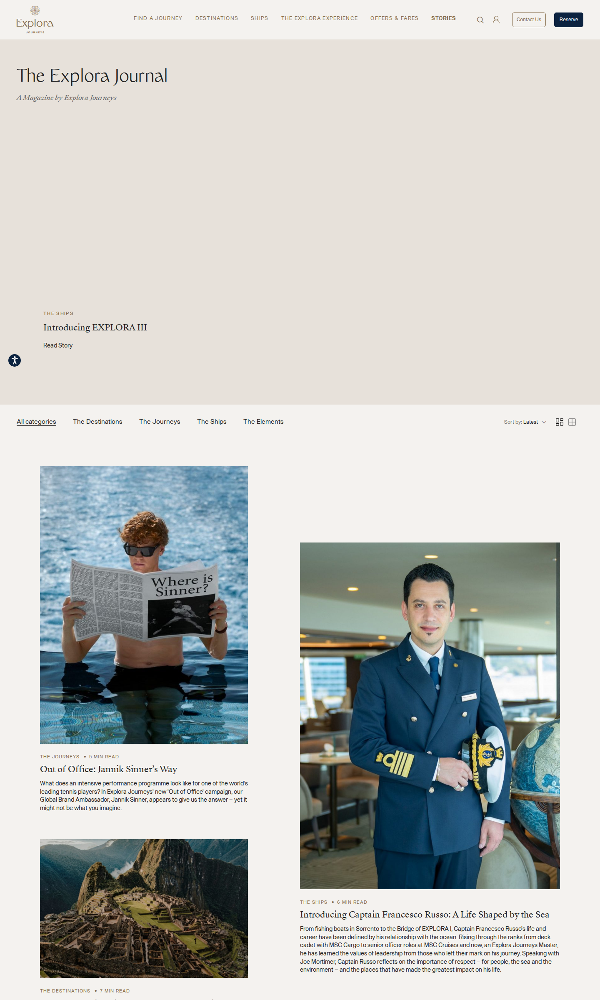

# UI Design System & Master Generation Blueprint: explorajourneys-com_int-en-explora-journal

> **The Explora Journal, A Magazine by Explora Journeys** (https://explorajourneys.com/int/en/explora-journal) — Step aboard The Explora Journal for stories of ships and destinations, from wellness and dining to ports and cultures, told through the O...



---

## 1. Executive Visual Persona & Design Archetype

- **Brand Essence & Persona**: **The Explora Journal, A Magazine by Explora Journeys** (`https://explorajourneys.com/int/en/explora-journal`). Step aboard The Explora Journal for stories of ships and destinations, from wellness and dining to ports and cultures, told through the O...
- **Visual Archetype**: **High-Contrast Obsidian / Atmospheric Design System (`#454545` canvas, `#fef2f2` ink, `#ba0c2f` accent)**.
- **Anti-AI-Slop Differentiators**:
  - **Source-Grounded Chromatic Polarity**: Anchors the viewport in `#454545` (`var(--rich-footer-text-color)` in `:root`) paired with `#fef2f2` primary typography and `#ba0c2f` accents.
  - **Extracted Typographic Hierarchy**: Pairs `WT Monarch Nova` for display copy (`Sign In to Your My Explora Account`) with `Shapiro` and not declared in static CSS (uses primary stack / `ui-monospace`).
  - **Calibrated Spatial Grid & Motion**: Combines `768px` container bounds (`gap: 2px`, padding `3px`) with `cubic-bezier(.32,.72,0,1)` easing and Three.js / WebGL Canvas Pipeline, Swiper Touch Carousel Engine.

---

## 2. Spatial Architecture & Modular Grid Mathematics


### Viewport Allocation & Container Geometry
- **Captured Viewport Dimensions**: Desktop `1440×9273px` (`assets/desktop.png`, full-page scroll capture), Mobile `390×2400px` (`assets/mobile.png`, capped at 2400px multi-section capture).
- **Master Container Bounds**: `768px` extracted from `explorajourneys-com_int-en-explora-journal` stylesheet.
- **Canvas Lateral Padding & Spacing**: `3px` lateral canvas padding with `2px` grid gap.
- **Border Radius Scale**: `3px`, `5px`, `100%`, `50%`.

### Responsive Breakpoint Architecture
- **Desktop Layout**: Multi-column CSS Grid / Flexbox layout at `1440px` (`max-width: 768px`, `gap: 2px`).
- **Mobile Layout**: Single-column vertical stack at `390px` viewport width with `3px` horizontal padding.
- **Extracted CSS Media Queries**: `@media only screen and (max-width:768px)`, `@media only screen and (max-width:360px)`, `@media only screen and (min-width:768px) and (max-width:1024px)`, `@media only screen and (max-width:767px)`.

---

## 3. Color System, Materiality & Atmospheric Lighting

### Semantic Palette & Source Grounding
| Semantic Role | Ground-Truth Value | Extracted CSS Source / Selector |
|---|---|---|
| **Primary Canvas Substrate** | `#454545` | `var(--rich-footer-text-color)` in `:root` |
| **Primary Typography Ink** | `#d1d1d1` | `var(--rich-footer-inactive-color-border)` in `:root` |
| **Elevated Surface / Card Substrate** | `#fef2f2` | `var(--bg-color--error)` in `:root` |
| **Interactive Accent / Highlight** | `#ba0c2f` | `var(--bg-color--error-dark)` in `:root` |
| **Secondary / Muted Copy** | `#262626` | `var(--color-text)` in `:root` |
| **Structural Hairline Border** | `#003` | `var(--custom-primary-color)` in `:root` |

### Sanitized Root CSS Variables (`ui-ux.md` Ground Truth)
| Variable Name | Extracted Value | Semantic Role |
|---|---|---|
| `--rich-footer-text-color` | `#454545` | Typography Ink Token |
| `--rich-footer-muted-color` | `rgba(69,69,69,0.7)` | Brand / Palette Token |
| `--rich-footer-inactive-color` | `rgba(69,69,69,0.4)` | Brand / Palette Token |
| `--rich-footer-inactive-color-border` | `#d1d1d1` | Brand / Palette Token |
| `--required-field` | `attr(data-form-field-required)` | Design System Custom Token |
| `--image-ratio-tablet` | `1/1` | Design System Custom Token |
| `--image-ratio-tablet-nc` | `665/370` | Design System Custom Token |
| `--image-ratio-mob` | `1/1` | Design System Custom Token |
| `--image-ratio` | `870/488` | Design System Custom Token |
| `--bg-color--error` | `#fef2f2` | Canvas / Surface Token |
| `--bg-color--error-dark` | `#ba0c2f` | Canvas / Surface Token |
| `--color-text` | `#262626` | Typography Ink Token |
| `--alert-height` | `0px` | Layout / Spatial Grid Token |
| `--menu-height-desktop` | `95px` | Layout / Spatial Grid Token |
| `--menu-height-mobile` | `80px` | Layout / Spatial Grid Token |
| `--partner-header-height` | `81px` | Layout / Spatial Grid Token |

---

## 4. Typographic Scale & Editorial Hierarchy

### Font Family Stacks
- **Display Typography**: `WT Monarch Nova`.
- **Primary Body Stack**: `Shapiro`.
- **Technical / Metadata Stack**: not declared in static CSS (uses primary stack / `ui-monospace`).

### Typographic Scale & Rules (Extracted from Stylesheet & Variables)
- **Hero Display (`H1`)**: rule `.title` (`font-size: 15px`, `font-weight: 600`).
- **Section Heading (`H2`)**: rule `h2` (`font-size: 24px`, `line-height: 140%`, `font-weight: 400`).
- **Body Copy**: rule `p` (`font-size: 18px`, `line-height: auto`, `font-weight: 400`).
- **Metadata & Navigation Labels**: rule `.label` (`font-size: 9pt`).

---

## 5. Choreographed Motion & Interaction Physics

### Primary Easing Curves
- **Extracted Timing Functions**: `cubic-bezier(.32,.72,0,1)`, `cubic-bezier(.74,-.33,.84,.04)`, `cubic-bezier(.11,.35,.58,1)`.

### Per-Element Transition & Choreography Rules
- **Selector `.cta-dark-btn`**: `transition: none` extracted from `explorajourneys-com_int-en-explora-journal` stylesheet.
- **Selector `.cta-dark-btn:before`**: `transition: all .3s ease-in-out` extracted from `explorajourneys-com_int-en-explora-journal` stylesheet.
- **Selector `.disabled):hover`**: `transition: none` extracted from `explorajourneys-com_int-en-explora-journal` stylesheet.
- **Extracted Easing Curve (`cubic-bezier(.32,.72,0,1)`)**: Governs interactive state transitions across `<header.experiencefragment>` and `<section.emag-home-grid>`.
- **Runtime Interaction Engine**: Integrates Three.js / WebGL Canvas Pipeline, Swiper Touch Carousel Engine with `prefers-reduced-motion: reduce` fallback guards.

---

## 6. Component Wireframe & Structural DOM Map

### Visual Layout Schematic (Grounded in `dom.html` — `1440px` Desktop & `390px` Mobile Reflow)
```
┌────────────────────────────────────────────────────────────────────────┐
│ DESKTOP VIEWPORT (1440px) — The Explora Journal, A Magazine by Explora │
│ ====================================================================== │
│ [ <header.experiencefragme | Find a journey · All Destinations · Al ]  │
│ ---------------------------------------------------------------------- │
│ | HERO STAGE: <section.emag-home-hero>                             |   │
│ | H1: Sign In to Your My Explora Account                           |   │
│ | Substrate: #454545    | Ink: #fef2f2    | Accent: #ba0c2f        |   │
│ ---------------------------------------------------------------------- │
│ | SHOWCASE GRID (<section.emag-home-grid>  ) max-w: 768px          |   │
│ | +------------------------------+  +------------------------------+ | │
│ | | The Explora Journal          |  | Introducing EXPLORA III      | | │
│ | +------------------------------+  +------------------------------+ | │
│ ---------------------------------------------------------------------- │
│ | MOBILE VIEWPORT REFLOW (390px) — Single-Column Stack (gap: 2px   ) | │
│ | [<header.experience] -> [<section.emag-home] -> [<section.emag-home] │
│ ---------------------------------------------------------------------- │
│ [ FOOTER (<footer.quotesubject> ) | https://explorajourneys.com/int/en │
└────────────────────────────────────────────────────────────────────────┘
```

### Granular DOM Region Breakdown
1. **Brand Header & Navigation Bar (<header.experiencefragment> — `explorajourneys-com_int-en-explora-journal`)**:
   - Landmark `<header class="experiencefragment header-sticky">` hosting `The Explora Journal, A Magazine by E` navigation (`Find a journey · All Destinations · Alaska · Asia · Grand Journeys`), DOM attributes (`data-destex-discover-bound`, `data-description="Scene7DefaultCSS"`, `data-component="ScrollBar"`, `data-namespace="s7classic"`), and stylesheet rule `.cta-dark-btn a { color:fff }`.
2. **Hero Stage & Focal Lead (<section.emag-home-hero> — `Sign In to Your My Explora Account`)**:
   - Landmark `<section class="emag-home-hero emag-home-hero--imageBackground">` presenting display lead `Sign In to Your My Explora Account` and copy excerpt *"Press Option+1 for screen-reader mode, Option+0 to cancel"* over `#454545` canvas and `#fef2f2` ink.
3. **Primary Showcase & Content Grid (<section.emag-home-grid> — `The Explora Journal`)**:
   - Landmark `<section class="emag-home-grid">` rendering section `The Explora Journal` with copy *"Accessibility Screen-Reader Guide, Feedback, and Issue Reporting "*, asset references (`a0e0fa57lf3jbh6.js`, `gtm.js`, `loader.js`, `5zcb1pbpn89ggc4.js`), and grid rule `.cta-dark-btn { min-width:212.52px;height:47px;text-align:center;letter-spacing:.1em;pad... }`.
4. **Interactive Detail & Feature Matrix (<article.article-card> — `Introducing EXPLORA III`)**:
   - Landmark `<article class="article-card card--small">` framing `Introducing EXPLORA III` and `Out of Office: Jannik Sinner’s Way` (*"Continue without agreeing →"*) with `#fef2f2` surface cards, `#ba0c2f` accents, and `.cta-dark-btn.res--1 { font-size:10px;font-size:.67rem;line-height:15px;line-height:1rem;height... }`.
5. **Colophon & Global Directory Footer (<footer.quotesubject> — `https://explorajourneys.com/int/en/explora-journal`)**:
   - Landmark `<footer class="quotesubject">` anchoring `The Explora Journal, A Magazine ` footer links (`Find a journey · All Destinations · Alaska · Asia · Grand Journeys`), copy *"With your agreement, we and our 9 partners use cookies or si"*, and `#003` structural dividers.

---

## 7. Master Zero-Shot AI Generation Prompt

```markdown
# Master Zero-Shot Frontend Generation Prompt: explorajourneys-com_int-en-explora-journal (The Explora Journal, A Magazine by Explora Journeys)

You are a principal frontend architect and design systems engineer. Build a complete, production-ready web application replicating the exact design system, DOM landmarks, typographic hierarchy, color tokens, and motion physics of `explorajourneys-com_int-en-explora-journal` (**The Explora Journal, A Magazine by Explora Journeys** — `https://explorajourneys.com/int/en/explora-journal`).

### 1. Visual Archetype & Anti-AI-Slop Mandates
- **Archetype**: High-Contrast Obsidian / Atmospheric Design System (`#454545` canvas, `#fef2f2` ink, `#ba0c2f` accent).
- **Identity & Domain Context**: Step aboard The Explora Journal for stories of ships and destinations, from wellness and dining to ports and cultures, told through the O...
- **Primary Substrate**: `#454545` (`var(--rich-footer-text-color)` in `:root`), **Primary Ink**: `#fef2f2`, **Accent / Highlight**: `#ba0c2f`.
- **Site-Specific Differentiators**:
  - **Source-Grounded Chromatic Polarity**: Anchors the viewport in `#454545` (`var(--rich-footer-text-color)` in `:root`) paired with `#fef2f2` primary typography and `#ba0c2f` accents.
  - **Extracted Typographic Hierarchy**: Pairs `WT Monarch Nova` for display copy (`Sign In to Your My Explora Account`) with `Shapiro` and not declared in static CSS (uses primary stack / `ui-monospace`).
  - **Calibrated Spatial Grid & Motion**: Combines `768px` container bounds (`gap: 2px`, padding `3px`) with `cubic-bezier(.32,.72,0,1)` easing and Three.js / WebGL Canvas Pipeline, Swiper Touch Carousel Engine.

### 2. Ground-Truth CSS Variables (`:root` Token Contract)
Declare and consume these exact custom properties extracted from `explorajourneys-com_int-en-explora-journal` in your global stylesheet:

:root {
  /* The Explora Journal, A Magazine by Explora Journeys (explorajourneys-com_int-en-explora-journal) — Ground-Truth Extracted CSS Variables */
  --rich-footer-text-color: #454545; /* Typography Ink Token (explorajourneys-com_int-en-explora-journal) */
  --rich-footer-muted-color: rgba(69,69,69,0.7); /* Brand / Palette Token (explorajourneys-com_int-en-explora-journal) */
  --rich-footer-inactive-color: rgba(69,69,69,0.4); /* Brand / Palette Token (explorajourneys-com_int-en-explora-journal) */
  --rich-footer-inactive-color-border: #d1d1d1; /* Brand / Palette Token (explorajourneys-com_int-en-explora-journal) */
  --required-field: attr(data-form-field-required); /* Design System Custom Token (explorajourneys-com_int-en-explora-journal) */
  --image-ratio-tablet: 1/1; /* Design System Custom Token (explorajourneys-com_int-en-explora-journal) */
  --image-ratio-tablet-nc: 665/370; /* Design System Custom Token (explorajourneys-com_int-en-explora-journal) */
  --image-ratio-mob: 1/1; /* Design System Custom Token (explorajourneys-com_int-en-explora-journal) */
  --image-ratio: 870/488; /* Design System Custom Token (explorajourneys-com_int-en-explora-journal) */
  --bg-color--error: #fef2f2; /* Canvas / Surface Token (explorajourneys-com_int-en-explora-journal) */
  --bg-color--error-dark: #ba0c2f; /* Canvas / Surface Token (explorajourneys-com_int-en-explora-journal) */
  --color-text: #262626; /* Typography Ink Token (explorajourneys-com_int-en-explora-journal) */
  --alert-height: 0px; /* Layout / Spatial Grid Token (explorajourneys-com_int-en-explora-journal) */
  --menu-height-desktop: 95px; /* Layout / Spatial Grid Token (explorajourneys-com_int-en-explora-journal) */
  --menu-height-mobile: 80px; /* Layout / Spatial Grid Token (explorajourneys-com_int-en-explora-journal) */
  --partner-header-height: 81px; /* Layout / Spatial Grid Token (explorajourneys-com_int-en-explora-journal) */
}

### 3. Semantic Color & Materiality Contract
Map every surface, ink, and border strictly to these source-grounded tokens:
- **Primary Canvas Substrate**: `#454545` — grounded in `var(--rich-footer-text-color)` in `:root`
- **Primary Typography Ink**: `#d1d1d1` — grounded in `var(--rich-footer-inactive-color-border)` in `:root`
- **Elevated Surface / Card Substrate**: `#fef2f2` — grounded in `var(--bg-color--error)` in `:root`
- **Interactive Accent / Highlight**: `#ba0c2f` — grounded in `var(--bg-color--error-dark)` in `:root`
- **Secondary / Muted Copy**: `#262626` — grounded in `var(--color-text)` in `:root`
- **Structural Hairline Border**: `#003` — grounded in `var(--custom-primary-color)` in `:root`

### 4. Spatial Grid, Container Bounds & Responsive Breakpoints
- **Desktop Viewport Reference**: `1440×9273px` (full-page scroll capture, `1440px` standard desktop width).
- **Mobile Viewport Reference**: `390×2400px` (capped at 2400px multi-section capture, `390px` standard mobile width).
- **Container Max-Width**: `768px` extracted from `explorajourneys-com_int-en-explora-journal` stylesheet
- **Padding & Gutters**: `3px` lateral canvas padding with `2px` grid gap
- **Desktop Grid**: Multi-column CSS Grid / Flexbox layout at `1440px` (`max-width: 768px`, `gap: 2px`)
- **Mobile Adaptation**: Single-column vertical stack at `390px` viewport width with `3px` horizontal padding
- **Media Queries**: `@media only screen and (max-width:768px)`, `@media only screen and (max-width:360px)`, `@media only screen and (min-width:768px) and (max-width:1024px)`, `@media only screen and (max-width:767px)`
- **Corner Radii**: `3px`, `5px`, `100%`, `50%`

### 5. Typography & Editorial Scale Contract
- **Display Font Stack**: `WT Monarch Nova`
- **Body Font Stack**: `Shapiro`
- **Monospace / Technical Font Stack**: not declared in static CSS (uses primary stack / `ui-monospace`)
- **H1 Display Rule**: rule `.title` (`font-size: 15px`, `font-weight: 600`)
- **H2 Section Rule**: rule `h2` (`font-size: 24px`, `line-height: 140%`, `font-weight: 400`)
- **Body Copy Rule**: rule `p` (`font-size: 18px`, `line-height: auto`, `font-weight: 400`)
- **Metadata & Index Rule**: rule `.label` (`font-size: 9pt`)

### 6. Component Hierarchy, Verbatim Copy & Real DOM Landmarks
Scaffold `explorajourneys-com_int-en-explora-journal` (`The Explora Journal, A Magazine by Explora Journeys`) with these exact structural regions, extracted copy, and CSS rules from `dom.html`:
1. **Brand Header & Navigation Bar (<header.experiencefragment> — `explorajourneys-com_int-en-explora-journal`)**:
   - DOM & Selectors: Landmark `<header class="experiencefragment header-sticky">` hosting `The Explora Journal, A Magazine by E` navigation (`Find a journey · All Destinations · Alaska · Asia · Grand Journeys`), DOM attributes (`data-destex-discover-bound`, `data-description="Scene7DefaultCSS"`, `data-component="ScrollBar"`, `data-namespace="s7classic"`), and stylesheet rule `.cta-dark-btn a { color:fff }`.
   - Responsive Contract: Header `Brand Header & Navigation Bar (<header.experiencefragment> — `explorajourneys-com_int-en-explora-journal`)` (`explorajourneys-com_int-en-explora-journal`) adapts across `@media only screen and (max-width:768px)`, `@media only screen and (max-width:360px)`, `@media only screen and (min-width:768px) and (max-width:1024px)`, `@media only screen and (max-width:767px)` with `cubic-bezier(.32,.72,0,1)`, `cubic-bezier(.74,-.33,.84,.04)`, `cubic-bezier(.11,.35,.58,1)` transitions and links `Find a journey · All Destinations · Alaska · Asia · Grand Journeys`.
2. **Hero Stage & Focal Lead (<section.emag-home-hero> — `Sign In to Your My Explora Account`)**:
   - DOM & Selectors: Landmark `<section class="emag-home-hero emag-home-hero--imageBackground">` presenting display lead `Sign In to Your My Explora Account` and copy excerpt *"Press Option+1 for screen-reader mode, Option+0 to cancel"* over `#454545` canvas and `#fef2f2` ink.
   - Responsive Contract: Hero stage (`1440×9273px` desktop / `390×2400px` mobile) sets `#454545` background with `#fef2f2` headline `Sign In to Your My Explora Account`.
3. **Primary Showcase & Content Grid (<section.emag-home-grid> — `The Explora Journal`)**:
   - DOM & Selectors: Landmark `<section class="emag-home-grid">` rendering section `The Explora Journal` with copy *"Accessibility Screen-Reader Guide, Feedback, and Issue Reporting "*, asset references (`a0e0fa57lf3jbh6.js`, `gtm.js`, `loader.js`, `5zcb1pbpn89ggc4.js`), and grid rule `.cta-dark-btn { min-width:212.52px;height:47px;text-align:center;letter-spacing:.1em;pad... }`.
   - Responsive Contract: Showcase grid `Primary Showcase & Content Grid (<section.emag-home-grid> — `The Explora Journal`)` applies Multi-column CSS Grid / Flexbox layout at `1440px` (`max-width: 768px`, `gap: 2px`) on desktop and Single-column vertical stack at `390px` viewport width with `3px` horizontal padding on mobile.
4. **Interactive Detail & Feature Matrix (<article.article-card> — `Introducing EXPLORA III`)**:
   - DOM & Selectors: Landmark `<article class="article-card card--small">` framing `Introducing EXPLORA III` and `Out of Office: Jannik Sinner’s Way` (*"Continue without agreeing →"*) with `#fef2f2` surface cards, `#ba0c2f` accents, and `.cta-dark-btn.res--1 { font-size:10px;font-size:.67rem;line-height:15px;line-height:1rem;height... }`.
   - Responsive Contract: Detail module `Interactive Detail & Feature Matrix (<article.article-card> — `Introducing EXPLORA III`)` uses `3px`, `5px`, `100%`, `50%` radii, `#ba0c2f` highlights, and assets (a0e0fa57lf3jbh6.js, gtm.js, loader.js).
5. **Colophon & Global Directory Footer (<footer.quotesubject> — `https://explorajourneys.com/int/en/explora-journal`)**:
   - DOM & Selectors: Landmark `<footer class="quotesubject">` anchoring `The Explora Journal, A Magazine ` footer links (`Find a journey · All Destinations · Alaska · Asia · Grand Journeys`), copy *"With your agreement, we and our 9 partners use cookies or si"*, and `#003` structural dividers.
   - Responsive Contract: Footer `Colophon & Global Directory Footer (<footer.quotesubject> — `https://explorajourneys.com/int/en/explora-journal`)` aligns to `768px` extracted from `explorajourneys-com_int-en-explora-journal` stylesheet with `3px` lateral canvas padding with `2px` grid gap and attributes (data-destex-discover-bound, data-description="Scene7DefaultCSS", data-component="ScrollBar").

#### Verbatim DOM Copy Excerpts (`dom.html`)
- Copy Excerpt 1: *"Press Option+1 for screen-reader mode, Option+0 to cancel"*
- Copy Excerpt 2: *"Accessibility Screen-Reader Guide, Feedback, and Issue Reporting · New window"*
- Copy Excerpt 3: *"Continue without agreeing →"*
- Copy Excerpt 4: *"With your agreement, we and our 9 partners use cookies or similar technologies to..."*

### 7. Motion, Extracted Stylesheet Rules & Interaction Choreography
- **Primary Easing Functions**: `cubic-bezier(.32,.72,0,1)`, `cubic-bezier(.74,-.33,.84,.04)`, `cubic-bezier(.11,.35,.58,1)`
- **Extracted Stylesheet Rules (`explorajourneys-com_int-en-explora-journal`)**:
- `.cta-dark-btn a { color:fff }`
- `.cta-dark-btn { min-width:212.52px;height:47px;text-align:center;letter-spacing:.1em;pad... }`
- `.cta-dark-btn.res--1 { font-size:10px;font-size:.67rem;line-height:15px;line-height:1rem;height... }`
- `hover { color:fff;-webkit-transition:none;transition:none;background:hsla(30,20%... }`
- `hover a { color:fff }`
- **Per-Selector Transition Rules**:
- **Selector `.cta-dark-btn`**: `transition: none` extracted from `explorajourneys-com_int-en-explora-journal` stylesheet.
- **Selector `.cta-dark-btn:before`**: `transition: all .3s ease-in-out` extracted from `explorajourneys-com_int-en-explora-journal` stylesheet.
- **Selector `.disabled):hover`**: `transition: none` extracted from `explorajourneys-com_int-en-explora-journal` stylesheet.
- **Extracted Easing Curve (`cubic-bezier(.32,.72,0,1)`)**: Governs interactive state transitions across `<header.experiencefragment>` and `<section.emag-home-grid>`.
- **Runtime Interaction Engine**: Integrates Three.js / WebGL Canvas Pipeline, Swiper Touch Carousel Engine with `prefers-reduced-motion: reduce` fallback guards.

### 8. Technical Deliverables
- Implement in Next.js (App Router) with TypeScript and Tailwind CSS consuming the `:root` custom properties defined above for `explorajourneys-com_int-en-explora-journal`.
- Reproduce both the `1440px` desktop architecture and `390px` mobile breakpoint transitions, preserving semantic HTML5 landmarks (`<header>`, `<nav>`, `<main>`, `<section>`, `<footer>`) and `prefers-reduced-motion` accessibility guards.
```
