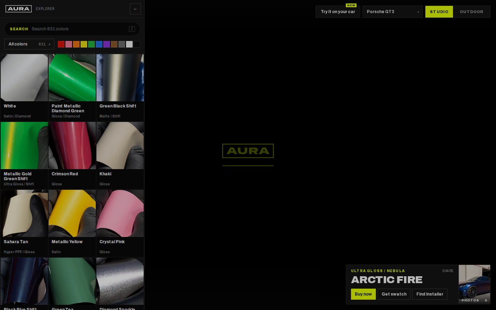
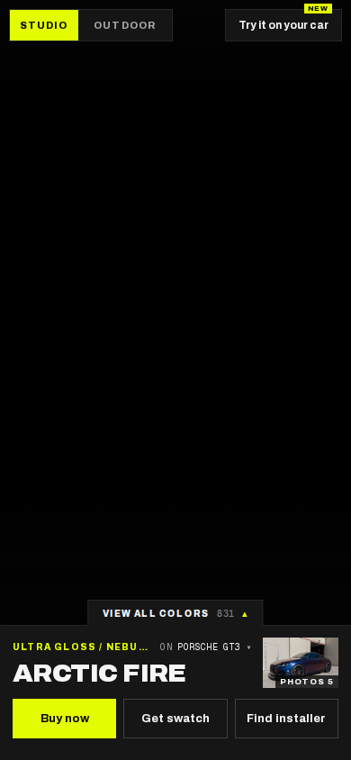

# UI Design System & Master Generation Blueprint: explore-auravinyl-com

> **Aura Vinyl Color Explorer** (https://explore.auravinyl.com) — Explore over 500 colors across matte, satin, and gloss finishes from Aura Premium Vinyl. Find vinyl wrap ideas and inspiration.



---

## 1. Executive Visual Persona & Design Archetype

- **Brand Essence & Persona**: **Aura Vinyl Color Explorer** (`https://explore.auravinyl.com`). Explore over 500 colors across matte, satin, and gloss finishes from Aura Premium Vinyl. Find vinyl wrap ideas and inspiration.
- **Capture Provenance**: Live browser capture (`tier1_fast`, HTTP `200`, captured `2026-11-23`).
- **Visual Archetype**: **Dark-Substrate WebGL / Canvas Interactive Experience (`#161616` / `#e3fc02`)**.
- **Anti-AI-Slop Differentiators**:
  - **Live-Computed Chromatic Polarity**: Anchors the viewport in `#161616` (live computed `body` `background-color` (`computed_styles.json`)) paired with `#ffffff` primary typography and `#e3fc02` accents.
  - **Grounded Typographic Hierarchy**: Pairs `Archivo` for display copy (`ARCTIC FIRE`) with `Helvetica Neue` and `Geist Mono`.
  - **Calibrated Spatial Grid & Motion**: Combines `1440px` container bounds (`gap: 10px`, padding `16px`) with `cubic-bezier(.215,.61,.355,1)` easing and Barba.js Page Transition Router, HTML5 `<canvas>` Interactive Viewport Surface.

---

## 2. Spatial Architecture & Modular Grid Mathematics



### Viewport Allocation & Container Geometry
- **Captured Viewport Dimensions**: Desktop `1440×900px` (`assets/desktop.png`, single-viewport 100vh live capture (900px)), Mobile `390×844px` (`assets/mobile.png`, single-viewport 100vh live capture (844px)).
- **Master Container Bounds**: `1440px` (full-bleed `100%` viewport stage).
- **Canvas Lateral Padding & Spacing**: `16px` lateral canvas padding with `10px` grid gap.
- **Border Radius Scale**: `6px`, `var(--radius-pill)`, `50%`, `2px`.

### Responsive Breakpoint Architecture
- **Desktop Layout**: Multi-column CSS Grid / Flexbox layout at `1440px` (`max-width: 1440px`, `gap: 10px`).
- **Mobile Layout**: Single-column vertical stack at `390px` viewport width with `16px` horizontal padding.
- **Extracted CSS Media Queries**: `@media (max-width:900px)`, `@media (prefers-reduced-motion:reduce)`, `@media (min-width:901px)`, `@media (max-width:560px)`.

---

## 3. Color System, Materiality & Atmospheric Lighting

### Semantic Palette & Source Grounding
| Semantic Role | Ground-Truth Value | Extracted Live / CSS Source |
|---|---|---|
| **Primary Canvas Substrate** | `#161616` | live computed `body` `background-color` (`computed_styles.json`) |
| **Primary Typography Ink** | `#ffffff` | live computed `body` `color` (`computed_styles.json`) |
| **Elevated Surface / Card Substrate** | `#0a0a0a` | `var(--bg)` in `:root` |
| **Interactive Accent / Highlight** | `#e3fc02` | live computed `a` `background-color` (`computed_styles.json`) |
| **Secondary / Muted Copy** | `#808080` | `var(--text-3)` in `:root` |
| **Structural Hairline Border** | `#262626` | `var(--line)` in `:root` |
| **Variable Token (`--bg-sunken`)** | `#050505` | `var(--bg-sunken)` in `:root` |
| **Variable Token (`--raised`)** | `#1e1e1e` | `var(--raised)` in `:root` |
| **Variable Token (`--line-steel`)** | `#404040` | `var(--line-steel)` in `:root` |
| **Variable Token (`--line-strong`)** | `#6b6b6b` | `var(--line-strong)` in `:root` |
| **Variable Token (`--text`)** | `#f5f5f5` | `var(--text)` in `:root` |
| **Variable Token (`--text-2`)** | `#a3a3a3` | `var(--text-2)` in `:root` |
| **Variable Token (`--signal-hover`)** | `#efff5c` | `var(--signal-hover)` in `:root` |
| **Variable Token (`--danger`)** | `#ff5a4f` | `var(--danger)` in `:root` |

### Sanitized Root CSS Variables (`ui-ux.md` Ground Truth)
| Variable Name | Extracted Value | Semantic Role |
|---|---|---|
| `--bg` | `#0a0a0a` | Canvas / Surface Token |
| `--bg-raised` | `#161616` | Canvas / Surface Token |
| `--bg-sunken` | `#050505` | Canvas / Surface Token |
| `--raised` | `#1e1e1e` | Color / Atmospheric Token |
| `--line` | `#262626` | Color / Atmospheric Token |
| `--line-steel` | `#404040` | Color / Atmospheric Token |
| `--line-strong` | `#6b6b6b` | Color / Atmospheric Token |
| `--text` | `#f5f5f5` | Typography Ink Token |
| `--text-2` | `#a3a3a3` | Typography Ink Token |
| `--text-3` | `#808080` | Typography Ink Token |
| `--signal` | `#e3fc02` | Color / Atmospheric Token |
| `--signal-hover` | `#efff5c` | Color / Atmospheric Token |
| `--on-signal` | `#0a0a0a` | Color / Atmospheric Token |
| `--danger` | `#ff5a4f` | Color / Atmospheric Token |
| `--float-bg` | `rgb(22 22 22 / .9)` | Canvas / Surface Token |
| `--float-border` | `1px solid rgb(255 255 255 / .08)` | Elevation / Border Token |

---

## 4. Typographic Scale & Editorial Hierarchy

### Font Family Stacks
- **Display Typography**: `Archivo`.
- **Primary Body Stack**: `Helvetica Neue`.
- **Technical / Metadata Stack**: `Geist Mono`.

### Typographic Scale & Rules (Live Computed & Stylesheet Grounded)
- **Hero Display (`H1`)**: live computed `h1` (`font-size: 30px`, `line-height: 27px`, `font-weight: 900`, `letter-spacing: -0.6px`); rule `.title` (`font-size: 18px`, `line-height: 1.1`, `letter-spacing: -.02em`, `font-weight: 800`).
- **Section Heading (`H2`)**: live computed `h2` (`font-size: 28px`, `line-height: 25.2px`, `font-weight: 900`, `letter-spacing: -0.56px`).
- **Body Copy**: live computed `body` (`font-size: 16px`, `line-height: normal`, `font-weight: 400`); rule `.body` (`font-size: 13px`, `line-height: 1.5`, `font-weight: 500`).
- **Metadata & Navigation Labels**: live computed `nav/a` (`font-size: 12px`, `line-height: normal`, `font-weight: 700`); CSS variables `--font-mono: "Geist Mono", ui-monospace, monospace`.

---

## 5. Choreographed Motion & Interaction Physics

### Primary Easing Curves
- **Extracted Timing Functions**: `cubic-bezier(.215,.61,.355,1)`, `cubic-bezier(.645,.045,.355,1)`, `cubic-bezier(.16,1,.3,1)`.

### Per-Element Transition & Choreography Rules
- **Selector `.FormDialog`**: `transition: opacity var(--dur-fast) var(--ease-standard),visibility 0s lin...` extracted from `explore-auravinyl-com` stylesheet.
- **Selector `.FormDialog.on`**: `transition: opacity var(--dur-fast) var(--ease-standard),visibility 0s` extracted from `explore-auravinyl-com` stylesheet.
- **Selector `.FormDialog .panel`**: `transition: transform var(--dur-fast) var(--ease-standard)` extracted from `explore-auravinyl-com` stylesheet.
- **Extracted Easing Curve (`cubic-bezier(.215,.61,.355,1)`)**: Governs interactive state transitions across `<header.head>` and `<section.card>`.
- **Runtime Interaction Engine**: Integrates Barba.js Page Transition Router, HTML5 `<canvas>` Interactive Viewport Surface with `prefers-reduced-motion: reduce` fallback guards.

---

## 6. Component Wireframe & Structural DOM Map

### Visual Layout Schematic — Desktop (`1440px`, Grounded in `dom.html` & Landmark Bounding Boxes)
```
┌────────────────────────────────────────────────────────────────────────┐
│ DESKTOP VIEWPORT (1440px) — Aura Vinyl Color Explorer                  │
│ ====================================================================== │
│ [ <header.head> (1440px)              | Overview · Index · Archive · ] │
│ ---------------------------------------------------------------------- │
│ | HERO STAGE: <section.mbar> (w=1440px)                              | │
│ | H1: ARCTIC FIRE                                                    | │
│ | Substrate: #161616 | Ink: #ffffff | Accent: #e3fc02                | │
│ ---------------------------------------------------------------------- │
│ | SHOWCASE GRID (<section.card>) max-w: 1440px                       | │
│ | +------------------------------+  +------------------------------+ | │
│ | | Arctic Fire                  |  | Paint Metallic Diamond Green | | │
│ | +------------------------------+  +------------------------------+ | │
│ ---------------------------------------------------------------------- │
│ | DETAIL MODULE (<section.sec>) — Metallic Gold Green S              | │
│ ---------------------------------------------------------------------- │
│ [ FOOTER (<footer.shell>      ) | https://explore.auravinyl.com        │
└────────────────────────────────────────────────────────────────────────┘
```

### Visual Layout Schematic — Mobile Reflow (`390px`)
```
┌────────────────────────────────────────────────────────────────────────┐
│ MOBILE VIEWPORT REFLOW (390px) — Single-Column Stack (gap: 10px)       │
│ ====================================================================== │
│ [ HEADER BAR (<header.head>           ) | Compact Menu (390px)         │
│ ---------------------------------------------------------------------- │
│ | HERO STAGE (<section.mbar>) — 390px Vertical Lead                  | │
│ | H1: ARCTIC FIRE                                                    | │
│ ---------------------------------------------------------------------- │
│ | SHOWCASE STACK (<section.card>) — 1-Col Stack                      | │
│ | [ Item 1: Arctic Fire                                            ] | │
│ | [ Item 2: Paint Metallic Diamond Green                           ] | │
│ ---------------------------------------------------------------------- │
│ | DETAIL STACK (<section.sec>) — 1-Col (Metallic Gold Gree)          | │
│ ---------------------------------------------------------------------- │
│ [ FOOTER (<footer.shell>      ) | Stacked 390px Colophon               │
└────────────────────────────────────────────────────────────────────────┘
```

### Granular DOM Region Breakdown
1. **Brand Header & Navigation Bar (<header.head> — `explore-auravinyl-com`)**:
   - Landmark `<header class="head">` (`1440px`) hosting `Aura Vinyl Color Explorer` navigation (`Overview · Index · Archive · About · Contact`), DOM attributes (`data-perma="satin-diamond-white"`, `data-perma="gloss-paint-metallic-..."`, `data-perma="matte-green-black-shift"`, `data-perma="ultra-gloss-metallic-..."`), and stylesheet rule `.FormDialog.on { visibility:visible;opacity:1;pointer-events:auto;transition:opacity var(... }`.
2. **Hero Stage & Focal Lead (<section.mbar> — `ARCTIC FIRE`)**:
   - Landmark `<section class="mbar">` presenting display lead `ARCTIC FIRE` and copy excerpt *"Please enable javascript"* over `#161616` canvas and `#ffffff` ink.
3. **Primary Showcase & Content Grid (<section.card> — `Arctic Fire`)**:
   - Landmark `<section class="card">` rendering section `Arctic Fire` with copy *"Paint Metallic Diamond Green"*, asset references (`favicon.svg`, `180.png`, `152.png`, `167.png`), and grid rule `.FormDialog { padding:10px }`.
4. **Interactive Detail & Feature Matrix (<section.sec> — `Paint Metallic Diamond Green`)**:
   - Landmark `<section class="sec">` framing `Paint Metallic Diamond Green` and `Metallic Gold Green Shift` (*"Metallic Gold Green Shift"*) with `#0a0a0a` surface cards, `#e3fc02` accents, and `.FormDialog .backdrop { position:absolute;inset:0;background:rgba(5,5,5,.8) }`.
5. **Colophon & Global Directory Footer (<footer.shell> — `https://explore.auravinyl.com`)**:
   - Landmark `<footer class="shell">` anchoring `Aura Vinyl Color Explorer` footer links (`Overview · Index · Archive · About · Contact`), copy *"Ultra Gloss / Shift"*, and `#262626` structural dividers.

---

## 7. Master Zero-Shot AI Generation Prompt

```markdown
# Master Zero-Shot Frontend Generation Prompt: explore-auravinyl-com (Aura Vinyl Color Explorer)

You are a principal frontend architect and design systems engineer. Build a complete, production-ready web application replicating the exact design system, DOM landmarks, typographic hierarchy, color tokens, and motion physics of `explore-auravinyl-com` (**Aura Vinyl Color Explorer** — `https://explore.auravinyl.com`).

### 1. Visual Archetype & Anti-AI-Slop Mandates
- **Archetype**: Dark-Substrate WebGL / Canvas Interactive Experience (`#161616` / `#e3fc02`).
- **Identity & Domain Context**: Explore over 500 colors across matte, satin, and gloss finishes from Aura Premium Vinyl. Find vinyl wrap ideas and inspiration.
- **Primary Substrate**: `#161616` (live computed `body` `background-color` (`computed_styles.json`)), **Primary Ink**: `#ffffff`, **Accent / Highlight**: `#e3fc02`.
- **Site-Specific Differentiators**:
  - **Live-Computed Chromatic Polarity**: Anchors the viewport in `#161616` (live computed `body` `background-color` (`computed_styles.json`)) paired with `#ffffff` primary typography and `#e3fc02` accents.
  - **Grounded Typographic Hierarchy**: Pairs `Archivo` for display copy (`ARCTIC FIRE`) with `Helvetica Neue` and `Geist Mono`.
  - **Calibrated Spatial Grid & Motion**: Combines `1440px` container bounds (`gap: 10px`, padding `16px`) with `cubic-bezier(.215,.61,.355,1)` easing and Barba.js Page Transition Router, HTML5 `<canvas>` Interactive Viewport Surface.

### 2. Ground-Truth CSS Variables (`:root` Token Contract)
Declare and consume these exact custom properties extracted from `explore-auravinyl-com` in your global stylesheet:

:root {
  /* Aura Vinyl Color Explorer (explore-auravinyl-com) — Live-Grounded CSS Variables */
  --bg: #0a0a0a; /* Canvas / Surface Token (explore-auravinyl-com) */
  --bg-raised: #161616; /* Canvas / Surface Token (explore-auravinyl-com) */
  --bg-sunken: #050505; /* Canvas / Surface Token (explore-auravinyl-com) */
  --raised: #1e1e1e; /* Color / Atmospheric Token (explore-auravinyl-com) */
  --line: #262626; /* Color / Atmospheric Token (explore-auravinyl-com) */
  --line-steel: #404040; /* Color / Atmospheric Token (explore-auravinyl-com) */
  --line-strong: #6b6b6b; /* Color / Atmospheric Token (explore-auravinyl-com) */
  --text: #f5f5f5; /* Typography Ink Token (explore-auravinyl-com) */
  --text-2: #a3a3a3; /* Typography Ink Token (explore-auravinyl-com) */
  --text-3: #808080; /* Typography Ink Token (explore-auravinyl-com) */
  --signal: #e3fc02; /* Color / Atmospheric Token (explore-auravinyl-com) */
  --signal-hover: #efff5c; /* Color / Atmospheric Token (explore-auravinyl-com) */
  --on-signal: #0a0a0a; /* Color / Atmospheric Token (explore-auravinyl-com) */
  --danger: #ff5a4f; /* Color / Atmospheric Token (explore-auravinyl-com) */
  --float-bg: rgb(22 22 22 / .9); /* Canvas / Surface Token (explore-auravinyl-com) */
  --float-border: 1px solid rgb(255 255 255 / .08); /* Elevation / Border Token (explore-auravinyl-com) */
}

### 3. Semantic Color & Materiality Contract
Map every surface, ink, and border strictly to these source-grounded tokens:
- **Primary Canvas Substrate**: `#161616` — grounded in live computed `body` `background-color` (`computed_styles.json`)
- **Primary Typography Ink**: `#ffffff` — grounded in live computed `body` `color` (`computed_styles.json`)
- **Elevated Surface / Card Substrate**: `#0a0a0a` — grounded in `var(--bg)` in `:root`
- **Interactive Accent / Highlight**: `#e3fc02` — grounded in live computed `a` `background-color` (`computed_styles.json`)
- **Secondary / Muted Copy**: `#808080` — grounded in `var(--text-3)` in `:root`
- **Structural Hairline Border**: `#262626` — grounded in `var(--line)` in `:root`
- **Variable Token (`--bg-sunken`)**: `#050505` — grounded in `var(--bg-sunken)` in `:root`
- **Variable Token (`--raised`)**: `#1e1e1e` — grounded in `var(--raised)` in `:root`
- **Variable Token (`--line-steel`)**: `#404040` — grounded in `var(--line-steel)` in `:root`
- **Variable Token (`--line-strong`)**: `#6b6b6b` — grounded in `var(--line-strong)` in `:root`
- **Variable Token (`--text`)**: `#f5f5f5` — grounded in `var(--text)` in `:root`
- **Variable Token (`--text-2`)**: `#a3a3a3` — grounded in `var(--text-2)` in `:root`
- **Variable Token (`--signal-hover`)**: `#efff5c` — grounded in `var(--signal-hover)` in `:root`
- **Variable Token (`--danger`)**: `#ff5a4f` — grounded in `var(--danger)` in `:root`

### 4. Spatial Grid, Container Bounds & Responsive Breakpoints
- **Desktop Viewport Reference**: `1440×900px` (single-viewport 100vh live capture (900px), `1440px` standard desktop width).
- **Mobile Viewport Reference**: `390×844px` (single-viewport 100vh live capture (844px), `390px` standard mobile width).
- **Container Max-Width**: `1440px` (full-bleed `100%` viewport stage)
- **Padding & Gutters**: `16px` lateral canvas padding with `10px` grid gap
- **Desktop Grid**: Multi-column CSS Grid / Flexbox layout at `1440px` (`max-width: 1440px`, `gap: 10px`)
- **Mobile Adaptation**: Single-column vertical stack at `390px` viewport width with `16px` horizontal padding
- **Media Queries**: `@media (max-width:900px)`, `@media (prefers-reduced-motion:reduce)`, `@media (min-width:901px)`, `@media (max-width:560px)`
- **Corner Radii**: `6px`, `var(--radius-pill)`, `50%`, `2px`

### 5. Typography & Editorial Scale Contract
- **Display Font Stack**: `Archivo`
- **Body Font Stack**: `Helvetica Neue`
- **Monospace / Technical Font Stack**: `Geist Mono`
- **H1 Display Rule**: live computed `h1` (`font-size: 30px`, `line-height: 27px`, `font-weight: 900`, `letter-spacing: -0.6px`); rule `.title` (`font-size: 18px`, `line-height: 1.1`, `letter-spacing: -.02em`, `font-weight: 800`)
- **H2 Section Rule**: live computed `h2` (`font-size: 28px`, `line-height: 25.2px`, `font-weight: 900`, `letter-spacing: -0.56px`)
- **Body Copy Rule**: live computed `body` (`font-size: 16px`, `line-height: normal`, `font-weight: 400`); rule `.body` (`font-size: 13px`, `line-height: 1.5`, `font-weight: 500`)
- **Metadata & Index Rule**: live computed `nav/a` (`font-size: 12px`, `line-height: normal`, `font-weight: 700`); CSS variables `--font-mono: "Geist Mono", ui-monospace, monospace`

### 6. Component Hierarchy, Verbatim Copy & Real DOM Landmarks
Scaffold `explore-auravinyl-com` (`Aura Vinyl Color Explorer`) with these exact structural regions, extracted copy, and CSS rules from `dom.html`:
1. **Brand Header & Navigation Bar (<header.head> — `explore-auravinyl-com`)**:
   - DOM & Selectors: Landmark `<header class="head">` (`1440px`) hosting `Aura Vinyl Color Explorer` navigation (`Overview · Index · Archive · About · Contact`), DOM attributes (`data-perma="satin-diamond-white"`, `data-perma="gloss-paint-metallic-..."`, `data-perma="matte-green-black-shift"`, `data-perma="ultra-gloss-metallic-..."`), and stylesheet rule `.FormDialog.on { visibility:visible;opacity:1;pointer-events:auto;transition:opacity var(... }`.
   - Responsive Contract: Header `Brand Header & Navigation Bar (<header.head> — `explore-auravinyl-com`)` (`explore-auravinyl-com`) adapts across `@media (max-width:900px)`, `@media (prefers-reduced-motion:reduce)`, `@media (min-width:901px)`, `@media (max-width:560px)` with `cubic-bezier(.215,.61,.355,1)`, `cubic-bezier(.645,.045,.355,1)`, `cubic-bezier(.16,1,.3,1)` transitions and links `Overview · Index · Archive · About · Contact`.
2. **Hero Stage & Focal Lead (<section.mbar> — `ARCTIC FIRE`)**:
   - DOM & Selectors: Landmark `<section class="mbar">` presenting display lead `ARCTIC FIRE` and copy excerpt *"Please enable javascript"* over `#161616` canvas and `#ffffff` ink.
   - Responsive Contract: Hero stage (`1440×900px` desktop / `390×844px` mobile) sets `#161616` background with `#ffffff` headline `ARCTIC FIRE`.
3. **Primary Showcase & Content Grid (<section.card> — `Arctic Fire`)**:
   - DOM & Selectors: Landmark `<section class="card">` rendering section `Arctic Fire` with copy *"Paint Metallic Diamond Green"*, asset references (`favicon.svg`, `180.png`, `152.png`, `167.png`), and grid rule `.FormDialog { padding:10px }`.
   - Responsive Contract: Showcase grid `Primary Showcase & Content Grid (<section.card> — `Arctic Fire`)` applies Multi-column CSS Grid / Flexbox layout at `1440px` (`max-width: 1440px`, `gap: 10px`) on desktop and Single-column vertical stack at `390px` viewport width with `16px` horizontal padding on mobile.
4. **Interactive Detail & Feature Matrix (<section.sec> — `Paint Metallic Diamond Green`)**:
   - DOM & Selectors: Landmark `<section class="sec">` framing `Paint Metallic Diamond Green` and `Metallic Gold Green Shift` (*"Metallic Gold Green Shift"*) with `#0a0a0a` surface cards, `#e3fc02` accents, and `.FormDialog .backdrop { position:absolute;inset:0;background:rgba(5,5,5,.8) }`.
   - Responsive Contract: Detail module `Interactive Detail & Feature Matrix (<section.sec> — `Paint Metallic Diamond Green`)` uses `6px`, `var(--radius-pill)`, `50%`, `2px` radii, `#e3fc02` highlights, and assets (favicon.svg, 180.png, 152.png).
5. **Colophon & Global Directory Footer (<footer.shell> — `https://explore.auravinyl.com`)**:
   - DOM & Selectors: Landmark `<footer class="shell">` anchoring `Aura Vinyl Color Explorer` footer links (`Overview · Index · Archive · About · Contact`), copy *"Ultra Gloss / Shift"*, and `#262626` structural dividers.
   - Responsive Contract: Footer `Colophon & Global Directory Footer (<footer.shell> — `https://explore.auravinyl.com`)` aligns to `1440px` (full-bleed `100%` viewport stage) with `16px` lateral canvas padding with `10px` grid gap and attributes (data-perma="satin-diamond-white", data-perma="gloss-paint-metallic-...", data-perma="matte-green-black-shift").

#### Verbatim DOM Copy Excerpts (`dom.html`)
- Copy Excerpt 1: *"Please enable javascript"*
- Copy Excerpt 2: *"Paint Metallic Diamond Green"*
- Copy Excerpt 3: *"Metallic Gold Green Shift"*
- Copy Excerpt 4: *"Ultra Gloss / Shift"*

### 7. Motion, Extracted Stylesheet Rules & Interaction Choreography
- **Primary Easing Functions**: `cubic-bezier(.215,.61,.355,1)`, `cubic-bezier(.645,.045,.355,1)`, `cubic-bezier(.16,1,.3,1)`
- **Extracted Stylesheet Rules (`explore-auravinyl-com`)**:
- `.FormDialog.on { visibility:visible;opacity:1;pointer-events:auto;transition:opacity var(... }`
- `.FormDialog { padding:10px }`
- `.FormDialog .backdrop { position:absolute;inset:0;background:rgba(5,5,5,.8) }`
- `.FormDialog .trap { position:absolute;width:1px;height:1px;overflow:hidden;clip-path:inset(5... }`
- `.FormDialog .panel { max-width:none;padding:20px }`
- **Per-Selector Transition Rules**:
- **Selector `.FormDialog`**: `transition: opacity var(--dur-fast) var(--ease-standard),visibility 0s lin...` extracted from `explore-auravinyl-com` stylesheet.
- **Selector `.FormDialog.on`**: `transition: opacity var(--dur-fast) var(--ease-standard),visibility 0s` extracted from `explore-auravinyl-com` stylesheet.
- **Selector `.FormDialog .panel`**: `transition: transform var(--dur-fast) var(--ease-standard)` extracted from `explore-auravinyl-com` stylesheet.
- **Extracted Easing Curve (`cubic-bezier(.215,.61,.355,1)`)**: Governs interactive state transitions across `<header.head>` and `<section.card>`.
- **Runtime Interaction Engine**: Integrates Barba.js Page Transition Router, HTML5 `<canvas>` Interactive Viewport Surface with `prefers-reduced-motion: reduce` fallback guards.

### 8. Technical Deliverables
- Implement in Next.js (App Router) with TypeScript and Tailwind CSS consuming the `:root` custom properties defined above for `explore-auravinyl-com`.
- Reproduce both the `1440px` desktop architecture and `390px` mobile breakpoint transitions, preserving semantic HTML5 landmarks (`<header>`, `<nav>`, `<main>`, `<section>`, `<footer>`) and `prefers-reduced-motion` accessibility guards.
```
