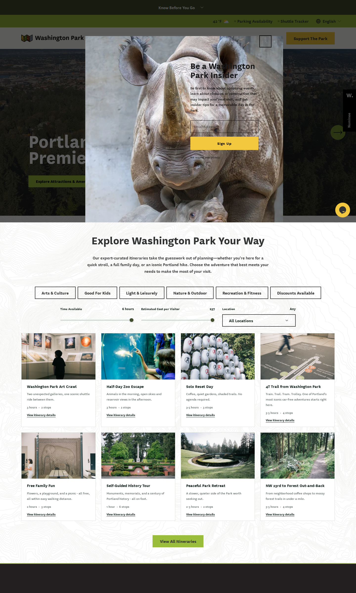
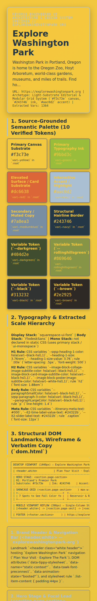

# UI Design System & Master Generation Blueprint: explorewashingtonpark-org

> **Explore Washington Park** (https://explorewashingtonpark.org) — Washington Park in Portland, Oregon is home to the Oregon Zoo, Hoyt Arboretum, world-class gardens, museums, and miles of trails. Find ho...



---

## 1. Executive Visual Persona & Design Archetype

- **Brand Essence & Persona**: **Explore Washington Park** (`https://explorewashingtonpark.org`). Washington Park in Portland, Oregon is home to the Oregon Zoo, Hoyt Arboretum, world-class gardens, museums, and miles of trails. Find ho...
- **Visual Archetype**: **Light-Substrate Editorial & Modular Grid System (`#f3c73e` canvas, `#243746` ink, `#aac0d2` accent)**.
- **Anti-AI-Slop Differentiators**:
  - **Source-Grounded Chromatic Polarity**: Anchors the viewport in `#f3c73e` (`var(--yellow)` in `:root`) paired with `#243746` primary typography and `#aac0d2` accents.
  - **Extracted Typographic Hierarchy**: Pairs `squarespace-ui-font` for display copy (`Portland’s Premier Park`) with `FlodeskSans` and not declared in static CSS (uses primary stack / `ui-monospace`).
  - **Calibrated Spatial Grid & Motion**: Combines `767px` container bounds (`gap: 15px`, padding `44px`) with `cubic-bezier(0,0,0.25,1)` easing and Three.js / WebGL Canvas Pipeline, Barba.js Page Transition Router.

---

## 2. Spatial Architecture & Modular Grid Mathematics



### Viewport Allocation & Container Geometry
- **Captured Viewport Dimensions**: Desktop `1440×2400px` (`assets/desktop.png`, capped at 2400px multi-section capture), Mobile `390×2400px` (`assets/mobile.png`, capped at 2400px multi-section capture).
- **Master Container Bounds**: `767px` extracted from `explorewashingtonpark-org` stylesheet.
- **Canvas Lateral Padding & Spacing**: `44px` lateral canvas padding with `15px` grid gap.
- **Border Radius Scale**: `2px`, `50%`, `999px`, `8px`.

### Responsive Breakpoint Architecture
- **Desktop Layout**: Multi-column CSS Grid / Flexbox layout at `1440px` (`max-width: 767px`, `gap: 15px`).
- **Mobile Layout**: Single-column vertical stack at `390px` viewport width with `44px` horizontal padding.
- **Extracted CSS Media Queries**: `@media (max-width:767px)`, `@media (min-width:768px)`, `@media (max-width:768px)`, `@media (prefers-reduced-motion: reduce)`.

---

## 3. Color System, Materiality & Atmospheric Lighting

### Semantic Palette & Source Grounding
| Semantic Role | Ground-Truth Value | Extracted CSS Source / Selector |
|---|---|---|
| **Primary Canvas Substrate** | `#f3c73e` | `var(--yellow)` in `:root` |
| **Primary Typography Ink** | `#9bbd3c` | `var(--green)` in `:root` |
| **Elevated Surface / Card Substrate** | `#dc6638` | `var(--red)` in `:root` |
| **Interactive Accent / Highlight** | `#aac0d2` | `var(--blue)` in `:root` |
| **Secondary / Muted Copy** | `#7a8ea3` | `var(--mediumblue)` in `:root` |
| **Structural Hairline Border** | `#243746` | `var(--navy)` in `:root` |
| **Variable Token (`--darkgreen`)** | `#404d2e` | `var(--darkgreen)` in `:root` |
| **Variable Token (`--rollinghillsgreen`)** | `#869646` | `var(--rollinghillsgreen)` in `:root` |
| **Variable Token (`--black`)** | `#313232` | `var(--black)` in `:root` |
| **Variable Token (`--brown`)** | `#2e2925` | `var(--brown)` in `:root` |

### Sanitized Root CSS Variables (`ui-ux.md` Ground Truth)
| Variable Name | Extracted Value | Semantic Role |
|---|---|---|
| `--palette-1` | `hsla(var(--white-hsl), 1)` | Brand / Palette Token |
| `--palette-2` | `hsla(var(--lightAccent-hsl), 1)` | Brand / Palette Token |
| `--palette-3` | `hsla(var(--accent-hsl), 1)` | Brand / Palette Token |
| `--palette-4` | `hsla(var(--darkAccent-hsl), 1)` | Brand / Palette Token |
| `--palette-5` | `hsla(var(--black-hsl), 1)` | Brand / Palette Token |
| `--yellow` | `#f3c73e` | Color / Atmospheric Token |
| `--green` | `#9bbd3c` | Color / Atmospheric Token |
| `--red` | `#dc6638` | Color / Atmospheric Token |
| `--blue` | `#aac0d2` | Color / Atmospheric Token |
| `--offwhite` | `linen` | Canvas / Surface Token |
| `--mediumblue` | `#7a8ea3` | Color / Atmospheric Token |
| `--navy` | `#243746` | Layout / Spatial Grid Token |
| `--darkgreen` | `#404d2e` | Canvas / Surface Token |
| `--rollinghillsgreen` | `#869646` | Color / Atmospheric Token |
| `--black` | `#313232` | Canvas / Surface Token |
| `--brown` | `#2e2925` | Color / Atmospheric Token |

---

## 4. Typographic Scale & Editorial Hierarchy

### Font Family Stacks
- **Display Typography**: `squarespace-ui-font`.
- **Primary Body Stack**: `FlodeskSans`.
- **Technical / Metadata Stack**: not declared in static CSS (uses primary stack / `ui-monospace`).

### Typographic Scale & Rules (Extracted from Stylesheet & Variables)
- **Hero Display (`H1`)**: CSS variables `--sqsp-heading-1-color: hsla(var(--black-hsl),1)`, `--heading-1-size: 3.76rem`, `--heading-1-size-value: 3.76`; rule `.title` (`letter-spacing: .5px`, `font-weight: 500`).
- **Section Heading (`H2`)**: CSS variables `--image-block-collage-image-subtitle-color: hsla(var(--black-hsl),1)`, `--image-block-card-image-subtitle-color: hsla(var(--black-hsl),1)`, `--image-block-poster-image-subtitle-color: hsla(var(--white-hsl),1)`; rule `h2` (`font-size: 1.88em`).
- **Body Copy**: CSS variables `--paragraphSmallColor: hsla(var(--black-hsl),1)`, `--sqsp-paragraph-3-color: hsla(var(--black-hsl),1)`, `--paragraphLargeColor: hsla(var(--black-hsl),1)`; rule `p` (`line-height: 1.4`).
- **Metadata & Navigation Labels**: CSS variables `--itinerary-meta-text: #000`, `--it2-time-label-value-text: #24322b`, `--it2-slider-label-text: #24322b`; rule `.caption` (`font-size: 12px`).

---

## 5. Choreographed Motion & Interaction Physics

### Primary Easing Curves
- **Extracted Timing Functions**: `cubic-bezier(0,0,0.25,1)`, `cubic-bezier(.25,.46,.45,.94)`, `cubic-bezier(.4,0,.2,1)`.

### Per-Element Transition & Choreography Rules
- **Selector `ion-id="6931d08b35b3016a24911ec2"...`**: `transition: width .3s ease` extracted from `explorewashingtonpark-org` stylesheet.
- **Selector `id*="hover"] .list-item`**: `transition: all .3s ease` extracted from `explorewashingtonpark-org` stylesheet.
- **Selector `.icon-heading-pair.star svg`**: `transition: transform .1s linear` extracted from `explorewashingtonpark-org` stylesheet.
- **Extracted Easing Curve (`cubic-bezier(0,0,0.25,1)`)**: Governs interactive state transitions across `<header.white>` and `<section.page-section>`.
- **Runtime Interaction Engine**: Integrates Three.js / WebGL Canvas Pipeline, Barba.js Page Transition Router with `prefers-reduced-motion: reduce` fallback guards.

---

## 6. Component Wireframe & Structural DOM Map

### Visual Layout Schematic (Grounded in `dom.html` — `1440px` Desktop & `390px` Mobile Reflow)
```
┌────────────────────────────────────────────────────────────────────────┐
│ DESKTOP VIEWPORT (1440px) — Explore Washington Park                    │
│ ====================================================================== │
│ [ <header.white>           | Plan Your Visit · Explore The Park     ]  │
│ ---------------------------------------------------------------------- │
│ | HERO STAGE: <section.page-section>                               |   │
│ | H1: Portland’s Premier Park                                      |   │
│ | Substrate: #f3c73e    | Ink: #243746    | Accent: #aac0d2        |   │
│ ---------------------------------------------------------------------- │
│ | SHOWCASE GRID (<section.page-section>    ) max-w: 767px          |   │
│ | +------------------------------+  +------------------------------+ | │
│ | | 7 Spots to See Fall Color fo |  | Reservoir & Reflecting Pools | | │
│ | +------------------------------+  +------------------------------+ | │
│ ---------------------------------------------------------------------- │
│ | MOBILE VIEWPORT REFLOW (390px) — Single-Column Stack (gap: 15px  ) | │
│ | [<header.white>] -> [<section.page-sect] -> [<section.page-sect] |   │
│ ---------------------------------------------------------------------- │
│ [ FOOTER (<footer.sections>     ) | https://explorewashingtonpark.org  │
└────────────────────────────────────────────────────────────────────────┘
```

### Granular DOM Region Breakdown
1. **Brand Header & Navigation Bar (<header.white> — `explorewashingtonpark-org`)**:
   - Landmark `<header class="white header">` hosting `Explore Washington Park` navigation (`Plan Your Visit · Explore The Park`), DOM attributes (`data-tippy-stylesheet`, `data-name="static-context"`, `data-tawk-font-preconnect`, `data-animation-state="booted"`), and stylesheet rule `.list-item-content { padding:44px }`.
2. **Hero Stage & Focal Lead (<section.page-section> — `Portland’s Premier Park`)**:
   - Landmark `<section class="page-section full-bleed-section">` presenting display lead `Portland’s Premier Park` and copy excerpt *"Know Before You Go"* over `#f3c73e` canvas and `#243746` ink.
3. **Primary Showcase & Content Grid (<section.page-section> — `7 Spots to See Fall Color for Free`)**:
   - Landmark `<section class="page-section full-bleed-section">` rendering section `7 Spots to See Fall Color for Free` with copy *"Parking fills fast, and payment is required at all lots. The Wash"*, asset references (`twk-main.js`, `announcement-bar-ff2c04748aa19f8b...`, `popup-overlay-f39ec8cdc95ccd84-mi...`, `popup-overlay-7afaba259a8e252a-mi...`), and grid rule `.list-item-content__button-container { padding-top:22px }`.
4. **Interactive Detail & Feature Matrix (<section.page-section> — `Reservoir & Reflecting Pools Are N`)**:
   - Landmark `<section class="page-section full-bleed-section">` framing `Reservoir & Reflecting Pools Are Now Open` and `TriMet Gets You Here Faster` (*"Washington Park Free Shuttle"*) with `#dc6638` surface cards, `#aac0d2` accents, and `.accordion-title .text { text-overflow:unset !important }`.
5. **Colophon & Global Directory Footer (<footer.sections> — `https://explorewashingtonpark.org`)**:
   - Landmark `<footer class="sections">` anchoring `Explore Washington Park` footer links (`Plan Your Visit · Explore The Park`), copy *"View Parking Availability"*, and `#243746` structural dividers.

---

## 7. Master Zero-Shot AI Generation Prompt

```markdown
# Master Zero-Shot Frontend Generation Prompt: explorewashingtonpark-org (Explore Washington Park)

You are a principal frontend architect and design systems engineer. Build a complete, production-ready web application replicating the exact design system, DOM landmarks, typographic hierarchy, color tokens, and motion physics of `explorewashingtonpark-org` (**Explore Washington Park** — `https://explorewashingtonpark.org`).

### 1. Visual Archetype & Anti-AI-Slop Mandates
- **Archetype**: Light-Substrate Editorial & Modular Grid System (`#f3c73e` canvas, `#243746` ink, `#aac0d2` accent).
- **Identity & Domain Context**: Washington Park in Portland, Oregon is home to the Oregon Zoo, Hoyt Arboretum, world-class gardens, museums, and miles of trails. Find ho...
- **Primary Substrate**: `#f3c73e` (`var(--yellow)` in `:root`), **Primary Ink**: `#243746`, **Accent / Highlight**: `#aac0d2`.
- **Site-Specific Differentiators**:
  - **Source-Grounded Chromatic Polarity**: Anchors the viewport in `#f3c73e` (`var(--yellow)` in `:root`) paired with `#243746` primary typography and `#aac0d2` accents.
  - **Extracted Typographic Hierarchy**: Pairs `squarespace-ui-font` for display copy (`Portland’s Premier Park`) with `FlodeskSans` and not declared in static CSS (uses primary stack / `ui-monospace`).
  - **Calibrated Spatial Grid & Motion**: Combines `767px` container bounds (`gap: 15px`, padding `44px`) with `cubic-bezier(0,0,0.25,1)` easing and Three.js / WebGL Canvas Pipeline, Barba.js Page Transition Router.

### 2. Ground-Truth CSS Variables (`:root` Token Contract)
Declare and consume these exact custom properties extracted from `explorewashingtonpark-org` in your global stylesheet:

:root {
  /* Explore Washington Park (explorewashingtonpark-org) — Ground-Truth Extracted CSS Variables */
  --palette-1: hsla(var(--white-hsl), 1); /* Brand / Palette Token (explorewashingtonpark-org) */
  --palette-2: hsla(var(--lightAccent-hsl), 1); /* Brand / Palette Token (explorewashingtonpark-org) */
  --palette-3: hsla(var(--accent-hsl), 1); /* Brand / Palette Token (explorewashingtonpark-org) */
  --palette-4: hsla(var(--darkAccent-hsl), 1); /* Brand / Palette Token (explorewashingtonpark-org) */
  --palette-5: hsla(var(--black-hsl), 1); /* Brand / Palette Token (explorewashingtonpark-org) */
  --yellow: #f3c73e; /* Color / Atmospheric Token (explorewashingtonpark-org) */
  --green: #9bbd3c; /* Color / Atmospheric Token (explorewashingtonpark-org) */
  --red: #dc6638; /* Color / Atmospheric Token (explorewashingtonpark-org) */
  --blue: #aac0d2; /* Color / Atmospheric Token (explorewashingtonpark-org) */
  --offwhite: linen; /* Canvas / Surface Token (explorewashingtonpark-org) */
  --mediumblue: #7a8ea3; /* Color / Atmospheric Token (explorewashingtonpark-org) */
  --navy: #243746; /* Layout / Spatial Grid Token (explorewashingtonpark-org) */
  --darkgreen: #404d2e; /* Canvas / Surface Token (explorewashingtonpark-org) */
  --rollinghillsgreen: #869646; /* Color / Atmospheric Token (explorewashingtonpark-org) */
  --black: #313232; /* Canvas / Surface Token (explorewashingtonpark-org) */
  --brown: #2e2925; /* Color / Atmospheric Token (explorewashingtonpark-org) */
}

### 3. Semantic Color & Materiality Contract
Map every surface, ink, and border strictly to these source-grounded tokens:
- **Primary Canvas Substrate**: `#f3c73e` — grounded in `var(--yellow)` in `:root`
- **Primary Typography Ink**: `#9bbd3c` — grounded in `var(--green)` in `:root`
- **Elevated Surface / Card Substrate**: `#dc6638` — grounded in `var(--red)` in `:root`
- **Interactive Accent / Highlight**: `#aac0d2` — grounded in `var(--blue)` in `:root`
- **Secondary / Muted Copy**: `#7a8ea3` — grounded in `var(--mediumblue)` in `:root`
- **Structural Hairline Border**: `#243746` — grounded in `var(--navy)` in `:root`
- **Variable Token (`--darkgreen`)**: `#404d2e` — grounded in `var(--darkgreen)` in `:root`
- **Variable Token (`--rollinghillsgreen`)**: `#869646` — grounded in `var(--rollinghillsgreen)` in `:root`
- **Variable Token (`--black`)**: `#313232` — grounded in `var(--black)` in `:root`
- **Variable Token (`--brown`)**: `#2e2925` — grounded in `var(--brown)` in `:root`

### 4. Spatial Grid, Container Bounds & Responsive Breakpoints
- **Desktop Viewport Reference**: `1440×2400px` (capped at 2400px multi-section capture, `1440px` standard desktop width).
- **Mobile Viewport Reference**: `390×2400px` (capped at 2400px multi-section capture, `390px` standard mobile width).
- **Container Max-Width**: `767px` extracted from `explorewashingtonpark-org` stylesheet
- **Padding & Gutters**: `44px` lateral canvas padding with `15px` grid gap
- **Desktop Grid**: Multi-column CSS Grid / Flexbox layout at `1440px` (`max-width: 767px`, `gap: 15px`)
- **Mobile Adaptation**: Single-column vertical stack at `390px` viewport width with `44px` horizontal padding
- **Media Queries**: `@media (max-width:767px)`, `@media (min-width:768px)`, `@media (max-width:768px)`, `@media (prefers-reduced-motion: reduce)`
- **Corner Radii**: `2px`, `50%`, `999px`, `8px`

### 5. Typography & Editorial Scale Contract
- **Display Font Stack**: `squarespace-ui-font`
- **Body Font Stack**: `FlodeskSans`
- **Monospace / Technical Font Stack**: not declared in static CSS (uses primary stack / `ui-monospace`)
- **H1 Display Rule**: CSS variables `--sqsp-heading-1-color: hsla(var(--black-hsl),1)`, `--heading-1-size: 3.76rem`, `--heading-1-size-value: 3.76`; rule `.title` (`letter-spacing: .5px`, `font-weight: 500`)
- **H2 Section Rule**: CSS variables `--image-block-collage-image-subtitle-color: hsla(var(--black-hsl),1)`, `--image-block-card-image-subtitle-color: hsla(var(--black-hsl),1)`, `--image-block-poster-image-subtitle-color: hsla(var(--white-hsl),1)`; rule `h2` (`font-size: 1.88em`)
- **Body Copy Rule**: CSS variables `--paragraphSmallColor: hsla(var(--black-hsl),1)`, `--sqsp-paragraph-3-color: hsla(var(--black-hsl),1)`, `--paragraphLargeColor: hsla(var(--black-hsl),1)`; rule `p` (`line-height: 1.4`)
- **Metadata & Index Rule**: CSS variables `--itinerary-meta-text: #f3c73e`, `--it2-time-label-value-text: #f3c73e`, `--it2-slider-label-text: #f3c73e`; rule `.caption` (`font-size: 12px`)

### 6. Component Hierarchy, Verbatim Copy & Real DOM Landmarks
Scaffold `explorewashingtonpark-org` (`Explore Washington Park`) with these exact structural regions, extracted copy, and CSS rules from `dom.html`:
1. **Brand Header & Navigation Bar (<header.white> — `explorewashingtonpark-org`)**:
   - DOM & Selectors: Landmark `<header class="white header">` hosting `Explore Washington Park` navigation (`Plan Your Visit · Explore The Park`), DOM attributes (`data-tippy-stylesheet`, `data-name="static-context"`, `data-tawk-font-preconnect`, `data-animation-state="booted"`), and stylesheet rule `.list-item-content { padding:44px }`.
   - Responsive Contract: Header `Brand Header & Navigation Bar (<header.white> — `explorewashingtonpark-org`)` (`explorewashingtonpark-org`) adapts across `@media (max-width:767px)`, `@media (min-width:768px)`, `@media (max-width:768px)`, `@media (prefers-reduced-motion: reduce)` with `cubic-bezier(0,0,0.25,1)`, `cubic-bezier(.25,.46,.45,.94)`, `cubic-bezier(.4,0,.2,1)` transitions and links `Plan Your Visit · Explore The Park`.
2. **Hero Stage & Focal Lead (<section.page-section> — `Portland’s Premier Park`)**:
   - DOM & Selectors: Landmark `<section class="page-section full-bleed-section">` presenting display lead `Portland’s Premier Park` and copy excerpt *"Know Before You Go"* over `#f3c73e` canvas and `#243746` ink.
   - Responsive Contract: Hero stage (`1440×2400px` desktop / `390×2400px` mobile) sets `#f3c73e` background with `#243746` headline `Portland’s Premier Park`.
3. **Primary Showcase & Content Grid (<section.page-section> — `7 Spots to See Fall Color for Free`)**:
   - DOM & Selectors: Landmark `<section class="page-section full-bleed-section">` rendering section `7 Spots to See Fall Color for Free` with copy *"Parking fills fast, and payment is required at all lots. The Wash"*, asset references (`twk-main.js`, `announcement-bar-ff2c04748aa19f8b...`, `popup-overlay-f39ec8cdc95ccd84-mi...`, `popup-overlay-7afaba259a8e252a-mi...`), and grid rule `.list-item-content__button-container { padding-top:22px }`.
   - Responsive Contract: Showcase grid `Primary Showcase & Content Grid (<section.page-section> — `7 Spots to See Fall Color for Free`)` applies Multi-column CSS Grid / Flexbox layout at `1440px` (`max-width: 767px`, `gap: 15px`) on desktop and Single-column vertical stack at `390px` viewport width with `44px` horizontal padding on mobile.
4. **Interactive Detail & Feature Matrix (<section.page-section> — `Reservoir & Reflecting Pools Are N`)**:
   - DOM & Selectors: Landmark `<section class="page-section full-bleed-section">` framing `Reservoir & Reflecting Pools Are Now Open` and `TriMet Gets You Here Faster` (*"Washington Park Free Shuttle"*) with `#dc6638` surface cards, `#aac0d2` accents, and `.accordion-title .text { text-overflow:unset !important }`.
   - Responsive Contract: Detail module `Interactive Detail & Feature Matrix (<section.page-section> — `Reservoir & Reflecting Pools Are N`)` uses `2px`, `50%`, `999px`, `8px` radii, `#aac0d2` highlights, and assets (twk-main.js, announcement-bar-ff2c04748aa19f8b..., popup-overlay-f39ec8cdc95ccd84-mi...).
5. **Colophon & Global Directory Footer (<footer.sections> — `https://explorewashingtonpark.org`)**:
   - DOM & Selectors: Landmark `<footer class="sections">` anchoring `Explore Washington Park` footer links (`Plan Your Visit · Explore The Park`), copy *"View Parking Availability"*, and `#243746` structural dividers.
   - Responsive Contract: Footer `Colophon & Global Directory Footer (<footer.sections> — `https://explorewashingtonpark.org`)` aligns to `767px` extracted from `explorewashingtonpark-org` stylesheet with `44px` lateral canvas padding with `15px` grid gap and attributes (data-tippy-stylesheet, data-name="static-context", data-tawk-font-preconnect).

#### Verbatim DOM Copy Excerpts (`dom.html`)
- Copy Excerpt 1: *"Know Before You Go"*
- Copy Excerpt 2: *"Parking fills fast, and payment is required at all lots. The Washington Park Free..."*
- Copy Excerpt 3: *"Washington Park Free Shuttle"*
- Copy Excerpt 4: *"View Parking Availability"*

### 7. Motion, Extracted Stylesheet Rules & Interaction Choreography
- **Primary Easing Functions**: `cubic-bezier(0,0,0.25,1)`, `cubic-bezier(.25,.46,.45,.94)`, `cubic-bezier(.4,0,.2,1)`
- **Extracted Stylesheet Rules (`explorewashingtonpark-org`)**:
- `.list-item-content { padding:44px }`
- `.list-item-content__button-container { padding-top:22px }`
- `.accordion-title .text { text-overflow:unset !important }`
- `ol.header-menu-controls-control--... { padding-left:0px !important;margin-left:0px !important }`
- `body.header--menu-open { overflow:hidden !important }`
- **Per-Selector Transition Rules**:
- **Selector `ion-id="6931d08b35b3016a24911ec2"...`**: `transition: width .3s ease` extracted from `explorewashingtonpark-org` stylesheet.
- **Selector `id*="hover"] .list-item`**: `transition: all .3s ease` extracted from `explorewashingtonpark-org` stylesheet.
- **Selector `.icon-heading-pair.star svg`**: `transition: transform .1s linear` extracted from `explorewashingtonpark-org` stylesheet.
- **Extracted Easing Curve (`cubic-bezier(0,0,0.25,1)`)**: Governs interactive state transitions across `<header.white>` and `<section.page-section>`.
- **Runtime Interaction Engine**: Integrates Three.js / WebGL Canvas Pipeline, Barba.js Page Transition Router with `prefers-reduced-motion: reduce` fallback guards.

### 8. Technical Deliverables
- Implement in Next.js (App Router) with TypeScript and Tailwind CSS consuming the `:root` custom properties defined above for `explorewashingtonpark-org`.
- Reproduce both the `1440px` desktop architecture and `390px` mobile breakpoint transitions, preserving semantic HTML5 landmarks (`<header>`, `<nav>`, `<main>`, `<section>`, `<footer>`) and `prefers-reduced-motion` accessibility guards.
```
