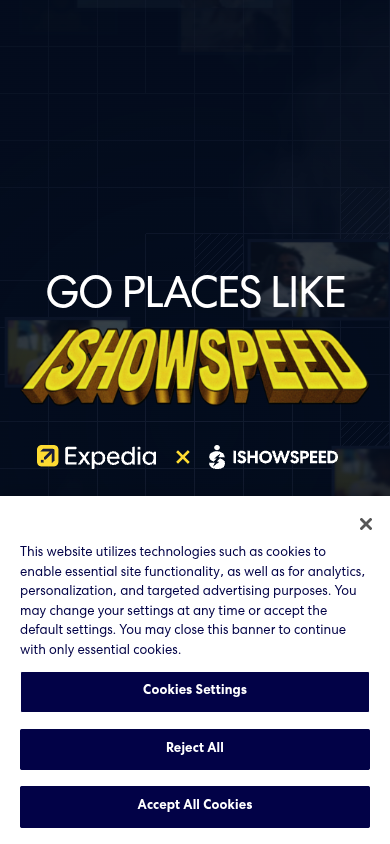

# UI Design System & Master Generation Blueprint: exspeedia-com

> **Official IShowSpeed Travel Site Powered by Expedia** (https://exspeedia.com) — The official IShowSpeed travel website powered by Expedia. Book trips inspired by Speed’s real travels, enter sweepstakes, and earn rewards.


---

## 1. Executive Visual Persona & Design Archetype

- **Brand Essence & Persona**: **Official IShowSpeed Travel Site Powered by Expedia** (`https://exspeedia.com`). The official IShowSpeed travel website powered by Expedia. Book trips inspired by Speed’s real travels, enter sweepstakes, and earn rewards.
- **Final Redirected URL**: [https://speed.expedia.com/](https://speed.expedia.com/)
- **Capture Provenance**: Live browser capture (`tier2_webgl`, HTTP `200`, captured `2026-11-23`).
- **Visual Archetype**: **Dark-Substrate WebGL / Canvas Interactive Experience (`#030c1d` / `#005aeb`)**.
- **Anti-AI-Slop Differentiators**:
  - **Live-Computed Chromatic Polarity**: Anchors the viewport in `#030c1d` (live computed `body` `background-color` (`computed_styles.json`)) paired with `#ffffff` primary typography and `#005aeb` accents.
  - **Grounded Typographic Hierarchy**: Pairs `Centra No2` for display copy (`GO PLACES LIKE`) with `Centra No2` and `SFMono-Regular`.
  - **Calibrated Spatial Grid & Motion**: Combines `96rem` container bounds (`gap: var(--spacing)`, padding `var(--spacing)`) with `cubic-bezier(.4,0,1,1)` easing and Three.js / WebGL Canvas Pipeline, Swiper Touch Carousel Engine.

---

## 2. Spatial Architecture & Modular Grid Mathematics



### Viewport Allocation & Container Geometry
- **Captured Viewport Dimensions**: Desktop `1440×900px` (`assets/desktop.png`, single-viewport 100vh live capture (900px)), Mobile `390×844px` (`assets/mobile.png`, single-viewport 100vh live capture (844px)).
- **Master Container Bounds**: `96rem` (non-`@media` desktop container stylesheet rule).
- **Canvas Lateral Padding & Spacing**: `var(--spacing)` lateral canvas padding with `var(--spacing)` grid gap.
- **Border Radius Scale**: `2px`, `.25rem`, `var(--radius-2xl)`, `4px`.

### Responsive Breakpoint Architecture
- **Desktop Layout**: Multi-column CSS Grid / Flexbox layout at `1440px` (`max-width: 96rem`, `gap: var(--spacing)`).
- **Mobile Layout**: Single-column vertical stack at `390px` viewport width with `var(--spacing)` horizontal padding.
- **Extracted CSS Media Queries**: `@media (width>=40rem)`, `@media (width>=48rem)`, `@media (width>=64rem)`, `@media (width>=80rem)`.

---

## 3. Color System, Materiality & Atmospheric Lighting

### Semantic Palette & Source Grounding
| Semantic Role | Ground-Truth Value | Extracted Live / CSS Source |
|---|---|---|
| **Primary Canvas Substrate** | `#030c1d` | live computed `body` `background-color` (`computed_styles.json`) |
| **Primary Typography Ink** | `#ffffff` | live computed `h1` `color` (`computed_styles.json`) |
| **Elevated Surface / Card Substrate** | `#020247` | live computed `button` `background-color` (`computed_styles.json`) |
| **Interactive Accent / Highlight** | `#005aeb` | live computed `a` `color` (`computed_styles.json`) |
| **Secondary / Muted Copy** | `#575b6e` | live computed `p` `color` (`computed_styles.json`) |
| **Structural Hairline Border** | `#808080` | `.border-gray-200 { border-color: #808080 }` |

### Sanitized Root CSS Variables (`ui-ux.md` Ground Truth)
| Variable Name | Extracted Value | Semantic Role |
|---|---|---|
| `--font-serif` | `ui-serif, Georgia, Cambria, "Times New Roman", Times, serif` | Typography / Scale Token |
| `--color-red-50` | `oklch(97.1% .013 17.38)` | Brand / Palette Token |
| `--color-red-100` | `oklch(93.6% .032 17.717)` | Brand / Palette Token |
| `--color-red-200` | `oklch(88.5% .062 18.334)` | Brand / Palette Token |
| `--color-red-300` | `oklch(80.8% .114 19.571)` | Brand / Palette Token |
| `--color-red-400` | `oklch(70.4% .191 22.216)` | Brand / Palette Token |
| `--color-red-500` | `oklch(63.7% .237 25.331)` | Brand / Palette Token |
| `--color-red-600` | `oklch(57.7% .245 27.325)` | Brand / Palette Token |
| `--color-red-700` | `oklch(50.5% .213 27.518)` | Brand / Palette Token |
| `--color-red-800` | `oklch(44.4% .177 26.899)` | Brand / Palette Token |
| `--color-red-900` | `oklch(39.6% .141 25.723)` | Brand / Palette Token |
| `--color-red-950` | `oklch(25.8% .092 26.042)` | Brand / Palette Token |
| `--color-orange-50` | `oklch(98% .016 73.684)` | Brand / Palette Token |
| `--color-orange-100` | `oklch(95.4% .038 75.164)` | Brand / Palette Token |
| `--color-orange-200` | `oklch(90.1% .076 70.697)` | Brand / Palette Token |
| `--color-orange-300` | `oklch(83.7% .128 66.29)` | Brand / Palette Token |

---

## 4. Typographic Scale & Editorial Hierarchy

### Font Family Stacks
- **Display Typography**: `Centra No2`.
- **Primary Body Stack**: `Centra No2`.
- **Technical / Metadata Stack**: `SFMono-Regular`.

### Typographic Scale & Rules (Live Computed & Stylesheet Grounded)
- **Hero Display (`H1`)**: live computed `h1` (`font-size: 16px`, `line-height: 14.4px`, `font-weight: 800`, `letter-spacing: -3.52px`); CSS variables `--text-4xl: 2.25rem`, `--text-4xl--line-height: calc(2.5 / 2.25)`, `--text-5xl: 3rem`; rule `h1` (`font-size: 1.5rem`, `line-height: 1.2`).
- **Section Heading (`H2`)**: CSS variables `--text-2xl: 1.5rem`, `--text-2xl--line-height: calc(2 / 1.5)`, `--text-3xl: 1.875rem`; rule `h2` (`font-size: 1.5rem`, `line-height: 1.25`).
- **Body Copy**: live computed `body` (`font-size: 16px`, `line-height: 24px`, `font-weight: 400`); CSS variables `--text-base: 1rem`, `--text-base--line-height: calc(1.5 / 1)`; rule `p` (`font-size: .75em`).
- **Metadata & Navigation Labels**: live computed `nav/a` (`font-size: 13.008px`, `line-height: 19.512px`, `font-weight: 400`); CSS variables `--text-xs: .75rem`, `--text-xs--line-height: calc(1 / .75)`, `--text-sm: .875rem`.

---

## 5. Choreographed Motion & Interaction Physics

### Primary Easing Curves
- **Extracted Timing Functions**: `cubic-bezier(.4,0,1,1)`, `cubic-bezier(0,0,.2,1)`, `cubic-bezier(.4,0,.2,1)`.

### Per-Element Transition & Choreography Rules
- **Selector `layer theme`**: `transition: .15s` extracted from `exspeedia-com` stylesheet.
- **Selector `.transition`**: `transition: var(--tw-ease,var(--default-transition-timing-function))` extracted from `exspeedia-com` stylesheet.
- **Selector `.transition-all`**: `transition: var(--tw-ease,var(--default-transition-timing-function))` extracted from `exspeedia-com` stylesheet.
- **Extracted Easing Curve (`cubic-bezier(.4,0,1,1)`)**: Governs interactive state transitions across `<header.grid>` and `<section.ot-hide>`.
- **Runtime Interaction Engine**: Integrates Three.js / WebGL Canvas Pipeline, Swiper Touch Carousel Engine with `prefers-reduced-motion: reduce` fallback guards.

---

## 6. Component Wireframe & Structural DOM Map

### Visual Layout Schematic — Desktop (`1440px`, Grounded in `dom.html` & Landmark Bounding Boxes)
```
┌────────────────────────────────────────────────────────────────────────┐
│ DESKTOP VIEWPORT (1440px) — Official IShowSpeed Travel Site Powered by │
│ ====================================================================== │
│ [ <header.grid> (1440px)              | Overview · Index · Archive · ] │
│ ---------------------------------------------------------------------- │
│ | HERO STAGE: <section.ot-sdk-row> (w=1440px)                        | │
│ | H1: GO PLACES LIKE                                                 | │
│ | Substrate: #030c1d | Ink: #ffffff | Accent: #005aeb                | │
│ ---------------------------------------------------------------------- │
│ | SHOWCASE GRID (<section.ot-hide>) max-w: 96rem                     | │
│ | +------------------------------+  +------------------------------+ | │
│ | | checkbox label label         |  | exspeedia-com Interactive Ma | | │
│ | +------------------------------+  +------------------------------+ | │
│ ---------------------------------------------------------------------- │
│ | DETAIL MODULE (<section.fixed>) — exspeedia-com Archive            | │
│ ---------------------------------------------------------------------- │
│ [ FOOTER (<footer.inset-0>    ) | https://exspeedia.com                │
└────────────────────────────────────────────────────────────────────────┘
```

### Visual Layout Schematic — Mobile Reflow (`390px`)
```
┌────────────────────────────────────────────────────────────────────────┐
│ MOBILE VIEWPORT REFLOW (390px) — Single-Column Stack (gap: var(--sp)   │
│ ====================================================================== │
│ [ HEADER BAR (<header.grid>           ) | Compact Menu (390px)         │
│ ---------------------------------------------------------------------- │
│ | HERO STAGE (<section.ot-sdk-row>) — 390px Vertical Lead            | │
│ | H1: GO PLACES LIKE                                                 | │
│ ---------------------------------------------------------------------- │
│ | SHOWCASE STACK (<section.ot-hide>) — 1-Col Stack                   | │
│ | [ Item 1: checkbox label label                                   ] | │
│ | [ Item 2: exspeedia-com Interactive Matrix                       ] | │
│ ---------------------------------------------------------------------- │
│ | DETAIL STACK (<section.fixed>) — 1-Col (exspeedia-com Arch)        | │
│ ---------------------------------------------------------------------- │
│ [ FOOTER (<footer.inset-0>    ) | Stacked 390px Colophon               │
└────────────────────────────────────────────────────────────────────────┘
```

### Granular DOM Region Breakdown
1. **Brand Header & Navigation Bar (<header.grid> — `exspeedia-com`)**:
   - Landmark `<header class="grid">` (`1440px`) hosting `Official IShowSpeed Travel Site Powe` navigation (`Overview · Index · Archive · About · Contact`), DOM attributes (`data-navigate-track="reload"`, `data-document-language="true"`, `data-domain-script="019d9c05-c22b-757a-b8..."`, `data-v-app`), and stylesheet rule `backdrop { box-sizing:border-box;border:0 solid;margin:0;padding:0 }`.
2. **Hero Stage & Focal Lead (<section.ot-sdk-row> — `GO PLACES LIKE`)**:
   - Landmark `<section class="ot-sdk-row ot-cat-grp">` presenting display lead `GO PLACES LIKE` and copy excerpt *"checkbox label label"* over `#030c1d` canvas and `#ffffff` ink.
3. **Primary Showcase & Content Grid (<section.ot-hide> — `checkbox label label`)**:
   - Landmark `<section class="ot-hide ot-pc-scrollbar">` rendering section `checkbox label label` with copy *"GO PLACES LIKE"*, asset references (`speed-cdn.expedia.com`, `d2848tzd1fqvrv.cloudfront.net`, `cdn.usefathom.com`, `favicon-96x96.png`), and grid rule `file-selector-button { box-sizing:border-box;border:0 solid;margin:0;padding:0 }`.
4. **Interactive Detail & Feature Matrix (<section.fixed> — `exspeedia-com Interactive Matrix`)**:
   - Landmark `<section class="fixed">` framing `exspeedia-com Interactive Matrix` and `exspeedia-com Archive & Directory` (*"checkbox label label"*) with `#020247` surface cards, `#005aeb` accents, and `strong { font-weight:bolder }`.
5. **Colophon & Global Directory Footer (<footer.inset-0> — `https://exspeedia.com`)**:
   - Landmark `<footer class="inset-0">` anchoring `Official IShowSpeed Travel Site ` footer links (`Overview · Index · Archive · About · Contact`), copy *"exspeedia-com Interactive Matrix"*, and `#808080` structural dividers.

---

## 7. Master Zero-Shot AI Generation Prompt

```markdown
# Master Zero-Shot Frontend Generation Prompt: exspeedia-com (Official IShowSpeed Travel Site Powered by Expedia)

You are a principal frontend architect and design systems engineer. Build a complete, production-ready web application replicating the exact design system, DOM landmarks, typographic hierarchy, color tokens, and motion physics of `exspeedia-com` (**Official IShowSpeed Travel Site Powered by Expedia** — `https://exspeedia.com`).

### 1. Visual Archetype & Anti-AI-Slop Mandates
- **Archetype**: Dark-Substrate WebGL / Canvas Interactive Experience (`#030c1d` / `#005aeb`).
- **Identity & Domain Context**: The official IShowSpeed travel website powered by Expedia. Book trips inspired by Speed’s real travels, enter sweepstakes, and earn rewards.
- **Primary Substrate**: `#030c1d` (live computed `body` `background-color` (`computed_styles.json`)), **Primary Ink**: `#ffffff`, **Accent / Highlight**: `#005aeb`.
- **Site-Specific Differentiators**:
  - **Live-Computed Chromatic Polarity**: Anchors the viewport in `#030c1d` (live computed `body` `background-color` (`computed_styles.json`)) paired with `#ffffff` primary typography and `#005aeb` accents.
  - **Grounded Typographic Hierarchy**: Pairs `Centra No2` for display copy (`GO PLACES LIKE`) with `Centra No2` and `SFMono-Regular`.
  - **Calibrated Spatial Grid & Motion**: Combines `96rem` container bounds (`gap: var(--spacing)`, padding `var(--spacing)`) with `cubic-bezier(.4,0,1,1)` easing and Three.js / WebGL Canvas Pipeline, Swiper Touch Carousel Engine.

### 2. Ground-Truth CSS Variables (`:root` Token Contract)
Declare and consume these exact custom properties extracted from `exspeedia-com` in your global stylesheet:

:root {
  /* Official IShowSpeed Travel Site Powered by Expedia (exspeedia-com) — Live-Grounded CSS Variables */
  --font-serif: ui-serif, Georgia, Cambria, "Times New Roman", Times, serif; /* Typography / Scale Token (exspeedia-com) */
  --color-red-50: oklch(97.1% .013 17.38); /* Brand / Palette Token (exspeedia-com) */
  --color-red-100: oklch(93.6% .032 17.717); /* Brand / Palette Token (exspeedia-com) */
  --color-red-200: oklch(88.5% .062 18.334); /* Brand / Palette Token (exspeedia-com) */
  --color-red-300: oklch(80.8% .114 19.571); /* Brand / Palette Token (exspeedia-com) */
  --color-red-400: oklch(70.4% .191 22.216); /* Brand / Palette Token (exspeedia-com) */
  --color-red-500: oklch(63.7% .237 25.331); /* Brand / Palette Token (exspeedia-com) */
  --color-red-600: oklch(57.7% .245 27.325); /* Brand / Palette Token (exspeedia-com) */
  --color-red-700: oklch(50.5% .213 27.518); /* Brand / Palette Token (exspeedia-com) */
  --color-red-800: oklch(44.4% .177 26.899); /* Brand / Palette Token (exspeedia-com) */
  --color-red-900: oklch(39.6% .141 25.723); /* Brand / Palette Token (exspeedia-com) */
  --color-red-950: oklch(25.8% .092 26.042); /* Brand / Palette Token (exspeedia-com) */
  --color-orange-50: oklch(98% .016 73.684); /* Brand / Palette Token (exspeedia-com) */
  --color-orange-100: oklch(95.4% .038 75.164); /* Brand / Palette Token (exspeedia-com) */
  --color-orange-200: oklch(90.1% .076 70.697); /* Brand / Palette Token (exspeedia-com) */
  --color-orange-300: oklch(83.7% .128 66.29); /* Brand / Palette Token (exspeedia-com) */
}

### 3. Semantic Color & Materiality Contract
Map every surface, ink, and border strictly to these source-grounded tokens:
- **Primary Canvas Substrate**: `#030c1d` — grounded in live computed `body` `background-color` (`computed_styles.json`)
- **Primary Typography Ink**: `#ffffff` — grounded in live computed `h1` `color` (`computed_styles.json`)
- **Elevated Surface / Card Substrate**: `#020247` — grounded in live computed `button` `background-color` (`computed_styles.json`)
- **Interactive Accent / Highlight**: `#005aeb` — grounded in live computed `a` `color` (`computed_styles.json`)
- **Secondary / Muted Copy**: `#575b6e` — grounded in live computed `p` `color` (`computed_styles.json`)
- **Structural Hairline Border**: `#808080` — grounded in `.border-gray-200 { border-color: #808080 }`

### 4. Spatial Grid, Container Bounds & Responsive Breakpoints
- **Desktop Viewport Reference**: `1440×900px` (single-viewport 100vh live capture (900px), `1440px` standard desktop width).
- **Mobile Viewport Reference**: `390×844px` (single-viewport 100vh live capture (844px), `390px` standard mobile width).
- **Container Max-Width**: `96rem` (non-`@media` desktop container stylesheet rule)
- **Padding & Gutters**: `var(--spacing)` lateral canvas padding with `var(--spacing)` grid gap
- **Desktop Grid**: Multi-column CSS Grid / Flexbox layout at `1440px` (`max-width: 96rem`, `gap: var(--spacing)`)
- **Mobile Adaptation**: Single-column vertical stack at `390px` viewport width with `var(--spacing)` horizontal padding
- **Media Queries**: `@media (width>=40rem)`, `@media (width>=48rem)`, `@media (width>=64rem)`, `@media (width>=80rem)`
- **Corner Radii**: `2px`, `.25rem`, `var(--radius-2xl)`, `4px`

### 5. Typography & Editorial Scale Contract
- **Display Font Stack**: `Centra No2`
- **Body Font Stack**: `Centra No2`
- **Monospace / Technical Font Stack**: `SFMono-Regular`
- **H1 Display Rule**: live computed `h1` (`font-size: 16px`, `line-height: 14.4px`, `font-weight: 800`, `letter-spacing: -3.52px`); CSS variables `--text-4xl: 2.25rem`, `--text-4xl--line-height: calc(2.5 / 2.25)`, `--text-5xl: 3rem`; rule `h1` (`font-size: 1.5rem`, `line-height: 1.2`)
- **H2 Section Rule**: CSS variables `--text-2xl: 1.5rem`, `--text-2xl--line-height: calc(2 / 1.5)`, `--text-3xl: 1.875rem`; rule `h2` (`font-size: 1.5rem`, `line-height: 1.25`)
- **Body Copy Rule**: live computed `body` (`font-size: 16px`, `line-height: 24px`, `font-weight: 400`); CSS variables `--text-base: 1rem`, `--text-base--line-height: calc(1.5 / 1)`; rule `p` (`font-size: .75em`)
- **Metadata & Index Rule**: live computed `nav/a` (`font-size: 13.008px`, `line-height: 19.512px`, `font-weight: 400`); CSS variables `--text-xs: .75rem`, `--text-xs--line-height: calc(1 / .75)`, `--text-sm: .875rem`

### 6. Component Hierarchy, Verbatim Copy & Real DOM Landmarks
Scaffold `exspeedia-com` (`Official IShowSpeed Travel Site Powered by Expedia`) with these exact structural regions, extracted copy, and CSS rules from `dom.html`:
1. **Brand Header & Navigation Bar (<header.grid> — `exspeedia-com`)**:
   - DOM & Selectors: Landmark `<header class="grid">` (`1440px`) hosting `Official IShowSpeed Travel Site Powe` navigation (`Overview · Index · Archive · About · Contact`), DOM attributes (`data-navigate-track="reload"`, `data-document-language="true"`, `data-domain-script="019d9c05-c22b-757a-b8..."`, `data-v-app`), and stylesheet rule `backdrop { box-sizing:border-box;border:0 solid;margin:0;padding:0 }`.
   - Responsive Contract: Header `Brand Header & Navigation Bar (<header.grid> — `exspeedia-com`)` (`exspeedia-com`) adapts across `@media (width>=40rem)`, `@media (width>=48rem)`, `@media (width>=64rem)`, `@media (width>=80rem)` with `cubic-bezier(.4,0,1,1)`, `cubic-bezier(0,0,.2,1)`, `cubic-bezier(.4,0,.2,1)` transitions and links `Overview · Index · Archive · About · Contact`.
2. **Hero Stage & Focal Lead (<section.ot-sdk-row> — `GO PLACES LIKE`)**:
   - DOM & Selectors: Landmark `<section class="ot-sdk-row ot-cat-grp">` presenting display lead `GO PLACES LIKE` and copy excerpt *"checkbox label label"* over `#030c1d` canvas and `#ffffff` ink.
   - Responsive Contract: Hero stage (`1440×900px` desktop / `390×844px` mobile) sets `#030c1d` background with `#ffffff` headline `GO PLACES LIKE`.
3. **Primary Showcase & Content Grid (<section.ot-hide> — `checkbox label label`)**:
   - DOM & Selectors: Landmark `<section class="ot-hide ot-pc-scrollbar">` rendering section `checkbox label label` with copy *"GO PLACES LIKE"*, asset references (`speed-cdn.expedia.com`, `d2848tzd1fqvrv.cloudfront.net`, `cdn.usefathom.com`, `favicon-96x96.png`), and grid rule `file-selector-button { box-sizing:border-box;border:0 solid;margin:0;padding:0 }`.
   - Responsive Contract: Showcase grid `Primary Showcase & Content Grid (<section.ot-hide> — `checkbox label label`)` applies Multi-column CSS Grid / Flexbox layout at `1440px` (`max-width: 96rem`, `gap: var(--spacing)`) on desktop and Single-column vertical stack at `390px` viewport width with `var(--spacing)` horizontal padding on mobile.
4. **Interactive Detail & Feature Matrix (<section.fixed> — `exspeedia-com Interactive Matrix`)**:
   - DOM & Selectors: Landmark `<section class="fixed">` framing `exspeedia-com Interactive Matrix` and `exspeedia-com Archive & Directory` (*"checkbox label label"*) with `#020247` surface cards, `#005aeb` accents, and `strong { font-weight:bolder }`.
   - Responsive Contract: Detail module `Interactive Detail & Feature Matrix (<section.fixed> — `exspeedia-com Interactive Matrix`)` uses `2px`, `.25rem`, `var(--radius-2xl)`, `4px` radii, `#005aeb` highlights, and assets (speed-cdn.expedia.com, d2848tzd1fqvrv.cloudfront.net, cdn.usefathom.com).
5. **Colophon & Global Directory Footer (<footer.inset-0> — `https://exspeedia.com`)**:
   - DOM & Selectors: Landmark `<footer class="inset-0">` anchoring `Official IShowSpeed Travel Site ` footer links (`Overview · Index · Archive · About · Contact`), copy *"exspeedia-com Interactive Matrix"*, and `#808080` structural dividers.
   - Responsive Contract: Footer `Colophon & Global Directory Footer (<footer.inset-0> — `https://exspeedia.com`)` aligns to `96rem` (non-`@media` desktop container stylesheet rule) with `var(--spacing)` lateral canvas padding with `var(--spacing)` grid gap and attributes (data-navigate-track="reload", data-document-language="true", data-domain-script="019d9c05-c22b-757a-b8...").

#### Verbatim DOM Copy Excerpts (`dom.html`)
- Copy Excerpt 1: *"checkbox label label"*

### 7. Motion, Extracted Stylesheet Rules & Interaction Choreography
- **Primary Easing Functions**: `cubic-bezier(.4,0,1,1)`, `cubic-bezier(0,0,.2,1)`, `cubic-bezier(.4,0,.2,1)`
- **Extracted Stylesheet Rules (`exspeedia-com`)**:
- `backdrop { box-sizing:border-box;border:0 solid;margin:0;padding:0 }`
- `file-selector-button { box-sizing:border-box;border:0 solid;margin:0;padding:0 }`
- `strong { font-weight:bolder }`
- `small { font-size:80% }`
- `sup { vertical-align:baseline;font-size:75%;line-height:0;position:relative }`
- **Per-Selector Transition Rules**:
- **Selector `layer theme`**: `transition: .15s` extracted from `exspeedia-com` stylesheet.
- **Selector `.transition`**: `transition: var(--tw-ease,var(--default-transition-timing-function))` extracted from `exspeedia-com` stylesheet.
- **Selector `.transition-all`**: `transition: var(--tw-ease,var(--default-transition-timing-function))` extracted from `exspeedia-com` stylesheet.
- **Extracted Easing Curve (`cubic-bezier(.4,0,1,1)`)**: Governs interactive state transitions across `<header.grid>` and `<section.ot-hide>`.
- **Runtime Interaction Engine**: Integrates Three.js / WebGL Canvas Pipeline, Swiper Touch Carousel Engine with `prefers-reduced-motion: reduce` fallback guards.

### 8. Technical Deliverables
- Implement in Next.js (App Router) with TypeScript and Tailwind CSS consuming the `:root` custom properties defined above for `exspeedia-com`.
- Reproduce both the `1440px` desktop architecture and `390px` mobile breakpoint transitions, preserving semantic HTML5 landmarks (`<header>`, `<nav>`, `<main>`, `<section>`, `<footer>`) and `prefers-reduced-motion` accessibility guards.
```
