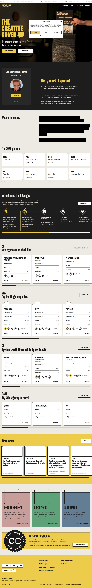
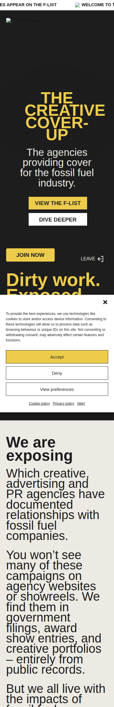

# UI Design System & Master Generation Blueprint: f-list-cleancreatives-org

> **F-List 2026** (https://f-list.cleancreatives.org/) — Search the F-List 2026 to uncover the 802 advertising and PR agencies behind 1,321 documented fossil fuel contracts worldwide.



---

## 1. Executive Visual Persona & Design Archetype

- **Brand Essence & Persona**: **F-List 2026** (`https://f-list.cleancreatives.org/`). Search the F-List 2026 to uncover the 802 advertising and PR agencies behind 1,321 documented fossil fuel contracts worldwide.
- **Visual Archetype**: **Light-Substrate Editorial & Modular Grid System (`#ffffff` canvas, `#1d1d1d` ink, `#edcc4b` accent)**.
- **Anti-AI-Slop Differentiators**:
  - **Source-Grounded Chromatic Polarity**: Anchors the viewport in `#ffffff` (`var(--cmplz_banner_background_color)` in `:root`) paired with `#1d1d1d` primary typography and `#edcc4b` accents.
  - **Extracted Typographic Hierarchy**: Pairs `roc-grotesk` for display copy (`The Creative Cover-up`) with `roc-grotesk-compressed` and not declared in static CSS (uses primary stack / `ui-monospace`).
  - **Calibrated Spatial Grid & Motion**: Combines `425px` container bounds (`gap: 10px`, padding `15px`) with `cubic-bezier(0.4,0,0.2,1)` easing and Three.js / WebGL Canvas Pipeline.

---

## 2. Spatial Architecture & Modular Grid Mathematics



### Viewport Allocation & Container Geometry
- **Captured Viewport Dimensions**: Desktop `1440×9151px` (`assets/desktop.png`, full-page scroll capture), Mobile `390×2400px` (`assets/mobile.png`, capped at 2400px multi-section capture).
- **Master Container Bounds**: `425px` extracted from `f-list-cleancreatives-org` stylesheet.
- **Canvas Lateral Padding & Spacing**: `15px` lateral canvas padding with `10px` grid gap.
- **Border Radius Scale**: `var(--cmplz_banner_border_radius)`, `10px`, `var(--cmplz_button_border_radius)`, `2px`.

### Responsive Breakpoint Architecture
- **Desktop Layout**: Multi-column CSS Grid / Flexbox layout at `1440px` (`max-width: 425px`, `gap: 10px`).
- **Mobile Layout**: Single-column vertical stack at `390px` viewport width with `15px` horizontal padding.
- **Extracted CSS Media Queries**: `@media (max-width: 425px)`, `@media (min-width: 350px)`, `@media (min-width: 768px)`, `@media (max-width: 768px)`.

---

## 3. Color System, Materiality & Atmospheric Lighting

### Semantic Palette & Source Grounding
| Semantic Role | Ground-Truth Value | Extracted CSS Source / Selector |
|---|---|---|
| **Primary Canvas Substrate** | `#ffffff` | `var(--cmplz_banner_background_color)` in `:root` |
| **Primary Typography Ink** | `#f2f2f2` | `var(--cmplz_banner_border_color)` in `:root` |
| **Elevated Surface / Card Substrate** | `#1d1d1d` | `var(--cmplz_text_color)` in `:root` |
| **Interactive Accent / Highlight** | `#edcc4b` | `var(--cmplz_button_accept_background_color)` in `:root` |
| **Secondary / Muted Copy** | `#dddddd` | `var(--cmplz_slider_inactive_color)` in `:root` |
| **Structural Hairline Border** | `#FFF` | `var(--fl-white)` in `:root` |

### Sanitized Root CSS Variables (`ui-ux.md` Ground Truth)
| Variable Name | Extracted Value | Semantic Role |
|---|---|---|
| `--cmplz_banner_width` | `526px` | Layout / Spatial Grid Token |
| `--cmplz_banner_background_color` | `#ffffff` | Canvas / Surface Token |
| `--cmplz_banner_border_color` | `#f2f2f2` | Brand / Palette Token |
| `--cmplz_banner_border_width` | `0px 0px 0px 0px` | Layout / Spatial Grid Token |
| `--cmplz_banner_border_radius` | `0px 0px 0px 0px` | Elevation / Border Token |
| `--cmplz_banner_margin` | `10px` | Layout / Spatial Grid Token |
| `--cmplz_categories-height` | `216px` | Layout / Spatial Grid Token |
| `--cmplz_title_font_size` | `15px` | Typography / Scale Token |
| `--cmplz_text_line_height` | `calc(var(--cmplz_text_font_size) * 1.5)` | Typography Ink Token |
| `--cmplz_text_color` | `#1d1d1d` | Typography Ink Token |
| `--cmplz_hyperlink_color` | `#1d1d1d` | Typography Ink Token |
| `--cmplz_text_font_size` | `12px` | Typography Ink Token |
| `--cmplz_link_font_size` | `12px` | Typography Ink Token |
| `--cmplz_category_body_font_size` | `12px` | Typography / Scale Token |
| `--cmplz_button_accept_background_color` | `#edcc4b` | Canvas / Surface Token |
| `--cmplz_button_accept_border_color` | `#1d1d1d` | Brand / Palette Token |

---

## 4. Typographic Scale & Editorial Hierarchy

### Font Family Stacks
- **Display Typography**: `roc-grotesk`.
- **Primary Body Stack**: `roc-grotesk-compressed`.
- **Technical / Metadata Stack**: not declared in static CSS (uses primary stack / `ui-monospace`).

### Typographic Scale & Rules (Extracted from Stylesheet & Variables)
- **Hero Display (`H1`)**: rule `,.h1` (`font-size: 4.5rem`).
- **Section Heading (`H2`)**: rule `h2` (`font-size: 17px`).
- **Body Copy**: CSS variables `--cmplz_category_body_font_size: 12px`, `--font-longform-paragraph-margin: 2.125rem 0 0 0`; rule `p` (`font-size: 16px`, `line-height: 24px`).
- **Metadata & Navigation Labels**: rule `small` (`line-height: 100%`, `font-weight: 300`).

---

## 5. Choreographed Motion & Interaction Physics

### Primary Easing Curves
- **Extracted Timing Functions**: `cubic-bezier(0.4,0,0.2,1)`.

### Per-Element Transition & Choreography Rules
- **Selector `.cmplz-cookiebanner a`**: `transition: initial` extracted from `f-list-cleancreatives-org` stylesheet.
- **Selector `mplz-category-header .cmplz-icon....`**: `transition: all 0.5s ease` extracted from `f-list-cleancreatives-org` stylesheet.
- **Selector `y .cmplz-banner-checkbox .cmplz-l...`**: `transition: background-color 0.3s, left 0.3s` extracted from `f-list-cleancreatives-org` stylesheet.
- **Extracted Easing Curve (`cubic-bezier(0.4,0,0.2,1)`)**: Governs interactive state transitions across `<header.browser-chrome>` and `<section.flex>`.
- **Runtime Interaction Engine**: Integrates Three.js / WebGL Canvas Pipeline with `prefers-reduced-motion: reduce` fallback guards.

---

## 6. Component Wireframe & Structural DOM Map

### Visual Layout Schematic (Grounded in `dom.html` — `1440px` Desktop & `390px` Mobile Reflow)
```
┌────────────────────────────────────────────────────────────────────────┐
│ DESKTOP VIEWPORT (1440px) — F-List 2026                                │
│ ====================================================================== │
│ [ <header.browser-chrome>  | The report · The F-List · Dirty work · ]  │
│ ---------------------------------------------------------------------- │
│ | HERO STAGE: <section.flex>                                       |   │
│ | H1: The Creative Cover-up                                        |   │
│ | Substrate: #ffffff    | Ink: #1d1d1d    | Accent: #edcc4b        |   │
│ ---------------------------------------------------------------------- │
│ | SHOWCASE GRID (<section.flex>            ) max-w: 425px          |   │
│ | +------------------------------+  +------------------------------+ | │
│ | | Dirty work. Exposed.         |  | We are exposing              | | │
│ | +------------------------------+  +------------------------------+ | │
│ ---------------------------------------------------------------------- │
│ | MOBILE VIEWPORT REFLOW (390px) — Single-Column Stack (gap: 10px  ) | │
│ | [<header.browser-ch] -> [<section.flex>] -> [<section.flex>] |       │
│ ---------------------------------------------------------------------- │
│ [ FOOTER (<footer.page-template>) | https://f-list.cleancreatives.org/ │
└────────────────────────────────────────────────────────────────────────┘
```

### Granular DOM Region Breakdown
1. **Brand Header & Navigation Bar (<header.browser-chrome> — `f-list-cleancreatives-org`)**:
   - Landmark `<header class="browser-chrome">` hosting `F-List 2026` navigation (`The report · The F-List · Dirty work · Take Action`), DOM attributes (`data-cmplz="1"`, `data-nosnippet="true"`, `data-prefix="fas"`, `data-icon="times"`), and stylesheet rule `.cmplz-category { width: initial; -webkit-appearance: checkbox; }`.
2. **Hero Stage & Focal Lead (<section.flex> — `The Creative Cover-up`)**:
   - Landmark `<section class="flex hero">` presenting display lead `The Creative Cover-up` and copy excerpt *"Functional Always active"* over `#ffffff` canvas and `#1d1d1d` ink.
3. **Primary Showcase & Content Grid (<section.flex> — `Dirty work. Exposed.`)**:
   - Landmark `<section class="flex call-intro">` rendering section `Dirty work. Exposed.` with copy *"The technical storage or access is strictly necessary for the leg"*, asset references (`xmlrpc.php`, `www.googletagmanager.com`, `flist2026.b-cdn.net`, `embed`), and grid rule `.cmplz-category:checked::before { content: ''; }`.
4. **Interactive Detail & Feature Matrix (<section.flex> — `We are exposing`)**:
   - Landmark `<section class="flex redacted">` framing `We are exposing` and `The 2026 picture` (*"The technical storage or access is necessary for the legitimate p"*) with `#1d1d1d` surface cards, `#edcc4b` accents, and `.cmplz-cookiebanner { box-sizing: border-box; }`.
5. **Colophon & Global Directory Footer (<footer.page-template> — `https://f-list.cleancreatives.org/`)**:
   - Landmark `<footer class="page-template">` anchoring `F-List 2026` footer links (`The report · The F-List · Dirty work · Take Action`), copy *"The technical storage or access that is used exclusively for"*, and `#FFF` structural dividers.

---

## 7. Master Zero-Shot AI Generation Prompt

```markdown
# Master Zero-Shot Frontend Generation Prompt: f-list-cleancreatives-org (F-List 2026)

You are a principal frontend architect and design systems engineer. Build a complete, production-ready web application replicating the exact design system, DOM landmarks, typographic hierarchy, color tokens, and motion physics of `f-list-cleancreatives-org` (**F-List 2026** — `https://f-list.cleancreatives.org/`).

### 1. Visual Archetype & Anti-AI-Slop Mandates
- **Archetype**: Light-Substrate Editorial & Modular Grid System (`#ffffff` canvas, `#1d1d1d` ink, `#edcc4b` accent).
- **Identity & Domain Context**: Search the F-List 2026 to uncover the 802 advertising and PR agencies behind 1,321 documented fossil fuel contracts worldwide.
- **Primary Substrate**: `#ffffff` (`var(--cmplz_banner_background_color)` in `:root`), **Primary Ink**: `#1d1d1d`, **Accent / Highlight**: `#edcc4b`.
- **Site-Specific Differentiators**:
  - **Source-Grounded Chromatic Polarity**: Anchors the viewport in `#ffffff` (`var(--cmplz_banner_background_color)` in `:root`) paired with `#1d1d1d` primary typography and `#edcc4b` accents.
  - **Extracted Typographic Hierarchy**: Pairs `roc-grotesk` for display copy (`The Creative Cover-up`) with `roc-grotesk-compressed` and not declared in static CSS (uses primary stack / `ui-monospace`).
  - **Calibrated Spatial Grid & Motion**: Combines `425px` container bounds (`gap: 10px`, padding `15px`) with `cubic-bezier(0.4,0,0.2,1)` easing and Three.js / WebGL Canvas Pipeline.

### 2. Ground-Truth CSS Variables (`:root` Token Contract)
Declare and consume these exact custom properties extracted from `f-list-cleancreatives-org` in your global stylesheet:

:root {
  /* F-List 2026 (f-list-cleancreatives-org) — Ground-Truth Extracted CSS Variables */
  --cmplz_banner_width: 526px; /* Layout / Spatial Grid Token (f-list-cleancreatives-org) */
  --cmplz_banner_background_color: #ffffff; /* Canvas / Surface Token (f-list-cleancreatives-org) */
  --cmplz_banner_border_color: #f2f2f2; /* Brand / Palette Token (f-list-cleancreatives-org) */
  --cmplz_banner_border_width: 0px 0px 0px 0px; /* Layout / Spatial Grid Token (f-list-cleancreatives-org) */
  --cmplz_banner_border_radius: 0px 0px 0px 0px; /* Elevation / Border Token (f-list-cleancreatives-org) */
  --cmplz_banner_margin: 10px; /* Layout / Spatial Grid Token (f-list-cleancreatives-org) */
  --cmplz_categories-height: 216px; /* Layout / Spatial Grid Token (f-list-cleancreatives-org) */
  --cmplz_title_font_size: 15px; /* Typography / Scale Token (f-list-cleancreatives-org) */
  --cmplz_text_line_height: calc(var(--cmplz_text_font_size) * 1.5); /* Typography Ink Token (f-list-cleancreatives-org) */
  --cmplz_text_color: #1d1d1d; /* Typography Ink Token (f-list-cleancreatives-org) */
  --cmplz_hyperlink_color: #1d1d1d; /* Typography Ink Token (f-list-cleancreatives-org) */
  --cmplz_text_font_size: 12px; /* Typography Ink Token (f-list-cleancreatives-org) */
  --cmplz_link_font_size: 12px; /* Typography Ink Token (f-list-cleancreatives-org) */
  --cmplz_category_body_font_size: 12px; /* Typography / Scale Token (f-list-cleancreatives-org) */
  --cmplz_button_accept_background_color: #edcc4b; /* Canvas / Surface Token (f-list-cleancreatives-org) */
  --cmplz_button_accept_border_color: #1d1d1d; /* Brand / Palette Token (f-list-cleancreatives-org) */
}

### 3. Semantic Color & Materiality Contract
Map every surface, ink, and border strictly to these source-grounded tokens:
- **Primary Canvas Substrate**: `#ffffff` — grounded in `var(--cmplz_banner_background_color)` in `:root`
- **Primary Typography Ink**: `#f2f2f2` — grounded in `var(--cmplz_banner_border_color)` in `:root`
- **Elevated Surface / Card Substrate**: `#1d1d1d` — grounded in `var(--cmplz_text_color)` in `:root`
- **Interactive Accent / Highlight**: `#edcc4b` — grounded in `var(--cmplz_button_accept_background_color)` in `:root`
- **Secondary / Muted Copy**: `#dddddd` — grounded in `var(--cmplz_slider_inactive_color)` in `:root`
- **Structural Hairline Border**: `#FFF` — grounded in `var(--fl-white)` in `:root`

### 4. Spatial Grid, Container Bounds & Responsive Breakpoints
- **Desktop Viewport Reference**: `1440×9151px` (full-page scroll capture, `1440px` standard desktop width).
- **Mobile Viewport Reference**: `390×2400px` (capped at 2400px multi-section capture, `390px` standard mobile width).
- **Container Max-Width**: `425px` extracted from `f-list-cleancreatives-org` stylesheet
- **Padding & Gutters**: `15px` lateral canvas padding with `10px` grid gap
- **Desktop Grid**: Multi-column CSS Grid / Flexbox layout at `1440px` (`max-width: 425px`, `gap: 10px`)
- **Mobile Adaptation**: Single-column vertical stack at `390px` viewport width with `15px` horizontal padding
- **Media Queries**: `@media (max-width: 425px)`, `@media (min-width: 350px)`, `@media (min-width: 768px)`, `@media (max-width: 768px)`
- **Corner Radii**: `var(--cmplz_banner_border_radius)`, `10px`, `var(--cmplz_button_border_radius)`, `2px`

### 5. Typography & Editorial Scale Contract
- **Display Font Stack**: `roc-grotesk`
- **Body Font Stack**: `roc-grotesk-compressed`
- **Monospace / Technical Font Stack**: not declared in static CSS (uses primary stack / `ui-monospace`)
- **H1 Display Rule**: rule `,.h1` (`font-size: 4.5rem`)
- **H2 Section Rule**: rule `h2` (`font-size: 17px`)
- **Body Copy Rule**: CSS variables `--cmplz_category_body_font_size: 12px`, `--font-longform-paragraph-margin: 2.125rem 0 0 0`; rule `p` (`font-size: 16px`, `line-height: 24px`)
- **Metadata & Index Rule**: rule `small` (`line-height: 100%`, `font-weight: 300`)

### 6. Component Hierarchy, Verbatim Copy & Real DOM Landmarks
Scaffold `f-list-cleancreatives-org` (`F-List 2026`) with these exact structural regions, extracted copy, and CSS rules from `dom.html`:
1. **Brand Header & Navigation Bar (<header.browser-chrome> — `f-list-cleancreatives-org`)**:
   - DOM & Selectors: Landmark `<header class="browser-chrome">` hosting `F-List 2026` navigation (`The report · The F-List · Dirty work · Take Action`), DOM attributes (`data-cmplz="1"`, `data-nosnippet="true"`, `data-prefix="fas"`, `data-icon="times"`), and stylesheet rule `.cmplz-category { width: initial; -webkit-appearance: checkbox; }`.
   - Responsive Contract: Header `Brand Header & Navigation Bar (<header.browser-chrome> — `f-list-cleancreatives-org`)` (`f-list-cleancreatives-org`) adapts across `@media (max-width: 425px)`, `@media (min-width: 350px)`, `@media (min-width: 768px)`, `@media (max-width: 768px)` with `cubic-bezier(0.4,0,0.2,1)` transitions and links `The report · The F-List · Dirty work · Take Action`.
2. **Hero Stage & Focal Lead (<section.flex> — `The Creative Cover-up`)**:
   - DOM & Selectors: Landmark `<section class="flex hero">` presenting display lead `The Creative Cover-up` and copy excerpt *"Functional Always active"* over `#ffffff` canvas and `#1d1d1d` ink.
   - Responsive Contract: Hero stage (`1440×9151px` desktop / `390×2400px` mobile) sets `#ffffff` background with `#1d1d1d` headline `The Creative Cover-up`.
3. **Primary Showcase & Content Grid (<section.flex> — `Dirty work. Exposed.`)**:
   - DOM & Selectors: Landmark `<section class="flex call-intro">` rendering section `Dirty work. Exposed.` with copy *"The technical storage or access is strictly necessary for the leg"*, asset references (`xmlrpc.php`, `www.googletagmanager.com`, `flist2026.b-cdn.net`, `embed`), and grid rule `.cmplz-category:checked::before { content: ''; }`.
   - Responsive Contract: Showcase grid `Primary Showcase & Content Grid (<section.flex> — `Dirty work. Exposed.`)` applies Multi-column CSS Grid / Flexbox layout at `1440px` (`max-width: 425px`, `gap: 10px`) on desktop and Single-column vertical stack at `390px` viewport width with `15px` horizontal padding on mobile.
4. **Interactive Detail & Feature Matrix (<section.flex> — `We are exposing`)**:
   - DOM & Selectors: Landmark `<section class="flex redacted">` framing `We are exposing` and `The 2026 picture` (*"The technical storage or access is necessary for the legitimate p"*) with `#1d1d1d` surface cards, `#edcc4b` accents, and `.cmplz-cookiebanner { box-sizing: border-box; }`.
   - Responsive Contract: Detail module `Interactive Detail & Feature Matrix (<section.flex> — `We are exposing`)` uses `var(--cmplz_banner_border_radius)`, `10px`, `var(--cmplz_button_border_radius)`, `2px` radii, `#edcc4b` highlights, and assets (xmlrpc.php, www.googletagmanager.com, flist2026.b-cdn.net).
5. **Colophon & Global Directory Footer (<footer.page-template> — `https://f-list.cleancreatives.org/`)**:
   - DOM & Selectors: Landmark `<footer class="page-template">` anchoring `F-List 2026` footer links (`The report · The F-List · Dirty work · Take Action`), copy *"The technical storage or access that is used exclusively for"*, and `#FFF` structural dividers.
   - Responsive Contract: Footer `Colophon & Global Directory Footer (<footer.page-template> — `https://f-list.cleancreatives.org/`)` aligns to `425px` extracted from `f-list-cleancreatives-org` stylesheet with `15px` lateral canvas padding with `10px` grid gap and attributes (data-cmplz="1", data-nosnippet="true", data-prefix="fas").

#### Verbatim DOM Copy Excerpts (`dom.html`)
- Copy Excerpt 1: *"Functional Always active"*
- Copy Excerpt 2: *"The technical storage or access is strictly necessary for the legitimate purpose o..."*
- Copy Excerpt 3: *"The technical storage or access is necessary for the legitimate purpose of storing..."*
- Copy Excerpt 4: *"The technical storage or access that is used exclusively for statistical purposes."*

### 7. Motion, Extracted Stylesheet Rules & Interaction Choreography
- **Primary Easing Functions**: `cubic-bezier(0.4,0,0.2,1)`
- **Extracted Stylesheet Rules (`f-list-cleancreatives-org`)**:
- `.cmplz-category { width: initial; -webkit-appearance: checkbox; }`
- `.cmplz-category:checked::before { content: ''; }`
- `.cmplz-cookiebanner { box-sizing: border-box; }`
- `ge-consent .cmplz-manage-consent:... { outline: none; border: none; }`
- `t .cmplz-manage-consent.cmplz-dis... { display: none; }`
- **Per-Selector Transition Rules**:
- **Selector `.cmplz-cookiebanner a`**: `transition: initial` extracted from `f-list-cleancreatives-org` stylesheet.
- **Selector `mplz-category-header .cmplz-icon....`**: `transition: all 0.5s ease` extracted from `f-list-cleancreatives-org` stylesheet.
- **Selector `y .cmplz-banner-checkbox .cmplz-l...`**: `transition: background-color 0.3s, left 0.3s` extracted from `f-list-cleancreatives-org` stylesheet.
- **Extracted Easing Curve (`cubic-bezier(0.4,0,0.2,1)`)**: Governs interactive state transitions across `<header.browser-chrome>` and `<section.flex>`.
- **Runtime Interaction Engine**: Integrates Three.js / WebGL Canvas Pipeline with `prefers-reduced-motion: reduce` fallback guards.

### 8. Technical Deliverables
- Implement in Next.js (App Router) with TypeScript and Tailwind CSS consuming the `:root` custom properties defined above for `f-list-cleancreatives-org`.
- Reproduce both the `1440px` desktop architecture and `390px` mobile breakpoint transitions, preserving semantic HTML5 landmarks (`<header>`, `<nav>`, `<main>`, `<section>`, `<footer>`) and `prefers-reduced-motion` accessibility guards.
```
