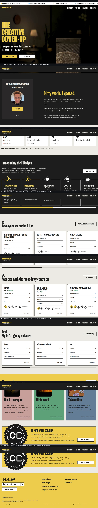
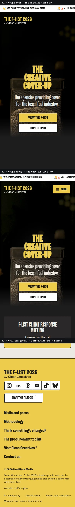

# UI Design System & Master Generation Blueprint: f-list-cleancreatives-org

> **F-List 2026** (https://f-list.cleancreatives.org/) — Search the F-List 2026 to uncover the 802 advertising and PR agencies behind 1,321 documented fossil fuel contracts worldwide.





---

## 1. Executive Visual Persona & Design Archetype

- **Brand Essence & Persona**: **F-List 2026** (`https://f-list.cleancreatives.org/`). Search the F-List 2026 to uncover the 802 advertising and PR agencies behind 1,321 documented fossil fuel contracts worldwide.
- **Capture Provenance**: Live browser capture (`tier1_fast`, HTTP `200`, captured `2026-11-24`).
- **Visual Archetype**: **Light-Substrate Editorial & Modular Grid System (`#ffffff` canvas, `#1d1d1d` ink, `#ffff00` accent)**.
- **Anti-AI-Slop Differentiators**:
  - **Live-Computed Chromatic Polarity**: Anchors the viewport in `#ffffff` (live computed `body` `background-color` (`computed_styles.json`)) paired with `#1d1d1d` primary typography and `#ffff00` accents.
  - **Grounded Typographic Hierarchy**: Pairs `roc-grotesk-compressed` for display copy (`THE CREATIVE COVER-UP`) with `roc-grotesk`.
  - **Calibrated Spatial Grid & Motion**: Combines `1472px` container bounds (`gap: .75rem`, padding `10px`) with `cubic-bezier(0.4,0,0.2,1)` easing and Three.js / WebGL Canvas Pipeline.

---

## 2. Spatial Architecture & Modular Grid Mathematics

### Viewport Allocation & Container Geometry
- **Captured Journey Filmstrips**: Desktop `1280×6624px` (`assets/desktop-journey.webp`, `8` keyframes up to `y=8246px` / doc `9151px`), Mobile `390×2616px` (`assets/mobile-journey.webp`, `3` keyframes).
- **Master Container Bounds**: `1472px` (non-`@media` desktop container stylesheet rule).
- **Canvas Lateral Padding & Spacing**: `10px` lateral canvas padding with `.75rem` grid gap.
- **Border Radius Scale**: `5.008px`, `2px`, `.313rem`, `50%`.

### Responsive Breakpoint Architecture
- **Desktop Layout**: Multi-column CSS Grid / Flexbox layout at `1440px` (`max-width: 1472px`, `gap: .75rem`).
- **Mobile Layout**: Single-column vertical stack at `390px` viewport width with `10px` horizontal padding.
- **Extracted CSS Media Queries**: `@media (max-width: 479px)`, `@media (min-width: 769px)`, `@media (min-width: 480px)`, `@media (min-width: 1701px)`.

---

## 3. Color System, Materiality & Atmospheric Lighting

### Semantic Palette & Source Grounding
| Semantic Role | Ground-Truth Value | Extracted Live / CSS Source |
|---|---|---|
| **Primary Canvas Substrate** | `#ffffff` | live computed `body` `background-color` (`computed_styles.json`) |
| **Primary Typography Ink** | `#1d1d1d` | live computed `body` `color` (`computed_styles.json`) |
| **Elevated Surface / Card Substrate** | `#edcc4b` | live computed `footer` `background-color` (`computed_styles.json`) |
| **Interactive Accent / Highlight** | `#ffff00` | `header nav a:hover { color: yellow }` (`#ffff00`) |
| **Secondary / Muted Copy** | `#edcc4b` | live computed `h1` `color` (`computed_styles.json`) |
| **Structural Hairline Border** | `#f2f2f2` | `var(--cmplz_banner_border_color)` in `:root` |
| **Variable Token (`--fl-grey-1`)** | `#cacaca` | `var(--fl-grey-1)` in `:root` |
| **Variable Token (`--fl-grey-2`)** | `#7d7d7d` | `var(--fl-grey-2)` in `:root` |
| **Variable Token (`--fl-cream`)** | `#eceae3` | `var(--fl-cream)` in `:root` |
| **Variable Token (`--fl-green`)** | `#5da279` | `var(--fl-green)` in `:root` |
| **Variable Token (`--fl-red`)** | `#ff5037` | `var(--fl-red)` in `:root` |

### Sanitized Root CSS Variables (`ui-ux.md` Ground Truth)
| Variable Name | Extracted Value | Semantic Role |
|---|---|---|
| `--fl-black-pure` | `#1D1D1D` | Canvas / Surface Token |
| `--fl-black-text` | `#1D1D1D` | Canvas / Surface Token |
| `--fl-white` | `#FFF` | Canvas / Surface Token |
| `--fl-grey-1` | `#CACACA` | Color / Atmospheric Token |
| `--fl-grey-2` | `#7D7D7D` | Color / Atmospheric Token |
| `--fl-cream` | `#ECEAE3` | Color / Atmospheric Token |
| `--fl-yellow` | `#EDCC4B` | Color / Atmospheric Token |
| `--fl-green` | `#5DA279` | Color / Atmospheric Token |
| `--fl-red` | `#FF5037` | Color / Atmospheric Token |
| `--font-longform-family` | `"roc-grotesk", sans-serif` | Typography / Scale Token |
| `--font-longform-line-height` | `165%` | Typography / Scale Token |
| `--font-longform-size` | `1.25rem` | Typography / Scale Token |
| `--font-longform-style` | `normal` | Typography / Scale Token |
| `--font-longform-weight` | `400` | Typography / Scale Token |
| `--font-longform-weight-bold` | `600` | Typography / Scale Token |
| `--font-longform-paragraph-margin` | `2.125rem 0 0 0` | Typography / Scale Token |

---

## 4. Typographic Scale & Editorial Hierarchy

### Font Family Stacks
- **Display Typography**: `roc-grotesk-compressed`.
- **Primary Body Stack**: `roc-grotesk`.
- **Technical / Metadata Stack**: not declared in live computed styles (uses primary stack / `ui-monospace`).

### Typographic Scale & Rules (Live Computed & Stylesheet Grounded)
- **Hero Display (`H1`)**: live computed `h1` (`font-size: 132.951px`, `line-height: 99.7133px`, `font-weight: 700`); rule `,.h1` (`font-size: 4.5rem`).
- **Section Heading (`H2`)**: live computed `h2` (`font-size: 95.7373px`, `line-height: 81.3767px`, `font-weight: 600`); rule `,.h2` (`font-size: 3.75rem`).
- **Body Copy**: live computed `body` (`font-size: 16px`, `line-height: normal`, `font-weight: 400`); CSS variables `--font-longform-paragraph-margin: 2.125rem 0 0 0`, `--cmplz_category_body_font_size: 12px`; rule `p` (`font-size: 16px`, `line-height: 24px`).
- **Metadata & Navigation Labels**: live computed `nav/a` (`font-size: 16px`, `line-height: normal`, `font-weight: 400`); rule `small` (`line-height: 100%`, `font-weight: 300`).

---

## 5. Choreographed Motion & Interaction Physics

### Primary Easing Curves
- **Extracted Timing Functions**: `cubic-bezier(0.4,0,0.2,1)`.

### Per-Element Transition & Choreography Rules
- **Selector `.btn`**: `transition: transform 150ms ease-out,box-shadow 150ms ease-out` extracted from `f-list-cleancreatives-org` stylesheet.
- **Selector `.alt-btn`**: `transition: background-color 150ms ease-out,color 150ms ease-out` extracted from `f-list-cleancreatives-org` stylesheet.
- **Selector `#hero-banner-image`**: `transition: all 150ms ease-in-out` extracted from `f-list-cleancreatives-org` stylesheet.
- **Extracted Easing Curve (`cubic-bezier(0.4,0,0.2,1)`)**: Governs interactive state transitions across `<header.browser-chrome>` and `<section.call-intro>`.
- **Runtime Interaction Engine**: Integrates Three.js / WebGL Canvas Pipeline with `prefers-reduced-motion: reduce` fallback guards.
### Measured Runtime Scroll & Interaction Telemetry (`behavioral_journey_v2`)
- **Scroll Driver Mode**: `native` (max document height `9151px`, deepest scrollY reached `8246px` across `8` desktop keyframes).
- **Detected Scroll / Motion Libraries**: Native browser scroll / standard CSS transitions.
- **Hover Physics (`primary_cta` · `VIEW THE F-LIST`)**: `transform`: `matrix(1, 0, 0, 1, 3, -3)` -> `matrix(1, 0, 0, 1, 0, 0)`; `boxShadow`: `rgb(29, 29, 29) -3px 3p...` -> `rgb(29, 29, 29) 0px 0px...` (`transition-duration: 0.15s, 0.15s`, `timing: ease-out, ease-out`).
- **Theme Toggle Probe**: Detected `New York Times sells out to...` (no body background diff).
- **Route Transition Architecture**: First internal navigation (`/f-list/agencies/`) measured as `direct` in `1870ms`.

---

## 6. Component Wireframe & Structural DOM Map

### Visual Layout Schematic — Desktop (`1440px`, Grounded in `dom.html` & Landmark Bounding Boxes)
```
┌────────────────────────────────────────────────────────────────────────┐
│ DESKTOP VIEWPORT (1440px) — F-List 2026                                │
│ ====================================================================== │
│ [ <header.browser-chrome (1440x95px)  | The report · The F-List · Di ] │
│ ---------------------------------------------------------------------- │
│ | HERO STAGE: <section.hero> (w=1440px)                              | │
│ | H1: THE CREATIVE COVER-UP                                          | │
│ | Substrate: #ffffff | Ink: #1d1d1d | Accent: #ffff00                | │
│ ---------------------------------------------------------------------- │
│ | SHOWCASE GRID (<section.call-intro>) max-w: 1472px                 | │
│ | +------------------------------+  +------------------------------+ | │
│ | | The Creative Cover-up        |  | Functional Always active     | | │
│ | +------------------------------+  +------------------------------+ | │
│ ---------------------------------------------------------------------- │
│ | DETAIL MODULE (<section.redacted>) — The technical storage         | │
│ ---------------------------------------------------------------------- │
│ [ FOOTER (<footer.page-templat) | https://f-list.cleancreatives.org/   │
└────────────────────────────────────────────────────────────────────────┘
```

### Visual Layout Schematic — Mobile Reflow (`390px`)
```
┌────────────────────────────────────────────────────────────────────────┐
│ MOBILE VIEWPORT REFLOW (390px) — Single-Column Stack (gap: .75rem)     │
│ ====================================================================== │
│ [ HEADER BAR (<header.browser-chrome> ) | Compact Menu (390px)         │
│ ---------------------------------------------------------------------- │
│ | HERO STAGE (<section.hero>) — 390px Vertical Lead                  | │
│ | H1: THE CREATIVE COVER-UP                                          | │
│ ---------------------------------------------------------------------- │
│ | SHOWCASE STACK (<section.call-intro>) — 1-Col Stack                | │
│ | [ Item 1: The Creative Cover-up                                  ] | │
│ | [ Item 2: Functional Always active                               ] | │
│ ---------------------------------------------------------------------- │
│ | DETAIL STACK (<section.redacted>) — 1-Col (The technical stor)     | │
│ ---------------------------------------------------------------------- │
│ [ FOOTER (<footer.page-templat) | Stacked 390px Colophon               │
└────────────────────────────────────────────────────────────────────────┘
```

### Granular DOM Region Breakdown
1. **Brand Header & Navigation Bar (<header.browser-chrome> — `f-list-cleancreatives-org`)**:
   - Landmark `<header class="browser-chrome">` (`1440x95px`) hosting `F-List 2026` navigation (`The report · The F-List · Dirty work · Take Action`), DOM attributes (`data-cmplz="1"`, `data-nosnippet="true"`, `data-prefix="fas"`, `data-icon="times"`), and stylesheet rule `div.notice-box { border: 1px LightSkyBlue solid; border-left-width: 5px; padding: 10px 15... }`.
2. **Hero Stage & Focal Lead (<section.hero> — `THE CREATIVE COVER-UP`)**:
   - Landmark `<section class="hero home">` presenting display lead `THE CREATIVE COVER-UP` and copy excerpt *"The agencies providing cover for the fossil fuel industry."* over `#ffffff` canvas and `#1d1d1d` ink.
3. **Primary Showcase & Content Grid (<section.call-intro> — `The Creative Cover-up`)**:
   - Landmark `<section class="call-intro flex">` rendering section `The Creative Cover-up` with copy *"Functional Always active"*, asset references (`xmlrpc.php`, `www.googletagmanager.com`, `flist2026.b-cdn.net`, `embed`), and grid rule `div.notice-box.notice-success { border-color: MediumSpringGreen ; }`.
4. **Interactive Detail & Feature Matrix (<section.redacted> — `Functional Always active`)**:
   - Landmark `<section class="redacted bg-cream">` framing `Functional Always active` and `The technical storage or access is strictly nece` (*"The technical storage or access is strictly necessary for the leg"*) with `#edcc4b` surface cards, `#ffff00` accents, and `div.notice-box.notice-danger { border-color: LightCoral ; }`.
5. **Colophon & Global Directory Footer (<footer.page-template> — `https://f-list.cleancreatives.org/`)**:
   - Landmark `<footer class="page-template">` anchoring `F-List 2026` footer links (`The report · The F-List · Dirty work · Take Action`), copy *"The technical storage or access is necessary for the legitim"*, and `#f2f2f2` structural dividers.
### Full Vertical Scroll Sequence (Desktop `1440×900` Keyframes)
- **Step 01** (`y=0px`, `0%`): Active landmark `THE CREATIVE COVER-UP` · sticky/fixed elements: `1`
- **Step 02** (`y=850px`, `10%`): Active landmark `EVERY SHARE PUTS THE F-LIST IN FRONT OF THE PEOPL...` · sticky/fixed elements: `1`
- **Step 03** (`y=2550px`, `31%`): Active landmark `EVERY SHARE PUTS THE F-LIST IN FRONT OF THE PEOPL...` · sticky/fixed elements: `1`
- **Step 04** (`y=3400px`, `41%`): Active landmark `EVERY SHARE PUTS THE F-LIST IN FRONT OF THE PEOPL...` · sticky/fixed elements: `1`
- **Step 05** (`y=5100px`, `62%`): Active landmark `Agencies with the most dirty contracts` · sticky/fixed elements: `1`
- **Step 06** (`y=5950px`, `72%`): Active landmark `EVERY SHARE PUTS THE F-LIST IN FRONT OF THE PEOPL...` · sticky/fixed elements: `1`
- **Step 07** (`y=7650px`, `93%`): Active landmark `Read the report` · sticky/fixed elements: `1`
- **Step 08** (`y=8246px`, `100%`): Active landmark `EVERY SHARE PUTS THE F-LIST IN FRONT OF THE PEOPL...` · sticky/fixed elements: `1`

### Multi-Page Internal Route Map
- **Detail Route (`/f-list/agencies/`)**: `https://f-list.cleancreatives.org/f-list/agencies/?new=true` — H1: `THE F-LIST`, scrollHeight `48270px`, transition `direct` (`1870ms`)
- **Detail Route (`/agency/knights-media-public-relations/`)**: `https://f-list.cleancreatives.org/agency/knights-media-public-relations/` — H1: `KNIGHTS MEDIA & PUBLIC RELATIONS`, scrollHeight `3479px`, transition `direct` (`909ms`)
- **Detail Route (`/agency/elite-monday-lovers/`)**: `https://f-list.cleancreatives.org/agency/elite-monday-lovers/` — H1: `ELITE — MONDAY LOVERS`, scrollHeight `3479px`, transition `direct` (`865ms`)

---

## 7. Master Zero-Shot AI Generation Prompt

```markdown
# Master Zero-Shot Frontend Generation Prompt: f-list-cleancreatives-org (F-List 2026)

You are a principal frontend architect and design systems engineer. Build a complete, production-ready web application replicating the exact design system, DOM landmarks, typographic hierarchy, color tokens, and motion physics of `f-list-cleancreatives-org` (**F-List 2026** — `https://f-list.cleancreatives.org/`).

### 1. Visual Archetype & Anti-AI-Slop Mandates
- **Archetype**: Light-Substrate Editorial & Modular Grid System (`#ffffff` canvas, `#1d1d1d` ink, `#ffff00` accent).
- **Identity & Domain Context**: Search the F-List 2026 to uncover the 802 advertising and PR agencies behind 1,321 documented fossil fuel contracts worldwide.
- **Primary Substrate**: `#ffffff` (live computed `body` `background-color` (`computed_styles.json`)), **Primary Ink**: `#1d1d1d`, **Accent / Highlight**: `#ffff00`.
- **Site-Specific Differentiators**:
  - **Live-Computed Chromatic Polarity**: Anchors the viewport in `#ffffff` (live computed `body` `background-color` (`computed_styles.json`)) paired with `#1d1d1d` primary typography and `#ffff00` accents.
  - **Grounded Typographic Hierarchy**: Pairs `roc-grotesk-compressed` for display copy (`THE CREATIVE COVER-UP`) with `roc-grotesk`.
  - **Calibrated Spatial Grid & Motion**: Combines `1472px` container bounds (`gap: .75rem`, padding `10px`) with `cubic-bezier(0.4,0,0.2,1)` easing and Three.js / WebGL Canvas Pipeline.

### 2. Ground-Truth CSS Variables (`:root` Token Contract)
Declare and consume these exact custom properties extracted from `f-list-cleancreatives-org` in your global stylesheet:

:root {
  /* F-List 2026 (f-list-cleancreatives-org) — Live-Grounded CSS Variables */
  --fl-black-pure: #1D1D1D; /* Canvas / Surface Token (f-list-cleancreatives-org) */
  --fl-black-text: #1D1D1D; /* Canvas / Surface Token (f-list-cleancreatives-org) */
  --fl-white: #FFF; /* Canvas / Surface Token (f-list-cleancreatives-org) */
  --fl-grey-1: #CACACA; /* Color / Atmospheric Token (f-list-cleancreatives-org) */
  --fl-grey-2: #7D7D7D; /* Color / Atmospheric Token (f-list-cleancreatives-org) */
  --fl-cream: #ECEAE3; /* Color / Atmospheric Token (f-list-cleancreatives-org) */
  --fl-yellow: #EDCC4B; /* Color / Atmospheric Token (f-list-cleancreatives-org) */
  --fl-green: #5DA279; /* Color / Atmospheric Token (f-list-cleancreatives-org) */
  --fl-red: #FF5037; /* Color / Atmospheric Token (f-list-cleancreatives-org) */
  --font-longform-family: "roc-grotesk", sans-serif; /* Typography / Scale Token (f-list-cleancreatives-org) */
  --font-longform-line-height: 165%; /* Typography / Scale Token (f-list-cleancreatives-org) */
  --font-longform-size: 1.25rem; /* Typography / Scale Token (f-list-cleancreatives-org) */
  --font-longform-style: normal; /* Typography / Scale Token (f-list-cleancreatives-org) */
  --font-longform-weight: 400; /* Typography / Scale Token (f-list-cleancreatives-org) */
  --font-longform-weight-bold: 600; /* Typography / Scale Token (f-list-cleancreatives-org) */
  --font-longform-paragraph-margin: 2.125rem 0 0 0; /* Typography / Scale Token (f-list-cleancreatives-org) */
}

### 3. Semantic Color & Materiality Contract
Map every surface, ink, and border strictly to these source-grounded tokens:
- **Primary Canvas Substrate**: `#ffffff` — grounded in live computed `body` `background-color` (`computed_styles.json`)
- **Primary Typography Ink**: `#1d1d1d` — grounded in live computed `body` `color` (`computed_styles.json`)
- **Elevated Surface / Card Substrate**: `#edcc4b` — grounded in live computed `footer` `background-color` (`computed_styles.json`)
- **Interactive Accent / Highlight**: `#ffff00` — grounded in `header nav a:hover { color: yellow }` (`#ffff00`)
- **Secondary / Muted Copy**: `#edcc4b` — grounded in live computed `h1` `color` (`computed_styles.json`)
- **Structural Hairline Border**: `#f2f2f2` — grounded in `var(--cmplz_banner_border_color)` in `:root`
- **Variable Token (`--fl-grey-1`)**: `#cacaca` — grounded in `var(--fl-grey-1)` in `:root`
- **Variable Token (`--fl-grey-2`)**: `#7d7d7d` — grounded in `var(--fl-grey-2)` in `:root`
- **Variable Token (`--fl-cream`)**: `#eceae3` — grounded in `var(--fl-cream)` in `:root`
- **Variable Token (`--fl-green`)**: `#5da279` — grounded in `var(--fl-green)` in `:root`
- **Variable Token (`--fl-red`)**: `#ff5037` — grounded in `var(--fl-red)` in `:root`

### 4. Spatial Grid, Container Bounds & Responsive Breakpoints
- **Desktop Viewport Reference**: `1280×6624px` (multi-frame vertical journey filmstrip (6624px), `1440px` standard desktop width).
- **Mobile Viewport Reference**: `390×2616px` (multi-frame vertical journey filmstrip (2616px), `390px` standard mobile width).
- **Container Max-Width**: `1472px` (non-`@media` desktop container stylesheet rule)
- **Padding & Gutters**: `10px` lateral canvas padding with `.75rem` grid gap
- **Desktop Grid**: Multi-column CSS Grid / Flexbox layout at `1440px` (`max-width: 1472px`, `gap: .75rem`)
- **Mobile Adaptation**: Single-column vertical stack at `390px` viewport width with `10px` horizontal padding
- **Media Queries**: `@media (max-width: 479px)`, `@media (min-width: 769px)`, `@media (min-width: 480px)`, `@media (min-width: 1701px)`
- **Corner Radii**: `5.008px`, `2px`, `.313rem`, `50%`

### 5. Typography & Editorial Scale Contract
- **Display Font Stack**: `roc-grotesk-compressed`
- **Body Font Stack**: `roc-grotesk`
- **Monospace / Technical Font Stack**: not declared in live computed styles (uses primary stack / `ui-monospace`)
- **H1 Display Rule**: live computed `h1` (`font-size: 132.951px`, `line-height: 99.7133px`, `font-weight: 700`); rule `,.h1` (`font-size: 4.5rem`)
- **H2 Section Rule**: live computed `h2` (`font-size: 95.7373px`, `line-height: 81.3767px`, `font-weight: 600`); rule `,.h2` (`font-size: 3.75rem`)
- **Body Copy Rule**: live computed `body` (`font-size: 16px`, `line-height: normal`, `font-weight: 400`); CSS variables `--font-longform-paragraph-margin: 2.125rem 0 0 0`, `--cmplz_category_body_font_size: 12px`; rule `p` (`font-size: 16px`, `line-height: 24px`)
- **Metadata & Index Rule**: live computed `nav/a` (`font-size: 16px`, `line-height: normal`, `font-weight: 400`); rule `small` (`line-height: 100%`, `font-weight: 300`)

### 6. Component Hierarchy, Verbatim Copy & Real DOM Landmarks
Scaffold `f-list-cleancreatives-org` (`F-List 2026`) with these exact structural regions, extracted copy, and CSS rules from `dom.html`:
1. **Brand Header & Navigation Bar (<header.browser-chrome> — `f-list-cleancreatives-org`)**:
   - DOM & Selectors: Landmark `<header class="browser-chrome">` (`1440x95px`) hosting `F-List 2026` navigation (`The report · The F-List · Dirty work · Take Action`), DOM attributes (`data-cmplz="1"`, `data-nosnippet="true"`, `data-prefix="fas"`, `data-icon="times"`), and stylesheet rule `div.notice-box { border: 1px LightSkyBlue solid; border-left-width: 5px; padding: 10px 15... }`.
   - Responsive Contract: Header `Brand Header & Navigation Bar (<header.browser-chrome> — `f-list-cleancreatives-org`)` (`f-list-cleancreatives-org`) adapts across `@media (max-width: 479px)`, `@media (min-width: 769px)`, `@media (min-width: 480px)`, `@media (min-width: 1701px)` with `cubic-bezier(0.4,0,0.2,1)` transitions and links `The report · The F-List · Dirty work · Take Action`.
2. **Hero Stage & Focal Lead (<section.hero> — `THE CREATIVE COVER-UP`)**:
   - DOM & Selectors: Landmark `<section class="hero home">` presenting display lead `THE CREATIVE COVER-UP` and copy excerpt *"The agencies providing cover for the fossil fuel industry."* over `#ffffff` canvas and `#1d1d1d` ink.
   - Responsive Contract: Hero stage (`1280×6624px` desktop / `390×2616px` mobile) sets `#ffffff` background with `#1d1d1d` headline `THE CREATIVE COVER-UP`.
3. **Primary Showcase & Content Grid (<section.call-intro> — `The Creative Cover-up`)**:
   - DOM & Selectors: Landmark `<section class="call-intro flex">` rendering section `The Creative Cover-up` with copy *"Functional Always active"*, asset references (`xmlrpc.php`, `www.googletagmanager.com`, `flist2026.b-cdn.net`, `embed`), and grid rule `div.notice-box.notice-success { border-color: MediumSpringGreen ; }`.
   - Responsive Contract: Showcase grid `Primary Showcase & Content Grid (<section.call-intro> — `The Creative Cover-up`)` applies Multi-column CSS Grid / Flexbox layout at `1440px` (`max-width: 1472px`, `gap: .75rem`) on desktop and Single-column vertical stack at `390px` viewport width with `10px` horizontal padding on mobile.
4. **Interactive Detail & Feature Matrix (<section.redacted> — `Functional Always active`)**:
   - DOM & Selectors: Landmark `<section class="redacted bg-cream">` framing `Functional Always active` and `The technical storage or access is strictly nece` (*"The technical storage or access is strictly necessary for the leg"*) with `#edcc4b` surface cards, `#ffff00` accents, and `div.notice-box.notice-danger { border-color: LightCoral ; }`.
   - Responsive Contract: Detail module `Interactive Detail & Feature Matrix (<section.redacted> — `Functional Always active`)` uses `5.008px`, `2px`, `.313rem`, `50%` radii, `#ffff00` highlights, and assets (xmlrpc.php, www.googletagmanager.com, flist2026.b-cdn.net).
5. **Colophon & Global Directory Footer (<footer.page-template> — `https://f-list.cleancreatives.org/`)**:
   - DOM & Selectors: Landmark `<footer class="page-template">` anchoring `F-List 2026` footer links (`The report · The F-List · Dirty work · Take Action`), copy *"The technical storage or access is necessary for the legitim"*, and `#f2f2f2` structural dividers.
   - Responsive Contract: Footer `Colophon & Global Directory Footer (<footer.page-template> — `https://f-list.cleancreatives.org/`)` aligns to `1472px` (non-`@media` desktop container stylesheet rule) with `10px` lateral canvas padding with `.75rem` grid gap and attributes (data-cmplz="1", data-nosnippet="true", data-prefix="fas").

#### Verbatim DOM Copy Excerpts (`dom.html`)
- Copy Excerpt 1: *"The agencies providing cover for the fossil fuel industry."*
- Copy Excerpt 2: *"Functional Always active"*
- Copy Excerpt 3: *"The technical storage or access is strictly necessary for the legitimate purpose o..."*
- Copy Excerpt 4: *"The technical storage or access is necessary for the legitimate purpose of storing..."*

### 7. Motion, Extracted Stylesheet Rules & Interaction Choreography
- **Primary Easing Functions**: `cubic-bezier(0.4,0,0.2,1)`
- **Extracted Stylesheet Rules (`f-list-cleancreatives-org`)**:
- `div.notice-box { border: 1px LightSkyBlue solid; border-left-width: 5px; padding: 10px 15... }`
- `div.notice-box.notice-success { border-color: MediumSpringGreen ; }`
- `div.notice-box.notice-danger { border-color: LightCoral ; }`
- `div.notice-box h4 { font-size: 18px; margin:0 0 10px 0; }`
- `div.notice-box p { font-size: 16px; line-height: 24px; margin:0; }`
- **Per-Selector Transition Rules**:
- **Selector `.btn`**: `transition: transform 150ms ease-out,box-shadow 150ms ease-out` extracted from `f-list-cleancreatives-org` stylesheet.
- **Selector `.alt-btn`**: `transition: background-color 150ms ease-out,color 150ms ease-out` extracted from `f-list-cleancreatives-org` stylesheet.
- **Selector `#hero-banner-image`**: `transition: all 150ms ease-in-out` extracted from `f-list-cleancreatives-org` stylesheet.
- **Extracted Easing Curve (`cubic-bezier(0.4,0,0.2,1)`)**: Governs interactive state transitions across `<header.browser-chrome>` and `<section.call-intro>`.
- **Runtime Interaction Engine**: Integrates Three.js / WebGL Canvas Pipeline with `prefers-reduced-motion: reduce` fallback guards.
### 7b. Full-Page Scroll Choreography, Interactive States & Multi-Page Routes
- **Scroll Mechanics**: Implement `native` vertical progression up to `9151px` across 8 distinct viewport chapters.
- **Vertical Chapter Sequence**: THE CREATIVE COVER-UP (0%) -> EVERY SHARE PUTS THE F-LIST... (10%) -> EVERY SHARE PUTS THE F-LIST... (31%) -> EVERY SHARE PUTS THE F-LIST... (41%) -> Agencies with the most dirt... (62%) -> EVERY SHARE PUTS THE F-LIST... (72%) -> Read the report (93%) -> EVERY SHARE PUTS THE F-LIST... (100%).
- **Hover Micro-Interaction (`primary_cta`)**: Animate `transform, boxShadow` with `0.15s, 0.15s ease-out, ease-out`.
- **Multi-Page Routes**: Scaffold internal routes `/f-list/agencies/` (detail, direct), `/agency/knights-media-public-relations/` (detail, direct), `/agency/elite-monday-lovers/` (detail, direct) sharing the global header/footer shell and design tokens.

### 8. Technical Deliverables
- Implement in Next.js (App Router) with TypeScript and Tailwind CSS consuming the `:root` custom properties defined above for `f-list-cleancreatives-org`.
- Reproduce both the `1440px` desktop architecture and `390px` mobile breakpoint transitions, preserving semantic HTML5 landmarks (`<header>`, `<nav>`, `<main>`, `<section>`, `<footer>`) and `prefers-reduced-motion` accessibility guards.
```
---

## 8. Full-Page Scroll Journey, Interactive States & Subpage Inventory

### Desktop Scroll Keyframes (`1440×900` WebP)
| Step | Scroll Y | Progress | Active Landmark / Section | Sticky/Fixed | Visual Asset |
| :---: | :---: | :---: | :--- | :---: | :--- |
| `#01` | `0px` | `0%` | THE CREATIVE COVER-UP | `1` | [desktop-step-01.webp](assets/desktop-step-01.webp) |
| `#02` | `850px` | `10%` | EVERY SHARE PUTS THE F-LIST IN FRONT OF THE P... | `1` | [desktop-step-02.webp](assets/desktop-step-02.webp) |
| `#03` | `2550px` | `31%` | EVERY SHARE PUTS THE F-LIST IN FRONT OF THE P... | `1` | [desktop-step-03.webp](assets/desktop-step-03.webp) |
| `#04` | `3400px` | `41%` | EVERY SHARE PUTS THE F-LIST IN FRONT OF THE P... | `1` | [desktop-step-04.webp](assets/desktop-step-04.webp) |
| `#05` | `5100px` | `62%` | Agencies with the most dirty contracts | `1` | [desktop-step-05.webp](assets/desktop-step-05.webp) |
| `#06` | `5950px` | `72%` | EVERY SHARE PUTS THE F-LIST IN FRONT OF THE P... | `1` | [desktop-step-06.webp](assets/desktop-step-06.webp) |
| `#07` | `7650px` | `93%` | Read the report | `1` | [desktop-step-07.webp](assets/desktop-step-07.webp) |
| `#08` | `8246px` | `100%` | EVERY SHARE PUTS THE F-LIST IN FRONT OF THE P... | `1` | [desktop-step-08.webp](assets/desktop-step-08.webp) |

### Mobile Condensed Keyframes (`390×844` WebP)
| Step | Scroll Y | Progress | Active Landmark | Visual Asset |
| :---: | :---: | :---: | :--- | :--- |
| `#01` | `0px` | `0%` | THE CREATIVE COVER-UP | [mobile-step-01.webp](assets/mobile-step-01.webp) |
| `#02` | `0px` | `50%` | THE CREATIVE COVER-UP | [mobile-step-02.webp](assets/mobile-step-02.webp) |
| `#03` | `9751px` | `100%` | Introducing the F-Badges | [mobile-step-03.webp](assets/mobile-step-03.webp) |

### Internal Subpage Filmstrips (`1080px` Wide WebP)
| # | Template | Route URL | H1 / Title | Scroll Height | Transition | Filmstrip Asset |
| :-: | :---: | :--- | :--- | :---: | :---: | :--- |
| `1` | `detail` | `https://f-list.cleancreatives.org/f-list/agencies/?new=true` | THE F-LIST | `48270px` | `direct` (`1870ms`) | [subpage-01-f-list-agencies.webp](assets/subpage-01-f-list-agencies.webp) |
| `2` | `detail` | `https://f-list.cleancreatives.org/agency/knights-media-public-relations/` | KNIGHTS MEDIA & PUBLIC RELATIONS | `3479px` | `direct` (`909ms`) | [subpage-02-agency-knights-media-public-relation.webp](assets/subpage-02-agency-knights-media-public-relation.webp) |
| `3` | `detail` | `https://f-list.cleancreatives.org/agency/elite-monday-lovers/` | ELITE — MONDAY LOVERS | `3479px` | `direct` (`865ms`) | [subpage-03-agency-elite-monday-lovers.webp](assets/subpage-03-agency-elite-monday-lovers.webp) |

