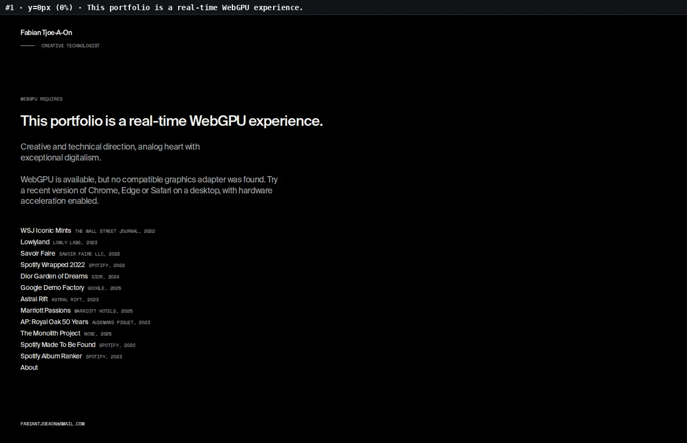
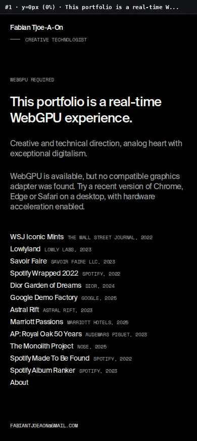

# UI Design System & Master Generation Blueprint: fabiantjoeaon-com

> **Fabian Tjoe-A-On — Creative technologist** (https://fabiantjoeaon.com) — Creative and technical direction, analog heart with exceptional digitalism.





---

## 1. Executive Visual Persona & Design Archetype

- **Brand Essence & Persona**: **Fabian Tjoe-A-On — Creative technologist** (`https://fabiantjoeaon.com`). Creative and technical direction, analog heart with exceptional digitalism.
- **Capture Provenance**: Live browser capture (`tier1_fast`, HTTP `200`, captured `2026-11-24`).
- **Visual Archetype**: **High-Contrast Obsidian / Atmospheric Design System (`#000000` canvas, `#f3f3ef` ink, `#99ff99` accent)**.
- **Anti-AI-Slop Differentiators**:
  - **Live-Computed Chromatic Polarity**: Anchors the viewport in `#000000` (live computed `body` `background-color` (`computed_styles.json`)) paired with `#f3f3ef` primary typography and `#99ff99` accents.
  - **Grounded Typographic Hierarchy**: Uses `Suisse Intl` across display (`This portfolio is a real-time WebGPU`) and body copy, paired with `Space Mono` for monospace/code.
  - **Calibrated Spatial Grid & Motion**: Combines `1440px` container bounds (`gap: 12px`, padding `43.2px`) with `cubic-bezier(.22,1,.36,1)` easing and Lenis Smooth Scroll (`data-lenis`), Three.js / WebGL Canvas Pipeline.

---

## 2. Spatial Architecture & Modular Grid Mathematics

### Viewport Allocation & Container Geometry
- **Captured Journey Filmstrips**: Desktop `1280×828px` (`assets/desktop-journey.webp`, `1` keyframes up to `y=0px` / doc `900px`), Mobile `390×872px` (`assets/mobile-journey.webp`, `1` keyframes).
- **Master Container Bounds**: `1440px` (full-bleed `100%` desktop stage measured on `1440px` viewport).
- **Canvas Lateral Padding & Spacing**: `43.2px` lateral canvas padding with `12px` grid gap.
- **Border Radius Scale**: `50%`.

### Responsive Breakpoint Architecture
- **Desktop Layout**: Multi-column CSS Grid / Flexbox layout at `1440px` (`max-width: 1440px`, `gap: 12px`).
- **Mobile Layout**: Single-column vertical stack at `390px` viewport width with `43.2px` horizontal padding.
- **Extracted CSS Media Queries**: `@media (max-width: 700px)`, `@media (prefers-reduced-motion: reduce)`, `@media (min-width: 1800px)`, `@media (max-width: 1000px)`.

---

## 3. Color System, Materiality & Atmospheric Lighting

### Semantic Palette & Source Grounding
| Semantic Role | Ground-Truth Value | Extracted Live / CSS Source |
|---|---|---|
| **Primary Canvas Substrate** | `#000000` | live computed `body` `background-color` (`computed_styles.json`) |
| **Primary Typography Ink** | `#f3f3ef` | live computed `h1` `color` (`computed_styles.json`) |
| **Elevated Surface / Card Substrate** | `#a2e2e1` | `::selection { background: #a2e2e1 }` |
| **Interactive Accent / Highlight** | `#99ff99` | `.touch-debug { color: #99ff99 }` |
| **Secondary / Muted Copy** | `#a3a6a7` | live computed `p` `color` (`computed_styles.json`) |
| **Structural Hairline Border** | `#353939` | `var(--rule)` in `:root` (`rgba(220, 237, 239, 0.24)`) |

### Sanitized Root CSS Variables (`ui-ux.md` Ground Truth)
| Variable Name | Extracted Value | Semantic Role |
|---|---|---|
| `--font-family` | `Arial, sans-serif` | Typography / Scale Token |
| `--font-mono` | `ui-monospace, monospace` | Typography / Scale Token |
| `--w-light` | `400` | Canvas / Surface Token |
| `--w-regular` | `400` | Design System Custom Token |
| `--w-book` | `400` | Design System Custom Token |
| `--w-medium` | `500` | Design System Custom Token |
| `--page-gutter` | `clamp(20px, 3vw, 64px)` | Layout / Spatial Grid Token |
| `--nav-inset` | `clamp(20px, 2.1vw, 44px)` | Layout / Spatial Grid Token |
| `--text` | `#f3f3ef` | Typography Ink Token |
| `--muted` | `#a3a6a7` | Color / Atmospheric Token |
| `--rule` | `rgba(220, 237, 239, 0.24)` | Color / Atmospheric Token |
| `--type-scale` | `0.86` | Typography / Scale Token |
| `--nav-font-size` | `calc(clamp(16px, 1.15vw, 24px) * var(--type-scale))` | Typography / Scale Token |
| `--meta-font-size` | `clamp(9.5px, 0.64vw, 12px)` | Typography / Scale Token |
| `--digit-height` | `1.1em` | Layout / Spatial Grid Token |
| `--size` | `18px` | Layout / Spatial Grid Token |

---

## 4. Typographic Scale & Editorial Hierarchy

### Font Family Stacks
- **Display Typography**: `Suisse Intl`.
- **Primary Body Stack**: `Suisse Intl`.
- **Technical / Metadata Stack**: `Space Mono`.

### Typographic Scale & Rules (Live Computed & Stylesheet Grounded)
- **Hero Display (`H1`)**: live computed `h1` (`font-size: 29.9693px`, `line-height: 36.8622px`, `font-weight: 500`, `letter-spacing: -1.04892px`).
- **Section Heading (`H2`)**: observed font-size ladder: `29.9693px`, `16px`, `9.5px`, `14.2416px`, `clamp(110px, 15vw, 260px)`.
- **Body Copy**: live computed `body` (`font-size: 16px`, `line-height: normal`, `font-weight: 400`); rule `body` (`font-weight: var(--w-regular)`).
- **Metadata & Navigation Labels**: live computed `nav/a` (`font-size: 16px`, `line-height: normal`, `font-weight: 400`); CSS variables `--font-mono: ui-monospace, monospace`, `--meta-font-size: clamp(9.5px, 0.64vw, 12px)`.

---

## 5. Choreographed Motion & Interaction Physics

### Primary Easing Curves
- **Extracted Timing Functions**: `cubic-bezier(.22,1,.36,1)`, `cubic-bezier(0.19,1,0.22,1)`, `cubic-bezier(0.65,0,0.35,1)`.

### Per-Element Transition & Choreography Rules
- **Selector `.loader-enter`**: `transition: color 450ms cubic-bezier(.22,1,.36,1)` extracted from `fabiantjoeaon-com` stylesheet.
- **Selector `.loader-enter::after`**: `transition: transform 650ms cubic-bezier(.22,1,.36,1)` extracted from `fabiantjoeaon-com` stylesheet.
- **Selector `.project-visit`**: `transition: color 250ms ease` extracted from `fabiantjoeaon-com` stylesheet.
- **Extracted Easing Curve (`cubic-bezier(.22,1,.36,1)`)**: Governs interactive state transitions across `<header.no-webgpu-header>` and `<section.no-webgpu-body:nth(2)>`.
- **Runtime Interaction Engine**: Integrates Lenis Smooth Scroll (`data-lenis`), Three.js / WebGL Canvas Pipeline with `prefers-reduced-motion: reduce` fallback guards.
### Measured Runtime Scroll & Interaction Telemetry (`behavioral_journey_v2`)
- **Scroll Driver Mode**: `wheel` (max document height `900px`, deepest scrollY reached `0px` across `1` desktop keyframes).
- **Detected Scroll / Motion Libraries**: Native browser scroll / standard CSS transitions.
- **Route Transition Architecture**: First internal navigation (`/about`) measured as `MPA` in `1577ms`.

---

## 6. Component Wireframe & Structural DOM Map

### Visual Layout Schematic — Desktop (`1440px`, Grounded in `dom.html` & Landmark Bounding Boxes)
```
┌────────────────────────────────────────────────────────────────────────┐
│ DESKTOP VIEWPORT (1440px) — Fabian Tjoe-A-On — Creative technologist   │
│ ====================================================================== │
│ [ <header.no-webgpu-head (1354x41px)  | About                        ] │
│ ---------------------------------------------------------------------- │
│ | HERO STAGE: <section.no-webgpu-body> (w=1440px)                    | │
│ | H1: This portfolio is a real-time WebGPU experience.               | │
│ | Substrate: #000000 | Ink: #f3f3ef | Accent: #99ff99                | │
│ ---------------------------------------------------------------------- │
│ | SHOWCASE GRID (<section.no-webgpu-body:nt) max-w: 1440px           | │
│ | +------------------------------+  +------------------------------+ | │
│ | | Creative technologist        |  | Creative and technical direc | | │
│ | +------------------------------+  +------------------------------+ | │
│ ---------------------------------------------------------------------- │
│ | DETAIL MODULE (<section.no-webgpu-body:nt) — WebGPU is available,  | │
│ ---------------------------------------------------------------------- │
│ [ FOOTER (<footer.no-webgpu-fo) | https://fabiantjoeaon.com            │
└────────────────────────────────────────────────────────────────────────┘
```

### Visual Layout Schematic — Mobile Reflow (`390px`)
```
┌────────────────────────────────────────────────────────────────────────┐
│ MOBILE VIEWPORT REFLOW (390px) — Single-Column Stack (gap: 12px)       │
│ ====================================================================== │
│ [ HEADER BAR (<header.no-webgpu-header) | Compact Menu (390px)         │
│ ---------------------------------------------------------------------- │
│ | HERO STAGE (<section.no-webgpu-body>) — 390px Vertical Lead        | │
│ | H1: This portfolio is a real-time WebGPU experience.               | │
│ ---------------------------------------------------------------------- │
│ | SHOWCASE STACK (<section.no-webgpu-bod) — 1-Col Stack              | │
│ | [ Item 1: Creative technologist                                  ] | │
│ | [ Item 2: Creative and technical direction, analog heart w       ] | │
│ ---------------------------------------------------------------------- │
│ | DETAIL STACK (<section.no-webgpu-body:) — 1-Col (WebGPU is availabl) │
│ ---------------------------------------------------------------------- │
│ [ FOOTER (<footer.no-webgpu-fo) | Stacked 390px Colophon               │
└────────────────────────────────────────────────────────────────────────┘
```

### Granular DOM Region Breakdown
1. **Brand Header & Navigation Bar (<header.no-webgpu-header> — `fabiantjoeaon-com`)**:
   - Landmark `<header class="no-webgpu-header">` (`1354x41px`) hosting `Fabian Tjoe-A-On — Creative technolo` navigation (`About`), DOM attributes (`data-mono`), and stylesheet rule `.loader-grid { position: absolute; inset: 0; width: 100%; height: 100%; display: block; }`.
2. **Hero Stage & Focal Lead (<section.no-webgpu-body> — `This portfolio is a real-time WebG`)**:
   - Landmark `<section class="no-webgpu-body">` presenting display lead `This portfolio is a real-time WebGPU experience.` and copy excerpt *"Creative technologist"* over `#000000` canvas and `#f3f3ef` ink.
3. **Primary Showcase & Content Grid (<section.no-webgpu-body:nth(2)> — `Creative technologist`)**:
   - Landmark `<section class="no-webgpu-body">` rendering section `Creative technologist` with copy *"Creative and technical direction, analog heart with exceptional d"*, asset references (`SuisseIntl-Regular.otf`, `SpaceMono-Regular.ttf`, `favicon.ico`, `favicon.svg`), and grid rule `.loader-mask { display: block; overflow: hidden; }`.
4. **Interactive Detail & Feature Matrix (<section.no-webgpu-body:nth(3)> — `Creative and technical direction, `)**:
   - Landmark `<section class="no-webgpu-body">` framing `Creative and technical direction, analog heart w` and `WebGPU is available, but no compatible graphics ` (*"WebGPU is available, but no compatible graphics adapter was found"*) with `#a2e2e1` surface cards, `#99ff99` accents, and `.loader-mask > span { display: block; will-change: transform; }`.
5. **Colophon & Global Directory Footer (<footer.no-webgpu-footer> — `https://fabiantjoeaon.com`)**:
   - Landmark `<footer class="no-webgpu-footer">` anchoring `Fabian Tjoe-A-On — Creative tech` footer links (`About`), copy *"WSJ Iconic Mints The Wall Street Journal, 2022"*, and `#353939` structural dividers.
### Full Vertical Scroll Sequence (Desktop `1440×900` Keyframes)
- **Step 01** (`y=0px`, `0%`): Active landmark `This portfolio is a real-time WebGPU experience.` · sticky/fixed elements: `0`

### Multi-Page Internal Route Map
- **About Route (`/about`)**: `https://fabiantjoeaon.com/about` — H1: `About`, scrollHeight `900px`, transition `MPA` (`1577ms`)

---

## 7. Master Zero-Shot AI Generation Prompt

```markdown
# Master Zero-Shot Frontend Generation Prompt: fabiantjoeaon-com (Fabian Tjoe-A-On — Creative technologist)

You are a principal frontend architect and design systems engineer. Build a complete, production-ready web application replicating the exact design system, DOM landmarks, typographic hierarchy, color tokens, and motion physics of `fabiantjoeaon-com` (**Fabian Tjoe-A-On — Creative technologist** — `https://fabiantjoeaon.com`).

### 1. Visual Archetype & Anti-AI-Slop Mandates
- **Archetype**: High-Contrast Obsidian / Atmospheric Design System (`#000000` canvas, `#f3f3ef` ink, `#99ff99` accent).
- **Identity & Domain Context**: Creative and technical direction, analog heart with exceptional digitalism.
- **Primary Substrate**: `#000000` (live computed `body` `background-color` (`computed_styles.json`)), **Primary Ink**: `#f3f3ef`, **Accent / Highlight**: `#99ff99`.
- **Site-Specific Differentiators**:
  - **Live-Computed Chromatic Polarity**: Anchors the viewport in `#000000` (live computed `body` `background-color` (`computed_styles.json`)) paired with `#f3f3ef` primary typography and `#99ff99` accents.
  - **Grounded Typographic Hierarchy**: Uses `Suisse Intl` across display (`This portfolio is a real-time WebGPU`) and body copy, paired with `Space Mono` for monospace/code.
  - **Calibrated Spatial Grid & Motion**: Combines `1440px` container bounds (`gap: 12px`, padding `43.2px`) with `cubic-bezier(.22,1,.36,1)` easing and Lenis Smooth Scroll (`data-lenis`), Three.js / WebGL Canvas Pipeline.

### 2. Ground-Truth CSS Variables (`:root` Token Contract)
Declare and consume these exact custom properties extracted from `fabiantjoeaon-com` in your global stylesheet:

:root {
  /* Fabian Tjoe-A-On — Creative technologist (fabiantjoeaon-com) — Live-Grounded CSS Variables */
  --font-family: Arial, sans-serif; /* Typography / Scale Token (fabiantjoeaon-com) */
  --font-mono: ui-monospace, monospace; /* Typography / Scale Token (fabiantjoeaon-com) */
  --w-light: 400; /* Canvas / Surface Token (fabiantjoeaon-com) */
  --w-regular: 400; /* Design System Custom Token (fabiantjoeaon-com) */
  --w-book: 400; /* Design System Custom Token (fabiantjoeaon-com) */
  --w-medium: 500; /* Design System Custom Token (fabiantjoeaon-com) */
  --page-gutter: clamp(20px, 3vw, 64px); /* Layout / Spatial Grid Token (fabiantjoeaon-com) */
  --nav-inset: clamp(20px, 2.1vw, 44px); /* Layout / Spatial Grid Token (fabiantjoeaon-com) */
  --text: #f3f3ef; /* Typography Ink Token (fabiantjoeaon-com) */
  --muted: #a3a6a7; /* Color / Atmospheric Token (fabiantjoeaon-com) */
  --rule: rgba(220, 237, 239, 0.24); /* Color / Atmospheric Token (fabiantjoeaon-com) */
  --type-scale: 0.86; /* Typography / Scale Token (fabiantjoeaon-com) */
  --nav-font-size: calc(clamp(16px, 1.15vw, 24px) * var(--type-scale)); /* Typography / Scale Token (fabiantjoeaon-com) */
  --meta-font-size: clamp(9.5px, 0.64vw, 12px); /* Typography / Scale Token (fabiantjoeaon-com) */
  --digit-height: 1.1em; /* Layout / Spatial Grid Token (fabiantjoeaon-com) */
  --size: 18px; /* Layout / Spatial Grid Token (fabiantjoeaon-com) */
}

### 3. Semantic Color & Materiality Contract
Map every surface, ink, and border strictly to these source-grounded tokens:
- **Primary Canvas Substrate**: `#000000` — grounded in live computed `body` `background-color` (`computed_styles.json`)
- **Primary Typography Ink**: `#f3f3ef` — grounded in live computed `h1` `color` (`computed_styles.json`)
- **Elevated Surface / Card Substrate**: `#a2e2e1` — grounded in `::selection { background: #a2e2e1 }`
- **Interactive Accent / Highlight**: `#99ff99` — grounded in `.touch-debug { color: #99ff99 }`
- **Secondary / Muted Copy**: `#a3a6a7` — grounded in live computed `p` `color` (`computed_styles.json`)
- **Structural Hairline Border**: `#353939` — grounded in `var(--rule)` in `:root` (`rgba(220, 237, 239, 0.24)`)

### 4. Spatial Grid, Container Bounds & Responsive Breakpoints
- **Desktop Viewport Reference**: `1280×828px` (single-viewport 100vh live capture (900px), `1440px` standard desktop width).
- **Mobile Viewport Reference**: `390×872px` (full-page live capture (872px), `390px` standard mobile width).
- **Container Max-Width**: `1440px` (full-bleed `100%` desktop stage measured on `1440px` viewport)
- **Padding & Gutters**: `43.2px` lateral canvas padding with `12px` grid gap
- **Desktop Grid**: Multi-column CSS Grid / Flexbox layout at `1440px` (`max-width: 1440px`, `gap: 12px`)
- **Mobile Adaptation**: Single-column vertical stack at `390px` viewport width with `43.2px` horizontal padding
- **Media Queries**: `@media (max-width: 700px)`, `@media (prefers-reduced-motion: reduce)`, `@media (min-width: 1800px)`, `@media (max-width: 1000px)`
- **Corner Radii**: `50%`

### 5. Typography & Editorial Scale Contract
- **Display Font Stack**: `Suisse Intl`
- **Body Font Stack**: `Suisse Intl`
- **Monospace / Technical Font Stack**: `Space Mono`
- **H1 Display Rule**: live computed `h1` (`font-size: 29.9693px`, `line-height: 36.8622px`, `font-weight: 500`, `letter-spacing: -1.04892px`)
- **H2 Section Rule**: observed font-size ladder: `29.9693px`, `16px`, `9.5px`, `14.2416px`, `clamp(110px, 15vw, 260px)`
- **Body Copy Rule**: live computed `body` (`font-size: 16px`, `line-height: normal`, `font-weight: 400`); rule `body` (`font-weight: var(--w-regular)`)
- **Metadata & Index Rule**: live computed `nav/a` (`font-size: 16px`, `line-height: normal`, `font-weight: 400`); CSS variables `--font-mono: ui-monospace, monospace`, `--meta-font-size: clamp(9.5px, 0.64vw, 12px)`

### 6. Component Hierarchy, Verbatim Copy & Real DOM Landmarks
Scaffold `fabiantjoeaon-com` (`Fabian Tjoe-A-On — Creative technologist`) with these exact structural regions, extracted copy, and CSS rules from `dom.html`:
1. **Brand Header & Navigation Bar (<header.no-webgpu-header> — `fabiantjoeaon-com`)**:
   - DOM & Selectors: Landmark `<header class="no-webgpu-header">` (`1354x41px`) hosting `Fabian Tjoe-A-On — Creative technolo` navigation (`About`), DOM attributes (`data-mono`), and stylesheet rule `.loader-grid { position: absolute; inset: 0; width: 100%; height: 100%; display: block; }`.
   - Responsive Contract: Header `Brand Header & Navigation Bar (<header.no-webgpu-header> — `fabiantjoeaon-com`)` (`fabiantjoeaon-com`) adapts across `@media (max-width: 700px)`, `@media (prefers-reduced-motion: reduce)`, `@media (min-width: 1800px)`, `@media (max-width: 1000px)` with `cubic-bezier(.22,1,.36,1)`, `cubic-bezier(0.19,1,0.22,1)`, `cubic-bezier(0.65,0,0.35,1)` transitions and links `About`.
2. **Hero Stage & Focal Lead (<section.no-webgpu-body> — `This portfolio is a real-time WebG`)**:
   - DOM & Selectors: Landmark `<section class="no-webgpu-body">` presenting display lead `This portfolio is a real-time WebGPU experience.` and copy excerpt *"Creative technologist"* over `#000000` canvas and `#f3f3ef` ink.
   - Responsive Contract: Hero stage (`1280×828px` desktop / `390×872px` mobile) sets `#000000` background with `#f3f3ef` headline `This portfolio is a real-time WebGPU experience.`.
3. **Primary Showcase & Content Grid (<section.no-webgpu-body:nth(2)> — `Creative technologist`)**:
   - DOM & Selectors: Landmark `<section class="no-webgpu-body">` rendering section `Creative technologist` with copy *"Creative and technical direction, analog heart with exceptional d"*, asset references (`SuisseIntl-Regular.otf`, `SpaceMono-Regular.ttf`, `favicon.ico`, `favicon.svg`), and grid rule `.loader-mask { display: block; overflow: hidden; }`.
   - Responsive Contract: Showcase grid `Primary Showcase & Content Grid (<section.no-webgpu-body:nth(2)> — `Creative technologist`)` applies Multi-column CSS Grid / Flexbox layout at `1440px` (`max-width: 1440px`, `gap: 12px`) on desktop and Single-column vertical stack at `390px` viewport width with `43.2px` horizontal padding on mobile.
4. **Interactive Detail & Feature Matrix (<section.no-webgpu-body:nth(3)> — `Creative and technical direction, `)**:
   - DOM & Selectors: Landmark `<section class="no-webgpu-body">` framing `Creative and technical direction, analog heart w` and `WebGPU is available, but no compatible graphics ` (*"WebGPU is available, but no compatible graphics adapter was found"*) with `#a2e2e1` surface cards, `#99ff99` accents, and `.loader-mask > span { display: block; will-change: transform; }`.
   - Responsive Contract: Detail module `Interactive Detail & Feature Matrix (<section.no-webgpu-body:nth(3)> — `Creative and technical direction, `)` uses `50%` radii, `#99ff99` highlights, and assets (SuisseIntl-Regular.otf, SpaceMono-Regular.ttf, favicon.ico).
5. **Colophon & Global Directory Footer (<footer.no-webgpu-footer> — `https://fabiantjoeaon.com`)**:
   - DOM & Selectors: Landmark `<footer class="no-webgpu-footer">` anchoring `Fabian Tjoe-A-On — Creative tech` footer links (`About`), copy *"WSJ Iconic Mints The Wall Street Journal, 2022"*, and `#353939` structural dividers.
   - Responsive Contract: Footer `Colophon & Global Directory Footer (<footer.no-webgpu-footer> — `https://fabiantjoeaon.com`)` aligns to `1440px` (full-bleed `100%` desktop stage measured on `1440px` viewport) with `43.2px` lateral canvas padding with `12px` grid gap and attributes (data-mono).

#### Verbatim DOM Copy Excerpts (`dom.html`)
- Copy Excerpt 1: *"Creative technologist"*
- Copy Excerpt 2: *"Creative and technical direction, analog heart with exceptional digitalism."*
- Copy Excerpt 3: *"WebGPU is available, but no compatible graphics adapter was found. Try a recent ve..."*
- Copy Excerpt 4: *"WSJ Iconic Mints The Wall Street Journal, 2022"*

### 7. Motion, Extracted Stylesheet Rules & Interaction Choreography
- **Primary Easing Functions**: `cubic-bezier(.22,1,.36,1)`, `cubic-bezier(0.19,1,0.22,1)`, `cubic-bezier(0.65,0,0.35,1)`
- **Extracted Stylesheet Rules (`fabiantjoeaon-com`)**:
- `.loader-grid { position: absolute; inset: 0; width: 100%; height: 100%; display: block; }`
- `.loader-mask { display: block; overflow: hidden; }`
- `.loader-mask > span { display: block; will-change: transform; }`
- `.entry-loader > .loader-identity { position: absolute; top: var(--nav-inset); left: var(--page-gutter); }`
- `.loader-digits { display: flex; }`
- **Per-Selector Transition Rules**:
- **Selector `.loader-enter`**: `transition: color 450ms cubic-bezier(.22,1,.36,1)` extracted from `fabiantjoeaon-com` stylesheet.
- **Selector `.loader-enter::after`**: `transition: transform 650ms cubic-bezier(.22,1,.36,1)` extracted from `fabiantjoeaon-com` stylesheet.
- **Selector `.project-visit`**: `transition: color 250ms ease` extracted from `fabiantjoeaon-com` stylesheet.
- **Extracted Easing Curve (`cubic-bezier(.22,1,.36,1)`)**: Governs interactive state transitions across `<header.no-webgpu-header>` and `<section.no-webgpu-body:nth(2)>`.
- **Runtime Interaction Engine**: Integrates Lenis Smooth Scroll (`data-lenis`), Three.js / WebGL Canvas Pipeline with `prefers-reduced-motion: reduce` fallback guards.
### 7b. Full-Page Scroll Choreography, Interactive States & Multi-Page Routes
- **Scroll Mechanics**: Implement `wheel` vertical progression up to `900px` across 1 distinct viewport chapters.
- **Vertical Chapter Sequence**: This portfolio is a real-ti... (0%).
- **Multi-Page Routes**: Scaffold internal routes `/about` (about, MPA) sharing the global header/footer shell and design tokens.

### 8. Technical Deliverables
- Implement in Next.js (App Router) with TypeScript and Tailwind CSS consuming the `:root` custom properties defined above for `fabiantjoeaon-com`.
- Reproduce both the `1440px` desktop architecture and `390px` mobile breakpoint transitions, preserving semantic HTML5 landmarks (`<header>`, `<nav>`, `<main>`, `<section>`, `<footer>`) and `prefers-reduced-motion` accessibility guards.
```
---

## 8. Full-Page Scroll Journey, Interactive States & Subpage Inventory

### Desktop Scroll Keyframes (`1440×900` WebP)
| Step | Scroll Y | Progress | Active Landmark / Section | Sticky/Fixed | Visual Asset |
| :---: | :---: | :---: | :--- | :---: | :--- |
| `#01` | `0px` | `0%` | This portfolio is a real-time WebGPU experience. | `0` | [desktop-step-01.webp](assets/desktop-step-01.webp) |

### Mobile Condensed Keyframes (`390×844` WebP)
| Step | Scroll Y | Progress | Active Landmark | Visual Asset |
| :---: | :---: | :---: | :--- | :--- |
| `#01` | `0px` | `0%` | This portfolio is a real-time WebGPU expe... | [mobile-step-01.webp](assets/mobile-step-01.webp) |

### Internal Subpage Filmstrips (`1080px` Wide WebP)
| # | Template | Route URL | H1 / Title | Scroll Height | Transition | Filmstrip Asset |
| :-: | :---: | :--- | :--- | :---: | :---: | :--- |
| `1` | `about` | `https://fabiantjoeaon.com/about` | About | `900px` | `MPA` (`1577ms`) | [subpage-01-about.webp](assets/subpage-01-about.webp) |

