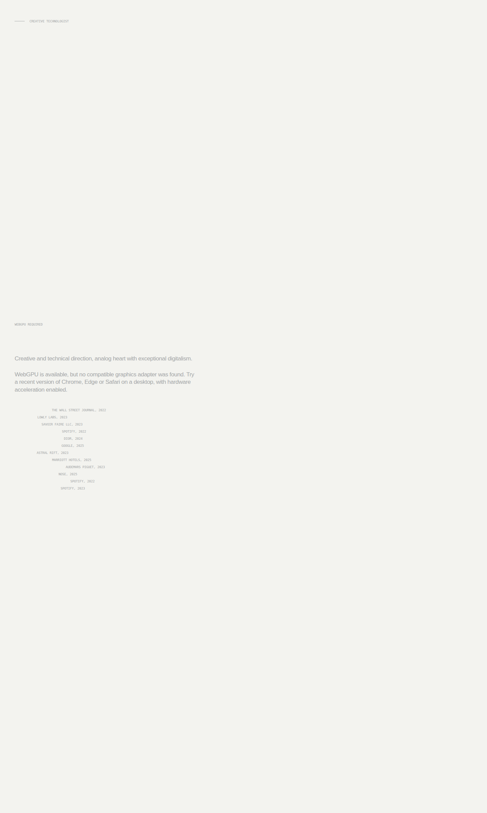
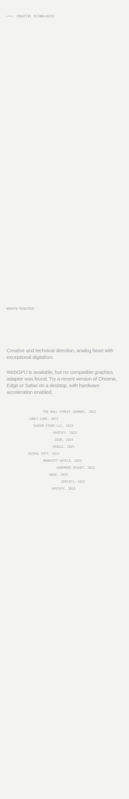

# UI Design System & Master Generation Blueprint: fabiantjoeaon-com

> **Fabian Tjoe-A-On — Creative technologist** (https://fabiantjoeaon.com) — Creative and technical direction, analog heart with exceptional digitalism.



---

## 1. Executive Visual Persona & Design Archetype

- **Brand Essence & Persona**: **Fabian Tjoe-A-On — Creative technologist** (`https://fabiantjoeaon.com`). Creative and technical direction, analog heart with exceptional digitalism.
- **Visual Archetype**: **Light-Substrate Editorial & Modular Grid System (`#f3f3ef` canvas, `#000` ink, `#e8fffd` accent)**.
- **Anti-AI-Slop Differentiators**:
  - **Source-Grounded Chromatic Polarity**: Anchors the viewport in `#f3f3ef` (`var(--text)` in `:root`) paired with `#000` primary typography and `#e8fffd` accents.
  - **Extracted Typographic Hierarchy**: Pairs `Arial` for display copy (`This portfolio is a real-time WebGPU`) with `clamp(9.5px` and not declared in static CSS (uses primary stack / `ui-monospace`).
  - **Calibrated Spatial Grid & Motion**: Combines `700px` container bounds (`gap: 12px`, padding `12px`) with `cubic-bezier(.22,1,.36,1)` easing and Lenis Smooth Scroll (`data-lenis`), Three.js / WebGL Canvas Pipeline.

---

## 2. Spatial Architecture & Modular Grid Mathematics



### Viewport Allocation & Container Geometry
- **Captured Viewport Dimensions**: Desktop `1440×2400px` (`assets/desktop.png`, capped at 2400px multi-section capture), Mobile `390×2400px` (`assets/mobile.png`, capped at 2400px multi-section capture).
- **Master Container Bounds**: `700px` extracted from `fabiantjoeaon-com` stylesheet.
- **Canvas Lateral Padding & Spacing**: `12px` lateral canvas padding with `12px` grid gap.
- **Border Radius Scale**: `50%`.

### Responsive Breakpoint Architecture
- **Desktop Layout**: Multi-column CSS Grid / Flexbox layout at `1440px` (`max-width: 700px`, `gap: 12px`).
- **Mobile Layout**: Single-column vertical stack at `390px` viewport width with `12px` horizontal padding.
- **Extracted CSS Media Queries**: `@media (max-width: 700px)`, `@media (prefers-reduced-motion: reduce)`, `@media (min-width: 1800px)`, `@media (max-width: 1000px)`.

---

## 3. Color System, Materiality & Atmospheric Lighting

### Semantic Palette & Source Grounding
| Semantic Role | Ground-Truth Value | Extracted CSS Source / Selector |
|---|---|---|
| **Primary Canvas Substrate** | `#f3f3ef` | `var(--text)` in `:root` |
| **Primary Typography Ink** | `#a3a6a7` | `var(--muted)` in `:root` |
| **Elevated Surface / Card Substrate** | `#000` | `.entry-loader { background: #000 }` |
| **Interactive Accent / Highlight** | `#e8fffd` | `ollapsible > .list-item-cell:fi... { color: #e8fffd }` |
| **Secondary / Muted Copy** | `#d4d6d4` | `ollapsible > .list-item-cell:fi... { color: #d4d6d4 }` |
| **Structural Hairline Border** | `#9aa0a0` | `ollapsible > .list-item-cell:fi... { color: #9aa0a0 }` |

### Sanitized Root CSS Variables (`ui-ux.md` Ground Truth)
| Variable Name | Extracted Value | Semantic Role |
|---|---|---|
| `--digit-height` | `1.1em` | Layout / Spatial Grid Token |
| `--size` | `18px` | Layout / Spatial Grid Token |
| `--font-family` | `Arial, sans-serif` | Typography / Scale Token |
| `--font-mono` | `ui-monospace, monospace` | Typography / Scale Token |
| `--w-light` | `400` | Canvas / Surface Token |
| `--w-regular` | `400` | Design System Custom Token |
| `--w-book` | `400` | Design System Custom Token |
| `--w-medium` | `500` | Design System Custom Token |
| `--segment-reveal` | `0` | Design System Custom Token |
| `--aside` | `calc(var(--project-left) - var(--page-gutter))` | Design System Custom Token |
| `--main` | `var(--project-mediaWidth)` | Design System Custom Token |
| `--rest` | `minmax(0, 1fr)` | Dimension / Scale Token |
| `--next-gap` | `48px` | Layout / Spatial Grid Token |
| `--line-reveal` | `0` | Design System Custom Token |
| `--corner` | `calc(14px * var(--line-reveal))` | Dimension / Scale Token |
| `--page-gutter` | `clamp(20px, 3vw, 64px)` | Layout / Spatial Grid Token |

---

## 4. Typographic Scale & Editorial Hierarchy

### Font Family Stacks
- **Display Typography**: `Arial`.
- **Primary Body Stack**: `clamp(9.5px`.
- **Technical / Metadata Stack**: not declared in static CSS (uses primary stack / `ui-monospace`).

### Typographic Scale & Rules (Extracted from Stylesheet & Variables)
- **Hero Display (`H1`)**: not explicitly declared on tag in static CSS (stylesheet font-size ladder: `clamp(110px, 15vw, 260px)`, `var(--meta-font-size)`, `clamp(26px, 2.5vw, 46px)`, `clamp(11px, 0.8vw, 15px)`, `13px`).
- **Section Heading (`H2`)**: not explicitly declared on tag in static CSS (stylesheet font-size ladder: `clamp(110px, 15vw, 260px)`, `var(--meta-font-size)`, `clamp(26px, 2.5vw, 46px)`, `clamp(11px, 0.8vw, 15px)`, `13px`).
- **Body Copy**: rule `body` (`font-weight: var(--w-regular)`).
- **Metadata & Navigation Labels**: CSS variables `--font-mono: ui-monospace, monospace`, `--meta-font-size: clamp(9.5px, 0.64vw, 12px)`.

---

## 5. Choreographed Motion & Interaction Physics

### Primary Easing Curves
- **Extracted Timing Functions**: `cubic-bezier(.22,1,.36,1)`, `cubic-bezier(0.19,1,0.22,1)`, `cubic-bezier(0.65,0,0.35,1)`.

### Per-Element Transition & Choreography Rules
- **Selector `.loader-enter`**: `transition: color 450ms cubic-bezier(.22,1,.36,1)` extracted from `fabiantjoeaon-com` stylesheet.
- **Selector `.loader-enter::after`**: `transition: transform 650ms cubic-bezier(.22,1,.36,1)` extracted from `fabiantjoeaon-com` stylesheet.
- **Selector `.project-visit`**: `transition: color 250ms ease` extracted from `fabiantjoeaon-com` stylesheet.
- **Extracted Easing Curve (`cubic-bezier(.22,1,.36,1)`)**: Governs interactive state transitions across `<header.no-webgpu-header>` and `<section.no-webgpu-body>`.
- **Runtime Interaction Engine**: Integrates Lenis Smooth Scroll (`data-lenis`), Three.js / WebGL Canvas Pipeline with `prefers-reduced-motion: reduce` fallback guards.

---

## 6. Component Wireframe & Structural DOM Map

### Visual Layout Schematic (Grounded in `dom.html` — `1440px` Desktop & `390px` Mobile Reflow)
```
┌────────────────────────────────────────────────────────────────────────┐
│ DESKTOP VIEWPORT (1440px) — Fabian Tjoe-A-On — Creative technologist   │
│ ====================================================================== │
│ [ <header.no-webgpu-header | About                                  ]  │
│ ---------------------------------------------------------------------- │
│ | HERO STAGE: <section.no-webgpu-body>                             |   │
│ | H1: This portfolio is a real-time WebGPU experience.             |   │
│ | Substrate: #f3f3ef    | Ink: #000       | Accent: #e8fffd        |   │
│ ---------------------------------------------------------------------- │
│ | SHOWCASE GRID (<section.no-webgpu-body>  ) max-w: 700px          |   │
│ | +------------------------------+  +------------------------------+ | │
│ | | Creative technologist        |  | Creative and technical direc | | │
│ | +------------------------------+  +------------------------------+ | │
│ ---------------------------------------------------------------------- │
│ | MOBILE VIEWPORT REFLOW (390px) — Single-Column Stack (gap: 12px  ) | │
│ | [<header.no-webgpu-] -> [<section.no-webgpu] -> [<section.no-webgpu] │
│ ---------------------------------------------------------------------- │
│ [ FOOTER (<footer.no-webgpu-foot) | https://fabiantjoeaon.com          │
└────────────────────────────────────────────────────────────────────────┘
```

### Granular DOM Region Breakdown
1. **Brand Header & Navigation Bar (<header.no-webgpu-header> — `fabiantjoeaon-com`)**:
   - Landmark `<header class="no-webgpu-header">` hosting `Fabian Tjoe-A-On — Creative technolo` navigation (`About`), DOM attributes (`data-mono`), and stylesheet rule `.loader-grid { position: absolute; inset: 0; width: 100%; height: 100%; display: block; }`.
2. **Hero Stage & Focal Lead (<section.no-webgpu-body> — `This portfolio is a real-time WebG`)**:
   - Landmark `<section class="no-webgpu-body">` presenting display lead `This portfolio is a real-time WebGPU experience.` and copy excerpt *"Creative technologist"* over `#f3f3ef` canvas and `#000` ink.
3. **Primary Showcase & Content Grid (<section.no-webgpu-body> — `Creative technologist`)**:
   - Landmark `<section class="no-webgpu-body">` rendering section `Creative technologist` with copy *"Creative and technical direction, analog heart with exceptional d"*, asset references (`SuisseIntl-Regular.otf`, `SpaceMono-Regular.ttf`, `favicon.ico`, `favicon.svg`), and grid rule `.loader-mask { display: block; overflow: hidden; }`.
4. **Interactive Detail & Feature Matrix (<section.no-webgpu-body> — `Creative and technical direction, `)**:
   - Landmark `<section class="no-webgpu-body">` framing `Creative and technical direction, analog heart w` and `WebGPU is available, but no compatible graphics ` (*"WebGPU is available, but no compatible graphics adapter was found"*) with `#000` surface cards, `#e8fffd` accents, and `.loader-mask > span { display: block; will-change: transform; }`.
5. **Colophon & Global Directory Footer (<footer.no-webgpu-footer> — `https://fabiantjoeaon.com`)**:
   - Landmark `<footer class="no-webgpu-footer">` anchoring `Fabian Tjoe-A-On — Creative tech` footer links (`About`), copy *"WSJ Iconic Mints The Wall Street Journal, 2022"*, and `#9aa0a0` structural dividers.

---

## 7. Master Zero-Shot AI Generation Prompt

```markdown
# Master Zero-Shot Frontend Generation Prompt: fabiantjoeaon-com (Fabian Tjoe-A-On — Creative technologist)

You are a principal frontend architect and design systems engineer. Build a complete, production-ready web application replicating the exact design system, DOM landmarks, typographic hierarchy, color tokens, and motion physics of `fabiantjoeaon-com` (**Fabian Tjoe-A-On — Creative technologist** — `https://fabiantjoeaon.com`).

### 1. Visual Archetype & Anti-AI-Slop Mandates
- **Archetype**: Light-Substrate Editorial & Modular Grid System (`#f3f3ef` canvas, `#000` ink, `#e8fffd` accent).
- **Identity & Domain Context**: Creative and technical direction, analog heart with exceptional digitalism.
- **Primary Substrate**: `#f3f3ef` (`var(--text)` in `:root`), **Primary Ink**: `#000`, **Accent / Highlight**: `#e8fffd`.
- **Site-Specific Differentiators**:
  - **Source-Grounded Chromatic Polarity**: Anchors the viewport in `#f3f3ef` (`var(--text)` in `:root`) paired with `#000` primary typography and `#e8fffd` accents.
  - **Extracted Typographic Hierarchy**: Pairs `Arial` for display copy (`This portfolio is a real-time WebGPU`) with `clamp(9.5px` and not declared in static CSS (uses primary stack / `ui-monospace`).
  - **Calibrated Spatial Grid & Motion**: Combines `700px` container bounds (`gap: 12px`, padding `12px`) with `cubic-bezier(.22,1,.36,1)` easing and Lenis Smooth Scroll (`data-lenis`), Three.js / WebGL Canvas Pipeline.

### 2. Ground-Truth CSS Variables (`:root` Token Contract)
Declare and consume these exact custom properties extracted from `fabiantjoeaon-com` in your global stylesheet:

:root {
  /* Fabian Tjoe-A-On — Creative technologist (fabiantjoeaon-com) — Ground-Truth Extracted CSS Variables */
  --digit-height: 1.1em; /* Layout / Spatial Grid Token (fabiantjoeaon-com) */
  --size: 18px; /* Layout / Spatial Grid Token (fabiantjoeaon-com) */
  --font-family: Arial, sans-serif; /* Typography / Scale Token (fabiantjoeaon-com) */
  --font-mono: ui-monospace, monospace; /* Typography / Scale Token (fabiantjoeaon-com) */
  --w-light: 400; /* Canvas / Surface Token (fabiantjoeaon-com) */
  --w-regular: 400; /* Design System Custom Token (fabiantjoeaon-com) */
  --w-book: 400; /* Design System Custom Token (fabiantjoeaon-com) */
  --w-medium: 500; /* Design System Custom Token (fabiantjoeaon-com) */
  --segment-reveal: 0; /* Design System Custom Token (fabiantjoeaon-com) */
  --aside: calc(var(--project-left) - var(--page-gutter)); /* Design System Custom Token (fabiantjoeaon-com) */
  --main: var(--project-mediaWidth); /* Design System Custom Token (fabiantjoeaon-com) */
  --rest: minmax(0, 1fr); /* Dimension / Scale Token (fabiantjoeaon-com) */
  --next-gap: 48px; /* Layout / Spatial Grid Token (fabiantjoeaon-com) */
  --line-reveal: 0; /* Design System Custom Token (fabiantjoeaon-com) */
  --corner: calc(14px * var(--line-reveal)); /* Dimension / Scale Token (fabiantjoeaon-com) */
  --page-gutter: clamp(20px, 3vw, 64px); /* Layout / Spatial Grid Token (fabiantjoeaon-com) */
}

### 3. Semantic Color & Materiality Contract
Map every surface, ink, and border strictly to these source-grounded tokens:
- **Primary Canvas Substrate**: `#f3f3ef` — grounded in `var(--text)` in `:root`
- **Primary Typography Ink**: `#a3a6a7` — grounded in `var(--muted)` in `:root`
- **Elevated Surface / Card Substrate**: `#000` — grounded in `.entry-loader { background: #000 }`
- **Interactive Accent / Highlight**: `#e8fffd` — grounded in `ollapsible > .list-item-cell:fi... { color: #e8fffd }`
- **Secondary / Muted Copy**: `#d4d6d4` — grounded in `ollapsible > .list-item-cell:fi... { color: #d4d6d4 }`
- **Structural Hairline Border**: `#9aa0a0` — grounded in `ollapsible > .list-item-cell:fi... { color: #9aa0a0 }`

### 4. Spatial Grid, Container Bounds & Responsive Breakpoints
- **Desktop Viewport Reference**: `1440×2400px` (capped at 2400px multi-section capture, `1440px` standard desktop width).
- **Mobile Viewport Reference**: `390×2400px` (capped at 2400px multi-section capture, `390px` standard mobile width).
- **Container Max-Width**: `700px` extracted from `fabiantjoeaon-com` stylesheet
- **Padding & Gutters**: `12px` lateral canvas padding with `12px` grid gap
- **Desktop Grid**: Multi-column CSS Grid / Flexbox layout at `1440px` (`max-width: 700px`, `gap: 12px`)
- **Mobile Adaptation**: Single-column vertical stack at `390px` viewport width with `12px` horizontal padding
- **Media Queries**: `@media (max-width: 700px)`, `@media (prefers-reduced-motion: reduce)`, `@media (min-width: 1800px)`, `@media (max-width: 1000px)`
- **Corner Radii**: `50%`

### 5. Typography & Editorial Scale Contract
- **Display Font Stack**: `Arial`
- **Body Font Stack**: `clamp(9.5px`
- **Monospace / Technical Font Stack**: not declared in static CSS (uses primary stack / `ui-monospace`)
- **H1 Display Rule**: not explicitly declared on tag in static CSS (stylesheet font-size ladder: `clamp(110px, 15vw, 260px)`, `var(--meta-font-size)`, `clamp(26px, 2.5vw, 46px)`, `clamp(11px, 0.8vw, 15px)`, `13px`)
- **H2 Section Rule**: not explicitly declared on tag in static CSS (stylesheet font-size ladder: `clamp(110px, 15vw, 260px)`, `var(--meta-font-size)`, `clamp(26px, 2.5vw, 46px)`, `clamp(11px, 0.8vw, 15px)`, `13px`)
- **Body Copy Rule**: rule `body` (`font-weight: var(--w-regular)`)
- **Metadata & Index Rule**: CSS variables `--font-mono: ui-monospace, monospace`, `--meta-font-size: clamp(9.5px, 0.64vw, 12px)`

### 6. Component Hierarchy, Verbatim Copy & Real DOM Landmarks
Scaffold `fabiantjoeaon-com` (`Fabian Tjoe-A-On — Creative technologist`) with these exact structural regions, extracted copy, and CSS rules from `dom.html`:
1. **Brand Header & Navigation Bar (<header.no-webgpu-header> — `fabiantjoeaon-com`)**:
   - DOM & Selectors: Landmark `<header class="no-webgpu-header">` hosting `Fabian Tjoe-A-On — Creative technolo` navigation (`About`), DOM attributes (`data-mono`), and stylesheet rule `.loader-grid { position: absolute; inset: 0; width: 100%; height: 100%; display: block; }`.
   - Responsive Contract: Header `Brand Header & Navigation Bar (<header.no-webgpu-header> — `fabiantjoeaon-com`)` (`fabiantjoeaon-com`) adapts across `@media (max-width: 700px)`, `@media (prefers-reduced-motion: reduce)`, `@media (min-width: 1800px)`, `@media (max-width: 1000px)` with `cubic-bezier(.22,1,.36,1)`, `cubic-bezier(0.19,1,0.22,1)`, `cubic-bezier(0.65,0,0.35,1)` transitions and links `About`.
2. **Hero Stage & Focal Lead (<section.no-webgpu-body> — `This portfolio is a real-time WebG`)**:
   - DOM & Selectors: Landmark `<section class="no-webgpu-body">` presenting display lead `This portfolio is a real-time WebGPU experience.` and copy excerpt *"Creative technologist"* over `#f3f3ef` canvas and `#000` ink.
   - Responsive Contract: Hero stage (`1440×2400px` desktop / `390×2400px` mobile) sets `#f3f3ef` background with `#000` headline `This portfolio is a real-time WebGPU experience.`.
3. **Primary Showcase & Content Grid (<section.no-webgpu-body> — `Creative technologist`)**:
   - DOM & Selectors: Landmark `<section class="no-webgpu-body">` rendering section `Creative technologist` with copy *"Creative and technical direction, analog heart with exceptional d"*, asset references (`SuisseIntl-Regular.otf`, `SpaceMono-Regular.ttf`, `favicon.ico`, `favicon.svg`), and grid rule `.loader-mask { display: block; overflow: hidden; }`.
   - Responsive Contract: Showcase grid `Primary Showcase & Content Grid (<section.no-webgpu-body> — `Creative technologist`)` applies Multi-column CSS Grid / Flexbox layout at `1440px` (`max-width: 700px`, `gap: 12px`) on desktop and Single-column vertical stack at `390px` viewport width with `12px` horizontal padding on mobile.
4. **Interactive Detail & Feature Matrix (<section.no-webgpu-body> — `Creative and technical direction, `)**:
   - DOM & Selectors: Landmark `<section class="no-webgpu-body">` framing `Creative and technical direction, analog heart w` and `WebGPU is available, but no compatible graphics ` (*"WebGPU is available, but no compatible graphics adapter was found"*) with `#000` surface cards, `#e8fffd` accents, and `.loader-mask > span { display: block; will-change: transform; }`.
   - Responsive Contract: Detail module `Interactive Detail & Feature Matrix (<section.no-webgpu-body> — `Creative and technical direction, `)` uses `50%` radii, `#e8fffd` highlights, and assets (SuisseIntl-Regular.otf, SpaceMono-Regular.ttf, favicon.ico).
5. **Colophon & Global Directory Footer (<footer.no-webgpu-footer> — `https://fabiantjoeaon.com`)**:
   - DOM & Selectors: Landmark `<footer class="no-webgpu-footer">` anchoring `Fabian Tjoe-A-On — Creative tech` footer links (`About`), copy *"WSJ Iconic Mints The Wall Street Journal, 2022"*, and `#9aa0a0` structural dividers.
   - Responsive Contract: Footer `Colophon & Global Directory Footer (<footer.no-webgpu-footer> — `https://fabiantjoeaon.com`)` aligns to `700px` extracted from `fabiantjoeaon-com` stylesheet with `12px` lateral canvas padding with `12px` grid gap and attributes (data-mono).

#### Verbatim DOM Copy Excerpts (`dom.html`)
- Copy Excerpt 1: *"Creative technologist"*
- Copy Excerpt 2: *"Creative and technical direction, analog heart with exceptional digitalism."*
- Copy Excerpt 3: *"WebGPU is available, but no compatible graphics adapter was found. Try a recent ve..."*
- Copy Excerpt 4: *"WSJ Iconic Mints The Wall Street Journal, 2022"*

### 7. Motion, Extracted Stylesheet Rules & Interaction Choreography
- **Primary Easing Functions**: `cubic-bezier(.22,1,.36,1)`, `cubic-bezier(0.19,1,0.22,1)`, `cubic-bezier(0.65,0,0.35,1)`
- **Extracted Stylesheet Rules (`fabiantjoeaon-com`)**:
- `.loader-grid { position: absolute; inset: 0; width: 100%; height: 100%; display: block; }`
- `.loader-mask { display: block; overflow: hidden; }`
- `.loader-mask > span { display: block; will-change: transform; }`
- `.entry-loader > .loader-identity { position: absolute; top: var(--nav-inset); left: var(--page-gutter); }`
- `.loader-digits { display: flex; }`
- **Per-Selector Transition Rules**:
- **Selector `.loader-enter`**: `transition: color 450ms cubic-bezier(.22,1,.36,1)` extracted from `fabiantjoeaon-com` stylesheet.
- **Selector `.loader-enter::after`**: `transition: transform 650ms cubic-bezier(.22,1,.36,1)` extracted from `fabiantjoeaon-com` stylesheet.
- **Selector `.project-visit`**: `transition: color 250ms ease` extracted from `fabiantjoeaon-com` stylesheet.
- **Extracted Easing Curve (`cubic-bezier(.22,1,.36,1)`)**: Governs interactive state transitions across `<header.no-webgpu-header>` and `<section.no-webgpu-body>`.
- **Runtime Interaction Engine**: Integrates Lenis Smooth Scroll (`data-lenis`), Three.js / WebGL Canvas Pipeline with `prefers-reduced-motion: reduce` fallback guards.

### 8. Technical Deliverables
- Implement in Next.js (App Router) with TypeScript and Tailwind CSS consuming the `:root` custom properties defined above for `fabiantjoeaon-com`.
- Reproduce both the `1440px` desktop architecture and `390px` mobile breakpoint transitions, preserving semantic HTML5 landmarks (`<header>`, `<nav>`, `<main>`, `<section>`, `<footer>`) and `prefers-reduced-motion` accessibility guards.
```
