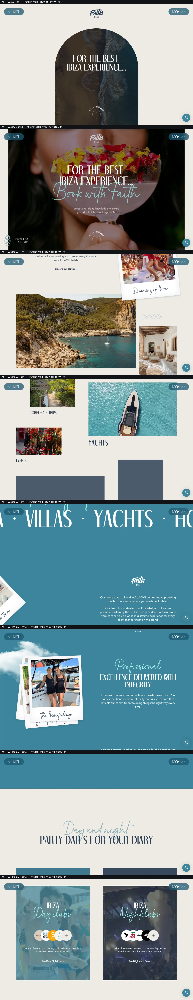
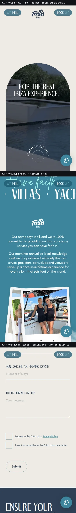

# UI Design System & Master Generation Blueprint: faithibiza-com

> **Faith Ibiza · VIP Ibiza Concierge Services** (https://faithibiza.com/) — Travelling to Ibiza and looking for a VIP experience? Our concierge services will ensure you experience all that the White Isle has to of...





---

## 1. Executive Visual Persona & Design Archetype

- **Brand Essence & Persona**: **Faith Ibiza · VIP Ibiza Concierge Services** (`https://faithibiza.com/`). Travelling to Ibiza and looking for a VIP experience? Our concierge services will ensure you experience all that the White Isle has to of...
- **Capture Provenance**: Live browser capture (`tier1_fast`, HTTP `200`, captured `2026-11-24`).
- **Visual Archetype**: **Light-Substrate Editorial & Modular Grid System (`#eeebe4` canvas, `#4c5b6b` ink, `#204ce5` accent)**.
- **Anti-AI-Slop Differentiators**:
  - **Live-Computed Chromatic Polarity**: Anchors the viewport in `#eeebe4` (live computed `body` `background-color` (`computed_styles.json`)) paired with `#4c5b6b` primary typography and `#204ce5` accents.
  - **Grounded Typographic Hierarchy**: Pairs `Eastern Harrogate` for display copy (`unforgettable`) with `Afacad Flux`.
  - **Calibrated Spatial Grid & Motion**: Combines `100vw` container bounds (`gap: 6.25rem`, padding `15px`) with `cubic-bezier(.25,.25,.75,.75)` easing and Lenis Smooth Scroll (`data-lenis`), GSAP Timeline & ScrollTrigger.

---

## 2. Spatial Architecture & Modular Grid Mathematics

### Viewport Allocation & Container Geometry
- **Captured Journey Filmstrips**: Desktop `1280×6624px` (`assets/desktop-journey.webp`, `8` keyframes up to `y=14400px` / doc `19768px`), Mobile `390×2616px` (`assets/mobile-journey.webp`, `3` keyframes).
- **Master Container Bounds**: `100vw` (non-`@media` desktop container stylesheet rule).
- **Canvas Lateral Padding & Spacing**: `15px` lateral canvas padding with `6.25rem` grid gap.
- **Border Radius Scale**: `100px`, `50%`, `500px`, `4px`.

### Responsive Breakpoint Architecture
- **Desktop Layout**: Multi-column CSS Grid / Flexbox layout at `1440px` (`max-width: 100vw`, `gap: 6.25rem`).
- **Mobile Layout**: Single-column vertical stack at `390px` viewport width with `15px` horizontal padding.
- **Extracted CSS Media Queries**: `@media (min-resolution:192dpi)`, `@media screen and (max-width:600px)`, `@media screen and (width <=620px)`, `@media screen and (orientation:landscape)`.

---

## 3. Color System, Materiality & Atmospheric Lighting

### Semantic Palette & Source Grounding
| Semantic Role | Ground-Truth Value | Extracted Live / CSS Source |
|---|---|---|
| **Primary Canvas Substrate** | `#eeebe4` | live computed `body` `background-color` (`computed_styles.json`) |
| **Primary Typography Ink** | `#4c5b6b` | live computed `main` `color` (`computed_styles.json`) |
| **Elevated Surface / Card Substrate** | `#dddddd` | `var(--wp-editor-canvas-background)` in `:root` |
| **Interactive Accent / Highlight** | `#204ce5` | `var(--gf-color-primary)` in `:root` |
| **Secondary / Muted Copy** | `#8daeb6` | `var(--c-secondary)` in `:root` |
| **Structural Hairline Border** | `#d4c9ff` | `var(--outline-purple)` in `:root` |
| **Variable Token (`--wp-block-synced-color`)** | `#7a00df` | `var(--wp-block-synced-color)` in `:root` |
| **Variable Token (`--wp-admin-theme-color`)** | `#007cba` | `var(--wp-admin-theme-color)` in `:root` |
| **Variable Token (`--wp-admin-theme-color-darker-10`)** | `#006ba1` | `var(--wp-admin-theme-color-darker-10)` in `:root` |
| **Variable Token (`--wp-admin-theme-color-darker-20`)** | `#005a87` | `var(--wp-admin-theme-color-darker-20)` in `:root` |
| **Variable Token (`--cookieadmin-primary-color`)** | `#001d39` | `var(--cookieadmin-primary-color)` in `:root` |
| **Variable Token (`--cookieadmin-primary-hover-color`)** | `#985e23` | `var(--cookieadmin-primary-hover-color)` in `:root` |

### Sanitized Root CSS Variables (`ui-ux.md` Ground Truth)
| Variable Name | Extracted Value | Semantic Role |
|---|---|---|
| `--i-star` | `url(https://faithibiza.com/wp-content/themes/general-block-wp/img/star.svg)` | Dimension / Scale Token |
| `--wp-block-synced-color` | `#7a00df` | Brand / Palette Token |
| `--wp-block-synced-color--rgb` | `122,0,223` | Brand / Palette Token |
| `--wp-bound-block-color` | `var(--wp-block-synced-color)` | Brand / Palette Token |
| `--wp-editor-canvas-background` | `#ddd` | Canvas / Surface Token |
| `--wp-admin-theme-color` | `#007cba` | Brand / Palette Token |
| `--wp-admin-theme-color--rgb` | `0,124,186` | Brand / Palette Token |
| `--wp-admin-theme-color-darker-10` | `#006ba1` | Canvas / Surface Token |
| `--wp-admin-theme-color-darker-10--rgb` | `0,107,160.5` | Canvas / Surface Token |
| `--wp-admin-theme-color-darker-20` | `#005a87` | Canvas / Surface Token |
| `--wp-admin-theme-color-darker-20--rgb` | `0,90,135` | Canvas / Surface Token |
| `--wp-admin-border-width-focus` | `2px` | Layout / Spatial Grid Token |
| `--wp-admin--admin-bar--position-offset` | `var(--wp-admin--admin-bar--height,0px)` | Dimension / Scale Token |
| `--wp--style--block-gap` | `24px` | Layout / Spatial Grid Token |
| `--cookieadmin-primary-color` | `#001d39` | Brand / Palette Token |
| `--cookieadmin-primary-hover-color` | `#985e23` | Brand / Palette Token |

---

## 4. Typographic Scale & Editorial Hierarchy

### Font Family Stacks
- **Display Typography**: `Eastern Harrogate`.
- **Primary Body Stack**: `Afacad Flux`.
- **Technical / Metadata Stack**: not declared in live computed styles (uses primary stack / `ui-monospace`).

### Typographic Scale & Rules (Live Computed & Stylesheet Grounded)
- **Hero Display (`H1`)**: live computed `h1` (`font-size: 149.999px`, `line-height: 164.999px`, `font-weight: 400`); rule `h1` (`font-size: 2.5em`).
- **Section Heading (`H2`)**: live computed `h2` (`font-size: 110px`, `line-height: 121px`, `font-weight: 400`); rule `h2` (`font-size: 2em`).
- **Body Copy**: live computed `body` (`font-size: 16px`, `line-height: normal`, `font-weight: 400`); rule `p` (`font-size: 10px`).
- **Metadata & Navigation Labels**: live computed `nav/a` (`font-size: 16px`, `line-height: normal`, `font-weight: 400`); CSS variables `--modal-size-small: 500px`, `--gf-label-width: 30%`, `--gf-label-req-gap: 6px`.

---

## 5. Choreographed Motion & Interaction Physics

### Primary Easing Curves
- **Extracted Timing Functions**: `cubic-bezier(.25,.25,.75,.75)`, `cubic-bezier(.6,-.28,.735,.045)`, `cubic-bezier(.175,.885,.32,1.275)`.

### Per-Element Transition & Choreography Rules
- **Selector `.block-feature-cards .feature-car...`**: `transition: margin-right 300ms ease-out` extracted from `faithibiza-com` stylesheet.
- **Selector `.block-features .feature__title`**: `transition: transform 200ms ease-in-out` extracted from `faithibiza-com` stylesheet.
- **Selector `tures .feature-item .media-wrappe...`**: `transition: opacity 200ms ease-in-out` extracted from `faithibiza-com` stylesheet.
- **Extracted Easing Curve (`cubic-bezier(.25,.25,.75,.75)`)**: Governs interactive state transitions across `<header.site-header>` and `<main.site-main:nth(2)>`.
- **Runtime Interaction Engine**: Integrates Lenis Smooth Scroll (`data-lenis`), GSAP Timeline & ScrollTrigger, Three.js / WebGL Canvas Pipeline, Swiper Touch Carousel Engine, Barba.js Page Transition Router with `prefers-reduced-motion: reduce` fallback guards.
### Measured Runtime Scroll & Interaction Telemetry (`behavioral_journey_v2`)
- **Scroll Driver Mode**: `native` (max document height `19768px`, deepest scrollY reached `14400px` across `8` desktop keyframes).
- **Detected Scroll / Motion Libraries**: `Lenis`, `GSAP/ScrollTrigger`.
- **Hover Physics (`primary_cta` · `BOOK`)**: Computed transition `0s` / `ease` (no static color/transform shift captured at rest).
- **Route Transition Architecture**: First internal navigation (`/about/destination-management/`) measured as `direct` in `2421ms`.

---

## 6. Component Wireframe & Structural DOM Map

### Visual Layout Schematic — Desktop (`1440px`, Grounded in `dom.html` & Landmark Bounding Boxes)
```
┌────────────────────────────────────────────────────────────────────────┐
│ DESKTOP VIEWPORT (1440px) — Faith Ibiza · VIP Ibiza Concierge Services │
│ ====================================================================== │
│ [ <header.site-header> (1440x0px)     | About · About Us · Charity W ] │
│ ---------------------------------------------------------------------- │
│ | HERO STAGE: <main.site-main> (w=1440px)                            | │
│ | H1: unforgettable                                                  | │
│ | Substrate: #eeebe4 | Ink: #4c5b6b | Accent: #204ce5                | │
│ ---------------------------------------------------------------------- │
│ | SHOWCASE GRID (<main.site-main:nth(2)>) max-w: 100vw               | │
│ | +------------------------------+  +------------------------------+ | │
│ | | For the best Ibiza experienc |  | Book with Faith              | | │
│ | +------------------------------+  +------------------------------+ | │
│ ---------------------------------------------------------------------- │
│ | DETAIL MODULE (<main.site-main:nth(3)>) — COME FOR THE BEACHES     | │
│ ---------------------------------------------------------------------- │
│ [ FOOTER (<footer.site-footer>) | https://faithibiza.com/              │
└────────────────────────────────────────────────────────────────────────┘
```

### Visual Layout Schematic — Mobile Reflow (`390px`)
```
┌────────────────────────────────────────────────────────────────────────┐
│ MOBILE VIEWPORT REFLOW (390px) — Single-Column Stack (gap: 6.25rem)    │
│ ====================================================================== │
│ [ HEADER BAR (<header.site-header>    ) | Compact Menu (390px)         │
│ ---------------------------------------------------------------------- │
│ | HERO STAGE (<main.site-main>) — 390px Vertical Lead                | │
│ | H1: unforgettable                                                  | │
│ ---------------------------------------------------------------------- │
│ | SHOWCASE STACK (<main.site-main:nth(2)) — 1-Col Stack              | │
│ | [ Item 1: For the best Ibiza experience...                       ] | │
│ | [ Item 2: Book with Faith                                        ] | │
│ ---------------------------------------------------------------------- │
│ | DETAIL STACK (<main.site-main:nth(3)>) — 1-Col (COME FOR THE BEACH)  │
│ ---------------------------------------------------------------------- │
│ [ FOOTER (<footer.site-footer>) | Stacked 390px Colophon               │
└────────────────────────────────────────────────────────────────────────┘
```

### Granular DOM Region Breakdown
1. **Brand Header & Navigation Bar (<header.site-header> — `faithibiza-com`)**:
   - Landmark `<header class="site-header">` (`1440x0px`) hosting `Faith Ibiza · VIP Ibiza Concierge Se` navigation (`About · About Us · Charity Work · Latest News · Where to stay`), DOM attributes (`data-optimized="1"`, `data-optimized="1"`, `data-optimized="2"`, `data-optimized="1"`), and stylesheet rule `ideo.background::-webkit-media-co... { display:none!important;opacity:0 }`.
2. **Hero Stage & Focal Lead (<main.site-main> — `unforgettable`)**:
   - Landmark `<main class="site-main">` presenting display lead `unforgettable` and copy excerpt *"Your holiday shouldn’t be spent worrying about bookings, transfer"* over `#eeebe4` canvas and `#4c5b6b` ink.
3. **Primary Showcase & Content Grid (<main.site-main:nth(2)> — `For the best Ibiza experience...`)**:
   - Landmark `<main class="site-main">` rendering section `For the best Ibiza experience...` with copy *"Use Up/Down Arrow keys to increase or decrease volume."*, asset references (`recaptcha__en.js`, `cdn.jsdelivr.net`, `unpkg.com`, `www.google.com`), and grid rule `it-media-controls-start-playback-... { display:none!important }`.
4. **Interactive Detail & Feature Matrix (<main.site-main:nth(3)> — `Book with Faith`)**:
   - Landmark `<main class="site-main">` framing `Book with Faith` and `COME FOR THE BEACHES` (*"Exceptional island knowledge to ensure your stay in Ibiza is unfo"*) with `#dddddd` surface cards, `#204ce5` accents, and `root { --wp-admin-border-width-focus:1.5px }`.
5. **Colophon & Global Directory Footer (<footer.site-footer> — `https://faithibiza.com/`)**:
   - Landmark `<footer class="site-footer is-dark">` anchoring `Faith Ibiza · VIP Ibiza Concierg` footer links (`About · About Us · Charity Work · Latest News · Where to stay`), copy *"PART OF THE O BEACH GROUP"*, and `#d4c9ff` structural dividers.
### Full Vertical Scroll Sequence (Desktop `1440×900` Keyframes)
- **Step 01** (`y=0px`, `0%`): Active landmark `ENSURE YOUR STAY IN IBIZA IS` · sticky/fixed elements: `2`
- **Step 02** (`y=850px`, `5%`): Active landmark `ENSURE YOUR STAY IN IBIZA IS` · sticky/fixed elements: `2`
- **Step 03** (`y=3400px`, `18%`): Active landmark `ENSURE YOUR STAY IN IBIZA IS` · sticky/fixed elements: `1`
- **Step 04** (`y=5950px`, `32%`): Active landmark `ENSURE YOUR STAY IN IBIZA IS` · sticky/fixed elements: `1`
- **Step 05** (`y=8500px`, `45%`): Active landmark `ENSURE YOUR STAY IN IBIZA IS` · sticky/fixed elements: `1`
- **Step 06** (`y=11050px`, `59%`): Active landmark `ENSURE YOUR STAY IN IBIZA IS` · sticky/fixed elements: `1`
- **Step 07** (`y=13600px`, `72%`): Active landmark `ENSURE YOUR STAY IN IBIZA IS` · sticky/fixed elements: `1`
- **Step 08** (`y=14400px`, `76%`): Active landmark `ENSURE YOUR STAY IN IBIZA IS` · sticky/fixed elements: `1`

### Multi-Page Internal Route Map
- **Detail Route (`/about/destination-management/`)**: `https://faithibiza.com/about/destination-management/` — H1: `Welcome to`, scrollHeight `8887px`, transition `direct` (`2421ms`)
- **About Route (`/contact/`)**: `https://faithibiza.com/contact/` — H1: `ENSURE YOUR STAY IN IBIZA IS`, scrollHeight `2524px`, transition `direct` (`1262ms`)
- **Detail Route (`/about/corporate-experiences/`)**: `https://faithibiza.com/about/corporate-experiences/` — H1: `Corporate`, scrollHeight `15605px`, transition `direct` (`1728ms`)

---

## 7. Master Zero-Shot AI Generation Prompt

```markdown
# Master Zero-Shot Frontend Generation Prompt: faithibiza-com (Faith Ibiza · VIP Ibiza Concierge Services)

You are a principal frontend architect and design systems engineer. Build a complete, production-ready web application replicating the exact design system, DOM landmarks, typographic hierarchy, color tokens, and motion physics of `faithibiza-com` (**Faith Ibiza · VIP Ibiza Concierge Services** — `https://faithibiza.com/`).

### 1. Visual Archetype & Anti-AI-Slop Mandates
- **Archetype**: Light-Substrate Editorial & Modular Grid System (`#eeebe4` canvas, `#4c5b6b` ink, `#204ce5` accent).
- **Identity & Domain Context**: Travelling to Ibiza and looking for a VIP experience? Our concierge services will ensure you experience all that the White Isle has to of...
- **Primary Substrate**: `#eeebe4` (live computed `body` `background-color` (`computed_styles.json`)), **Primary Ink**: `#4c5b6b`, **Accent / Highlight**: `#204ce5`.
- **Site-Specific Differentiators**:
  - **Live-Computed Chromatic Polarity**: Anchors the viewport in `#eeebe4` (live computed `body` `background-color` (`computed_styles.json`)) paired with `#4c5b6b` primary typography and `#204ce5` accents.
  - **Grounded Typographic Hierarchy**: Pairs `Eastern Harrogate` for display copy (`unforgettable`) with `Afacad Flux`.
  - **Calibrated Spatial Grid & Motion**: Combines `100vw` container bounds (`gap: 6.25rem`, padding `15px`) with `cubic-bezier(.25,.25,.75,.75)` easing and Lenis Smooth Scroll (`data-lenis`), GSAP Timeline & ScrollTrigger.

### 2. Ground-Truth CSS Variables (`:root` Token Contract)
Declare and consume these exact custom properties extracted from `faithibiza-com` in your global stylesheet:

:root {
  /* Faith Ibiza · VIP Ibiza Concierge Services (faithibiza-com) — Live-Grounded CSS Variables */
  --i-star: url(https://faithibiza.com/wp-content/themes/general-block-wp/img/star.svg); /* Dimension / Scale Token (faithibiza-com) */
  --wp-block-synced-color: #7a00df; /* Brand / Palette Token (faithibiza-com) */
  --wp-block-synced-color--rgb: 122,0,223; /* Brand / Palette Token (faithibiza-com) */
  --wp-bound-block-color: var(--wp-block-synced-color); /* Brand / Palette Token (faithibiza-com) */
  --wp-editor-canvas-background: #ddd; /* Canvas / Surface Token (faithibiza-com) */
  --wp-admin-theme-color: #007cba; /* Brand / Palette Token (faithibiza-com) */
  --wp-admin-theme-color--rgb: 0,124,186; /* Brand / Palette Token (faithibiza-com) */
  --wp-admin-theme-color-darker-10: #006ba1; /* Canvas / Surface Token (faithibiza-com) */
  --wp-admin-theme-color-darker-10--rgb: 0,107,160.5; /* Canvas / Surface Token (faithibiza-com) */
  --wp-admin-theme-color-darker-20: #005a87; /* Canvas / Surface Token (faithibiza-com) */
  --wp-admin-theme-color-darker-20--rgb: 0,90,135; /* Canvas / Surface Token (faithibiza-com) */
  --wp-admin-border-width-focus: 2px; /* Layout / Spatial Grid Token (faithibiza-com) */
  --wp-admin--admin-bar--position-offset: var(--wp-admin--admin-bar--height,0px); /* Dimension / Scale Token (faithibiza-com) */
  --wp--style--block-gap: 24px; /* Layout / Spatial Grid Token (faithibiza-com) */
  --cookieadmin-primary-color: #001d39; /* Brand / Palette Token (faithibiza-com) */
  --cookieadmin-primary-hover-color: #985e23; /* Brand / Palette Token (faithibiza-com) */
}

### 3. Semantic Color & Materiality Contract
Map every surface, ink, and border strictly to these source-grounded tokens:
- **Primary Canvas Substrate**: `#eeebe4` — grounded in live computed `body` `background-color` (`computed_styles.json`)
- **Primary Typography Ink**: `#4c5b6b` — grounded in live computed `main` `color` (`computed_styles.json`)
- **Elevated Surface / Card Substrate**: `#dddddd` — grounded in `var(--wp-editor-canvas-background)` in `:root`
- **Interactive Accent / Highlight**: `#204ce5` — grounded in `var(--gf-color-primary)` in `:root`
- **Secondary / Muted Copy**: `#8daeb6` — grounded in `var(--c-secondary)` in `:root`
- **Structural Hairline Border**: `#d4c9ff` — grounded in `var(--outline-purple)` in `:root`
- **Variable Token (`--wp-block-synced-color`)**: `#7a00df` — grounded in `var(--wp-block-synced-color)` in `:root`
- **Variable Token (`--wp-admin-theme-color`)**: `#007cba` — grounded in `var(--wp-admin-theme-color)` in `:root`
- **Variable Token (`--wp-admin-theme-color-darker-10`)**: `#006ba1` — grounded in `var(--wp-admin-theme-color-darker-10)` in `:root`
- **Variable Token (`--wp-admin-theme-color-darker-20`)**: `#005a87` — grounded in `var(--wp-admin-theme-color-darker-20)` in `:root`
- **Variable Token (`--cookieadmin-primary-color`)**: `#001d39` — grounded in `var(--cookieadmin-primary-color)` in `:root`
- **Variable Token (`--cookieadmin-primary-hover-color`)**: `#985e23` — grounded in `var(--cookieadmin-primary-hover-color)` in `:root`

### 4. Spatial Grid, Container Bounds & Responsive Breakpoints
- **Desktop Viewport Reference**: `1280×6624px` (multi-frame vertical journey filmstrip (6624px), `1440px` standard desktop width).
- **Mobile Viewport Reference**: `390×2616px` (multi-frame vertical journey filmstrip (2616px), `390px` standard mobile width).
- **Container Max-Width**: `100vw` (non-`@media` desktop container stylesheet rule)
- **Padding & Gutters**: `15px` lateral canvas padding with `6.25rem` grid gap
- **Desktop Grid**: Multi-column CSS Grid / Flexbox layout at `1440px` (`max-width: 100vw`, `gap: 6.25rem`)
- **Mobile Adaptation**: Single-column vertical stack at `390px` viewport width with `15px` horizontal padding
- **Media Queries**: `@media (min-resolution:192dpi)`, `@media screen and (max-width:600px)`, `@media screen and (width <=620px)`, `@media screen and (orientation:landscape)`
- **Corner Radii**: `100px`, `50%`, `500px`, `4px`

### 5. Typography & Editorial Scale Contract
- **Display Font Stack**: `Eastern Harrogate`
- **Body Font Stack**: `Afacad Flux`
- **Monospace / Technical Font Stack**: not declared in live computed styles (uses primary stack / `ui-monospace`)
- **H1 Display Rule**: live computed `h1` (`font-size: 149.999px`, `line-height: 164.999px`, `font-weight: 400`); rule `h1` (`font-size: 2.5em`)
- **H2 Section Rule**: live computed `h2` (`font-size: 110px`, `line-height: 121px`, `font-weight: 400`); rule `h2` (`font-size: 2em`)
- **Body Copy Rule**: live computed `body` (`font-size: 16px`, `line-height: normal`, `font-weight: 400`); rule `p` (`font-size: 10px`)
- **Metadata & Index Rule**: live computed `nav/a` (`font-size: 16px`, `line-height: normal`, `font-weight: 400`); CSS variables `--modal-size-small: 500px`, `--gf-label-width: 30%`, `--gf-label-req-gap: 6px`

### 6. Component Hierarchy, Verbatim Copy & Real DOM Landmarks
Scaffold `faithibiza-com` (`Faith Ibiza · VIP Ibiza Concierge Services`) with these exact structural regions, extracted copy, and CSS rules from `dom.html`:
1. **Brand Header & Navigation Bar (<header.site-header> — `faithibiza-com`)**:
   - DOM & Selectors: Landmark `<header class="site-header">` (`1440x0px`) hosting `Faith Ibiza · VIP Ibiza Concierge Se` navigation (`About · About Us · Charity Work · Latest News · Where to stay`), DOM attributes (`data-optimized="1"`, `data-optimized="1"`, `data-optimized="2"`, `data-optimized="1"`), and stylesheet rule `ideo.background::-webkit-media-co... { display:none!important;opacity:0 }`.
   - Responsive Contract: Header `Brand Header & Navigation Bar (<header.site-header> — `faithibiza-com`)` (`faithibiza-com`) adapts across `@media (min-resolution:192dpi)`, `@media screen and (max-width:600px)`, `@media screen and (width <=620px)`, `@media screen and (orientation:landscape)` with `cubic-bezier(.25,.25,.75,.75)`, `cubic-bezier(.6,-.28,.735,.045)`, `cubic-bezier(.175,.885,.32,1.275)` transitions and links `About · About Us · Charity Work · Latest News · Where to stay`.
2. **Hero Stage & Focal Lead (<main.site-main> — `unforgettable`)**:
   - DOM & Selectors: Landmark `<main class="site-main">` presenting display lead `unforgettable` and copy excerpt *"Your holiday shouldn’t be spent worrying about bookings, transfer"* over `#eeebe4` canvas and `#4c5b6b` ink.
   - Responsive Contract: Hero stage (`1280×6624px` desktop / `390×2616px` mobile) sets `#eeebe4` background with `#4c5b6b` headline `unforgettable`.
3. **Primary Showcase & Content Grid (<main.site-main:nth(2)> — `For the best Ibiza experience...`)**:
   - DOM & Selectors: Landmark `<main class="site-main">` rendering section `For the best Ibiza experience...` with copy *"Use Up/Down Arrow keys to increase or decrease volume."*, asset references (`recaptcha__en.js`, `cdn.jsdelivr.net`, `unpkg.com`, `www.google.com`), and grid rule `it-media-controls-start-playback-... { display:none!important }`.
   - Responsive Contract: Showcase grid `Primary Showcase & Content Grid (<main.site-main:nth(2)> — `For the best Ibiza experience...`)` applies Multi-column CSS Grid / Flexbox layout at `1440px` (`max-width: 100vw`, `gap: 6.25rem`) on desktop and Single-column vertical stack at `390px` viewport width with `15px` horizontal padding on mobile.
4. **Interactive Detail & Feature Matrix (<main.site-main:nth(3)> — `Book with Faith`)**:
   - DOM & Selectors: Landmark `<main class="site-main">` framing `Book with Faith` and `COME FOR THE BEACHES` (*"Exceptional island knowledge to ensure your stay in Ibiza is unfo"*) with `#dddddd` surface cards, `#204ce5` accents, and `root { --wp-admin-border-width-focus:1.5px }`.
   - Responsive Contract: Detail module `Interactive Detail & Feature Matrix (<main.site-main:nth(3)> — `Book with Faith`)` uses `100px`, `50%`, `500px`, `4px` radii, `#204ce5` highlights, and assets (recaptcha__en.js, cdn.jsdelivr.net, unpkg.com).
5. **Colophon & Global Directory Footer (<footer.site-footer> — `https://faithibiza.com/`)**:
   - DOM & Selectors: Landmark `<footer class="site-footer is-dark">` anchoring `Faith Ibiza · VIP Ibiza Concierg` footer links (`About · About Us · Charity Work · Latest News · Where to stay`), copy *"PART OF THE O BEACH GROUP"*, and `#d4c9ff` structural dividers.
   - Responsive Contract: Footer `Colophon & Global Directory Footer (<footer.site-footer> — `https://faithibiza.com/`)` aligns to `100vw` (non-`@media` desktop container stylesheet rule) with `15px` lateral canvas padding with `6.25rem` grid gap and attributes (data-optimized="1", data-optimized="1", data-optimized="2").

#### Verbatim DOM Copy Excerpts (`dom.html`)
- Copy Excerpt 1: *"Your holiday shouldn’t be spent worrying about bookings, transfers and schedules...."*
- Copy Excerpt 2: *"Use Up/Down Arrow keys to increase or decrease volume."*
- Copy Excerpt 3: *"Exceptional island knowledge to ensure your stay in Ibiza is unforgettable."*
- Copy Excerpt 4: *"PART OF THE O BEACH GROUP"*

### 7. Motion, Extracted Stylesheet Rules & Interaction Choreography
- **Primary Easing Functions**: `cubic-bezier(.25,.25,.75,.75)`, `cubic-bezier(.6,-.28,.735,.045)`, `cubic-bezier(.175,.885,.32,1.275)`
- **Extracted Stylesheet Rules (`faithibiza-com`)**:
- `ideo.background::-webkit-media-co... { display:none!important;opacity:0 }`
- `it-media-controls-start-playback-... { display:none!important }`
- `root { --wp-admin-border-width-focus:1.5px }`
- `.wp-element-button { cursor:pointer }`
- `t .has-very-light-gray-background... { background-color:eee }`
- **Per-Selector Transition Rules**:
- **Selector `.block-feature-cards .feature-car...`**: `transition: margin-right 300ms ease-out` extracted from `faithibiza-com` stylesheet.
- **Selector `.block-features .feature__title`**: `transition: transform 200ms ease-in-out` extracted from `faithibiza-com` stylesheet.
- **Selector `tures .feature-item .media-wrappe...`**: `transition: opacity 200ms ease-in-out` extracted from `faithibiza-com` stylesheet.
- **Extracted Easing Curve (`cubic-bezier(.25,.25,.75,.75)`)**: Governs interactive state transitions across `<header.site-header>` and `<main.site-main:nth(2)>`.
- **Runtime Interaction Engine**: Integrates Lenis Smooth Scroll (`data-lenis`), GSAP Timeline & ScrollTrigger, Three.js / WebGL Canvas Pipeline, Swiper Touch Carousel Engine, Barba.js Page Transition Router with `prefers-reduced-motion: reduce` fallback guards.
### 7b. Full-Page Scroll Choreography, Interactive States & Multi-Page Routes
- **Scroll Mechanics**: Implement `native` vertical progression up to `19768px` across 8 distinct viewport chapters using Lenis, GSAP/ScrollTrigger.
- **Vertical Chapter Sequence**: ENSURE YOUR STAY IN IBIZA IS (0%) -> ENSURE YOUR STAY IN IBIZA IS (5%) -> ENSURE YOUR STAY IN IBIZA IS (18%) -> ENSURE YOUR STAY IN IBIZA IS (32%) -> ENSURE YOUR STAY IN IBIZA IS (45%) -> ENSURE YOUR STAY IN IBIZA IS (59%) -> ENSURE YOUR STAY IN IBIZA IS (72%) -> ENSURE YOUR STAY IN IBIZA IS (76%).
- **Multi-Page Routes**: Scaffold internal routes `/about/destination-management/` (detail, direct), `/contact/` (about, direct), `/about/corporate-experiences/` (detail, direct) sharing the global header/footer shell and design tokens.

### 8. Technical Deliverables
- Implement in Next.js (App Router) with TypeScript and Tailwind CSS consuming the `:root` custom properties defined above for `faithibiza-com`.
- Reproduce both the `1440px` desktop architecture and `390px` mobile breakpoint transitions, preserving semantic HTML5 landmarks (`<header>`, `<nav>`, `<main>`, `<section>`, `<footer>`) and `prefers-reduced-motion` accessibility guards.
```
---

## 8. Full-Page Scroll Journey, Interactive States & Subpage Inventory

### Desktop Scroll Keyframes (`1440×900` WebP)
| Step | Scroll Y | Progress | Active Landmark / Section | Sticky/Fixed | Visual Asset |
| :---: | :---: | :---: | :--- | :---: | :--- |
| `#01` | `0px` | `0%` | ENSURE YOUR STAY IN IBIZA IS | `2` | [desktop-step-01.webp](assets/desktop-step-01.webp) |
| `#02` | `850px` | `5%` | ENSURE YOUR STAY IN IBIZA IS | `2` | [desktop-step-02.webp](assets/desktop-step-02.webp) |
| `#03` | `3400px` | `18%` | ENSURE YOUR STAY IN IBIZA IS | `1` | [desktop-step-03.webp](assets/desktop-step-03.webp) |
| `#04` | `5950px` | `32%` | ENSURE YOUR STAY IN IBIZA IS | `1` | [desktop-step-04.webp](assets/desktop-step-04.webp) |
| `#05` | `8500px` | `45%` | ENSURE YOUR STAY IN IBIZA IS | `1` | [desktop-step-05.webp](assets/desktop-step-05.webp) |
| `#06` | `11050px` | `59%` | ENSURE YOUR STAY IN IBIZA IS | `1` | [desktop-step-06.webp](assets/desktop-step-06.webp) |
| `#07` | `13600px` | `72%` | ENSURE YOUR STAY IN IBIZA IS | `1` | [desktop-step-07.webp](assets/desktop-step-07.webp) |
| `#08` | `14400px` | `76%` | ENSURE YOUR STAY IN IBIZA IS | `1` | [desktop-step-08.webp](assets/desktop-step-08.webp) |

### Mobile Condensed Keyframes (`390×844` WebP)
| Step | Scroll Y | Progress | Active Landmark | Visual Asset |
| :---: | :---: | :---: | :--- | :--- |
| `#01` | `0px` | `0%` | FOR THE BEST IBIZA EXPERIENCE... | [mobile-step-01.webp](assets/mobile-step-01.webp) |
| `#02` | `7200px` | `50%` | Section @ 48% | [mobile-step-02.webp](assets/mobile-step-02.webp) |
| `#03` | `14400px` | `100%` | ENSURE YOUR STAY IN IBIZA IS | [mobile-step-03.webp](assets/mobile-step-03.webp) |

### Internal Subpage Filmstrips (`1080px` Wide WebP)
| # | Template | Route URL | H1 / Title | Scroll Height | Transition | Filmstrip Asset |
| :-: | :---: | :--- | :--- | :---: | :---: | :--- |
| `1` | `detail` | `https://faithibiza.com/about/destination-management/` | Welcome to | `8887px` | `direct` (`2421ms`) | [subpage-01-about-destination-management.webp](assets/subpage-01-about-destination-management.webp) |
| `2` | `about` | `https://faithibiza.com/contact/` | ENSURE YOUR STAY IN IBIZA IS | `2524px` | `direct` (`1262ms`) | [subpage-02-contact.webp](assets/subpage-02-contact.webp) |
| `3` | `detail` | `https://faithibiza.com/about/corporate-experiences/` | Corporate | `15605px` | `direct` (`1728ms`) | [subpage-03-about-corporate-experiences.webp](assets/subpage-03-about-corporate-experiences.webp) |

