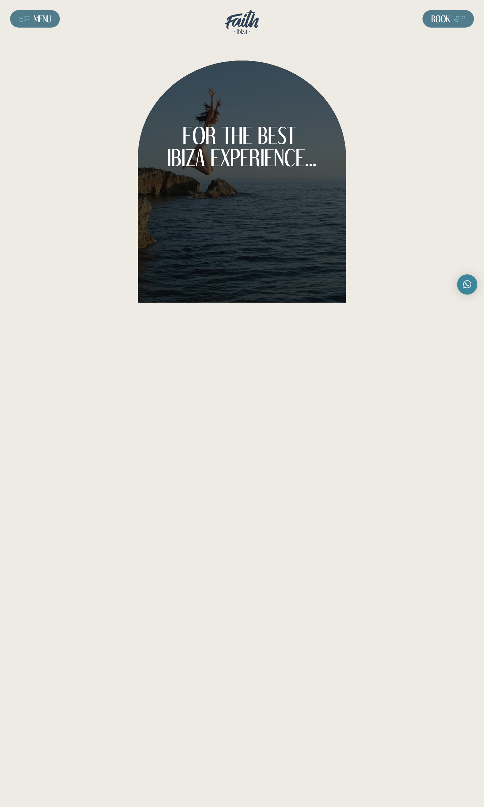

# UI Design System & Master Generation Blueprint: faithibiza-com

> **Faith Ibiza · VIP Ibiza Concierge Services** (https://faithibiza.com/) — Travelling to Ibiza and looking for a VIP experience? Our concierge services will ensure you experience all that the White Isle has to of...



---

## 1. Executive Visual Persona & Design Archetype

- **Brand Essence & Persona**: **Faith Ibiza · VIP Ibiza Concierge Services** (`https://faithibiza.com/`). Travelling to Ibiza and looking for a VIP experience? Our concierge services will ensure you experience all that the White Isle has to of...
- **Capture Provenance**: Live browser capture (`tier1_fast`, HTTP `200`, captured `2026-11-23`).
- **Visual Archetype**: **Light-Substrate Editorial & Modular Grid System (`#eeebe4` canvas, `#2f4156` ink, `#185abc` accent)**.
- **Anti-AI-Slop Differentiators**:
  - **Live-Computed Chromatic Polarity**: Anchors the viewport in `#eeebe4` (live computed `body` `background-color` (`computed_styles.json`)) paired with `#2f4156` primary typography and `#185abc` accents.
  - **Grounded Typographic Hierarchy**: Pairs `Dream Orphans` for display copy (`FOR THE BEST IBIZA EXPERIENCE...`) with `Afacad Flux` and not declared in live computed styles (uses primary stack / `ui-monospace`).
  - **Calibrated Spatial Grid & Motion**: Combines `1440px` container bounds (`gap: 0px (flush layout)`, padding `1px`) with `cubic-bezier(.49,.78,.46,1.34)` easing and Lenis Smooth Scroll (`data-lenis`), GSAP Timeline & ScrollTrigger.

---

## 2. Spatial Architecture & Modular Grid Mathematics


### Viewport Allocation & Container Geometry
- **Captured Viewport Dimensions**: Desktop `1440×2400px` (`assets/desktop.png`, clamped at 2400px live multi-section capture), Mobile `390×2400px` (`assets/mobile.png`, clamped at 2400px live multi-section capture).
- **Master Container Bounds**: `1440px` (full-bleed `100%` desktop stage measured on `1440px` viewport).
- **Canvas Lateral Padding & Spacing**: `1px` lateral canvas padding with `0px (flush layout)` grid gap.
- **Border Radius Scale**: `100px`, `2px`, `36px`, `38px`.

### Responsive Breakpoint Architecture
- **Desktop Layout**: Multi-column CSS Grid / Flexbox layout at `1440px` (`max-width: 1440px`, `gap: 0px (flush layout)`).
- **Mobile Layout**: Single-column vertical stack at `390px` viewport width with `1px` horizontal padding.
- **Extracted CSS Media Queries**: `@media screen and (forced-colors:active) and (prefers-color-sche...`.

---

## 3. Color System, Materiality & Atmospheric Lighting

### Semantic Palette & Source Grounding
| Semantic Role | Ground-Truth Value | Extracted Live / CSS Source |
|---|---|---|
| **Primary Canvas Substrate** | `#eeebe4` | live computed `body` `background-color` (`computed_styles.json`) |
| **Primary Typography Ink** | `#2f4156` | live computed `h2` `color` (`computed_styles.json`) |
| **Elevated Surface / Card Substrate** | `#dddddd` | `var(--wp-editor-canvas-background)` in `:root` |
| **Interactive Accent / Highlight** | `#185abc` | `.rc-2fa-submit-button-holder bu... { background-color: #185abc }` |
| **Secondary / Muted Copy** | `#8daeb6` | `var(--c-secondary)` in `:root` |
| **Structural Hairline Border** | `#b2b2b2` | `kbox-hover .recaptcha-checkbox-... { border: #b2b2b2 }` |
| **Variable Token (`--wp-block-synced-color`)** | `#7a00df` | `var(--wp-block-synced-color)` in `:root` |
| **Variable Token (`--wp-admin-theme-color`)** | `#007cba` | `var(--wp-admin-theme-color)` in `:root` |
| **Variable Token (`--wp-admin-theme-color-darker-10`)** | `#006ba1` | `var(--wp-admin-theme-color-darker-10)` in `:root` |
| **Variable Token (`--wp-admin-theme-color-darker-20`)** | `#005a87` | `var(--wp-admin-theme-color-darker-20)` in `:root` |
| **Variable Token (`--cookieadmin-primary-color`)** | `#001d39` | `var(--cookieadmin-primary-color)` in `:root` |
| **Variable Token (`--cookieadmin-primary-hover-color`)** | `#985e23` | `var(--cookieadmin-primary-hover-color)` in `:root` |

### Sanitized Root CSS Variables (`ui-ux.md` Ground Truth)
| Variable Name | Extracted Value | Semantic Role |
|---|---|---|
| `--i-star` | `url(https://faithibiza.com/wp-content/themes/general-block-wp/img/star.svg)` | Dimension / Scale Token |
| `--wp-block-synced-color` | `#7a00df` | Brand / Palette Token |
| `--wp-block-synced-color--rgb` | `122,0,223` | Brand / Palette Token |
| `--wp-bound-block-color` | `var(--wp-block-synced-color)` | Brand / Palette Token |
| `--wp-editor-canvas-background` | `#ddd` | Canvas / Surface Token |
| `--wp-admin-theme-color` | `#007cba` | Brand / Palette Token |
| `--wp-admin-theme-color--rgb` | `0,124,186` | Brand / Palette Token |
| `--wp-admin-theme-color-darker-10` | `#006ba1` | Canvas / Surface Token |
| `--wp-admin-theme-color-darker-10--rgb` | `0,107,160.5` | Canvas / Surface Token |
| `--wp-admin-theme-color-darker-20` | `#005a87` | Canvas / Surface Token |
| `--wp-admin-theme-color-darker-20--rgb` | `0,90,135` | Canvas / Surface Token |
| `--wp-admin-border-width-focus` | `2px` | Layout / Spatial Grid Token |
| `--wp-admin--admin-bar--position-offset` | `var(--wp-admin--admin-bar--height,0px)` | Dimension / Scale Token |
| `--wp--style--block-gap` | `24px` | Layout / Spatial Grid Token |
| `--cookieadmin-primary-color` | `#001d39` | Brand / Palette Token |
| `--cookieadmin-primary-hover-color` | `#985e23` | Brand / Palette Token |

---

## 4. Typographic Scale & Editorial Hierarchy

### Font Family Stacks
- **Display Typography**: `Dream Orphans`.
- **Primary Body Stack**: `Afacad Flux`.
- **Technical / Metadata Stack**: not declared in live computed styles (uses primary stack / `ui-monospace`).

### Typographic Scale & Rules (Live Computed & Stylesheet Grounded)
- **Hero Display (`H1`)**: live computed `h1` (`font-size: 80px`, `line-height: 88px`, `font-weight: 400`, `letter-spacing: 0.8px`).
- **Section Heading (`H2`)**: live computed `h2` (`font-size: 69.9998px`, `line-height: 76.9998px`, `font-weight: 400`, `letter-spacing: 0.699998px`).
- **Body Copy**: live computed `body` (`font-size: 16px`, `line-height: normal`, `font-weight: 400`).
- **Metadata & Navigation Labels**: live computed `nav/a` (`font-size: 16px`, `line-height: normal`, `font-weight: 400`); CSS variables `--modal-size-small: 500px`.

---

## 5. Choreographed Motion & Interaction Physics

### Primary Easing Curves
- **Extracted Timing Functions**: `cubic-bezier(.49,.78,.46,1.34)`.

### Per-Element Transition & Choreography Rules
- **Selector `.recaptcha-checkbox-spinner`**: `transition: 1s` extracted from `faithibiza-com` stylesheet.
- **Selector `ible .rc-anchor-normal-footer .rc...`**: `transition: opacity .3s ease` extracted from `faithibiza-com` stylesheet.
- **Selector `.rc-anchor-logo-img-large`**: `transition: all .3s ease` extracted from `faithibiza-com` stylesheet.
- **Extracted Easing Curve (`cubic-bezier(.49,.78,.46,1.34)`)**: Governs interactive state transitions across `<header.site-header>` and `<main.site-main:nth(2)>`.
- **Runtime Interaction Engine**: Integrates Lenis Smooth Scroll (`data-lenis`), GSAP Timeline & ScrollTrigger, Three.js / WebGL Canvas Pipeline, Swiper Touch Carousel Engine, Barba.js Page Transition Router with `prefers-reduced-motion: reduce` fallback guards.

---

## 6. Component Wireframe & Structural DOM Map

### Visual Layout Schematic — Desktop (`1440px`, Grounded in `dom.html` & Landmark Bounding Boxes)
```
┌────────────────────────────────────────────────────────────────────────┐
│ DESKTOP VIEWPORT (1440px) — Faith Ibiza · VIP Ibiza Concierge Services │
│ ====================================================================== │
│ [ <header.site-header> (1440x0px)     | About · About Us · Charity W ] │
│ ---------------------------------------------------------------------- │
│ | HERO STAGE: <main.site-main> (w=1440px)                            | │
│ | H1: FOR THE BEST IBIZA EXPERIENCE...                               | │
│ | Substrate: #eeebe4 | Ink: #2f4156 | Accent: #185abc                | │
│ ---------------------------------------------------------------------- │
│ | SHOWCASE GRID (<main.site-main:nth(2)>) max-w: 1440px              | │
│ | +------------------------------+  +------------------------------+ | │
│ | | For the best Ibiza experienc |  | Book with Faith              | | │
│ | +------------------------------+  +------------------------------+ | │
│ ---------------------------------------------------------------------- │
│ | DETAIL MODULE (<main.site-main:nth(3)>) — COME FOR THE BEACHES     | │
│ ---------------------------------------------------------------------- │
│ [ FOOTER (<footer.site-footer>) | https://faithibiza.com/              │
└────────────────────────────────────────────────────────────────────────┘
```

### Visual Layout Schematic — Mobile Reflow (`390px`)
```
┌────────────────────────────────────────────────────────────────────────┐
│ MOBILE VIEWPORT REFLOW (390px) — Single-Column Stack (gap: 0px (flu)   │
│ ====================================================================== │
│ [ HEADER BAR (<header.site-header>    ) | Compact Menu (390px)         │
│ ---------------------------------------------------------------------- │
│ | HERO STAGE (<main.site-main>) — 390px Vertical Lead                | │
│ | H1: FOR THE BEST IBIZA EXPERIENCE...                               | │
│ ---------------------------------------------------------------------- │
│ | SHOWCASE STACK (<main.site-main:nth(2)) — 1-Col Stack              | │
│ | [ Item 1: For the best Ibiza experience...                       ] | │
│ | [ Item 2: Book with Faith                                        ] | │
│ ---------------------------------------------------------------------- │
│ | DETAIL STACK (<main.site-main:nth(3)>) — 1-Col (COME FOR THE BEACH)  │
│ ---------------------------------------------------------------------- │
│ [ FOOTER (<footer.site-footer>) | Stacked 390px Colophon               │
└────────────────────────────────────────────────────────────────────────┘
```

### Granular DOM Region Breakdown
1. **Brand Header & Navigation Bar (<header.site-header> — `faithibiza-com`)**:
   - Landmark `<header class="site-header">` (`1440x0px`) hosting `Faith Ibiza · VIP Ibiza Concierge Se` navigation (`About · About Us · Charity Work · Latest News · Where to stay`), DOM attributes (`data-optimized="1"`, `data-optimized="1"`, `data-optimized="2"`, `data-optimized="1"`), and stylesheet rule `.goog-inline-block { position:relative;display:-moz-inline-box;display:inline-block }`.
2. **Hero Stage & Focal Lead (<main.site-main> — `FOR THE BEST IBIZA EXPERIENCE...`)**:
   - Landmark `<main class="site-main">` presenting display lead `FOR THE BEST IBIZA EXPERIENCE...` and copy excerpt *"Exceptional island knowledge to ensure your stay in Ibiza is unfo"* over `#eeebe4` canvas and `#2f4156` ink.
3. **Primary Showcase & Content Grid (<main.site-main:nth(2)> — `For the best Ibiza experience...`)**:
   - Landmark `<main class="site-main">` rendering section `For the best Ibiza experience...` with copy *"Use Up/Down Arrow keys to increase or decrease volume."*, asset references (`recaptcha__en.js`, `cdn.jsdelivr.net`, `unpkg.com`, `www.google.com`), and grid rule `html .goog-inline-block { display:inline }`.
4. **Interactive Detail & Feature Matrix (<main.site-main:nth(3)> — `Book with Faith`)**:
   - Landmark `<main class="site-main">` framing `Book with Faith` and `COME FOR THE BEACHES` (*"PART OF THE O BEACH GROUP"*) with `#dddddd` surface cards, `#185abc` accents, and `.recaptcha-checkbox { border:none;font-size:1px;height:28px;margin:4px;width:28px;overflow:vis... }`.
5. **Colophon & Global Directory Footer (<footer.site-footer> — `https://faithibiza.com/`)**:
   - Landmark `<footer class="site-footer is-dark">` anchoring `Faith Ibiza · VIP Ibiza Concierg` footer links (`About · About Us · Charity Work · Latest News · Where to stay`), copy *"Your holiday shouldn’t be spent worrying about bookings, tra"*, and `#b2b2b2` structural dividers.

---

## 7. Master Zero-Shot AI Generation Prompt

```markdown
# Master Zero-Shot Frontend Generation Prompt: faithibiza-com (Faith Ibiza · VIP Ibiza Concierge Services)

You are a principal frontend architect and design systems engineer. Build a complete, production-ready web application replicating the exact design system, DOM landmarks, typographic hierarchy, color tokens, and motion physics of `faithibiza-com` (**Faith Ibiza · VIP Ibiza Concierge Services** — `https://faithibiza.com/`).

### 1. Visual Archetype & Anti-AI-Slop Mandates
- **Archetype**: Light-Substrate Editorial & Modular Grid System (`#eeebe4` canvas, `#2f4156` ink, `#185abc` accent).
- **Identity & Domain Context**: Travelling to Ibiza and looking for a VIP experience? Our concierge services will ensure you experience all that the White Isle has to of...
- **Primary Substrate**: `#eeebe4` (live computed `body` `background-color` (`computed_styles.json`)), **Primary Ink**: `#2f4156`, **Accent / Highlight**: `#185abc`.
- **Site-Specific Differentiators**:
  - **Live-Computed Chromatic Polarity**: Anchors the viewport in `#eeebe4` (live computed `body` `background-color` (`computed_styles.json`)) paired with `#2f4156` primary typography and `#185abc` accents.
  - **Grounded Typographic Hierarchy**: Pairs `Dream Orphans` for display copy (`FOR THE BEST IBIZA EXPERIENCE...`) with `Afacad Flux` and not declared in live computed styles (uses primary stack / `ui-monospace`).
  - **Calibrated Spatial Grid & Motion**: Combines `1440px` container bounds (`gap: 0px (flush layout)`, padding `1px`) with `cubic-bezier(.49,.78,.46,1.34)` easing and Lenis Smooth Scroll (`data-lenis`), GSAP Timeline & ScrollTrigger.

### 2. Ground-Truth CSS Variables (`:root` Token Contract)
Declare and consume these exact custom properties extracted from `faithibiza-com` in your global stylesheet:

:root {
  /* Faith Ibiza · VIP Ibiza Concierge Services (faithibiza-com) — Live-Grounded CSS Variables */
  --i-star: url(https://faithibiza.com/wp-content/themes/general-block-wp/img/star.svg); /* Dimension / Scale Token (faithibiza-com) */
  --wp-block-synced-color: #7a00df; /* Brand / Palette Token (faithibiza-com) */
  --wp-block-synced-color--rgb: 122,0,223; /* Brand / Palette Token (faithibiza-com) */
  --wp-bound-block-color: var(--wp-block-synced-color); /* Brand / Palette Token (faithibiza-com) */
  --wp-editor-canvas-background: #ddd; /* Canvas / Surface Token (faithibiza-com) */
  --wp-admin-theme-color: #007cba; /* Brand / Palette Token (faithibiza-com) */
  --wp-admin-theme-color--rgb: 0,124,186; /* Brand / Palette Token (faithibiza-com) */
  --wp-admin-theme-color-darker-10: #006ba1; /* Canvas / Surface Token (faithibiza-com) */
  --wp-admin-theme-color-darker-10--rgb: 0,107,160.5; /* Canvas / Surface Token (faithibiza-com) */
  --wp-admin-theme-color-darker-20: #005a87; /* Canvas / Surface Token (faithibiza-com) */
  --wp-admin-theme-color-darker-20--rgb: 0,90,135; /* Canvas / Surface Token (faithibiza-com) */
  --wp-admin-border-width-focus: 2px; /* Layout / Spatial Grid Token (faithibiza-com) */
  --wp-admin--admin-bar--position-offset: var(--wp-admin--admin-bar--height,0px); /* Dimension / Scale Token (faithibiza-com) */
  --wp--style--block-gap: 24px; /* Layout / Spatial Grid Token (faithibiza-com) */
  --cookieadmin-primary-color: #001d39; /* Brand / Palette Token (faithibiza-com) */
  --cookieadmin-primary-hover-color: #985e23; /* Brand / Palette Token (faithibiza-com) */
}

### 3. Semantic Color & Materiality Contract
Map every surface, ink, and border strictly to these source-grounded tokens:
- **Primary Canvas Substrate**: `#eeebe4` — grounded in live computed `body` `background-color` (`computed_styles.json`)
- **Primary Typography Ink**: `#2f4156` — grounded in live computed `h2` `color` (`computed_styles.json`)
- **Elevated Surface / Card Substrate**: `#dddddd` — grounded in `var(--wp-editor-canvas-background)` in `:root`
- **Interactive Accent / Highlight**: `#185abc` — grounded in `.rc-2fa-submit-button-holder bu... { background-color: #185abc }`
- **Secondary / Muted Copy**: `#8daeb6` — grounded in `var(--c-secondary)` in `:root`
- **Structural Hairline Border**: `#b2b2b2` — grounded in `kbox-hover .recaptcha-checkbox-... { border: #b2b2b2 }`
- **Variable Token (`--wp-block-synced-color`)**: `#7a00df` — grounded in `var(--wp-block-synced-color)` in `:root`
- **Variable Token (`--wp-admin-theme-color`)**: `#007cba` — grounded in `var(--wp-admin-theme-color)` in `:root`
- **Variable Token (`--wp-admin-theme-color-darker-10`)**: `#006ba1` — grounded in `var(--wp-admin-theme-color-darker-10)` in `:root`
- **Variable Token (`--wp-admin-theme-color-darker-20`)**: `#005a87` — grounded in `var(--wp-admin-theme-color-darker-20)` in `:root`
- **Variable Token (`--cookieadmin-primary-color`)**: `#001d39` — grounded in `var(--cookieadmin-primary-color)` in `:root`
- **Variable Token (`--cookieadmin-primary-hover-color`)**: `#985e23` — grounded in `var(--cookieadmin-primary-hover-color)` in `:root`

### 4. Spatial Grid, Container Bounds & Responsive Breakpoints
- **Desktop Viewport Reference**: `1440×2400px` (clamped at 2400px live multi-section capture, `1440px` standard desktop width).
- **Mobile Viewport Reference**: `390×2400px` (clamped at 2400px live multi-section capture, `390px` standard mobile width).
- **Container Max-Width**: `1440px` (full-bleed `100%` desktop stage measured on `1440px` viewport)
- **Padding & Gutters**: `1px` lateral canvas padding with `0px (flush layout)` grid gap
- **Desktop Grid**: Multi-column CSS Grid / Flexbox layout at `1440px` (`max-width: 1440px`, `gap: 0px (flush layout)`)
- **Mobile Adaptation**: Single-column vertical stack at `390px` viewport width with `1px` horizontal padding
- **Media Queries**: `@media screen and (forced-colors:active) and (prefers-color-sche...`
- **Corner Radii**: `100px`, `2px`, `36px`, `38px`

### 5. Typography & Editorial Scale Contract
- **Display Font Stack**: `Dream Orphans`
- **Body Font Stack**: `Afacad Flux`
- **Monospace / Technical Font Stack**: not declared in live computed styles (uses primary stack / `ui-monospace`)
- **H1 Display Rule**: live computed `h1` (`font-size: 80px`, `line-height: 88px`, `font-weight: 400`, `letter-spacing: 0.8px`)
- **H2 Section Rule**: live computed `h2` (`font-size: 69.9998px`, `line-height: 76.9998px`, `font-weight: 400`, `letter-spacing: 0.699998px`)
- **Body Copy Rule**: live computed `body` (`font-size: 16px`, `line-height: normal`, `font-weight: 400`)
- **Metadata & Index Rule**: live computed `nav/a` (`font-size: 16px`, `line-height: normal`, `font-weight: 400`); CSS variables `--modal-size-small: 500px`

### 6. Component Hierarchy, Verbatim Copy & Real DOM Landmarks
Scaffold `faithibiza-com` (`Faith Ibiza · VIP Ibiza Concierge Services`) with these exact structural regions, extracted copy, and CSS rules from `dom.html`:
1. **Brand Header & Navigation Bar (<header.site-header> — `faithibiza-com`)**:
   - DOM & Selectors: Landmark `<header class="site-header">` (`1440x0px`) hosting `Faith Ibiza · VIP Ibiza Concierge Se` navigation (`About · About Us · Charity Work · Latest News · Where to stay`), DOM attributes (`data-optimized="1"`, `data-optimized="1"`, `data-optimized="2"`, `data-optimized="1"`), and stylesheet rule `.goog-inline-block { position:relative;display:-moz-inline-box;display:inline-block }`.
   - Responsive Contract: Header `Brand Header & Navigation Bar (<header.site-header> — `faithibiza-com`)` (`faithibiza-com`) adapts across `@media screen and (forced-colors:active) and (prefers-color-sche...` with `cubic-bezier(.49,.78,.46,1.34)` transitions and links `About · About Us · Charity Work · Latest News · Where to stay`.
2. **Hero Stage & Focal Lead (<main.site-main> — `FOR THE BEST IBIZA EXPERIENCE...`)**:
   - DOM & Selectors: Landmark `<main class="site-main">` presenting display lead `FOR THE BEST IBIZA EXPERIENCE...` and copy excerpt *"Exceptional island knowledge to ensure your stay in Ibiza is unfo"* over `#eeebe4` canvas and `#2f4156` ink.
   - Responsive Contract: Hero stage (`1440×2400px` desktop / `390×2400px` mobile) sets `#eeebe4` background with `#2f4156` headline `FOR THE BEST IBIZA EXPERIENCE...`.
3. **Primary Showcase & Content Grid (<main.site-main:nth(2)> — `For the best Ibiza experience...`)**:
   - DOM & Selectors: Landmark `<main class="site-main">` rendering section `For the best Ibiza experience...` with copy *"Use Up/Down Arrow keys to increase or decrease volume."*, asset references (`recaptcha__en.js`, `cdn.jsdelivr.net`, `unpkg.com`, `www.google.com`), and grid rule `html .goog-inline-block { display:inline }`.
   - Responsive Contract: Showcase grid `Primary Showcase & Content Grid (<main.site-main:nth(2)> — `For the best Ibiza experience...`)` applies Multi-column CSS Grid / Flexbox layout at `1440px` (`max-width: 1440px`, `gap: 0px (flush layout)`) on desktop and Single-column vertical stack at `390px` viewport width with `1px` horizontal padding on mobile.
4. **Interactive Detail & Feature Matrix (<main.site-main:nth(3)> — `Book with Faith`)**:
   - DOM & Selectors: Landmark `<main class="site-main">` framing `Book with Faith` and `COME FOR THE BEACHES` (*"PART OF THE O BEACH GROUP"*) with `#dddddd` surface cards, `#185abc` accents, and `.recaptcha-checkbox { border:none;font-size:1px;height:28px;margin:4px;width:28px;overflow:vis... }`.
   - Responsive Contract: Detail module `Interactive Detail & Feature Matrix (<main.site-main:nth(3)> — `Book with Faith`)` uses `100px`, `2px`, `36px`, `38px` radii, `#185abc` highlights, and assets (recaptcha__en.js, cdn.jsdelivr.net, unpkg.com).
5. **Colophon & Global Directory Footer (<footer.site-footer> — `https://faithibiza.com/`)**:
   - DOM & Selectors: Landmark `<footer class="site-footer is-dark">` anchoring `Faith Ibiza · VIP Ibiza Concierg` footer links (`About · About Us · Charity Work · Latest News · Where to stay`), copy *"Your holiday shouldn’t be spent worrying about bookings, tra"*, and `#b2b2b2` structural dividers.
   - Responsive Contract: Footer `Colophon & Global Directory Footer (<footer.site-footer> — `https://faithibiza.com/`)` aligns to `1440px` (full-bleed `100%` desktop stage measured on `1440px` viewport) with `1px` lateral canvas padding with `0px (flush layout)` grid gap and attributes (data-optimized="1", data-optimized="1", data-optimized="2").

#### Verbatim DOM Copy Excerpts (`dom.html`)
- Copy Excerpt 1: *"Exceptional island knowledge to ensure your stay in Ibiza is unforgettable."*
- Copy Excerpt 2: *"Use Up/Down Arrow keys to increase or decrease volume."*
- Copy Excerpt 3: *"PART OF THE O BEACH GROUP"*
- Copy Excerpt 4: *"Your holiday shouldn’t be spent worrying about bookings, transfers and schedules...."*

### 7. Motion, Extracted Stylesheet Rules & Interaction Choreography
- **Primary Easing Functions**: `cubic-bezier(.49,.78,.46,1.34)`
- **Extracted Stylesheet Rules (`faithibiza-com`)**:
- `.goog-inline-block { position:relative;display:-moz-inline-box;display:inline-block }`
- `html .goog-inline-block { display:inline }`
- `.recaptcha-checkbox { border:none;font-size:1px;height:28px;margin:4px;width:28px;overflow:vis... }`
- `ark .recaptcha-checkbox-spinner-o... { background-color:222 }`
- `x-hover .recaptcha-checkbox-spinn... { -webkit-box-shadow:inset 0 1px 1px rgba(0,0,0,.1);box-shadow:inset 0 1px... }`
- **Per-Selector Transition Rules**:
- **Selector `.recaptcha-checkbox-spinner`**: `transition: 1s` extracted from `faithibiza-com` stylesheet.
- **Selector `ible .rc-anchor-normal-footer .rc...`**: `transition: opacity .3s ease` extracted from `faithibiza-com` stylesheet.
- **Selector `.rc-anchor-logo-img-large`**: `transition: all .3s ease` extracted from `faithibiza-com` stylesheet.
- **Extracted Easing Curve (`cubic-bezier(.49,.78,.46,1.34)`)**: Governs interactive state transitions across `<header.site-header>` and `<main.site-main:nth(2)>`.
- **Runtime Interaction Engine**: Integrates Lenis Smooth Scroll (`data-lenis`), GSAP Timeline & ScrollTrigger, Three.js / WebGL Canvas Pipeline, Swiper Touch Carousel Engine, Barba.js Page Transition Router with `prefers-reduced-motion: reduce` fallback guards.

### 8. Technical Deliverables
- Implement in Next.js (App Router) with TypeScript and Tailwind CSS consuming the `:root` custom properties defined above for `faithibiza-com`.
- Reproduce both the `1440px` desktop architecture and `390px` mobile breakpoint transitions, preserving semantic HTML5 landmarks (`<header>`, `<nav>`, `<main>`, `<section>`, `<footer>`) and `prefers-reduced-motion` accessibility guards.
```
