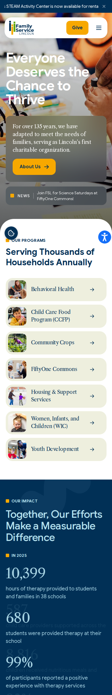

# UI Design System & Master Generation Blueprint: familyservicelincoln-org

> **Family Service Lincoln: Everyone Deserves the Chance to Thrive** (https://familyservicelincoln.org) — For over 135 years, we have adapted to meet the needs of families, serving as Lincoln's first charitable organization.


---

## 1. Executive Visual Persona & Design Archetype

- **Brand Essence & Persona**: **Family Service Lincoln: Everyone Deserves the Chance to Thrive** (`https://familyservicelincoln.org`). For over 135 years, we have adapted to meet the needs of families, serving as Lincoln's first charitable organization.
- **Visual Archetype**: **High-Contrast Obsidian / Atmospheric Design System (`#1b1f2a` canvas, `#ffffff` ink, `#ffc145` accent)**.
- **Anti-AI-Slop Differentiators**:
  - **Source-Grounded Chromatic Polarity**: Anchors the viewport in `#1b1f2a` (`var(--gmcc-bg)` in `:root`) paired with `#ffffff` primary typography and `#ffc145` accents.
  - **Extracted Typographic Hierarchy**: Pairs `Google Sans` for display copy (`Everyone Deserves the Chance to Thri`) with `Libre Caslon Text` and `SFMono-Regular`.
  - **Calibrated Spatial Grid & Motion**: Combines `56rem` container bounds (`gap: 1rem`, padding `1.5rem`) with `cubic-bezier(.4,0,.2,1)` easing and GSAP Timeline & ScrollTrigger, Three.js / WebGL Canvas Pipeline.

---

## 2. Spatial Architecture & Modular Grid Mathematics



### Viewport Allocation & Container Geometry
- **Captured Viewport Dimensions**: Desktop `1440×4818px` (`assets/desktop.png`, full-page scroll capture), Mobile `390×2400px` (`assets/mobile.png`, capped at 2400px multi-section capture).
- **Master Container Bounds**: `56rem` extracted from `familyservicelincoln-org` stylesheet.
- **Canvas Lateral Padding & Spacing**: `1.5rem` lateral canvas padding with `1rem` grid gap.
- **Border Radius Scale**: `var(--gmcc-radius)`, `9999px`, `4px`, `100%`.

### Responsive Breakpoint Architecture
- **Desktop Layout**: Multi-column CSS Grid / Flexbox layout at `1440px` (`max-width: 56rem`, `gap: 1rem`).
- **Mobile Layout**: Single-column vertical stack at `390px` viewport width with `1.5rem` horizontal padding.
- **Extracted CSS Media Queries**: `@media (min-width: 768px)`, `@media (prefers-reduced-motion: reduce)`, `@media (min-width: 900px)`, `@media (min-width: 700px)`.

---

## 3. Color System, Materiality & Atmospheric Lighting

### Semantic Palette & Source Grounding
| Semantic Role | Ground-Truth Value | Extracted CSS Source / Selector |
|---|---|---|
| **Primary Canvas Substrate** | `#1b1f2a` | `var(--gmcc-bg)` in `:root` |
| **Primary Typography Ink** | `#ffffff` | `var(--gmcc-text)` in `:root` |
| **Elevated Surface / Card Substrate** | `#a7b0bd` | `var(--gmcc-text-muted)` in `:root` |
| **Interactive Accent / Highlight** | `#ffc145` | `var(--gmcc-accent)` in `:root` |
| **Secondary / Muted Copy** | `#15171c` | `var(--gmcc-accent-text)` in `:root` |
| **Structural Hairline Border** | `#ffd37a` | `var(--gmcc-accent-hover)` in `:root` |
| **Variable Token (`--gmcc-link`)** | `#7cc6ff` | `var(--gmcc-link)` in `:root` |
| **Variable Token (`--gmcc-focus`)** | `#3b82f6` | `var(--gmcc-focus)` in `:root` |

### Sanitized Root CSS Variables (`ui-ux.md` Ground Truth)
| Variable Name | Extracted Value | Semantic Role |
|---|---|---|
| `--gmcc-bg` | `#1b1f2a` | Canvas / Surface Token |
| `--gmcc-text` | `#ffffff` | Typography Ink Token |
| `--gmcc-text-muted` | `#a7b0bd` | Typography Ink Token |
| `--gmcc-accent` | `#ffc145` | Brand / Palette Token |
| `--gmcc-accent-text` | `#15171c` | Typography Ink Token |
| `--gmcc-accent-hover` | `#ffd37a` | Brand / Palette Token |
| `--gmcc-link` | `#7cc6ff` | Typography Ink Token |
| `--gmcc-focus` | `#3b82f6` | Color / Atmospheric Token |
| `--gmcc-radius` | `16px` | Elevation / Border Token |
| `--gmcc-font` | `inherit` | Typography / Scale Token |
| `--header-height` | `88px` | Layout / Spatial Grid Token |
| `--admin-bar-height` | `32px` | Layout / Spatial Grid Token |
| `--gform-theme-control-shadow` | `none` | Brand / Palette Token |
| `--gform-theme-control-size` | `auto` | Brand / Palette Token |
| `--gform-theme-control-checked-shadow` | `none` | Brand / Palette Token |
| `--gform-theme-control-checkbox-checked-shadow` | `none` | Brand / Palette Token |

---

## 4. Typographic Scale & Editorial Hierarchy

### Font Family Stacks
- **Display Typography**: `Google Sans`.
- **Primary Body Stack**: `Libre Caslon Text`.
- **Technical / Metadata Stack**: `SFMono-Regular`.

### Typographic Scale & Rules (Extracted from Stylesheet & Variables)
- **Hero Display (`H1`)**: rule `h1` (`font-size: 3rem`, `line-height: 1`).
- **Section Heading (`H2`)**: rule `h2` (`font-size: clamp(32px,5vw,70px)`, `line-height: 1.17`, `letter-spacing: -1.4px`, `font-weight: 400`).
- **Body Copy**: rule `,p` (`font-size: 1rem`, `line-height: 1.5rem`).
- **Metadata & Navigation Labels**: not explicitly declared on tag in static CSS (stylesheet font-size ladder: `20px`, `14px`, `15px`, `13px`, `16px`).

---

## 5. Choreographed Motion & Interaction Physics

### Primary Easing Curves
- **Extracted Timing Functions**: `cubic-bezier(.4,0,.2,1)`, `cubic-bezier(0,0,.2,1)`, `cubic-bezier(.33,.85,.4,1.35)`.

### Per-Element Transition & Choreography Rules
- **Selector `.gm-cc`**: `transition: transform 0.32s ease-out, opacity 0.32s ease-out` extracted from `familyservicelincoln-org` stylesheet.
- **Selector `media (prefers-reduced-motion: re...`**: `transition: none` extracted from `familyservicelincoln-org` stylesheet.
- **Selector `.gm-cc__btn`**: `transition: background-color 0.2s ease-out, color 0.2s ease-out, border-co...` extracted from `familyservicelincoln-org` stylesheet.
- **Extracted Easing Curve (`cubic-bezier(.4,0,.2,1)`)**: Governs interactive state transitions across `<header.fixed>` and `<section.module-program_tabs>`.
- **Runtime Interaction Engine**: Integrates GSAP Timeline & ScrollTrigger, Three.js / WebGL Canvas Pipeline with `prefers-reduced-motion: reduce` fallback guards.

---

## 6. Component Wireframe & Structural DOM Map

### Visual Layout Schematic (Grounded in `dom.html` — `1440px` Desktop & `390px` Mobile Reflow)
```
┌────────────────────────────────────────────────────────────────────────┐
│ DESKTOP VIEWPORT (1440px) — Family Service Lincoln: Everyone Deserves  │
│ ====================================================================== │
│ [ <header.fixed>           | About Us · Leadership Team · Annual Re ]  │
│ ---------------------------------------------------------------------- │
│ | HERO STAGE: <section.module-hero>                                |   │
│ | H1: Everyone Deserves the Chance to Thrive                       |   │
│ | Substrate: #1b1f2a    | Ink: #ffffff    | Accent: #ffc145        |   │
│ ---------------------------------------------------------------------- │
│ | SHOWCASE GRID (<section.module-program_ta) max-w: 56rem          |   │
│ | +------------------------------+  +------------------------------+ | │
│ | | Serving Thousands of Househo |  | Together, Our Efforts Make a | | │
│ | +------------------------------+  +------------------------------+ | │
│ ---------------------------------------------------------------------- │
│ | MOBILE VIEWPORT REFLOW (390px) — Single-Column Stack (gap: 1rem  ) | │
│ | [<header.fixed>] -> [<section.module-he] -> [<section.module-pr] |   │
│ ---------------------------------------------------------------------- │
│ [ FOOTER (<footer.full>         ) | https://familyservicelincoln.org   │
└────────────────────────────────────────────────────────────────────────┘
```

### Granular DOM Region Breakdown
1. **Brand Header & Navigation Bar (<header.fixed> — `familyservicelincoln-org`)**:
   - Landmark `<header class="fixed top-0">` hosting `Family Service Lincoln: Everyone Des` navigation (`About Us · Leadership Team · Annual Report · Strategic Plan · Form 990`), DOM attributes (`data-cbid="1670e8a1-465b-4331-ab..."`, `data-blockingmode="manual"`, `data-acsb-sr-alert="true"`, `data-acsb-sr-only="true"`), and stylesheet rule `.gm-cc { padding: 0 2% 1.25rem; }`.
2. **Hero Stage & Focal Lead (<section.module-hero> — `Everyone Deserves the Chance to Th`)**:
   - Landmark `<section class="module-hero full">` presenting display lead `Everyone Deserves the Chance to Thrive` and copy excerpt *"Press Option+1 for screen-reader mode, Option+0 to cancel"* over `#1b1f2a` canvas and `#ffffff` ink.
3. **Primary Showcase & Content Grid (<section.module-program_tabs> — `Serving Thousands of Households An`)**:
   - Landmark `<section class="module-program_tabs full">` rendering section `Serving Thousands of Households Annually` with copy *"Accessibility Screen-Reader Guide, Feedback, and Issue Reporting "*, asset references (`widgetIcon.min.js`, `state.js`, `logconsent.ashx`, `cc.js`), and grid rule `.gm-cc.is-visible { transform: none; opacity: 1; }`.
4. **Interactive Detail & Feature Matrix (<section.module-impact_stats> — `Together, Our Efforts Make a Measu`)**:
   - Landmark `<section class="module-impact_stats full">` framing `Together, Our Efforts Make a Measurable Difference` and `Strong Families Build Strong Communities` (*"Skip to main content"*) with `#a7b0bd` surface cards, `#ffc145` accents, and `.gm-cc__card { padding: 1.75rem 2rem; }`.
5. **Colophon & Global Directory Footer (<footer.full> — `https://familyservicelincoln.org`)**:
   - Landmark `<footer class="full relative">` anchoring `Family Service Lincoln: Everyone` footer links (`About Us · Leadership Team · Annual Report · Strategic Plan · Form 990`), copy *"The FiftyOne Commons STEAM Activity Center is now available "*, and `#ffd37a` structural dividers.

---

## 7. Master Zero-Shot AI Generation Prompt

```markdown
# Master Zero-Shot Frontend Generation Prompt: familyservicelincoln-org (Family Service Lincoln: Everyone Deserves the Chance to Thrive)

You are a principal frontend architect and design systems engineer. Build a complete, production-ready web application replicating the exact design system, DOM landmarks, typographic hierarchy, color tokens, and motion physics of `familyservicelincoln-org` (**Family Service Lincoln: Everyone Deserves the Chance to Thrive** — `https://familyservicelincoln.org`).

### 1. Visual Archetype & Anti-AI-Slop Mandates
- **Archetype**: High-Contrast Obsidian / Atmospheric Design System (`#1b1f2a` canvas, `#ffffff` ink, `#ffc145` accent).
- **Identity & Domain Context**: For over 135 years, we have adapted to meet the needs of families, serving as Lincoln's first charitable organization.
- **Primary Substrate**: `#1b1f2a` (`var(--gmcc-bg)` in `:root`), **Primary Ink**: `#ffffff`, **Accent / Highlight**: `#ffc145`.
- **Site-Specific Differentiators**:
  - **Source-Grounded Chromatic Polarity**: Anchors the viewport in `#1b1f2a` (`var(--gmcc-bg)` in `:root`) paired with `#ffffff` primary typography and `#ffc145` accents.
  - **Extracted Typographic Hierarchy**: Pairs `Google Sans` for display copy (`Everyone Deserves the Chance to Thri`) with `Libre Caslon Text` and `SFMono-Regular`.
  - **Calibrated Spatial Grid & Motion**: Combines `56rem` container bounds (`gap: 1rem`, padding `1.5rem`) with `cubic-bezier(.4,0,.2,1)` easing and GSAP Timeline & ScrollTrigger, Three.js / WebGL Canvas Pipeline.

### 2. Ground-Truth CSS Variables (`:root` Token Contract)
Declare and consume these exact custom properties extracted from `familyservicelincoln-org` in your global stylesheet:

:root {
  /* Family Service Lincoln: Everyone Deserves the Chance to Thrive (familyservicelincoln-org) — Ground-Truth Extracted CSS Variables */
  --gmcc-bg: #1b1f2a; /* Canvas / Surface Token (familyservicelincoln-org) */
  --gmcc-text: #ffffff; /* Typography Ink Token (familyservicelincoln-org) */
  --gmcc-text-muted: #a7b0bd; /* Typography Ink Token (familyservicelincoln-org) */
  --gmcc-accent: #ffc145; /* Brand / Palette Token (familyservicelincoln-org) */
  --gmcc-accent-text: #15171c; /* Typography Ink Token (familyservicelincoln-org) */
  --gmcc-accent-hover: #ffd37a; /* Brand / Palette Token (familyservicelincoln-org) */
  --gmcc-link: #7cc6ff; /* Typography Ink Token (familyservicelincoln-org) */
  --gmcc-focus: #3b82f6; /* Color / Atmospheric Token (familyservicelincoln-org) */
  --gmcc-radius: 16px; /* Elevation / Border Token (familyservicelincoln-org) */
  --gmcc-font: inherit; /* Typography / Scale Token (familyservicelincoln-org) */
  --header-height: 88px; /* Layout / Spatial Grid Token (familyservicelincoln-org) */
  --admin-bar-height: 32px; /* Layout / Spatial Grid Token (familyservicelincoln-org) */
  --gform-theme-control-shadow: none; /* Brand / Palette Token (familyservicelincoln-org) */
  --gform-theme-control-size: auto; /* Brand / Palette Token (familyservicelincoln-org) */
  --gform-theme-control-checked-shadow: none; /* Brand / Palette Token (familyservicelincoln-org) */
  --gform-theme-control-checkbox-checked-shadow: none; /* Brand / Palette Token (familyservicelincoln-org) */
}

### 3. Semantic Color & Materiality Contract
Map every surface, ink, and border strictly to these source-grounded tokens:
- **Primary Canvas Substrate**: `#1b1f2a` — grounded in `var(--gmcc-bg)` in `:root`
- **Primary Typography Ink**: `#ffffff` — grounded in `var(--gmcc-text)` in `:root`
- **Elevated Surface / Card Substrate**: `#a7b0bd` — grounded in `var(--gmcc-text-muted)` in `:root`
- **Interactive Accent / Highlight**: `#ffc145` — grounded in `var(--gmcc-accent)` in `:root`
- **Secondary / Muted Copy**: `#15171c` — grounded in `var(--gmcc-accent-text)` in `:root`
- **Structural Hairline Border**: `#ffd37a` — grounded in `var(--gmcc-accent-hover)` in `:root`
- **Variable Token (`--gmcc-link`)**: `#7cc6ff` — grounded in `var(--gmcc-link)` in `:root`
- **Variable Token (`--gmcc-focus`)**: `#3b82f6` — grounded in `var(--gmcc-focus)` in `:root`

### 4. Spatial Grid, Container Bounds & Responsive Breakpoints
- **Desktop Viewport Reference**: `1440×4818px` (full-page scroll capture, `1440px` standard desktop width).
- **Mobile Viewport Reference**: `390×2400px` (capped at 2400px multi-section capture, `390px` standard mobile width).
- **Container Max-Width**: `56rem` extracted from `familyservicelincoln-org` stylesheet
- **Padding & Gutters**: `1.5rem` lateral canvas padding with `1rem` grid gap
- **Desktop Grid**: Multi-column CSS Grid / Flexbox layout at `1440px` (`max-width: 56rem`, `gap: 1rem`)
- **Mobile Adaptation**: Single-column vertical stack at `390px` viewport width with `1.5rem` horizontal padding
- **Media Queries**: `@media (min-width: 768px)`, `@media (prefers-reduced-motion: reduce)`, `@media (min-width: 900px)`, `@media (min-width: 700px)`
- **Corner Radii**: `var(--gmcc-radius)`, `9999px`, `4px`, `100%`

### 5. Typography & Editorial Scale Contract
- **Display Font Stack**: `Google Sans`
- **Body Font Stack**: `Libre Caslon Text`
- **Monospace / Technical Font Stack**: `SFMono-Regular`
- **H1 Display Rule**: rule `h1` (`font-size: 3rem`, `line-height: 1`)
- **H2 Section Rule**: rule `h2` (`font-size: clamp(32px,5vw,70px)`, `line-height: 1.17`, `letter-spacing: -1.4px`, `font-weight: 400`)
- **Body Copy Rule**: rule `,p` (`font-size: 1rem`, `line-height: 1.5rem`)
- **Metadata & Index Rule**: not explicitly declared on tag in static CSS (stylesheet font-size ladder: `20px`, `14px`, `15px`, `13px`, `16px`)

### 6. Component Hierarchy, Verbatim Copy & Real DOM Landmarks
Scaffold `familyservicelincoln-org` (`Family Service Lincoln: Everyone Deserves the Chance to Thrive`) with these exact structural regions, extracted copy, and CSS rules from `dom.html`:
1. **Brand Header & Navigation Bar (<header.fixed> — `familyservicelincoln-org`)**:
   - DOM & Selectors: Landmark `<header class="fixed top-0">` hosting `Family Service Lincoln: Everyone Des` navigation (`About Us · Leadership Team · Annual Report · Strategic Plan · Form 990`), DOM attributes (`data-cbid="1670e8a1-465b-4331-ab..."`, `data-blockingmode="manual"`, `data-acsb-sr-alert="true"`, `data-acsb-sr-only="true"`), and stylesheet rule `.gm-cc { padding: 0 2% 1.25rem; }`.
   - Responsive Contract: Header `Brand Header & Navigation Bar (<header.fixed> — `familyservicelincoln-org`)` (`familyservicelincoln-org`) adapts across `@media (min-width: 768px)`, `@media (prefers-reduced-motion: reduce)`, `@media (min-width: 900px)`, `@media (min-width: 700px)` with `cubic-bezier(.4,0,.2,1)`, `cubic-bezier(0,0,.2,1)`, `cubic-bezier(.33,.85,.4,1.35)` transitions and links `About Us · Leadership Team · Annual Report · Strategic Plan · Form 990`.
2. **Hero Stage & Focal Lead (<section.module-hero> — `Everyone Deserves the Chance to Th`)**:
   - DOM & Selectors: Landmark `<section class="module-hero full">` presenting display lead `Everyone Deserves the Chance to Thrive` and copy excerpt *"Press Option+1 for screen-reader mode, Option+0 to cancel"* over `#1b1f2a` canvas and `#ffffff` ink.
   - Responsive Contract: Hero stage (`1440×4818px` desktop / `390×2400px` mobile) sets `#1b1f2a` background with `#ffffff` headline `Everyone Deserves the Chance to Thrive`.
3. **Primary Showcase & Content Grid (<section.module-program_tabs> — `Serving Thousands of Households An`)**:
   - DOM & Selectors: Landmark `<section class="module-program_tabs full">` rendering section `Serving Thousands of Households Annually` with copy *"Accessibility Screen-Reader Guide, Feedback, and Issue Reporting "*, asset references (`widgetIcon.min.js`, `state.js`, `logconsent.ashx`, `cc.js`), and grid rule `.gm-cc.is-visible { transform: none; opacity: 1; }`.
   - Responsive Contract: Showcase grid `Primary Showcase & Content Grid (<section.module-program_tabs> — `Serving Thousands of Households An`)` applies Multi-column CSS Grid / Flexbox layout at `1440px` (`max-width: 56rem`, `gap: 1rem`) on desktop and Single-column vertical stack at `390px` viewport width with `1.5rem` horizontal padding on mobile.
4. **Interactive Detail & Feature Matrix (<section.module-impact_stats> — `Together, Our Efforts Make a Measu`)**:
   - DOM & Selectors: Landmark `<section class="module-impact_stats full">` framing `Together, Our Efforts Make a Measurable Difference` and `Strong Families Build Strong Communities` (*"Skip to main content"*) with `#a7b0bd` surface cards, `#ffc145` accents, and `.gm-cc__card { padding: 1.75rem 2rem; }`.
   - Responsive Contract: Detail module `Interactive Detail & Feature Matrix (<section.module-impact_stats> — `Together, Our Efforts Make a Measu`)` uses `var(--gmcc-radius)`, `9999px`, `4px`, `100%` radii, `#ffc145` highlights, and assets (widgetIcon.min.js, state.js, logconsent.ashx).
5. **Colophon & Global Directory Footer (<footer.full> — `https://familyservicelincoln.org`)**:
   - DOM & Selectors: Landmark `<footer class="full relative">` anchoring `Family Service Lincoln: Everyone` footer links (`About Us · Leadership Team · Annual Report · Strategic Plan · Form 990`), copy *"The FiftyOne Commons STEAM Activity Center is now available "*, and `#ffd37a` structural dividers.
   - Responsive Contract: Footer `Colophon & Global Directory Footer (<footer.full> — `https://familyservicelincoln.org`)` aligns to `56rem` extracted from `familyservicelincoln-org` stylesheet with `1.5rem` lateral canvas padding with `1rem` grid gap and attributes (data-cbid="1670e8a1-465b-4331-ab...", data-blockingmode="manual", data-acsb-sr-alert="true").

#### Verbatim DOM Copy Excerpts (`dom.html`)
- Copy Excerpt 1: *"Press Option+1 for screen-reader mode, Option+0 to cancel"*
- Copy Excerpt 2: *"Accessibility Screen-Reader Guide, Feedback, and Issue Reporting · New window"*
- Copy Excerpt 3: *"Skip to main content"*
- Copy Excerpt 4: *"The FiftyOne Commons STEAM Activity Center is now available for rental! Learn more"*

### 7. Motion, Extracted Stylesheet Rules & Interaction Choreography
- **Primary Easing Functions**: `cubic-bezier(.4,0,.2,1)`, `cubic-bezier(0,0,.2,1)`, `cubic-bezier(.33,.85,.4,1.35)`
- **Extracted Stylesheet Rules (`familyservicelincoln-org`)**:
- `.gm-cc { padding: 0 2% 1.25rem; }`
- `.gm-cc.is-visible { transform: none; opacity: 1; }`
- `.gm-cc__card { padding: 1.75rem 2rem; }`
- `.gm-cc__top { display: flex; flex-direction: column; gap: 1rem; }`
- `.gm-cc__title { margin: 0 0 0.25rem; font-size: 20px; line-height: 1.25; font-weight: 60... }`
- **Per-Selector Transition Rules**:
- **Selector `.gm-cc`**: `transition: transform 0.32s ease-out, opacity 0.32s ease-out` extracted from `familyservicelincoln-org` stylesheet.
- **Selector `media (prefers-reduced-motion: re...`**: `transition: none` extracted from `familyservicelincoln-org` stylesheet.
- **Selector `.gm-cc__btn`**: `transition: background-color 0.2s ease-out, color 0.2s ease-out, border-co...` extracted from `familyservicelincoln-org` stylesheet.
- **Extracted Easing Curve (`cubic-bezier(.4,0,.2,1)`)**: Governs interactive state transitions across `<header.fixed>` and `<section.module-program_tabs>`.
- **Runtime Interaction Engine**: Integrates GSAP Timeline & ScrollTrigger, Three.js / WebGL Canvas Pipeline with `prefers-reduced-motion: reduce` fallback guards.

### 8. Technical Deliverables
- Implement in Next.js (App Router) with TypeScript and Tailwind CSS consuming the `:root` custom properties defined above for `familyservicelincoln-org`.
- Reproduce both the `1440px` desktop architecture and `390px` mobile breakpoint transitions, preserving semantic HTML5 landmarks (`<header>`, `<nav>`, `<main>`, `<section>`, `<footer>`) and `prefers-reduced-motion` accessibility guards.
```
