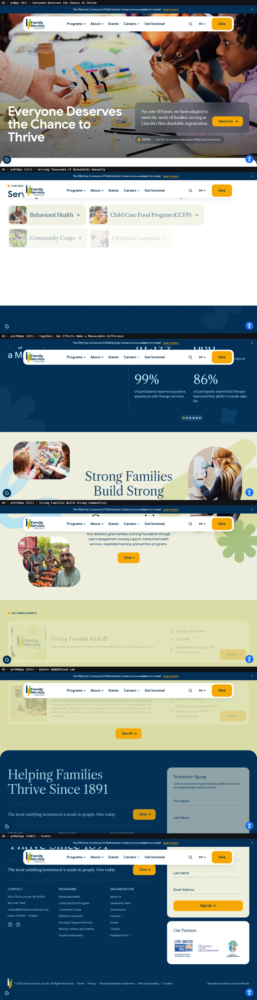
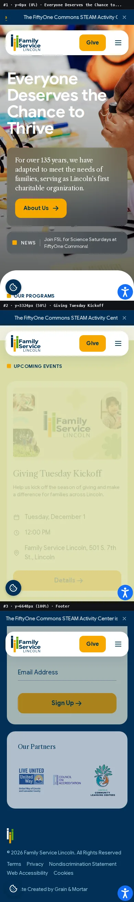

# UI Design System & Master Generation Blueprint: familyservicelincoln-org

> **Family Service Lincoln: Everyone Deserves the Chance to Thrive** (https://familyservicelincoln.org) — For over 135 years, we have adapted to meet the needs of families, serving as Lincoln's first charitable organization.





---

## 1. Executive Visual Persona & Design Archetype

- **Brand Essence & Persona**: **Family Service Lincoln: Everyone Deserves the Chance to Thrive** (`https://familyservicelincoln.org`). For over 135 years, we have adapted to meet the needs of families, serving as Lincoln's first charitable organization.
- **Capture Provenance**: Live browser capture (`tier1_fast`, HTTP `200`, captured `2026-11-24`).
- **Visual Archetype**: **Light-Substrate Editorial & Modular Grid System (`#ffffff` canvas, `#171717` ink, `#00c2ff` accent)**.
- **Anti-AI-Slop Differentiators**:
  - **Live-Computed Chromatic Polarity**: Anchors the viewport in `#ffffff` (live computed `body` `background-color` (`computed_styles.json`)) paired with `#171717` primary typography and `#00c2ff` accents.
  - **Grounded Typographic Hierarchy**: Uses `Google Sans` across display (`Everyone Deserves the Chance to Thri`) and body copy, paired with `SFMono-Regular` for monospace/code.
  - **Calibrated Spatial Grid & Motion**: Combines `1536px` container bounds (`gap: 4px`, padding `16px`) with `cubic-bezier(.4,0,.2,1)` easing and GSAP Timeline & ScrollTrigger, Three.js / WebGL Canvas Pipeline.

---

## 2. Spatial Architecture & Modular Grid Mathematics

### Viewport Allocation & Container Geometry
- **Captured Journey Filmstrips**: Desktop `1280×4968px` (`assets/desktop-journey.webp`, `6` keyframes up to `y=4022px` / doc `4922px`), Mobile `390×2616px` (`assets/mobile-journey.webp`, `3` keyframes).
- **Master Container Bounds**: `1536px` (non-`@media` desktop container stylesheet rule).
- **Canvas Lateral Padding & Spacing**: `16px` lateral canvas padding with `4px` grid gap.
- **Border Radius Scale**: `9999px`, `100%`, `.3125rem`, `.375rem`.

### Responsive Breakpoint Architecture
- **Desktop Layout**: Multi-column CSS Grid / Flexbox layout at `1440px` (`max-width: 1536px`, `gap: 4px`).
- **Mobile Layout**: Single-column vertical stack at `390px` viewport width with `16px` horizontal padding.
- **Extracted CSS Media Queries**: `@media (min-width:768px)`, `@media (min-width:640px)`, `@media (min-width:1024px)`, `@media (min-width:1280px)`.

---

## 3. Color System, Materiality & Atmospheric Lighting

### Semantic Palette & Source Grounding
| Semantic Role | Ground-Truth Value | Extracted Live / CSS Source |
|---|---|---|
| **Primary Canvas Substrate** | `#ffffff` | live computed `body` `background-color` (`computed_styles.json`) |
| **Primary Typography Ink** | `#171717` | live computed `main` `color` (`computed_styles.json`) |
| **Elevated Surface / Card Substrate** | `#dddddd` | `var(--wp-editor-canvas-background)` in `:root` |
| **Interactive Accent / Highlight** | `#00c2ff` | `var(--gf-field-pg-prog-bar-bg-gradient-blues)` in `:root` |
| **Secondary / Muted Copy** | `#a7b0bd` | `var(--gmcc-text-muted)` in `:root` |
| **Structural Hairline Border** | `#6b7280` | `textarea { border-color: #6b7280 }` |
| **Variable Token (`--wp-block-synced-color`)** | `#7a00df` | `var(--wp-block-synced-color)` in `:root` |
| **Variable Token (`--wp-admin-theme-color`)** | `#007cba` | `var(--wp-admin-theme-color)` in `:root` |
| **Variable Token (`--wp-admin-theme-color-darker-10`)** | `#006ba1` | `var(--wp-admin-theme-color-darker-10)` in `:root` |
| **Variable Token (`--wp-admin-theme-color-darker-20`)** | `#005a87` | `var(--wp-admin-theme-color-darker-20)` in `:root` |

### Sanitized Root CSS Variables (`ui-ux.md` Ground Truth)
| Variable Name | Extracted Value | Semantic Role |
|---|---|---|
| `--wp-block-synced-color` | `#7a00df` | Brand / Palette Token |
| `--wp-block-synced-color--rgb` | `122,0,223` | Brand / Palette Token |
| `--wp-bound-block-color` | `var(--wp-block-synced-color)` | Brand / Palette Token |
| `--wp-editor-canvas-background` | `#ddd` | Canvas / Surface Token |
| `--wp-admin-theme-color` | `#007cba` | Brand / Palette Token |
| `--wp-admin-theme-color--rgb` | `0,124,186` | Brand / Palette Token |
| `--wp-admin-theme-color-darker-10` | `#006ba1` | Canvas / Surface Token |
| `--wp-admin-theme-color-darker-10--rgb` | `0,107,160.5` | Canvas / Surface Token |
| `--wp-admin-theme-color-darker-20` | `#005a87` | Canvas / Surface Token |
| `--wp-admin-theme-color-darker-20--rgb` | `0,90,135` | Canvas / Surface Token |
| `--wp-admin-border-width-focus` | `2px` | Layout / Spatial Grid Token |
| `--wp-admin--admin-bar--position-offset` | `var(--wp-admin--admin-bar--height,0px)` | Dimension / Scale Token |
| `--header-height` | `88px` | Layout / Spatial Grid Token |
| `--admin-bar-height` | `32px` | Layout / Spatial Grid Token |
| `--gform-theme-control-shadow` | `none` | Brand / Palette Token |
| `--gform-theme-control-size` | `auto` | Brand / Palette Token |

---

## 4. Typographic Scale & Editorial Hierarchy

### Font Family Stacks
- **Display Typography**: `Google Sans`.
- **Primary Body Stack**: `Google Sans`.
- **Technical / Metadata Stack**: `SFMono-Regular`.

### Typographic Scale & Rules (Live Computed & Stylesheet Grounded)
- **Hero Display (`H1`)**: live computed `h1` (`font-size: 72px`, `line-height: 72px`, `font-weight: 700`, `letter-spacing: -1.8px`); CSS variables `--gf-field-pwd-str-ind-display: inline-block`, `--gf-local-display: block`; rule `h1` (`font-size: 3rem`, `line-height: 1`).
- **Section Heading (`H2`)**: live computed `h2` (`font-size: 70px`, `line-height: 81.9px`, `font-weight: 400`, `letter-spacing: -1.4px`); rule `h2` (`font-size: clamp(32px,5vw,70px)`, `line-height: 1.17`, `letter-spacing: -1.4px`, `font-weight: 400`).
- **Body Copy**: live computed `body` (`font-size: 16px`, `line-height: 24px`, `font-weight: 400`); rule `,p` (`font-size: 1rem`, `line-height: 1.5rem`).
- **Metadata & Navigation Labels**: live computed `nav/a` (`font-size: 16px`, `line-height: 24px`, `font-weight: 400`); CSS variables `--gf-label-width: 30%`, `--gf-label-req-gap: 6px`, `--gf-label-space-primary: 8px`.

---

## 5. Choreographed Motion & Interaction Physics

### Primary Easing Curves
- **Extracted Timing Functions**: `cubic-bezier(.4,0,.2,1)`, `cubic-bezier(0,0,.2,1)`, `cubic-bezier(.33,.85,.4,1.35)`.

### Per-Element Transition & Choreography Rules
- **Selector `.btn`**: `transition: cubic-bezier(.4,0,.2,1)` extracted from `familyservicelincoln-org` stylesheet.
- **Selector `.transition`**: `transition: cubic-bezier(.4,0,.2,1)` extracted from `familyservicelincoln-org` stylesheet.
- **Selector `.transition-\[transform\2c filter\]`**: `transition: cubic-bezier(.4,0,.2,1)` extracted from `familyservicelincoln-org` stylesheet.
- **Extracted Easing Curve (`cubic-bezier(.4,0,.2,1)`)**: Governs interactive state transitions across `<header.top-0>` and `<section.module-program_tabs>`.
- **Runtime Interaction Engine**: Integrates GSAP Timeline & ScrollTrigger, Three.js / WebGL Canvas Pipeline, Swiper Touch Carousel Engine with `prefers-reduced-motion: reduce` fallback guards.
### Measured Runtime Scroll & Interaction Telemetry (`behavioral_journey_v2`)
- **Scroll Driver Mode**: `native` (max document height `4922px`, deepest scrollY reached `4022px` across `6` desktop keyframes).
- **Detected Scroll / Motion Libraries**: `GSAP/ScrollTrigger`.
- **Nav / Drawer Probe**: Tested trigger `Programs` (diff `0.12`, below state-capture threshold).
- **Hover Physics (`primary_cta` · `About Us`)**: `color`: `rgb(1, 48, 86)` -> `rgb(255, 255, 255)`; `backgroundColor`: `rgb(247, 168, 0)` -> `rgb(1, 48, 86)` (`transition-duration: 0.2s`, `timing: cubic-bezier(0.4, 0, 0.2, 1)`).
- **Interactive Control Probe (`carousel_next`)**: Tested `Show next stat` (diff `0.968`).
- **Route Transition Architecture**: First internal navigation (`/programs/behavioral-health/`) measured as `direct` in `2144ms`.

---

## 6. Component Wireframe & Structural DOM Map

### Visual Layout Schematic — Desktop (`1440px`, Grounded in `dom.html` & Landmark Bounding Boxes)
```
┌────────────────────────────────────────────────────────────────────────┐
│ DESKTOP VIEWPORT (1440px) — Family Service Lincoln: Everyone Deserves  │
│ ====================================================================== │
│ [ <header.top-0> (1440x100px)         | About Us · Leadership Team · ] │
│ ---------------------------------------------------------------------- │
│ | HERO STAGE: <section.module-hero> (w=1440px)                       | │
│ | H1: Everyone Deserves the Chance to Thrive                         | │
│ | Substrate: #ffffff | Ink: #171717 | Accent: #00c2ff                | │
│ ---------------------------------------------------------------------- │
│ | SHOWCASE GRID (<section.module-program_ta) max-w: 1536px           | │
│ | +------------------------------+  +------------------------------+ | │
│ | | Serving Thousands of Househo |  | Together, Our Efforts Make a | | │
│ | +------------------------------+  +------------------------------+ | │
│ ---------------------------------------------------------------------- │
│ | DETAIL MODULE (<section.module-impact_sta) — Strong Families Build | │
│ ---------------------------------------------------------------------- │
│ [ FOOTER (<footer.full>       ) | https://familyservicelincoln.org     │
└────────────────────────────────────────────────────────────────────────┘
```

### Visual Layout Schematic — Mobile Reflow (`390px`)
```
┌────────────────────────────────────────────────────────────────────────┐
│ MOBILE VIEWPORT REFLOW (390px) — Single-Column Stack (gap: 4px)        │
│ ====================================================================== │
│ [ HEADER BAR (<header.top-0>          ) | Compact Menu (390px)         │
│ ---------------------------------------------------------------------- │
│ | HERO STAGE (<section.module-hero>) — 390px Vertical Lead           | │
│ | H1: Everyone Deserves the Chance to Thrive                         | │
│ ---------------------------------------------------------------------- │
│ | SHOWCASE STACK (<section.module-progra) — 1-Col Stack              | │
│ | [ Item 1: Serving Thousands of Households Annually               ] | │
│ | [ Item 2: Together, Our Efforts Make a Measurable Difference     ] | │
│ ---------------------------------------------------------------------- │
│ | DETAIL STACK (<section.module-impact_s) — 1-Col (Strong Families Bu) │
│ ---------------------------------------------------------------------- │
│ [ FOOTER (<footer.full>       ) | Stacked 390px Colophon               │
└────────────────────────────────────────────────────────────────────────┘
```

### Granular DOM Region Breakdown
1. **Brand Header & Navigation Bar (<header.top-0> — `familyservicelincoln-org`)**:
   - Landmark `<header class="top-0 left-0">` (`1440x100px`) hosting `Family Service Lincoln: Everyone Des` navigation (`About Us · Leadership Team · Annual Report · Strategic Plan · Form 990`), DOM attributes (`data-cbid="1670e8a1-465b-4331-ab..."`, `data-blockingmode="manual"`, `data-acsb-sr-alert="true"`, `data-acsb-sr-only="true"`), and stylesheet rule `before { box-sizing:border-box;border:0 solid e5e7eb }`.
2. **Hero Stage & Focal Lead (<section.module-hero> — `Everyone Deserves the Chance to Th`)**:
   - Landmark `<section class="module-hero full">` presenting display lead `Everyone Deserves the Chance to Thrive` and copy excerpt *"Join FSL for Science Saturdays at FiftyOne Commons!"* over `#ffffff` canvas and `#171717` ink.
3. **Primary Showcase & Content Grid (<section.module-program_tabs> — `Serving Thousands of Households An`)**:
   - Landmark `<section class="module-program_tabs full">` rendering section `Serving Thousands of Households Annually` with copy *"Child Care Food Program (CCFP)"*, asset references (`logconsent.ashx`, `state.js`, `widgetIcon.min.js`, `cc.js`), and grid rule `body { margin:0;line-height:inherit }`.
4. **Interactive Detail & Feature Matrix (<section.module-impact_stats> — `Together, Our Efforts Make a Measu`)**:
   - Landmark `<section class="module-impact_stats full">` framing `Together, Our Efforts Make a Measurable Difference` and `Strong Families Build Strong Communities` (*"Housing & Support Services"*) with `#dddddd` surface cards, `#00c2ff` accents, and `strong { font-weight:bolder }`.
5. **Colophon & Global Directory Footer (<footer.full> — `https://familyservicelincoln.org`)**:
   - Landmark `<footer class="full relative">` anchoring `Family Service Lincoln: Everyone` footer links (`About Us · Leadership Team · Annual Report · Strategic Plan · Form 990`), copy *"Women, Infants, and Children (WIC)"*, and `#6b7280` structural dividers.
### Full Vertical Scroll Sequence (Desktop `1440×900` Keyframes)
- **Step 01** (`y=0px`, `0%`): Active landmark `Everyone Deserves the Chance to Thrive` · sticky/fixed elements: `2`
- **Step 02** (`y=850px`, `21%`): Active landmark `Serving Thousands of Households Annually` · sticky/fixed elements: `2`
- **Step 03** (`y=1700px`, `42%`): Active landmark `Together, Our Efforts Make a Measurable Difference` · sticky/fixed elements: `2`
- **Step 04** (`y=2550px`, `63%`): Active landmark `Strong Families Build Strong Communities` · sticky/fixed elements: `2`
- **Step 05** (`y=3400px`, `85%`): Active landmark `Winter WONDERland Lab` · sticky/fixed elements: `2`
- **Step 06** (`y=4022px`, `100%`): Active landmark `Footer` · sticky/fixed elements: `2`

### Multi-Page Internal Route Map
- **Detail Route (`/programs/behavioral-health/`)**: `https://familyservicelincoln.org/programs/behavioral-health/` — H1: `Behavioral Health`, scrollHeight `4228px`, transition `direct` (`2144ms`)
- **About Route (`/about/`)**: `https://familyservicelincoln.org/about/` — H1: `About Family Service Lincoln`, scrollHeight `5298px`, transition `direct` (`2155ms`)
- **Detail Route (`/programs/child-care-food-program/`)**: `https://familyservicelincoln.org/programs/child-care-food-program/` — H1: `Child Care Food Program (CCFP)`, scrollHeight `5239px`, transition `direct` (`2654ms`)

---

## 7. Master Zero-Shot AI Generation Prompt

```markdown
# Master Zero-Shot Frontend Generation Prompt: familyservicelincoln-org (Family Service Lincoln: Everyone Deserves the Chance to Thrive)

You are a principal frontend architect and design systems engineer. Build a complete, production-ready web application replicating the exact design system, DOM landmarks, typographic hierarchy, color tokens, and motion physics of `familyservicelincoln-org` (**Family Service Lincoln: Everyone Deserves the Chance to Thrive** — `https://familyservicelincoln.org`).

### 1. Visual Archetype & Anti-AI-Slop Mandates
- **Archetype**: Light-Substrate Editorial & Modular Grid System (`#ffffff` canvas, `#171717` ink, `#00c2ff` accent).
- **Identity & Domain Context**: For over 135 years, we have adapted to meet the needs of families, serving as Lincoln's first charitable organization.
- **Primary Substrate**: `#ffffff` (live computed `body` `background-color` (`computed_styles.json`)), **Primary Ink**: `#171717`, **Accent / Highlight**: `#00c2ff`.
- **Site-Specific Differentiators**:
  - **Live-Computed Chromatic Polarity**: Anchors the viewport in `#ffffff` (live computed `body` `background-color` (`computed_styles.json`)) paired with `#171717` primary typography and `#00c2ff` accents.
  - **Grounded Typographic Hierarchy**: Uses `Google Sans` across display (`Everyone Deserves the Chance to Thri`) and body copy, paired with `SFMono-Regular` for monospace/code.
  - **Calibrated Spatial Grid & Motion**: Combines `1536px` container bounds (`gap: 4px`, padding `16px`) with `cubic-bezier(.4,0,.2,1)` easing and GSAP Timeline & ScrollTrigger, Three.js / WebGL Canvas Pipeline.

### 2. Ground-Truth CSS Variables (`:root` Token Contract)
Declare and consume these exact custom properties extracted from `familyservicelincoln-org` in your global stylesheet:

:root {
  /* Family Service Lincoln: Everyone Deserves the Chance to Thrive (familyservicelincoln-org) — Live-Grounded CSS Variables */
  --wp-block-synced-color: #7a00df; /* Brand / Palette Token (familyservicelincoln-org) */
  --wp-block-synced-color--rgb: 122,0,223; /* Brand / Palette Token (familyservicelincoln-org) */
  --wp-bound-block-color: var(--wp-block-synced-color); /* Brand / Palette Token (familyservicelincoln-org) */
  --wp-editor-canvas-background: #ddd; /* Canvas / Surface Token (familyservicelincoln-org) */
  --wp-admin-theme-color: #007cba; /* Brand / Palette Token (familyservicelincoln-org) */
  --wp-admin-theme-color--rgb: 0,124,186; /* Brand / Palette Token (familyservicelincoln-org) */
  --wp-admin-theme-color-darker-10: #006ba1; /* Canvas / Surface Token (familyservicelincoln-org) */
  --wp-admin-theme-color-darker-10--rgb: 0,107,160.5; /* Canvas / Surface Token (familyservicelincoln-org) */
  --wp-admin-theme-color-darker-20: #005a87; /* Canvas / Surface Token (familyservicelincoln-org) */
  --wp-admin-theme-color-darker-20--rgb: 0,90,135; /* Canvas / Surface Token (familyservicelincoln-org) */
  --wp-admin-border-width-focus: 2px; /* Layout / Spatial Grid Token (familyservicelincoln-org) */
  --wp-admin--admin-bar--position-offset: var(--wp-admin--admin-bar--height,0px); /* Dimension / Scale Token (familyservicelincoln-org) */
  --header-height: 88px; /* Layout / Spatial Grid Token (familyservicelincoln-org) */
  --admin-bar-height: 32px; /* Layout / Spatial Grid Token (familyservicelincoln-org) */
  --gform-theme-control-shadow: none; /* Brand / Palette Token (familyservicelincoln-org) */
  --gform-theme-control-size: auto; /* Brand / Palette Token (familyservicelincoln-org) */
}

### 3. Semantic Color & Materiality Contract
Map every surface, ink, and border strictly to these source-grounded tokens:
- **Primary Canvas Substrate**: `#ffffff` — grounded in live computed `body` `background-color` (`computed_styles.json`)
- **Primary Typography Ink**: `#171717` — grounded in live computed `main` `color` (`computed_styles.json`)
- **Elevated Surface / Card Substrate**: `#dddddd` — grounded in `var(--wp-editor-canvas-background)` in `:root`
- **Interactive Accent / Highlight**: `#00c2ff` — grounded in `var(--gf-field-pg-prog-bar-bg-gradient-blues)` in `:root`
- **Secondary / Muted Copy**: `#a7b0bd` — grounded in `var(--gmcc-text-muted)` in `:root`
- **Structural Hairline Border**: `#6b7280` — grounded in `textarea { border-color: #6b7280 }`
- **Variable Token (`--wp-block-synced-color`)**: `#7a00df` — grounded in `var(--wp-block-synced-color)` in `:root`
- **Variable Token (`--wp-admin-theme-color`)**: `#007cba` — grounded in `var(--wp-admin-theme-color)` in `:root`
- **Variable Token (`--wp-admin-theme-color-darker-10`)**: `#006ba1` — grounded in `var(--wp-admin-theme-color-darker-10)` in `:root`
- **Variable Token (`--wp-admin-theme-color-darker-20`)**: `#005a87` — grounded in `var(--wp-admin-theme-color-darker-20)` in `:root`

### 4. Spatial Grid, Container Bounds & Responsive Breakpoints
- **Desktop Viewport Reference**: `1280×4968px` (multi-frame vertical journey filmstrip (4968px), `1440px` standard desktop width).
- **Mobile Viewport Reference**: `390×2616px` (multi-frame vertical journey filmstrip (2616px), `390px` standard mobile width).
- **Container Max-Width**: `1536px` (non-`@media` desktop container stylesheet rule)
- **Padding & Gutters**: `16px` lateral canvas padding with `4px` grid gap
- **Desktop Grid**: Multi-column CSS Grid / Flexbox layout at `1440px` (`max-width: 1536px`, `gap: 4px`)
- **Mobile Adaptation**: Single-column vertical stack at `390px` viewport width with `16px` horizontal padding
- **Media Queries**: `@media (min-width:768px)`, `@media (min-width:640px)`, `@media (min-width:1024px)`, `@media (min-width:1280px)`
- **Corner Radii**: `9999px`, `100%`, `.3125rem`, `.375rem`

### 5. Typography & Editorial Scale Contract
- **Display Font Stack**: `Google Sans`
- **Body Font Stack**: `Google Sans`
- **Monospace / Technical Font Stack**: `SFMono-Regular`
- **H1 Display Rule**: live computed `h1` (`font-size: 72px`, `line-height: 72px`, `font-weight: 700`, `letter-spacing: -1.8px`); CSS variables `--gf-field-pwd-str-ind-display: inline-block`, `--gf-local-display: block`; rule `h1` (`font-size: 3rem`, `line-height: 1`)
- **H2 Section Rule**: live computed `h2` (`font-size: 70px`, `line-height: 81.9px`, `font-weight: 400`, `letter-spacing: -1.4px`); rule `h2` (`font-size: clamp(32px,5vw,70px)`, `line-height: 1.17`, `letter-spacing: -1.4px`, `font-weight: 400`)
- **Body Copy Rule**: live computed `body` (`font-size: 16px`, `line-height: 24px`, `font-weight: 400`); rule `,p` (`font-size: 1rem`, `line-height: 1.5rem`)
- **Metadata & Index Rule**: live computed `nav/a` (`font-size: 16px`, `line-height: 24px`, `font-weight: 400`); CSS variables `--gf-label-width: 30%`, `--gf-label-req-gap: 6px`, `--gf-label-space-primary: 8px`

### 6. Component Hierarchy, Verbatim Copy & Real DOM Landmarks
Scaffold `familyservicelincoln-org` (`Family Service Lincoln: Everyone Deserves the Chance to Thrive`) with these exact structural regions, extracted copy, and CSS rules from `dom.html`:
1. **Brand Header & Navigation Bar (<header.top-0> — `familyservicelincoln-org`)**:
   - DOM & Selectors: Landmark `<header class="top-0 left-0">` (`1440x100px`) hosting `Family Service Lincoln: Everyone Des` navigation (`About Us · Leadership Team · Annual Report · Strategic Plan · Form 990`), DOM attributes (`data-cbid="1670e8a1-465b-4331-ab..."`, `data-blockingmode="manual"`, `data-acsb-sr-alert="true"`, `data-acsb-sr-only="true"`), and stylesheet rule `before { box-sizing:border-box;border:0 solid e5e7eb }`.
   - Responsive Contract: Header `Brand Header & Navigation Bar (<header.top-0> — `familyservicelincoln-org`)` (`familyservicelincoln-org`) adapts across `@media (min-width:768px)`, `@media (min-width:640px)`, `@media (min-width:1024px)`, `@media (min-width:1280px)` with `cubic-bezier(.4,0,.2,1)`, `cubic-bezier(0,0,.2,1)`, `cubic-bezier(.33,.85,.4,1.35)` transitions and links `About Us · Leadership Team · Annual Report · Strategic Plan · Form 990`.
2. **Hero Stage & Focal Lead (<section.module-hero> — `Everyone Deserves the Chance to Th`)**:
   - DOM & Selectors: Landmark `<section class="module-hero full">` presenting display lead `Everyone Deserves the Chance to Thrive` and copy excerpt *"Join FSL for Science Saturdays at FiftyOne Commons!"* over `#ffffff` canvas and `#171717` ink.
   - Responsive Contract: Hero stage (`1280×4968px` desktop / `390×2616px` mobile) sets `#ffffff` background with `#171717` headline `Everyone Deserves the Chance to Thrive`.
3. **Primary Showcase & Content Grid (<section.module-program_tabs> — `Serving Thousands of Households An`)**:
   - DOM & Selectors: Landmark `<section class="module-program_tabs full">` rendering section `Serving Thousands of Households Annually` with copy *"Child Care Food Program (CCFP)"*, asset references (`logconsent.ashx`, `state.js`, `widgetIcon.min.js`, `cc.js`), and grid rule `body { margin:0;line-height:inherit }`.
   - Responsive Contract: Showcase grid `Primary Showcase & Content Grid (<section.module-program_tabs> — `Serving Thousands of Households An`)` applies Multi-column CSS Grid / Flexbox layout at `1440px` (`max-width: 1536px`, `gap: 4px`) on desktop and Single-column vertical stack at `390px` viewport width with `16px` horizontal padding on mobile.
4. **Interactive Detail & Feature Matrix (<section.module-impact_stats> — `Together, Our Efforts Make a Measu`)**:
   - DOM & Selectors: Landmark `<section class="module-impact_stats full">` framing `Together, Our Efforts Make a Measurable Difference` and `Strong Families Build Strong Communities` (*"Housing & Support Services"*) with `#dddddd` surface cards, `#00c2ff` accents, and `strong { font-weight:bolder }`.
   - Responsive Contract: Detail module `Interactive Detail & Feature Matrix (<section.module-impact_stats> — `Together, Our Efforts Make a Measu`)` uses `9999px`, `100%`, `.3125rem`, `.375rem` radii, `#00c2ff` highlights, and assets (logconsent.ashx, state.js, widgetIcon.min.js).
5. **Colophon & Global Directory Footer (<footer.full> — `https://familyservicelincoln.org`)**:
   - DOM & Selectors: Landmark `<footer class="full relative">` anchoring `Family Service Lincoln: Everyone` footer links (`About Us · Leadership Team · Annual Report · Strategic Plan · Form 990`), copy *"Women, Infants, and Children (WIC)"*, and `#6b7280` structural dividers.
   - Responsive Contract: Footer `Colophon & Global Directory Footer (<footer.full> — `https://familyservicelincoln.org`)` aligns to `1536px` (non-`@media` desktop container stylesheet rule) with `16px` lateral canvas padding with `4px` grid gap and attributes (data-cbid="1670e8a1-465b-4331-ab...", data-blockingmode="manual", data-acsb-sr-alert="true").

#### Verbatim DOM Copy Excerpts (`dom.html`)
- Copy Excerpt 1: *"Join FSL for Science Saturdays at FiftyOne Commons!"*
- Copy Excerpt 2: *"Child Care Food Program (CCFP)"*
- Copy Excerpt 3: *"Housing & Support Services"*
- Copy Excerpt 4: *"Women, Infants, and Children (WIC)"*

### 7. Motion, Extracted Stylesheet Rules & Interaction Choreography
- **Primary Easing Functions**: `cubic-bezier(.4,0,.2,1)`, `cubic-bezier(0,0,.2,1)`, `cubic-bezier(.33,.85,.4,1.35)`
- **Extracted Stylesheet Rules (`familyservicelincoln-org`)**:
- `before { box-sizing:border-box;border:0 solid e5e7eb }`
- `body { margin:0;line-height:inherit }`
- `strong { font-weight:bolder }`
- `small { font-size:80% }`
- `sup { font-size:75%;line-height:0;position:relative;vertical-align:baseline }`
- **Per-Selector Transition Rules**:
- **Selector `.btn`**: `transition: cubic-bezier(.4,0,.2,1)` extracted from `familyservicelincoln-org` stylesheet.
- **Selector `.transition`**: `transition: cubic-bezier(.4,0,.2,1)` extracted from `familyservicelincoln-org` stylesheet.
- **Selector `.transition-\[transform\2c filter\]`**: `transition: cubic-bezier(.4,0,.2,1)` extracted from `familyservicelincoln-org` stylesheet.
- **Extracted Easing Curve (`cubic-bezier(.4,0,.2,1)`)**: Governs interactive state transitions across `<header.top-0>` and `<section.module-program_tabs>`.
- **Runtime Interaction Engine**: Integrates GSAP Timeline & ScrollTrigger, Three.js / WebGL Canvas Pipeline, Swiper Touch Carousel Engine with `prefers-reduced-motion: reduce` fallback guards.
### 7b. Full-Page Scroll Choreography, Interactive States & Multi-Page Routes
- **Scroll Mechanics**: Implement `native` vertical progression up to `4922px` across 6 distinct viewport chapters using GSAP/ScrollTrigger.
- **Vertical Chapter Sequence**: Everyone Deserves the Chanc... (0%) -> Serving Thousands of Househ... (21%) -> Together, Our Efforts Make... (42%) -> Strong Families Build Stron... (63%) -> Winter WONDERland Lab (85%) -> Footer (100%).
- **Hover Micro-Interaction (`primary_cta`)**: Animate `color, backgroundColor` with `0.2s cubic-bezier(0.4, 0, 0.2, 1)`.
- **Multi-Page Routes**: Scaffold internal routes `/programs/behavioral-health/` (detail, direct), `/about/` (about, direct), `/programs/child-care-food-program/` (detail, direct) sharing the global header/footer shell and design tokens.

### 8. Technical Deliverables
- Implement in Next.js (App Router) with TypeScript and Tailwind CSS consuming the `:root` custom properties defined above for `familyservicelincoln-org`.
- Reproduce both the `1440px` desktop architecture and `390px` mobile breakpoint transitions, preserving semantic HTML5 landmarks (`<header>`, `<nav>`, `<main>`, `<section>`, `<footer>`) and `prefers-reduced-motion` accessibility guards.
```
---

## 8. Full-Page Scroll Journey, Interactive States & Subpage Inventory

### Desktop Scroll Keyframes (`1440×900` WebP)
| Step | Scroll Y | Progress | Active Landmark / Section | Sticky/Fixed | Visual Asset |
| :---: | :---: | :---: | :--- | :---: | :--- |
| `#01` | `0px` | `0%` | Everyone Deserves the Chance to Thrive | `2` | [desktop-step-01.webp](assets/desktop-step-01.webp) |
| `#02` | `850px` | `21%` | Serving Thousands of Households Annually | `2` | [desktop-step-02.webp](assets/desktop-step-02.webp) |
| `#03` | `1700px` | `42%` | Together, Our Efforts Make a Measurable Diffe... | `2` | [desktop-step-03.webp](assets/desktop-step-03.webp) |
| `#04` | `2550px` | `63%` | Strong Families Build Strong Communities | `2` | [desktop-step-04.webp](assets/desktop-step-04.webp) |
| `#05` | `3400px` | `85%` | Winter WONDERland Lab | `2` | [desktop-step-05.webp](assets/desktop-step-05.webp) |
| `#06` | `4022px` | `100%` | Footer | `2` | [desktop-step-06.webp](assets/desktop-step-06.webp) |

### Mobile Condensed Keyframes (`390×844` WebP)
| Step | Scroll Y | Progress | Active Landmark | Visual Asset |
| :---: | :---: | :---: | :--- | :--- |
| `#01` | `0px` | `0%` | Everyone Deserves the Chance to Thrive | [mobile-step-01.webp](assets/mobile-step-01.webp) |
| `#02` | `3324px` | `50%` | Giving Tuesday Kickoff | [mobile-step-02.webp](assets/mobile-step-02.webp) |
| `#03` | `6648px` | `100%` | Footer | [mobile-step-03.webp](assets/mobile-step-03.webp) |

### Internal Subpage Filmstrips (`1080px` Wide WebP)
| # | Template | Route URL | H1 / Title | Scroll Height | Transition | Filmstrip Asset |
| :-: | :---: | :--- | :--- | :---: | :---: | :--- |
| `1` | `detail` | `https://familyservicelincoln.org/programs/behavioral-health/` | Behavioral Health | `4228px` | `direct` (`2144ms`) | [subpage-01-programs-behavioral-health.webp](assets/subpage-01-programs-behavioral-health.webp) |
| `2` | `about` | `https://familyservicelincoln.org/about/` | About Family Service Lincoln | `5298px` | `direct` (`2155ms`) | [subpage-02-about.webp](assets/subpage-02-about.webp) |
| `3` | `detail` | `https://familyservicelincoln.org/programs/child-care-food-program/` | Child Care Food Program (CCFP) | `5239px` | `direct` (`2654ms`) | [subpage-03-programs-child-care-food-program.webp](assets/subpage-03-programs-child-care-food-program.webp) |

