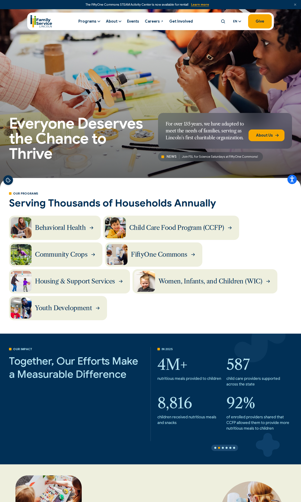

# UI Design System & Master Generation Blueprint: familyservicelincoln-org

> **Family Service Lincoln: Everyone Deserves the Chance to Thrive** (https://familyservicelincoln.org) — For over 135 years, we have adapted to meet the needs of families, serving as Lincoln's first charitable organization.



---

## 1. Executive Visual Persona & Design Archetype

- **Brand Essence & Persona**: **Family Service Lincoln: Everyone Deserves the Chance to Thrive** (`https://familyservicelincoln.org`). For over 135 years, we have adapted to meet the needs of families, serving as Lincoln's first charitable organization.
- **Capture Provenance**: Live browser capture (`tier1_fast`, HTTP `200`, captured `2026-11-23`).
- **Visual Archetype**: **Light-Substrate Editorial & Modular Grid System (`#ffffff` canvas, `#171717` ink, `#d99500` accent)**.
- **Anti-AI-Slop Differentiators**:
  - **Live-Computed Chromatic Polarity**: Anchors the viewport in `#ffffff` (live computed `body` `background-color` (`computed_styles.json`)) paired with `#171717` primary typography and `#d99500` accents.
  - **Grounded Typographic Hierarchy**: Pairs `Google Sans` for display copy (`Everyone Deserves the Chance to Thri`) with `Google Sans` and `SFMono-Regular`.
  - **Calibrated Spatial Grid & Motion**: Combines `1536px` container bounds (`gap: 4px`, padding `16px`) with `cubic-bezier(.4,0,.2,1)` easing and GSAP Timeline & ScrollTrigger, Three.js / WebGL Canvas Pipeline.

---

## 2. Spatial Architecture & Modular Grid Mathematics


### Viewport Allocation & Container Geometry
- **Captured Viewport Dimensions**: Desktop `1440×2400px` (`assets/desktop.png`, clamped at 2400px live multi-section capture), Mobile `390×2400px` (`assets/mobile.png`, clamped at 2400px live multi-section capture).
- **Master Container Bounds**: `1536px` (non-`@media` desktop container stylesheet rule).
- **Canvas Lateral Padding & Spacing**: `16px` lateral canvas padding with `4px` grid gap.
- **Border Radius Scale**: `9999px`, `var(--gmcc-radius)`, `4px`, `100%`.

### Responsive Breakpoint Architecture
- **Desktop Layout**: Multi-column CSS Grid / Flexbox layout at `1440px` (`max-width: 1536px`, `gap: 4px`).
- **Mobile Layout**: Single-column vertical stack at `390px` viewport width with `16px` horizontal padding.
- **Extracted CSS Media Queries**: `@media (min-width: 768px)`, `@media (prefers-reduced-motion: reduce)`, `@media (min-width: 900px)`, `@media (min-width: 700px)`.

---

## 3. Color System, Materiality & Atmospheric Lighting

### Semantic Palette & Source Grounding
| Semantic Role | Ground-Truth Value | Extracted Live / CSS Source |
|---|---|---|
| **Primary Canvas Substrate** | `#ffffff` | live computed `body` `background-color` (`computed_styles.json`) |
| **Primary Typography Ink** | `#171717` | live computed `main` `color` (`computed_styles.json`) |
| **Elevated Surface / Card Substrate** | `#dddddd` | `var(--wp-editor-canvas-background)` in `:root` |
| **Interactive Accent / Highlight** | `#d99500` | `var(--gmcc-accenthover)` in `:root` |
| **Secondary / Muted Copy** | `#a7b0bd` | `var(--gmcc-text-muted)` in `:root` |
| **Structural Hairline Border** | `#d9d9d9` | `.gm-cc__prefs { border-top: #d9d9d9 }` |
| **Variable Token (`--wp-block-synced-color`)** | `#7a00df` | `var(--wp-block-synced-color)` in `:root` |
| **Variable Token (`--wp-admin-theme-color`)** | `#007cba` | `var(--wp-admin-theme-color)` in `:root` |
| **Variable Token (`--wp-admin-theme-color-darker-10`)** | `#006ba1` | `var(--wp-admin-theme-color-darker-10)` in `:root` |
| **Variable Token (`--wp-admin-theme-color-darker-20`)** | `#005a87` | `var(--wp-admin-theme-color-darker-20)` in `:root` |
| **Variable Token (`--gmcc-bg`)** | `#1b1f2a` | `var(--gmcc-bg)` in `:root` |

### Sanitized Root CSS Variables (`ui-ux.md` Ground Truth)
| Variable Name | Extracted Value | Semantic Role |
|---|---|---|
| `--wp-block-synced-color` | `#7a00df` | Brand / Palette Token |
| `--wp-block-synced-color--rgb` | `122,0,223` | Brand / Palette Token |
| `--wp-bound-block-color` | `var(--wp-block-synced-color)` | Brand / Palette Token |
| `--wp-editor-canvas-background` | `#ddd` | Canvas / Surface Token |
| `--wp-admin-theme-color` | `#007cba` | Brand / Palette Token |
| `--wp-admin-theme-color--rgb` | `0,124,186` | Brand / Palette Token |
| `--wp-admin-theme-color-darker-10` | `#006ba1` | Canvas / Surface Token |
| `--wp-admin-theme-color-darker-10--rgb` | `0,107,160.5` | Canvas / Surface Token |
| `--wp-admin-theme-color-darker-20` | `#005a87` | Canvas / Surface Token |
| `--wp-admin-theme-color-darker-20--rgb` | `0,90,135` | Canvas / Surface Token |
| `--wp-admin-border-width-focus` | `2px` | Layout / Spatial Grid Token |
| `--wp-admin--admin-bar--position-offset` | `var(--wp-admin--admin-bar--height,0px)` | Dimension / Scale Token |
| `--header-height` | `88px` | Layout / Spatial Grid Token |
| `--gmcc-bg` | `#1b1f2a` | Canvas / Surface Token |
| `--gmcc-text` | `#ffffff` | Typography Ink Token |
| `--gmcc-text-muted` | `#a7b0bd` | Typography Ink Token |

---

## 4. Typographic Scale & Editorial Hierarchy

### Font Family Stacks
- **Display Typography**: `Google Sans`.
- **Primary Body Stack**: `Google Sans`.
- **Technical / Metadata Stack**: `SFMono-Regular`.

### Typographic Scale & Rules (Live Computed & Stylesheet Grounded)
- **Hero Display (`H1`)**: live computed `h1` (`font-size: 72px`, `line-height: 72px`, `font-weight: 700`, `letter-spacing: -1.8px`); rule `h1` (`font-size: 3rem`, `line-height: 1`).
- **Section Heading (`H2`)**: live computed `h2` (`font-size: 48px`, `line-height: 48px`, `font-weight: 700`); rule `h2` (`font-size: clamp(32px,5vw,70px)`, `line-height: 1.17`, `letter-spacing: -1.4px`, `font-weight: 400`).
- **Body Copy**: live computed `body` (`font-size: 16px`, `line-height: 24px`, `font-weight: 400`); rule `,p` (`font-size: 1rem`, `line-height: 1.5rem`).
- **Metadata & Navigation Labels**: live computed `nav/a` (`font-size: 16px`, `line-height: 24px`, `font-weight: 400`).

---

## 5. Choreographed Motion & Interaction Physics

### Primary Easing Curves
- **Extracted Timing Functions**: `cubic-bezier(.4,0,.2,1)`, `cubic-bezier(0,0,.2,1)`, `cubic-bezier(.33,.85,.4,1.35)`.

### Per-Element Transition & Choreography Rules
- **Selector `.gm-cc`**: `transition: transform 0.32s ease-out, opacity 0.32s ease-out` extracted from `familyservicelincoln-org` stylesheet.
- **Selector `media (prefers-reduced-motion: re...`**: `transition: none` extracted from `familyservicelincoln-org` stylesheet.
- **Selector `.gm-cc__btn`**: `transition: background-color 0.2s ease-out, color 0.2s ease-out, border-co...` extracted from `familyservicelincoln-org` stylesheet.
- **Extracted Easing Curve (`cubic-bezier(.4,0,.2,1)`)**: Governs interactive state transitions across `<header.top-0>` and `<section.module-program_tabs>`.
- **Runtime Interaction Engine**: Integrates GSAP Timeline & ScrollTrigger, Three.js / WebGL Canvas Pipeline with `prefers-reduced-motion: reduce` fallback guards.

---

## 6. Component Wireframe & Structural DOM Map

### Visual Layout Schematic — Desktop (`1440px`, Grounded in `dom.html` & Landmark Bounding Boxes)
```
┌────────────────────────────────────────────────────────────────────────┐
│ DESKTOP VIEWPORT (1440px) — Family Service Lincoln: Everyone Deserves  │
│ ====================================================================== │
│ [ <header.top-0> (1440x100px)         | About Us · Leadership Team · ] │
│ ---------------------------------------------------------------------- │
│ | HERO STAGE: <section.module-hero> (w=1440px)                       | │
│ | H1: Everyone Deserves the Chance to Thrive                         | │
│ | Substrate: #ffffff | Ink: #171717 | Accent: #d99500                | │
│ ---------------------------------------------------------------------- │
│ | SHOWCASE GRID (<section.module-program_ta) max-w: 1536px           | │
│ | +------------------------------+  +------------------------------+ | │
│ | | Serving Thousands of Househo |  | Together, Our Efforts Make a | | │
│ | +------------------------------+  +------------------------------+ | │
│ ---------------------------------------------------------------------- │
│ | DETAIL MODULE (<section.module-impact_sta) — Strong Families Build | │
│ ---------------------------------------------------------------------- │
│ [ FOOTER (<footer.full>       ) | https://familyservicelincoln.org     │
└────────────────────────────────────────────────────────────────────────┘
```

### Visual Layout Schematic — Mobile Reflow (`390px`)
```
┌────────────────────────────────────────────────────────────────────────┐
│ MOBILE VIEWPORT REFLOW (390px) — Single-Column Stack (gap: 4px)        │
│ ====================================================================== │
│ [ HEADER BAR (<header.top-0>          ) | Compact Menu (390px)         │
│ ---------------------------------------------------------------------- │
│ | HERO STAGE (<section.module-hero>) — 390px Vertical Lead           | │
│ | H1: Everyone Deserves the Chance to Thrive                         | │
│ ---------------------------------------------------------------------- │
│ | SHOWCASE STACK (<section.module-progra) — 1-Col Stack              | │
│ | [ Item 1: Serving Thousands of Households Annually               ] | │
│ | [ Item 2: Together, Our Efforts Make a Measurable Difference     ] | │
│ ---------------------------------------------------------------------- │
│ | DETAIL STACK (<section.module-impact_s) — 1-Col (Strong Families Bu) │
│ ---------------------------------------------------------------------- │
│ [ FOOTER (<footer.full>       ) | Stacked 390px Colophon               │
└────────────────────────────────────────────────────────────────────────┘
```

### Granular DOM Region Breakdown
1. **Brand Header & Navigation Bar (<header.top-0> — `familyservicelincoln-org`)**:
   - Landmark `<header class="top-0 left-0">` (`1440x100px`) hosting `Family Service Lincoln: Everyone Des` navigation (`About Us · Leadership Team · Annual Report · Strategic Plan · Form 990`), DOM attributes (`data-cbid="1670e8a1-465b-4331-ab..."`, `data-blockingmode="manual"`, `data-acsb-sr-alert="true"`, `data-acsb-sr-only="true"`), and stylesheet rule `.gm-cc { padding: 0 2% 1.25rem; }`.
2. **Hero Stage & Focal Lead (<section.module-hero> — `Everyone Deserves the Chance to Th`)**:
   - Landmark `<section class="module-hero full">` presenting display lead `Everyone Deserves the Chance to Thrive` and copy excerpt *"Join FSL for Science Saturdays at FiftyOne Commons!"* over `#ffffff` canvas and `#171717` ink.
3. **Primary Showcase & Content Grid (<section.module-program_tabs> — `Serving Thousands of Households An`)**:
   - Landmark `<section class="module-program_tabs full">` rendering section `Serving Thousands of Households Annually` with copy *"Child Care Food Program (CCFP)"*, asset references (`state.js`, `widgetIcon.min.js`, `logconsent.ashx`, `cc.js`), and grid rule `.gm-cc.is-visible { transform: none; opacity: 1; }`.
4. **Interactive Detail & Feature Matrix (<section.module-impact_stats> — `Together, Our Efforts Make a Measu`)**:
   - Landmark `<section class="module-impact_stats full">` framing `Together, Our Efforts Make a Measurable Difference` and `Strong Families Build Strong Communities` (*"Housing & Support Services"*) with `#dddddd` surface cards, `#d99500` accents, and `.gm-cc__card { padding: 1.75rem 2rem; }`.
5. **Colophon & Global Directory Footer (<footer.full> — `https://familyservicelincoln.org`)**:
   - Landmark `<footer class="full relative">` anchoring `Family Service Lincoln: Everyone` footer links (`About Us · Leadership Team · Annual Report · Strategic Plan · Form 990`), copy *"Women, Infants, and Children (WIC)"*, and `#d9d9d9` structural dividers.

---

## 7. Master Zero-Shot AI Generation Prompt

```markdown
# Master Zero-Shot Frontend Generation Prompt: familyservicelincoln-org (Family Service Lincoln: Everyone Deserves the Chance to Thrive)

You are a principal frontend architect and design systems engineer. Build a complete, production-ready web application replicating the exact design system, DOM landmarks, typographic hierarchy, color tokens, and motion physics of `familyservicelincoln-org` (**Family Service Lincoln: Everyone Deserves the Chance to Thrive** — `https://familyservicelincoln.org`).

### 1. Visual Archetype & Anti-AI-Slop Mandates
- **Archetype**: Light-Substrate Editorial & Modular Grid System (`#ffffff` canvas, `#171717` ink, `#d99500` accent).
- **Identity & Domain Context**: For over 135 years, we have adapted to meet the needs of families, serving as Lincoln's first charitable organization.
- **Primary Substrate**: `#ffffff` (live computed `body` `background-color` (`computed_styles.json`)), **Primary Ink**: `#171717`, **Accent / Highlight**: `#d99500`.
- **Site-Specific Differentiators**:
  - **Live-Computed Chromatic Polarity**: Anchors the viewport in `#ffffff` (live computed `body` `background-color` (`computed_styles.json`)) paired with `#171717` primary typography and `#d99500` accents.
  - **Grounded Typographic Hierarchy**: Pairs `Google Sans` for display copy (`Everyone Deserves the Chance to Thri`) with `Google Sans` and `SFMono-Regular`.
  - **Calibrated Spatial Grid & Motion**: Combines `1536px` container bounds (`gap: 4px`, padding `16px`) with `cubic-bezier(.4,0,.2,1)` easing and GSAP Timeline & ScrollTrigger, Three.js / WebGL Canvas Pipeline.

### 2. Ground-Truth CSS Variables (`:root` Token Contract)
Declare and consume these exact custom properties extracted from `familyservicelincoln-org` in your global stylesheet:

:root {
  /* Family Service Lincoln: Everyone Deserves the Chance to Thrive (familyservicelincoln-org) — Live-Grounded CSS Variables */
  --wp-block-synced-color: #7a00df; /* Brand / Palette Token (familyservicelincoln-org) */
  --wp-block-synced-color--rgb: 122,0,223; /* Brand / Palette Token (familyservicelincoln-org) */
  --wp-bound-block-color: var(--wp-block-synced-color); /* Brand / Palette Token (familyservicelincoln-org) */
  --wp-editor-canvas-background: #ddd; /* Canvas / Surface Token (familyservicelincoln-org) */
  --wp-admin-theme-color: #007cba; /* Brand / Palette Token (familyservicelincoln-org) */
  --wp-admin-theme-color--rgb: 0,124,186; /* Brand / Palette Token (familyservicelincoln-org) */
  --wp-admin-theme-color-darker-10: #006ba1; /* Canvas / Surface Token (familyservicelincoln-org) */
  --wp-admin-theme-color-darker-10--rgb: 0,107,160.5; /* Canvas / Surface Token (familyservicelincoln-org) */
  --wp-admin-theme-color-darker-20: #005a87; /* Canvas / Surface Token (familyservicelincoln-org) */
  --wp-admin-theme-color-darker-20--rgb: 0,90,135; /* Canvas / Surface Token (familyservicelincoln-org) */
  --wp-admin-border-width-focus: 2px; /* Layout / Spatial Grid Token (familyservicelincoln-org) */
  --wp-admin--admin-bar--position-offset: var(--wp-admin--admin-bar--height,0px); /* Dimension / Scale Token (familyservicelincoln-org) */
  --header-height: 88px; /* Layout / Spatial Grid Token (familyservicelincoln-org) */
  --gmcc-bg: #1b1f2a; /* Canvas / Surface Token (familyservicelincoln-org) */
  --gmcc-text: #ffffff; /* Typography Ink Token (familyservicelincoln-org) */
  --gmcc-text-muted: #a7b0bd; /* Typography Ink Token (familyservicelincoln-org) */
}

### 3. Semantic Color & Materiality Contract
Map every surface, ink, and border strictly to these source-grounded tokens:
- **Primary Canvas Substrate**: `#ffffff` — grounded in live computed `body` `background-color` (`computed_styles.json`)
- **Primary Typography Ink**: `#171717` — grounded in live computed `main` `color` (`computed_styles.json`)
- **Elevated Surface / Card Substrate**: `#dddddd` — grounded in `var(--wp-editor-canvas-background)` in `:root`
- **Interactive Accent / Highlight**: `#d99500` — grounded in `var(--gmcc-accenthover)` in `:root`
- **Secondary / Muted Copy**: `#a7b0bd` — grounded in `var(--gmcc-text-muted)` in `:root`
- **Structural Hairline Border**: `#d9d9d9` — grounded in `.gm-cc__prefs { border-top: #d9d9d9 }`
- **Variable Token (`--wp-block-synced-color`)**: `#7a00df` — grounded in `var(--wp-block-synced-color)` in `:root`
- **Variable Token (`--wp-admin-theme-color`)**: `#007cba` — grounded in `var(--wp-admin-theme-color)` in `:root`
- **Variable Token (`--wp-admin-theme-color-darker-10`)**: `#006ba1` — grounded in `var(--wp-admin-theme-color-darker-10)` in `:root`
- **Variable Token (`--wp-admin-theme-color-darker-20`)**: `#005a87` — grounded in `var(--wp-admin-theme-color-darker-20)` in `:root`
- **Variable Token (`--gmcc-bg`)**: `#1b1f2a` — grounded in `var(--gmcc-bg)` in `:root`

### 4. Spatial Grid, Container Bounds & Responsive Breakpoints
- **Desktop Viewport Reference**: `1440×2400px` (clamped at 2400px live multi-section capture, `1440px` standard desktop width).
- **Mobile Viewport Reference**: `390×2400px` (clamped at 2400px live multi-section capture, `390px` standard mobile width).
- **Container Max-Width**: `1536px` (non-`@media` desktop container stylesheet rule)
- **Padding & Gutters**: `16px` lateral canvas padding with `4px` grid gap
- **Desktop Grid**: Multi-column CSS Grid / Flexbox layout at `1440px` (`max-width: 1536px`, `gap: 4px`)
- **Mobile Adaptation**: Single-column vertical stack at `390px` viewport width with `16px` horizontal padding
- **Media Queries**: `@media (min-width: 768px)`, `@media (prefers-reduced-motion: reduce)`, `@media (min-width: 900px)`, `@media (min-width: 700px)`
- **Corner Radii**: `9999px`, `var(--gmcc-radius)`, `4px`, `100%`

### 5. Typography & Editorial Scale Contract
- **Display Font Stack**: `Google Sans`
- **Body Font Stack**: `Google Sans`
- **Monospace / Technical Font Stack**: `SFMono-Regular`
- **H1 Display Rule**: live computed `h1` (`font-size: 72px`, `line-height: 72px`, `font-weight: 700`, `letter-spacing: -1.8px`); rule `h1` (`font-size: 3rem`, `line-height: 1`)
- **H2 Section Rule**: live computed `h2` (`font-size: 48px`, `line-height: 48px`, `font-weight: 700`); rule `h2` (`font-size: clamp(32px,5vw,70px)`, `line-height: 1.17`, `letter-spacing: -1.4px`, `font-weight: 400`)
- **Body Copy Rule**: live computed `body` (`font-size: 16px`, `line-height: 24px`, `font-weight: 400`); rule `,p` (`font-size: 1rem`, `line-height: 1.5rem`)
- **Metadata & Index Rule**: live computed `nav/a` (`font-size: 16px`, `line-height: 24px`, `font-weight: 400`)

### 6. Component Hierarchy, Verbatim Copy & Real DOM Landmarks
Scaffold `familyservicelincoln-org` (`Family Service Lincoln: Everyone Deserves the Chance to Thrive`) with these exact structural regions, extracted copy, and CSS rules from `dom.html`:
1. **Brand Header & Navigation Bar (<header.top-0> — `familyservicelincoln-org`)**:
   - DOM & Selectors: Landmark `<header class="top-0 left-0">` (`1440x100px`) hosting `Family Service Lincoln: Everyone Des` navigation (`About Us · Leadership Team · Annual Report · Strategic Plan · Form 990`), DOM attributes (`data-cbid="1670e8a1-465b-4331-ab..."`, `data-blockingmode="manual"`, `data-acsb-sr-alert="true"`, `data-acsb-sr-only="true"`), and stylesheet rule `.gm-cc { padding: 0 2% 1.25rem; }`.
   - Responsive Contract: Header `Brand Header & Navigation Bar (<header.top-0> — `familyservicelincoln-org`)` (`familyservicelincoln-org`) adapts across `@media (min-width: 768px)`, `@media (prefers-reduced-motion: reduce)`, `@media (min-width: 900px)`, `@media (min-width: 700px)` with `cubic-bezier(.4,0,.2,1)`, `cubic-bezier(0,0,.2,1)`, `cubic-bezier(.33,.85,.4,1.35)` transitions and links `About Us · Leadership Team · Annual Report · Strategic Plan · Form 990`.
2. **Hero Stage & Focal Lead (<section.module-hero> — `Everyone Deserves the Chance to Th`)**:
   - DOM & Selectors: Landmark `<section class="module-hero full">` presenting display lead `Everyone Deserves the Chance to Thrive` and copy excerpt *"Join FSL for Science Saturdays at FiftyOne Commons!"* over `#ffffff` canvas and `#171717` ink.
   - Responsive Contract: Hero stage (`1440×2400px` desktop / `390×2400px` mobile) sets `#ffffff` background with `#171717` headline `Everyone Deserves the Chance to Thrive`.
3. **Primary Showcase & Content Grid (<section.module-program_tabs> — `Serving Thousands of Households An`)**:
   - DOM & Selectors: Landmark `<section class="module-program_tabs full">` rendering section `Serving Thousands of Households Annually` with copy *"Child Care Food Program (CCFP)"*, asset references (`state.js`, `widgetIcon.min.js`, `logconsent.ashx`, `cc.js`), and grid rule `.gm-cc.is-visible { transform: none; opacity: 1; }`.
   - Responsive Contract: Showcase grid `Primary Showcase & Content Grid (<section.module-program_tabs> — `Serving Thousands of Households An`)` applies Multi-column CSS Grid / Flexbox layout at `1440px` (`max-width: 1536px`, `gap: 4px`) on desktop and Single-column vertical stack at `390px` viewport width with `16px` horizontal padding on mobile.
4. **Interactive Detail & Feature Matrix (<section.module-impact_stats> — `Together, Our Efforts Make a Measu`)**:
   - DOM & Selectors: Landmark `<section class="module-impact_stats full">` framing `Together, Our Efforts Make a Measurable Difference` and `Strong Families Build Strong Communities` (*"Housing & Support Services"*) with `#dddddd` surface cards, `#d99500` accents, and `.gm-cc__card { padding: 1.75rem 2rem; }`.
   - Responsive Contract: Detail module `Interactive Detail & Feature Matrix (<section.module-impact_stats> — `Together, Our Efforts Make a Measu`)` uses `9999px`, `var(--gmcc-radius)`, `4px`, `100%` radii, `#d99500` highlights, and assets (state.js, widgetIcon.min.js, logconsent.ashx).
5. **Colophon & Global Directory Footer (<footer.full> — `https://familyservicelincoln.org`)**:
   - DOM & Selectors: Landmark `<footer class="full relative">` anchoring `Family Service Lincoln: Everyone` footer links (`About Us · Leadership Team · Annual Report · Strategic Plan · Form 990`), copy *"Women, Infants, and Children (WIC)"*, and `#d9d9d9` structural dividers.
   - Responsive Contract: Footer `Colophon & Global Directory Footer (<footer.full> — `https://familyservicelincoln.org`)` aligns to `1536px` (non-`@media` desktop container stylesheet rule) with `16px` lateral canvas padding with `4px` grid gap and attributes (data-cbid="1670e8a1-465b-4331-ab...", data-blockingmode="manual", data-acsb-sr-alert="true").

#### Verbatim DOM Copy Excerpts (`dom.html`)
- Copy Excerpt 1: *"Join FSL for Science Saturdays at FiftyOne Commons!"*
- Copy Excerpt 2: *"Child Care Food Program (CCFP)"*
- Copy Excerpt 3: *"Housing & Support Services"*
- Copy Excerpt 4: *"Women, Infants, and Children (WIC)"*

### 7. Motion, Extracted Stylesheet Rules & Interaction Choreography
- **Primary Easing Functions**: `cubic-bezier(.4,0,.2,1)`, `cubic-bezier(0,0,.2,1)`, `cubic-bezier(.33,.85,.4,1.35)`
- **Extracted Stylesheet Rules (`familyservicelincoln-org`)**:
- `.gm-cc { padding: 0 2% 1.25rem; }`
- `.gm-cc.is-visible { transform: none; opacity: 1; }`
- `.gm-cc__card { padding: 1.75rem 2rem; }`
- `.gm-cc__top { display: flex; flex-direction: column; gap: 1rem; }`
- `.gm-cc__title { margin: 0 0 0.25rem; font-size: 20px; line-height: 1.25; font-weight: 60... }`
- **Per-Selector Transition Rules**:
- **Selector `.gm-cc`**: `transition: transform 0.32s ease-out, opacity 0.32s ease-out` extracted from `familyservicelincoln-org` stylesheet.
- **Selector `media (prefers-reduced-motion: re...`**: `transition: none` extracted from `familyservicelincoln-org` stylesheet.
- **Selector `.gm-cc__btn`**: `transition: background-color 0.2s ease-out, color 0.2s ease-out, border-co...` extracted from `familyservicelincoln-org` stylesheet.
- **Extracted Easing Curve (`cubic-bezier(.4,0,.2,1)`)**: Governs interactive state transitions across `<header.top-0>` and `<section.module-program_tabs>`.
- **Runtime Interaction Engine**: Integrates GSAP Timeline & ScrollTrigger, Three.js / WebGL Canvas Pipeline with `prefers-reduced-motion: reduce` fallback guards.

### 8. Technical Deliverables
- Implement in Next.js (App Router) with TypeScript and Tailwind CSS consuming the `:root` custom properties defined above for `familyservicelincoln-org`.
- Reproduce both the `1440px` desktop architecture and `390px` mobile breakpoint transitions, preserving semantic HTML5 landmarks (`<header>`, `<nav>`, `<main>`, `<section>`, `<footer>`) and `prefers-reduced-motion` accessibility guards.
```
