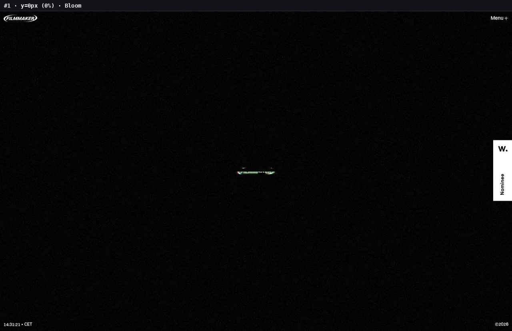
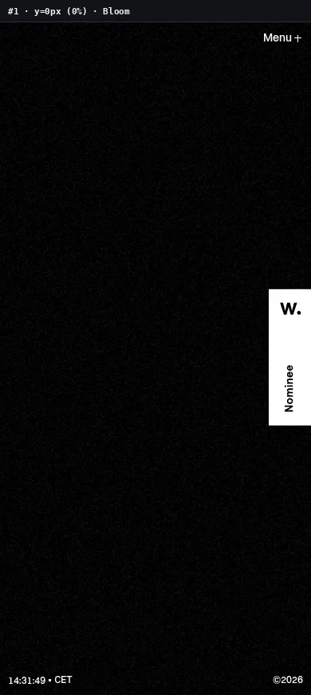

# UI Design System & Master Generation Blueprint: filmmaker-framer-media

> **Filmmaker — Portfolio for Directors & Studios** (https://filmmaker.framer.media/) — An independent film studio directing, shooting and finishing commercials, music videos, documentaries and short films, from the first ide...





---

## 1. Executive Visual Persona & Design Archetype

- **Brand Essence & Persona**: **Filmmaker — Portfolio for Directors & Studios** (`https://filmmaker.framer.media/`). An independent film studio directing, shooting and finishing commercials, music videos, documentaries and short films, from the first ide...
- **Capture Provenance**: Live browser capture (`tier2_webgl`, HTTP `200`, captured `2026-11-24`).
- **Visual Archetype**: **Dark-Substrate WebGL / Canvas Interactive Experience (`#000000` / `#0000ee`)**.
- **Anti-AI-Slop Differentiators**:
  - **Live-Computed Chromatic Polarity**: Anchors the viewport in `#000000` (live computed `body` `background-color` (`computed_styles.json`)) paired with `#ffffff` primary typography and `#0000ee` accents.
  - **Grounded Typographic Hierarchy**: Pairs `Switzer` for display copy (`Filmmaker: a film studio for commerc`) with `Switzer Placeholder`.
  - **Calibrated Spatial Grid & Motion**: Combines `1920px` container bounds (`gap: 4px`, padding `20px`) with `cubic-bezier(0.76,0,0.24,1)` easing and Lenis Smooth Scroll (`data-lenis`), Framer Motion Layout Physics.

---

## 2. Spatial Architecture & Modular Grid Mathematics

### Viewport Allocation & Container Geometry
- **Captured Journey Filmstrips**: Desktop `1280×828px` (`assets/desktop-journey.webp`, `1` keyframes up to `y=0px` / doc `900px`), Mobile `390×872px` (`assets/mobile-journey.webp`, `1` keyframes).
- **Master Container Bounds**: `1920px` (non-`@media` desktop container stylesheet rule).
- **Canvas Lateral Padding & Spacing**: `20px` lateral canvas padding with `4px` grid gap.
- **Border Radius Scale**: `8px`, `15px`, `4px`, `10px`.

### Responsive Breakpoint Architecture
- **Desktop Layout**: Multi-column CSS Grid / Flexbox layout at `1440px` (`max-width: 1920px`, `gap: 4px`).
- **Mobile Layout**: Single-column vertical stack at `390px` viewport width with `20px` horizontal padding.
- **Extracted CSS Media Queries**: `@media (min-width: 1200px)`, `@media (min-width: 810px) and (max-width: 1199.98px)`, `@media (max-width: 809.98px)`, `@media (max-width:809px) and (min-width:1px)`.

---

## 3. Color System, Materiality & Atmospheric Lighting

### Semantic Palette & Source Grounding
| Semantic Role | Ground-Truth Value | Extracted Live / CSS Source |
|---|---|---|
| **Primary Canvas Substrate** | `#000000` | live computed `body` `background-color` (`computed_styles.json`) |
| **Primary Typography Ink** | `#ffffff` | live computed `h1` `color` (`computed_styles.json`) |
| **Elevated Surface / Card Substrate** | `#ffffff` | `var(--selection-background-color)` in `:root` |
| **Interactive Accent / Highlight** | `#0000ee` | live computed `a` `color` (`computed_styles.json`) |
| **Secondary / Muted Copy** | `#0000ee` | live computed `a` `color` (`computed_styles.json`) |
| **Structural Hairline Border** | `#0000ee` | hairline divider derived from live computed `a` `color` (`computed_styles.json`) |
| **Variable Token (`--token-1ff0dbc2-5727-4025-9011-ab5e4843a4bf`)** | `#8e929e` | `var(--token-1ff0dbc2-5727-4025-9011-ab5e4843a4bf)` in `:root` |
| **Variable Token (`--token-0a4f7205-8d7c-4457-b654-54014e40dc6b`)** | `#494b52` | `var(--token-0a4f7205-8d7c-4457-b654-54014e40dc6b)` in `:root` |
| **Variable Token (`--token-1be011e0-feca-4140-878b-b3b075f07f18`)** | `#222224` | `var(--token-1be011e0-feca-4140-878b-b3b075f07f18)` in `:root` |
| **Variable Token (`--token-107047f9-7a86-4585-a089-f7c6945f5b94`)** | `#ff4444` | `var(--token-107047f9-7a86-4585-a089-f7c6945f5b94)` in `:root` |

### Sanitized Root CSS Variables (`ui-ux.md` Ground Truth)
| Variable Name | Extracted Value | Semantic Role |
|---|---|---|
| `--token-f411dcae-2c7e-4242-8a06-6993e5583d49` | `#fff` | Color / Atmospheric Token |
| `--token-f454398d-5d46-4a7c-87d9-57e6a7bcdcf8` | `#000` | Color / Atmospheric Token |
| `--token-1ff0dbc2-5727-4025-9011-ab5e4843a4bf` | `#8e929e` | Color / Atmospheric Token |
| `--token-0a4f7205-8d7c-4457-b654-54014e40dc6b` | `#494b52` | Color / Atmospheric Token |
| `--token-1be011e0-feca-4140-878b-b3b075f07f18` | `#222224` | Color / Atmospheric Token |
| `--token-107047f9-7a86-4585-a089-f7c6945f5b94` | `#f44` | Color / Atmospheric Token |
| `--infinity` | `infinity` | Design System Custom Token |
| `--text-decoration-skip-ink` | `var(--framer-text-decoration-skip-ink)` | Typography Ink Token |
| `--text-underline-offset` | `var(--framer-text-decoration-offset)` | Typography Ink Token |
| `--font-family` | `var(--framer-font-family)` | Typography / Scale Token |
| `--font-style` | `var(--framer-font-style)` | Typography / Scale Token |
| `--font-weight` | `var(--framer-font-weight)` | Typography / Scale Token |
| `--text-color` | `var(--framer-text-color)` | Typography Ink Token |
| `--letter-spacing` | `var(--framer-letter-spacing)` | Typography / Scale Token |
| `--font-size` | `var(--framer-font-size)` | Typography / Scale Token |
| `--text-transform` | `var(--framer-text-transform)` | Typography Ink Token |

---

## 4. Typographic Scale & Editorial Hierarchy

### Font Family Stacks
- **Display Typography**: `Switzer`.
- **Primary Body Stack**: `Switzer Placeholder`.
- **Technical / Metadata Stack**: not declared in live computed styles (uses primary stack / `ui-monospace`).

### Typographic Scale & Rules (Live Computed & Stylesheet Grounded)
- **Hero Display (`H1`)**: live computed `h1` (`font-size: 48px`, `line-height: 48px`, `font-weight: 700`, `letter-spacing: -0.96px`); rule `h1` (`font-size: 48px`, `line-height: 1em`, `letter-spacing: -.02em`, `font-weight: 700`).
- **Section Heading (`H2`)**: observed font-size ladder: `48px`, `12px`, `14px`, `var(--font-size)`, `var(--framer-font-size)`.
- **Body Copy**: live computed `body` (`font-size: 12px`, `line-height: normal`, `font-weight: 400`); rule `p` (`font-size: 24px`, `line-height: 1.25em`, `letter-spacing: -.01em`, `font-weight: 600`).
- **Metadata & Navigation Labels**: live computed `nav/a` (`font-size: 12px`, `line-height: normal`, `font-weight: 400`); CSS variables `--letter-spacing: var(--framer-letter-spacing)`.

---

## 5. Choreographed Motion & Interaction Physics

### Primary Easing Curves
- **Extracted Timing Functions**: `cubic-bezier(0.76,0,0.24,1)`.

### Per-Element Transition & Choreography Rules
- **Selector `#__framer-editorbar-label`**: `transition: opacity 0.4s ease-out` extracted from `filmmaker-framer-media` stylesheet.
- **Selector `.lenis.lenis-autoToggle`**: `transition: 1ms` extracted from `filmmaker-framer-media` stylesheet.
- **Selector `style]`**: `transition: transform 0.1s cubic-bezier(0.76,0,0.24,1), opacity 0.1s cu...` extracted from `filmmaker-framer-media` stylesheet.
- **Extracted Easing Curve (`cubic-bezier(0.76,0,0.24,1)`)**: Governs interactive state transitions across `<header.lenis>` and `<div.lenis-stopped>`.
- **Runtime Interaction Engine**: Integrates Lenis Smooth Scroll (`data-lenis`), Framer Motion Layout Physics, HTML5 `<canvas>` Interactive Viewport Surface with `prefers-reduced-motion: reduce` fallback guards.
### Measured Runtime Scroll & Interaction Telemetry (`behavioral_journey_v2`)
- **Scroll Driver Mode**: `wheel` (max document height `900px`, deepest scrollY reached `0px` across `1` desktop keyframes).
- **Detected Scroll / Motion Libraries**: `Lenis`, `Framer Motion`, `WebGL/Canvas`.

---

## 6. Component Wireframe & Structural DOM Map

### Visual Layout Schematic — Desktop (`1440px`, Grounded in `dom.html` & Landmark Bounding Boxes)
```
┌────────────────────────────────────────────────────────────────────────┐
│ DESKTOP VIEWPORT (1440px) — Filmmaker — Portfolio for Directors & Stud │
│ ====================================================================== │
│ [ <header.lenis> (1440px)             | Home · Works · About · Press ] │
│ ---------------------------------------------------------------------- │
│ | HERO STAGE: <div.lenis-autoToggle> (w=1440px)                      | │
│ | H1: Filmmaker: a film studio for commercials, music v...           | │
│ | Substrate: #000000 | Ink: #ffffff | Accent: #0000ee                | │
│ ---------------------------------------------------------------------- │
│ | SHOWCASE GRID (<div.lenis-stopped>) max-w: 1920px                  | │
│ | +------------------------------+  +------------------------------+ | │
│ | | Bloom                        |  | Red Lens                     | | │
│ | +------------------------------+  +------------------------------+ | │
│ ---------------------------------------------------------------------- │
│ | DETAIL MODULE (<div.framer-v2pXD>) — Second Skin                   | │
│ ---------------------------------------------------------------------- │
│ [ FOOTER (<footer.framer-nvb9y) | https://filmmaker.framer.media/      │
└────────────────────────────────────────────────────────────────────────┘
```

### Visual Layout Schematic — Mobile Reflow (`390px`)
```
┌────────────────────────────────────────────────────────────────────────┐
│ MOBILE VIEWPORT REFLOW (390px) — Single-Column Stack (gap: 4px)        │
│ ====================================================================== │
│ [ HEADER BAR (<header.lenis>          ) | Compact Menu (390px)         │
│ ---------------------------------------------------------------------- │
│ | HERO STAGE (<div.lenis-autoToggle>) — 390px Vertical Lead          | │
│ | H1: Filmmaker: a film studio for commercials, music v...           | │
│ ---------------------------------------------------------------------- │
│ | SHOWCASE STACK (<div.lenis-stopped>) — 1-Col Stack                 | │
│ | [ Item 1: Bloom                                                  ] | │
│ | [ Item 2: Red Lens                                               ] | │
│ ---------------------------------------------------------------------- │
│ | DETAIL STACK (<div.framer-v2pXD>) — 1-Col (Second Skin)            | │
│ ---------------------------------------------------------------------- │
│ [ FOOTER (<footer.framer-nvb9y) | Stacked 390px Colophon               │
└────────────────────────────────────────────────────────────────────────┘
```

### Granular DOM Region Breakdown
1. **Brand Header & Navigation Bar (<header.lenis> — `filmmaker-framer-media`)**:
   - Landmark `<header class="lenis">` (`1440px`) hosting `Filmmaker — Portfolio for Directors ` navigation (`Home · Works · About · Press · Contact`), DOM attributes (`data-redirect-timezone="1"`, `data-framer-generated-canonical`, `data-framer-font-css`, `data-framer-breakpoint-css`), and stylesheet rule `.hidden-72rtr7 { display:none!important }`.
2. **Hero Stage & Focal Lead (<div.lenis-autoToggle> — `Filmmaker: a film studio for comme`)**:
   - Landmark `<div class="lenis-autoToggle">` presenting display lead `Filmmaker: a film studio for commercials, music v...` and copy excerpt *"(Scroll to explore)"* over `#000000` canvas and `#ffffff` ink.
3. **Primary Showcase & Content Grid (<div.lenis-stopped> — `Bloom`)**:
   - Landmark `<div class="lenis-stopped">` rendering section `Bloom` with copy *"Create a free website with Framer, the website builder loved by s"*, asset references (`VBRLrBkFJJ3iKvr3ee0PscUivO0.png`, `gOHbZD6M7GPcLWoAJjxuSCzbM4.png`, `script`, `gyMkyphEohfoNDaOxqDjcfioUEg.jpg`), and grid rule `.hidden-kh3wqm { display:none!important }`.
4. **Interactive Detail & Feature Matrix (<div.framer-v2pXD> — `Red Lens`)**:
   - Landmark `<div class="framer-v2pXD">` framing `Red Lens` and `Second Skin` (*"Bloom"*) with `#ffffff` surface cards, `#0000ee` accents, and `.hidden-s381sx { display:none!important }`.
5. **Colophon & Global Directory Footer (<footer.framer-nvb9y9> — `https://filmmaker.framer.media/`)**:
   - Landmark `<footer class="framer-nvb9y9">` anchoring `Filmmaker — Portfolio for Direct` footer links (`Home · Works · About · Press · Contact`), copy *"Red Lens"*, and `#0000ee` structural dividers.
### Full Vertical Scroll Sequence (Desktop `1440×900` Keyframes)
- **Step 01** (`y=0px`, `0%`): Active landmark `Bloom` · sticky/fixed elements: `3`

---

## 7. Master Zero-Shot AI Generation Prompt

```markdown
# Master Zero-Shot Frontend Generation Prompt: filmmaker-framer-media (Filmmaker — Portfolio for Directors & Studios)

You are a principal frontend architect and design systems engineer. Build a complete, production-ready web application replicating the exact design system, DOM landmarks, typographic hierarchy, color tokens, and motion physics of `filmmaker-framer-media` (**Filmmaker — Portfolio for Directors & Studios** — `https://filmmaker.framer.media/`).

### 1. Visual Archetype & Anti-AI-Slop Mandates
- **Archetype**: Dark-Substrate WebGL / Canvas Interactive Experience (`#000000` / `#0000ee`).
- **Identity & Domain Context**: An independent film studio directing, shooting and finishing commercials, music videos, documentaries and short films, from the first ide...
- **Primary Substrate**: `#000000` (live computed `body` `background-color` (`computed_styles.json`)), **Primary Ink**: `#ffffff`, **Accent / Highlight**: `#0000ee`.
- **Site-Specific Differentiators**:
  - **Live-Computed Chromatic Polarity**: Anchors the viewport in `#000000` (live computed `body` `background-color` (`computed_styles.json`)) paired with `#ffffff` primary typography and `#0000ee` accents.
  - **Grounded Typographic Hierarchy**: Pairs `Switzer` for display copy (`Filmmaker: a film studio for commerc`) with `Switzer Placeholder`.
  - **Calibrated Spatial Grid & Motion**: Combines `1920px` container bounds (`gap: 4px`, padding `20px`) with `cubic-bezier(0.76,0,0.24,1)` easing and Lenis Smooth Scroll (`data-lenis`), Framer Motion Layout Physics.

### 2. Ground-Truth CSS Variables (`:root` Token Contract)
Declare and consume these exact custom properties extracted from `filmmaker-framer-media` in your global stylesheet:

:root {
  /* Filmmaker — Portfolio for Directors & Studios (filmmaker-framer-media) — Live-Grounded CSS Variables */
  --token-f411dcae-2c7e-4242-8a06-6993e5583d49: #fff; /* Color / Atmospheric Token (filmmaker-framer-media) */
  --token-f454398d-5d46-4a7c-87d9-57e6a7bcdcf8: #000; /* Color / Atmospheric Token (filmmaker-framer-media) */
  --token-1ff0dbc2-5727-4025-9011-ab5e4843a4bf: #8e929e; /* Color / Atmospheric Token (filmmaker-framer-media) */
  --token-0a4f7205-8d7c-4457-b654-54014e40dc6b: #494b52; /* Color / Atmospheric Token (filmmaker-framer-media) */
  --token-1be011e0-feca-4140-878b-b3b075f07f18: #222224; /* Color / Atmospheric Token (filmmaker-framer-media) */
  --token-107047f9-7a86-4585-a089-f7c6945f5b94: #f44; /* Color / Atmospheric Token (filmmaker-framer-media) */
  --infinity: infinity; /* Design System Custom Token (filmmaker-framer-media) */
  --text-decoration-skip-ink: var(--framer-text-decoration-skip-ink); /* Typography Ink Token (filmmaker-framer-media) */
  --text-underline-offset: var(--framer-text-decoration-offset); /* Typography Ink Token (filmmaker-framer-media) */
  --font-family: var(--framer-font-family); /* Typography / Scale Token (filmmaker-framer-media) */
  --font-style: var(--framer-font-style); /* Typography / Scale Token (filmmaker-framer-media) */
  --font-weight: var(--framer-font-weight); /* Typography / Scale Token (filmmaker-framer-media) */
  --text-color: var(--framer-text-color); /* Typography Ink Token (filmmaker-framer-media) */
  --letter-spacing: var(--framer-letter-spacing); /* Typography / Scale Token (filmmaker-framer-media) */
  --font-size: var(--framer-font-size); /* Typography / Scale Token (filmmaker-framer-media) */
  --text-transform: var(--framer-text-transform); /* Typography Ink Token (filmmaker-framer-media) */
}

### 3. Semantic Color & Materiality Contract
Map every surface, ink, and border strictly to these source-grounded tokens:
- **Primary Canvas Substrate**: `#000000` — grounded in live computed `body` `background-color` (`computed_styles.json`)
- **Primary Typography Ink**: `#ffffff` — grounded in live computed `h1` `color` (`computed_styles.json`)
- **Elevated Surface / Card Substrate**: `#ffffff` — grounded in `var(--selection-background-color)` in `:root`
- **Interactive Accent / Highlight**: `#0000ee` — grounded in live computed `a` `color` (`computed_styles.json`)
- **Secondary / Muted Copy**: `#0000ee` — grounded in live computed `a` `color` (`computed_styles.json`)
- **Structural Hairline Border**: `#0000ee` — grounded in hairline divider derived from live computed `a` `color` (`computed_styles.json`)
- **Variable Token (`--token-1ff0dbc2-5727-4025-9011-ab5e4843a4bf`)**: `#8e929e` — grounded in `var(--token-1ff0dbc2-5727-4025-9011-ab5e4843a4bf)` in `:root`
- **Variable Token (`--token-0a4f7205-8d7c-4457-b654-54014e40dc6b`)**: `#494b52` — grounded in `var(--token-0a4f7205-8d7c-4457-b654-54014e40dc6b)` in `:root`
- **Variable Token (`--token-1be011e0-feca-4140-878b-b3b075f07f18`)**: `#222224` — grounded in `var(--token-1be011e0-feca-4140-878b-b3b075f07f18)` in `:root`
- **Variable Token (`--token-107047f9-7a86-4585-a089-f7c6945f5b94`)**: `#ff4444` — grounded in `var(--token-107047f9-7a86-4585-a089-f7c6945f5b94)` in `:root`

### 4. Spatial Grid, Container Bounds & Responsive Breakpoints
- **Desktop Viewport Reference**: `1280×828px` (single-viewport 100vh live capture (900px), `1440px` standard desktop width).
- **Mobile Viewport Reference**: `390×872px` (full-page live capture (872px), `390px` standard mobile width).
- **Container Max-Width**: `1920px` (non-`@media` desktop container stylesheet rule)
- **Padding & Gutters**: `20px` lateral canvas padding with `4px` grid gap
- **Desktop Grid**: Multi-column CSS Grid / Flexbox layout at `1440px` (`max-width: 1920px`, `gap: 4px`)
- **Mobile Adaptation**: Single-column vertical stack at `390px` viewport width with `20px` horizontal padding
- **Media Queries**: `@media (min-width: 1200px)`, `@media (min-width: 810px) and (max-width: 1199.98px)`, `@media (max-width: 809.98px)`, `@media (max-width:809px) and (min-width:1px)`
- **Corner Radii**: `8px`, `15px`, `4px`, `10px`

### 5. Typography & Editorial Scale Contract
- **Display Font Stack**: `Switzer`
- **Body Font Stack**: `Switzer Placeholder`
- **Monospace / Technical Font Stack**: not declared in live computed styles (uses primary stack / `ui-monospace`)
- **H1 Display Rule**: live computed `h1` (`font-size: 48px`, `line-height: 48px`, `font-weight: 700`, `letter-spacing: -0.96px`); rule `h1` (`font-size: 48px`, `line-height: 1em`, `letter-spacing: -.02em`, `font-weight: 700`)
- **H2 Section Rule**: observed font-size ladder: `48px`, `12px`, `14px`, `var(--font-size)`, `var(--framer-font-size)`
- **Body Copy Rule**: live computed `body` (`font-size: 12px`, `line-height: normal`, `font-weight: 400`); rule `p` (`font-size: 24px`, `line-height: 1.25em`, `letter-spacing: -.01em`, `font-weight: 600`)
- **Metadata & Index Rule**: live computed `nav/a` (`font-size: 12px`, `line-height: normal`, `font-weight: 400`); CSS variables `--letter-spacing: var(--framer-letter-spacing)`

### 6. Component Hierarchy, Verbatim Copy & Real DOM Landmarks
Scaffold `filmmaker-framer-media` (`Filmmaker — Portfolio for Directors & Studios`) with these exact structural regions, extracted copy, and CSS rules from `dom.html`:
1. **Brand Header & Navigation Bar (<header.lenis> — `filmmaker-framer-media`)**:
   - DOM & Selectors: Landmark `<header class="lenis">` (`1440px`) hosting `Filmmaker — Portfolio for Directors ` navigation (`Home · Works · About · Press · Contact`), DOM attributes (`data-redirect-timezone="1"`, `data-framer-generated-canonical`, `data-framer-font-css`, `data-framer-breakpoint-css`), and stylesheet rule `.hidden-72rtr7 { display:none!important }`.
   - Responsive Contract: Header `Brand Header & Navigation Bar (<header.lenis> — `filmmaker-framer-media`)` (`filmmaker-framer-media`) adapts across `@media (min-width: 1200px)`, `@media (min-width: 810px) and (max-width: 1199.98px)`, `@media (max-width: 809.98px)`, `@media (max-width:809px) and (min-width:1px)` with `cubic-bezier(0.76,0,0.24,1)` transitions and links `Home · Works · About · Press · Contact`.
2. **Hero Stage & Focal Lead (<div.lenis-autoToggle> — `Filmmaker: a film studio for comme`)**:
   - DOM & Selectors: Landmark `<div class="lenis-autoToggle">` presenting display lead `Filmmaker: a film studio for commercials, music v...` and copy excerpt *"(Scroll to explore)"* over `#000000` canvas and `#ffffff` ink.
   - Responsive Contract: Hero stage (`1280×828px` desktop / `390×872px` mobile) sets `#000000` background with `#ffffff` headline `Filmmaker: a film studio for commercials, music v...`.
3. **Primary Showcase & Content Grid (<div.lenis-stopped> — `Bloom`)**:
   - DOM & Selectors: Landmark `<div class="lenis-stopped">` rendering section `Bloom` with copy *"Create a free website with Framer, the website builder loved by s"*, asset references (`VBRLrBkFJJ3iKvr3ee0PscUivO0.png`, `gOHbZD6M7GPcLWoAJjxuSCzbM4.png`, `script`, `gyMkyphEohfoNDaOxqDjcfioUEg.jpg`), and grid rule `.hidden-kh3wqm { display:none!important }`.
   - Responsive Contract: Showcase grid `Primary Showcase & Content Grid (<div.lenis-stopped> — `Bloom`)` applies Multi-column CSS Grid / Flexbox layout at `1440px` (`max-width: 1920px`, `gap: 4px`) on desktop and Single-column vertical stack at `390px` viewport width with `20px` horizontal padding on mobile.
4. **Interactive Detail & Feature Matrix (<div.framer-v2pXD> — `Red Lens`)**:
   - DOM & Selectors: Landmark `<div class="framer-v2pXD">` framing `Red Lens` and `Second Skin` (*"Bloom"*) with `#ffffff` surface cards, `#0000ee` accents, and `.hidden-s381sx { display:none!important }`.
   - Responsive Contract: Detail module `Interactive Detail & Feature Matrix (<div.framer-v2pXD> — `Red Lens`)` uses `8px`, `15px`, `4px`, `10px` radii, `#0000ee` highlights, and assets (VBRLrBkFJJ3iKvr3ee0PscUivO0.png, gOHbZD6M7GPcLWoAJjxuSCzbM4.png, script).
5. **Colophon & Global Directory Footer (<footer.framer-nvb9y9> — `https://filmmaker.framer.media/`)**:
   - DOM & Selectors: Landmark `<footer class="framer-nvb9y9">` anchoring `Filmmaker — Portfolio for Direct` footer links (`Home · Works · About · Press · Contact`), copy *"Red Lens"*, and `#0000ee` structural dividers.
   - Responsive Contract: Footer `Colophon & Global Directory Footer (<footer.framer-nvb9y9> — `https://filmmaker.framer.media/`)` aligns to `1920px` (non-`@media` desktop container stylesheet rule) with `20px` lateral canvas padding with `4px` grid gap and attributes (data-redirect-timezone="1", data-framer-generated-canonical, data-framer-font-css).

#### Verbatim DOM Copy Excerpts (`dom.html`)
- Copy Excerpt 1: *"(Scroll to explore)"*
- Copy Excerpt 2: *"Create a free website with Framer, the website builder loved by startups, designer..."*

### 7. Motion, Extracted Stylesheet Rules & Interaction Choreography
- **Primary Easing Functions**: `cubic-bezier(0.76,0,0.24,1)`
- **Extracted Stylesheet Rules (`filmmaker-framer-media`)**:
- `.hidden-72rtr7 { display:none!important }`
- `.hidden-kh3wqm { display:none!important }`
- `.hidden-s381sx { display:none!important }`
- `.hidden-nvb9y9 { display:none!important }`
- `.hidden-1pjv3x2 { display:none!important }`
- **Per-Selector Transition Rules**:
- **Selector `#__framer-editorbar-label`**: `transition: opacity 0.4s ease-out` extracted from `filmmaker-framer-media` stylesheet.
- **Selector `.lenis.lenis-autoToggle`**: `transition: 1ms` extracted from `filmmaker-framer-media` stylesheet.
- **Selector `style]`**: `transition: transform 0.1s cubic-bezier(0.76,0,0.24,1), opacity 0.1s cu...` extracted from `filmmaker-framer-media` stylesheet.
- **Extracted Easing Curve (`cubic-bezier(0.76,0,0.24,1)`)**: Governs interactive state transitions across `<header.lenis>` and `<div.lenis-stopped>`.
- **Runtime Interaction Engine**: Integrates Lenis Smooth Scroll (`data-lenis`), Framer Motion Layout Physics, HTML5 `<canvas>` Interactive Viewport Surface with `prefers-reduced-motion: reduce` fallback guards.
### 7b. Full-Page Scroll Choreography, Interactive States & Multi-Page Routes
- **Scroll Mechanics**: Implement `wheel` vertical progression up to `900px` across 1 distinct viewport chapters using Lenis, Framer Motion, WebGL/Canvas.
- **Vertical Chapter Sequence**: Bloom (0%).

### 8. Technical Deliverables
- Implement in Next.js (App Router) with TypeScript and Tailwind CSS consuming the `:root` custom properties defined above for `filmmaker-framer-media`.
- Reproduce both the `1440px` desktop architecture and `390px` mobile breakpoint transitions, preserving semantic HTML5 landmarks (`<header>`, `<nav>`, `<main>`, `<section>`, `<footer>`) and `prefers-reduced-motion` accessibility guards.
```
---

## 8. Full-Page Scroll Journey, Interactive States & Subpage Inventory

### Desktop Scroll Keyframes (`1440×900` WebP)
| Step | Scroll Y | Progress | Active Landmark / Section | Sticky/Fixed | Visual Asset |
| :---: | :---: | :---: | :--- | :---: | :--- |
| `#01` | `0px` | `0%` | Bloom | `3` | [desktop-step-01.webp](assets/desktop-step-01.webp) |

### Mobile Condensed Keyframes (`390×844` WebP)
| Step | Scroll Y | Progress | Active Landmark | Visual Asset |
| :---: | :---: | :---: | :--- | :--- |
| `#01` | `0px` | `0%` | Bloom | [mobile-step-01.webp](assets/mobile-step-01.webp) |

