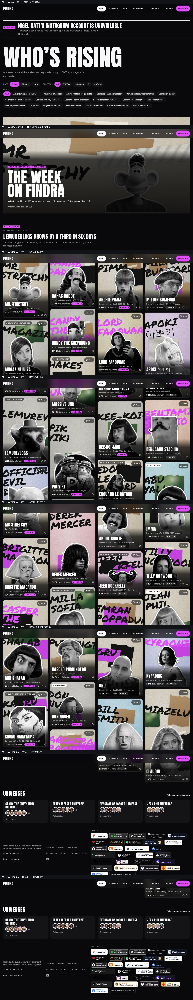
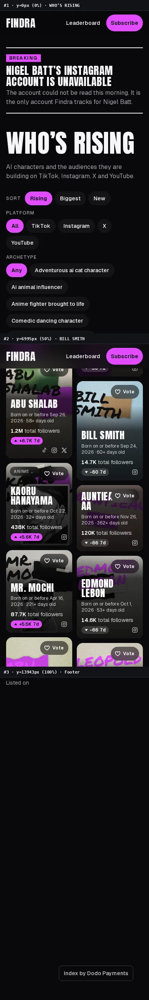

# UI Design System & Master Generation Blueprint: findra-art

> **Findra: the AI character feed** (https://findra.art/) — Who is rising among AI characters on TikTok, Instagram, X and YouTube: what they look like, their legends and where to follow them.





---

## 1. Executive Visual Persona & Design Archetype

- **Brand Essence & Persona**: **Findra: the AI character feed** (`https://findra.art/`). Who is rising among AI characters on TikTok, Instagram, X and YouTube: what they look like, their legends and where to follow them.
- **Capture Provenance**: Live browser capture (`tier1_fast`, HTTP `200`, captured `2026-11-24`).
- **Visual Archetype**: **High-Contrast Obsidian / Atmospheric Design System (`#09090b` canvas, `#ffffff` ink, `#e14bff` accent)**.
- **Anti-AI-Slop Differentiators**:
  - **Live-Computed Chromatic Polarity**: Anchors the viewport in `#09090b` (live computed `body` `background-color` (`computed_styles.json`)) paired with `#ffffff` primary typography and `#e14bff` accents.
  - **Grounded Typographic Hierarchy**: Pairs `Anton` for display copy (`WHO’S RISING`) with `Geist` and `SFMono-Regular`.
  - **Calibrated Spatial Grid & Motion**: Combines `1600px` container bounds (`gap: 64px`, padding `24px`) with `cubic-bezier(0,0,.2,1)` easing.

---

## 2. Spatial Architecture & Modular Grid Mathematics

### Viewport Allocation & Container Geometry
- **Captured Journey Filmstrips**: Desktop `1280×6624px` (`assets/desktop-journey.webp`, `8` keyframes up to `y=11966px` / doc `12866px`), Mobile `390×2616px` (`assets/mobile-journey.webp`, `3` keyframes).
- **Master Container Bounds**: `1600px` (live computed `main` `max-width`).
- **Canvas Lateral Padding & Spacing**: `24px` lateral canvas padding with `64px` grid gap.
- **Border Radius Scale**: `3.35544e+07px`, `8px`, `.25rem`, `var(--radius-2xl)`.

### Responsive Breakpoint Architecture
- **Desktop Layout**: Multi-column CSS Grid / Flexbox layout at `1440px` (`max-width: 1600px`, `gap: 64px`).
- **Mobile Layout**: Single-column vertical stack at `390px` viewport width with `24px` horizontal padding.
- **Extracted CSS Media Queries**: `@media (min-width:40rem)`, `@media (min-width:48rem)`, `@media (min-width:63rem)`, `@media (min-width:80rem)`.

---

## 3. Color System, Materiality & Atmospheric Lighting

### Semantic Palette & Source Grounding
| Semantic Role | Ground-Truth Value | Extracted Live / CSS Source |
|---|---|---|
| **Primary Canvas Substrate** | `#09090b` | live computed `body` `background-color` (`computed_styles.json`) |
| **Primary Typography Ink** | `#ffffff` | live computed `h2` `color` (`computed_styles.json`) |
| **Elevated Surface / Card Substrate** | `#141417` | `var(--surface)` in `:root` |
| **Interactive Accent / Highlight** | `#e14bff` | live computed `button` `background-color` (`computed_styles.json`) |
| **Secondary / Muted Copy** | `#a1a1aa` | live computed `p` `color` (`computed_styles.json`) |
| **Structural Hairline Border** | `#27272c` | `var(--border)` in `:root` |
| **Variable Token (`--foreground`)** | `#f5f5f7` | `var(--foreground)` in `:root` |
| **Variable Token (`--surface-hover`)** | `#1d1d21` | `var(--surface-hover)` in `:root` |
| **Variable Token (`--accent-foreground`)** | `#0a0a0b` | `var(--accent-foreground)` in `:root` |
| **Variable Token (`--paper`)** | `#f1ece1` | `var(--paper)` in `:root` |
| **Variable Token (`--ink`)** | `#1b1a17` | `var(--ink)` in `:root` |
| **Variable Token (`--ink-muted`)** | `#57524a` | `var(--ink-muted)` in `:root` |
| **Variable Token (`--ink-accent`)** | `#8a1ca6` | `var(--ink-accent)` in `:root` |

### Sanitized Root CSS Variables (`ui-ux.md` Ground Truth)
| Variable Name | Extracted Value | Semantic Role |
|---|---|---|
| `--background` | `#09090b` | Canvas / Surface Token |
| `--foreground` | `#f5f5f7` | Typography Ink Token |
| `--muted` | `#a1a1aa` | Color / Atmospheric Token |
| `--surface` | `#141417` | Canvas / Surface Token |
| `--surface-hover` | `#1d1d21` | Canvas / Surface Token |
| `--border` | `#27272c` | Elevation / Border Token |
| `--accent` | `#e14bff` | Brand / Palette Token |
| `--accent-foreground` | `#0a0a0b` | Typography Ink Token |
| `--paper` | `#f1ece1` | Canvas / Surface Token |
| `--ink` | `#1b1a17` | Typography Ink Token |
| `--ink-muted` | `#57524a` | Typography Ink Token |
| `--ink-accent` | `#8a1ca6` | Typography Ink Token |
| `--lightningcss-dark` | `initial` | Canvas / Surface Token |
| `--font-geist` | `"Geist", "Geist Fallback"` | Typography / Scale Token |
| `--font-anton` | `"Anton", "Anton Fallback"` | Typography / Scale Token |
| `--font-permanent-marker` | `"Permanent Marker", "Permanent Marker Fallback"` | Typography / Scale Token |

---

## 4. Typographic Scale & Editorial Hierarchy

### Font Family Stacks
- **Display Typography**: `Anton`.
- **Primary Body Stack**: `Geist`.
- **Technical / Metadata Stack**: `SFMono-Regular`.

### Typographic Scale & Rules (Live Computed & Stylesheet Grounded)
- **Hero Display (`H1`)**: live computed `h1` (`font-size: 176px`, `line-height: 158.4px`, `font-weight: 400`, `letter-spacing: 0.88px`); CSS variables `--font-display: var(--font-anton), Impact, "Arial Narrow", sans-serif`.
- **Section Heading (`H2`)**: live computed `h2` (`font-size: 112px`, `line-height: 100.8px`, `font-weight: 400`, `letter-spacing: 0.56px`); CSS variables `--text-2xl: 1.5rem`, `--text-2xl--line-height: calc(2 / 1.5)`.
- **Body Copy**: live computed `body` (`font-size: 16px`, `line-height: 24px`, `font-weight: 400`); CSS variables `--text-base: 1rem`, `--text-base--line-height: calc(1.5 / 1)`.
- **Metadata & Navigation Labels**: live computed `nav/a` (`font-size: 16px`, `line-height: 24px`, `font-weight: 400`); CSS variables `--text-xs: .75rem`, `--text-xs--line-height: calc(1 / .75)`, `--text-sm: .875rem`.

---

## 5. Choreographed Motion & Interaction Physics

### Primary Easing Curves
- **Extracted Timing Functions**: `cubic-bezier(0,0,.2,1)`, `cubic-bezier(.4,0,.6,1)`, `cubic-bezier(.4,0,.2,1)`.

### Per-Element Transition & Choreography Rules
- **Selector `layer theme`**: `transition: .15s` extracted from `findra-art` stylesheet.
- **Selector `scale\]`**: `transition: var(--tw-ease,var(--default-transition-timing-function))` extracted from `findra-art` stylesheet.
- **Selector `scale\]`**: `transition: var(--tw-ease,var(--default-transition-timing-function))` extracted from `findra-art` stylesheet.
- **Extracted Easing Curve (`cubic-bezier(0,0,.2,1)`)**: Governs interactive state transitions across `<header.top-0>` and `<article.group>`.
- **State & Hover Choreography**: Opacity and transform transitions on `<section.border-foreground>` and `<article.group>` interactive targets.
### Measured Runtime Scroll & Interaction Telemetry (`behavioral_journey_v2`)
- **Scroll Driver Mode**: `native` (max document height `12866px`, deepest scrollY reached `11966px` across `8` desktop keyframes).
- **Detected Scroll / Motion Libraries**: Native browser scroll / standard CSS transitions.
- **Hover Physics (`primary_cta` · `NIGEL BATT’S INSTAGRAM ACCOUNT IS...`)**: Computed transition `0s` / `ease` (no static color/transform shift captured at rest).
- **Route Transition Architecture**: First internal navigation (`/magazine/nigel-batt-instagram-account-unavailable`) measured as `SPA` in `1290ms`.

---

## 6. Component Wireframe & Structural DOM Map

### Visual Layout Schematic — Desktop (`1440px`, Grounded in `dom.html` & Landmark Bounding Boxes)
```
┌────────────────────────────────────────────────────────────────────────┐
│ DESKTOP VIEWPORT (1440px) — Findra: the AI character feed              │
│ ====================================================================== │
│ [ <header.top-0> (1440x64px)          | Feed · Magazine · Wire · Lea ] │
│ ---------------------------------------------------------------------- │
│ | HERO STAGE: <section.border-foreground> (w=1440px)                 | │
│ | H1: WHO’S RISING                                                   | │
│ | Substrate: #09090b | Ink: #ffffff | Accent: #e14bff                | │
│ ---------------------------------------------------------------------- │
│ | SHOWCASE GRID (<article.group>) max-w: 1600px                      | │
│ | +------------------------------+  +------------------------------+ | │
│ | | Who’s rising                 |  | The week on Findra           | | │
│ | +------------------------------+  +------------------------------+ | │
│ ---------------------------------------------------------------------- │
│ | DETAIL MODULE (<section.border-border>) — Latest story             | │
│ ---------------------------------------------------------------------- │
│ [ FOOTER (<footer.text-muted> ) | https://findra.art/                  │
└────────────────────────────────────────────────────────────────────────┘
```

### Visual Layout Schematic — Mobile Reflow (`390px`)
```
┌────────────────────────────────────────────────────────────────────────┐
│ MOBILE VIEWPORT REFLOW (390px) — Single-Column Stack (gap: 64px)       │
│ ====================================================================== │
│ [ HEADER BAR (<header.top-0>          ) | Compact Menu (390px)         │
│ ---------------------------------------------------------------------- │
│ | HERO STAGE (<section.border-foregrou) — 390px Vertical Lead        | │
│ | H1: WHO’S RISING                                                   | │
│ ---------------------------------------------------------------------- │
│ | SHOWCASE STACK (<article.group>) — 1-Col Stack                     | │
│ | [ Item 1: Who’s rising                                           ] | │
│ | [ Item 2: The week on Findra                                     ] | │
│ ---------------------------------------------------------------------- │
│ | DETAIL STACK (<section.border-border>) — 1-Col (Latest story)      | │
│ ---------------------------------------------------------------------- │
│ [ FOOTER (<footer.text-muted> ) | Stacked 390px Colophon               │
└────────────────────────────────────────────────────────────────────────┘
```

### Granular DOM Region Breakdown
1. **Brand Header & Navigation Bar (<header.top-0> — `findra-art`)**:
   - Landmark `<header class="top-0 backdrop-blur-xl">` (`1440x64px`) hosting `Findra: the AI character feed` navigation (`Feed · Magazine · Wire · Leaderboard · 40 Under 40`), DOM attributes (`data-precedence="next"`, `data-sdkn="@vercel/analytics/react"`, `data-sdkv="1.6.1"`, `data-test="skip-to-content"`), and stylesheet rule `.u8MhCG_className { font-family:Geist,Geist Fallback;font-style:normal }`.
2. **Hero Stage & Focal Lead (<section.border-foreground> — `WHO’S RISING`)**:
   - Landmark `<section class="border-foreground gap-2">` presenting display lead `WHO’S RISING` and copy excerpt *"The account could not be read this morning. It is the only accoun"* over `#09090b` canvas and `#ffffff` ink.
3. **Primary Showcase & Content Grid (<article.group> — `Who’s rising`)**:
   - Landmark `<article class="group justify-end">` rendering section `Who’s rising` with copy *"AI characters and the audiences they are building on TikTok, Inst"*, asset references (`3f38907974d4f61e778b2b56d301ade05...`, `d4d0f0a272f823cf8d0558137c9b10adc...`, `3qago8bg0x8_-.css`, `30qn3skk62nz8.js`), and grid rule `.u8MhCG_variable { --font-geist:"Geist", "Geist Fallback" }`.
4. **Interactive Detail & Feature Matrix (<section.border-border> — `The week on Findra`)**:
   - Landmark `<section class="border-border gap-3">` framing `The week on Findra` and `Latest story` (*"adventurous ai cat character"*) with `#141417` surface cards, `#e14bff` accents, and `.mJqafq_className { font-family:Anton,Anton Fallback;font-style:normal;font-weight:400 }`.
5. **Colophon & Global Directory Footer (<footer.text-muted> — `https://findra.art/`)**:
   - Landmark `<footer class="text-muted gap-4">` anchoring `Findra: the AI character feed` footer links (`Feed · Magazine · Wire · Leaderboard · 40 Under 40`), copy *"ai animal influencer"*, and `#27272c` structural dividers.
### Full Vertical Scroll Sequence (Desktop `1440×900` Keyframes)
- **Step 01** (`y=0px`, `0%`): Active landmark `WHO’S RISING` · sticky/fixed elements: `1`
- **Step 02** (`y=850px`, `7%`): Active landmark `THE WEEK ON FINDRA` · sticky/fixed elements: `1`
- **Step 03** (`y=3400px`, `28%`): Active landmark `DAHAB DADDY` · sticky/fixed elements: `1`
- **Step 04** (`y=5100px`, `43%`): Active landmark `MASSIVE UNC` · sticky/fixed elements: `1`
- **Step 05** (`y=7650px`, `64%`): Active landmark `ABDUL BIGOTE` · sticky/fixed elements: `1`
- **Step 06** (`y=9350px`, `78%`): Active landmark `HAROLD PUDDINGTON` · sticky/fixed elements: `1`
- **Step 07** (`y=11900px`, `99%`): Active landmark `UNIVERSES` · sticky/fixed elements: `1`
- **Step 08** (`y=11966px`, `100%`): Active landmark `UNIVERSES` · sticky/fixed elements: `1`

### Multi-Page Internal Route Map
- **Detail Route (`/magazine/nigel-batt-instagram-account-unavailable`)**: `https://findra.art/magazine/nigel-batt-instagram-account-unavailable` — H1: `NIGEL BATT’S INSTAGRAM ACCOUNT IS UNAVAILABLE`, scrollHeight `6098px`, transition `SPA` (`1290ms`)
- **About Route (`/contact`)**: `https://findra.art/contact` — H1: `CONTACT`, scrollHeight `1066px`, transition `direct` (`719ms`)
- **Detail Route (`/magazine/the-week-on-findra-2026-11-16`)**: `https://findra.art/magazine/the-week-on-findra-2026-11-16` — H1: `THE WEEK ON FINDRA`, scrollHeight `8657px`, transition `direct` (`1627ms`)

---

## 7. Master Zero-Shot AI Generation Prompt

```markdown
# Master Zero-Shot Frontend Generation Prompt: findra-art (Findra: the AI character feed)

You are a principal frontend architect and design systems engineer. Build a complete, production-ready web application replicating the exact design system, DOM landmarks, typographic hierarchy, color tokens, and motion physics of `findra-art` (**Findra: the AI character feed** — `https://findra.art/`).

### 1. Visual Archetype & Anti-AI-Slop Mandates
- **Archetype**: High-Contrast Obsidian / Atmospheric Design System (`#09090b` canvas, `#ffffff` ink, `#e14bff` accent).
- **Identity & Domain Context**: Who is rising among AI characters on TikTok, Instagram, X and YouTube: what they look like, their legends and where to follow them.
- **Primary Substrate**: `#09090b` (live computed `body` `background-color` (`computed_styles.json`)), **Primary Ink**: `#ffffff`, **Accent / Highlight**: `#e14bff`.
- **Site-Specific Differentiators**:
  - **Live-Computed Chromatic Polarity**: Anchors the viewport in `#09090b` (live computed `body` `background-color` (`computed_styles.json`)) paired with `#ffffff` primary typography and `#e14bff` accents.
  - **Grounded Typographic Hierarchy**: Pairs `Anton` for display copy (`WHO’S RISING`) with `Geist` and `SFMono-Regular`.
  - **Calibrated Spatial Grid & Motion**: Combines `1600px` container bounds (`gap: 64px`, padding `24px`) with `cubic-bezier(0,0,.2,1)` easing.

### 2. Ground-Truth CSS Variables (`:root` Token Contract)
Declare and consume these exact custom properties extracted from `findra-art` in your global stylesheet:

:root {
  /* Findra: the AI character feed (findra-art) — Live-Grounded CSS Variables */
  --background: #09090b; /* Canvas / Surface Token (findra-art) */
  --foreground: #f5f5f7; /* Typography Ink Token (findra-art) */
  --muted: #a1a1aa; /* Color / Atmospheric Token (findra-art) */
  --surface: #141417; /* Canvas / Surface Token (findra-art) */
  --surface-hover: #1d1d21; /* Canvas / Surface Token (findra-art) */
  --border: #27272c; /* Elevation / Border Token (findra-art) */
  --accent: #e14bff; /* Brand / Palette Token (findra-art) */
  --accent-foreground: #0a0a0b; /* Typography Ink Token (findra-art) */
  --paper: #f1ece1; /* Canvas / Surface Token (findra-art) */
  --ink: #1b1a17; /* Typography Ink Token (findra-art) */
  --ink-muted: #57524a; /* Typography Ink Token (findra-art) */
  --ink-accent: #8a1ca6; /* Typography Ink Token (findra-art) */
  --lightningcss-dark: initial; /* Canvas / Surface Token (findra-art) */
  --font-geist: "Geist", "Geist Fallback"; /* Typography / Scale Token (findra-art) */
  --font-anton: "Anton", "Anton Fallback"; /* Typography / Scale Token (findra-art) */
  --font-permanent-marker: "Permanent Marker", "Permanent Marker Fallback"; /* Typography / Scale Token (findra-art) */
}

### 3. Semantic Color & Materiality Contract
Map every surface, ink, and border strictly to these source-grounded tokens:
- **Primary Canvas Substrate**: `#09090b` — grounded in live computed `body` `background-color` (`computed_styles.json`)
- **Primary Typography Ink**: `#ffffff` — grounded in live computed `h2` `color` (`computed_styles.json`)
- **Elevated Surface / Card Substrate**: `#141417` — grounded in `var(--surface)` in `:root`
- **Interactive Accent / Highlight**: `#e14bff` — grounded in live computed `button` `background-color` (`computed_styles.json`)
- **Secondary / Muted Copy**: `#a1a1aa` — grounded in live computed `p` `color` (`computed_styles.json`)
- **Structural Hairline Border**: `#27272c` — grounded in `var(--border)` in `:root`
- **Variable Token (`--foreground`)**: `#f5f5f7` — grounded in `var(--foreground)` in `:root`
- **Variable Token (`--surface-hover`)**: `#1d1d21` — grounded in `var(--surface-hover)` in `:root`
- **Variable Token (`--accent-foreground`)**: `#0a0a0b` — grounded in `var(--accent-foreground)` in `:root`
- **Variable Token (`--paper`)**: `#f1ece1` — grounded in `var(--paper)` in `:root`
- **Variable Token (`--ink`)**: `#1b1a17` — grounded in `var(--ink)` in `:root`
- **Variable Token (`--ink-muted`)**: `#57524a` — grounded in `var(--ink-muted)` in `:root`
- **Variable Token (`--ink-accent`)**: `#8a1ca6` — grounded in `var(--ink-accent)` in `:root`

### 4. Spatial Grid, Container Bounds & Responsive Breakpoints
- **Desktop Viewport Reference**: `1280×6624px` (multi-frame vertical journey filmstrip (6624px), `1440px` standard desktop width).
- **Mobile Viewport Reference**: `390×2616px` (multi-frame vertical journey filmstrip (2616px), `390px` standard mobile width).
- **Container Max-Width**: `1600px` (live computed `main` `max-width`)
- **Padding & Gutters**: `24px` lateral canvas padding with `64px` grid gap
- **Desktop Grid**: Multi-column CSS Grid / Flexbox layout at `1440px` (`max-width: 1600px`, `gap: 64px`)
- **Mobile Adaptation**: Single-column vertical stack at `390px` viewport width with `24px` horizontal padding
- **Media Queries**: `@media (min-width:40rem)`, `@media (min-width:48rem)`, `@media (min-width:63rem)`, `@media (min-width:80rem)`
- **Corner Radii**: `3.35544e+07px`, `8px`, `.25rem`, `var(--radius-2xl)`

### 5. Typography & Editorial Scale Contract
- **Display Font Stack**: `Anton`
- **Body Font Stack**: `Geist`
- **Monospace / Technical Font Stack**: `SFMono-Regular`
- **H1 Display Rule**: live computed `h1` (`font-size: 176px`, `line-height: 158.4px`, `font-weight: 400`, `letter-spacing: 0.88px`); CSS variables `--font-display: var(--font-anton), Impact, "Arial Narrow", sans-serif`
- **H2 Section Rule**: live computed `h2` (`font-size: 112px`, `line-height: 100.8px`, `font-weight: 400`, `letter-spacing: 0.56px`); CSS variables `--text-2xl: 1.5rem`, `--text-2xl--line-height: calc(2 / 1.5)`
- **Body Copy Rule**: live computed `body` (`font-size: 16px`, `line-height: 24px`, `font-weight: 400`); CSS variables `--text-base: 1rem`, `--text-base--line-height: calc(1.5 / 1)`
- **Metadata & Index Rule**: live computed `nav/a` (`font-size: 16px`, `line-height: 24px`, `font-weight: 400`); CSS variables `--text-xs: .75rem`, `--text-xs--line-height: calc(1 / .75)`, `--text-sm: .875rem`

### 6. Component Hierarchy, Verbatim Copy & Real DOM Landmarks
Scaffold `findra-art` (`Findra: the AI character feed`) with these exact structural regions, extracted copy, and CSS rules from `dom.html`:
1. **Brand Header & Navigation Bar (<header.top-0> — `findra-art`)**:
   - DOM & Selectors: Landmark `<header class="top-0 backdrop-blur-xl">` (`1440x64px`) hosting `Findra: the AI character feed` navigation (`Feed · Magazine · Wire · Leaderboard · 40 Under 40`), DOM attributes (`data-precedence="next"`, `data-sdkn="@vercel/analytics/react"`, `data-sdkv="1.6.1"`, `data-test="skip-to-content"`), and stylesheet rule `.u8MhCG_className { font-family:Geist,Geist Fallback;font-style:normal }`.
   - Responsive Contract: Header `Brand Header & Navigation Bar (<header.top-0> — `findra-art`)` (`findra-art`) adapts across `@media (min-width:40rem)`, `@media (min-width:48rem)`, `@media (min-width:63rem)`, `@media (min-width:80rem)` with `cubic-bezier(0,0,.2,1)`, `cubic-bezier(.4,0,.6,1)`, `cubic-bezier(.4,0,.2,1)` transitions and links `Feed · Magazine · Wire · Leaderboard · 40 Under 40`.
2. **Hero Stage & Focal Lead (<section.border-foreground> — `WHO’S RISING`)**:
   - DOM & Selectors: Landmark `<section class="border-foreground gap-2">` presenting display lead `WHO’S RISING` and copy excerpt *"The account could not be read this morning. It is the only accoun"* over `#09090b` canvas and `#ffffff` ink.
   - Responsive Contract: Hero stage (`1280×6624px` desktop / `390×2616px` mobile) sets `#09090b` background with `#ffffff` headline `WHO’S RISING`.
3. **Primary Showcase & Content Grid (<article.group> — `Who’s rising`)**:
   - DOM & Selectors: Landmark `<article class="group justify-end">` rendering section `Who’s rising` with copy *"AI characters and the audiences they are building on TikTok, Inst"*, asset references (`3f38907974d4f61e778b2b56d301ade05...`, `d4d0f0a272f823cf8d0558137c9b10adc...`, `3qago8bg0x8_-.css`, `30qn3skk62nz8.js`), and grid rule `.u8MhCG_variable { --font-geist:"Geist", "Geist Fallback" }`.
   - Responsive Contract: Showcase grid `Primary Showcase & Content Grid (<article.group> — `Who’s rising`)` applies Multi-column CSS Grid / Flexbox layout at `1440px` (`max-width: 1600px`, `gap: 64px`) on desktop and Single-column vertical stack at `390px` viewport width with `24px` horizontal padding on mobile.
4. **Interactive Detail & Feature Matrix (<section.border-border> — `The week on Findra`)**:
   - DOM & Selectors: Landmark `<section class="border-border gap-3">` framing `The week on Findra` and `Latest story` (*"adventurous ai cat character"*) with `#141417` surface cards, `#e14bff` accents, and `.mJqafq_className { font-family:Anton,Anton Fallback;font-style:normal;font-weight:400 }`.
   - Responsive Contract: Detail module `Interactive Detail & Feature Matrix (<section.border-border> — `The week on Findra`)` uses `3.35544e+07px`, `8px`, `.25rem`, `var(--radius-2xl)` radii, `#e14bff` highlights, and assets (3f38907974d4f61e778b2b56d301ade05..., d4d0f0a272f823cf8d0558137c9b10adc..., 3qago8bg0x8_-.css).
5. **Colophon & Global Directory Footer (<footer.text-muted> — `https://findra.art/`)**:
   - DOM & Selectors: Landmark `<footer class="text-muted gap-4">` anchoring `Findra: the AI character feed` footer links (`Feed · Magazine · Wire · Leaderboard · 40 Under 40`), copy *"ai animal influencer"*, and `#27272c` structural dividers.
   - Responsive Contract: Footer `Colophon & Global Directory Footer (<footer.text-muted> — `https://findra.art/`)` aligns to `1600px` (live computed `main` `max-width`) with `24px` lateral canvas padding with `64px` grid gap and attributes (data-precedence="next", data-sdkn="@vercel/analytics/react", data-sdkv="1.6.1").

#### Verbatim DOM Copy Excerpts (`dom.html`)
- Copy Excerpt 1: *"The account could not be read this morning. It is the only account Findra tracks f..."*
- Copy Excerpt 2: *"AI characters and the audiences they are building on TikTok, Instagram, X and YouT..."*
- Copy Excerpt 3: *"adventurous ai cat character"*
- Copy Excerpt 4: *"ai animal influencer"*

### 7. Motion, Extracted Stylesheet Rules & Interaction Choreography
- **Primary Easing Functions**: `cubic-bezier(0,0,.2,1)`, `cubic-bezier(.4,0,.6,1)`, `cubic-bezier(.4,0,.2,1)`
- **Extracted Stylesheet Rules (`findra-art`)**:
- `.u8MhCG_className { font-family:Geist,Geist Fallback;font-style:normal }`
- `.u8MhCG_variable { --font-geist:"Geist", "Geist Fallback" }`
- `.mJqafq_className { font-family:Anton,Anton Fallback;font-style:normal;font-weight:400 }`
- `.mJqafq_variable { --font-anton:"Anton", "Anton Fallback" }`
- `.XWwCSG_className { font-family:Permanent Marker,Permanent Marker Fallback;font-style:normal... }`
- **Per-Selector Transition Rules**:
- **Selector `layer theme`**: `transition: .15s` extracted from `findra-art` stylesheet.
- **Selector `scale\]`**: `transition: var(--tw-ease,var(--default-transition-timing-function))` extracted from `findra-art` stylesheet.
- **Selector `scale\]`**: `transition: var(--tw-ease,var(--default-transition-timing-function))` extracted from `findra-art` stylesheet.
- **Extracted Easing Curve (`cubic-bezier(0,0,.2,1)`)**: Governs interactive state transitions across `<header.top-0>` and `<article.group>`.
- **State & Hover Choreography**: Opacity and transform transitions on `<section.border-foreground>` and `<article.group>` interactive targets.
### 7b. Full-Page Scroll Choreography, Interactive States & Multi-Page Routes
- **Scroll Mechanics**: Implement `native` vertical progression up to `12866px` across 8 distinct viewport chapters.
- **Vertical Chapter Sequence**: WHO’S RISING (0%) -> THE WEEK ON FINDRA (7%) -> DAHAB DADDY (28%) -> MASSIVE UNC (43%) -> ABDUL BIGOTE (64%) -> HAROLD PUDDINGTON (78%) -> UNIVERSES (99%) -> UNIVERSES (100%).
- **Multi-Page Routes**: Scaffold internal routes `/magazine/nigel-batt-instagram-account-unavailable` (detail, SPA), `/contact` (about, direct), `/magazine/the-week-on-findra-2026-11-16` (detail, direct) sharing the global header/footer shell and design tokens.

### 8. Technical Deliverables
- Implement in Next.js (App Router) with TypeScript and Tailwind CSS consuming the `:root` custom properties defined above for `findra-art`.
- Reproduce both the `1440px` desktop architecture and `390px` mobile breakpoint transitions, preserving semantic HTML5 landmarks (`<header>`, `<nav>`, `<main>`, `<section>`, `<footer>`) and `prefers-reduced-motion` accessibility guards.
```
---

## 8. Full-Page Scroll Journey, Interactive States & Subpage Inventory

### Desktop Scroll Keyframes (`1440×900` WebP)
| Step | Scroll Y | Progress | Active Landmark / Section | Sticky/Fixed | Visual Asset |
| :---: | :---: | :---: | :--- | :---: | :--- |
| `#01` | `0px` | `0%` | WHO’S RISING | `1` | [desktop-step-01.webp](assets/desktop-step-01.webp) |
| `#02` | `850px` | `7%` | THE WEEK ON FINDRA | `1` | [desktop-step-02.webp](assets/desktop-step-02.webp) |
| `#03` | `3400px` | `28%` | DAHAB DADDY | `1` | [desktop-step-03.webp](assets/desktop-step-03.webp) |
| `#04` | `5100px` | `43%` | MASSIVE UNC | `1` | [desktop-step-04.webp](assets/desktop-step-04.webp) |
| `#05` | `7650px` | `64%` | ABDUL BIGOTE | `1` | [desktop-step-05.webp](assets/desktop-step-05.webp) |
| `#06` | `9350px` | `78%` | HAROLD PUDDINGTON | `1` | [desktop-step-06.webp](assets/desktop-step-06.webp) |
| `#07` | `11900px` | `99%` | UNIVERSES | `1` | [desktop-step-07.webp](assets/desktop-step-07.webp) |
| `#08` | `11966px` | `100%` | UNIVERSES | `1` | [desktop-step-08.webp](assets/desktop-step-08.webp) |

### Mobile Condensed Keyframes (`390×844` WebP)
| Step | Scroll Y | Progress | Active Landmark | Visual Asset |
| :---: | :---: | :---: | :--- | :--- |
| `#01` | `0px` | `0%` | WHO’S RISING | [mobile-step-01.webp](assets/mobile-step-01.webp) |
| `#02` | `6995px` | `50%` | BILL SMITH | [mobile-step-02.webp](assets/mobile-step-02.webp) |
| `#03` | `13943px` | `100%` | Footer | [mobile-step-03.webp](assets/mobile-step-03.webp) |

### Internal Subpage Filmstrips (`1080px` Wide WebP)
| # | Template | Route URL | H1 / Title | Scroll Height | Transition | Filmstrip Asset |
| :-: | :---: | :--- | :--- | :---: | :---: | :--- |
| `1` | `detail` | `https://findra.art/magazine/nigel-batt-instagram-account-unavailable` | NIGEL BATT’S INSTAGRAM ACCOUNT IS UNA... | `6098px` | `SPA` (`1290ms`) | [subpage-01-magazine-nigel-batt-instagram-accoun.webp](assets/subpage-01-magazine-nigel-batt-instagram-accoun.webp) |
| `2` | `about` | `https://findra.art/contact` | CONTACT | `1066px` | `direct` (`719ms`) | [subpage-02-contact.webp](assets/subpage-02-contact.webp) |
| `3` | `detail` | `https://findra.art/magazine/the-week-on-findra-2026-11-16` | THE WEEK ON FINDRA | `8657px` | `direct` (`1627ms`) | [subpage-03-magazine-the-week-on-findra-2026-11-.webp](assets/subpage-03-magazine-the-week-on-findra-2026-11-.webp) |

