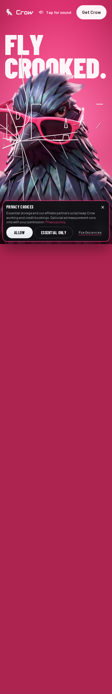

# UI Design System & Master Generation Blueprint: flycrooked-com

> **Crow · Trip planner and flight finder for iPhone** (https://flycrooked.com/) — Your iPhone travel companion. Plan a trip, compare flight routes, track delays and gate changes, and carry a blunt local guide when you l...


---

## 1. Executive Visual Persona & Design Archetype

- **Brand Essence & Persona**: **Crow · Trip planner and flight finder for iPhone** (`https://flycrooked.com/`). Your iPhone travel companion. Plan a trip, compare flight routes, track delays and gate changes, and carry a blunt local guide when you l...
- **Capture Provenance**: Live browser capture (`tier1_fast`, HTTP `200`, captured `2026-11-23`).
- **Visual Archetype**: **Dark-Substrate WebGL / Canvas Interactive Experience (`#ad2450` / `#ff3d81`)**.
- **Anti-AI-Slop Differentiators**:
  - **Live-Computed Chromatic Polarity**: Anchors the viewport in `#ad2450` (live computed `body` `background-color` (`computed_styles.json`)) paired with `#fff5f8` primary typography and `#ff3d81` accents.
  - **Grounded Typographic Hierarchy**: Pairs `Barlow Condensed` for display copy (`FLY CROOKED.`) with `Barlow` and `mono`.
  - **Calibrated Spatial Grid & Motion**: Combines `96rem` container bounds (`gap: 28px`, padding `43.2px`) with `cubic-bezier(.22,1,.36,1)` easing and Three.js / WebGL Canvas Pipeline.

---

## 2. Spatial Architecture & Modular Grid Mathematics



### Viewport Allocation & Container Geometry
- **Captured Viewport Dimensions**: Desktop `1440×2400px` (`assets/desktop.png`, clamped at 2400px live multi-section capture), Mobile `390×2400px` (`assets/mobile.png`, clamped at 2400px live multi-section capture).
- **Master Container Bounds**: `96rem` (non-`@media` desktop container stylesheet rule).
- **Canvas Lateral Padding & Spacing**: `43.2px` lateral canvas padding with `28px` grid gap.
- **Border Radius Scale**: `99px`, `999px`, `50%`, `14px`.

### Responsive Breakpoint Architecture
- **Desktop Layout**: Multi-column CSS Grid / Flexbox layout at `1440px` (`max-width: 96rem`, `gap: 28px`).
- **Mobile Layout**: Single-column vertical stack at `390px` viewport width with `43.2px` horizontal padding.
- **Extracted CSS Media Queries**: `@media (max-width:374px)`, `@media (max-width:699px)`, `@media (max-width:820px)`, `@media (min-width:40rem)`.

---

## 3. Color System, Materiality & Atmospheric Lighting

### Semantic Palette & Source Grounding
| Semantic Role | Ground-Truth Value | Extracted Live / CSS Source |
|---|---|---|
| **Primary Canvas Substrate** | `#ad2450` | live computed `body` `background-color` (`computed_styles.json`) |
| **Primary Typography Ink** | `#fff5f8` | live computed `h1` `color` (`computed_styles.json`) |
| **Elevated Surface / Card Substrate** | `#1c1e24` | `var(--panel-black)` in `:root` |
| **Interactive Accent / Highlight** | `#ff3d81` | `var(--accent)` in `:root` |
| **Secondary / Muted Copy** | `#bec2ca` | `var(--cp-muted)` in `:root` |
| **Structural Hairline Border** | `#33373f` | `var(--surface-line)` in `:root` |
| **Variable Token (`--concourse`)** | `#eceff3` | `var(--concourse)` in `:root` |
| **Variable Token (`--sign-black`)** | `#17181c` | `var(--sign-black)` in `:root` |
| **Variable Token (`--night`)** | `#0e0f13` | `var(--night)` in `:root` |
| **Variable Token (`--surface`)** | `#1e2128` | `var(--surface)` in `:root` |
| **Variable Token (`--ink`)** | `#1b1c21` | `var(--ink)` in `:root` |
| **Variable Token (`--ink-2`)** | `#5b616b` | `var(--ink-2)` in `:root` |
| **Variable Token (`--card`)** | `#ffffff` | `var(--card)` in `:root` |
| **Variable Token (`--rule`)** | `#d7dce3` | `var(--rule)` in `:root` |
| **Variable Token (`--green`)** | `#1e7b4d` | `var(--green)` in `:root` |
| **Variable Token (`--dgreen`)** | `#00c16a` | `var(--dgreen)` in `:root` |
| **Variable Token (`--dorange`)** | `#ff7a1a` | `var(--dorange)` in `:root` |
| **Variable Token (`--dorange-deep`)** | `#c2510a` | `var(--dorange-deep)` in `:root` |

### Sanitized Root CSS Variables (`ui-ux.md` Ground Truth)
| Variable Name | Extracted Value | Semantic Role |
|---|---|---|
| `--concourse` | `#eceff3` | Color / Atmospheric Token |
| `--sign-black` | `#17181c` | Canvas / Surface Token |
| `--panel-black` | `#1c1e24` | Canvas / Surface Token |
| `--accent` | `#ff3d81` | Brand / Palette Token |
| `--accent-rgb` | `255,61,129` | Brand / Palette Token |
| `--night` | `#0e0f13` | Color / Atmospheric Token |
| `--surface` | `#1e2128` | Canvas / Surface Token |
| `--surface-line` | `#33373f` | Canvas / Surface Token |
| `--ink` | `#1b1c21` | Typography Ink Token |
| `--ink-2` | `#5b616b` | Typography Ink Token |
| `--card` | `#fff` | Color / Atmospheric Token |
| `--rule` | `#d7dce3` | Color / Atmospheric Token |
| `--green` | `#1e7b4d` | Color / Atmospheric Token |
| `--dgreen` | `#00c16a` | Color / Atmospheric Token |
| `--dorange` | `#ff7a1a` | Color / Atmospheric Token |
| `--dorange-deep` | `#c2510a` | Color / Atmospheric Token |

---

## 4. Typographic Scale & Editorial Hierarchy

### Font Family Stacks
- **Display Typography**: `Barlow Condensed`.
- **Primary Body Stack**: `Barlow`.
- **Technical / Metadata Stack**: `mono`.

### Typographic Scale & Rules (Live Computed & Stylesheet Grounded)
- **Hero Display (`H1`)**: live computed `h1` (`font-size: 262.74px`, `line-height: 215.447px`, `font-weight: 900`, `letter-spacing: -1.3137px`); CSS variables `--display: var(--font-display),"Arial Narrow",Arial,sans-serif`, `--font-display: "display","display Fallback"`; rule `h1` (`letter-spacing: -.005em`).
- **Section Heading (`H2`)**: live computed `h2` (`font-size: 18px`, `line-height: 27px`, `font-weight: 400`); rule `h2` (`letter-spacing: -.005em`).
- **Body Copy**: live computed `body` (`font-size: 18px`, `line-height: 27px`, `font-weight: 400`); CSS variables `--body: var(--font-body),-apple-system,"Segoe UI",sans-serif`, `--font-body: "body","body Fallback"`; rule `p` (`font-size: 16px`, `line-height: 1.75`).
- **Metadata & Navigation Labels**: live computed `nav/a` (`font-size: 15px`, `line-height: 22.5px`, `font-weight: 500`); CSS variables `--mono: var(--font-mono),ui-monospace,"SF Mono",Menlo,monospace`, `--font-mono: "mono"`, `--default-mono-font-family: var(--font-mono)`; rule `nav` (`font-size: 15px`, `font-weight: 500`).

---

## 5. Choreographed Motion & Interaction Physics

### Primary Easing Curves
- **Extracted Timing Functions**: `cubic-bezier(.22,1,.36,1)`, `cubic-bezier(.2,.8,.2,1)`, `cubic-bezier(.4,0,.2,1)`.

### Per-Element Transition & Choreography Rules
- **Selector `#crow-story .crow`**: `transition: transform .9s cubic-bezier(.22,1,.36,1)` extracted from `flycrooked-com` stylesheet.
- **Selector `#crow-story .how`**: `transition: background-color .3s,color .3s` extracted from `flycrooked-com` stylesheet.
- **Selector `#crow-story .how .dot`**: `transition: transform .45s cubic-bezier(.22,1,.36,1)` extracted from `flycrooked-com` stylesheet.
- **Extracted Easing Curve (`cubic-bezier(.22,1,.36,1)`)**: Governs interactive state transitions across `<nav.js>` and `<section.one>`.
- **Runtime Interaction Engine**: Integrates Three.js / WebGL Canvas Pipeline with `prefers-reduced-motion: reduce` fallback guards.

---

## 6. Component Wireframe & Structural DOM Map

### Visual Layout Schematic — Desktop (`1440px`, Grounded in `dom.html` & Landmark Bounding Boxes)
```
┌────────────────────────────────────────────────────────────────────────┐
│ DESKTOP VIEWPORT (1440px) — Crow · Trip planner and flight finder for  │
│ ====================================================================== │
│ [ <nav.js> (1461x106px)               | Crow · Guides · Get Crow     ] │
│ ---------------------------------------------------------------------- │
│ | HERO STAGE: <section.hero> (w=1440px)                              | │
│ | H1: FLY CROOKED.                                                   | │
│ | Substrate: #ad2450 | Ink: #fff5f8 | Accent: #ff3d81                | │
│ ---------------------------------------------------------------------- │
│ | SHOWCASE GRID (<section.one>) max-w: 96rem                         | │
│ | +------------------------------+  +------------------------------+ | │
│ | | F l y c r o o k e d .        |  | I’m the travel AI with opini | | │
│ | +------------------------------+  +------------------------------+ | │
│ ---------------------------------------------------------------------- │
│ | DETAIL MODULE (<section.side>) — Most apps leave when              | │
│ ---------------------------------------------------------------------- │
│ [ FOOTER (<footer.foot>       ) | https://flycrooked.com/              │
└────────────────────────────────────────────────────────────────────────┘
```

### Visual Layout Schematic — Mobile Reflow (`390px`)
```
┌────────────────────────────────────────────────────────────────────────┐
│ MOBILE VIEWPORT REFLOW (390px) — Single-Column Stack (gap: 28px)       │
│ ====================================================================== │
│ [ HEADER BAR (<nav.js>                ) | Compact Menu (390px)         │
│ ---------------------------------------------------------------------- │
│ | HERO STAGE (<section.hero>) — 390px Vertical Lead                  | │
│ | H1: FLY CROOKED.                                                   | │
│ ---------------------------------------------------------------------- │
│ | SHOWCASE STACK (<section.one>) — 1-Col Stack                       | │
│ | [ Item 1: F l y c r o o k e d .                                  ] | │
│ | [ Item 2: I’m the travel AI with opinions. I plan your tri       ] | │
│ ---------------------------------------------------------------------- │
│ | DETAIL STACK (<section.side>) — 1-Col (Most apps leave wh)         | │
│ ---------------------------------------------------------------------- │
│ [ FOOTER (<footer.foot>       ) | Stacked 390px Colophon               │
└────────────────────────────────────────────────────────────────────────┘
```

### Granular DOM Region Breakdown
1. **Brand Header & Navigation Bar (<nav.js> — `flycrooked-com`)**:
   - Landmark `<nav class="js">` (`1461x106px`) hosting `Crow · Trip planner and flight finde` navigation (`Crow · Guides · Get Crow`), DOM attributes (`data-precedence="next"`, `data-precedence="next"`, `data-precedence="story"`, `data-booted="1"`), and stylesheet rule `.__className_2063d3 { font-family:display,display Fallback }`.
2. **Hero Stage & Focal Lead (<section.hero> — `FLY CROOKED.`)**:
   - Landmark `<section class="hero one">` presenting display lead `FLY CROOKED.` and copy excerpt *"F l y c r o o k e d ."* over `#ad2450` canvas and `#fff5f8` ink.
3. **Primary Showcase & Content Grid (<section.one> — `F l y c r o o k e d .`)**:
   - Landmark `<section class="hero one">` rendering section `F l y c r o o k e d .` with copy *"I’m the travel AI with opinions. I plan your trip, come along for"*, asset references (`06ac09dcb8ec7d56.p.woff2`, `4224042929936d69-s.p.woff2`, `422bb7078d9b61dc.p.woff2`, `532b6dda9c49d302-s.p.woff2`), and grid rule `.__variable_2063d3 { --font-display:"display","display Fallback" }`.
4. **Interactive Detail & Feature Matrix (<section.side> — `I’m the travel AI with opinions. I`)**:
   - Landmark `<section class="hero one">` framing `I’m the travel AI with opinions. I plan your tri` and `Most apps leave when you land.` (*"Most apps leave when you land."*) with `#1c1e24` surface cards, `#ff3d81` accents, and `.__className_c3828f { font-family:mono }`.
5. **Colophon & Global Directory Footer (<footer.foot> — `https://flycrooked.com/`)**:
   - Landmark `<footer class="foot">` anchoring `Crow · Trip planner and flight f` footer links (`Crow · Guides · Get Crow`), copy *"Day three. The temple, early."*, and `#33373f` structural dividers.

---

## 7. Master Zero-Shot AI Generation Prompt

```markdown
# Master Zero-Shot Frontend Generation Prompt: flycrooked-com (Crow · Trip planner and flight finder for iPhone)

You are a principal frontend architect and design systems engineer. Build a complete, production-ready web application replicating the exact design system, DOM landmarks, typographic hierarchy, color tokens, and motion physics of `flycrooked-com` (**Crow · Trip planner and flight finder for iPhone** — `https://flycrooked.com/`).

### 1. Visual Archetype & Anti-AI-Slop Mandates
- **Archetype**: Dark-Substrate WebGL / Canvas Interactive Experience (`#ad2450` / `#ff3d81`).
- **Identity & Domain Context**: Your iPhone travel companion. Plan a trip, compare flight routes, track delays and gate changes, and carry a blunt local guide when you l...
- **Primary Substrate**: `#ad2450` (live computed `body` `background-color` (`computed_styles.json`)), **Primary Ink**: `#fff5f8`, **Accent / Highlight**: `#ff3d81`.
- **Site-Specific Differentiators**:
  - **Live-Computed Chromatic Polarity**: Anchors the viewport in `#ad2450` (live computed `body` `background-color` (`computed_styles.json`)) paired with `#fff5f8` primary typography and `#ff3d81` accents.
  - **Grounded Typographic Hierarchy**: Pairs `Barlow Condensed` for display copy (`FLY CROOKED.`) with `Barlow` and `mono`.
  - **Calibrated Spatial Grid & Motion**: Combines `96rem` container bounds (`gap: 28px`, padding `43.2px`) with `cubic-bezier(.22,1,.36,1)` easing and Three.js / WebGL Canvas Pipeline.

### 2. Ground-Truth CSS Variables (`:root` Token Contract)
Declare and consume these exact custom properties extracted from `flycrooked-com` in your global stylesheet:

:root {
  /* Crow · Trip planner and flight finder for iPhone (flycrooked-com) — Live-Grounded CSS Variables */
  --concourse: #eceff3; /* Color / Atmospheric Token (flycrooked-com) */
  --sign-black: #17181c; /* Canvas / Surface Token (flycrooked-com) */
  --panel-black: #1c1e24; /* Canvas / Surface Token (flycrooked-com) */
  --accent: #ff3d81; /* Brand / Palette Token (flycrooked-com) */
  --accent-rgb: 255,61,129; /* Brand / Palette Token (flycrooked-com) */
  --night: #0e0f13; /* Color / Atmospheric Token (flycrooked-com) */
  --surface: #1e2128; /* Canvas / Surface Token (flycrooked-com) */
  --surface-line: #33373f; /* Canvas / Surface Token (flycrooked-com) */
  --ink: #1b1c21; /* Typography Ink Token (flycrooked-com) */
  --ink-2: #5b616b; /* Typography Ink Token (flycrooked-com) */
  --card: #fff; /* Color / Atmospheric Token (flycrooked-com) */
  --rule: #d7dce3; /* Color / Atmospheric Token (flycrooked-com) */
  --green: #1e7b4d; /* Color / Atmospheric Token (flycrooked-com) */
  --dgreen: #00c16a; /* Color / Atmospheric Token (flycrooked-com) */
  --dorange: #ff7a1a; /* Color / Atmospheric Token (flycrooked-com) */
  --dorange-deep: #c2510a; /* Color / Atmospheric Token (flycrooked-com) */
}

### 3. Semantic Color & Materiality Contract
Map every surface, ink, and border strictly to these source-grounded tokens:
- **Primary Canvas Substrate**: `#ad2450` — grounded in live computed `body` `background-color` (`computed_styles.json`)
- **Primary Typography Ink**: `#fff5f8` — grounded in live computed `h1` `color` (`computed_styles.json`)
- **Elevated Surface / Card Substrate**: `#1c1e24` — grounded in `var(--panel-black)` in `:root`
- **Interactive Accent / Highlight**: `#ff3d81` — grounded in `var(--accent)` in `:root`
- **Secondary / Muted Copy**: `#bec2ca` — grounded in `var(--cp-muted)` in `:root`
- **Structural Hairline Border**: `#33373f` — grounded in `var(--surface-line)` in `:root`
- **Variable Token (`--concourse`)**: `#eceff3` — grounded in `var(--concourse)` in `:root`
- **Variable Token (`--sign-black`)**: `#17181c` — grounded in `var(--sign-black)` in `:root`
- **Variable Token (`--night`)**: `#0e0f13` — grounded in `var(--night)` in `:root`
- **Variable Token (`--surface`)**: `#1e2128` — grounded in `var(--surface)` in `:root`
- **Variable Token (`--ink`)**: `#1b1c21` — grounded in `var(--ink)` in `:root`
- **Variable Token (`--ink-2`)**: `#5b616b` — grounded in `var(--ink-2)` in `:root`
- **Variable Token (`--card`)**: `#ffffff` — grounded in `var(--card)` in `:root`
- **Variable Token (`--rule`)**: `#d7dce3` — grounded in `var(--rule)` in `:root`
- **Variable Token (`--green`)**: `#1e7b4d` — grounded in `var(--green)` in `:root`
- **Variable Token (`--dgreen`)**: `#00c16a` — grounded in `var(--dgreen)` in `:root`
- **Variable Token (`--dorange`)**: `#ff7a1a` — grounded in `var(--dorange)` in `:root`
- **Variable Token (`--dorange-deep`)**: `#c2510a` — grounded in `var(--dorange-deep)` in `:root`

### 4. Spatial Grid, Container Bounds & Responsive Breakpoints
- **Desktop Viewport Reference**: `1440×2400px` (clamped at 2400px live multi-section capture, `1440px` standard desktop width).
- **Mobile Viewport Reference**: `390×2400px` (clamped at 2400px live multi-section capture, `390px` standard mobile width).
- **Container Max-Width**: `96rem` (non-`@media` desktop container stylesheet rule)
- **Padding & Gutters**: `43.2px` lateral canvas padding with `28px` grid gap
- **Desktop Grid**: Multi-column CSS Grid / Flexbox layout at `1440px` (`max-width: 96rem`, `gap: 28px`)
- **Mobile Adaptation**: Single-column vertical stack at `390px` viewport width with `43.2px` horizontal padding
- **Media Queries**: `@media (max-width:374px)`, `@media (max-width:699px)`, `@media (max-width:820px)`, `@media (min-width:40rem)`
- **Corner Radii**: `99px`, `999px`, `50%`, `14px`

### 5. Typography & Editorial Scale Contract
- **Display Font Stack**: `Barlow Condensed`
- **Body Font Stack**: `Barlow`
- **Monospace / Technical Font Stack**: `mono`
- **H1 Display Rule**: live computed `h1` (`font-size: 262.74px`, `line-height: 215.447px`, `font-weight: 900`, `letter-spacing: -1.3137px`); CSS variables `--display: var(--font-display),"Arial Narrow",Arial,sans-serif`, `--font-display: "display","display Fallback"`; rule `h1` (`letter-spacing: -.005em`)
- **H2 Section Rule**: live computed `h2` (`font-size: 18px`, `line-height: 27px`, `font-weight: 400`); rule `h2` (`letter-spacing: -.005em`)
- **Body Copy Rule**: live computed `body` (`font-size: 18px`, `line-height: 27px`, `font-weight: 400`); CSS variables `--body: var(--font-body),-apple-system,"Segoe UI",sans-serif`, `--font-body: "body","body Fallback"`; rule `p` (`font-size: 16px`, `line-height: 1.75`)
- **Metadata & Index Rule**: live computed `nav/a` (`font-size: 15px`, `line-height: 22.5px`, `font-weight: 500`); CSS variables `--mono: var(--font-mono),ui-monospace,"SF Mono",Menlo,monospace`, `--font-mono: "mono"`, `--default-mono-font-family: var(--font-mono)`; rule `nav` (`font-size: 15px`, `font-weight: 500`)

### 6. Component Hierarchy, Verbatim Copy & Real DOM Landmarks
Scaffold `flycrooked-com` (`Crow · Trip planner and flight finder for iPhone`) with these exact structural regions, extracted copy, and CSS rules from `dom.html`:
1. **Brand Header & Navigation Bar (<nav.js> — `flycrooked-com`)**:
   - DOM & Selectors: Landmark `<nav class="js">` (`1461x106px`) hosting `Crow · Trip planner and flight finde` navigation (`Crow · Guides · Get Crow`), DOM attributes (`data-precedence="next"`, `data-precedence="next"`, `data-precedence="story"`, `data-booted="1"`), and stylesheet rule `.__className_2063d3 { font-family:display,display Fallback }`.
   - Responsive Contract: Header `Brand Header & Navigation Bar (<nav.js> — `flycrooked-com`)` (`flycrooked-com`) adapts across `@media (max-width:374px)`, `@media (max-width:699px)`, `@media (max-width:820px)`, `@media (min-width:40rem)` with `cubic-bezier(.22,1,.36,1)`, `cubic-bezier(.2,.8,.2,1)`, `cubic-bezier(.4,0,.2,1)` transitions and links `Crow · Guides · Get Crow`.
2. **Hero Stage & Focal Lead (<section.hero> — `FLY CROOKED.`)**:
   - DOM & Selectors: Landmark `<section class="hero one">` presenting display lead `FLY CROOKED.` and copy excerpt *"F l y c r o o k e d ."* over `#ad2450` canvas and `#fff5f8` ink.
   - Responsive Contract: Hero stage (`1440×2400px` desktop / `390×2400px` mobile) sets `#ad2450` background with `#fff5f8` headline `FLY CROOKED.`.
3. **Primary Showcase & Content Grid (<section.one> — `F l y c r o o k e d .`)**:
   - DOM & Selectors: Landmark `<section class="hero one">` rendering section `F l y c r o o k e d .` with copy *"I’m the travel AI with opinions. I plan your trip, come along for"*, asset references (`06ac09dcb8ec7d56.p.woff2`, `4224042929936d69-s.p.woff2`, `422bb7078d9b61dc.p.woff2`, `532b6dda9c49d302-s.p.woff2`), and grid rule `.__variable_2063d3 { --font-display:"display","display Fallback" }`.
   - Responsive Contract: Showcase grid `Primary Showcase & Content Grid (<section.one> — `F l y c r o o k e d .`)` applies Multi-column CSS Grid / Flexbox layout at `1440px` (`max-width: 96rem`, `gap: 28px`) on desktop and Single-column vertical stack at `390px` viewport width with `43.2px` horizontal padding on mobile.
4. **Interactive Detail & Feature Matrix (<section.side> — `I’m the travel AI with opinions. I`)**:
   - DOM & Selectors: Landmark `<section class="hero one">` framing `I’m the travel AI with opinions. I plan your tri` and `Most apps leave when you land.` (*"Most apps leave when you land."*) with `#1c1e24` surface cards, `#ff3d81` accents, and `.__className_c3828f { font-family:mono }`.
   - Responsive Contract: Detail module `Interactive Detail & Feature Matrix (<section.side> — `I’m the travel AI with opinions. I`)` uses `99px`, `999px`, `50%`, `14px` radii, `#ff3d81` highlights, and assets (06ac09dcb8ec7d56.p.woff2, 4224042929936d69-s.p.woff2, 422bb7078d9b61dc.p.woff2).
5. **Colophon & Global Directory Footer (<footer.foot> — `https://flycrooked.com/`)**:
   - DOM & Selectors: Landmark `<footer class="foot">` anchoring `Crow · Trip planner and flight f` footer links (`Crow · Guides · Get Crow`), copy *"Day three. The temple, early."*, and `#33373f` structural dividers.
   - Responsive Contract: Footer `Colophon & Global Directory Footer (<footer.foot> — `https://flycrooked.com/`)` aligns to `96rem` (non-`@media` desktop container stylesheet rule) with `43.2px` lateral canvas padding with `28px` grid gap and attributes (data-precedence="next", data-precedence="next", data-precedence="story").

#### Verbatim DOM Copy Excerpts (`dom.html`)
- Copy Excerpt 1: *"F l y c r o o k e d ."*
- Copy Excerpt 2: *"I’m the travel AI with opinions. I plan your trip, come along for it, and remember..."*
- Copy Excerpt 3: *"Most apps leave when you land."*
- Copy Excerpt 4: *"Day three. The temple, early."*

### 7. Motion, Extracted Stylesheet Rules & Interaction Choreography
- **Primary Easing Functions**: `cubic-bezier(.22,1,.36,1)`, `cubic-bezier(.2,.8,.2,1)`, `cubic-bezier(.4,0,.2,1)`
- **Extracted Stylesheet Rules (`flycrooked-com`)**:
- `.__className_2063d3 { font-family:display,display Fallback }`
- `.__variable_2063d3 { --font-display:"display","display Fallback" }`
- `.__className_c3828f { font-family:mono }`
- `.__variable_c3828f { --font-mono:"mono" }`
- `.__className_b7c917 { font-family:body,body Fallback }`
- **Per-Selector Transition Rules**:
- **Selector `#crow-story .crow`**: `transition: transform .9s cubic-bezier(.22,1,.36,1)` extracted from `flycrooked-com` stylesheet.
- **Selector `#crow-story .how`**: `transition: background-color .3s,color .3s` extracted from `flycrooked-com` stylesheet.
- **Selector `#crow-story .how .dot`**: `transition: transform .45s cubic-bezier(.22,1,.36,1)` extracted from `flycrooked-com` stylesheet.
- **Extracted Easing Curve (`cubic-bezier(.22,1,.36,1)`)**: Governs interactive state transitions across `<nav.js>` and `<section.one>`.
- **Runtime Interaction Engine**: Integrates Three.js / WebGL Canvas Pipeline with `prefers-reduced-motion: reduce` fallback guards.

### 8. Technical Deliverables
- Implement in Next.js (App Router) with TypeScript and Tailwind CSS consuming the `:root` custom properties defined above for `flycrooked-com`.
- Reproduce both the `1440px` desktop architecture and `390px` mobile breakpoint transitions, preserving semantic HTML5 landmarks (`<header>`, `<nav>`, `<main>`, `<section>`, `<footer>`) and `prefers-reduced-motion` accessibility guards.
```
