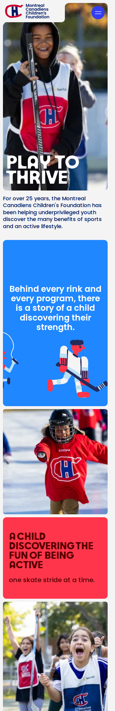

# UI Design System & Master Generation Blueprint: fondation-canadiens-com

> **Montreal Canadiens Children's Foundation - Play to thrive** (https://fondation.canadiens.com/) — The Foundation encourages physical activity and the adoption of a healthy lifestyle among underprivileged youth from 4 to 17 years old.


---

## 1. Executive Visual Persona & Design Archetype

- **Brand Essence & Persona**: **Montreal Canadiens Children's Foundation - Play to thrive** (`https://fondation.canadiens.com/`). The Foundation encourages physical activity and the adoption of a healthy lifestyle among underprivileged youth from 4 to 17 years old.
- **Capture Provenance**: Live browser capture (`tier1_fast`, HTTP `200`, captured `2026-11-23`).
- **Visual Archetype**: **Light-Gallery WebGL / Canvas Interactive Experience (`#f4f4f4` / `#0000ff`)**.
- **Anti-AI-Slop Differentiators**:
  - **Live-Computed Chromatic Polarity**: Anchors the viewport in `#f4f4f4` (live computed `body` `background-color` (`computed_styles.json`)) paired with `#001a66` primary typography and `#0000ff` accents.
  - **Grounded Typographic Hierarchy**: Pairs `bauhausvole` for display copy (`PLAY TO THRIVE`) with `Poppins` and `SFMono-Regular`.
  - **Calibrated Spatial Grid & Motion**: Combines `96rem` container bounds (`gap: var(--spacing-margin)`, padding `10px`) with `cubic-bezier(.32,0,.67,0)` easing and Lenis Smooth Scroll (`data-lenis`), Three.js / WebGL Canvas Pipeline.

---

## 2. Spatial Architecture & Modular Grid Mathematics



### Viewport Allocation & Container Geometry
- **Captured Viewport Dimensions**: Desktop `1440×2400px` (`assets/desktop.png`, clamped at 2400px live multi-section capture), Mobile `390×2400px` (`assets/mobile.png`, clamped at 2400px live multi-section capture).
- **Master Container Bounds**: `96rem` (non-`@media` desktop container stylesheet rule).
- **Canvas Lateral Padding & Spacing**: `10px` lateral canvas padding with `var(--spacing-margin)` grid gap.
- **Border Radius Scale**: `0px 0px 13.5px`, `var(--radius-md)`, `var(--radius-sm)`, `.25rem`.

### Responsive Breakpoint Architecture
- **Desktop Layout**: Multi-column CSS Grid / Flexbox layout at `1440px` (`max-width: 96rem`, `gap: var(--spacing-margin)`).
- **Mobile Layout**: Single-column vertical stack at `390px` viewport width with `10px` horizontal padding.
- **Extracted CSS Media Queries**: `@media (min-width:64rem)`, `@media not all and (max-width:64rem)`, `@media (min-width:40rem)`, `@media (min-width:48rem)`.

---

## 3. Color System, Materiality & Atmospheric Lighting

### Semantic Palette & Source Grounding
| Semantic Role | Ground-Truth Value | Extracted Live / CSS Source |
|---|---|---|
| **Primary Canvas Substrate** | `#f4f4f4` | live computed `body` `background-color` (`computed_styles.json`) |
| **Primary Typography Ink** | `#001a66` | live computed `main` `color` (`computed_styles.json`) |
| **Elevated Surface / Card Substrate** | `#ffffff` | `.bg-white { background-color: white }` (`#ffffff`) |
| **Interactive Accent / Highlight** | `#0000ff` | `.prose-column .pill-btn:hover { background-color: blue }` (`#0000ff`) |
| **Secondary / Muted Copy** | `#ffffff` | live computed `h1` `color` (`computed_styles.json`) |
| **Structural Hairline Border** | `#c3c3c3` | `.loader { border-color: #c3c3c3 }` |

### Sanitized Root CSS Variables (`ui-ux.md` Ground Truth)
| Variable Name | Extracted Value | Semantic Role |
|---|---|---|
| `--font-sans` | `"Poppins",sans-serif` | Typography / Scale Token |
| `--color-red-50` | `oklch(97.1% .013 17.38)` | Brand / Palette Token |
| `--color-red-500` | `oklch(63.7% .237 25.331)` | Brand / Palette Token |
| `--color-red-800` | `oklch(44.4% .177 26.899)` | Brand / Palette Token |
| `--color-amber-500` | `oklch(76.9% .188 70.08)` | Brand / Palette Token |
| `--color-yellow-500` | `oklch(79.5% .184 86.047)` | Brand / Palette Token |
| `--color-green-500` | `oklch(72.3% .219 149.579)` | Brand / Palette Token |
| `--color-blue-500` | `oklch(62.3% .214 259.815)` | Brand / Palette Token |
| `--color-blue-600` | `oklch(54.6% .245 262.881)` | Brand / Palette Token |
| `--color-purple-500` | `oklch(62.7% .265 303.9)` | Brand / Palette Token |
| `--color-gray-50` | `oklch(98.5% .002 247.839)` | Brand / Palette Token |
| `--color-gray-100` | `oklch(96.7% .003 264.542)` | Brand / Palette Token |
| `--color-gray-200` | `oklch(92.8% .006 264.531)` | Brand / Palette Token |
| `--color-gray-300` | `oklch(87.2% .01 258.338)` | Brand / Palette Token |
| `--color-gray-400` | `oklch(70.7% .022 261.325)` | Brand / Palette Token |
| `--color-gray-600` | `oklch(44.6% .03 256.802)` | Brand / Palette Token |

---

## 4. Typographic Scale & Editorial Hierarchy

### Font Family Stacks
- **Display Typography**: `bauhausvole`.
- **Primary Body Stack**: `Poppins`.
- **Technical / Metadata Stack**: `SFMono-Regular`.

### Typographic Scale & Rules (Live Computed & Stylesheet Grounded)
- **Hero Display (`H1`)**: live computed `h1` (`font-size: 172.8px`, `line-height: 146.88px`, `font-weight: 600`, `letter-spacing: -5.184px`); CSS variables `--text-h1: calc(var(--font-size-h1)/var(--rem)*1rem)`, `--text-h1--line-height: .85`, `--text-h1--letter-spacing: -.03em`; rule `h1` (`font-size: var(--text-h1)`, `line-height: var(--tw-leading,var(...`, `letter-spacing: var(--tw-tracking,var...`, `font-weight: var(--font-we...`).
- **Section Heading (`H2`)**: live computed `h2` (`font-size: 50px`, `line-height: 57.5px`, `font-weight: 600`); CSS variables `--text-2xl: 1.5rem`, `--text-2xl--line-height: calc(2/1.5)`, `--text-h2: calc(var(--font-size-h2)/var(--rem)*1rem)`; rule `h2` (`font-size: var(--text-h4)`, `line-height: var(--tw-leading,var(...`, `font-weight: var(--font-we...`).
- **Body Copy**: live computed `body` (`font-size: 18px`, `line-height: 25.2px`, `font-weight: 500`); CSS variables `--text-body: 1rem`, `--text-body--line-height: 1.4`, `--font-size-body: 16`.
- **Metadata & Navigation Labels**: live computed `nav/a` (`font-size: 18px`, `line-height: 25.2px`, `font-weight: 500`); CSS variables `--text-sm: .875rem`, `--text-sm--line-height: calc(1.25/.875)`, `--default-mono-font-family: var(--font-mono)`.

---

## 5. Choreographed Motion & Interaction Physics

### Primary Easing Curves
- **Extracted Timing Functions**: `cubic-bezier(.32,0,.67,0)`, `cubic-bezier(.33,1,.68,1)`, `cubic-bezier(.65,0,.35,1)`.

### Per-Element Transition & Choreography Rules
- **Selector `layer theme`**: `transition: var(--speed-normal)` extracted from `fondation-canadiens-com` stylesheet.
- **Selector `.lenis.lenis-autoToggle`**: `transition: 1ms` extracted from `fondation-canadiens-com` stylesheet.
- **Selector `swiper-pagination .swiper-paginat...`**: `transition: var(--tw-ease,var(--default-transition-timing-function))` extracted from `fondation-canadiens-com` stylesheet.
- **Extracted Easing Curve (`cubic-bezier(.32,0,.67,0)`)**: Governs interactive state transitions across `<header.left-0>` and `<article.space-y-gutter>`.
- **Runtime Interaction Engine**: Integrates Lenis Smooth Scroll (`data-lenis`), Three.js / WebGL Canvas Pipeline, Swiper Touch Carousel Engine, Lottie Vector Animation Player with `prefers-reduced-motion: reduce` fallback guards.

---

## 6. Component Wireframe & Structural DOM Map

### Visual Layout Schematic — Desktop (`1440px`, Grounded in `dom.html` & Landmark Bounding Boxes)
```
┌────────────────────────────────────────────────────────────────────────┐
│ DESKTOP VIEWPORT (1440px) — Montreal Canadiens Children's Foundation - │
│ ====================================================================== │
│ [ <header.left-0> (1425x110px)        | Overview · Index · Archive · ] │
│ ---------------------------------------------------------------------- │
│ | HERO STAGE: <article.pt-margin> (w=1425px)                         | │
│ | H1: PLAY TO THRIVE                                                 | │
│ | Substrate: #f4f4f4 | Ink: #001a66 | Accent: #0000ff                | │
│ ---------------------------------------------------------------------- │
│ | SHOWCASE GRID (<article.space-y-gutter>) max-w: 96rem              | │
│ | +------------------------------+  +------------------------------+ | │
│ | | P l a y t o t h r i v e      |  | News & Stories               | | │
│ | +------------------------------+  +------------------------------+ | │
│ ---------------------------------------------------------------------- │
│ | DETAIL MODULE (<article.bg-gray-light>) — A child discovering t    | │
│ ---------------------------------------------------------------------- │
│ [ FOOTER (<footer.px-margin>  ) | https://fondation.canadiens.com/     │
└────────────────────────────────────────────────────────────────────────┘
```

### Visual Layout Schematic — Mobile Reflow (`390px`)
```
┌────────────────────────────────────────────────────────────────────────┐
│ MOBILE VIEWPORT REFLOW (390px) — Single-Column Stack (gap: var(--sp)   │
│ ====================================================================== │
│ [ HEADER BAR (<header.left-0>         ) | Compact Menu (390px)         │
│ ---------------------------------------------------------------------- │
│ | HERO STAGE (<article.pt-margin>) — 390px Vertical Lead             | │
│ | H1: PLAY TO THRIVE                                                 | │
│ ---------------------------------------------------------------------- │
│ | SHOWCASE STACK (<article.space-y-gutte) — 1-Col Stack              | │
│ | [ Item 1: P l a y t o t h r i v e                                ] | │
│ | [ Item 2: News & Stories                                         ] | │
│ ---------------------------------------------------------------------- │
│ | DETAIL STACK (<article.bg-gray-light>) — 1-Col (A child discoverin)  │
│ ---------------------------------------------------------------------- │
│ [ FOOTER (<footer.px-margin>  ) | Stacked 390px Colophon               │
└────────────────────────────────────────────────────────────────────────┘
```

### Granular DOM Region Breakdown
1. **Brand Header & Navigation Bar (<header.left-0> — `fondation-canadiens-com`)**:
   - Landmark `<header class="left-0 top-0">` (`1425x110px`) hosting `Montreal Canadiens Children's Founda` navigation (`Overview · Index · Archive · About · Contact`), DOM attributes (`data-sveltekit-preload-data="hover"`, `data-svg-origin="464 490"`, `data-svg-origin="857.5 300.5"`, `data-flip-id="auto-2"`), and stylesheet rule `backdrop { box-sizing:border-box;border:0 solid;margin:0;padding:0 }`.
2. **Hero Stage & Focal Lead (<article.pt-margin> — `PLAY TO THRIVE`)**:
   - Landmark `<article class="pt-margin space-y-gutter">` presenting display lead `PLAY TO THRIVE` and copy excerpt *"For over 25 years, the Montreal Canadiens Children's Foundation h"* over `#f4f4f4` canvas and `#001a66` ink.
3. **Primary Showcase & Content Grid (<article.space-y-gutter> — `P l a y t o t h r i v e`)**:
   - Landmark `<article class="pt-margin space-y-gutter">` rendering section `P l a y t o t h r i v e` with copy *"Behind every rink and every program, there is a story of a child "*, asset references (`fonts.googleapis.com`, `fonts.gstatic.com`, `css2`, `favicon-96x96.png`), and grid rule `file-selector-button { box-sizing:border-box;border:0 solid;margin:0;padding:0 }`.
4. **Interactive Detail & Feature Matrix (<article.bg-gray-light> — `News & Stories`)**:
   - Landmark `<article class="pt-margin space-y-gutter">` framing `News & Stories` and `A child discovering the fun of being active` (*"A child discovering the fun of being active"*) with `#ffffff` surface cards, `#0000ff` accents, and `strong { font-weight:bolder }`.
5. **Colophon & Global Directory Footer (<footer.px-margin> — `https://fondation.canadiens.com/`)**:
   - Landmark `<footer class="px-margin pb-30">` anchoring `Montreal Canadiens Children's Fo` footer links (`Overview · Index · Archive · About · Contact`), copy *"one skate stride at a time."*, and `#c3c3c3` structural dividers.

---

## 7. Master Zero-Shot AI Generation Prompt

```markdown
# Master Zero-Shot Frontend Generation Prompt: fondation-canadiens-com (Montreal Canadiens Children's Foundation - Play to thrive)

You are a principal frontend architect and design systems engineer. Build a complete, production-ready web application replicating the exact design system, DOM landmarks, typographic hierarchy, color tokens, and motion physics of `fondation-canadiens-com` (**Montreal Canadiens Children's Foundation - Play to thrive** — `https://fondation.canadiens.com/`).

### 1. Visual Archetype & Anti-AI-Slop Mandates
- **Archetype**: Light-Gallery WebGL / Canvas Interactive Experience (`#f4f4f4` / `#0000ff`).
- **Identity & Domain Context**: The Foundation encourages physical activity and the adoption of a healthy lifestyle among underprivileged youth from 4 to 17 years old.
- **Primary Substrate**: `#f4f4f4` (live computed `body` `background-color` (`computed_styles.json`)), **Primary Ink**: `#001a66`, **Accent / Highlight**: `#0000ff`.
- **Site-Specific Differentiators**:
  - **Live-Computed Chromatic Polarity**: Anchors the viewport in `#f4f4f4` (live computed `body` `background-color` (`computed_styles.json`)) paired with `#001a66` primary typography and `#0000ff` accents.
  - **Grounded Typographic Hierarchy**: Pairs `bauhausvole` for display copy (`PLAY TO THRIVE`) with `Poppins` and `SFMono-Regular`.
  - **Calibrated Spatial Grid & Motion**: Combines `96rem` container bounds (`gap: var(--spacing-margin)`, padding `10px`) with `cubic-bezier(.32,0,.67,0)` easing and Lenis Smooth Scroll (`data-lenis`), Three.js / WebGL Canvas Pipeline.

### 2. Ground-Truth CSS Variables (`:root` Token Contract)
Declare and consume these exact custom properties extracted from `fondation-canadiens-com` in your global stylesheet:

:root {
  /* Montreal Canadiens Children's Foundation - Play to thrive (fondation-canadiens-com) — Live-Grounded CSS Variables */
  --font-sans: "Poppins",sans-serif; /* Typography / Scale Token (fondation-canadiens-com) */
  --color-red-50: oklch(97.1% .013 17.38); /* Brand / Palette Token (fondation-canadiens-com) */
  --color-red-500: oklch(63.7% .237 25.331); /* Brand / Palette Token (fondation-canadiens-com) */
  --color-red-800: oklch(44.4% .177 26.899); /* Brand / Palette Token (fondation-canadiens-com) */
  --color-amber-500: oklch(76.9% .188 70.08); /* Brand / Palette Token (fondation-canadiens-com) */
  --color-yellow-500: oklch(79.5% .184 86.047); /* Brand / Palette Token (fondation-canadiens-com) */
  --color-green-500: oklch(72.3% .219 149.579); /* Brand / Palette Token (fondation-canadiens-com) */
  --color-blue-500: oklch(62.3% .214 259.815); /* Brand / Palette Token (fondation-canadiens-com) */
  --color-blue-600: oklch(54.6% .245 262.881); /* Brand / Palette Token (fondation-canadiens-com) */
  --color-purple-500: oklch(62.7% .265 303.9); /* Brand / Palette Token (fondation-canadiens-com) */
  --color-gray-50: oklch(98.5% .002 247.839); /* Brand / Palette Token (fondation-canadiens-com) */
  --color-gray-100: oklch(96.7% .003 264.542); /* Brand / Palette Token (fondation-canadiens-com) */
  --color-gray-200: oklch(92.8% .006 264.531); /* Brand / Palette Token (fondation-canadiens-com) */
  --color-gray-300: oklch(87.2% .01 258.338); /* Brand / Palette Token (fondation-canadiens-com) */
  --color-gray-400: oklch(70.7% .022 261.325); /* Brand / Palette Token (fondation-canadiens-com) */
  --color-gray-600: oklch(44.6% .03 256.802); /* Brand / Palette Token (fondation-canadiens-com) */
}

### 3. Semantic Color & Materiality Contract
Map every surface, ink, and border strictly to these source-grounded tokens:
- **Primary Canvas Substrate**: `#f4f4f4` — grounded in live computed `body` `background-color` (`computed_styles.json`)
- **Primary Typography Ink**: `#001a66` — grounded in live computed `main` `color` (`computed_styles.json`)
- **Elevated Surface / Card Substrate**: `#ffffff` — grounded in `.bg-white { background-color: white }` (`#ffffff`)
- **Interactive Accent / Highlight**: `#0000ff` — grounded in `.prose-column .pill-btn:hover { background-color: blue }` (`#0000ff`)
- **Secondary / Muted Copy**: `#ffffff` — grounded in live computed `h1` `color` (`computed_styles.json`)
- **Structural Hairline Border**: `#c3c3c3` — grounded in `.loader { border-color: #c3c3c3 }`

### 4. Spatial Grid, Container Bounds & Responsive Breakpoints
- **Desktop Viewport Reference**: `1440×2400px` (clamped at 2400px live multi-section capture, `1440px` standard desktop width).
- **Mobile Viewport Reference**: `390×2400px` (clamped at 2400px live multi-section capture, `390px` standard mobile width).
- **Container Max-Width**: `96rem` (non-`@media` desktop container stylesheet rule)
- **Padding & Gutters**: `10px` lateral canvas padding with `var(--spacing-margin)` grid gap
- **Desktop Grid**: Multi-column CSS Grid / Flexbox layout at `1440px` (`max-width: 96rem`, `gap: var(--spacing-margin)`)
- **Mobile Adaptation**: Single-column vertical stack at `390px` viewport width with `10px` horizontal padding
- **Media Queries**: `@media (min-width:64rem)`, `@media not all and (max-width:64rem)`, `@media (min-width:40rem)`, `@media (min-width:48rem)`
- **Corner Radii**: `0px 0px 13.5px`, `var(--radius-md)`, `var(--radius-sm)`, `.25rem`

### 5. Typography & Editorial Scale Contract
- **Display Font Stack**: `bauhausvole`
- **Body Font Stack**: `Poppins`
- **Monospace / Technical Font Stack**: `SFMono-Regular`
- **H1 Display Rule**: live computed `h1` (`font-size: 172.8px`, `line-height: 146.88px`, `font-weight: 600`, `letter-spacing: -5.184px`); CSS variables `--text-h1: calc(var(--font-size-h1)/var(--rem)*1rem)`, `--text-h1--line-height: .85`, `--text-h1--letter-spacing: -.03em`; rule `h1` (`font-size: var(--text-h1)`, `line-height: var(--tw-leading,var(...`, `letter-spacing: var(--tw-tracking,var...`, `font-weight: var(--font-we...`)
- **H2 Section Rule**: live computed `h2` (`font-size: 50px`, `line-height: 57.5px`, `font-weight: 600`); CSS variables `--text-2xl: 1.5rem`, `--text-2xl--line-height: calc(2/1.5)`, `--text-h2: calc(var(--font-size-h2)/var(--rem)*1rem)`; rule `h2` (`font-size: var(--text-h4)`, `line-height: var(--tw-leading,var(...`, `font-weight: var(--font-we...`)
- **Body Copy Rule**: live computed `body` (`font-size: 18px`, `line-height: 25.2px`, `font-weight: 500`); CSS variables `--text-body: 1rem`, `--text-body--line-height: 1.4`, `--font-size-body: 16`
- **Metadata & Index Rule**: live computed `nav/a` (`font-size: 18px`, `line-height: 25.2px`, `font-weight: 500`); CSS variables `--text-sm: .875rem`, `--text-sm--line-height: calc(1.25/.875)`, `--default-mono-font-family: var(--font-mono)`

### 6. Component Hierarchy, Verbatim Copy & Real DOM Landmarks
Scaffold `fondation-canadiens-com` (`Montreal Canadiens Children's Foundation - Play to thrive`) with these exact structural regions, extracted copy, and CSS rules from `dom.html`:
1. **Brand Header & Navigation Bar (<header.left-0> — `fondation-canadiens-com`)**:
   - DOM & Selectors: Landmark `<header class="left-0 top-0">` (`1425x110px`) hosting `Montreal Canadiens Children's Founda` navigation (`Overview · Index · Archive · About · Contact`), DOM attributes (`data-sveltekit-preload-data="hover"`, `data-svg-origin="464 490"`, `data-svg-origin="857.5 300.5"`, `data-flip-id="auto-2"`), and stylesheet rule `backdrop { box-sizing:border-box;border:0 solid;margin:0;padding:0 }`.
   - Responsive Contract: Header `Brand Header & Navigation Bar (<header.left-0> — `fondation-canadiens-com`)` (`fondation-canadiens-com`) adapts across `@media (min-width:64rem)`, `@media not all and (max-width:64rem)`, `@media (min-width:40rem)`, `@media (min-width:48rem)` with `cubic-bezier(.32,0,.67,0)`, `cubic-bezier(.33,1,.68,1)`, `cubic-bezier(.65,0,.35,1)` transitions and links `Overview · Index · Archive · About · Contact`.
2. **Hero Stage & Focal Lead (<article.pt-margin> — `PLAY TO THRIVE`)**:
   - DOM & Selectors: Landmark `<article class="pt-margin space-y-gutter">` presenting display lead `PLAY TO THRIVE` and copy excerpt *"For over 25 years, the Montreal Canadiens Children's Foundation h"* over `#f4f4f4` canvas and `#001a66` ink.
   - Responsive Contract: Hero stage (`1440×2400px` desktop / `390×2400px` mobile) sets `#f4f4f4` background with `#001a66` headline `PLAY TO THRIVE`.
3. **Primary Showcase & Content Grid (<article.space-y-gutter> — `P l a y t o t h r i v e`)**:
   - DOM & Selectors: Landmark `<article class="pt-margin space-y-gutter">` rendering section `P l a y t o t h r i v e` with copy *"Behind every rink and every program, there is a story of a child "*, asset references (`fonts.googleapis.com`, `fonts.gstatic.com`, `css2`, `favicon-96x96.png`), and grid rule `file-selector-button { box-sizing:border-box;border:0 solid;margin:0;padding:0 }`.
   - Responsive Contract: Showcase grid `Primary Showcase & Content Grid (<article.space-y-gutter> — `P l a y t o t h r i v e`)` applies Multi-column CSS Grid / Flexbox layout at `1440px` (`max-width: 96rem`, `gap: var(--spacing-margin)`) on desktop and Single-column vertical stack at `390px` viewport width with `10px` horizontal padding on mobile.
4. **Interactive Detail & Feature Matrix (<article.bg-gray-light> — `News & Stories`)**:
   - DOM & Selectors: Landmark `<article class="pt-margin space-y-gutter">` framing `News & Stories` and `A child discovering the fun of being active` (*"A child discovering the fun of being active"*) with `#ffffff` surface cards, `#0000ff` accents, and `strong { font-weight:bolder }`.
   - Responsive Contract: Detail module `Interactive Detail & Feature Matrix (<article.bg-gray-light> — `News & Stories`)` uses `0px 0px 13.5px`, `var(--radius-md)`, `var(--radius-sm)`, `.25rem` radii, `#0000ff` highlights, and assets (fonts.googleapis.com, fonts.gstatic.com, css2).
5. **Colophon & Global Directory Footer (<footer.px-margin> — `https://fondation.canadiens.com/`)**:
   - DOM & Selectors: Landmark `<footer class="px-margin pb-30">` anchoring `Montreal Canadiens Children's Fo` footer links (`Overview · Index · Archive · About · Contact`), copy *"one skate stride at a time."*, and `#c3c3c3` structural dividers.
   - Responsive Contract: Footer `Colophon & Global Directory Footer (<footer.px-margin> — `https://fondation.canadiens.com/`)` aligns to `96rem` (non-`@media` desktop container stylesheet rule) with `10px` lateral canvas padding with `var(--spacing-margin)` grid gap and attributes (data-sveltekit-preload-data="hover", data-svg-origin="464 490", data-svg-origin="857.5 300.5").

#### Verbatim DOM Copy Excerpts (`dom.html`)
- Copy Excerpt 1: *"For over 25 years, the Montreal Canadiens Children's Foundation has been helping u..."*
- Copy Excerpt 2: *"Behind every rink and every program, there is a story of a child discovering their..."*
- Copy Excerpt 3: *"A child discovering the fun of being active"*
- Copy Excerpt 4: *"one skate stride at a time."*

### 7. Motion, Extracted Stylesheet Rules & Interaction Choreography
- **Primary Easing Functions**: `cubic-bezier(.32,0,.67,0)`, `cubic-bezier(.33,1,.68,1)`, `cubic-bezier(.65,0,.35,1)`
- **Extracted Stylesheet Rules (`fondation-canadiens-com`)**:
- `backdrop { box-sizing:border-box;border:0 solid;margin:0;padding:0 }`
- `file-selector-button { box-sizing:border-box;border:0 solid;margin:0;padding:0 }`
- `strong { font-weight:bolder }`
- `small { font-size:80% }`
- `sup { vertical-align:baseline;font-size:75%;line-height:0;position:relative }`
- **Per-Selector Transition Rules**:
- **Selector `layer theme`**: `transition: var(--speed-normal)` extracted from `fondation-canadiens-com` stylesheet.
- **Selector `.lenis.lenis-autoToggle`**: `transition: 1ms` extracted from `fondation-canadiens-com` stylesheet.
- **Selector `swiper-pagination .swiper-paginat...`**: `transition: var(--tw-ease,var(--default-transition-timing-function))` extracted from `fondation-canadiens-com` stylesheet.
- **Extracted Easing Curve (`cubic-bezier(.32,0,.67,0)`)**: Governs interactive state transitions across `<header.left-0>` and `<article.space-y-gutter>`.
- **Runtime Interaction Engine**: Integrates Lenis Smooth Scroll (`data-lenis`), Three.js / WebGL Canvas Pipeline, Swiper Touch Carousel Engine, Lottie Vector Animation Player with `prefers-reduced-motion: reduce` fallback guards.

### 8. Technical Deliverables
- Implement in Next.js (App Router) with TypeScript and Tailwind CSS consuming the `:root` custom properties defined above for `fondation-canadiens-com`.
- Reproduce both the `1440px` desktop architecture and `390px` mobile breakpoint transitions, preserving semantic HTML5 landmarks (`<header>`, `<nav>`, `<main>`, `<section>`, `<footer>`) and `prefers-reduced-motion` accessibility guards.
```
