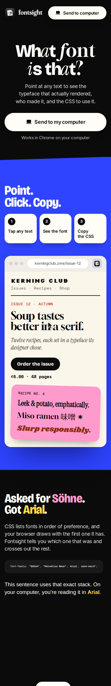

# UI Design System & Master Generation Blueprint: fontsight-xyz

> **Fontsight: What Font Is That? Font Finder for Chrome** (https://fontsight.xyz/) — What font is that? Point at any text to see the typeface that actually rendered, who made it, and the CSS to use it. A free font finder f...


---

## 1. Executive Visual Persona & Design Archetype

- **Brand Essence & Persona**: **Fontsight: What Font Is That? Font Finder for Chrome** (`https://fontsight.xyz/`). What font is that? Point at any text to see the typeface that actually rendered, who made it, and the CSS to use it. A free font finder f...
- **Capture Provenance**: Live browser capture (`tier1_fast`, HTTP `200`, captured `2026-11-23`).
- **Visual Archetype**: **Light-Gallery WebGL / Canvas Interactive Experience (`#ffd84a` / `#ffff00`)**.
- **Anti-AI-Slop Differentiators**:
  - **Live-Computed Chromatic Polarity**: Anchors the viewport in `#ffd84a` (live computed `body` `background-color` (`computed_styles.json`)) paired with `#0b0b0c` primary typography and `#ffff00` accents.
  - **Grounded Typographic Hierarchy**: Pairs `Inter` for display copy (`What font is that? W h a t f o n t i`) with `Inter` and `Geist Mono`.
  - **Calibrated Spatial Grid & Motion**: Combines `1440px` container bounds (`gap: 20px`, padding `44px`) with `cubic-bezier(.2,.8,.2,1)` easing and Three.js / WebGL Canvas Pipeline.

---

## 2. Spatial Architecture & Modular Grid Mathematics



### Viewport Allocation & Container Geometry
- **Captured Viewport Dimensions**: Desktop `1440×2400px` (`assets/desktop.png`, clamped at 2400px live multi-section capture), Mobile `390×2400px` (`assets/mobile.png`, clamped at 2400px live multi-section capture).
- **Master Container Bounds**: `1440px` (full-bleed `100%` desktop stage measured on `1440px` viewport).
- **Canvas Lateral Padding & Spacing**: `44px` lateral canvas padding with `20px` grid gap.
- **Border Radius Scale**: `999px`, `8px`, `7px`, `18px`.

### Responsive Breakpoint Architecture
- **Desktop Layout**: Multi-column CSS Grid / Flexbox layout at `1440px` (`max-width: 1440px`, `gap: 20px`).
- **Mobile Layout**: Single-column vertical stack at `390px` viewport width with `44px` horizontal padding.
- **Extracted CSS Media Queries**: `@media (width>=900px)`, `@media (width<=1100px)`, `@media (width<=760px)`, `@media (width<=820px)`.

---

## 3. Color System, Materiality & Atmospheric Lighting

### Semantic Palette & Source Grounding
| Semantic Role | Ground-Truth Value | Extracted Live / CSS Source |
|---|---|---|
| **Primary Canvas Substrate** | `#ffd84a` | live computed `body` `background-color` (`computed_styles.json`) |
| **Primary Typography Ink** | `#0b0b0c` | live computed `body` `color` (`computed_styles.json`) |
| **Elevated Surface / Card Substrate** | `#fffdf6` | live computed `button` `background-color` (`computed_styles.json`) |
| **Interactive Accent / Highlight** | `#ffff00` | `.btn .tagline { background: yellow }` (`#ffff00`) |
| **Secondary / Muted Copy** | `#ff9acd` | `var(--pink)` in `:root` |
| **Structural Hairline Border** | `#fedb5b` | `var(--card-line)` in `:root` (`f4f4f11a`) |
| **Variable Token (`--blue`)** | `#2e44ff` | `var(--blue)` in `:root` |
| **Variable Token (`--tomato`)** | `#ff5a36` | `var(--tomato)` in `:root` |
| **Variable Token (`--card`)** | `#1c1c1b` | `var(--card)` in `:root` |
| **Variable Token (`--card-well`)** | `#262625` | `var(--card-well)` in `:root` |
| **Variable Token (`--card-row`)** | `#2b2b2a` | `var(--card-row)` in `:root` |
| **Variable Token (`--card-line`)** | `#f4f4f1` | `var(--card-line)` in `:root` |
| **Variable Token (`--card-soft`)** | `#9b9a94` | `var(--card-soft)` in `:root` |
| **Variable Token (`--warn`)** | `#f2b544` | `var(--warn)` in `:root` |
| **Variable Token (`--go`)** | `#5be38a` | `var(--go)` in `:root` |

### Sanitized Root CSS Variables (`ui-ux.md` Ground Truth)
| Variable Name | Extracted Value | Semantic Role |
|---|---|---|
| `--yellow` | `#ffd84a` | Color / Atmospheric Token |
| `--blue` | `#2e44ff` | Color / Atmospheric Token |
| `--pink` | `#ff9acd` | Typography Ink Token |
| `--tomato` | `#ff5a36` | Color / Atmospheric Token |
| `--ink` | `#0b0b0c` | Typography Ink Token |
| `--paper` | `#fffdf6` | Canvas / Surface Token |
| `--ink-2` | `#0b0b0cad` | Typography Ink Token |
| `--paper-2` | `#fffdf6db` | Canvas / Surface Token |
| `--card` | `#1c1c1b` | Color / Atmospheric Token |
| `--card-well` | `#262625` | Color / Atmospheric Token |
| `--card-row` | `#2b2b2a` | Color / Atmospheric Token |
| `--card-line` | `#f4f4f11a` | Color / Atmospheric Token |
| `--card-ink` | `#f4f4f1` | Typography Ink Token |
| `--card-soft` | `#9b9a94` | Color / Atmospheric Token |
| `--warn` | `#f2b544` | Color / Atmospheric Token |
| `--go` | `#5be38a` | Color / Atmospheric Token |

---

## 4. Typographic Scale & Editorial Hierarchy

### Font Family Stacks
- **Display Typography**: `Inter`.
- **Primary Body Stack**: `Inter`.
- **Technical / Metadata Stack**: `Geist Mono`.

### Typographic Scale & Rules (Live Computed & Stylesheet Grounded)
- **Hero Display (`H1`)**: live computed `h1` (`font-size: 164.16px`, `line-height: 164.16px`, `font-weight: 400`); CSS variables `--display: "Bricolage Grotesque", "Inter", system-ui, sans-serif`.
- **Section Heading (`H2`)**: live computed `h2` (`font-size: 109.44px`, `line-height: 98.496px`, `font-weight: 800`, `letter-spacing: -1.6416px`); rule `.h2` (`font-size: clamp(44px,6.4vw,104px)`).
- **Body Copy**: live computed `body` (`font-size: 17px`, `line-height: 25.5px`, `font-weight: 400`); rule `p` (`font-size: 15.5px`, `line-height: 1.5`).
- **Metadata & Navigation Labels**: live computed `nav/a` (`font-size: 17px`, `line-height: 25.5px`, `font-weight: 400`); CSS variables `--mono: "Geist Mono", ui-monospace, "SF Mono", Menlo, monospace`; rule `small` (`letter-spacing: normal`).

---

## 5. Choreographed Motion & Interaction Physics

### Primary Easing Curves
- **Extracted Timing Functions**: `cubic-bezier(.2,.8,.2,1)`, `cubic-bezier(.34,1.56,.64,1)`.

### Per-Element Transition & Choreography Rules
- **Selector `.btn`**: `transition: transform .4s var(--spring), box-shadow .4s var(--ease)` extracted from `fontsight-xyz` stylesheet.
- **Selector `.nav-links .nav-page`**: `transition: transform .35s var(--spring), background .2s` extracted from `fontsight-xyz` stylesheet.
- **Selector `.shuffle`**: `transition: opacity .6s var(--ease), transform .8s var(--ease)` extracted from `fontsight-xyz` stylesheet.
- **Extracted Easing Curve (`cubic-bezier(.2,.8,.2,1)`)**: Governs interactive state transitions across `<header.nav>` and `<section.demo>`.
- **Runtime Interaction Engine**: Integrates Three.js / WebGL Canvas Pipeline with `prefers-reduced-motion: reduce` fallback guards.

---

## 6. Component Wireframe & Structural DOM Map

### Visual Layout Schematic — Desktop (`1440px`, Grounded in `dom.html` & Landmark Bounding Boxes)
```
┌────────────────────────────────────────────────────────────────────────┐
│ DESKTOP VIEWPORT (1440px) — Fontsight: What Font Is That? Font Finder  │
│ ====================================================================== │
│ [ <header.nav> (1360x90px)            | How it works · Fallbacks · T ] │
│ ---------------------------------------------------------------------- │
│ | HERO STAGE: <section.hero> (w=1440px)                              | │
│ | H1: What font is that? W h a t f o n t i s t h a t ?               | │
│ | Substrate: #ffd84a | Ink: #0b0b0c | Accent: #ffff00                | │
│ ---------------------------------------------------------------------- │
│ | SHOWCASE GRID (<section.demo>) max-w: 1440px                       | │
│ | +------------------------------+  +------------------------------+ | │
│ | | Point at any text to see the |  | Add to Chrome Brave          | | │
│ | +------------------------------+  +------------------------------+ | │
│ ---------------------------------------------------------------------- │
│ | DETAIL MODULE (<section.fallback>) — What font is that?            | │
│ ---------------------------------------------------------------------- │
│ [ FOOTER (<footer.footer>     ) | https://fontsight.xyz/               │
└────────────────────────────────────────────────────────────────────────┘
```

### Visual Layout Schematic — Mobile Reflow (`390px`)
```
┌────────────────────────────────────────────────────────────────────────┐
│ MOBILE VIEWPORT REFLOW (390px) — Single-Column Stack (gap: 20px)       │
│ ====================================================================== │
│ [ HEADER BAR (<header.nav>            ) | Compact Menu (390px)         │
│ ---------------------------------------------------------------------- │
│ | HERO STAGE (<section.hero>) — 390px Vertical Lead                  | │
│ | H1: What font is that? W h a t f o n t i s t h a t ?               | │
│ ---------------------------------------------------------------------- │
│ | SHOWCASE STACK (<section.demo>) — 1-Col Stack                      | │
│ | [ Item 1: Point at any text to see the typeface that actua       ] | │
│ | [ Item 2: Add to Chrome Brave                                    ] | │
│ ---------------------------------------------------------------------- │
│ | DETAIL STACK (<section.fallback>) — 1-Col (What font is that?)     | │
│ ---------------------------------------------------------------------- │
│ [ FOOTER (<footer.footer>     ) | Stacked 390px Colophon               │
└────────────────────────────────────────────────────────────────────────┘
```

### Granular DOM Region Breakdown
1. **Brand Header & Navigation Bar (<header.nav> — `fontsight-xyz`)**:
   - Landmark `<header class="nav wrap">` (`1360x90px`) hosting `Fontsight: What Font Is That? Font F` navigation (`How it works · Fallbacks · Try on · Test drive · Foundries`), DOM attributes (`data-browser="chrome"`, `data-site="GQEJOPOH"`, `data-noinspect`, `data-store`), and stylesheet rule `img { max-width:100% }`.
2. **Hero Stage & Focal Lead (<section.hero> — `What font is that? W h a t f o n t`)**:
   - Landmark `<section class="hero">` presenting display lead `What font is that? W h a t f o n t i s t h a t ?` and copy excerpt *"Point at any text to see the typeface that actually rendered, who"* over `#ffd84a` canvas and `#0b0b0c` ink.
3. **Primary Showcase & Content Grid (<section.demo> — `Point at any text to see the typef`)**:
   - Landmark `<section class="demo">` rendering section `Point at any text to see the typeface that actua` with copy *"Add to Chrome Brave"*, asset references (`bricolage-grotesque-latin-standar...`, `inter-latin-opsz-normal.BwkfbSeq....`, `favicon.ico`, `favicon.svg`), and grid rule `html { scroll-behavior:smooth;background:var(--ink);overscroll-behavior-y:none }`.
4. **Interactive Detail & Feature Matrix (<section.fallback> — `Add to Chrome Brave`)**:
   - Landmark `<section class="fallback">` framing `Add to Chrome Brave` and `What font is that?` (*"What font is that?"*) with `#fffdf6` surface cards, `#ffff00` accents, and `selection { background:var(--ink);color:var(--yellow) }`.
5. **Colophon & Global Directory Footer (<footer.footer> — `https://fontsight.xyz/`)**:
   - Landmark `<footer class="footer">` anchoring `Fontsight: What Font Is That? Fo` footer links (`How it works · Fallbacks · Try on · Test drive · Foundries`), copy *"Bricolage Grotesque ExtraBold"*, and `#fedb5b` structural dividers.

---

## 7. Master Zero-Shot AI Generation Prompt

```markdown
# Master Zero-Shot Frontend Generation Prompt: fontsight-xyz (Fontsight: What Font Is That? Font Finder for Chrome)

You are a principal frontend architect and design systems engineer. Build a complete, production-ready web application replicating the exact design system, DOM landmarks, typographic hierarchy, color tokens, and motion physics of `fontsight-xyz` (**Fontsight: What Font Is That? Font Finder for Chrome** — `https://fontsight.xyz/`).

### 1. Visual Archetype & Anti-AI-Slop Mandates
- **Archetype**: Light-Gallery WebGL / Canvas Interactive Experience (`#ffd84a` / `#ffff00`).
- **Identity & Domain Context**: What font is that? Point at any text to see the typeface that actually rendered, who made it, and the CSS to use it. A free font finder f...
- **Primary Substrate**: `#ffd84a` (live computed `body` `background-color` (`computed_styles.json`)), **Primary Ink**: `#0b0b0c`, **Accent / Highlight**: `#ffff00`.
- **Site-Specific Differentiators**:
  - **Live-Computed Chromatic Polarity**: Anchors the viewport in `#ffd84a` (live computed `body` `background-color` (`computed_styles.json`)) paired with `#0b0b0c` primary typography and `#ffff00` accents.
  - **Grounded Typographic Hierarchy**: Pairs `Inter` for display copy (`What font is that? W h a t f o n t i`) with `Inter` and `Geist Mono`.
  - **Calibrated Spatial Grid & Motion**: Combines `1440px` container bounds (`gap: 20px`, padding `44px`) with `cubic-bezier(.2,.8,.2,1)` easing and Three.js / WebGL Canvas Pipeline.

### 2. Ground-Truth CSS Variables (`:root` Token Contract)
Declare and consume these exact custom properties extracted from `fontsight-xyz` in your global stylesheet:

:root {
  /* Fontsight: What Font Is That? Font Finder for Chrome (fontsight-xyz) — Live-Grounded CSS Variables */
  --yellow: #ffd84a; /* Color / Atmospheric Token (fontsight-xyz) */
  --blue: #2e44ff; /* Color / Atmospheric Token (fontsight-xyz) */
  --pink: #ff9acd; /* Typography Ink Token (fontsight-xyz) */
  --tomato: #ff5a36; /* Color / Atmospheric Token (fontsight-xyz) */
  --ink: #0b0b0c; /* Typography Ink Token (fontsight-xyz) */
  --paper: #fffdf6; /* Canvas / Surface Token (fontsight-xyz) */
  --ink-2: #0b0b0cad; /* Typography Ink Token (fontsight-xyz) */
  --paper-2: #fffdf6db; /* Canvas / Surface Token (fontsight-xyz) */
  --card: #1c1c1b; /* Color / Atmospheric Token (fontsight-xyz) */
  --card-well: #262625; /* Color / Atmospheric Token (fontsight-xyz) */
  --card-row: #2b2b2a; /* Color / Atmospheric Token (fontsight-xyz) */
  --card-line: #f4f4f11a; /* Color / Atmospheric Token (fontsight-xyz) */
  --card-ink: #f4f4f1; /* Typography Ink Token (fontsight-xyz) */
  --card-soft: #9b9a94; /* Color / Atmospheric Token (fontsight-xyz) */
  --warn: #f2b544; /* Color / Atmospheric Token (fontsight-xyz) */
  --go: #5be38a; /* Color / Atmospheric Token (fontsight-xyz) */
}

### 3. Semantic Color & Materiality Contract
Map every surface, ink, and border strictly to these source-grounded tokens:
- **Primary Canvas Substrate**: `#ffd84a` — grounded in live computed `body` `background-color` (`computed_styles.json`)
- **Primary Typography Ink**: `#0b0b0c` — grounded in live computed `body` `color` (`computed_styles.json`)
- **Elevated Surface / Card Substrate**: `#fffdf6` — grounded in live computed `button` `background-color` (`computed_styles.json`)
- **Interactive Accent / Highlight**: `#ffff00` — grounded in `.btn .tagline { background: yellow }` (`#ffff00`)
- **Secondary / Muted Copy**: `#ff9acd` — grounded in `var(--pink)` in `:root`
- **Structural Hairline Border**: `#fedb5b` — grounded in `var(--card-line)` in `:root` (`f4f4f11a`)
- **Variable Token (`--blue`)**: `#2e44ff` — grounded in `var(--blue)` in `:root`
- **Variable Token (`--tomato`)**: `#ff5a36` — grounded in `var(--tomato)` in `:root`
- **Variable Token (`--card`)**: `#1c1c1b` — grounded in `var(--card)` in `:root`
- **Variable Token (`--card-well`)**: `#262625` — grounded in `var(--card-well)` in `:root`
- **Variable Token (`--card-row`)**: `#2b2b2a` — grounded in `var(--card-row)` in `:root`
- **Variable Token (`--card-line`)**: `#f4f4f1` — grounded in `var(--card-line)` in `:root`
- **Variable Token (`--card-soft`)**: `#9b9a94` — grounded in `var(--card-soft)` in `:root`
- **Variable Token (`--warn`)**: `#f2b544` — grounded in `var(--warn)` in `:root`
- **Variable Token (`--go`)**: `#5be38a` — grounded in `var(--go)` in `:root`

### 4. Spatial Grid, Container Bounds & Responsive Breakpoints
- **Desktop Viewport Reference**: `1440×2400px` (clamped at 2400px live multi-section capture, `1440px` standard desktop width).
- **Mobile Viewport Reference**: `390×2400px` (clamped at 2400px live multi-section capture, `390px` standard mobile width).
- **Container Max-Width**: `1440px` (full-bleed `100%` desktop stage measured on `1440px` viewport)
- **Padding & Gutters**: `44px` lateral canvas padding with `20px` grid gap
- **Desktop Grid**: Multi-column CSS Grid / Flexbox layout at `1440px` (`max-width: 1440px`, `gap: 20px`)
- **Mobile Adaptation**: Single-column vertical stack at `390px` viewport width with `44px` horizontal padding
- **Media Queries**: `@media (width>=900px)`, `@media (width<=1100px)`, `@media (width<=760px)`, `@media (width<=820px)`
- **Corner Radii**: `999px`, `8px`, `7px`, `18px`

### 5. Typography & Editorial Scale Contract
- **Display Font Stack**: `Inter`
- **Body Font Stack**: `Inter`
- **Monospace / Technical Font Stack**: `Geist Mono`
- **H1 Display Rule**: live computed `h1` (`font-size: 164.16px`, `line-height: 164.16px`, `font-weight: 400`); CSS variables `--display: "Bricolage Grotesque", "Inter", system-ui, sans-serif`
- **H2 Section Rule**: live computed `h2` (`font-size: 109.44px`, `line-height: 98.496px`, `font-weight: 800`, `letter-spacing: -1.6416px`); rule `.h2` (`font-size: clamp(44px,6.4vw,104px)`)
- **Body Copy Rule**: live computed `body` (`font-size: 17px`, `line-height: 25.5px`, `font-weight: 400`); rule `p` (`font-size: 15.5px`, `line-height: 1.5`)
- **Metadata & Index Rule**: live computed `nav/a` (`font-size: 17px`, `line-height: 25.5px`, `font-weight: 400`); CSS variables `--mono: "Geist Mono", ui-monospace, "SF Mono", Menlo, monospace`; rule `small` (`letter-spacing: normal`)

### 6. Component Hierarchy, Verbatim Copy & Real DOM Landmarks
Scaffold `fontsight-xyz` (`Fontsight: What Font Is That? Font Finder for Chrome`) with these exact structural regions, extracted copy, and CSS rules from `dom.html`:
1. **Brand Header & Navigation Bar (<header.nav> — `fontsight-xyz`)**:
   - DOM & Selectors: Landmark `<header class="nav wrap">` (`1360x90px`) hosting `Fontsight: What Font Is That? Font F` navigation (`How it works · Fallbacks · Try on · Test drive · Foundries`), DOM attributes (`data-browser="chrome"`, `data-site="GQEJOPOH"`, `data-noinspect`, `data-store`), and stylesheet rule `img { max-width:100% }`.
   - Responsive Contract: Header `Brand Header & Navigation Bar (<header.nav> — `fontsight-xyz`)` (`fontsight-xyz`) adapts across `@media (width>=900px)`, `@media (width<=1100px)`, `@media (width<=760px)`, `@media (width<=820px)` with `cubic-bezier(.2,.8,.2,1)`, `cubic-bezier(.34,1.56,.64,1)` transitions and links `How it works · Fallbacks · Try on · Test drive · Foundries`.
2. **Hero Stage & Focal Lead (<section.hero> — `What font is that? W h a t f o n t`)**:
   - DOM & Selectors: Landmark `<section class="hero">` presenting display lead `What font is that? W h a t f o n t i s t h a t ?` and copy excerpt *"Point at any text to see the typeface that actually rendered, who"* over `#ffd84a` canvas and `#0b0b0c` ink.
   - Responsive Contract: Hero stage (`1440×2400px` desktop / `390×2400px` mobile) sets `#ffd84a` background with `#0b0b0c` headline `What font is that? W h a t f o n t i s t h a t ?`.
3. **Primary Showcase & Content Grid (<section.demo> — `Point at any text to see the typef`)**:
   - DOM & Selectors: Landmark `<section class="demo">` rendering section `Point at any text to see the typeface that actua` with copy *"Add to Chrome Brave"*, asset references (`bricolage-grotesque-latin-standar...`, `inter-latin-opsz-normal.BwkfbSeq....`, `favicon.ico`, `favicon.svg`), and grid rule `html { scroll-behavior:smooth;background:var(--ink);overscroll-behavior-y:none }`.
   - Responsive Contract: Showcase grid `Primary Showcase & Content Grid (<section.demo> — `Point at any text to see the typef`)` applies Multi-column CSS Grid / Flexbox layout at `1440px` (`max-width: 1440px`, `gap: 20px`) on desktop and Single-column vertical stack at `390px` viewport width with `44px` horizontal padding on mobile.
4. **Interactive Detail & Feature Matrix (<section.fallback> — `Add to Chrome Brave`)**:
   - DOM & Selectors: Landmark `<section class="fallback">` framing `Add to Chrome Brave` and `What font is that?` (*"What font is that?"*) with `#fffdf6` surface cards, `#ffff00` accents, and `selection { background:var(--ink);color:var(--yellow) }`.
   - Responsive Contract: Detail module `Interactive Detail & Feature Matrix (<section.fallback> — `Add to Chrome Brave`)` uses `999px`, `8px`, `7px`, `18px` radii, `#ffff00` highlights, and assets (bricolage-grotesque-latin-standar..., inter-latin-opsz-normal.BwkfbSeq...., favicon.ico).
5. **Colophon & Global Directory Footer (<footer.footer> — `https://fontsight.xyz/`)**:
   - DOM & Selectors: Landmark `<footer class="footer">` anchoring `Fontsight: What Font Is That? Fo` footer links (`How it works · Fallbacks · Try on · Test drive · Foundries`), copy *"Bricolage Grotesque ExtraBold"*, and `#fedb5b` structural dividers.
   - Responsive Contract: Footer `Colophon & Global Directory Footer (<footer.footer> — `https://fontsight.xyz/`)` aligns to `1440px` (full-bleed `100%` desktop stage measured on `1440px` viewport) with `44px` lateral canvas padding with `20px` grid gap and attributes (data-browser="chrome", data-site="GQEJOPOH", data-noinspect).

#### Verbatim DOM Copy Excerpts (`dom.html`)
- Copy Excerpt 1: *"Point at any text to see the typeface that actually rendered, who made it, and the..."*
- Copy Excerpt 2: *"Add to Chrome Brave"*
- Copy Excerpt 3: *"What font is that?"*
- Copy Excerpt 4: *"Bricolage Grotesque ExtraBold"*

### 7. Motion, Extracted Stylesheet Rules & Interaction Choreography
- **Primary Easing Functions**: `cubic-bezier(.2,.8,.2,1)`, `cubic-bezier(.34,1.56,.64,1)`
- **Extracted Stylesheet Rules (`fontsight-xyz`)**:
- `img { max-width:100% }`
- `html { scroll-behavior:smooth;background:var(--ink);overscroll-behavior-y:none }`
- `selection { background:var(--ink);color:var(--yellow) }`
- `focus-visible { outline:3px solid var(--ink);outline-offset:3px;border-radius:8px }`
- `.sr { clip:rect(0 0 0 0);white-space:nowrap;width:1px;height:1px;position:abso... }`
- **Per-Selector Transition Rules**:
- **Selector `.btn`**: `transition: transform .4s var(--spring), box-shadow .4s var(--ease)` extracted from `fontsight-xyz` stylesheet.
- **Selector `.nav-links .nav-page`**: `transition: transform .35s var(--spring), background .2s` extracted from `fontsight-xyz` stylesheet.
- **Selector `.shuffle`**: `transition: opacity .6s var(--ease), transform .8s var(--ease)` extracted from `fontsight-xyz` stylesheet.
- **Extracted Easing Curve (`cubic-bezier(.2,.8,.2,1)`)**: Governs interactive state transitions across `<header.nav>` and `<section.demo>`.
- **Runtime Interaction Engine**: Integrates Three.js / WebGL Canvas Pipeline with `prefers-reduced-motion: reduce` fallback guards.

### 8. Technical Deliverables
- Implement in Next.js (App Router) with TypeScript and Tailwind CSS consuming the `:root` custom properties defined above for `fontsight-xyz`.
- Reproduce both the `1440px` desktop architecture and `390px` mobile breakpoint transitions, preserving semantic HTML5 landmarks (`<header>`, `<nav>`, `<main>`, `<section>`, `<footer>`) and `prefers-reduced-motion` accessibility guards.
```
