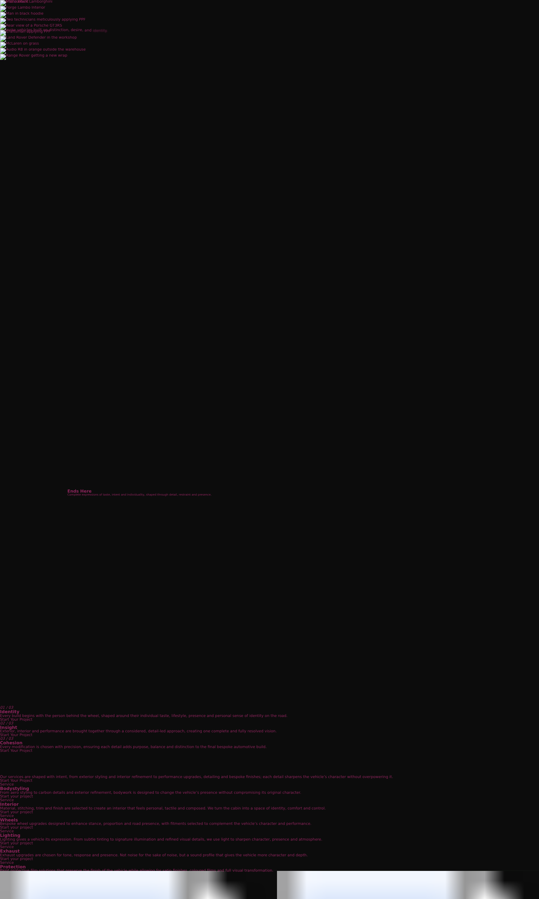
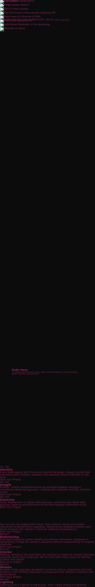

# UI Design System & Master Generation Blueprint: forgeautomotive-co-uk

> **Bespoke Vehicle Builds & Styling · Forge Automotive** (https://forgeautomotive.co.uk/) — A luxury automotive atelier for bespoke styling, performance and craftsmanship — one-off Defender, G63, Range Rover, Urus and 911 builds.



---

## 1. Executive Visual Persona & Design Archetype

- **Brand Essence & Persona**: **Bespoke Vehicle Builds & Styling · Forge Automotive** (`https://forgeautomotive.co.uk/`). A luxury automotive atelier for bespoke styling, performance and craftsmanship — one-off Defender, G63, Range Rover, Urus and 911 builds.
- **Visual Archetype**: **High-Contrast Obsidian / Atmospheric Design System (`#000000` canvas, `#ffffff` ink, `#ffffff` accent)**.
- **Anti-AI-Slop Differentiators**:
  - **Source-Grounded Chromatic Polarity**: Anchors the viewport in `#000000` (`#page:after { background: black }` (`#000000`)) paired with `#ffffff` primary typography and `#ffffff` accents.
  - **Extracted Typographic Hierarchy**: Pairs `GeistSans` for display copy (`We don’t modify vehicles We build th`) with `GeistSans Fallback` and not declared in static CSS (uses primary stack / `ui-monospace`).
  - **Calibrated Spatial Grid & Motion**: Combines `none (full-bleed `100%` viewport stage)` container bounds (`gap: .8rem`, padding `1.2rem`) with `cubic-bezier(.2,.7,.2,1)` easing and Lenis Smooth Scroll (`data-lenis`), GSAP Timeline & ScrollTrigger.

---

## 2. Spatial Architecture & Modular Grid Mathematics



### Viewport Allocation & Container Geometry
- **Captured Viewport Dimensions**: Desktop `1440×2400px` (`assets/desktop.png`, capped at 2400px multi-section capture), Mobile `390×2400px` (`assets/mobile.png`, capped at 2400px multi-section capture).
- **Master Container Bounds**: `none (full-bleed `100%` viewport stage)` extracted from `forgeautomotive-co-uk` stylesheet.
- **Canvas Lateral Padding & Spacing**: `1.2rem` lateral canvas padding with `.8rem` grid gap.
- **Border Radius Scale**: `0px` (sharp unrounded corners).

### Responsive Breakpoint Architecture
- **Desktop Layout**: Multi-column CSS Grid / Flexbox layout at `1440px` (`max-width: none (full-bleed `100%` viewport stage)`, `gap: .8rem`).
- **Mobile Layout**: Single-column vertical stack at `390px` viewport width with `1.2rem` horizontal padding.
- **Extracted CSS Media Queries**: `@media (min-width:1600px)`, `@media (min-width:1920px)`, `@media (prefers-reduced-motion:reduce)`.

---

## 3. Color System, Materiality & Atmospheric Lighting

### Semantic Palette & Source Grounding
| Semantic Role | Ground-Truth Value | Extracted CSS Source / Selector |
|---|---|---|
| **Primary Canvas Substrate** | `#000000` | `#page:after { background: black }` (`#000000`) |
| **Primary Typography Ink** | `#ffffff` | `::selection { color: white }` (`#ffffff`) |
| **Elevated Surface / Card Substrate** | `#0c0c0c` | `<meta name="theme-color" content="#0c0c0c">` in `dom.html` |

### Sanitized Root CSS Variables (`ui-ux.md` Ground Truth)
| Variable Name | Extracted Value | Semantic Role |
|---|---|---|
| `--page-beat-dur` | `1.2s` | Motion / Timing Token |
| `--page-leave-dur` | `var(--page-beat-dur)` | Design System Custom Token |
| `--page-enter-dur` | `var(--page-beat-dur)` | Design System Custom Token |
| `--page-enter-ease` | `cubic-bezier(.2, .7, .2, 1)` | Motion / Easing Token |
| `--black` | `var(--global-black)` | Canvas / Surface Token |
| `--white` | `var(--global-white)` | Canvas / Surface Token |
| `--bezzy` | `var(--easing-bezzy)` | Design System Custom Token |
| `--bezzy2` | `var(--easing-bezzy2)` | Design System Custom Token |
| `--bezzy3` | `var(--easing-bezzy3)` | Design System Custom Token |
| `--next-build-dur` | `1.2s` | Motion / Timing Token |
| `--next-build-ease` | `cubic-bezier(.7, .05, .13, 1)` | Motion / Easing Token |
| `--font-geist-sans` | `"GeistSans", "GeistSans Fallback"` | Typography / Scale Token |
| `--editorial` | `"editorial", "editorial Fallback"` | Design System Custom Token |
| `--lqip-mobile` | `url("data:image/jpeg` | Design System Custom Token |
| `--play-state` | `paused` | Design System Custom Token |
| `--fill-to` | `rgb(255, 255, 255)` | Color / Atmospheric Token |

---

## 4. Typographic Scale & Editorial Hierarchy

### Font Family Stacks
- **Display Typography**: `GeistSans`.
- **Primary Body Stack**: `GeistSans Fallback`.
- **Technical / Metadata Stack**: not declared in static CSS (uses primary stack / `ui-monospace`).

### Typographic Scale & Rules (Extracted from Stylesheet & Variables)
- **Hero Display (`H1`)**: not explicitly declared on tag in static CSS (stylesheet font-size ladder: `62.5%`, `68.75%`, `75%`, `1.4rem`).
- **Section Heading (`H2`)**: not explicitly declared on tag in static CSS (stylesheet font-size ladder: `62.5%`, `68.75%`, `75%`, `1.4rem`).
- **Body Copy**: not explicitly declared on tag in static CSS (stylesheet font-size ladder: `62.5%`, `68.75%`, `75%`, `1.4rem`).
- **Metadata & Navigation Labels**: not explicitly declared on tag in static CSS (stylesheet font-size ladder: `62.5%`, `68.75%`, `75%`, `1.4rem`).

---

## 5. Choreographed Motion & Interaction Physics

### Primary Easing Curves
- **Extracted Timing Functions**: `cubic-bezier(.2,.7,.2,1)`, `cubic-bezier(.7,.05,.13,1)`.

### Per-Element Transition & Choreography Rules
- **Selector `.lenis.lenis-autoToggle`**: `transition: 1ms` extracted from `forgeautomotive-co-uk` stylesheet.
- **Selector `html[data-page-leaving] #page:after`**: `transition: opacity var(--page-leave-dur) var(--bezzy2)` extracted from `forgeautomotive-co-uk` stylesheet.
- **Extracted Easing Curve (`cubic-bezier(.2,.7,.2,1)`)**: Governs interactive state transitions across `<header.sc-337305d3-0>` and `<section.sc-337305d3-0>`.
- **Runtime Interaction Engine**: Integrates Lenis Smooth Scroll (`data-lenis`), GSAP Timeline & ScrollTrigger, Three.js / WebGL Canvas Pipeline with `prefers-reduced-motion: reduce` fallback guards.

---

## 6. Component Wireframe & Structural DOM Map

### Visual Layout Schematic (Grounded in `dom.html` — `1440px` Desktop & `390px` Mobile Reflow)
```
┌────────────────────────────────────────────────────────────────────────┐
│ DESKTOP VIEWPORT (1440px) — Bespoke Vehicle Builds & Styling · Forge A │
│ ====================================================================== │
│ [ <header.sc-337305d3-0>   | Overview · Index · Archive · About · C ]  │
│ ---------------------------------------------------------------------- │
│ | HERO STAGE: <section.sc-337305d3-0>                              |   │
│ | H1: We don’t modify vehicles We build them for you               |   │
│ | Substrate: #000000    | Ink: #ffffff    | Accent: #ffffff        |   │
│ ---------------------------------------------------------------------- │
│ | SHOWCASE GRID (<section.sc-337305d3-0>   ) max-w: none (full-ble |   │
│ | +------------------------------+  +------------------------------+ | │
│ | | For Those Who Refuse Ordinar |  | Our Approach To Every Build  | | │
│ | +------------------------------+  +------------------------------+ | │
│ ---------------------------------------------------------------------- │
│ | MOBILE VIEWPORT REFLOW (390px) — Single-Column Stack (gap: .8rem ) | │
│ | [<header.sc-337305d] -> [<section.sc-337305] -> [<section.sc-337305] │
│ ---------------------------------------------------------------------- │
│ [ FOOTER (<footer.sc-337305d3-0>) | https://forgeautomotive.co.uk/     │
└────────────────────────────────────────────────────────────────────────┘
```

### Granular DOM Region Breakdown
1. **Brand Header & Navigation Bar (<header.sc-337305d3-0> — `forgeautomotive-co-uk`)**:
   - Landmark `<header class="sc-337305d3-0 sc-cf9722b1-0">` hosting `Bespoke Vehicle Builds & Styling · F` navigation (`Overview · Index · Archive · About · Contact`), DOM attributes (`data-precedence="next"`, `data-precedence="next"`, `data-precedence="next"`, `data-styled="active"`), and stylesheet rule `html.lenis body { height:auto }`.
2. **Hero Stage & Focal Lead (<section.sc-337305d3-0> — `We don’t modify vehicles We build `)**:
   - Landmark `<section class="sc-337305d3-0 sc-2b039258-0">` presenting display lead `We don’t modify vehicles We build them for you` and copy excerpt *"Bespoke vehicles built on distinction, desire, and identity. not "* over `#000000` canvas and `#ffffff` ink.
3. **Primary Showcase & Content Grid (<section.sc-337305d3-0> — `For Those Who Refuse Ordinary`)**:
   - Landmark `<section class="sc-337305d3-0 sc-12ea9db1-0">` rendering section `For Those Who Refuse Ordinary` with copy *"A luxury automotive atelier for bespoke styling, performance and "*, asset references (`2fdd_lc5jd195.css`, `19rhlcx2srev9.css`, `2cf1_565uvy1t.css`, `431bw722fec3m.js`), and grid rule `.lenis-stopped { overflow:clip }`.
4. **Interactive Detail & Feature Matrix (<section.sc-337305d3-0> — `Our Approach To Every Build`)**:
   - Landmark `<section class="sc-337305d3-0 sc-e85696e3-0">` framing `Our Approach To Every Build` and `Identity` (*"Every decision is intentional, every detail has purpose based on "*) with `#0c0c0c` surface cards, `#ffffff` accents, and `.lenis.lenis-smooth iframe { pointer-events:none }`.
5. **Colophon & Global Directory Footer (<footer.sc-337305d3-0> — `https://forgeautomotive.co.uk/`)**:
   - Landmark `<footer class="sc-337305d3-0 sc-a2c8839e-0">` anchoring `Bespoke Vehicle Builds & Styling` footer links (`Overview · Index · Archive · About · Contact`), copy *"S t a r t Y o u r P r o j e c t"*, and `#ffffff` structural dividers.

---

## 7. Master Zero-Shot AI Generation Prompt

```markdown
# Master Zero-Shot Frontend Generation Prompt: forgeautomotive-co-uk (Bespoke Vehicle Builds & Styling · Forge Automotive)

You are a principal frontend architect and design systems engineer. Build a complete, production-ready web application replicating the exact design system, DOM landmarks, typographic hierarchy, color tokens, and motion physics of `forgeautomotive-co-uk` (**Bespoke Vehicle Builds & Styling · Forge Automotive** — `https://forgeautomotive.co.uk/`).

### 1. Visual Archetype & Anti-AI-Slop Mandates
- **Archetype**: High-Contrast Obsidian / Atmospheric Design System (`#000000` canvas, `#ffffff` ink, `#ffffff` accent).
- **Identity & Domain Context**: A luxury automotive atelier for bespoke styling, performance and craftsmanship — one-off Defender, G63, Range Rover, Urus and 911 builds.
- **Primary Substrate**: `#000000` (`#page:after { background: black }` (`#000000`)), **Primary Ink**: `#ffffff`, **Accent / Highlight**: `#ffffff`.
- **Site-Specific Differentiators**:
  - **Source-Grounded Chromatic Polarity**: Anchors the viewport in `#000000` (`#page:after { background: black }` (`#000000`)) paired with `#ffffff` primary typography and `#ffffff` accents.
  - **Extracted Typographic Hierarchy**: Pairs `GeistSans` for display copy (`We don’t modify vehicles We build th`) with `GeistSans Fallback` and not declared in static CSS (uses primary stack / `ui-monospace`).
  - **Calibrated Spatial Grid & Motion**: Combines `none (full-bleed `100%` viewport stage)` container bounds (`gap: .8rem`, padding `1.2rem`) with `cubic-bezier(.2,.7,.2,1)` easing and Lenis Smooth Scroll (`data-lenis`), GSAP Timeline & ScrollTrigger.

### 2. Ground-Truth CSS Variables (`:root` Token Contract)
Declare and consume these exact custom properties extracted from `forgeautomotive-co-uk` in your global stylesheet:

:root {
  /* Bespoke Vehicle Builds & Styling · Forge Automotive (forgeautomotive-co-uk) — Ground-Truth Extracted CSS Variables */
  --page-beat-dur: 1.2s; /* Motion / Timing Token (forgeautomotive-co-uk) */
  --page-leave-dur: var(--page-beat-dur); /* Design System Custom Token (forgeautomotive-co-uk) */
  --page-enter-dur: var(--page-beat-dur); /* Design System Custom Token (forgeautomotive-co-uk) */
  --page-enter-ease: cubic-bezier(.2, .7, .2, 1); /* Motion / Easing Token (forgeautomotive-co-uk) */
  --black: var(--global-black); /* Canvas / Surface Token (forgeautomotive-co-uk) */
  --white: var(--global-white); /* Canvas / Surface Token (forgeautomotive-co-uk) */
  --bezzy: var(--easing-bezzy); /* Design System Custom Token (forgeautomotive-co-uk) */
  --bezzy2: var(--easing-bezzy2); /* Design System Custom Token (forgeautomotive-co-uk) */
  --bezzy3: var(--easing-bezzy3); /* Design System Custom Token (forgeautomotive-co-uk) */
  --next-build-dur: 1.2s; /* Motion / Timing Token (forgeautomotive-co-uk) */
  --next-build-ease: cubic-bezier(.7, .05, .13, 1); /* Motion / Easing Token (forgeautomotive-co-uk) */
  --font-geist-sans: "GeistSans", "GeistSans Fallback"; /* Typography / Scale Token (forgeautomotive-co-uk) */
  --editorial: "editorial", "editorial Fallback"; /* Design System Custom Token (forgeautomotive-co-uk) */
  --lqip-mobile: url("data:image/jpeg; /* Design System Custom Token (forgeautomotive-co-uk) */
  --play-state: paused; /* Design System Custom Token (forgeautomotive-co-uk) */
  --fill-to: rgb(255, 255, 255); /* Color / Atmospheric Token (forgeautomotive-co-uk) */
}

### 3. Semantic Color & Materiality Contract
Map every surface, ink, and border strictly to these source-grounded tokens:
- **Primary Canvas Substrate**: `#000000` — grounded in `#page:after { background: black }` (`#000000`)
- **Primary Typography Ink**: `#ffffff` — grounded in `::selection { color: white }` (`#ffffff`)
- **Elevated Surface / Card Substrate**: `#0c0c0c` — grounded in `<meta name="theme-color" content="#0c0c0c">` in `dom.html`

### 4. Spatial Grid, Container Bounds & Responsive Breakpoints
- **Desktop Viewport Reference**: `1440×2400px` (capped at 2400px multi-section capture, `1440px` standard desktop width).
- **Mobile Viewport Reference**: `390×2400px` (capped at 2400px multi-section capture, `390px` standard mobile width).
- **Container Max-Width**: `none (full-bleed `100%` viewport stage)` extracted from `forgeautomotive-co-uk` stylesheet
- **Padding & Gutters**: `1.2rem` lateral canvas padding with `.8rem` grid gap
- **Desktop Grid**: Multi-column CSS Grid / Flexbox layout at `1440px` (`max-width: none (full-bleed `100%` viewport stage)`, `gap: .8rem`)
- **Mobile Adaptation**: Single-column vertical stack at `390px` viewport width with `1.2rem` horizontal padding
- **Media Queries**: `@media (min-width:1600px)`, `@media (min-width:1920px)`, `@media (prefers-reduced-motion:reduce)`
- **Corner Radii**: `0px` (sharp unrounded corners)

### 5. Typography & Editorial Scale Contract
- **Display Font Stack**: `GeistSans`
- **Body Font Stack**: `GeistSans Fallback`
- **Monospace / Technical Font Stack**: not declared in static CSS (uses primary stack / `ui-monospace`)
- **H1 Display Rule**: not explicitly declared on tag in static CSS (stylesheet font-size ladder: `62.5%`, `68.75%`, `75%`, `1.4rem`)
- **H2 Section Rule**: not explicitly declared on tag in static CSS (stylesheet font-size ladder: `62.5%`, `68.75%`, `75%`, `1.4rem`)
- **Body Copy Rule**: not explicitly declared on tag in static CSS (stylesheet font-size ladder: `62.5%`, `68.75%`, `75%`, `1.4rem`)
- **Metadata & Index Rule**: not explicitly declared on tag in static CSS (stylesheet font-size ladder: `62.5%`, `68.75%`, `75%`, `1.4rem`)

### 6. Component Hierarchy, Verbatim Copy & Real DOM Landmarks
Scaffold `forgeautomotive-co-uk` (`Bespoke Vehicle Builds & Styling · Forge Automotive`) with these exact structural regions, extracted copy, and CSS rules from `dom.html`:
1. **Brand Header & Navigation Bar (<header.sc-337305d3-0> — `forgeautomotive-co-uk`)**:
   - DOM & Selectors: Landmark `<header class="sc-337305d3-0 sc-cf9722b1-0">` hosting `Bespoke Vehicle Builds & Styling · F` navigation (`Overview · Index · Archive · About · Contact`), DOM attributes (`data-precedence="next"`, `data-precedence="next"`, `data-precedence="next"`, `data-styled="active"`), and stylesheet rule `html.lenis body { height:auto }`.
   - Responsive Contract: Header `Brand Header & Navigation Bar (<header.sc-337305d3-0> — `forgeautomotive-co-uk`)` (`forgeautomotive-co-uk`) adapts across `@media (min-width:1600px)`, `@media (min-width:1920px)`, `@media (prefers-reduced-motion:reduce)` with `cubic-bezier(.2,.7,.2,1)`, `cubic-bezier(.7,.05,.13,1)` transitions and links `Overview · Index · Archive · About · Contact`.
2. **Hero Stage & Focal Lead (<section.sc-337305d3-0> — `We don’t modify vehicles We build `)**:
   - DOM & Selectors: Landmark `<section class="sc-337305d3-0 sc-2b039258-0">` presenting display lead `We don’t modify vehicles We build them for you` and copy excerpt *"Bespoke vehicles built on distinction, desire, and identity. not "* over `#000000` canvas and `#ffffff` ink.
   - Responsive Contract: Hero stage (`1440×2400px` desktop / `390×2400px` mobile) sets `#000000` background with `#ffffff` headline `We don’t modify vehicles We build them for you`.
3. **Primary Showcase & Content Grid (<section.sc-337305d3-0> — `For Those Who Refuse Ordinary`)**:
   - DOM & Selectors: Landmark `<section class="sc-337305d3-0 sc-12ea9db1-0">` rendering section `For Those Who Refuse Ordinary` with copy *"A luxury automotive atelier for bespoke styling, performance and "*, asset references (`2fdd_lc5jd195.css`, `19rhlcx2srev9.css`, `2cf1_565uvy1t.css`, `431bw722fec3m.js`), and grid rule `.lenis-stopped { overflow:clip }`.
   - Responsive Contract: Showcase grid `Primary Showcase & Content Grid (<section.sc-337305d3-0> — `For Those Who Refuse Ordinary`)` applies Multi-column CSS Grid / Flexbox layout at `1440px` (`max-width: none (full-bleed `100%` viewport stage)`, `gap: .8rem`) on desktop and Single-column vertical stack at `390px` viewport width with `1.2rem` horizontal padding on mobile.
4. **Interactive Detail & Feature Matrix (<section.sc-337305d3-0> — `Our Approach To Every Build`)**:
   - DOM & Selectors: Landmark `<section class="sc-337305d3-0 sc-e85696e3-0">` framing `Our Approach To Every Build` and `Identity` (*"Every decision is intentional, every detail has purpose based on "*) with `#0c0c0c` surface cards, `#ffffff` accents, and `.lenis.lenis-smooth iframe { pointer-events:none }`.
   - Responsive Contract: Detail module `Interactive Detail & Feature Matrix (<section.sc-337305d3-0> — `Our Approach To Every Build`)` uses `0px` (sharp unrounded corners) radii, `#ffffff` highlights, and assets (2fdd_lc5jd195.css, 19rhlcx2srev9.css, 2cf1_565uvy1t.css).
5. **Colophon & Global Directory Footer (<footer.sc-337305d3-0> — `https://forgeautomotive.co.uk/`)**:
   - DOM & Selectors: Landmark `<footer class="sc-337305d3-0 sc-a2c8839e-0">` anchoring `Bespoke Vehicle Builds & Styling` footer links (`Overview · Index · Archive · About · Contact`), copy *"S t a r t Y o u r P r o j e c t"*, and `#ffffff` structural dividers.
   - Responsive Contract: Footer `Colophon & Global Directory Footer (<footer.sc-337305d3-0> — `https://forgeautomotive.co.uk/`)` aligns to `none (full-bleed `100%` viewport stage)` extracted from `forgeautomotive-co-uk` stylesheet with `1.2rem` lateral canvas padding with `.8rem` grid gap and attributes (data-precedence="next", data-precedence="next", data-precedence="next").

#### Verbatim DOM Copy Excerpts (`dom.html`)
- Copy Excerpt 1: *"Bespoke vehicles built on distinction, desire, and identity. not simply to be modi..."*
- Copy Excerpt 2: *"A luxury automotive atelier for bespoke styling, performance and craftsmanship."*
- Copy Excerpt 3: *"Every decision is intentional, every detail has purpose based on your taste, your..."*
- Copy Excerpt 4: *"S t a r t Y o u r P r o j e c t"*

### 7. Motion, Extracted Stylesheet Rules & Interaction Choreography
- **Primary Easing Functions**: `cubic-bezier(.2,.7,.2,1)`, `cubic-bezier(.7,.05,.13,1)`
- **Extracted Stylesheet Rules (`forgeautomotive-co-uk`)**:
- `html.lenis body { height:auto }`
- `.lenis-stopped { overflow:clip }`
- `.lenis.lenis-smooth iframe { pointer-events:none }`
- `.lenis.lenis-autoToggle { transition-behavior:allow-discrete;transition-property:overflow;transiti... }`
- `section { display:block }`
- **Per-Selector Transition Rules**:
- **Selector `.lenis.lenis-autoToggle`**: `transition: 1ms` extracted from `forgeautomotive-co-uk` stylesheet.
- **Selector `html[data-page-leaving] #page:after`**: `transition: opacity var(--page-leave-dur) var(--bezzy2)` extracted from `forgeautomotive-co-uk` stylesheet.
- **Extracted Easing Curve (`cubic-bezier(.2,.7,.2,1)`)**: Governs interactive state transitions across `<header.sc-337305d3-0>` and `<section.sc-337305d3-0>`.
- **Runtime Interaction Engine**: Integrates Lenis Smooth Scroll (`data-lenis`), GSAP Timeline & ScrollTrigger, Three.js / WebGL Canvas Pipeline with `prefers-reduced-motion: reduce` fallback guards.

### 8. Technical Deliverables
- Implement in Next.js (App Router) with TypeScript and Tailwind CSS consuming the `:root` custom properties defined above for `forgeautomotive-co-uk`.
- Reproduce both the `1440px` desktop architecture and `390px` mobile breakpoint transitions, preserving semantic HTML5 landmarks (`<header>`, `<nav>`, `<main>`, `<section>`, `<footer>`) and `prefers-reduced-motion` accessibility guards.
```
