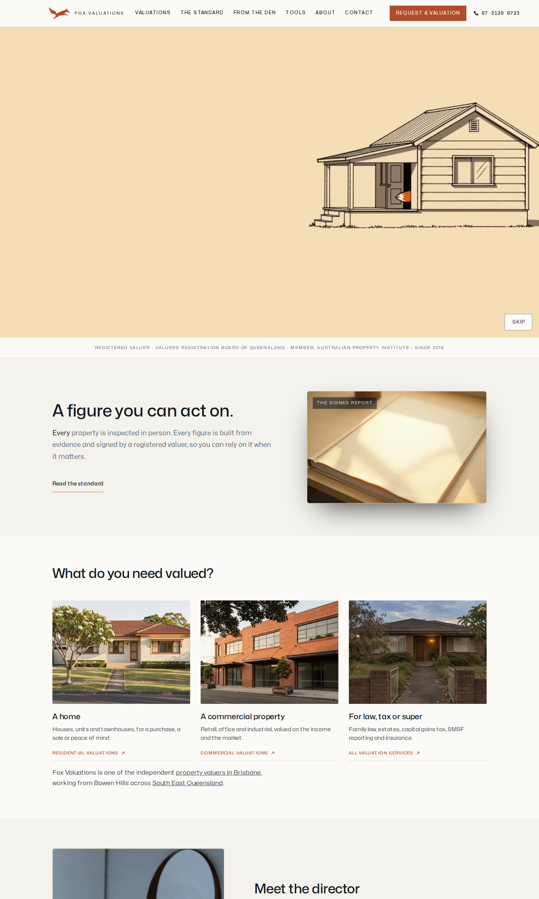
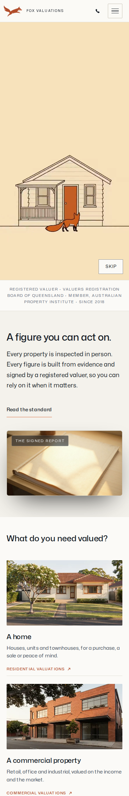

# UI Design System & Master Generation Blueprint: foxvaluations-com-au

> **Property valuations Brisbane · Fox Valuations** (https://foxvaluations.com.au) — Independent property valuations across Brisbane and South East Queensland by registered valuer Sebastian Fox. Fixed fee, quoted free.



---

## 1. Executive Visual Persona & Design Archetype

- **Brand Essence & Persona**: **Property valuations Brisbane · Fox Valuations** (`https://foxvaluations.com.au`). Independent property valuations across Brisbane and South East Queensland by registered valuer Sebastian Fox. Fixed fee, quoted free.
- **Visual Archetype**: **High-Contrast Obsidian / Atmospheric Design System (`#16202F` canvas, `#FAFAF8` ink, `#FAFAF8` accent)**.
- **Anti-AI-Slop Differentiators**:
  - **Source-Grounded Chromatic Polarity**: Anchors the viewport in `#16202F` (`var(--ink)` in `:root`) paired with `#FAFAF8` primary typography and `#FAFAF8` accents.
  - **Extracted Typographic Hierarchy**: Pairs `Instrument Sans` for display copy (`What is your property worth?`) with `Mona Sans` and `Spline Sans Mono`.
  - **Calibrated Spatial Grid & Motion**: Combines `var(--shell)` container bounds (`gap: 2rem`, padding `0.55rem`) with `cubic-bezier(0.22,1,0.36,1)` easing.

---

## 2. Spatial Architecture & Modular Grid Mathematics



### Viewport Allocation & Container Geometry
- **Captured Viewport Dimensions**: Desktop `1440×4367px` (`assets/desktop.png`, full-page scroll capture), Mobile `390×2400px` (`assets/mobile.png`, capped at 2400px multi-section capture).
- **Master Container Bounds**: `var(--shell)` extracted from `foxvaluations-com-au` stylesheet.
- **Canvas Lateral Padding & Spacing**: `0.55rem` lateral canvas padding with `2rem` grid gap.
- **Border Radius Scale**: `2px`, `50%`, `3px`, `6px`.

### Responsive Breakpoint Architecture
- **Desktop Layout**: Multi-column CSS Grid / Flexbox layout at `1440px` (`max-width: var(--shell)`, `gap: 2rem`).
- **Mobile Layout**: Single-column vertical stack at `390px` viewport width with `0.55rem` horizontal padding.
- **Extracted CSS Media Queries**: `@media (prefers-reduced-motion: no-preference)`, `@media (prefers-reduced-motion: reduce)`, `@media (max-width: 900px)`, `@media (max-width: 520px)`.

---

## 3. Color System, Materiality & Atmospheric Lighting

### Semantic Palette & Source Grounding
| Semantic Role | Ground-Truth Value | Extracted CSS Source / Selector |
|---|---|---|
| **Primary Canvas Substrate** | `#16202F` | `var(--ink)` in `:root` |
| **Primary Typography Ink** | `#1C2839` | `var(--ink-2)` in `:root` |
| **Elevated Surface / Card Substrate** | `#2C3B50` | `var(--ink-line)` in `:root` |
| **Interactive Accent / Highlight** | `#FAFAF8` | `var(--paper)` in `:root` |
| **Secondary / Muted Copy** | `#F1F1ED` | `var(--plaster)` in `:root` |
| **Structural Hairline Border** | `#262E3C` | `var(--graphite)` in `:root` |
| **Variable Token (`--slate`)** | `#5B6473` | `var(--slate)` in `:root` |
| **Variable Token (`--rust`)** | `#B14D2B` | `var(--rust)` in `:root` |
| **Variable Token (`--rust-bright`)** | `#D96B3F` | `var(--rust-bright)` in `:root` |
| **Variable Token (`--line`)** | `#DAD8D0` | `var(--line)` in `:root` |
| **Variable Token (`--dark-body`)** | `#B8BFC9` | `var(--dark-body)` in `:root` |
| **Variable Token (`--dark-dim`)** | `#9AA3B0` | `var(--dark-dim)` in `:root` |
| **Variable Token (`--dark-bright`)** | `#F5F4F0` | `var(--dark-bright)` in `:root` |

### Sanitized Root CSS Variables (`ui-ux.md` Ground Truth)
| Variable Name | Extracted Value | Semantic Role |
|---|---|---|
| `--ink` | `#16202F` | Typography Ink Token |
| `--ink-2` | `#1C2839` | Typography Ink Token |
| `--ink-line` | `#2C3B50` | Typography Ink Token |
| `--paper` | `#FAFAF8` | Canvas / Surface Token |
| `--plaster` | `#F1F1ED` | Color / Atmospheric Token |
| `--graphite` | `#262E3C` | Color / Atmospheric Token |
| `--slate` | `#5B6473` | Color / Atmospheric Token |
| `--rust` | `#B14D2B` | Color / Atmospheric Token |
| `--rust-bright` | `#D96B3F` | Color / Atmospheric Token |
| `--line` | `#DAD8D0` | Color / Atmospheric Token |
| `--dark-body` | `#B8BFC9` | Canvas / Surface Token |
| `--dark-dim` | `#9AA3B0` | Canvas / Surface Token |
| `--dark-bright` | `#F5F4F0` | Canvas / Surface Token |
| `--mono` | `"Spline Sans Mono", "SF Mono", Consolas, monospace` | Typography / Scale Token |
| `--label` | `0.8rem` | Dimension / Scale Token |
| `--shell` | `1240px` | Dimension / Scale Token |

---

## 4. Typographic Scale & Editorial Hierarchy

### Font Family Stacks
- **Display Typography**: `Instrument Sans`.
- **Primary Body Stack**: `Mona Sans`.
- **Technical / Metadata Stack**: `Spline Sans Mono`.

### Typographic Scale & Rules (Extracted from Stylesheet & Variables)
- **Hero Display (`H1`)**: CSS variables `--display-ls: -0.032em`; rule `h1` (`font-size: clamp(2.6rem, 6vw, 4.5rem)`, `line-height: 1.04`, `letter-spacing: -0.015em`, `font-weight: 500`).
- **Section Heading (`H2`)**: rule `h2` (`font-size: clamp(1.5rem, 2.6vw, 2.05rem)`, `line-height: 1.12`, `letter-spacing: -0.01em`, `font-weight: 500`).
- **Body Copy**: CSS variables `--dark-body: #B8BFC9`; rule `p` (`font-size: 1rem`).
- **Metadata & Navigation Labels**: CSS variables `--mono: "Spline Sans Mono", "SF Mono", Consolas, monospace`, `--label: 0.8rem`.

---

## 5. Choreographed Motion & Interaction Physics

### Primary Easing Curves
- **Extracted Timing Functions**: `cubic-bezier(0.22,1,0.36,1)`, `cubic-bezier(.3,1.35,.45,1)`.

### Per-Element Transition & Choreography Rules
- **Selector `.site-head`**: `transition: border-color 0.3s var(--ease)` extracted from `foxvaluations-com-au` stylesheet.
- **Selector `.site-nav a`**: `transition: border-color 0.2s, color 0.2s` extracted from `foxvaluations-com-au` stylesheet.
- **Selector `.head-call`**: `transition: background 0.25s var(--ease), color 0.25s var(--ease)` extracted from `foxvaluations-com-au` stylesheet.
- **Extracted Easing Curve (`cubic-bezier(0.22,1,0.36,1)`)**: Governs interactive state transitions across `<header.site-head>` and `<section.cred-strip>`.
- **State & Hover Choreography**: Opacity and transform transitions on `<section.landing>` and `<section.cred-strip>` interactive targets.

---

## 6. Component Wireframe & Structural DOM Map

### Visual Layout Schematic (Grounded in `dom.html` — `1440px` Desktop & `390px` Mobile Reflow)
```
┌────────────────────────────────────────────────────────────────────────┐
│ DESKTOP VIEWPORT (1440px) — Property valuations Brisbane · Fox Valuati │
│ ====================================================================== │
│ [ <header.site-head>       | Valuations · The standard · From the d ]  │
│ ---------------------------------------------------------------------- │
│ | HERO STAGE: <section.landing>                                    |   │
│ | H1: What is your property worth?                                 |   │
│ | Substrate: #16202F    | Ink: #FAFAF8    | Accent: #FAFAF8        |   │
│ ---------------------------------------------------------------------- │
│ | SHOWCASE GRID (<section.cred-strip>      ) max-w: var(--shell)   |   │
│ | +------------------------------+  +------------------------------+ | │
│ | | A figure you can act on.     |  | What do you need valued?     | | │
│ | +------------------------------+  +------------------------------+ | │
│ ---------------------------------------------------------------------- │
│ | MOBILE VIEWPORT REFLOW (390px) — Single-Column Stack (gap: 2rem  ) | │
│ | [<header.site-head>] -> [<section.landing>] -> [<section.cred-stri]  │
│ ---------------------------------------------------------------------- │
│ [ FOOTER (<footer.site-foot>    ) | https://foxvaluations.com.au       │
└────────────────────────────────────────────────────────────────────────┘
```

### Granular DOM Region Breakdown
1. **Brand Header & Navigation Bar (<header.site-head> — `foxvaluations-com-au`)**:
   - Landmark `<header class="site-head site-head-cine">` hosting `Property valuations Brisbane · Fox V` navigation (`Valuations · The standard · From the den · Tools · About`), DOM attributes (`data-website-id="dc310766-8aa8-41ef-af..."`, `data-portrait="1"`, `data-slot="svc-residential"`, `data-slot="svc-commercial"`), and stylesheet rule `html { scroll-behavior: smooth }`.
2. **Hero Stage & Focal Lead (<section.landing> — `What is your property worth?`)**:
   - Landmark `<section class="landing">` presenting display lead `What is your property worth?` and copy excerpt *"Request a valuation"* over `#16202F` canvas and `#FAFAF8` ink.
3. **Primary Showcase & Content Grid (<section.cred-strip> — `A figure you can act on.`)**:
   - Landmark `<section class="cred-strip">` rendering section `A figure you can act on.` with copy *"Email the practice"*, asset references (`favicon-rust.png`, `analytics.blackshard.com.au`, `fox-mark-rust.png`, `fox-run-first-v2.webp`), and grid rule `img { display: block;max-width: 100%;height: auto }`.
4. **Interactive Detail & Feature Matrix (<section.standard> — `What do you need valued?`)**:
   - Landmark `<section class="standard standard-band">` framing `What do you need valued?` and `Meet the director` (*"Level 1, 47 Brookes Street, Bowen Hills QLD 4006"*) with `#2C3B50` surface cards, `#FAFAF8` accents, and `focus-visible { outline: 2px solid var(--rust);outline-offset: 3px }`.
5. **Colophon & Global Directory Footer (<footer.site-foot> — `https://foxvaluations.com.au`)**:
   - Landmark `<footer class="site-foot">` anchoring `Property valuations Brisbane · F` footer links (`Valuations · The standard · From the den · Tools · About`), copy *"Independent property valuations by a registered valuer. Bris"*, and `#262E3C` structural dividers.

---

## 7. Master Zero-Shot AI Generation Prompt

```markdown
# Master Zero-Shot Frontend Generation Prompt: foxvaluations-com-au (Property valuations Brisbane · Fox Valuations)

You are a principal frontend architect and design systems engineer. Build a complete, production-ready web application replicating the exact design system, DOM landmarks, typographic hierarchy, color tokens, and motion physics of `foxvaluations-com-au` (**Property valuations Brisbane · Fox Valuations** — `https://foxvaluations.com.au`).

### 1. Visual Archetype & Anti-AI-Slop Mandates
- **Archetype**: High-Contrast Obsidian / Atmospheric Design System (`#16202F` canvas, `#FAFAF8` ink, `#FAFAF8` accent).
- **Identity & Domain Context**: Independent property valuations across Brisbane and South East Queensland by registered valuer Sebastian Fox. Fixed fee, quoted free.
- **Primary Substrate**: `#16202F` (`var(--ink)` in `:root`), **Primary Ink**: `#FAFAF8`, **Accent / Highlight**: `#FAFAF8`.
- **Site-Specific Differentiators**:
  - **Source-Grounded Chromatic Polarity**: Anchors the viewport in `#16202F` (`var(--ink)` in `:root`) paired with `#FAFAF8` primary typography and `#FAFAF8` accents.
  - **Extracted Typographic Hierarchy**: Pairs `Instrument Sans` for display copy (`What is your property worth?`) with `Mona Sans` and `Spline Sans Mono`.
  - **Calibrated Spatial Grid & Motion**: Combines `var(--shell)` container bounds (`gap: 2rem`, padding `0.55rem`) with `cubic-bezier(0.22,1,0.36,1)` easing.

### 2. Ground-Truth CSS Variables (`:root` Token Contract)
Declare and consume these exact custom properties extracted from `foxvaluations-com-au` in your global stylesheet:

:root {
  /* Property valuations Brisbane · Fox Valuations (foxvaluations-com-au) — Ground-Truth Extracted CSS Variables */
  --ink: #16202F; /* Typography Ink Token (foxvaluations-com-au) */
  --ink-2: #1C2839; /* Typography Ink Token (foxvaluations-com-au) */
  --ink-line: #2C3B50; /* Typography Ink Token (foxvaluations-com-au) */
  --paper: #FAFAF8; /* Canvas / Surface Token (foxvaluations-com-au) */
  --plaster: #F1F1ED; /* Color / Atmospheric Token (foxvaluations-com-au) */
  --graphite: #262E3C; /* Color / Atmospheric Token (foxvaluations-com-au) */
  --slate: #5B6473; /* Color / Atmospheric Token (foxvaluations-com-au) */
  --rust: #B14D2B; /* Color / Atmospheric Token (foxvaluations-com-au) */
  --rust-bright: #D96B3F; /* Color / Atmospheric Token (foxvaluations-com-au) */
  --line: #DAD8D0; /* Color / Atmospheric Token (foxvaluations-com-au) */
  --dark-body: #B8BFC9; /* Canvas / Surface Token (foxvaluations-com-au) */
  --dark-dim: #9AA3B0; /* Canvas / Surface Token (foxvaluations-com-au) */
  --dark-bright: #F5F4F0; /* Canvas / Surface Token (foxvaluations-com-au) */
  --mono: "Spline Sans Mono", "SF Mono", Consolas, monospace; /* Typography / Scale Token (foxvaluations-com-au) */
  --label: 0.8rem; /* Dimension / Scale Token (foxvaluations-com-au) */
  --shell: 1240px; /* Dimension / Scale Token (foxvaluations-com-au) */
}

### 3. Semantic Color & Materiality Contract
Map every surface, ink, and border strictly to these source-grounded tokens:
- **Primary Canvas Substrate**: `#16202F` — grounded in `var(--ink)` in `:root`
- **Primary Typography Ink**: `#1C2839` — grounded in `var(--ink-2)` in `:root`
- **Elevated Surface / Card Substrate**: `#2C3B50` — grounded in `var(--ink-line)` in `:root`
- **Interactive Accent / Highlight**: `#FAFAF8` — grounded in `var(--paper)` in `:root`
- **Secondary / Muted Copy**: `#F1F1ED` — grounded in `var(--plaster)` in `:root`
- **Structural Hairline Border**: `#262E3C` — grounded in `var(--graphite)` in `:root`
- **Variable Token (`--slate`)**: `#5B6473` — grounded in `var(--slate)` in `:root`
- **Variable Token (`--rust`)**: `#B14D2B` — grounded in `var(--rust)` in `:root`
- **Variable Token (`--rust-bright`)**: `#D96B3F` — grounded in `var(--rust-bright)` in `:root`
- **Variable Token (`--line`)**: `#DAD8D0` — grounded in `var(--line)` in `:root`
- **Variable Token (`--dark-body`)**: `#B8BFC9` — grounded in `var(--dark-body)` in `:root`
- **Variable Token (`--dark-dim`)**: `#9AA3B0` — grounded in `var(--dark-dim)` in `:root`
- **Variable Token (`--dark-bright`)**: `#F5F4F0` — grounded in `var(--dark-bright)` in `:root`

### 4. Spatial Grid, Container Bounds & Responsive Breakpoints
- **Desktop Viewport Reference**: `1440×4367px` (full-page scroll capture, `1440px` standard desktop width).
- **Mobile Viewport Reference**: `390×2400px` (capped at 2400px multi-section capture, `390px` standard mobile width).
- **Container Max-Width**: `var(--shell)` extracted from `foxvaluations-com-au` stylesheet
- **Padding & Gutters**: `0.55rem` lateral canvas padding with `2rem` grid gap
- **Desktop Grid**: Multi-column CSS Grid / Flexbox layout at `1440px` (`max-width: var(--shell)`, `gap: 2rem`)
- **Mobile Adaptation**: Single-column vertical stack at `390px` viewport width with `0.55rem` horizontal padding
- **Media Queries**: `@media (prefers-reduced-motion: no-preference)`, `@media (prefers-reduced-motion: reduce)`, `@media (max-width: 900px)`, `@media (max-width: 520px)`
- **Corner Radii**: `2px`, `50%`, `3px`, `6px`

### 5. Typography & Editorial Scale Contract
- **Display Font Stack**: `Instrument Sans`
- **Body Font Stack**: `Mona Sans`
- **Monospace / Technical Font Stack**: `Spline Sans Mono`
- **H1 Display Rule**: CSS variables `--display-ls: -0.032em`; rule `h1` (`font-size: clamp(2.6rem, 6vw, 4.5rem)`, `line-height: 1.04`, `letter-spacing: -0.015em`, `font-weight: 500`)
- **H2 Section Rule**: rule `h2` (`font-size: clamp(1.5rem, 2.6vw, 2.05rem)`, `line-height: 1.12`, `letter-spacing: -0.01em`, `font-weight: 500`)
- **Body Copy Rule**: CSS variables `--dark-body: #B8BFC9`; rule `p` (`font-size: 1rem`)
- **Metadata & Index Rule**: CSS variables `--mono: "Spline Sans Mono", "SF Mono", Consolas, monospace`, `--label: 0.8rem`

### 6. Component Hierarchy, Verbatim Copy & Real DOM Landmarks
Scaffold `foxvaluations-com-au` (`Property valuations Brisbane · Fox Valuations`) with these exact structural regions, extracted copy, and CSS rules from `dom.html`:
1. **Brand Header & Navigation Bar (<header.site-head> — `foxvaluations-com-au`)**:
   - DOM & Selectors: Landmark `<header class="site-head site-head-cine">` hosting `Property valuations Brisbane · Fox V` navigation (`Valuations · The standard · From the den · Tools · About`), DOM attributes (`data-website-id="dc310766-8aa8-41ef-af..."`, `data-portrait="1"`, `data-slot="svc-residential"`, `data-slot="svc-commercial"`), and stylesheet rule `html { scroll-behavior: smooth }`.
   - Responsive Contract: Header `Brand Header & Navigation Bar (<header.site-head> — `foxvaluations-com-au`)` (`foxvaluations-com-au`) adapts across `@media (prefers-reduced-motion: no-preference)`, `@media (prefers-reduced-motion: reduce)`, `@media (max-width: 900px)`, `@media (max-width: 520px)` with `cubic-bezier(0.22,1,0.36,1)`, `cubic-bezier(.3,1.35,.45,1)` transitions and links `Valuations · The standard · From the den · Tools · About`.
2. **Hero Stage & Focal Lead (<section.landing> — `What is your property worth?`)**:
   - DOM & Selectors: Landmark `<section class="landing">` presenting display lead `What is your property worth?` and copy excerpt *"Request a valuation"* over `#16202F` canvas and `#FAFAF8` ink.
   - Responsive Contract: Hero stage (`1440×4367px` desktop / `390×2400px` mobile) sets `#16202F` background with `#FAFAF8` headline `What is your property worth?`.
3. **Primary Showcase & Content Grid (<section.cred-strip> — `A figure you can act on.`)**:
   - DOM & Selectors: Landmark `<section class="cred-strip">` rendering section `A figure you can act on.` with copy *"Email the practice"*, asset references (`favicon-rust.png`, `analytics.blackshard.com.au`, `fox-mark-rust.png`, `fox-run-first-v2.webp`), and grid rule `img { display: block;max-width: 100%;height: auto }`.
   - Responsive Contract: Showcase grid `Primary Showcase & Content Grid (<section.cred-strip> — `A figure you can act on.`)` applies Multi-column CSS Grid / Flexbox layout at `1440px` (`max-width: var(--shell)`, `gap: 2rem`) on desktop and Single-column vertical stack at `390px` viewport width with `0.55rem` horizontal padding on mobile.
4. **Interactive Detail & Feature Matrix (<section.standard> — `What do you need valued?`)**:
   - DOM & Selectors: Landmark `<section class="standard standard-band">` framing `What do you need valued?` and `Meet the director` (*"Level 1, 47 Brookes Street, Bowen Hills QLD 4006"*) with `#2C3B50` surface cards, `#FAFAF8` accents, and `focus-visible { outline: 2px solid var(--rust);outline-offset: 3px }`.
   - Responsive Contract: Detail module `Interactive Detail & Feature Matrix (<section.standard> — `What do you need valued?`)` uses `2px`, `50%`, `3px`, `6px` radii, `#FAFAF8` highlights, and assets (favicon-rust.png, analytics.blackshard.com.au, fox-mark-rust.png).
5. **Colophon & Global Directory Footer (<footer.site-foot> — `https://foxvaluations.com.au`)**:
   - DOM & Selectors: Landmark `<footer class="site-foot">` anchoring `Property valuations Brisbane · F` footer links (`Valuations · The standard · From the den · Tools · About`), copy *"Independent property valuations by a registered valuer. Bris"*, and `#262E3C` structural dividers.
   - Responsive Contract: Footer `Colophon & Global Directory Footer (<footer.site-foot> — `https://foxvaluations.com.au`)` aligns to `var(--shell)` extracted from `foxvaluations-com-au` stylesheet with `0.55rem` lateral canvas padding with `2rem` grid gap and attributes (data-website-id="dc310766-8aa8-41ef-af...", data-portrait="1", data-slot="svc-residential").

#### Verbatim DOM Copy Excerpts (`dom.html`)
- Copy Excerpt 1: *"Request a valuation"*
- Copy Excerpt 2: *"Email the practice"*
- Copy Excerpt 3: *"Level 1, 47 Brookes Street, Bowen Hills QLD 4006"*
- Copy Excerpt 4: *"Independent property valuations by a registered valuer. Brisbane based, Australia-..."*

### 7. Motion, Extracted Stylesheet Rules & Interaction Choreography
- **Primary Easing Functions**: `cubic-bezier(0.22,1,0.36,1)`, `cubic-bezier(.3,1.35,.45,1)`
- **Extracted Stylesheet Rules (`foxvaluations-com-au`)**:
- `html { scroll-behavior: smooth }`
- `img { display: block;max-width: 100%;height: auto }`
- `focus-visible { outline: 2px solid var(--rust);outline-offset: 3px }`
- `.nowrap { white-space: nowrap }`
- `.shell { max-width: var(--shell);margin: 0 auto;padding-inline: clamp(1.25rem, 4v... }`
- **Per-Selector Transition Rules**:
- **Selector `.site-head`**: `transition: border-color 0.3s var(--ease)` extracted from `foxvaluations-com-au` stylesheet.
- **Selector `.site-nav a`**: `transition: border-color 0.2s, color 0.2s` extracted from `foxvaluations-com-au` stylesheet.
- **Selector `.head-call`**: `transition: background 0.25s var(--ease), color 0.25s var(--ease)` extracted from `foxvaluations-com-au` stylesheet.
- **Extracted Easing Curve (`cubic-bezier(0.22,1,0.36,1)`)**: Governs interactive state transitions across `<header.site-head>` and `<section.cred-strip>`.
- **State & Hover Choreography**: Opacity and transform transitions on `<section.landing>` and `<section.cred-strip>` interactive targets.

### 8. Technical Deliverables
- Implement in Next.js (App Router) with TypeScript and Tailwind CSS consuming the `:root` custom properties defined above for `foxvaluations-com-au`.
- Reproduce both the `1440px` desktop architecture and `390px` mobile breakpoint transitions, preserving semantic HTML5 landmarks (`<header>`, `<nav>`, `<main>`, `<section>`, `<footer>`) and `prefers-reduced-motion` accessibility guards.
```
