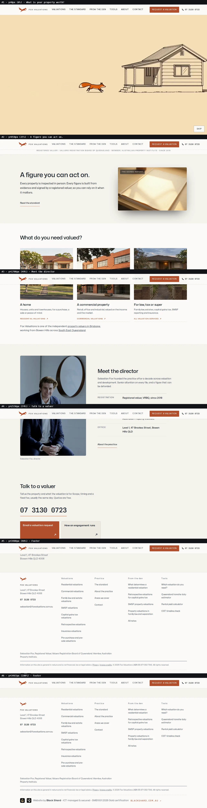
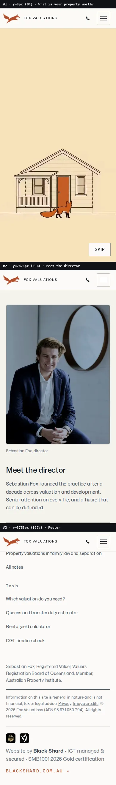

# UI Design System & Master Generation Blueprint: foxvaluations-com-au

> **Property valuations Brisbane · Fox Valuations** (https://foxvaluations.com.au) — Independent property valuations across Brisbane and South East Queensland by registered valuer Sebastian Fox. Fixed fee, quoted free.





---

## 1. Executive Visual Persona & Design Archetype

- **Brand Essence & Persona**: **Property valuations Brisbane · Fox Valuations** (`https://foxvaluations.com.au`). Independent property valuations across Brisbane and South East Queensland by registered valuer Sebastian Fox. Fixed fee, quoted free.
- **Capture Provenance**: Live browser capture (`tier1_fast`, HTTP `200`, captured `2026-11-24`).
- **Visual Archetype**: **Light-Substrate Editorial & Modular Grid System (`#fbfaf7` canvas, `#131a24` ink, `#d96b3f` accent)**.
- **Anti-AI-Slop Differentiators**:
  - **Live-Computed Chromatic Polarity**: Anchors the viewport in `#fbfaf7` (live computed `body` `background-color` (`computed_styles.json`)) paired with `#131a24` primary typography and `#d96b3f` accents.
  - **Grounded Typographic Hierarchy**: Uses `Mona Sans` across display (`What is your property worth?`) and body copy, paired with `Spline Sans Mono` for monospace/code.
  - **Calibrated Spatial Grid & Motion**: Combines `1440px` container bounds (`gap: 25.6px`, padding `0.55rem`) with `cubic-bezier(0.22,1,0.36,1)` easing.

---

## 2. Spatial Architecture & Modular Grid Mathematics

### Viewport Allocation & Container Geometry
- **Captured Journey Filmstrips**: Desktop `1280×4968px` (`assets/desktop-journey.webp`, `6` keyframes up to `y=3467px` / doc `4367px`), Mobile `390×2616px` (`assets/mobile-journey.webp`, `3` keyframes).
- **Master Container Bounds**: `1440px` (full-bleed `100%` desktop stage measured on `1440px` viewport).
- **Canvas Lateral Padding & Spacing**: `0.55rem` lateral canvas padding with `25.6px` grid gap.
- **Border Radius Scale**: `3px`, `2px`, `50%`, `6px`.

### Responsive Breakpoint Architecture
- **Desktop Layout**: Multi-column CSS Grid / Flexbox layout at `1440px` (`max-width: 1440px`, `gap: 25.6px`).
- **Mobile Layout**: Single-column vertical stack at `390px` viewport width with `0.55rem` horizontal padding.
- **Extracted CSS Media Queries**: `@media (prefers-reduced-motion: no-preference)`, `@media (prefers-reduced-motion: reduce)`, `@media (max-width: 900px)`, `@media (max-width: 520px)`.

---

## 3. Color System, Materiality & Atmospheric Lighting

### Semantic Palette & Source Grounding
| Semantic Role | Ground-Truth Value | Extracted Live / CSS Source |
|---|---|---|
| **Primary Canvas Substrate** | `#fbfaf7` | live computed `body` `background-color` (`computed_styles.json`) |
| **Primary Typography Ink** | `#131a24` | live computed `h1` `color` (`computed_styles.json`) |
| **Elevated Surface / Card Substrate** | `#fafaf8` | `var(--paper)` in `:root` |
| **Interactive Accent / Highlight** | `#d96b3f` | live computed `a` `background-color` (`computed_styles.json`) |
| **Secondary / Muted Copy** | `#414b58` | live computed `p` `color` (`computed_styles.json`) |
| **Structural Hairline Border** | `#dad8d0` | `var(--line)` in `:root` |
| **Variable Token (`--ink`)** | `#16202f` | `var(--ink)` in `:root` |
| **Variable Token (`--ink-2`)** | `#1c2839` | `var(--ink-2)` in `:root` |
| **Variable Token (`--ink-line`)** | `#2c3b50` | `var(--ink-line)` in `:root` |
| **Variable Token (`--plaster`)** | `#f1f1ed` | `var(--plaster)` in `:root` |
| **Variable Token (`--graphite`)** | `#262e3c` | `var(--graphite)` in `:root` |
| **Variable Token (`--slate`)** | `#5b6473` | `var(--slate)` in `:root` |
| **Variable Token (`--rust`)** | `#b14d2b` | `var(--rust)` in `:root` |
| **Variable Token (`--dark-body`)** | `#b8bfc9` | `var(--dark-body)` in `:root` |
| **Variable Token (`--dark-dim`)** | `#9aa3b0` | `var(--dark-dim)` in `:root` |
| **Variable Token (`--dark-bright`)** | `#f5f4f0` | `var(--dark-bright)` in `:root` |

### Sanitized Root CSS Variables (`ui-ux.md` Ground Truth)
| Variable Name | Extracted Value | Semantic Role |
|---|---|---|
| `--ink` | `#16202F` | Typography Ink Token |
| `--ink-2` | `#1C2839` | Typography Ink Token |
| `--ink-line` | `#2C3B50` | Typography Ink Token |
| `--paper` | `#FAFAF8` | Canvas / Surface Token |
| `--plaster` | `#F1F1ED` | Color / Atmospheric Token |
| `--graphite` | `#262E3C` | Color / Atmospheric Token |
| `--slate` | `#5B6473` | Color / Atmospheric Token |
| `--rust` | `#B14D2B` | Color / Atmospheric Token |
| `--rust-bright` | `#D96B3F` | Color / Atmospheric Token |
| `--line` | `#DAD8D0` | Color / Atmospheric Token |
| `--dark-body` | `#B8BFC9` | Canvas / Surface Token |
| `--dark-dim` | `#9AA3B0` | Canvas / Surface Token |
| `--dark-bright` | `#F5F4F0` | Canvas / Surface Token |
| `--mono` | `"Spline Sans Mono", "SF Mono", Consolas, monospace` | Typography / Scale Token |
| `--label` | `0.8rem` | Dimension / Scale Token |
| `--shell` | `1240px` | Dimension / Scale Token |

---

## 4. Typographic Scale & Editorial Hierarchy

### Font Family Stacks
- **Display Typography**: `Mona Sans`.
- **Primary Body Stack**: `Mona Sans`.
- **Technical / Metadata Stack**: `Spline Sans Mono`.

### Typographic Scale & Rules (Live Computed & Stylesheet Grounded)
- **Hero Display (`H1`)**: live computed `h1` (`font-size: 64px`, `line-height: 66.56px`, `font-weight: 500`, `letter-spacing: -0.896px`); CSS variables `--display-ls: -0.032em`; rule `h1` (`font-size: clamp(2.6rem, 6vw, 4.5rem)`, `line-height: 1.04`, `letter-spacing: -0.015em`, `font-weight: 500`).
- **Section Heading (`H2`)**: live computed `h2` (`font-size: 44.8px`, `line-height: 47.488px`, `font-weight: 500`, `letter-spacing: -0.6272px`); rule `h2` (`font-size: clamp(1.5rem, 2.6vw, 2.05rem)`, `line-height: 1.12`, `letter-spacing: -0.01em`, `font-weight: 500`).
- **Body Copy**: live computed `body` (`font-size: 16px`, `line-height: 26.4px`, `font-weight: 400`); rule `p` (`font-size: 1rem`).
- **Metadata & Navigation Labels**: live computed `nav/a` (`font-size: 16px`, `line-height: 26.4px`, `font-weight: 400`); CSS variables `--mono: "Spline Sans Mono", "SF Mono", Consolas, monospace`, `--label: 0.8rem`.

---

## 5. Choreographed Motion & Interaction Physics

### Primary Easing Curves
- **Extracted Timing Functions**: `cubic-bezier(0.22,1,0.36,1)`, `cubic-bezier(.3,1.35,.45,1)`.

### Per-Element Transition & Choreography Rules
- **Selector `.site-head`**: `transition: border-color 0.3s var(--ease)` extracted from `foxvaluations-com-au` stylesheet.
- **Selector `.site-nav a`**: `transition: border-color 0.2s, color 0.2s` extracted from `foxvaluations-com-au` stylesheet.
- **Selector `.head-call`**: `transition: background 0.25s var(--ease), color 0.25s var(--ease)` extracted from `foxvaluations-com-au` stylesheet.
- **Extracted Easing Curve (`cubic-bezier(0.22,1,0.36,1)`)**: Governs interactive state transitions across `<header.site-head>` and `<section.cred-strip>`.
- **State & Hover Choreography**: Opacity and transform transitions on `<section.landing>` and `<section.cred-strip>` interactive targets.
### Measured Runtime Scroll & Interaction Telemetry (`behavioral_journey_v2`)
- **Scroll Driver Mode**: `native` (max document height `4367px`, deepest scrollY reached `3467px` across `6` desktop keyframes).
- **Detected Scroll / Motion Libraries**: Native browser scroll / standard CSS transitions.
- **Hover Physics (`primary_cta` · `REQUEST A VALUATION`)**: `backgroundColor`: `rgb(177, 77, 43)` -> `rgb(217, 107, 63)`; `borderColor`: `rgb(177, 77, 43)` -> `rgb(217, 107, 63)` (`transition-duration: 0.25s, 0.25s, 0.25s`, `timing: cubic-bezier(0.22, 1, 0.36, 1), cubic-bezier(0.22, 1, 0.36, 1), cubic-bezier(0.22, 1, 0.36, 1)`).
- **Route Transition Architecture**: First internal navigation (`/valuations/residential/`) measured as `direct` in `2341ms`.

---

## 6. Component Wireframe & Structural DOM Map

### Visual Layout Schematic — Desktop (`1440px`, Grounded in `dom.html` & Landmark Bounding Boxes)
```
┌────────────────────────────────────────────────────────────────────────┐
│ DESKTOP VIEWPORT (1440px) — Property valuations Brisbane · Fox Valuati │
│ ====================================================================== │
│ [ <header.site-head> (1440x72px)      | Valuations · The standard ·  ] │
│ ---------------------------------------------------------------------- │
│ | HERO STAGE: <section.landing> (w=1440px)                           | │
│ | H1: What is your property worth?                                   | │
│ | Substrate: #fbfaf7 | Ink: #131a24 | Accent: #d96b3f                | │
│ ---------------------------------------------------------------------- │
│ | SHOWCASE GRID (<section.cred-strip>) max-w: 1440px                 | │
│ | +------------------------------+  +------------------------------+ | │
│ | | A figure you can act on.     |  | What do you need valued?     | | │
│ | +------------------------------+  +------------------------------+ | │
│ ---------------------------------------------------------------------- │
│ | DETAIL MODULE (<section.standard>) — Meet the director             | │
│ ---------------------------------------------------------------------- │
│ [ FOOTER (<footer.site-foot>  ) | https://foxvaluations.com.au         │
└────────────────────────────────────────────────────────────────────────┘
```

### Visual Layout Schematic — Mobile Reflow (`390px`)
```
┌────────────────────────────────────────────────────────────────────────┐
│ MOBILE VIEWPORT REFLOW (390px) — Single-Column Stack (gap: 25.6px)     │
│ ====================================================================== │
│ [ HEADER BAR (<header.site-head>      ) | Compact Menu (390px)         │
│ ---------------------------------------------------------------------- │
│ | HERO STAGE (<section.landing>) — 390px Vertical Lead               | │
│ | H1: What is your property worth?                                   | │
│ ---------------------------------------------------------------------- │
│ | SHOWCASE STACK (<section.cred-strip>) — 1-Col Stack                | │
│ | [ Item 1: A figure you can act on.                               ] | │
│ | [ Item 2: What do you need valued?                               ] | │
│ ---------------------------------------------------------------------- │
│ | DETAIL STACK (<section.standard>) — 1-Col (Meet the director)      | │
│ ---------------------------------------------------------------------- │
│ [ FOOTER (<footer.site-foot>  ) | Stacked 390px Colophon               │
└────────────────────────────────────────────────────────────────────────┘
```

### Granular DOM Region Breakdown
1. **Brand Header & Navigation Bar (<header.site-head> — `foxvaluations-com-au`)**:
   - Landmark `<header class="site-head site-head-cine">` (`1440x72px`) hosting `Property valuations Brisbane · Fox V` navigation (`Valuations · The standard · From the den · Tools · About`), DOM attributes (`data-website-id="dc310766-8aa8-41ef-af..."`, `data-portrait="1"`, `data-slot="svc-residential"`, `data-slot="svc-commercial"`), and stylesheet rule `html { scroll-behavior: smooth }`.
2. **Hero Stage & Focal Lead (<section.landing> — `What is your property worth?`)**:
   - Landmark `<section class="landing">` presenting display lead `What is your property worth?` and copy excerpt *"Independent property valuations by a registered valuer. Brisbane "* over `#fbfaf7` canvas and `#131a24` ink.
3. **Primary Showcase & Content Grid (<section.cred-strip> — `A figure you can act on.`)**:
   - Landmark `<section class="cred-strip">` rendering section `A figure you can act on.` with copy *"Registered valuer · Valuers Registration Board of Queensland · Me"*, asset references (`favicon-rust.png`, `analytics.blackshard.com.au`, `fox-mark-rust.png`, `fox-run-first-v2.webp`), and grid rule `img { display: block;max-width: 100%;height: auto }`.
4. **Interactive Detail & Feature Matrix (<section.standard> — `What do you need valued?`)**:
   - Landmark `<section class="standard standard-band">` framing `What do you need valued?` and `Meet the director` (*"Every property is inspected in person. Every figure is built from"*) with `#fafaf8` surface cards, `#d96b3f` accents, and `focus-visible { outline: 2px solid var(--rust);outline-offset: 3px }`.
5. **Colophon & Global Directory Footer (<footer.site-foot> — `https://foxvaluations.com.au`)**:
   - Landmark `<footer class="site-foot">` anchoring `Property valuations Brisbane · F` footer links (`Valuations · The standard · From the den · Tools · About`), copy *"Houses, units and townhouses, for a purchase, a sale or peac"*, and `#dad8d0` structural dividers.
### Full Vertical Scroll Sequence (Desktop `1440×900` Keyframes)
- **Step 01** (`y=0px`, `0%`): Active landmark `What is your property worth?` · sticky/fixed elements: `1`
- **Step 02** (`y=850px`, `25%`): Active landmark `A figure you can act on.` · sticky/fixed elements: `1`
- **Step 03** (`y=1700px`, `49%`): Active landmark `Meet the director` · sticky/fixed elements: `1`
- **Step 04** (`y=2550px`, `74%`): Active landmark `Talk to a valuer` · sticky/fixed elements: `1`
- **Step 05** (`y=3400px`, `98%`): Active landmark `Footer` · sticky/fixed elements: `1`
- **Step 06** (`y=3467px`, `100%`): Active landmark `Footer` · sticky/fixed elements: `1`

### Multi-Page Internal Route Map
- **Detail Route (`/valuations/residential/`)**: `https://foxvaluations.com.au/valuations/residential/` — H1: `Residential property valuations Brisbane`, scrollHeight `3445px`, transition `direct` (`2341ms`)
- **About Route (`/about/`)**: `https://foxvaluations.com.au/about/` — H1: `About the practice`, scrollHeight `2847px`, transition `direct` (`1084ms`)
- **Detail Route (`/valuations/commercial/`)**: `https://foxvaluations.com.au/valuations/commercial/` — H1: `Commercial property valuations Brisbane`, scrollHeight `5184px`, transition `direct` (`1052ms`)

---

## 7. Master Zero-Shot AI Generation Prompt

```markdown
# Master Zero-Shot Frontend Generation Prompt: foxvaluations-com-au (Property valuations Brisbane · Fox Valuations)

You are a principal frontend architect and design systems engineer. Build a complete, production-ready web application replicating the exact design system, DOM landmarks, typographic hierarchy, color tokens, and motion physics of `foxvaluations-com-au` (**Property valuations Brisbane · Fox Valuations** — `https://foxvaluations.com.au`).

### 1. Visual Archetype & Anti-AI-Slop Mandates
- **Archetype**: Light-Substrate Editorial & Modular Grid System (`#fbfaf7` canvas, `#131a24` ink, `#d96b3f` accent).
- **Identity & Domain Context**: Independent property valuations across Brisbane and South East Queensland by registered valuer Sebastian Fox. Fixed fee, quoted free.
- **Primary Substrate**: `#fbfaf7` (live computed `body` `background-color` (`computed_styles.json`)), **Primary Ink**: `#131a24`, **Accent / Highlight**: `#d96b3f`.
- **Site-Specific Differentiators**:
  - **Live-Computed Chromatic Polarity**: Anchors the viewport in `#fbfaf7` (live computed `body` `background-color` (`computed_styles.json`)) paired with `#131a24` primary typography and `#d96b3f` accents.
  - **Grounded Typographic Hierarchy**: Uses `Mona Sans` across display (`What is your property worth?`) and body copy, paired with `Spline Sans Mono` for monospace/code.
  - **Calibrated Spatial Grid & Motion**: Combines `1440px` container bounds (`gap: 25.6px`, padding `0.55rem`) with `cubic-bezier(0.22,1,0.36,1)` easing.

### 2. Ground-Truth CSS Variables (`:root` Token Contract)
Declare and consume these exact custom properties extracted from `foxvaluations-com-au` in your global stylesheet:

:root {
  /* Property valuations Brisbane · Fox Valuations (foxvaluations-com-au) — Live-Grounded CSS Variables */
  --ink: #16202F; /* Typography Ink Token (foxvaluations-com-au) */
  --ink-2: #1C2839; /* Typography Ink Token (foxvaluations-com-au) */
  --ink-line: #2C3B50; /* Typography Ink Token (foxvaluations-com-au) */
  --paper: #FAFAF8; /* Canvas / Surface Token (foxvaluations-com-au) */
  --plaster: #F1F1ED; /* Color / Atmospheric Token (foxvaluations-com-au) */
  --graphite: #262E3C; /* Color / Atmospheric Token (foxvaluations-com-au) */
  --slate: #5B6473; /* Color / Atmospheric Token (foxvaluations-com-au) */
  --rust: #B14D2B; /* Color / Atmospheric Token (foxvaluations-com-au) */
  --rust-bright: #D96B3F; /* Color / Atmospheric Token (foxvaluations-com-au) */
  --line: #DAD8D0; /* Color / Atmospheric Token (foxvaluations-com-au) */
  --dark-body: #B8BFC9; /* Canvas / Surface Token (foxvaluations-com-au) */
  --dark-dim: #9AA3B0; /* Canvas / Surface Token (foxvaluations-com-au) */
  --dark-bright: #F5F4F0; /* Canvas / Surface Token (foxvaluations-com-au) */
  --mono: "Spline Sans Mono", "SF Mono", Consolas, monospace; /* Typography / Scale Token (foxvaluations-com-au) */
  --label: 0.8rem; /* Dimension / Scale Token (foxvaluations-com-au) */
  --shell: 1240px; /* Dimension / Scale Token (foxvaluations-com-au) */
}

### 3. Semantic Color & Materiality Contract
Map every surface, ink, and border strictly to these source-grounded tokens:
- **Primary Canvas Substrate**: `#fbfaf7` — grounded in live computed `body` `background-color` (`computed_styles.json`)
- **Primary Typography Ink**: `#131a24` — grounded in live computed `h1` `color` (`computed_styles.json`)
- **Elevated Surface / Card Substrate**: `#fafaf8` — grounded in `var(--paper)` in `:root`
- **Interactive Accent / Highlight**: `#d96b3f` — grounded in live computed `a` `background-color` (`computed_styles.json`)
- **Secondary / Muted Copy**: `#414b58` — grounded in live computed `p` `color` (`computed_styles.json`)
- **Structural Hairline Border**: `#dad8d0` — grounded in `var(--line)` in `:root`
- **Variable Token (`--ink`)**: `#16202f` — grounded in `var(--ink)` in `:root`
- **Variable Token (`--ink-2`)**: `#1c2839` — grounded in `var(--ink-2)` in `:root`
- **Variable Token (`--ink-line`)**: `#2c3b50` — grounded in `var(--ink-line)` in `:root`
- **Variable Token (`--plaster`)**: `#f1f1ed` — grounded in `var(--plaster)` in `:root`
- **Variable Token (`--graphite`)**: `#262e3c` — grounded in `var(--graphite)` in `:root`
- **Variable Token (`--slate`)**: `#5b6473` — grounded in `var(--slate)` in `:root`
- **Variable Token (`--rust`)**: `#b14d2b` — grounded in `var(--rust)` in `:root`
- **Variable Token (`--dark-body`)**: `#b8bfc9` — grounded in `var(--dark-body)` in `:root`
- **Variable Token (`--dark-dim`)**: `#9aa3b0` — grounded in `var(--dark-dim)` in `:root`
- **Variable Token (`--dark-bright`)**: `#f5f4f0` — grounded in `var(--dark-bright)` in `:root`

### 4. Spatial Grid, Container Bounds & Responsive Breakpoints
- **Desktop Viewport Reference**: `1280×4968px` (multi-frame vertical journey filmstrip (4968px), `1440px` standard desktop width).
- **Mobile Viewport Reference**: `390×2616px` (multi-frame vertical journey filmstrip (2616px), `390px` standard mobile width).
- **Container Max-Width**: `1440px` (full-bleed `100%` desktop stage measured on `1440px` viewport)
- **Padding & Gutters**: `0.55rem` lateral canvas padding with `25.6px` grid gap
- **Desktop Grid**: Multi-column CSS Grid / Flexbox layout at `1440px` (`max-width: 1440px`, `gap: 25.6px`)
- **Mobile Adaptation**: Single-column vertical stack at `390px` viewport width with `0.55rem` horizontal padding
- **Media Queries**: `@media (prefers-reduced-motion: no-preference)`, `@media (prefers-reduced-motion: reduce)`, `@media (max-width: 900px)`, `@media (max-width: 520px)`
- **Corner Radii**: `3px`, `2px`, `50%`, `6px`

### 5. Typography & Editorial Scale Contract
- **Display Font Stack**: `Mona Sans`
- **Body Font Stack**: `Mona Sans`
- **Monospace / Technical Font Stack**: `Spline Sans Mono`
- **H1 Display Rule**: live computed `h1` (`font-size: 64px`, `line-height: 66.56px`, `font-weight: 500`, `letter-spacing: -0.896px`); CSS variables `--display-ls: -0.032em`; rule `h1` (`font-size: clamp(2.6rem, 6vw, 4.5rem)`, `line-height: 1.04`, `letter-spacing: -0.015em`, `font-weight: 500`)
- **H2 Section Rule**: live computed `h2` (`font-size: 44.8px`, `line-height: 47.488px`, `font-weight: 500`, `letter-spacing: -0.6272px`); rule `h2` (`font-size: clamp(1.5rem, 2.6vw, 2.05rem)`, `line-height: 1.12`, `letter-spacing: -0.01em`, `font-weight: 500`)
- **Body Copy Rule**: live computed `body` (`font-size: 16px`, `line-height: 26.4px`, `font-weight: 400`); rule `p` (`font-size: 1rem`)
- **Metadata & Index Rule**: live computed `nav/a` (`font-size: 16px`, `line-height: 26.4px`, `font-weight: 400`); CSS variables `--mono: "Spline Sans Mono", "SF Mono", Consolas, monospace`, `--label: 0.8rem`

### 6. Component Hierarchy, Verbatim Copy & Real DOM Landmarks
Scaffold `foxvaluations-com-au` (`Property valuations Brisbane · Fox Valuations`) with these exact structural regions, extracted copy, and CSS rules from `dom.html`:
1. **Brand Header & Navigation Bar (<header.site-head> — `foxvaluations-com-au`)**:
   - DOM & Selectors: Landmark `<header class="site-head site-head-cine">` (`1440x72px`) hosting `Property valuations Brisbane · Fox V` navigation (`Valuations · The standard · From the den · Tools · About`), DOM attributes (`data-website-id="dc310766-8aa8-41ef-af..."`, `data-portrait="1"`, `data-slot="svc-residential"`, `data-slot="svc-commercial"`), and stylesheet rule `html { scroll-behavior: smooth }`.
   - Responsive Contract: Header `Brand Header & Navigation Bar (<header.site-head> — `foxvaluations-com-au`)` (`foxvaluations-com-au`) adapts across `@media (prefers-reduced-motion: no-preference)`, `@media (prefers-reduced-motion: reduce)`, `@media (max-width: 900px)`, `@media (max-width: 520px)` with `cubic-bezier(0.22,1,0.36,1)`, `cubic-bezier(.3,1.35,.45,1)` transitions and links `Valuations · The standard · From the den · Tools · About`.
2. **Hero Stage & Focal Lead (<section.landing> — `What is your property worth?`)**:
   - DOM & Selectors: Landmark `<section class="landing">` presenting display lead `What is your property worth?` and copy excerpt *"Independent property valuations by a registered valuer. Brisbane "* over `#fbfaf7` canvas and `#131a24` ink.
   - Responsive Contract: Hero stage (`1280×4968px` desktop / `390×2616px` mobile) sets `#fbfaf7` background with `#131a24` headline `What is your property worth?`.
3. **Primary Showcase & Content Grid (<section.cred-strip> — `A figure you can act on.`)**:
   - DOM & Selectors: Landmark `<section class="cred-strip">` rendering section `A figure you can act on.` with copy *"Registered valuer · Valuers Registration Board of Queensland · Me"*, asset references (`favicon-rust.png`, `analytics.blackshard.com.au`, `fox-mark-rust.png`, `fox-run-first-v2.webp`), and grid rule `img { display: block;max-width: 100%;height: auto }`.
   - Responsive Contract: Showcase grid `Primary Showcase & Content Grid (<section.cred-strip> — `A figure you can act on.`)` applies Multi-column CSS Grid / Flexbox layout at `1440px` (`max-width: 1440px`, `gap: 25.6px`) on desktop and Single-column vertical stack at `390px` viewport width with `0.55rem` horizontal padding on mobile.
4. **Interactive Detail & Feature Matrix (<section.standard> — `What do you need valued?`)**:
   - DOM & Selectors: Landmark `<section class="standard standard-band">` framing `What do you need valued?` and `Meet the director` (*"Every property is inspected in person. Every figure is built from"*) with `#fafaf8` surface cards, `#d96b3f` accents, and `focus-visible { outline: 2px solid var(--rust);outline-offset: 3px }`.
   - Responsive Contract: Detail module `Interactive Detail & Feature Matrix (<section.standard> — `What do you need valued?`)` uses `3px`, `2px`, `50%`, `6px` radii, `#d96b3f` highlights, and assets (favicon-rust.png, analytics.blackshard.com.au, fox-mark-rust.png).
5. **Colophon & Global Directory Footer (<footer.site-foot> — `https://foxvaluations.com.au`)**:
   - DOM & Selectors: Landmark `<footer class="site-foot">` anchoring `Property valuations Brisbane · F` footer links (`Valuations · The standard · From the den · Tools · About`), copy *"Houses, units and townhouses, for a purchase, a sale or peac"*, and `#dad8d0` structural dividers.
   - Responsive Contract: Footer `Colophon & Global Directory Footer (<footer.site-foot> — `https://foxvaluations.com.au`)` aligns to `1440px` (full-bleed `100%` desktop stage measured on `1440px` viewport) with `0.55rem` lateral canvas padding with `25.6px` grid gap and attributes (data-website-id="dc310766-8aa8-41ef-af...", data-portrait="1", data-slot="svc-residential").

#### Verbatim DOM Copy Excerpts (`dom.html`)
- Copy Excerpt 1: *"Independent property valuations by a registered valuer. Brisbane based, Australia-..."*
- Copy Excerpt 2: *"Registered valuer · Valuers Registration Board of Queensland · Member, Australian..."*
- Copy Excerpt 3: *"Every property is inspected in person. Every figure is built from evidence and sig..."*
- Copy Excerpt 4: *"Houses, units and townhouses, for a purchase, a sale or peace of mind."*

### 7. Motion, Extracted Stylesheet Rules & Interaction Choreography
- **Primary Easing Functions**: `cubic-bezier(0.22,1,0.36,1)`, `cubic-bezier(.3,1.35,.45,1)`
- **Extracted Stylesheet Rules (`foxvaluations-com-au`)**:
- `html { scroll-behavior: smooth }`
- `img { display: block;max-width: 100%;height: auto }`
- `focus-visible { outline: 2px solid var(--rust);outline-offset: 3px }`
- `.nowrap { white-space: nowrap }`
- `.shell { max-width: var(--shell);margin: 0 auto;padding-inline: clamp(1.25rem, 4v... }`
- **Per-Selector Transition Rules**:
- **Selector `.site-head`**: `transition: border-color 0.3s var(--ease)` extracted from `foxvaluations-com-au` stylesheet.
- **Selector `.site-nav a`**: `transition: border-color 0.2s, color 0.2s` extracted from `foxvaluations-com-au` stylesheet.
- **Selector `.head-call`**: `transition: background 0.25s var(--ease), color 0.25s var(--ease)` extracted from `foxvaluations-com-au` stylesheet.
- **Extracted Easing Curve (`cubic-bezier(0.22,1,0.36,1)`)**: Governs interactive state transitions across `<header.site-head>` and `<section.cred-strip>`.
- **State & Hover Choreography**: Opacity and transform transitions on `<section.landing>` and `<section.cred-strip>` interactive targets.
### 7b. Full-Page Scroll Choreography, Interactive States & Multi-Page Routes
- **Scroll Mechanics**: Implement `native` vertical progression up to `4367px` across 6 distinct viewport chapters.
- **Vertical Chapter Sequence**: What is your property worth? (0%) -> A figure you can act on. (25%) -> Meet the director (49%) -> Talk to a valuer (74%) -> Footer (98%) -> Footer (100%).
- **Hover Micro-Interaction (`primary_cta`)**: Animate `backgroundColor, borderColor` with `0.25s, 0.25s, 0.25s cubic-bezier(0.22, 1, 0.36, 1), cubic-bezier(0.22, 1, 0.36, 1), cubic-bezier(0.22, 1, 0.36, 1)`.
- **Multi-Page Routes**: Scaffold internal routes `/valuations/residential/` (detail, direct), `/about/` (about, direct), `/valuations/commercial/` (detail, direct) sharing the global header/footer shell and design tokens.

### 8. Technical Deliverables
- Implement in Next.js (App Router) with TypeScript and Tailwind CSS consuming the `:root` custom properties defined above for `foxvaluations-com-au`.
- Reproduce both the `1440px` desktop architecture and `390px` mobile breakpoint transitions, preserving semantic HTML5 landmarks (`<header>`, `<nav>`, `<main>`, `<section>`, `<footer>`) and `prefers-reduced-motion` accessibility guards.
```
---

## 8. Full-Page Scroll Journey, Interactive States & Subpage Inventory

### Desktop Scroll Keyframes (`1440×900` WebP)
| Step | Scroll Y | Progress | Active Landmark / Section | Sticky/Fixed | Visual Asset |
| :---: | :---: | :---: | :--- | :---: | :--- |
| `#01` | `0px` | `0%` | What is your property worth? | `1` | [desktop-step-01.webp](assets/desktop-step-01.webp) |
| `#02` | `850px` | `25%` | A figure you can act on. | `1` | [desktop-step-02.webp](assets/desktop-step-02.webp) |
| `#03` | `1700px` | `49%` | Meet the director | `1` | [desktop-step-03.webp](assets/desktop-step-03.webp) |
| `#04` | `2550px` | `74%` | Talk to a valuer | `1` | [desktop-step-04.webp](assets/desktop-step-04.webp) |
| `#05` | `3400px` | `98%` | Footer | `1` | [desktop-step-05.webp](assets/desktop-step-05.webp) |
| `#06` | `3467px` | `100%` | Footer | `1` | [desktop-step-06.webp](assets/desktop-step-06.webp) |

### Mobile Condensed Keyframes (`390×844` WebP)
| Step | Scroll Y | Progress | Active Landmark | Visual Asset |
| :---: | :---: | :---: | :--- | :--- |
| `#01` | `0px` | `0%` | What is your property worth? | [mobile-step-01.webp](assets/mobile-step-01.webp) |
| `#02` | `2876px` | `50%` | Meet the director | [mobile-step-02.webp](assets/mobile-step-02.webp) |
| `#03` | `5753px` | `100%` | Footer | [mobile-step-03.webp](assets/mobile-step-03.webp) |

### Internal Subpage Filmstrips (`1080px` Wide WebP)
| # | Template | Route URL | H1 / Title | Scroll Height | Transition | Filmstrip Asset |
| :-: | :---: | :--- | :--- | :---: | :---: | :--- |
| `1` | `detail` | `https://foxvaluations.com.au/valuations/residential/` | Residential property valuations Brisbane | `3445px` | `direct` (`2341ms`) | [subpage-01-valuations-residential.webp](assets/subpage-01-valuations-residential.webp) |
| `2` | `about` | `https://foxvaluations.com.au/about/` | About the practice | `2847px` | `direct` (`1084ms`) | [subpage-02-about.webp](assets/subpage-02-about.webp) |
| `3` | `detail` | `https://foxvaluations.com.au/valuations/commercial/` | Commercial property valuations Brisbane | `5184px` | `direct` (`1052ms`) | [subpage-03-valuations-commercial.webp](assets/subpage-03-valuations-commercial.webp) |

