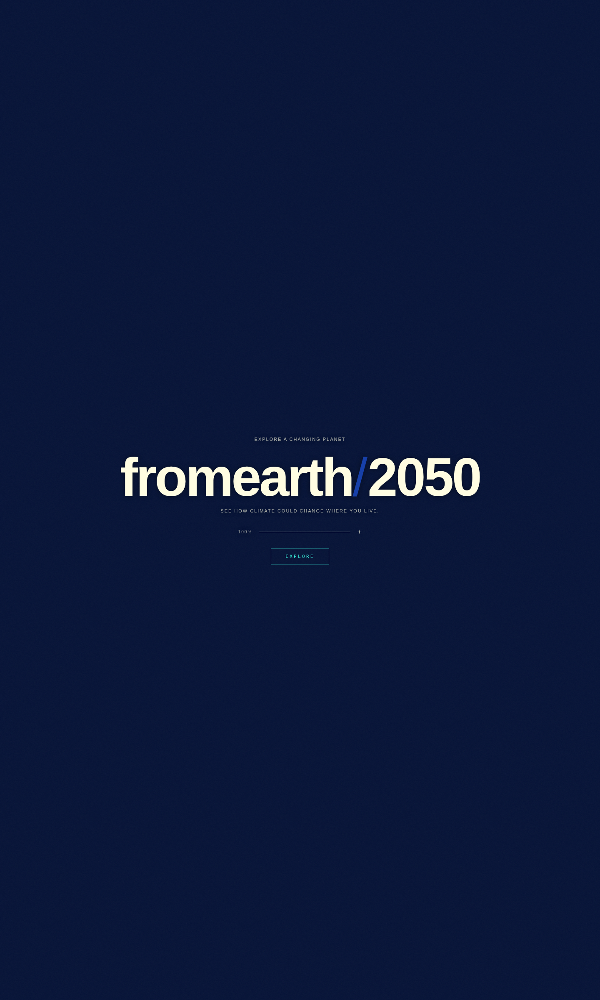

# UI Design System & Master Generation Blueprint: fromearth-love

> **fromearth · 2050 — Explore climate projections** (http://fromearth.love) — See your future. Explore how climate and population could change where you live, from 2026 to 2050.



---

## 1. Executive Visual Persona & Design Archetype

- **Brand Essence & Persona**: **fromearth · 2050 — Explore climate projections** (`http://fromearth.love`). See your future. Explore how climate and population could change where you live, from 2026 to 2050.
- **Visual Archetype**: **Light-Gallery WebGL / Canvas Interactive Experience (`#f5f7fa` / `#051236`)**.
- **Anti-AI-Slop Differentiators**:
  - **Source-Grounded Chromatic Polarity**: Anchors the viewport in `#f5f7fa` (`var(--glass-text)` in `:root`) paired with `#051236` primary typography and `#051236` accents.
  - **Extracted Typographic Hierarchy**: Pairs `Noto Sans Cuneiform` for display copy (`Hello, ·⋅+✧✶ human. ⋮·⋅+✧`) with `EarthLausanne` and not declared in static CSS (uses primary stack / `ui-monospace`).
  - **Calibrated Spatial Grid & Motion**: Combines `600px` container bounds (`gap: 3px`, padding `32px`) with `cubic-bezier(.19,1,.22,1)` easing and GSAP Timeline & ScrollTrigger, Three.js / WebGL Canvas Pipeline.

---

## 2. Spatial Architecture & Modular Grid Mathematics


### Viewport Allocation & Container Geometry
- **Captured Viewport Dimensions**: Desktop `1440×2400px` (`assets/desktop.png`, capped at 2400px multi-section capture), Mobile `390×2400px` (`assets/mobile.png`, capped at 2400px multi-section capture).
- **Master Container Bounds**: `600px` extracted from `fromearth-love` stylesheet.
- **Canvas Lateral Padding & Spacing**: `32px` lateral canvas padding with `3px` grid gap.
- **Border Radius Scale**: `12px`, `50%`, `2px`, `24px`.

### Responsive Breakpoint Architecture
- **Desktop Layout**: Multi-column CSS Grid / Flexbox layout at `1440px` (`max-width: 600px`, `gap: 3px`).
- **Mobile Layout**: Single-column vertical stack at `390px` viewport width with `32px` horizontal padding.
- **Extracted CSS Media Queries**: `@media (max-height:650px)`, `@media (prefers-reduced-motion:reduce)`, `@media (max-width:600px)`, `@media (max-width:720px)`.

---

## 3. Color System, Materiality & Atmospheric Lighting

### Semantic Palette & Source Grounding
| Semantic Role | Ground-Truth Value | Extracted CSS Source / Selector |
|---|---|---|
| **Primary Canvas Substrate** | `#f5f7fa` | `var(--glass-text)` in `:root` |
| **Primary Typography Ink** | `#c1cad5` | `var(--glass-muted)` in `:root` |
| **Elevated Surface / Card Substrate** | `#b9bdb6` | `var(--fiche-secondaire)` in `:root` |
| **Interactive Accent / Highlight** | `#051236` | `var(--encre)` in `:root` |
| **Secondary / Muted Copy** | `#071a45` | `var(--encre-2)` in `:root` |
| **Structural Hairline Border** | `#0b2358` | `var(--encre-3)` in `:root` |

### Sanitized Root CSS Variables (`ui-ux.md` Ground Truth)
| Variable Name | Extracted Value | Semantic Role |
|---|---|---|
| `--earth-ease` | `cubic-bezier(.19,1,.22,1)` | Motion / Easing Token |
| `--ui-unit` | `max(10px,.5208333333vw)` | Dimension / Scale Token |
| `--ui-inset-x` | `2.5vw` | Dimension / Scale Token |
| `--ui-inset-y` | `var(--ui-inset-x)` | Design System Custom Token |
| `--ui-control` | `max(44px,calc(4.4 * var(--ui-unit)))` | Dimension / Scale Token |
| `--ui-height` | `max(48px,calc(4.8 * var(--ui-unit)))` | Layout / Spatial Grid Token |
| `--ui-gap` | `calc(1.6 * var(--ui-unit))` | Layout / Spatial Grid Token |
| `--ui-step` | `calc(var(--ui-control) + var(--ui-gap))` | Design System Custom Token |
| `--ui-year-width` | `calc(20 * var(--ui-unit))` | Layout / Spatial Grid Token |
| `--ui-left` | `calc(var(--ui-inset-x) + env(safe-area-inset-left,0px))` | Dimension / Scale Token |
| `--ui-right` | `calc(var(--ui-inset-x) + env(safe-area-inset-right,0px))` | Dimension / Scale Token |
| `--ui-top` | `calc(var(--ui-inset-y) + env(safe-area-inset-top,0px))` | Dimension / Scale Token |
| `--dock-bottom` | `calc(max(32px,var(--ui-inset-y)) + env(safe-area-inset-bottom,0px))` | Dimension / Scale Token |
| `--glass-tint` | `rgba(20,20,20,.34)` | Canvas / Surface Token |
| `--glass-text` | `#f5f7fa` | Typography Ink Token |
| `--glass-muted` | `#c1cad5` | Color / Atmospheric Token |

---

## 4. Typographic Scale & Editorial Hierarchy

### Font Family Stacks
- **Display Typography**: `Noto Sans Cuneiform`.
- **Primary Body Stack**: `EarthLausanne`.
- **Technical / Metadata Stack**: not declared in static CSS (uses primary stack / `ui-monospace`).

### Typographic Scale & Rules (Extracted from Stylesheet & Variables)
- **Hero Display (`H1`)**: rule `h1` (`letter-spacing: -.025em`).
- **Section Heading (`H2`)**: rule `h2` (`font-size: 25px`, `line-height: 1.2`, `letter-spacing: -.025em`, `font-weight: 400`).
- **Body Copy**: rule `p` (`font-size: 13px`).
- **Metadata & Navigation Labels**: CSS variables `--mono: 'PingFang TC','Microsoft JhengHei',sans-serif`; rule `small` (`font-size: 10px`, `line-height: 1.3`).

---

## 5. Choreographed Motion & Interaction Physics

### Primary Easing Curves
- **Extracted Timing Functions**: `cubic-bezier(.19,1,.22,1)`, `cubic-bezier(.22,.61,.36,1)`, `cubic-bezier(.16,1,.3,1)`.

### Per-Element Transition & Choreography Rules
- **Selector `#language-options label`**: `transition: background .35s,border-color .35s,color .35s,transform .5s cub...` extracted from `fromearth-love` stylesheet.
- **Selector `#language-continue svg`**: `transition: background .25s,border-color .25s,transform .25s` extracted from `fromearth-love` stylesheet.
- **Selector `#language-continue svg`**: `transition: none` extracted from `fromearth-love` stylesheet.
- **Extracted Easing Curve (`cubic-bezier(.19,1,.22,1)`)**: Governs interactive state transitions across `<header.panneau>` and `<section.fiche-bilan>`.
- **Runtime Interaction Engine**: Integrates GSAP Timeline & ScrollTrigger, Three.js / WebGL Canvas Pipeline with `prefers-reduced-motion: reduce` fallback guards.

---

## 6. Component Wireframe & Structural DOM Map

### Visual Layout Schematic (Grounded in `dom.html` — `1440px` Desktop & `390px` Mobile Reflow)
```
┌────────────────────────────────────────────────────────────────────────┐
│ DESKTOP VIEWPORT (1440px) — fromearth · 2050 — Explore climate project │
│ ====================================================================== │
│ [ <header.panneau>         | Overview · Index · Archive · About · C ]  │
│ ---------------------------------------------------------------------- │
│ | HERO STAGE: <section.loupe>                                      |   │
│ | H1: Hello, ·⋅+✧✶ human. ⋮·⋅+✧                                    |   │
│ | Substrate: #f5f7fa    | Ink: #051236    | Accent: #051236        |   │
│ ---------------------------------------------------------------------- │
│ | SHOWCASE GRID (<section.fiche-bilan>     ) max-w: 600px          |   │
│ | +------------------------------+  +------------------------------+ | │
│ | | Select your language         |  | from earth / 2050            | | │
│ | +------------------------------+  +------------------------------+ | │
│ ---------------------------------------------------------------------- │
│ | MOBILE VIEWPORT REFLOW (390px) — Single-Column Stack (gap: 3px   ) | │
│ | [<header.panneau>] -> [<section.loupe>] -> [<section.fiche-bil] |    │
│ ---------------------------------------------------------------------- │
│ [ FOOTER (<footer.actions>      ) | http://fromearth.love              │
└────────────────────────────────────────────────────────────────────────┘
```

### Granular DOM Region Breakdown
1. **Brand Header & Navigation Bar (<header.panneau> — `fromearth-love`)**:
   - Landmark `<header class="panneau">` hosting `fromearth · 2050 — Explore climate p` navigation (`Overview · Index · Archive · About · Contact`), DOM attributes (`data-engine="three.js r160"`, `data-t="sous1"`, `data-t="sous2"`, `data-t="initialiser"`), and stylesheet rule `font-face { font-family:EarthHerbik;src:url('./fonts/Herbik-MediumItalic.woff2') for... }`.
2. **Hero Stage & Focal Lead (<section.loupe> — `Hello, ·⋅+✧✶ human. ⋮·⋅+✧`)**:
   - Landmark `<section class="loupe">` presenting display lead `Hello, ·⋅+✧✶ human. ⋮·⋅+✧` and copy excerpt *"You ✧✶✺ leave ✺⊹⋮·⋅ a ✶ trace ✧✶✺⊹⋮ on +✧ everything ⋅+✧✶✺⊹⋮·⋅ yo"* over `#f5f7fa` canvas and `#051236` ink.
3. **Primary Showcase & Content Grid (<section.fiche-bilan> — `Select your language`)**:
   - Landmark `<section class="fiche-bilan">` rendering section `Select your language` with copy *"everything ⋅+✧✶✺⊹⋮·⋅"*, asset references (`pixel-earth-animated.png`, `three.module.min.js`, `earth_color_2048.webp`, `earth_mask_4320.webp`), and grid rule `language-dialog::backdrop { background:050606 }`.
4. **Interactive Detail & Feature Matrix (<section.fiche-risques> — `from earth / 2050`)**:
   - Landmark `<section class="fiche-risques">` framing `from earth / 2050` and `The globe could not start` (*"Including ⊹⋮·⋅+✧✶✺ me. ✺⊹⋮ You ✶✺⊹ can ✧✶✺ blame +✧✶✺⊹ the ⋅+✧ co"*) with `#b9bdb6` surface cards, `#051236` accents, and `.language-content { width:min(340px,100%);margin:auto;text-align:center;animation:language-a... }`.
5. **Colophon & Global Directory Footer (<footer.actions> — `http://fromearth.love`)**:
   - Landmark `<footer class="actions">` anchoring `fromearth · 2050 — Explore clima` footer links (`Overview · Index · Archive · About · Contact`), copy *"Including ⊹⋮·⋅+✧✶✺"*, and `#0b2358` structural dividers.

---

## 7. Master Zero-Shot AI Generation Prompt

```markdown
# Master Zero-Shot Frontend Generation Prompt: fromearth-love (fromearth · 2050 — Explore climate projections)

You are a principal frontend architect and design systems engineer. Build a complete, production-ready web application replicating the exact design system, DOM landmarks, typographic hierarchy, color tokens, and motion physics of `fromearth-love` (**fromearth · 2050 — Explore climate projections** — `http://fromearth.love`).

### 1. Visual Archetype & Anti-AI-Slop Mandates
- **Archetype**: Light-Gallery WebGL / Canvas Interactive Experience (`#f5f7fa` / `#051236`).
- **Identity & Domain Context**: See your future. Explore how climate and population could change where you live, from 2026 to 2050.
- **Primary Substrate**: `#f5f7fa` (`var(--glass-text)` in `:root`), **Primary Ink**: `#051236`, **Accent / Highlight**: `#051236`.
- **Site-Specific Differentiators**:
  - **Source-Grounded Chromatic Polarity**: Anchors the viewport in `#f5f7fa` (`var(--glass-text)` in `:root`) paired with `#051236` primary typography and `#051236` accents.
  - **Extracted Typographic Hierarchy**: Pairs `Noto Sans Cuneiform` for display copy (`Hello, ·⋅+✧✶ human. ⋮·⋅+✧`) with `EarthLausanne` and not declared in static CSS (uses primary stack / `ui-monospace`).
  - **Calibrated Spatial Grid & Motion**: Combines `600px` container bounds (`gap: 3px`, padding `32px`) with `cubic-bezier(.19,1,.22,1)` easing and GSAP Timeline & ScrollTrigger, Three.js / WebGL Canvas Pipeline.

### 2. Ground-Truth CSS Variables (`:root` Token Contract)
Declare and consume these exact custom properties extracted from `fromearth-love` in your global stylesheet:

:root {
  /* fromearth · 2050 — Explore climate projections (fromearth-love) — Ground-Truth Extracted CSS Variables */
  --earth-ease: cubic-bezier(.19,1,.22,1); /* Motion / Easing Token (fromearth-love) */
  --ui-unit: max(10px,.5208333333vw); /* Dimension / Scale Token (fromearth-love) */
  --ui-inset-x: 2.5vw; /* Dimension / Scale Token (fromearth-love) */
  --ui-inset-y: var(--ui-inset-x); /* Design System Custom Token (fromearth-love) */
  --ui-control: max(44px,calc(4.4 * var(--ui-unit))); /* Dimension / Scale Token (fromearth-love) */
  --ui-height: max(48px,calc(4.8 * var(--ui-unit))); /* Layout / Spatial Grid Token (fromearth-love) */
  --ui-gap: calc(1.6 * var(--ui-unit)); /* Layout / Spatial Grid Token (fromearth-love) */
  --ui-step: calc(var(--ui-control) + var(--ui-gap)); /* Design System Custom Token (fromearth-love) */
  --ui-year-width: calc(20 * var(--ui-unit)); /* Layout / Spatial Grid Token (fromearth-love) */
  --ui-left: calc(var(--ui-inset-x) + env(safe-area-inset-left,0px)); /* Dimension / Scale Token (fromearth-love) */
  --ui-right: calc(var(--ui-inset-x) + env(safe-area-inset-right,0px)); /* Dimension / Scale Token (fromearth-love) */
  --ui-top: calc(var(--ui-inset-y) + env(safe-area-inset-top,0px)); /* Dimension / Scale Token (fromearth-love) */
  --dock-bottom: calc(max(32px,var(--ui-inset-y)) + env(safe-area-inset-bottom,0px)); /* Dimension / Scale Token (fromearth-love) */
  --glass-tint: rgba(20,20,20,.34); /* Canvas / Surface Token (fromearth-love) */
  --glass-text: #f5f7fa; /* Typography Ink Token (fromearth-love) */
  --glass-muted: #c1cad5; /* Color / Atmospheric Token (fromearth-love) */
}

### 3. Semantic Color & Materiality Contract
Map every surface, ink, and border strictly to these source-grounded tokens:
- **Primary Canvas Substrate**: `#f5f7fa` — grounded in `var(--glass-text)` in `:root`
- **Primary Typography Ink**: `#c1cad5` — grounded in `var(--glass-muted)` in `:root`
- **Elevated Surface / Card Substrate**: `#b9bdb6` — grounded in `var(--fiche-secondaire)` in `:root`
- **Interactive Accent / Highlight**: `#051236` — grounded in `var(--encre)` in `:root`
- **Secondary / Muted Copy**: `#071a45` — grounded in `var(--encre-2)` in `:root`
- **Structural Hairline Border**: `#0b2358` — grounded in `var(--encre-3)` in `:root`

### 4. Spatial Grid, Container Bounds & Responsive Breakpoints
- **Desktop Viewport Reference**: `1440×2400px` (capped at 2400px multi-section capture, `1440px` standard desktop width).
- **Mobile Viewport Reference**: `390×2400px` (capped at 2400px multi-section capture, `390px` standard mobile width).
- **Container Max-Width**: `600px` extracted from `fromearth-love` stylesheet
- **Padding & Gutters**: `32px` lateral canvas padding with `3px` grid gap
- **Desktop Grid**: Multi-column CSS Grid / Flexbox layout at `1440px` (`max-width: 600px`, `gap: 3px`)
- **Mobile Adaptation**: Single-column vertical stack at `390px` viewport width with `32px` horizontal padding
- **Media Queries**: `@media (max-height:650px)`, `@media (prefers-reduced-motion:reduce)`, `@media (max-width:600px)`, `@media (max-width:720px)`
- **Corner Radii**: `12px`, `50%`, `2px`, `24px`

### 5. Typography & Editorial Scale Contract
- **Display Font Stack**: `Noto Sans Cuneiform`
- **Body Font Stack**: `EarthLausanne`
- **Monospace / Technical Font Stack**: not declared in static CSS (uses primary stack / `ui-monospace`)
- **H1 Display Rule**: rule `h1` (`letter-spacing: -.025em`)
- **H2 Section Rule**: rule `h2` (`font-size: 25px`, `line-height: 1.2`, `letter-spacing: -.025em`, `font-weight: 400`)
- **Body Copy Rule**: rule `p` (`font-size: 13px`)
- **Metadata & Index Rule**: CSS variables `--mono: 'PingFang TC','Microsoft JhengHei',sans-serif`; rule `small` (`font-size: 10px`, `line-height: 1.3`)

### 6. Component Hierarchy, Verbatim Copy & Real DOM Landmarks
Scaffold `fromearth-love` (`fromearth · 2050 — Explore climate projections`) with these exact structural regions, extracted copy, and CSS rules from `dom.html`:
1. **Brand Header & Navigation Bar (<header.panneau> — `fromearth-love`)**:
   - DOM & Selectors: Landmark `<header class="panneau">` hosting `fromearth · 2050 — Explore climate p` navigation (`Overview · Index · Archive · About · Contact`), DOM attributes (`data-engine="three.js r160"`, `data-t="sous1"`, `data-t="sous2"`, `data-t="initialiser"`), and stylesheet rule `font-face { font-family:EarthHerbik;src:url('./fonts/Herbik-MediumItalic.woff2') for... }`.
   - Responsive Contract: Header `Brand Header & Navigation Bar (<header.panneau> — `fromearth-love`)` (`fromearth-love`) adapts across `@media (max-height:650px)`, `@media (prefers-reduced-motion:reduce)`, `@media (max-width:600px)`, `@media (max-width:720px)` with `cubic-bezier(.19,1,.22,1)`, `cubic-bezier(.22,.61,.36,1)`, `cubic-bezier(.16,1,.3,1)` transitions and links `Overview · Index · Archive · About · Contact`.
2. **Hero Stage & Focal Lead (<section.loupe> — `Hello, ·⋅+✧✶ human. ⋮·⋅+✧`)**:
   - DOM & Selectors: Landmark `<section class="loupe">` presenting display lead `Hello, ·⋅+✧✶ human. ⋮·⋅+✧` and copy excerpt *"You ✧✶✺ leave ✺⊹⋮·⋅ a ✶ trace ✧✶✺⊹⋮ on +✧ everything ⋅+✧✶✺⊹⋮·⋅ yo"* over `#f5f7fa` canvas and `#051236` ink.
   - Responsive Contract: Hero stage (`1440×2400px` desktop / `390×2400px` mobile) sets `#f5f7fa` background with `#051236` headline `Hello, ·⋅+✧✶ human. ⋮·⋅+✧`.
3. **Primary Showcase & Content Grid (<section.fiche-bilan> — `Select your language`)**:
   - DOM & Selectors: Landmark `<section class="fiche-bilan">` rendering section `Select your language` with copy *"everything ⋅+✧✶✺⊹⋮·⋅"*, asset references (`pixel-earth-animated.png`, `three.module.min.js`, `earth_color_2048.webp`, `earth_mask_4320.webp`), and grid rule `language-dialog::backdrop { background:050606 }`.
   - Responsive Contract: Showcase grid `Primary Showcase & Content Grid (<section.fiche-bilan> — `Select your language`)` applies Multi-column CSS Grid / Flexbox layout at `1440px` (`max-width: 600px`, `gap: 3px`) on desktop and Single-column vertical stack at `390px` viewport width with `32px` horizontal padding on mobile.
4. **Interactive Detail & Feature Matrix (<section.fiche-risques> — `from earth / 2050`)**:
   - DOM & Selectors: Landmark `<section class="fiche-risques">` framing `from earth / 2050` and `The globe could not start` (*"Including ⊹⋮·⋅+✧✶✺ me. ✺⊹⋮ You ✶✺⊹ can ✧✶✺ blame +✧✶✺⊹ the ⋅+✧ co"*) with `#b9bdb6` surface cards, `#051236` accents, and `.language-content { width:min(340px,100%);margin:auto;text-align:center;animation:language-a... }`.
   - Responsive Contract: Detail module `Interactive Detail & Feature Matrix (<section.fiche-risques> — `from earth / 2050`)` uses `12px`, `50%`, `2px`, `24px` radii, `#051236` highlights, and assets (pixel-earth-animated.png, three.module.min.js, earth_color_2048.webp).
5. **Colophon & Global Directory Footer (<footer.actions> — `http://fromearth.love`)**:
   - DOM & Selectors: Landmark `<footer class="actions">` anchoring `fromearth · 2050 — Explore clima` footer links (`Overview · Index · Archive · About · Contact`), copy *"Including ⊹⋮·⋅+✧✶✺"*, and `#0b2358` structural dividers.
   - Responsive Contract: Footer `Colophon & Global Directory Footer (<footer.actions> — `http://fromearth.love`)` aligns to `600px` extracted from `fromearth-love` stylesheet with `32px` lateral canvas padding with `3px` grid gap and attributes (data-engine="three.js r160", data-t="sous1", data-t="sous2").

#### Verbatim DOM Copy Excerpts (`dom.html`)
- Copy Excerpt 1: *"You ✧✶✺ leave ✺⊹⋮·⋅ a ✶ trace ✧✶✺⊹⋮ on +✧ everything ⋅+✧✶✺⊹⋮·⋅ you ·⋅+ touch. ✶✺⊹⋮·"*
- Copy Excerpt 2: *"everything ⋅+✧✶✺⊹⋮·⋅"*
- Copy Excerpt 3: *"Including ⊹⋮·⋅+✧✶✺ me. ✺⊹⋮ You ✶✺⊹ can ✧✶✺ blame +✧✶✺⊹ the ⋅+✧ corporations. ✺⊹⋮·⋅..."*
- Copy Excerpt 4: *"Including ⊹⋮·⋅+✧✶✺"*

### 7. Motion, Extracted Stylesheet Rules & Interaction Choreography
- **Primary Easing Functions**: `cubic-bezier(.19,1,.22,1)`, `cubic-bezier(.22,.61,.36,1)`, `cubic-bezier(.16,1,.3,1)`
- **Extracted Stylesheet Rules (`fromearth-love`)**:
- `font-face { font-family:EarthHerbik;src:url('./fonts/Herbik-MediumItalic.woff2') for... }`
- `language-dialog::backdrop { background:050606 }`
- `.language-content { width:min(340px,100%);margin:auto;text-align:center;animation:language-a... }`
- `.language-globe { width:84px;height:84px;opacity:.85;margin-bottom:28px;filter:drop-shadow... }`
- `language-title { font:400 32px/1.2 "TWK Lausanne",Arial,sans-serif;letter-spacing:-.055em... }`
- **Per-Selector Transition Rules**:
- **Selector `#language-options label`**: `transition: background .35s,border-color .35s,color .35s,transform .5s cub...` extracted from `fromearth-love` stylesheet.
- **Selector `#language-continue svg`**: `transition: background .25s,border-color .25s,transform .25s` extracted from `fromearth-love` stylesheet.
- **Selector `#language-continue svg`**: `transition: none` extracted from `fromearth-love` stylesheet.
- **Extracted Easing Curve (`cubic-bezier(.19,1,.22,1)`)**: Governs interactive state transitions across `<header.panneau>` and `<section.fiche-bilan>`.
- **Runtime Interaction Engine**: Integrates GSAP Timeline & ScrollTrigger, Three.js / WebGL Canvas Pipeline with `prefers-reduced-motion: reduce` fallback guards.

### 8. Technical Deliverables
- Implement in Next.js (App Router) with TypeScript and Tailwind CSS consuming the `:root` custom properties defined above for `fromearth-love`.
- Reproduce both the `1440px` desktop architecture and `390px` mobile breakpoint transitions, preserving semantic HTML5 landmarks (`<header>`, `<nav>`, `<main>`, `<section>`, `<footer>`) and `prefers-reduced-motion` accessibility guards.
```
