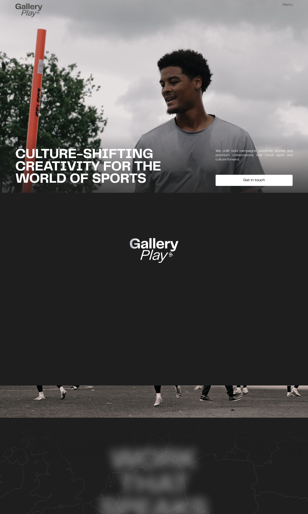
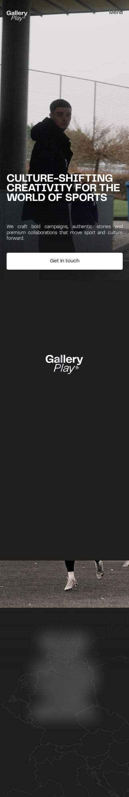

# UI Design System & Master Generation Blueprint: gallery-play-be

> **Home - Gallery Play** (https://gallery-play.be/) — We craft bold campaigns, authentic stories and premium collaborations that move sport and culture forward.



---

## 1. Executive Visual Persona & Design Archetype

- **Brand Essence & Persona**: **Home - Gallery Play** (`https://gallery-play.be/`). We craft bold campaigns, authentic stories and premium collaborations that move sport and culture forward.
- **Visual Archetype**: **Light-Gallery WebGL / Canvas Interactive Experience (`#ccd6df` / `#1E1E1E`)**.
- **Anti-AI-Slop Differentiators**:
  - **Source-Grounded Chromatic Polarity**: Anchors the viewport in `#ccd6df` (`var(--e-rating-icon-color)` in `:root`) paired with `#000000` primary typography and `#1E1E1E` accents.
  - **Extracted Typographic Hierarchy**: Pairs `PP Telegraf` for display copy (`Culture-shifting creativity for the `) with `block` and not declared in static CSS (uses primary stack / `ui-monospace`).
  - **Calibrated Spatial Grid & Motion**: Combines `200px` container bounds (`gap: .5rem`, padding `10px`) with `cubic-bezier(0.44,0.96,0.5,0.98)` easing and Lenis Smooth Scroll (`data-lenis`), GSAP Timeline & ScrollTrigger.

---

## 2. Spatial Architecture & Modular Grid Mathematics



### Viewport Allocation & Container Geometry
- **Captured Viewport Dimensions**: Desktop `1440×10973px` (`assets/desktop.png`, full-page scroll capture), Mobile `390×2400px` (`assets/mobile.png`, capped at 2400px multi-section capture).
- **Master Container Bounds**: `200px` extracted from `gallery-play-be` stylesheet.
- **Canvas Lateral Padding & Spacing**: `10px` lateral canvas padding with `.5rem` grid gap.
- **Border Radius Scale**: `3px`, `50%`, `var(--border-radius)`, `2px`.

### Responsive Breakpoint Architecture
- **Desktop Layout**: Multi-column CSS Grid / Flexbox layout at `1440px` (`max-width: 200px`, `gap: .5rem`).
- **Mobile Layout**: Single-column vertical stack at `390px` viewport width with `10px` horizontal padding.
- **Extracted CSS Media Queries**: `@media (max-width:767px)`, `@media (max-width:576px)`, `@media (min-width:768px)`, `@media (min-width:576px)and (max-width:767px)`.

---

## 3. Color System, Materiality & Atmospheric Lighting

### Semantic Palette & Source Grounding
| Semantic Role | Ground-Truth Value | Extracted CSS Source / Selector |
|---|---|---|
| **Primary Canvas Substrate** | `#ccd6df` | `var(--e-rating-icon-color)` in `:root` |
| **Primary Typography Ink** | `#f0ad4e` | `var(--e-rating-icon-marked-color)` in `:root` |
| **Elevated Surface / Card Substrate** | `#FFFFFF` | `var(--e-global-color-primary)` in `:root` |
| **Interactive Accent / Highlight** | `#1E1E1E` | `var(--e-global-color-accent)` in `:root` |
| **Secondary / Muted Copy** | `#000000` | `var(--e-global-color-0560f42)` in `:root` |
| **Structural Hairline Border** | `#E1E1E1` | `var(--e-global-color-160fc90)` in `:root` |

### Sanitized Root CSS Variables (`ui-ux.md` Ground Truth)
| Variable Name | Extracted Value | Semantic Role |
|---|---|---|
| `--direction-multiplier` | `1` | Design System Custom Token |
| `--flex-direction` | `initial` | Design System Custom Token |
| `--flex-wrap` | `initial` | Layout / Spatial Grid Token |
| `--justify-content` | `initial` | Design System Custom Token |
| `--align-items` | `initial` | Design System Custom Token |
| `--align-content` | `initial` | Design System Custom Token |
| `--gap` | `initial` | Layout / Spatial Grid Token |
| `--flex-basis` | `initial` | Design System Custom Token |
| `--flex-grow` | `initial` | Design System Custom Token |
| `--flex-shrink` | `initial` | Typography Ink Token |
| `--order` | `initial` | Design System Custom Token |
| `--align-self` | `initial` | Design System Custom Token |
| `--page-title-display` | `block` | Design System Custom Token |
| `--border-radius` | `0` | Elevation / Border Token |
| `--border-top-width` | `0px` | Layout / Spatial Grid Token |
| `--border-right-width` | `0px` | Layout / Spatial Grid Token |

---

## 4. Typographic Scale & Editorial Hierarchy

### Font Family Stacks
- **Display Typography**: `PP Telegraf`.
- **Primary Body Stack**: `block`.
- **Technical / Metadata Stack**: not declared in static CSS (uses primary stack / `ui-monospace`).

### Typographic Scale & Rules (Extracted from Stylesheet & Variables)
- **Hero Display (`H1`)**: CSS variables `--page-title-display: block`, `--display: flex`; rule `h1` (`font-size: var( --e-global-typography-pr...`, `line-height: var( --e-global-typog...`, `font-weight: var( --e-glob...`).
- **Section Heading (`H2`)**: rule `h2` (`font-size: 32px`, `line-height: 0.9em`, `font-weight: 400`).
- **Body Copy**: CSS variables `--cmplz_category_body_font_size: 12px`.
- **Metadata & Navigation Labels**: not explicitly declared on tag in static CSS (stylesheet font-size ladder: `14px`, `1rem`, `2.5rem`, `2rem`, `1.75rem`).

---

## 5. Choreographed Motion & Interaction Physics

### Primary Easing Curves
- **Extracted Timing Functions**: `cubic-bezier(0.44,0.96,0.5,0.98)`, `cubic-bezier(0.26,0.69,0.37,0.96)`, `cubic-bezier(0.83,0.08,0.16,0.97)`.

### Per-Element Transition & Choreography Rules
- **Selector `textarea`**: `transition: all .3s` extracted from `gallery-play-be` stylesheet.
- **Selector `button`**: `transition: all .3s` extracted from `gallery-play-be` stylesheet.
- **Selector `-holder .site-navigation-toggle-i...`**: `transition: all .2s ease-in-out` extracted from `gallery-play-be` stylesheet.
- **Extracted Easing Curve (`cubic-bezier(0.44,0.96,0.5,0.98)`)**: Governs interactive state transitions across `<header.elementor>` and `<main.site-main>`.
- **Runtime Interaction Engine**: Integrates Lenis Smooth Scroll (`data-lenis`), GSAP Timeline & ScrollTrigger, Three.js / WebGL Canvas Pipeline, Swiper Touch Carousel Engine, Lottie Vector Animation Player with `prefers-reduced-motion: reduce` fallback guards.

---

## 6. Component Wireframe & Structural DOM Map

### Visual Layout Schematic (Grounded in `dom.html` — `1440px` Desktop & `390px` Mobile Reflow)
```
┌────────────────────────────────────────────────────────────────────────┐
│ DESKTOP VIEWPORT (1440px) — Home - Gallery Play                        │
│ ====================================================================== │
│ [ <header.elementor>       | Projects · Services · Athletes · Team  ]  │
│ ---------------------------------------------------------------------- │
│ | HERO STAGE: <main.site-main>                                     |   │
│ | H1: Culture-shifting creativity for the world of sports          |   │
│ | Substrate: #ccd6df    | Ink: #000000    | Accent: #1E1E1E        |   │
│ ---------------------------------------------------------------------- │
│ | SHOWCASE GRID (<main.site-main>          ) max-w: 200px          |   │
│ | +------------------------------+  +------------------------------+ | │
│ | | Rooted in top-level football |  | Work that speaks louder than | | │
│ | +------------------------------+  +------------------------------+ | │
│ ---------------------------------------------------------------------- │
│ | MOBILE VIEWPORT REFLOW (390px) — Single-Column Stack (gap: .5rem ) | │
│ | [<header.elementor>] -> [<main.site-main>] -> [<main.site-main>] |   │
│ ---------------------------------------------------------------------- │
│ [ FOOTER (<footer.elementor>    ) | https://gallery-play.be/           │
└────────────────────────────────────────────────────────────────────────┘
```

### Granular DOM Region Breakdown
1. **Brand Header & Navigation Bar (<header.elementor> — `gallery-play-be`)**:
   - Landmark `<header class="elementor elementor-100">` hosting `Home - Gallery Play` navigation (`Projects · Services · Athletes · Team · Contact`), DOM attributes (`data-mp="true"`, `data-cfasync="false"`, `data-mp="true"`, `data-cfasync="false"`), and stylesheet rule `.cmplz-video.cmplz-iframe-styles { background-color:transparent }`.
2. **Hero Stage & Focal Lead (<main.site-main> — `Culture-shifting creativity for th`)**:
   - Landmark `<main class="site-main post-15">` presenting display lead `Culture-shifting creativity for the world of sports` and copy excerpt *"To provide the best experience, we use technologies such as cooki"* over `#ccd6df` canvas and `#000000` ink.
3. **Primary Showcase & Content Grid (<main.site-main> — `Rooted in top-level football, flue`)**:
   - Landmark `<main class="site-main post-15">` rendering section `Rooted in top-level football, fluent in branding,...` with copy *"Functional Altijd actief"*, asset references (`player.js`, `recaptcha__en.js`, `embed`, `cookieblocker.min.css`), and grid rule `.cmplz-video.cmplz-hidden { visibility:hidden !important }`.
4. **Interactive Detail & Feature Matrix (<main.site-main> — `Work that speaks louder than words`)**:
   - Landmark `<main class="site-main post-15">` framing `Work that speaks louder than words.` and `125 Years of AFC Ajax` (*"The technical storage or access is strictly necessary for the leg"*) with `#FFFFFF` surface cards, `#1E1E1E` accents, and `.cmplz-blocked-content-notice { display:none }`.
5. **Colophon & Global Directory Footer (<footer.elementor> — `https://gallery-play.be/`)**:
   - Landmark `<footer class="elementor elementor-102">` anchoring `Home - Gallery Play` footer links (`Projects · Services · Athletes · Team · Contact`), copy *"De technische opslag of toegang is noodzakelijk voor het leg"*, and `#E1E1E1` structural dividers.

---

## 7. Master Zero-Shot AI Generation Prompt

```markdown
# Master Zero-Shot Frontend Generation Prompt: gallery-play-be (Home - Gallery Play)

You are a principal frontend architect and design systems engineer. Build a complete, production-ready web application replicating the exact design system, DOM landmarks, typographic hierarchy, color tokens, and motion physics of `gallery-play-be` (**Home - Gallery Play** — `https://gallery-play.be/`).

### 1. Visual Archetype & Anti-AI-Slop Mandates
- **Archetype**: Light-Gallery WebGL / Canvas Interactive Experience (`#ccd6df` / `#1E1E1E`).
- **Identity & Domain Context**: We craft bold campaigns, authentic stories and premium collaborations that move sport and culture forward.
- **Primary Substrate**: `#ccd6df` (`var(--e-rating-icon-color)` in `:root`), **Primary Ink**: `#000000`, **Accent / Highlight**: `#1E1E1E`.
- **Site-Specific Differentiators**:
  - **Source-Grounded Chromatic Polarity**: Anchors the viewport in `#ccd6df` (`var(--e-rating-icon-color)` in `:root`) paired with `#000000` primary typography and `#1E1E1E` accents.
  - **Extracted Typographic Hierarchy**: Pairs `PP Telegraf` for display copy (`Culture-shifting creativity for the `) with `block` and not declared in static CSS (uses primary stack / `ui-monospace`).
  - **Calibrated Spatial Grid & Motion**: Combines `200px` container bounds (`gap: .5rem`, padding `10px`) with `cubic-bezier(0.44,0.96,0.5,0.98)` easing and Lenis Smooth Scroll (`data-lenis`), GSAP Timeline & ScrollTrigger.

### 2. Ground-Truth CSS Variables (`:root` Token Contract)
Declare and consume these exact custom properties extracted from `gallery-play-be` in your global stylesheet:

:root {
  /* Home - Gallery Play (gallery-play-be) — Ground-Truth Extracted CSS Variables */
  --direction-multiplier: 1; /* Design System Custom Token (gallery-play-be) */
  --flex-direction: initial; /* Design System Custom Token (gallery-play-be) */
  --flex-wrap: initial; /* Layout / Spatial Grid Token (gallery-play-be) */
  --justify-content: initial; /* Design System Custom Token (gallery-play-be) */
  --align-items: initial; /* Design System Custom Token (gallery-play-be) */
  --align-content: initial; /* Design System Custom Token (gallery-play-be) */
  --gap: initial; /* Layout / Spatial Grid Token (gallery-play-be) */
  --flex-basis: initial; /* Design System Custom Token (gallery-play-be) */
  --flex-grow: initial; /* Design System Custom Token (gallery-play-be) */
  --flex-shrink: initial; /* Typography Ink Token (gallery-play-be) */
  --order: initial; /* Design System Custom Token (gallery-play-be) */
  --align-self: initial; /* Design System Custom Token (gallery-play-be) */
  --page-title-display: block; /* Design System Custom Token (gallery-play-be) */
  --border-radius: 0; /* Elevation / Border Token (gallery-play-be) */
  --border-top-width: 0px; /* Layout / Spatial Grid Token (gallery-play-be) */
  --border-right-width: 0px; /* Layout / Spatial Grid Token (gallery-play-be) */
}

### 3. Semantic Color & Materiality Contract
Map every surface, ink, and border strictly to these source-grounded tokens:
- **Primary Canvas Substrate**: `#ccd6df` — grounded in `var(--e-rating-icon-color)` in `:root`
- **Primary Typography Ink**: `#f0ad4e` — grounded in `var(--e-rating-icon-marked-color)` in `:root`
- **Elevated Surface / Card Substrate**: `#FFFFFF` — grounded in `var(--e-global-color-primary)` in `:root`
- **Interactive Accent / Highlight**: `#1E1E1E` — grounded in `var(--e-global-color-accent)` in `:root`
- **Secondary / Muted Copy**: `#000000` — grounded in `var(--e-global-color-0560f42)` in `:root`
- **Structural Hairline Border**: `#E1E1E1` — grounded in `var(--e-global-color-160fc90)` in `:root`

### 4. Spatial Grid, Container Bounds & Responsive Breakpoints
- **Desktop Viewport Reference**: `1440×10973px` (full-page scroll capture, `1440px` standard desktop width).
- **Mobile Viewport Reference**: `390×2400px` (capped at 2400px multi-section capture, `390px` standard mobile width).
- **Container Max-Width**: `200px` extracted from `gallery-play-be` stylesheet
- **Padding & Gutters**: `10px` lateral canvas padding with `.5rem` grid gap
- **Desktop Grid**: Multi-column CSS Grid / Flexbox layout at `1440px` (`max-width: 200px`, `gap: .5rem`)
- **Mobile Adaptation**: Single-column vertical stack at `390px` viewport width with `10px` horizontal padding
- **Media Queries**: `@media (max-width:767px)`, `@media (max-width:576px)`, `@media (min-width:768px)`, `@media (min-width:576px)and (max-width:767px)`
- **Corner Radii**: `3px`, `50%`, `var(--border-radius)`, `2px`

### 5. Typography & Editorial Scale Contract
- **Display Font Stack**: `PP Telegraf`
- **Body Font Stack**: `block`
- **Monospace / Technical Font Stack**: not declared in static CSS (uses primary stack / `ui-monospace`)
- **H1 Display Rule**: CSS variables `--page-title-display: block`, `--display: flex`; rule `h1` (`font-size: var( --e-global-typography-pr...`, `line-height: var( --e-global-typog...`, `font-weight: var( --e-glob...`)
- **H2 Section Rule**: rule `h2` (`font-size: 32px`, `line-height: 0.9em`, `font-weight: 400`)
- **Body Copy Rule**: CSS variables `--cmplz_category_body_font_size: 12px`
- **Metadata & Index Rule**: not explicitly declared on tag in static CSS (stylesheet font-size ladder: `14px`, `1rem`, `2.5rem`, `2rem`, `1.75rem`)

### 6. Component Hierarchy, Verbatim Copy & Real DOM Landmarks
Scaffold `gallery-play-be` (`Home - Gallery Play`) with these exact structural regions, extracted copy, and CSS rules from `dom.html`:
1. **Brand Header & Navigation Bar (<header.elementor> — `gallery-play-be`)**:
   - DOM & Selectors: Landmark `<header class="elementor elementor-100">` hosting `Home - Gallery Play` navigation (`Projects · Services · Athletes · Team · Contact`), DOM attributes (`data-mp="true"`, `data-cfasync="false"`, `data-mp="true"`, `data-cfasync="false"`), and stylesheet rule `.cmplz-video.cmplz-iframe-styles { background-color:transparent }`.
   - Responsive Contract: Header `Brand Header & Navigation Bar (<header.elementor> — `gallery-play-be`)` (`gallery-play-be`) adapts across `@media (max-width:767px)`, `@media (max-width:576px)`, `@media (min-width:768px)`, `@media (min-width:576px)and (max-width:767px)` with `cubic-bezier(0.44,0.96,0.5,0.98)`, `cubic-bezier(0.26,0.69,0.37,0.96)`, `cubic-bezier(0.83,0.08,0.16,0.97)` transitions and links `Projects · Services · Athletes · Team · Contact`.
2. **Hero Stage & Focal Lead (<main.site-main> — `Culture-shifting creativity for th`)**:
   - DOM & Selectors: Landmark `<main class="site-main post-15">` presenting display lead `Culture-shifting creativity for the world of sports` and copy excerpt *"To provide the best experience, we use technologies such as cooki"* over `#ccd6df` canvas and `#000000` ink.
   - Responsive Contract: Hero stage (`1440×10973px` desktop / `390×2400px` mobile) sets `#ccd6df` background with `#000000` headline `Culture-shifting creativity for the world of sports`.
3. **Primary Showcase & Content Grid (<main.site-main> — `Rooted in top-level football, flue`)**:
   - DOM & Selectors: Landmark `<main class="site-main post-15">` rendering section `Rooted in top-level football, fluent in branding,...` with copy *"Functional Altijd actief"*, asset references (`player.js`, `recaptcha__en.js`, `embed`, `cookieblocker.min.css`), and grid rule `.cmplz-video.cmplz-hidden { visibility:hidden !important }`.
   - Responsive Contract: Showcase grid `Primary Showcase & Content Grid (<main.site-main> — `Rooted in top-level football, flue`)` applies Multi-column CSS Grid / Flexbox layout at `1440px` (`max-width: 200px`, `gap: .5rem`) on desktop and Single-column vertical stack at `390px` viewport width with `10px` horizontal padding on mobile.
4. **Interactive Detail & Feature Matrix (<main.site-main> — `Work that speaks louder than words`)**:
   - DOM & Selectors: Landmark `<main class="site-main post-15">` framing `Work that speaks louder than words.` and `125 Years of AFC Ajax` (*"The technical storage or access is strictly necessary for the leg"*) with `#FFFFFF` surface cards, `#1E1E1E` accents, and `.cmplz-blocked-content-notice { display:none }`.
   - Responsive Contract: Detail module `Interactive Detail & Feature Matrix (<main.site-main> — `Work that speaks louder than words`)` uses `3px`, `50%`, `var(--border-radius)`, `2px` radii, `#1E1E1E` highlights, and assets (player.js, recaptcha__en.js, embed).
5. **Colophon & Global Directory Footer (<footer.elementor> — `https://gallery-play.be/`)**:
   - DOM & Selectors: Landmark `<footer class="elementor elementor-102">` anchoring `Home - Gallery Play` footer links (`Projects · Services · Athletes · Team · Contact`), copy *"De technische opslag of toegang is noodzakelijk voor het leg"*, and `#E1E1E1` structural dividers.
   - Responsive Contract: Footer `Colophon & Global Directory Footer (<footer.elementor> — `https://gallery-play.be/`)` aligns to `200px` extracted from `gallery-play-be` stylesheet with `10px` lateral canvas padding with `.5rem` grid gap and attributes (data-mp="true", data-cfasync="false", data-mp="true").

#### Verbatim DOM Copy Excerpts (`dom.html`)
- Copy Excerpt 1: *"To provide the best experience, we use technologies such as cookies to store and/o..."*
- Copy Excerpt 2: *"Functional Altijd actief"*
- Copy Excerpt 3: *"The technical storage or access is strictly necessary for the legitimate purpose o..."*
- Copy Excerpt 4: *"De technische opslag of toegang is noodzakelijk voor het legitieme doel voorkeuren..."*

### 7. Motion, Extracted Stylesheet Rules & Interaction Choreography
- **Primary Easing Functions**: `cubic-bezier(0.44,0.96,0.5,0.98)`, `cubic-bezier(0.26,0.69,0.37,0.96)`, `cubic-bezier(0.83,0.08,0.16,0.97)`
- **Extracted Stylesheet Rules (`gallery-play-be`)**:
- `.cmplz-video.cmplz-iframe-styles { background-color:transparent }`
- `.cmplz-video.cmplz-hidden { visibility:hidden !important }`
- `.cmplz-blocked-content-notice { display:none }`
- `.cmplz-placeholder-parent { height:inherit }`
- `wp-video .cmplz-blocked-content-n... { display:block }`
- **Per-Selector Transition Rules**:
- **Selector `textarea`**: `transition: all .3s` extracted from `gallery-play-be` stylesheet.
- **Selector `button`**: `transition: all .3s` extracted from `gallery-play-be` stylesheet.
- **Selector `-holder .site-navigation-toggle-i...`**: `transition: all .2s ease-in-out` extracted from `gallery-play-be` stylesheet.
- **Extracted Easing Curve (`cubic-bezier(0.44,0.96,0.5,0.98)`)**: Governs interactive state transitions across `<header.elementor>` and `<main.site-main>`.
- **Runtime Interaction Engine**: Integrates Lenis Smooth Scroll (`data-lenis`), GSAP Timeline & ScrollTrigger, Three.js / WebGL Canvas Pipeline, Swiper Touch Carousel Engine, Lottie Vector Animation Player with `prefers-reduced-motion: reduce` fallback guards.

### 8. Technical Deliverables
- Implement in Next.js (App Router) with TypeScript and Tailwind CSS consuming the `:root` custom properties defined above for `gallery-play-be`.
- Reproduce both the `1440px` desktop architecture and `390px` mobile breakpoint transitions, preserving semantic HTML5 landmarks (`<header>`, `<nav>`, `<main>`, `<section>`, `<footer>`) and `prefers-reduced-motion` accessibility guards.
```
