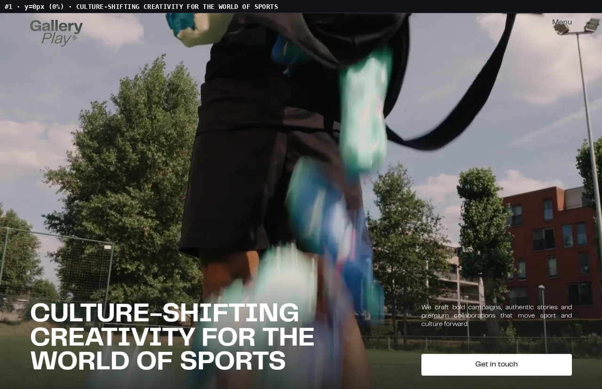
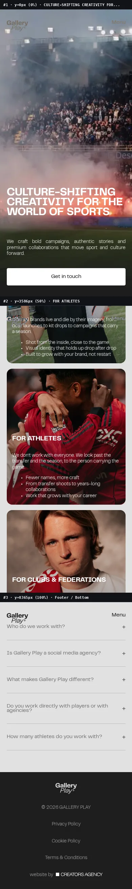

# UI Design System & Master Generation Blueprint: gallery-play-be

> **Home - Gallery Play** (https://gallery-play.be/) — We craft bold campaigns, authentic stories and premium collaborations that move sport and culture forward.





---

## 1. Executive Visual Persona & Design Archetype

- **Brand Essence & Persona**: **Home - Gallery Play** (`https://gallery-play.be/`). We craft bold campaigns, authentic stories and premium collaborations that move sport and culture forward.
- **Capture Provenance**: Live browser capture (`tier1_fast`, HTTP `200`, captured `2026-11-24`).
- **Visual Archetype**: **Dark-Substrate WebGL / Canvas Interactive Experience (`#1e1e1e` / `#ff3700`)**.
- **Anti-AI-Slop Differentiators**:
  - **Live-Computed Chromatic Polarity**: Anchors the viewport in `#1e1e1e` (live computed `body` `background-color` (`computed_styles.json`)) paired with `#ffffff` primary typography and `#ff3700` accents.
  - **Grounded Typographic Hierarchy**: Uses `PP Telegraf` across display (`CULTURE-SHIFTING CREATIVITY FOR THE `) and body copy, paired with `Inconsolata` for monospace/code.
  - **Calibrated Spatial Grid & Motion**: Combines `1800px` container bounds (`gap: 8px`, padding `10px`) with `cubic-bezier(0.44,0.96,0.5,0.98)` easing and Lenis Smooth Scroll (`data-lenis`), GSAP Timeline & ScrollTrigger.

---

## 2. Spatial Architecture & Modular Grid Mathematics

### Viewport Allocation & Container Geometry
- **Captured Journey Filmstrips**: Desktop `1280×828px` (`assets/desktop-journey.webp`, `1` keyframes up to `y=0px` / doc `10973px`), Mobile `390×2616px` (`assets/mobile-journey.webp`, `3` keyframes).
- **Master Container Bounds**: `1800px` (non-`@media` desktop container stylesheet rule).
- **Canvas Lateral Padding & Spacing**: `10px` lateral canvas padding with `8px` grid gap.
- **Border Radius Scale**: `4px`, `3px`, `5px`, `50%`.

### Responsive Breakpoint Architecture
- **Desktop Layout**: Multi-column CSS Grid / Flexbox layout at `1440px` (`max-width: 1800px`, `gap: 8px`).
- **Mobile Layout**: Single-column vertical stack at `390px` viewport width with `10px` horizontal padding.
- **Extracted CSS Media Queries**: `@media (max-width: 1440px)`, `@media screen and (min-width: 1px)and (max-width: 767px)`, `@media screen and (min-width: 768px)and (max-width: 1024px)`, `@media (min-width: 1025px)`.

---

## 3. Color System, Materiality & Atmospheric Lighting

### Semantic Palette & Source Grounding
| Semantic Role | Ground-Truth Value | Extracted Live / CSS Source |
|---|---|---|
| **Primary Canvas Substrate** | `#1e1e1e` | live computed `body` `background-color` (`computed_styles.json`) |
| **Primary Typography Ink** | `#ffffff` | live computed `h1` `color` (`computed_styles.json`) |
| **Elevated Surface / Card Substrate** | `#840739` | `.jet-tabs__edit-cover:hover { background-color: #840739 }` |
| **Interactive Accent / Highlight** | `#ff3700` | `var(--gradient-5)` in `:root` |
| **Secondary / Muted Copy** | `#cc3366` | live computed `a` `color` (`computed_styles.json`) |
| **Structural Hairline Border** | `#f2f2f2` | `var(--cmplz_banner_border_color)` in `:root` |

### Sanitized Root CSS Variables (`ui-ux.md` Ground Truth)
| Variable Name | Extracted Value | Semantic Role |
|---|---|---|
| `--direction-multiplier` | `1` | Design System Custom Token |
| `--page-title-display` | `block` | Design System Custom Token |
| `--cmplz_banner_width` | `526px` | Layout / Spatial Grid Token |
| `--cmplz_banner_background_color` | `#ffffff` | Canvas / Surface Token |
| `--cmplz_banner_border_color` | `#f2f2f2` | Brand / Palette Token |
| `--cmplz_banner_border_width` | `0px 0px 0px 0px` | Layout / Spatial Grid Token |
| `--cmplz_banner_border_radius` | `0px 0px 0px 0px` | Elevation / Border Token |
| `--cmplz_banner_margin` | `10px` | Layout / Spatial Grid Token |
| `--cmplz_categories-height` | `163px` | Layout / Spatial Grid Token |
| `--cmplz_title_font_size` | `15px` | Typography / Scale Token |
| `--cmplz_text_line_height` | `calc(var(--cmplz_text_font_size) * 1.5)` | Typography Ink Token |
| `--cmplz_text_color` | `#1e1e1e` | Typography Ink Token |
| `--cmplz_hyperlink_color` | `#1e1e1e` | Typography Ink Token |
| `--cmplz_text_font_size` | `12px` | Typography Ink Token |
| `--cmplz_link_font_size` | `12px` | Typography Ink Token |
| `--cmplz_category_body_font_size` | `12px` | Typography / Scale Token |

---

## 4. Typographic Scale & Editorial Hierarchy

### Font Family Stacks
- **Display Typography**: `PP Telegraf`.
- **Primary Body Stack**: `PP Telegraf`.
- **Technical / Metadata Stack**: `Inconsolata`.

### Typographic Scale & Rules (Live Computed & Stylesheet Grounded)
- **Hero Display (`H1`)**: live computed `h1` (`font-size: 64px`, `line-height: 57.6px`, `font-weight: 700`); CSS variables `--page-title-display: block`, `--display: flex`; rule `h1` (`font-size: var( --e-global-typography-pr...`, `line-height: var( --e-global-typog...`, `font-weight: var( --e-glob...`).
- **Section Heading (`H2`)**: live computed `h2` (`font-size: 128px`, `line-height: 115.2px`, `font-weight: 700`); rule `h2` (`font-size: 32px`, `line-height: 0.9em`, `font-weight: 400`).
- **Body Copy**: live computed `body` (`font-size: 16px`, `line-height: 20px`, `font-weight: 300`); CSS variables `--cmplz_category_body_font_size: 12px`.
- **Metadata & Navigation Labels**: live computed `nav/a` (`font-size: 16px`, `line-height: 20px`, `font-weight: 300`).

---

## 5. Choreographed Motion & Interaction Physics

### Primary Easing Curves
- **Extracted Timing Functions**: `cubic-bezier(0.44,0.96,0.5,0.98)`, `cubic-bezier(0.26,0.69,0.37,0.96)`, `cubic-bezier(0.83,0.08,0.16,0.97)`.

### Per-Element Transition & Choreography Rules
- **Selector `.jet-tabs__content-wrapper`**: `transition: height .25s cubic-bezier(0.44,0.96,0.5,0.98)` extracted from `gallery-play-be` stylesheet.
- **Selector `.jet-tabs__edit-cover`**: `transition: opacity .3s ease` extracted from `gallery-play-be` stylesheet.
- **Selector `.jet-toggle__content`**: `transition: height .5s ease` extracted from `gallery-play-be` stylesheet.
- **Extracted Easing Curve (`cubic-bezier(0.44,0.96,0.5,0.98)`)**: Governs interactive state transitions across `<header.elementor>` and `<main.post-15>`.
- **Runtime Interaction Engine**: Integrates Lenis Smooth Scroll (`data-lenis`), GSAP Timeline & ScrollTrigger, Three.js / WebGL Canvas Pipeline, Swiper Touch Carousel Engine, Lottie Vector Animation Player with `prefers-reduced-motion: reduce` fallback guards.
### Measured Runtime Scroll & Interaction Telemetry (`behavioral_journey_v2`)
- **Scroll Driver Mode**: `native` (max document height `10973px`, deepest scrollY reached `0px` across `1` desktop keyframes).
- **Detected Scroll / Motion Libraries**: Native browser scroll / standard CSS transitions.

---

## 6. Component Wireframe & Structural DOM Map

### Visual Layout Schematic — Desktop (`1440px`, Grounded in `dom.html` & Landmark Bounding Boxes)
```
┌────────────────────────────────────────────────────────────────────────┐
│ DESKTOP VIEWPORT (1440px) — Home - Gallery Play                        │
│ ====================================================================== │
│ [ <header.elementor> (1440x0px)       | Projects · Services · Athlet ] │
│ ---------------------------------------------------------------------- │
│ | HERO STAGE: <main.site-main> (w=1440px)                            | │
│ | H1: CULTURE-SHIFTING CREATIVITY FOR THE WORLD OF SPORTS            | │
│ | Substrate: #1e1e1e | Ink: #ffffff | Accent: #ff3700                | │
│ ---------------------------------------------------------------------- │
│ | SHOWCASE GRID (<main.post-15>) max-w: 1800px                       | │
│ | +------------------------------+  +------------------------------+ | │
│ | | Culture-shifting creativity  |  | Rooted in top-level football | | │
│ | +------------------------------+  +------------------------------+ | │
│ ---------------------------------------------------------------------- │
│ | DETAIL MODULE (<main.page>) — Work that speaks loud                | │
│ ---------------------------------------------------------------------- │
│ [ FOOTER (<footer.elementor>  ) | https://gallery-play.be/             │
└────────────────────────────────────────────────────────────────────────┘
```

### Visual Layout Schematic — Mobile Reflow (`390px`)
```
┌────────────────────────────────────────────────────────────────────────┐
│ MOBILE VIEWPORT REFLOW (390px) — Single-Column Stack (gap: 8px)        │
│ ====================================================================== │
│ [ HEADER BAR (<header.elementor>      ) | Compact Menu (390px)         │
│ ---------------------------------------------------------------------- │
│ | HERO STAGE (<main.site-main>) — 390px Vertical Lead                | │
│ | H1: CULTURE-SHIFTING CREATIVITY FOR THE WORLD OF SPORTS            | │
│ ---------------------------------------------------------------------- │
│ | SHOWCASE STACK (<main.post-15>) — 1-Col Stack                      | │
│ | [ Item 1: Culture-shifting creativity for the world of sports    ] | │
│ | [ Item 2: Rooted in top-level football, fluent in branding,...   ] | │
│ ---------------------------------------------------------------------- │
│ | DETAIL STACK (<main.page>) — 1-Col (Work that speaks l)            | │
│ ---------------------------------------------------------------------- │
│ [ FOOTER (<footer.elementor>  ) | Stacked 390px Colophon               │
└────────────────────────────────────────────────────────────────────────┘
```

### Granular DOM Region Breakdown
1. **Brand Header & Navigation Bar (<header.elementor> — `gallery-play-be`)**:
   - Landmark `<header class="elementor elementor-100">` (`1440x0px`) hosting `Home - Gallery Play` navigation (`Projects · Services · Athletes · Team · Contact`), DOM attributes (`data-mp="true"`, `data-cfasync="false"`, `data-mp="true"`, `data-cfasync="false"`), and stylesheet rule `lementor-column .elementor-spacer... { height:var(--spacer-size) }`.
2. **Hero Stage & Focal Lead (<main.site-main> — `CULTURE-SHIFTING CREATIVITY FOR TH`)**:
   - Landmark `<main class="site-main post-15">` presenting display lead `CULTURE-SHIFTING CREATIVITY FOR THE WORLD OF SPORTS` and copy excerpt *"We craft bold campaigns, authentic stories and premium collaborat"* over `#1e1e1e` canvas and `#ffffff` ink.
3. **Primary Showcase & Content Grid (<main.post-15> — `Culture-shifting creativity for th`)**:
   - Landmark `<main class="site-main post-15">` rendering section `Culture-shifting creativity for the world of sports` with copy *"Start the conversation"*, asset references (`player.js`, `recaptcha__en.js`, `embed`, `cookieblocker.min.css`), and grid rule `.e-con { --container-widget-width:100% }`.
4. **Interactive Detail & Feature Matrix (<main.page> — `Rooted in top-level football, flue`)**:
   - Landmark `<main class="site-main post-15">` framing `Rooted in top-level football, fluent in branding,...` and `Work that speaks louder than words.` (*"From shirt launches and transfer announcements to player branding"*) with `#840739` surface cards, `#ff3700` accents, and `dget-spacer>.elementor-widget-con... { height:100%;width:100% }`.
5. **Colophon & Global Directory Footer (<footer.elementor> — `https://gallery-play.be/`)**:
   - Landmark `<footer class="elementor elementor-102">` anchoring `Home - Gallery Play` footer links (`Projects · Services · Athletes · Team · Contact`), copy *"We tailor every collaboration to the client. Brands, athlete"*, and `#f2f2f2` structural dividers.
### Full Vertical Scroll Sequence (Desktop `1440×900` Keyframes)
- **Step 01** (`y=0px`, `0%`): Active landmark `CULTURE-SHIFTING CREATIVITY FOR THE WORLD OF SPORTS` · sticky/fixed elements: `2`

---

## 7. Master Zero-Shot AI Generation Prompt

```markdown
# Master Zero-Shot Frontend Generation Prompt: gallery-play-be (Home - Gallery Play)

You are a principal frontend architect and design systems engineer. Build a complete, production-ready web application replicating the exact design system, DOM landmarks, typographic hierarchy, color tokens, and motion physics of `gallery-play-be` (**Home - Gallery Play** — `https://gallery-play.be/`).

### 1. Visual Archetype & Anti-AI-Slop Mandates
- **Archetype**: Dark-Substrate WebGL / Canvas Interactive Experience (`#1e1e1e` / `#ff3700`).
- **Identity & Domain Context**: We craft bold campaigns, authentic stories and premium collaborations that move sport and culture forward.
- **Primary Substrate**: `#1e1e1e` (live computed `body` `background-color` (`computed_styles.json`)), **Primary Ink**: `#ffffff`, **Accent / Highlight**: `#ff3700`.
- **Site-Specific Differentiators**:
  - **Live-Computed Chromatic Polarity**: Anchors the viewport in `#1e1e1e` (live computed `body` `background-color` (`computed_styles.json`)) paired with `#ffffff` primary typography and `#ff3700` accents.
  - **Grounded Typographic Hierarchy**: Uses `PP Telegraf` across display (`CULTURE-SHIFTING CREATIVITY FOR THE `) and body copy, paired with `Inconsolata` for monospace/code.
  - **Calibrated Spatial Grid & Motion**: Combines `1800px` container bounds (`gap: 8px`, padding `10px`) with `cubic-bezier(0.44,0.96,0.5,0.98)` easing and Lenis Smooth Scroll (`data-lenis`), GSAP Timeline & ScrollTrigger.

### 2. Ground-Truth CSS Variables (`:root` Token Contract)
Declare and consume these exact custom properties extracted from `gallery-play-be` in your global stylesheet:

:root {
  /* Home - Gallery Play (gallery-play-be) — Live-Grounded CSS Variables */
  --direction-multiplier: 1; /* Design System Custom Token (gallery-play-be) */
  --page-title-display: block; /* Design System Custom Token (gallery-play-be) */
  --cmplz_banner_width: 526px; /* Layout / Spatial Grid Token (gallery-play-be) */
  --cmplz_banner_background_color: #ffffff; /* Canvas / Surface Token (gallery-play-be) */
  --cmplz_banner_border_color: #f2f2f2; /* Brand / Palette Token (gallery-play-be) */
  --cmplz_banner_border_width: 0px 0px 0px 0px; /* Layout / Spatial Grid Token (gallery-play-be) */
  --cmplz_banner_border_radius: 0px 0px 0px 0px; /* Elevation / Border Token (gallery-play-be) */
  --cmplz_banner_margin: 10px; /* Layout / Spatial Grid Token (gallery-play-be) */
  --cmplz_categories-height: 163px; /* Layout / Spatial Grid Token (gallery-play-be) */
  --cmplz_title_font_size: 15px; /* Typography / Scale Token (gallery-play-be) */
  --cmplz_text_line_height: calc(var(--cmplz_text_font_size) * 1.5); /* Typography Ink Token (gallery-play-be) */
  --cmplz_text_color: #1e1e1e; /* Typography Ink Token (gallery-play-be) */
  --cmplz_hyperlink_color: #1e1e1e; /* Typography Ink Token (gallery-play-be) */
  --cmplz_text_font_size: 12px; /* Typography Ink Token (gallery-play-be) */
  --cmplz_link_font_size: 12px; /* Typography Ink Token (gallery-play-be) */
  --cmplz_category_body_font_size: 12px; /* Typography / Scale Token (gallery-play-be) */
}

### 3. Semantic Color & Materiality Contract
Map every surface, ink, and border strictly to these source-grounded tokens:
- **Primary Canvas Substrate**: `#1e1e1e` — grounded in live computed `body` `background-color` (`computed_styles.json`)
- **Primary Typography Ink**: `#ffffff` — grounded in live computed `h1` `color` (`computed_styles.json`)
- **Elevated Surface / Card Substrate**: `#840739` — grounded in `.jet-tabs__edit-cover:hover { background-color: #840739 }`
- **Interactive Accent / Highlight**: `#ff3700` — grounded in `var(--gradient-5)` in `:root`
- **Secondary / Muted Copy**: `#cc3366` — grounded in live computed `a` `color` (`computed_styles.json`)
- **Structural Hairline Border**: `#f2f2f2` — grounded in `var(--cmplz_banner_border_color)` in `:root`

### 4. Spatial Grid, Container Bounds & Responsive Breakpoints
- **Desktop Viewport Reference**: `1280×828px` (single-viewport 100vh live capture (900px), `1440px` standard desktop width).
- **Mobile Viewport Reference**: `390×2616px` (multi-frame vertical journey filmstrip (2616px), `390px` standard mobile width).
- **Container Max-Width**: `1800px` (non-`@media` desktop container stylesheet rule)
- **Padding & Gutters**: `10px` lateral canvas padding with `8px` grid gap
- **Desktop Grid**: Multi-column CSS Grid / Flexbox layout at `1440px` (`max-width: 1800px`, `gap: 8px`)
- **Mobile Adaptation**: Single-column vertical stack at `390px` viewport width with `10px` horizontal padding
- **Media Queries**: `@media (max-width: 1440px)`, `@media screen and (min-width: 1px)and (max-width: 767px)`, `@media screen and (min-width: 768px)and (max-width: 1024px)`, `@media (min-width: 1025px)`
- **Corner Radii**: `4px`, `3px`, `5px`, `50%`

### 5. Typography & Editorial Scale Contract
- **Display Font Stack**: `PP Telegraf`
- **Body Font Stack**: `PP Telegraf`
- **Monospace / Technical Font Stack**: `Inconsolata`
- **H1 Display Rule**: live computed `h1` (`font-size: 64px`, `line-height: 57.6px`, `font-weight: 700`); CSS variables `--page-title-display: block`, `--display: flex`; rule `h1` (`font-size: var( --e-global-typography-pr...`, `line-height: var( --e-global-typog...`, `font-weight: var( --e-glob...`)
- **H2 Section Rule**: live computed `h2` (`font-size: 128px`, `line-height: 115.2px`, `font-weight: 700`); rule `h2` (`font-size: 32px`, `line-height: 0.9em`, `font-weight: 400`)
- **Body Copy Rule**: live computed `body` (`font-size: 16px`, `line-height: 20px`, `font-weight: 300`); CSS variables `--cmplz_category_body_font_size: 12px`
- **Metadata & Index Rule**: live computed `nav/a` (`font-size: 16px`, `line-height: 20px`, `font-weight: 300`)

### 6. Component Hierarchy, Verbatim Copy & Real DOM Landmarks
Scaffold `gallery-play-be` (`Home - Gallery Play`) with these exact structural regions, extracted copy, and CSS rules from `dom.html`:
1. **Brand Header & Navigation Bar (<header.elementor> — `gallery-play-be`)**:
   - DOM & Selectors: Landmark `<header class="elementor elementor-100">` (`1440x0px`) hosting `Home - Gallery Play` navigation (`Projects · Services · Athletes · Team · Contact`), DOM attributes (`data-mp="true"`, `data-cfasync="false"`, `data-mp="true"`, `data-cfasync="false"`), and stylesheet rule `lementor-column .elementor-spacer... { height:var(--spacer-size) }`.
   - Responsive Contract: Header `Brand Header & Navigation Bar (<header.elementor> — `gallery-play-be`)` (`gallery-play-be`) adapts across `@media (max-width: 1440px)`, `@media screen and (min-width: 1px)and (max-width: 767px)`, `@media screen and (min-width: 768px)and (max-width: 1024px)`, `@media (min-width: 1025px)` with `cubic-bezier(0.44,0.96,0.5,0.98)`, `cubic-bezier(0.26,0.69,0.37,0.96)`, `cubic-bezier(0.83,0.08,0.16,0.97)` transitions and links `Projects · Services · Athletes · Team · Contact`.
2. **Hero Stage & Focal Lead (<main.site-main> — `CULTURE-SHIFTING CREATIVITY FOR TH`)**:
   - DOM & Selectors: Landmark `<main class="site-main post-15">` presenting display lead `CULTURE-SHIFTING CREATIVITY FOR THE WORLD OF SPORTS` and copy excerpt *"We craft bold campaigns, authentic stories and premium collaborat"* over `#1e1e1e` canvas and `#ffffff` ink.
   - Responsive Contract: Hero stage (`1280×828px` desktop / `390×2616px` mobile) sets `#1e1e1e` background with `#ffffff` headline `CULTURE-SHIFTING CREATIVITY FOR THE WORLD OF SPORTS`.
3. **Primary Showcase & Content Grid (<main.post-15> — `Culture-shifting creativity for th`)**:
   - DOM & Selectors: Landmark `<main class="site-main post-15">` rendering section `Culture-shifting creativity for the world of sports` with copy *"Start the conversation"*, asset references (`player.js`, `recaptcha__en.js`, `embed`, `cookieblocker.min.css`), and grid rule `.e-con { --container-widget-width:100% }`.
   - Responsive Contract: Showcase grid `Primary Showcase & Content Grid (<main.post-15> — `Culture-shifting creativity for th`)` applies Multi-column CSS Grid / Flexbox layout at `1440px` (`max-width: 1800px`, `gap: 8px`) on desktop and Single-column vertical stack at `390px` viewport width with `10px` horizontal padding on mobile.
4. **Interactive Detail & Feature Matrix (<main.page> — `Rooted in top-level football, flue`)**:
   - DOM & Selectors: Landmark `<main class="site-main post-15">` framing `Rooted in top-level football, fluent in branding,...` and `Work that speaks louder than words.` (*"From shirt launches and transfer announcements to player branding"*) with `#840739` surface cards, `#ff3700` accents, and `dget-spacer>.elementor-widget-con... { height:100%;width:100% }`.
   - Responsive Contract: Detail module `Interactive Detail & Feature Matrix (<main.page> — `Rooted in top-level football, flue`)` uses `4px`, `3px`, `5px`, `50%` radii, `#ff3700` highlights, and assets (player.js, recaptcha__en.js, embed).
5. **Colophon & Global Directory Footer (<footer.elementor> — `https://gallery-play.be/`)**:
   - DOM & Selectors: Landmark `<footer class="elementor elementor-102">` anchoring `Home - Gallery Play` footer links (`Projects · Services · Athletes · Team · Contact`), copy *"We tailor every collaboration to the client. Brands, athlete"*, and `#f2f2f2` structural dividers.
   - Responsive Contract: Footer `Colophon & Global Directory Footer (<footer.elementor> — `https://gallery-play.be/`)` aligns to `1800px` (non-`@media` desktop container stylesheet rule) with `10px` lateral canvas padding with `8px` grid gap and attributes (data-mp="true", data-cfasync="false", data-mp="true").

#### Verbatim DOM Copy Excerpts (`dom.html`)
- Copy Excerpt 1: *"We craft bold campaigns, authentic stories and premium collaborations that move sp..."*
- Copy Excerpt 2: *"Start the conversation"*
- Copy Excerpt 3: *"From shirt launches and transfer announcements to player branding and cultural col..."*
- Copy Excerpt 4: *"We tailor every collaboration to the client. Brands, athletes, clubs and federations."*

### 7. Motion, Extracted Stylesheet Rules & Interaction Choreography
- **Primary Easing Functions**: `cubic-bezier(0.44,0.96,0.5,0.98)`, `cubic-bezier(0.26,0.69,0.37,0.96)`, `cubic-bezier(0.83,0.08,0.16,0.97)`
- **Extracted Stylesheet Rules (`gallery-play-be`)**:
- `lementor-column .elementor-spacer... { height:var(--spacer-size) }`
- `.e-con { --container-widget-width:100% }`
- `dget-spacer>.elementor-widget-con... { height:100%;width:100% }`
- `ntor-widget-container>.elementor-... { height:100% }`
- `lementor-spacer>.elementor-spacer... { height:var(--container-widget-height,var(--spacer-size)) }`
- **Per-Selector Transition Rules**:
- **Selector `.jet-tabs__content-wrapper`**: `transition: height .25s cubic-bezier(0.44,0.96,0.5,0.98)` extracted from `gallery-play-be` stylesheet.
- **Selector `.jet-tabs__edit-cover`**: `transition: opacity .3s ease` extracted from `gallery-play-be` stylesheet.
- **Selector `.jet-toggle__content`**: `transition: height .5s ease` extracted from `gallery-play-be` stylesheet.
- **Extracted Easing Curve (`cubic-bezier(0.44,0.96,0.5,0.98)`)**: Governs interactive state transitions across `<header.elementor>` and `<main.post-15>`.
- **Runtime Interaction Engine**: Integrates Lenis Smooth Scroll (`data-lenis`), GSAP Timeline & ScrollTrigger, Three.js / WebGL Canvas Pipeline, Swiper Touch Carousel Engine, Lottie Vector Animation Player with `prefers-reduced-motion: reduce` fallback guards.
### 7b. Full-Page Scroll Choreography, Interactive States & Multi-Page Routes
- **Scroll Mechanics**: Implement `native` vertical progression up to `10973px` across 1 distinct viewport chapters.
- **Vertical Chapter Sequence**: CULTURE-SHIFTING CREATIVITY... (0%).

### 8. Technical Deliverables
- Implement in Next.js (App Router) with TypeScript and Tailwind CSS consuming the `:root` custom properties defined above for `gallery-play-be`.
- Reproduce both the `1440px` desktop architecture and `390px` mobile breakpoint transitions, preserving semantic HTML5 landmarks (`<header>`, `<nav>`, `<main>`, `<section>`, `<footer>`) and `prefers-reduced-motion` accessibility guards.
```
---

## 8. Full-Page Scroll Journey, Interactive States & Subpage Inventory

### Desktop Scroll Keyframes (`1440×900` WebP)
| Step | Scroll Y | Progress | Active Landmark / Section | Sticky/Fixed | Visual Asset |
| :---: | :---: | :---: | :--- | :---: | :--- |
| `#01` | `0px` | `0%` | CULTURE-SHIFTING CREATIVITY FOR THE WORLD OF... | `2` | [desktop-step-01.webp](assets/desktop-step-01.webp) |

### Mobile Condensed Keyframes (`390×844` WebP)
| Step | Scroll Y | Progress | Active Landmark | Visual Asset |
| :---: | :---: | :---: | :--- | :--- |
| `#01` | `0px` | `0%` | CULTURE-SHIFTING CREATIVITY FOR THE WORLD... | [mobile-step-01.webp](assets/mobile-step-01.webp) |
| `#02` | `3586px` | `50%` | FOR ATHLETES | [mobile-step-02.webp](assets/mobile-step-02.webp) |
| `#03` | `8365px` | `100%` | Footer / Bottom | [mobile-step-03.webp](assets/mobile-step-03.webp) |

