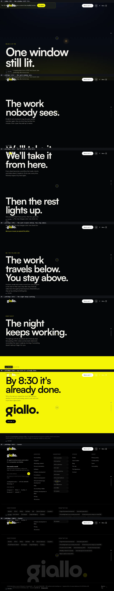
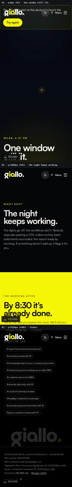

# UI Design System & Master Generation Blueprint: giallostudio-it_en-the-experience

> **The Experience: Milan lights up in yellow · Giallo** (https://giallostudio.it/en/the-experience) — A 3D journey over Milan, from the office where data is still copied by hand to a city lighting up in yellow. See what you could automate...





---

## 1. Executive Visual Persona & Design Archetype

- **Brand Essence & Persona**: **The Experience: Milan lights up in yellow · Giallo** (`https://giallostudio.it/en/the-experience`). A 3D journey over Milan, from the office where data is still copied by hand to a city lighting up in yellow. See what you could automate...
- **Capture Provenance**: Live browser capture (`tier1_fast`, HTTP `200`, captured `2026-11-24`).
- **Visual Archetype**: **High-Contrast Obsidian / Atmospheric Design System (`#050608` canvas, `#ffffff` ink, `#f5f505` accent)**.
- **Anti-AI-Slop Differentiators**:
  - **Live-Computed Chromatic Polarity**: Anchors the viewport in `#050608` (live computed `body` `background-color` (`computed_styles.json`)) paired with `#ffffff` primary typography and `#f5f505` accents.
  - **Grounded Typographic Hierarchy**: Uses `satoshi` across display (`One window still lit.`) and body copy, paired with `SFMono-Regular` for monospace/code.
  - **Calibrated Spatial Grid & Motion**: Combines `96rem` container bounds (`gap: var(--xp-gap)`, padding `var(--xp-top)`) with `cubic-bezier(.76,0,.24,1)` easing and Lenis Smooth Scroll (`data-lenis`).

---

## 2. Spatial Architecture & Modular Grid Mathematics

### Viewport Allocation & Container Geometry
- **Captured Journey Filmstrips**: Desktop `1280×6624px` (`assets/desktop-journey.webp`, `8` keyframes up to `y=6500px` / doc `7402px`), Mobile `390×2616px` (`assets/mobile-journey.webp`, `3` keyframes).
- **Master Container Bounds**: `96rem` (non-`@media` desktop container stylesheet rule).
- **Canvas Lateral Padding & Spacing**: `var(--xp-top)` lateral canvas padding with `var(--xp-gap)` grid gap.
- **Border Radius Scale**: `3.35544e+07px`, `14px`, `999px`, `50%`.

### Responsive Breakpoint Architecture
- **Desktop Layout**: Multi-column CSS Grid / Flexbox layout at `1440px` (`max-width: 96rem`, `gap: var(--xp-gap)`).
- **Mobile Layout**: Single-column vertical stack at `390px` viewport width with `var(--xp-top)` horizontal padding.
- **Extracted CSS Media Queries**: `@media (max-width:1099.98px)`, `@media (max-width:600px)`, `@media (max-aspect-ratio:1)`, `@media (min-aspect-ratio:4/3) and (max-height:640px)`.

---

## 3. Color System, Materiality & Atmospheric Lighting

### Semantic Palette & Source Grounding
| Semantic Role | Ground-Truth Value | Extracted Live / CSS Source |
|---|---|---|
| **Primary Canvas Substrate** | `#050608` | live computed `body` `background-color` (`computed_styles.json`) |
| **Primary Typography Ink** | `#ffffff` | live computed `footer` `color` (`computed_styles.json`) |
| **Elevated Surface / Card Substrate** | `#000000` | live computed `footer` `background-color` (`computed_styles.json`) |
| **Interactive Accent / Highlight** | `#f5f505` | `.hWJL2G_badge { background: #f5f505 }` |
| **Secondary / Muted Copy** | `#f5f505` | `var(--lab-wipe-ink)` in `:root` |
| **Structural Hairline Border** | `#040507` | `var(--lab-line)` in `:root` (`00000021`) |
| **Variable Token (`--paper`)** | `#f2f1ea` | `var(--paper)` in `:root` |

### Sanitized Root CSS Variables (`ui-ux.md` Ground Truth)
| Variable Name | Extracted Value | Semantic Role |
|---|---|---|
| `--font-satoshi` | `"satoshi", "satoshi Fallback", Inter, system-ui, sans-serif` | Typography / Scale Token |
| `--ink` | `#050608` | Typography Ink Token |
| `--paper` | `#f2f1ea` | Canvas / Surface Token |
| `--muted` | `#f2f1eabd` | Color / Atmospheric Token |
| `--yellow` | `#f5f505` | Color / Atmospheric Token |
| `--gutter` | `clamp(1.25rem, 5vw, 5.5rem)` | Layout / Spatial Grid Token |
| `--xp-top` | `calc(5rem + env(safe-area-inset-top,0px) + clamp(.75rem, 3.5vh, 2.75rem))` | Dimension / Scale Token |
| `--xp-bottom` | `calc(env(safe-area-inset-bottom,0px) + clamp(1.25rem, 5.5vh, 4rem))` | Dimension / Scale Token |
| `--xp-left` | `max(var(--gutter), calc(env(safe-area-inset-left,0px) + 1rem))` | Dimension / Scale Token |
| `--xp-right` | `max(var(--gutter), calc(env(safe-area-inset-right,0px) + 1rem))` | Dimension / Scale Token |
| `--xp-gap` | `clamp(.7rem, 2.2vh, 1.6rem)` | Layout / Spatial Grid Token |
| `--xp-title` | `clamp(3.4rem, min(8.4vw, 14.5vh), 9.25rem)` | Dimension / Scale Token |
| `--xp-title-hero` | `clamp(3.8rem, min(10.2vw, 16.5vh), 11rem)` | Dimension / Scale Token |
| `--xp-body` | `clamp(1.02rem, min(1.25vw, 2.3vh), 1.3rem)` | Dimension / Scale Token |
| `--sx` | `100%` | Dimension / Scale Token |
| `--sy` | `0%` | Dimension / Scale Token |

---

## 4. Typographic Scale & Editorial Hierarchy

### Font Family Stacks
- **Display Typography**: `satoshi`.
- **Primary Body Stack**: `satoshi`.
- **Technical / Metadata Stack**: `SFMono-Regular`.

### Typographic Scale & Rules (Live Computed & Stylesheet Grounded)
- **Hero Display (`H1`)**: live computed `h1` (`font-size: 146.88px`, `line-height: 135.13px`, `font-weight: 700`, `letter-spacing: -6.6096px`); CSS variables `--text-4xl: 2.25rem`, `--text-4xl--line-height: calc(2.5 / 2.25)`, `--text-5xl: 3rem`.
- **Section Heading (`H2`)**: live computed `h2` (`font-size: 120.96px`, `line-height: 111.283px`, `font-weight: 700`, `letter-spacing: -5.4432px`); CSS variables `--text-2xl: 1.5rem`, `--text-2xl--line-height: calc(2 / 1.5)`, `--text-3xl: 1.875rem`; rule `h2` (`font-size: clamp(2rem,4vw,3.5rem)`, `line-height: 1`, `font-weight: 600`).
- **Body Copy**: live computed `body` (`font-size: 16px`, `line-height: 26.4px`, `font-weight: 400`); CSS variables `--xp-body: clamp(1.02rem, min(1.25vw, 2.3vh), 1.3rem)`, `--text-base: 1rem`, `--text-base--line-height: calc(1.5 / 1)`; rule `p` (`line-height: var(--leading-relaxed)`).
- **Metadata & Navigation Labels**: live computed `nav/a` (`font-size: 16px`, `line-height: 26.4px`, `font-weight: 400`); CSS variables `--text-xs: .75rem`, `--text-xs--line-height: calc(1 / .75)`, `--text-sm: .875rem`.

---

## 5. Choreographed Motion & Interaction Physics

### Primary Easing Curves
- **Extracted Timing Functions**: `cubic-bezier(.76,0,.24,1)`, `cubic-bezier(.22,1,.36,1)`, `cubic-bezier(.55,0,.6,.2)`.

### Per-Element Transition & Choreography Rules
- **Selector `.wa6Phq_districtTag`**: `transition: color .25s` extracted from `giallostudio-it_en-the-experience` stylesheet.
- **Selector `hq_root[data-mode=immersive] .wa6...`**: `transition: clip-path 1.2s cubic-bezier(.76,0,.24,1)` extracted from `giallostudio-it_en-the-experience` stylesheet.
- **Selector `data-mode=immersive] .wa6Phq_chap...`**: `transition: opacity .7s` extracted from `giallostudio-it_en-the-experience` stylesheet.
- **Extracted Easing Curve (`cubic-bezier(.76,0,.24,1)`)**: Governs interactive state transitions across `<header.inset-x-0>` and `<section.wa6Phq_chapter:nth(2)>`.
- **Runtime Interaction Engine**: Integrates Lenis Smooth Scroll (`data-lenis`) with `prefers-reduced-motion: reduce` fallback guards.
### Measured Runtime Scroll & Interaction Telemetry (`behavioral_journey_v2`)
- **Scroll Driver Mode**: `native` (max document height `7402px`, deepest scrollY reached `6500px` across `8` desktop keyframes).
- **Detected Scroll / Motion Libraries**: `Lenis`.
- **Nav / Drawer Probe (`Open menu`)**: Triggered visual change (pixel diff `24.459`, captured in `assets/state-nav.webp`); revealed links: 01 Services, 02 AI agency, 03 Industries, 04 Case studies, 05 Blog, 06 The Lab.
- **Hover Physics (`primary_cta` · `Try again`)**: Computed transition `0s` / `ease` (no static color/transform shift captured at rest).
- **Theme Toggle Probe (`Activate Dark Theme`)**: Toggled body background `rgb(5, 6, 8)` -> `rgb(5, 6, 8)` and ink `rgb(0, 0, 0)` -> `rgb(247, 247, 239)`.
- **Route Transition Architecture**: First internal navigation (`/en/contact`) measured as `SPA` in `1059ms`.

---

## 6. Component Wireframe & Structural DOM Map

### Visual Layout Schematic — Desktop (`1440px`, Grounded in `dom.html` & Landmark Bounding Boxes)
```
┌────────────────────────────────────────────────────────────────────────┐
│ DESKTOP VIEWPORT (1440px) — The Experience: Milan lights up in yellow  │
│ ====================================================================== │
│ [ <header.inset-x-0> (1440x81px)      | Law firms Law firms · Retail ] │
│ ---------------------------------------------------------------------- │
│ | HERO STAGE: <section.wa6Phq_chapter> (w=1440px)                    | │
│ | H1: One window still lit.                                          | │
│ | Substrate: #050608 | Ink: #ffffff | Accent: #f5f505                | │
│ ---------------------------------------------------------------------- │
│ | SHOWCASE GRID (<section.wa6Phq_chapter:nt) max-w: 96rem            | │
│ | +------------------------------+  +------------------------------+ | │
│ | | The work nobody sees.        |  | We'll take it from here.     | | │
│ | +------------------------------+  +------------------------------+ | │
│ ---------------------------------------------------------------------- │
│ | DETAIL MODULE (<section.wa6Phq_chapter:nt) — Then the rest lights  | │
│ ---------------------------------------------------------------------- │
│ [ FOOTER (<footer.bg-ink>     ) | https://giallostudio.it/en/the-expe  │
└────────────────────────────────────────────────────────────────────────┘
```

### Visual Layout Schematic — Mobile Reflow (`390px`)
```
┌────────────────────────────────────────────────────────────────────────┐
│ MOBILE VIEWPORT REFLOW (390px) — Single-Column Stack (gap: var(--xp)   │
│ ====================================================================== │
│ [ HEADER BAR (<header.inset-x-0>      ) | Compact Menu (390px)         │
│ ---------------------------------------------------------------------- │
│ | HERO STAGE (<section.wa6Phq_chapter>) — 390px Vertical Lead        | │
│ | H1: One window still lit.                                          | │
│ ---------------------------------------------------------------------- │
│ | SHOWCASE STACK (<section.wa6Phq_chapte) — 1-Col Stack              | │
│ | [ Item 1: The work nobody sees.                                  ] | │
│ | [ Item 2: We'll take it from here.                               ] | │
│ ---------------------------------------------------------------------- │
│ | DETAIL STACK (<section.wa6Phq_chapter:) — 1-Col (Then the rest ligh) │
│ ---------------------------------------------------------------------- │
│ [ FOOTER (<footer.bg-ink>     ) | Stacked 390px Colophon               │
└────────────────────────────────────────────────────────────────────────┘
```

### Granular DOM Region Breakdown
1. **Brand Header & Navigation Bar (<header.inset-x-0> — `giallostudio-it_en-the-experience`)**:
   - Landmark `<header class="inset-x-0 top-0">` (`1440x81px`) hosting `The Experience: Milan lights up in y` navigation (`Law firms Law firms · Retail Retail · Tourism Tourism · PMI PMI`), DOM attributes (`data-precedence="next"`, `data-precedence="next"`, `data-precedence="next"`, `data-cursor="hover"`), and stylesheet rule `.STp5NW_className { font-family:satoshi,satoshi Fallback,Inter,system-ui,sans-serif }`.
2. **Hero Stage & Focal Lead (<section.wa6Phq_chapter> — `One window still lit.`)**:
   - Landmark `<section class="wa6Phq_chapter">` presenting display lead `One window still lit.` and copy excerpt *"The 3D didn't start on this device, so here's the simplified vers"* over `#050608` canvas and `#ffffff` ink.
3. **Primary Showcase & Content Grid (<section.wa6Phq_chapter:nth(2)> — `The work nobody sees.`)**:
   - Landmark `<section class="wa6Phq_chapter">` rendering section `The work nobody sees.` with copy *"The 3D didn't start on this device, so here's the simplified vers"*, asset references (`Satoshi_Variable-s.p.2ta4m073o532...`, `logo-black.svg`, `logo-solid-black.svg`, `logo-white.svg`), and grid rule `.STp5NW_variable { --font-satoshi:"satoshi", "satoshi Fallback", Inter, system-ui, sans-serif }`.
4. **Interactive Detail & Feature Matrix (<section.wa6Phq_chapter:nth(3)> — `We'll take it from here.`)**:
   - Landmark `<section class="wa6Phq_chapter">` framing `We'll take it from here.` and `Then the rest lights up.` (*"Someone is copying data from a PDF into Excel. Line by line. Like"*) with `#000000` surface cards, `#f5f505` accents, and `.wa6Phq_stage { position:relative }`.
5. **Colophon & Global Directory Footer (<footer.bg-ink> — `https://giallostudio.it/en/the-experience`)**:
   - Landmark `<footer class="bg-ink text-paper">` anchoring `The Experience: Milan lights up ` footer links (`Law firms Law firms · Retail Retail · Tourism Tourism · PMI PMI`), copy *"Lighting up the city"*, and `#040507` structural dividers.
### Full Vertical Scroll Sequence (Desktop `1440×900` Keyframes)
- **Step 01** (`y=0px`, `0%`): Active landmark `One window still lit.` · sticky/fixed elements: `3`
- **Step 02** (`y=850px`, `13%`): Active landmark `The work nobody sees.` · sticky/fixed elements: `3`
- **Step 03** (`y=1700px`, `26%`): Active landmark `We'll take it from here.` · sticky/fixed elements: `3`
- **Step 04** (`y=2550px`, `39%`): Active landmark `The work travels below. You stay above.` · sticky/fixed elements: `3`
- **Step 05** (`y=4250px`, `65%`): Active landmark `The night keeps working.` · sticky/fixed elements: `3`
- **Step 06** (`y=5100px`, `78%`): Active landmark `By 8:30 it's already done.` · sticky/fixed elements: `3`
- **Step 07** (`y=5950px`, `92%`): Active landmark `Footer` · sticky/fixed elements: `3`
- **Step 08** (`y=6500px`, `100%`): Active landmark `Footer` · sticky/fixed elements: `3`

### Multi-Page Internal Route Map
- **Detail Route (`/en/contact`)**: `https://giallostudio.it/en/contact` — H1: `Tell us where your time goes.`, scrollHeight `3486px`, transition `SPA` (`1059ms`)
- **Detail Route (`/en/industries/ai-for-accountants`)**: `https://giallostudio.it/en/industries/ai-for-accountants` — H1: `AI in your firm prepares the work. The signature...`, scrollHeight `9801px`, transition `direct` (`633ms`)
- **Detail Route (`/en/industries/ai-for-law-firms`)**: `https://giallostudio.it/en/industries/ai-for-law-firms` — H1: `More time on the merits, less on research.`, scrollHeight `8136px`, transition `direct` (`317ms`)

---

## 7. Master Zero-Shot AI Generation Prompt

```markdown
# Master Zero-Shot Frontend Generation Prompt: giallostudio-it_en-the-experience (The Experience: Milan lights up in yellow · Giallo)

You are a principal frontend architect and design systems engineer. Build a complete, production-ready web application replicating the exact design system, DOM landmarks, typographic hierarchy, color tokens, and motion physics of `giallostudio-it_en-the-experience` (**The Experience: Milan lights up in yellow · Giallo** — `https://giallostudio.it/en/the-experience`).

### 1. Visual Archetype & Anti-AI-Slop Mandates
- **Archetype**: High-Contrast Obsidian / Atmospheric Design System (`#050608` canvas, `#ffffff` ink, `#f5f505` accent).
- **Identity & Domain Context**: A 3D journey over Milan, from the office where data is still copied by hand to a city lighting up in yellow. See what you could automate...
- **Primary Substrate**: `#050608` (live computed `body` `background-color` (`computed_styles.json`)), **Primary Ink**: `#ffffff`, **Accent / Highlight**: `#f5f505`.
- **Site-Specific Differentiators**:
  - **Live-Computed Chromatic Polarity**: Anchors the viewport in `#050608` (live computed `body` `background-color` (`computed_styles.json`)) paired with `#ffffff` primary typography and `#f5f505` accents.
  - **Grounded Typographic Hierarchy**: Uses `satoshi` across display (`One window still lit.`) and body copy, paired with `SFMono-Regular` for monospace/code.
  - **Calibrated Spatial Grid & Motion**: Combines `96rem` container bounds (`gap: var(--xp-gap)`, padding `var(--xp-top)`) with `cubic-bezier(.76,0,.24,1)` easing and Lenis Smooth Scroll (`data-lenis`).

### 2. Ground-Truth CSS Variables (`:root` Token Contract)
Declare and consume these exact custom properties extracted from `giallostudio-it_en-the-experience` in your global stylesheet:

:root {
  /* The Experience: Milan lights up in yellow · Giallo (giallostudio-it_en-the-experience) — Live-Grounded CSS Variables */
  --font-satoshi: "satoshi", "satoshi Fallback", Inter, system-ui, sans-serif; /* Typography / Scale Token (giallostudio-it_en-the-experience) */
  --ink: #050608; /* Typography Ink Token (giallostudio-it_en-the-experience) */
  --paper: #f2f1ea; /* Canvas / Surface Token (giallostudio-it_en-the-experience) */
  --muted: #f2f1eabd; /* Color / Atmospheric Token (giallostudio-it_en-the-experience) */
  --yellow: #f5f505; /* Color / Atmospheric Token (giallostudio-it_en-the-experience) */
  --gutter: clamp(1.25rem, 5vw, 5.5rem); /* Layout / Spatial Grid Token (giallostudio-it_en-the-experience) */
  --xp-top: calc(5rem + env(safe-area-inset-top,0px) + clamp(.75rem, 3.5vh, 2.75rem)); /* Dimension / Scale Token (giallostudio-it_en-the-experience) */
  --xp-bottom: calc(env(safe-area-inset-bottom,0px) + clamp(1.25rem, 5.5vh, 4rem)); /* Dimension / Scale Token (giallostudio-it_en-the-experience) */
  --xp-left: max(var(--gutter), calc(env(safe-area-inset-left,0px) + 1rem)); /* Dimension / Scale Token (giallostudio-it_en-the-experience) */
  --xp-right: max(var(--gutter), calc(env(safe-area-inset-right,0px) + 1rem)); /* Dimension / Scale Token (giallostudio-it_en-the-experience) */
  --xp-gap: clamp(.7rem, 2.2vh, 1.6rem); /* Layout / Spatial Grid Token (giallostudio-it_en-the-experience) */
  --xp-title: clamp(3.4rem, min(8.4vw, 14.5vh), 9.25rem); /* Dimension / Scale Token (giallostudio-it_en-the-experience) */
  --xp-title-hero: clamp(3.8rem, min(10.2vw, 16.5vh), 11rem); /* Dimension / Scale Token (giallostudio-it_en-the-experience) */
  --xp-body: clamp(1.02rem, min(1.25vw, 2.3vh), 1.3rem); /* Dimension / Scale Token (giallostudio-it_en-the-experience) */
  --sx: 100%; /* Dimension / Scale Token (giallostudio-it_en-the-experience) */
  --sy: 0%; /* Dimension / Scale Token (giallostudio-it_en-the-experience) */
}

### 3. Semantic Color & Materiality Contract
Map every surface, ink, and border strictly to these source-grounded tokens:
- **Primary Canvas Substrate**: `#050608` — grounded in live computed `body` `background-color` (`computed_styles.json`)
- **Primary Typography Ink**: `#ffffff` — grounded in live computed `footer` `color` (`computed_styles.json`)
- **Elevated Surface / Card Substrate**: `#000000` — grounded in live computed `footer` `background-color` (`computed_styles.json`)
- **Interactive Accent / Highlight**: `#f5f505` — grounded in `.hWJL2G_badge { background: #f5f505 }`
- **Secondary / Muted Copy**: `#f5f505` — grounded in `var(--lab-wipe-ink)` in `:root`
- **Structural Hairline Border**: `#040507` — grounded in `var(--lab-line)` in `:root` (`00000021`)
- **Variable Token (`--paper`)**: `#f2f1ea` — grounded in `var(--paper)` in `:root`

### 4. Spatial Grid, Container Bounds & Responsive Breakpoints
- **Desktop Viewport Reference**: `1280×6624px` (multi-frame vertical journey filmstrip (6624px), `1440px` standard desktop width).
- **Mobile Viewport Reference**: `390×2616px` (multi-frame vertical journey filmstrip (2616px), `390px` standard mobile width).
- **Container Max-Width**: `96rem` (non-`@media` desktop container stylesheet rule)
- **Padding & Gutters**: `var(--xp-top)` lateral canvas padding with `var(--xp-gap)` grid gap
- **Desktop Grid**: Multi-column CSS Grid / Flexbox layout at `1440px` (`max-width: 96rem`, `gap: var(--xp-gap)`)
- **Mobile Adaptation**: Single-column vertical stack at `390px` viewport width with `var(--xp-top)` horizontal padding
- **Media Queries**: `@media (max-width:1099.98px)`, `@media (max-width:600px)`, `@media (max-aspect-ratio:1)`, `@media (min-aspect-ratio:4/3) and (max-height:640px)`
- **Corner Radii**: `3.35544e+07px`, `14px`, `999px`, `50%`

### 5. Typography & Editorial Scale Contract
- **Display Font Stack**: `satoshi`
- **Body Font Stack**: `satoshi`
- **Monospace / Technical Font Stack**: `SFMono-Regular`
- **H1 Display Rule**: live computed `h1` (`font-size: 146.88px`, `line-height: 135.13px`, `font-weight: 700`, `letter-spacing: -6.6096px`); CSS variables `--text-4xl: 2.25rem`, `--text-4xl--line-height: calc(2.5 / 2.25)`, `--text-5xl: 3rem`
- **H2 Section Rule**: live computed `h2` (`font-size: 120.96px`, `line-height: 111.283px`, `font-weight: 700`, `letter-spacing: -5.4432px`); CSS variables `--text-2xl: 1.5rem`, `--text-2xl--line-height: calc(2 / 1.5)`, `--text-3xl: 1.875rem`; rule `h2` (`font-size: clamp(2rem,4vw,3.5rem)`, `line-height: 1`, `font-weight: 600`)
- **Body Copy Rule**: live computed `body` (`font-size: 16px`, `line-height: 26.4px`, `font-weight: 400`); CSS variables `--xp-body: clamp(1.02rem, min(1.25vw, 2.3vh), 1.3rem)`, `--text-base: 1rem`, `--text-base--line-height: calc(1.5 / 1)`; rule `p` (`line-height: var(--leading-relaxed)`)
- **Metadata & Index Rule**: live computed `nav/a` (`font-size: 16px`, `line-height: 26.4px`, `font-weight: 400`); CSS variables `--text-xs: .75rem`, `--text-xs--line-height: calc(1 / .75)`, `--text-sm: .875rem`

### 6. Component Hierarchy, Verbatim Copy & Real DOM Landmarks
Scaffold `giallostudio-it_en-the-experience` (`The Experience: Milan lights up in yellow · Giallo`) with these exact structural regions, extracted copy, and CSS rules from `dom.html`:
1. **Brand Header & Navigation Bar (<header.inset-x-0> — `giallostudio-it_en-the-experience`)**:
   - DOM & Selectors: Landmark `<header class="inset-x-0 top-0">` (`1440x81px`) hosting `The Experience: Milan lights up in y` navigation (`Law firms Law firms · Retail Retail · Tourism Tourism · PMI PMI`), DOM attributes (`data-precedence="next"`, `data-precedence="next"`, `data-precedence="next"`, `data-cursor="hover"`), and stylesheet rule `.STp5NW_className { font-family:satoshi,satoshi Fallback,Inter,system-ui,sans-serif }`.
   - Responsive Contract: Header `Brand Header & Navigation Bar (<header.inset-x-0> — `giallostudio-it_en-the-experience`)` (`giallostudio-it_en-the-experience`) adapts across `@media (max-width:1099.98px)`, `@media (max-width:600px)`, `@media (max-aspect-ratio:1)`, `@media (min-aspect-ratio:4/3) and (max-height:640px)` with `cubic-bezier(.76,0,.24,1)`, `cubic-bezier(.22,1,.36,1)`, `cubic-bezier(.55,0,.6,.2)` transitions and links `Law firms Law firms · Retail Retail · Tourism Tourism · PMI PMI`.
2. **Hero Stage & Focal Lead (<section.wa6Phq_chapter> — `One window still lit.`)**:
   - DOM & Selectors: Landmark `<section class="wa6Phq_chapter">` presenting display lead `One window still lit.` and copy excerpt *"The 3D didn't start on this device, so here's the simplified vers"* over `#050608` canvas and `#ffffff` ink.
   - Responsive Contract: Hero stage (`1280×6624px` desktop / `390×2616px` mobile) sets `#050608` background with `#ffffff` headline `One window still lit.`.
3. **Primary Showcase & Content Grid (<section.wa6Phq_chapter:nth(2)> — `The work nobody sees.`)**:
   - DOM & Selectors: Landmark `<section class="wa6Phq_chapter">` rendering section `The work nobody sees.` with copy *"The 3D didn't start on this device, so here's the simplified vers"*, asset references (`Satoshi_Variable-s.p.2ta4m073o532...`, `logo-black.svg`, `logo-solid-black.svg`, `logo-white.svg`), and grid rule `.STp5NW_variable { --font-satoshi:"satoshi", "satoshi Fallback", Inter, system-ui, sans-serif }`.
   - Responsive Contract: Showcase grid `Primary Showcase & Content Grid (<section.wa6Phq_chapter:nth(2)> — `The work nobody sees.`)` applies Multi-column CSS Grid / Flexbox layout at `1440px` (`max-width: 96rem`, `gap: var(--xp-gap)`) on desktop and Single-column vertical stack at `390px` viewport width with `var(--xp-top)` horizontal padding on mobile.
4. **Interactive Detail & Feature Matrix (<section.wa6Phq_chapter:nth(3)> — `We'll take it from here.`)**:
   - DOM & Selectors: Landmark `<section class="wa6Phq_chapter">` framing `We'll take it from here.` and `Then the rest lights up.` (*"Someone is copying data from a PDF into Excel. Line by line. Like"*) with `#000000` surface cards, `#f5f505` accents, and `.wa6Phq_stage { position:relative }`.
   - Responsive Contract: Detail module `Interactive Detail & Feature Matrix (<section.wa6Phq_chapter:nth(3)> — `We'll take it from here.`)` uses `3.35544e+07px`, `14px`, `999px`, `50%` radii, `#f5f505` highlights, and assets (Satoshi_Variable-s.p.2ta4m073o532..., logo-black.svg, logo-solid-black.svg).
5. **Colophon & Global Directory Footer (<footer.bg-ink> — `https://giallostudio.it/en/the-experience`)**:
   - DOM & Selectors: Landmark `<footer class="bg-ink text-paper">` anchoring `The Experience: Milan lights up ` footer links (`Law firms Law firms · Retail Retail · Tourism Tourism · PMI PMI`), copy *"Lighting up the city"*, and `#040507` structural dividers.
   - Responsive Contract: Footer `Colophon & Global Directory Footer (<footer.bg-ink> — `https://giallostudio.it/en/the-experience`)` aligns to `96rem` (non-`@media` desktop container stylesheet rule) with `var(--xp-top)` lateral canvas padding with `var(--xp-gap)` grid gap and attributes (data-precedence="next", data-precedence="next", data-precedence="next").

#### Verbatim DOM Copy Excerpts (`dom.html`)
- Copy Excerpt 1: *"The 3D didn't start on this device, so here's the simplified version. Try again"*
- Copy Excerpt 2: *"The 3D didn't start on this device, so here's the simplified version."*
- Copy Excerpt 3: *"Someone is copying data from a PDF into Excel. Line by line. Like yesterday, like..."*
- Copy Excerpt 4: *"Lighting up the city"*

### 7. Motion, Extracted Stylesheet Rules & Interaction Choreography
- **Primary Easing Functions**: `cubic-bezier(.76,0,.24,1)`, `cubic-bezier(.22,1,.36,1)`, `cubic-bezier(.55,0,.6,.2)`
- **Extracted Stylesheet Rules (`giallostudio-it_en-the-experience`)**:
- `.STp5NW_className { font-family:satoshi,satoshi Fallback,Inter,system-ui,sans-serif }`
- `.STp5NW_variable { --font-satoshi:"satoshi", "satoshi Fallback", Inter, system-ui, sans-serif }`
- `.wa6Phq_stage { position:relative }`
- `.wa6Phq_canvas { display:none }`
- `.wa6Phq_hud { position:relative }`
- **Per-Selector Transition Rules**:
- **Selector `.wa6Phq_districtTag`**: `transition: color .25s` extracted from `giallostudio-it_en-the-experience` stylesheet.
- **Selector `hq_root[data-mode=immersive] .wa6...`**: `transition: clip-path 1.2s cubic-bezier(.76,0,.24,1)` extracted from `giallostudio-it_en-the-experience` stylesheet.
- **Selector `data-mode=immersive] .wa6Phq_chap...`**: `transition: opacity .7s` extracted from `giallostudio-it_en-the-experience` stylesheet.
- **Extracted Easing Curve (`cubic-bezier(.76,0,.24,1)`)**: Governs interactive state transitions across `<header.inset-x-0>` and `<section.wa6Phq_chapter:nth(2)>`.
- **Runtime Interaction Engine**: Integrates Lenis Smooth Scroll (`data-lenis`) with `prefers-reduced-motion: reduce` fallback guards.
### 7b. Full-Page Scroll Choreography, Interactive States & Multi-Page Routes
- **Scroll Mechanics**: Implement `native` vertical progression up to `7402px` across 8 distinct viewport chapters using Lenis.
- **Vertical Chapter Sequence**: One window still lit. (0%) -> The work nobody sees. (13%) -> We'll take it from here. (26%) -> The work travels below. You... (39%) -> The night keeps working. (65%) -> By 8:30 it's already done. (78%) -> Footer (92%) -> Footer (100%).
- **Navigation Drawer / Menu State**: Replicate interactive menu toggle (`Open menu`) with Escape-to-close keyboard handling.
- **Multi-Page Routes**: Scaffold internal routes `/en/contact` (detail, SPA), `/en/industries/ai-for-accountants` (detail, direct), `/en/industries/ai-for-law-firms` (detail, direct) sharing the global header/footer shell and design tokens.

### 8. Technical Deliverables
- Implement in Next.js (App Router) with TypeScript and Tailwind CSS consuming the `:root` custom properties defined above for `giallostudio-it_en-the-experience`.
- Reproduce both the `1440px` desktop architecture and `390px` mobile breakpoint transitions, preserving semantic HTML5 landmarks (`<header>`, `<nav>`, `<main>`, `<section>`, `<footer>`) and `prefers-reduced-motion` accessibility guards.
```
---

## 8. Full-Page Scroll Journey, Interactive States & Subpage Inventory

### Desktop Scroll Keyframes (`1440×900` WebP)
| Step | Scroll Y | Progress | Active Landmark / Section | Sticky/Fixed | Visual Asset |
| :---: | :---: | :---: | :--- | :---: | :--- |
| `#01` | `0px` | `0%` | One window still lit. | `3` | [desktop-step-01.webp](assets/desktop-step-01.webp) |
| `#02` | `850px` | `13%` | The work nobody sees. | `3` | [desktop-step-02.webp](assets/desktop-step-02.webp) |
| `#03` | `1700px` | `26%` | We'll take it from here. | `3` | [desktop-step-03.webp](assets/desktop-step-03.webp) |
| `#04` | `2550px` | `39%` | The work travels below. You stay above. | `3` | [desktop-step-04.webp](assets/desktop-step-04.webp) |
| `#05` | `4250px` | `65%` | The night keeps working. | `3` | [desktop-step-05.webp](assets/desktop-step-05.webp) |
| `#06` | `5100px` | `78%` | By 8:30 it's already done. | `3` | [desktop-step-06.webp](assets/desktop-step-06.webp) |
| `#07` | `5950px` | `92%` | Footer | `3` | [desktop-step-07.webp](assets/desktop-step-07.webp) |
| `#08` | `6500px` | `100%` | Footer | `3` | [desktop-step-08.webp](assets/desktop-step-08.webp) |

### Mobile Condensed Keyframes (`390×844` WebP)
| Step | Scroll Y | Progress | Active Landmark | Visual Asset |
| :---: | :---: | :---: | :--- | :--- |
| `#01` | `0px` | `0%` | One window still lit. | [mobile-step-01.webp](assets/mobile-step-01.webp) |
| `#02` | `3809px` | `50%` | The night keeps working. | [mobile-step-02.webp](assets/mobile-step-02.webp) |
| `#03` | `7619px` | `100%` | Footer | [mobile-step-03.webp](assets/mobile-step-03.webp) |

### Interactive UI State Captures (`1440×900` WebP)
| State Type | Trigger / Observation | Visual Asset |
| :--- | :--- | :--- |
| `nav_menu` | Nav/Menu opened (`Open menu`, diff `24.459`) | [state-nav.webp](assets/state-nav.webp) |

### Internal Subpage Filmstrips (`1080px` Wide WebP)
| # | Template | Route URL | H1 / Title | Scroll Height | Transition | Filmstrip Asset |
| :-: | :---: | :--- | :--- | :---: | :---: | :--- |
| `1` | `detail` | `https://giallostudio.it/en/contact` | Tell us where your time goes. | `3486px` | `SPA` (`1059ms`) | [subpage-01-en-contact.webp](assets/subpage-01-en-contact.webp) |
| `2` | `detail` | `https://giallostudio.it/en/industries/ai-for-accountants` | AI in your firm prepares the work. Th... | `9801px` | `direct` (`633ms`) | [subpage-02-en-industries-ai-for-accountants.webp](assets/subpage-02-en-industries-ai-for-accountants.webp) |
| `3` | `detail` | `https://giallostudio.it/en/industries/ai-for-law-firms` | More time on the merits, less on rese... | `8136px` | `direct` (`317ms`) | [subpage-03-en-industries-ai-for-law-firms.webp](assets/subpage-03-en-industries-ai-for-law-firms.webp) |

