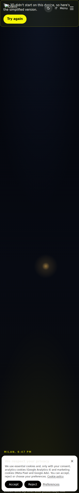

# UI Design System & Master Generation Blueprint: giallostudio-it_en-the-experience

> **The Experience: Milan lights up in yellow · Giallo** (https://giallostudio.it/en/the-experience) — A 3D journey over Milan, from the office where data is still copied by hand to a city lighting up in yellow. See what you could automate...


---

## 1. Executive Visual Persona & Design Archetype

- **Brand Essence & Persona**: **The Experience: Milan lights up in yellow · Giallo** (`https://giallostudio.it/en/the-experience`). A 3D journey over Milan, from the office where data is still copied by hand to a city lighting up in yellow. See what you could automate...
- **Visual Archetype**: **High-Contrast Obsidian / Atmospheric Design System (`#050608` canvas, `#f2f1ea` ink, `#fb2c36` accent)**.
- **Anti-AI-Slop Differentiators**:
  - **Source-Grounded Chromatic Polarity**: Anchors the viewport in `#050608` (`var(--ink)` in `:root`) paired with `#f2f1ea` primary typography and `#fb2c36` accents.
  - **Extracted Typographic Hierarchy**: Pairs `satoshi` for display copy (`One window still lit.`) with `satoshi Fallback` and `SFMono-Regular`.
  - **Calibrated Spatial Grid & Motion**: Combines `13ch` container bounds (`gap: var(--xp-gap)`, padding `var(--xp-top)`) with `cubic-bezier(.76,0,.24,1)` easing and Lenis Smooth Scroll (`data-lenis`).

---

## 2. Spatial Architecture & Modular Grid Mathematics



### Viewport Allocation & Container Geometry
- **Captured Viewport Dimensions**: Desktop `1440×7400px` (`assets/desktop.png`, full-page scroll capture), Mobile `390×2400px` (`assets/mobile.png`, capped at 2400px multi-section capture).
- **Master Container Bounds**: `13ch` extracted from `giallostudio-it_en-the-experience` stylesheet.
- **Canvas Lateral Padding & Spacing**: `var(--xp-top)` lateral canvas padding with `var(--xp-gap)` grid gap.
- **Border Radius Scale**: `14px`, `999px`, `50%`, `2rem`.

### Responsive Breakpoint Architecture
- **Desktop Layout**: Multi-column CSS Grid / Flexbox layout at `1440px` (`max-width: 13ch`, `gap: var(--xp-gap)`).
- **Mobile Layout**: Single-column vertical stack at `390px` viewport width with `var(--xp-top)` horizontal padding.
- **Extracted CSS Media Queries**: `@media (max-width:1099.98px)`, `@media (max-width:600px)`, `@media (max-aspect-ratio:1)`, `@media (min-aspect-ratio:4/3) and (max-height:640px)`.

---

## 3. Color System, Materiality & Atmospheric Lighting

### Semantic Palette & Source Grounding
| Semantic Role | Ground-Truth Value | Extracted CSS Source / Selector |
|---|---|---|
| **Primary Canvas Substrate** | `#050608` | `var(--ink)` in `:root` |
| **Primary Typography Ink** | `#f2f1ea` | `var(--paper)` in `:root` |
| **Elevated Surface / Card Substrate** | `#f5f505` | `var(--yellow)` in `:root` |
| **Interactive Accent / Highlight** | `#fb2c36` | `var(--color-red-500)` in `:root` |
| **Secondary / Muted Copy** | `#e40014` | `var(--color-red-600)` in `:root` |
| **Structural Hairline Border** | `#bf000f` | `var(--color-red-700)` in `:root` |
| **Variable Token (`--muted`)** | `#f2f1eabd` | `var(--muted)` in `:root` |

### Sanitized Root CSS Variables (`ui-ux.md` Ground Truth)
| Variable Name | Extracted Value | Semantic Role |
|---|---|---|
| `--ink` | `#050608` | Typography Ink Token |
| `--paper` | `#f2f1ea` | Canvas / Surface Token |
| `--muted` | `#f2f1eabd` | Color / Atmospheric Token |
| `--yellow` | `#f5f505` | Color / Atmospheric Token |
| `--gutter` | `clamp(1.25rem, 5vw, 5.5rem)` | Layout / Spatial Grid Token |
| `--xp-top` | `calc(5rem + env(safe-area-inset-top,0px) + clamp(.75rem, 3.5vh, 2.75rem))` | Dimension / Scale Token |
| `--xp-bottom` | `calc(env(safe-area-inset-bottom,0px) + clamp(1.25rem, 5.5vh, 4rem))` | Dimension / Scale Token |
| `--xp-left` | `max(var(--gutter), calc(env(safe-area-inset-left,0px) + 1rem))` | Dimension / Scale Token |
| `--xp-right` | `max(var(--gutter), calc(env(safe-area-inset-right,0px) + 1rem))` | Dimension / Scale Token |
| `--xp-gap` | `clamp(.7rem, 2.2vh, 1.6rem)` | Layout / Spatial Grid Token |
| `--xp-title` | `clamp(3.4rem, min(8.4vw, 14.5vh), 9.25rem)` | Dimension / Scale Token |
| `--xp-title-hero` | `clamp(3.8rem, min(10.2vw, 16.5vh), 11rem)` | Dimension / Scale Token |
| `--xp-body` | `clamp(1.02rem, min(1.25vw, 2.3vh), 1.3rem)` | Dimension / Scale Token |
| `--sx` | `100%` | Dimension / Scale Token |
| `--sy` | `0%` | Dimension / Scale Token |
| `--font-satoshi` | `"satoshi", "satoshi Fallback", Inter, system-ui, sans-serif` | Typography / Scale Token |

---

## 4. Typographic Scale & Editorial Hierarchy

### Font Family Stacks
- **Display Typography**: `satoshi`.
- **Primary Body Stack**: `satoshi Fallback`.
- **Technical / Metadata Stack**: `SFMono-Regular`.

### Typographic Scale & Rules (Extracted from Stylesheet & Variables)
- **Hero Display (`H1`)**: CSS variables `--text-4xl: 2.25rem`, `--text-4xl--line-height: calc(2.5 / 2.25)`, `--text-5xl: 3rem`.
- **Section Heading (`H2`)**: CSS variables `--text-2xl: 1.5rem`, `--text-2xl--line-height: calc(2 / 1.5)`, `--text-3xl: 1.875rem`; rule `h2` (`font-size: clamp(2rem,4vw,3.5rem)`, `line-height: 1`, `font-weight: 600`).
- **Body Copy**: CSS variables `--xp-body: clamp(1.02rem, min(1.25vw, 2.3vh), 1.3rem)`, `--text-base: 1rem`, `--text-base--line-height: calc(1.5 / 1)`; rule `p` (`line-height: var(--leading-relaxed)`).
- **Metadata & Navigation Labels**: CSS variables `--text-xs: .75rem`, `--text-xs--line-height: calc(1 / .75)`, `--text-sm: .875rem`.

---

## 5. Choreographed Motion & Interaction Physics

### Primary Easing Curves
- **Extracted Timing Functions**: `cubic-bezier(.76,0,.24,1)`, `cubic-bezier(.22,1,.36,1)`, `cubic-bezier(.55,0,.6,.2)`.

### Per-Element Transition & Choreography Rules
- **Selector `.wa6Phq_districtTag`**: `transition: color .25s` extracted from `giallostudio-it_en-the-experience` stylesheet.
- **Selector `hq_root[data-mode=immersive] .wa6...`**: `transition: clip-path 1.2s cubic-bezier(.76,0,.24,1)` extracted from `giallostudio-it_en-the-experience` stylesheet.
- **Selector `data-mode=immersive] .wa6Phq_chap...`**: `transition: opacity .7s` extracted from `giallostudio-it_en-the-experience` stylesheet.
- **Extracted Easing Curve (`cubic-bezier(.76,0,.24,1)`)**: Governs interactive state transitions across `<header.fixed>` and `<section.wa6Phq_chapter>`.
- **Runtime Interaction Engine**: Integrates Lenis Smooth Scroll (`data-lenis`) with `prefers-reduced-motion: reduce` fallback guards.

---

## 6. Component Wireframe & Structural DOM Map

### Visual Layout Schematic (Grounded in `dom.html` — `1440px` Desktop & `390px` Mobile Reflow)
```
┌────────────────────────────────────────────────────────────────────────┐
│ DESKTOP VIEWPORT (1440px) — The Experience: Milan lights up in yellow  │
│ ====================================================================== │
│ [ <header.fixed>           | Law firms Law firms · Retail Retail ·  ]  │
│ ---------------------------------------------------------------------- │
│ | HERO STAGE: <section.wa6Phq_chapter>                             |   │
│ | H1: One window still lit.                                        |   │
│ | Substrate: #050608    | Ink: #f2f1ea    | Accent: #fb2c36        |   │
│ ---------------------------------------------------------------------- │
│ | SHOWCASE GRID (<section.wa6Phq_chapter>  ) max-w: 13ch           |   │
│ | +------------------------------+  +------------------------------+ | │
│ | | The work nobody sees.        |  | We'll take it from here.     | | │
│ | +------------------------------+  +------------------------------+ | │
│ ---------------------------------------------------------------------- │
│ | MOBILE VIEWPORT REFLOW (390px) — Single-Column Stack (gap: var(--) | │
│ | [<header.fixed>] -> [<section.wa6Phq_ch] -> [<section.wa6Phq_ch] |   │
│ ---------------------------------------------------------------------- │
│ [ FOOTER (<footer.relative>     ) | https://giallostudio.it/en/the-exp │
└────────────────────────────────────────────────────────────────────────┘
```

### Granular DOM Region Breakdown
1. **Brand Header & Navigation Bar (<header.fixed> — `giallostudio-it_en-the-experience`)**:
   - Landmark `<header class="fixed inset-x-0">` hosting `The Experience: Milan lights up in y` navigation (`Law firms Law firms · Retail Retail · Tourism Tourism · PMI PMI`), DOM attributes (`data-precedence="next"`, `data-precedence="next"`, `data-precedence="next"`, `data-cursor="hover"`), and stylesheet rule `.wa6Phq_stage { position:relative }`.
2. **Hero Stage & Focal Lead (<section.wa6Phq_chapter> — `One window still lit.`)**:
   - Landmark `<section class="wa6Phq_chapter">` presenting display lead `One window still lit.` and copy excerpt *"Skip the experience"* over `#050608` canvas and `#f2f1ea` ink.
3. **Primary Showcase & Content Grid (<section.wa6Phq_chapter> — `The work nobody sees.`)**:
   - Landmark `<section class="wa6Phq_chapter">` rendering section `The work nobody sees.` with copy *"The 3D didn't start on this device, so here's the simplified vers"*, asset references (`Satoshi_Variable-s.p.2ta4m073o532...`, `logo-black.svg`, `logo-solid-black.svg`, `logo-white.svg`), and grid rule `.wa6Phq_canvas { display:none }`.
4. **Interactive Detail & Feature Matrix (<section.wa6Phq_chapter> — `We'll take it from here.`)**:
   - Landmark `<section class="wa6Phq_chapter">` framing `We'll take it from here.` and `Then the rest lights up.` (*"The 3D didn't start on this device, so here's the simplified vers"*) with `#f5f505` surface cards, `#fb2c36` accents, and `.wa6Phq_hud { position:relative }`.
5. **Colophon & Global Directory Footer (<footer.relative> — `https://giallostudio.it/en/the-experience`)**:
   - Landmark `<footer class="relative overflow-hidden">` anchoring `The Experience: Milan lights up ` footer links (`Law firms Law firms · Retail Retail · Tourism Tourism · PMI PMI`), copy *"Someone is copying data from a PDF into Excel. Line by line."*, and `#bf000f` structural dividers.

---

## 7. Master Zero-Shot AI Generation Prompt

```markdown
# Master Zero-Shot Frontend Generation Prompt: giallostudio-it_en-the-experience (The Experience: Milan lights up in yellow · Giallo)

You are a principal frontend architect and design systems engineer. Build a complete, production-ready web application replicating the exact design system, DOM landmarks, typographic hierarchy, color tokens, and motion physics of `giallostudio-it_en-the-experience` (**The Experience: Milan lights up in yellow · Giallo** — `https://giallostudio.it/en/the-experience`).

### 1. Visual Archetype & Anti-AI-Slop Mandates
- **Archetype**: High-Contrast Obsidian / Atmospheric Design System (`#050608` canvas, `#f2f1ea` ink, `#fb2c36` accent).
- **Identity & Domain Context**: A 3D journey over Milan, from the office where data is still copied by hand to a city lighting up in yellow. See what you could automate...
- **Primary Substrate**: `#050608` (`var(--ink)` in `:root`), **Primary Ink**: `#f2f1ea`, **Accent / Highlight**: `#fb2c36`.
- **Site-Specific Differentiators**:
  - **Source-Grounded Chromatic Polarity**: Anchors the viewport in `#050608` (`var(--ink)` in `:root`) paired with `#f2f1ea` primary typography and `#fb2c36` accents.
  - **Extracted Typographic Hierarchy**: Pairs `satoshi` for display copy (`One window still lit.`) with `satoshi Fallback` and `SFMono-Regular`.
  - **Calibrated Spatial Grid & Motion**: Combines `13ch` container bounds (`gap: var(--xp-gap)`, padding `var(--xp-top)`) with `cubic-bezier(.76,0,.24,1)` easing and Lenis Smooth Scroll (`data-lenis`).

### 2. Ground-Truth CSS Variables (`:root` Token Contract)
Declare and consume these exact custom properties extracted from `giallostudio-it_en-the-experience` in your global stylesheet:

:root {
  /* The Experience: Milan lights up in yellow · Giallo (giallostudio-it_en-the-experience) — Ground-Truth Extracted CSS Variables */
  --ink: #050608; /* Typography Ink Token (giallostudio-it_en-the-experience) */
  --paper: #f2f1ea; /* Canvas / Surface Token (giallostudio-it_en-the-experience) */
  --muted: #f2f1eabd; /* Color / Atmospheric Token (giallostudio-it_en-the-experience) */
  --yellow: #f5f505; /* Color / Atmospheric Token (giallostudio-it_en-the-experience) */
  --gutter: clamp(1.25rem, 5vw, 5.5rem); /* Layout / Spatial Grid Token (giallostudio-it_en-the-experience) */
  --xp-top: calc(5rem + env(safe-area-inset-top,0px) + clamp(.75rem, 3.5vh, 2.75rem)); /* Dimension / Scale Token (giallostudio-it_en-the-experience) */
  --xp-bottom: calc(env(safe-area-inset-bottom,0px) + clamp(1.25rem, 5.5vh, 4rem)); /* Dimension / Scale Token (giallostudio-it_en-the-experience) */
  --xp-left: max(var(--gutter), calc(env(safe-area-inset-left,0px) + 1rem)); /* Dimension / Scale Token (giallostudio-it_en-the-experience) */
  --xp-right: max(var(--gutter), calc(env(safe-area-inset-right,0px) + 1rem)); /* Dimension / Scale Token (giallostudio-it_en-the-experience) */
  --xp-gap: clamp(.7rem, 2.2vh, 1.6rem); /* Layout / Spatial Grid Token (giallostudio-it_en-the-experience) */
  --xp-title: clamp(3.4rem, min(8.4vw, 14.5vh), 9.25rem); /* Dimension / Scale Token (giallostudio-it_en-the-experience) */
  --xp-title-hero: clamp(3.8rem, min(10.2vw, 16.5vh), 11rem); /* Dimension / Scale Token (giallostudio-it_en-the-experience) */
  --xp-body: clamp(1.02rem, min(1.25vw, 2.3vh), 1.3rem); /* Dimension / Scale Token (giallostudio-it_en-the-experience) */
  --sx: 100%; /* Dimension / Scale Token (giallostudio-it_en-the-experience) */
  --sy: 0%; /* Dimension / Scale Token (giallostudio-it_en-the-experience) */
  --font-satoshi: "satoshi", "satoshi Fallback", Inter, system-ui, sans-serif; /* Typography / Scale Token (giallostudio-it_en-the-experience) */
}

### 3. Semantic Color & Materiality Contract
Map every surface, ink, and border strictly to these source-grounded tokens:
- **Primary Canvas Substrate**: `#050608` — grounded in `var(--ink)` in `:root`
- **Primary Typography Ink**: `#f2f1ea` — grounded in `var(--paper)` in `:root`
- **Elevated Surface / Card Substrate**: `#f5f505` — grounded in `var(--yellow)` in `:root`
- **Interactive Accent / Highlight**: `#fb2c36` — grounded in `var(--color-red-500)` in `:root`
- **Secondary / Muted Copy**: `#e40014` — grounded in `var(--color-red-600)` in `:root`
- **Structural Hairline Border**: `#bf000f` — grounded in `var(--color-red-700)` in `:root`
- **Variable Token (`--muted`)**: `#f2f1eabd` — grounded in `var(--muted)` in `:root`

### 4. Spatial Grid, Container Bounds & Responsive Breakpoints
- **Desktop Viewport Reference**: `1440×7400px` (full-page scroll capture, `1440px` standard desktop width).
- **Mobile Viewport Reference**: `390×2400px` (capped at 2400px multi-section capture, `390px` standard mobile width).
- **Container Max-Width**: `13ch` extracted from `giallostudio-it_en-the-experience` stylesheet
- **Padding & Gutters**: `var(--xp-top)` lateral canvas padding with `var(--xp-gap)` grid gap
- **Desktop Grid**: Multi-column CSS Grid / Flexbox layout at `1440px` (`max-width: 13ch`, `gap: var(--xp-gap)`)
- **Mobile Adaptation**: Single-column vertical stack at `390px` viewport width with `var(--xp-top)` horizontal padding
- **Media Queries**: `@media (max-width:1099.98px)`, `@media (max-width:600px)`, `@media (max-aspect-ratio:1)`, `@media (min-aspect-ratio:4/3) and (max-height:640px)`
- **Corner Radii**: `14px`, `999px`, `50%`, `2rem`

### 5. Typography & Editorial Scale Contract
- **Display Font Stack**: `satoshi`
- **Body Font Stack**: `satoshi Fallback`
- **Monospace / Technical Font Stack**: `SFMono-Regular`
- **H1 Display Rule**: CSS variables `--text-4xl: 2.25rem`, `--text-4xl--line-height: calc(2.5 / 2.25)`, `--text-5xl: 3rem`
- **H2 Section Rule**: CSS variables `--text-2xl: 1.5rem`, `--text-2xl--line-height: calc(2 / 1.5)`, `--text-3xl: 1.875rem`; rule `h2` (`font-size: clamp(2rem,4vw,3.5rem)`, `line-height: 1`, `font-weight: 600`)
- **Body Copy Rule**: CSS variables `--xp-body: clamp(1.02rem, min(1.25vw, 2.3vh), 1.3rem)`, `--text-base: 1rem`, `--text-base--line-height: calc(1.5 / 1)`; rule `p` (`line-height: var(--leading-relaxed)`)
- **Metadata & Index Rule**: CSS variables `--text-xs: .75rem`, `--text-xs--line-height: calc(1 / .75)`, `--text-sm: .875rem`

### 6. Component Hierarchy, Verbatim Copy & Real DOM Landmarks
Scaffold `giallostudio-it_en-the-experience` (`The Experience: Milan lights up in yellow · Giallo`) with these exact structural regions, extracted copy, and CSS rules from `dom.html`:
1. **Brand Header & Navigation Bar (<header.fixed> — `giallostudio-it_en-the-experience`)**:
   - DOM & Selectors: Landmark `<header class="fixed inset-x-0">` hosting `The Experience: Milan lights up in y` navigation (`Law firms Law firms · Retail Retail · Tourism Tourism · PMI PMI`), DOM attributes (`data-precedence="next"`, `data-precedence="next"`, `data-precedence="next"`, `data-cursor="hover"`), and stylesheet rule `.wa6Phq_stage { position:relative }`.
   - Responsive Contract: Header `Brand Header & Navigation Bar (<header.fixed> — `giallostudio-it_en-the-experience`)` (`giallostudio-it_en-the-experience`) adapts across `@media (max-width:1099.98px)`, `@media (max-width:600px)`, `@media (max-aspect-ratio:1)`, `@media (min-aspect-ratio:4/3) and (max-height:640px)` with `cubic-bezier(.76,0,.24,1)`, `cubic-bezier(.22,1,.36,1)`, `cubic-bezier(.55,0,.6,.2)` transitions and links `Law firms Law firms · Retail Retail · Tourism Tourism · PMI PMI`.
2. **Hero Stage & Focal Lead (<section.wa6Phq_chapter> — `One window still lit.`)**:
   - DOM & Selectors: Landmark `<section class="wa6Phq_chapter">` presenting display lead `One window still lit.` and copy excerpt *"Skip the experience"* over `#050608` canvas and `#f2f1ea` ink.
   - Responsive Contract: Hero stage (`1440×7400px` desktop / `390×2400px` mobile) sets `#050608` background with `#f2f1ea` headline `One window still lit.`.
3. **Primary Showcase & Content Grid (<section.wa6Phq_chapter> — `The work nobody sees.`)**:
   - DOM & Selectors: Landmark `<section class="wa6Phq_chapter">` rendering section `The work nobody sees.` with copy *"The 3D didn't start on this device, so here's the simplified vers"*, asset references (`Satoshi_Variable-s.p.2ta4m073o532...`, `logo-black.svg`, `logo-solid-black.svg`, `logo-white.svg`), and grid rule `.wa6Phq_canvas { display:none }`.
   - Responsive Contract: Showcase grid `Primary Showcase & Content Grid (<section.wa6Phq_chapter> — `The work nobody sees.`)` applies Multi-column CSS Grid / Flexbox layout at `1440px` (`max-width: 13ch`, `gap: var(--xp-gap)`) on desktop and Single-column vertical stack at `390px` viewport width with `var(--xp-top)` horizontal padding on mobile.
4. **Interactive Detail & Feature Matrix (<section.wa6Phq_chapter> — `We'll take it from here.`)**:
   - DOM & Selectors: Landmark `<section class="wa6Phq_chapter">` framing `We'll take it from here.` and `Then the rest lights up.` (*"The 3D didn't start on this device, so here's the simplified vers"*) with `#f5f505` surface cards, `#fb2c36` accents, and `.wa6Phq_hud { position:relative }`.
   - Responsive Contract: Detail module `Interactive Detail & Feature Matrix (<section.wa6Phq_chapter> — `We'll take it from here.`)` uses `14px`, `999px`, `50%`, `2rem` radii, `#fb2c36` highlights, and assets (Satoshi_Variable-s.p.2ta4m073o532..., logo-black.svg, logo-solid-black.svg).
5. **Colophon & Global Directory Footer (<footer.relative> — `https://giallostudio.it/en/the-experience`)**:
   - DOM & Selectors: Landmark `<footer class="relative overflow-hidden">` anchoring `The Experience: Milan lights up ` footer links (`Law firms Law firms · Retail Retail · Tourism Tourism · PMI PMI`), copy *"Someone is copying data from a PDF into Excel. Line by line."*, and `#bf000f` structural dividers.
   - Responsive Contract: Footer `Colophon & Global Directory Footer (<footer.relative> — `https://giallostudio.it/en/the-experience`)` aligns to `13ch` extracted from `giallostudio-it_en-the-experience` stylesheet with `var(--xp-top)` lateral canvas padding with `var(--xp-gap)` grid gap and attributes (data-precedence="next", data-precedence="next", data-precedence="next").

#### Verbatim DOM Copy Excerpts (`dom.html`)
- Copy Excerpt 1: *"Skip the experience"*
- Copy Excerpt 2: *"The 3D didn't start on this device, so here's the simplified version. Try again"*
- Copy Excerpt 3: *"The 3D didn't start on this device, so here's the simplified version."*
- Copy Excerpt 4: *"Someone is copying data from a PDF into Excel. Line by line. Like yesterday, like..."*

### 7. Motion, Extracted Stylesheet Rules & Interaction Choreography
- **Primary Easing Functions**: `cubic-bezier(.76,0,.24,1)`, `cubic-bezier(.22,1,.36,1)`, `cubic-bezier(.55,0,.6,.2)`
- **Extracted Stylesheet Rules (`giallostudio-it_en-the-experience`)**:
- `.wa6Phq_stage { position:relative }`
- `.wa6Phq_canvas { display:none }`
- `.wa6Phq_hud { position:relative }`
- `.wa6Phq_kicker { letter-spacing:.22em;text-transform:uppercase;color:var(--yellow);font-s... }`
- `.wa6Phq_title { font-size:var(--xp-title-hero);max-width:11ch }`
- **Per-Selector Transition Rules**:
- **Selector `.wa6Phq_districtTag`**: `transition: color .25s` extracted from `giallostudio-it_en-the-experience` stylesheet.
- **Selector `hq_root[data-mode=immersive] .wa6...`**: `transition: clip-path 1.2s cubic-bezier(.76,0,.24,1)` extracted from `giallostudio-it_en-the-experience` stylesheet.
- **Selector `data-mode=immersive] .wa6Phq_chap...`**: `transition: opacity .7s` extracted from `giallostudio-it_en-the-experience` stylesheet.
- **Extracted Easing Curve (`cubic-bezier(.76,0,.24,1)`)**: Governs interactive state transitions across `<header.fixed>` and `<section.wa6Phq_chapter>`.
- **Runtime Interaction Engine**: Integrates Lenis Smooth Scroll (`data-lenis`) with `prefers-reduced-motion: reduce` fallback guards.

### 8. Technical Deliverables
- Implement in Next.js (App Router) with TypeScript and Tailwind CSS consuming the `:root` custom properties defined above for `giallostudio-it_en-the-experience`.
- Reproduce both the `1440px` desktop architecture and `390px` mobile breakpoint transitions, preserving semantic HTML5 landmarks (`<header>`, `<nav>`, `<main>`, `<section>`, `<footer>`) and `prefers-reduced-motion` accessibility guards.
```
