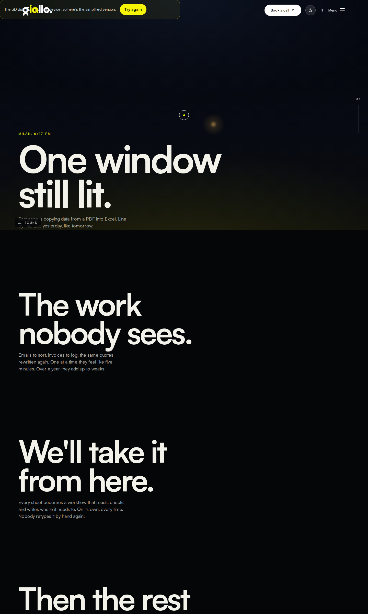

# UI Design System & Master Generation Blueprint: giallostudio-it_en-the-experience

> **The Experience: Milan lights up in yellow · Giallo** (https://giallostudio.it/en/the-experience) — A 3D journey over Milan, from the office where data is still copied by hand to a city lighting up in yellow. See what you could automate...



---

## 1. Executive Visual Persona & Design Archetype

- **Brand Essence & Persona**: **The Experience: Milan lights up in yellow · Giallo** (`https://giallostudio.it/en/the-experience`). A 3D journey over Milan, from the office where data is still copied by hand to a city lighting up in yellow. See what you could automate...
- **Capture Provenance**: Live browser capture (`tier1_fast`, HTTP `200`, captured `2026-11-23`).
- **Visual Archetype**: **High-Contrast Obsidian / Atmospheric Design System (`#050608` canvas, `#ffffff` ink, `#f5f505` accent)**.
- **Anti-AI-Slop Differentiators**:
  - **Live-Computed Chromatic Polarity**: Anchors the viewport in `#050608` (live computed `body` `background-color` (`computed_styles.json`)) paired with `#ffffff` primary typography and `#f5f505` accents.
  - **Grounded Typographic Hierarchy**: Pairs `satoshi` for display copy (`One window still lit.`) with `satoshi` and `SFMono-Regular`.
  - **Calibrated Spatial Grid & Motion**: Combines `96rem` container bounds (`gap: .7rem`, padding `1.2rem`) with `cubic-bezier(0,0,.2,1)` easing and Lenis Smooth Scroll (`data-lenis`).

---

## 2. Spatial Architecture & Modular Grid Mathematics


### Viewport Allocation & Container Geometry
- **Captured Viewport Dimensions**: Desktop `1440×2400px` (`assets/desktop.png`, clamped at 2400px live multi-section capture), Mobile `390×2400px` (`assets/mobile.png`, clamped at 2400px live multi-section capture).
- **Master Container Bounds**: `96rem` (non-`@media` desktop container stylesheet rule).
- **Canvas Lateral Padding & Spacing**: `1.2rem` lateral canvas padding with `.7rem` grid gap.
- **Border Radius Scale**: `3.35544e+07px`, `2rem`, `.25rem`, `var(--radius-2xl)`.

### Responsive Breakpoint Architecture
- **Desktop Layout**: Multi-column CSS Grid / Flexbox layout at `1440px` (`max-width: 96rem`, `gap: .7rem`).
- **Mobile Layout**: Single-column vertical stack at `390px` viewport width with `1.2rem` horizontal padding.
- **Extracted CSS Media Queries**: `@media (min-width:40rem)`, `@media (min-width:48rem)`, `@media (min-width:64rem)`, `@media (min-width:80rem)`.

---

## 3. Color System, Materiality & Atmospheric Lighting

### Semantic Palette & Source Grounding
| Semantic Role | Ground-Truth Value | Extracted Live / CSS Source |
|---|---|---|
| **Primary Canvas Substrate** | `#050608` | live computed `body` `background-color` (`computed_styles.json`) |
| **Primary Typography Ink** | `#ffffff` | live computed `footer` `color` (`computed_styles.json`) |
| **Elevated Surface / Card Substrate** | `#000000` | live computed `footer` `background-color` (`computed_styles.json`) |
| **Interactive Accent / Highlight** | `#f5f505` | `.hWJL2G_badge { background: #f5f505 }` |
| **Secondary / Muted Copy** | `#f5f505` | `var(--lab-wipe-ink)` in `:root` |
| **Structural Hairline Border** | `#040507` | `var(--lab-line)` in `:root` (`00000021`) |
| **Variable Token (`--color-red-500`)** | `#fb2c36` | `var(--color-red-500)` in `:root` |
| **Variable Token (`--color-red-600`)** | `#e40014` | `var(--color-red-600)` in `:root` |
| **Variable Token (`--color-red-700`)** | `#bf000f` | `var(--color-red-700)` in `:root` |

### Sanitized Root CSS Variables (`ui-ux.md` Ground Truth)
| Variable Name | Extracted Value | Semantic Role |
|---|---|---|
| `--font-satoshi` | `"satoshi", "satoshi Fallback", Inter, system-ui, sans-serif` | Typography / Scale Token |
| `--bg-angle` | `0deg` | Canvas / Surface Token |
| `--font-sans` | `var(--font-satoshi)` | Typography / Scale Token |
| `--font-serif` | `ui-serif, Georgia, Cambria, "Times New Roman", Times, serif` | Typography / Scale Token |
| `--color-red-500` | `#fb2c36` | Brand / Palette Token |
| `--color-red-600` | `#e40014` | Brand / Palette Token |
| `--color-red-700` | `#bf000f` | Brand / Palette Token |
| `--color-black` | `#000` | Canvas / Surface Token |
| `--color-white` | `#fff` | Canvas / Surface Token |
| `--spacing` | `.25rem` | Layout / Spatial Grid Token |
| `--container-xs` | `20rem` | Layout / Spatial Grid Token |
| `--container-sm` | `24rem` | Layout / Spatial Grid Token |
| `--container-md` | `28rem` | Layout / Spatial Grid Token |
| `--container-lg` | `32rem` | Layout / Spatial Grid Token |
| `--container-xl` | `36rem` | Layout / Spatial Grid Token |
| `--container-2xl` | `42rem` | Layout / Spatial Grid Token |

---

## 4. Typographic Scale & Editorial Hierarchy

### Font Family Stacks
- **Display Typography**: `satoshi`.
- **Primary Body Stack**: `satoshi`.
- **Technical / Metadata Stack**: `SFMono-Regular`.

### Typographic Scale & Rules (Live Computed & Stylesheet Grounded)
- **Hero Display (`H1`)**: live computed `h1` (`font-size: 146.88px`, `line-height: 135.13px`, `font-weight: 700`, `letter-spacing: -6.6096px`); CSS variables `--text-4xl: 2.25rem`, `--text-4xl--line-height: calc(2.5 / 2.25)`, `--text-5xl: 3rem`.
- **Section Heading (`H2`)**: live computed `h2` (`font-size: 120.96px`, `line-height: 111.283px`, `font-weight: 700`, `letter-spacing: -5.4432px`); CSS variables `--text-2xl: 1.5rem`, `--text-2xl--line-height: calc(2 / 1.5)`, `--text-3xl: 1.875rem`; rule `h2` (`font-size: clamp(2rem,4vw,3.5rem)`, `line-height: 1`, `font-weight: 600`).
- **Body Copy**: live computed `body` (`font-size: 16px`, `line-height: 26.4px`, `font-weight: 400`); CSS variables `--text-base: 1rem`, `--text-base--line-height: calc(1.5 / 1)`, `--xp-body: clamp(1.02rem, min(1.25vw, 2.3vh), 1.3rem)`; rule `p` (`line-height: var(--leading-relaxed)`).
- **Metadata & Navigation Labels**: live computed `nav/a` (`font-size: 16px`, `line-height: 26.4px`, `font-weight: 400`); CSS variables `--text-xs: .75rem`, `--text-xs--line-height: calc(1 / .75)`, `--text-sm: .875rem`.

---

## 5. Choreographed Motion & Interaction Physics

### Primary Easing Curves
- **Extracted Timing Functions**: `cubic-bezier(0,0,.2,1)`, `cubic-bezier(.4,0,.2,1)`, `cubic-bezier(.4,0,.6,1)`.

### Per-Element Transition & Choreography Rules
- **Selector `layer theme`**: `transition: .15s` extracted from `giallostudio-it_en-the-experience` stylesheet.
- **Selector `.link-underline`**: `transition: background-size .4s var(--ease-swiss)` extracted from `giallostudio-it_en-the-experience` stylesheet.
- **Selector `.editorial-card`**: `transition: transform .55s var(--ease-swiss), border-color .35s var(--ease...` extracted from `giallostudio-it_en-the-experience` stylesheet.
- **Extracted Easing Curve (`cubic-bezier(0,0,.2,1)`)**: Governs interactive state transitions across `<header.inset-x-0>` and `<section.wa6Phq_chapter:nth(2)>`.
- **Runtime Interaction Engine**: Integrates Lenis Smooth Scroll (`data-lenis`) with `prefers-reduced-motion: reduce` fallback guards.

---

## 6. Component Wireframe & Structural DOM Map

### Visual Layout Schematic — Desktop (`1440px`, Grounded in `dom.html` & Landmark Bounding Boxes)
```
┌────────────────────────────────────────────────────────────────────────┐
│ DESKTOP VIEWPORT (1440px) — The Experience: Milan lights up in yellow  │
│ ====================================================================== │
│ [ <header.inset-x-0> (1440x81px)      | Law firms Law firms · Retail ] │
│ ---------------------------------------------------------------------- │
│ | HERO STAGE: <section.wa6Phq_chapter> (w=1440px)                    | │
│ | H1: One window still lit.                                          | │
│ | Substrate: #050608 | Ink: #ffffff | Accent: #f5f505                | │
│ ---------------------------------------------------------------------- │
│ | SHOWCASE GRID (<section.wa6Phq_chapter:nt) max-w: 96rem            | │
│ | +------------------------------+  +------------------------------+ | │
│ | | The work nobody sees.        |  | We'll take it from here.     | | │
│ | +------------------------------+  +------------------------------+ | │
│ ---------------------------------------------------------------------- │
│ | DETAIL MODULE (<section.wa6Phq_chapter:nt) — Then the rest lights  | │
│ ---------------------------------------------------------------------- │
│ [ FOOTER (<footer.bg-ink>     ) | https://giallostudio.it/en/the-expe  │
└────────────────────────────────────────────────────────────────────────┘
```

### Visual Layout Schematic — Mobile Reflow (`390px`)
```
┌────────────────────────────────────────────────────────────────────────┐
│ MOBILE VIEWPORT REFLOW (390px) — Single-Column Stack (gap: .7rem)      │
│ ====================================================================== │
│ [ HEADER BAR (<header.inset-x-0>      ) | Compact Menu (390px)         │
│ ---------------------------------------------------------------------- │
│ | HERO STAGE (<section.wa6Phq_chapter>) — 390px Vertical Lead        | │
│ | H1: One window still lit.                                          | │
│ ---------------------------------------------------------------------- │
│ | SHOWCASE STACK (<section.wa6Phq_chapte) — 1-Col Stack              | │
│ | [ Item 1: The work nobody sees.                                  ] | │
│ | [ Item 2: We'll take it from here.                               ] | │
│ ---------------------------------------------------------------------- │
│ | DETAIL STACK (<section.wa6Phq_chapter:) — 1-Col (Then the rest ligh) │
│ ---------------------------------------------------------------------- │
│ [ FOOTER (<footer.bg-ink>     ) | Stacked 390px Colophon               │
└────────────────────────────────────────────────────────────────────────┘
```

### Granular DOM Region Breakdown
1. **Brand Header & Navigation Bar (<header.inset-x-0> — `giallostudio-it_en-the-experience`)**:
   - Landmark `<header class="inset-x-0 top-0">` (`1440x81px`) hosting `The Experience: Milan lights up in y` navigation (`Law firms Law firms · Retail Retail · Tourism Tourism · PMI PMI`), DOM attributes (`data-precedence="next"`, `data-precedence="next"`, `data-precedence="next"`, `data-cursor="hover"`), and stylesheet rule `.STp5NW_className { font-family:satoshi,satoshi Fallback,Inter,system-ui,sans-serif }`.
2. **Hero Stage & Focal Lead (<section.wa6Phq_chapter> — `One window still lit.`)**:
   - Landmark `<section class="wa6Phq_chapter">` presenting display lead `One window still lit.` and copy excerpt *"The 3D didn't start on this device, so here's the simplified vers"* over `#050608` canvas and `#ffffff` ink.
3. **Primary Showcase & Content Grid (<section.wa6Phq_chapter:nth(2)> — `The work nobody sees.`)**:
   - Landmark `<section class="wa6Phq_chapter">` rendering section `The work nobody sees.` with copy *"The 3D didn't start on this device, so here's the simplified vers"*, asset references (`Satoshi_Variable-s.p.2ta4m073o532...`, `logo-black.svg`, `logo-solid-black.svg`, `logo-white.svg`), and grid rule `.STp5NW_variable { --font-satoshi:"satoshi", "satoshi Fallback", Inter, system-ui, sans-serif }`.
4. **Interactive Detail & Feature Matrix (<section.wa6Phq_chapter:nth(3)> — `We'll take it from here.`)**:
   - Landmark `<section class="wa6Phq_chapter">` framing `We'll take it from here.` and `Then the rest lights up.` (*"Someone is copying data from a PDF into Excel. Line by line. Like"*) with `#000000` surface cards, `#f5f505` accents, and `backdrop { box-sizing:border-box;border:0 solid;margin:0;padding:0 }`.
5. **Colophon & Global Directory Footer (<footer.bg-ink> — `https://giallostudio.it/en/the-experience`)**:
   - Landmark `<footer class="bg-ink text-paper">` anchoring `The Experience: Milan lights up ` footer links (`Law firms Law firms · Retail Retail · Tourism Tourism · PMI PMI`), copy *"Lighting up the city"*, and `#040507` structural dividers.

---

## 7. Master Zero-Shot AI Generation Prompt

```markdown
# Master Zero-Shot Frontend Generation Prompt: giallostudio-it_en-the-experience (The Experience: Milan lights up in yellow · Giallo)

You are a principal frontend architect and design systems engineer. Build a complete, production-ready web application replicating the exact design system, DOM landmarks, typographic hierarchy, color tokens, and motion physics of `giallostudio-it_en-the-experience` (**The Experience: Milan lights up in yellow · Giallo** — `https://giallostudio.it/en/the-experience`).

### 1. Visual Archetype & Anti-AI-Slop Mandates
- **Archetype**: High-Contrast Obsidian / Atmospheric Design System (`#050608` canvas, `#ffffff` ink, `#f5f505` accent).
- **Identity & Domain Context**: A 3D journey over Milan, from the office where data is still copied by hand to a city lighting up in yellow. See what you could automate...
- **Primary Substrate**: `#050608` (live computed `body` `background-color` (`computed_styles.json`)), **Primary Ink**: `#ffffff`, **Accent / Highlight**: `#f5f505`.
- **Site-Specific Differentiators**:
  - **Live-Computed Chromatic Polarity**: Anchors the viewport in `#050608` (live computed `body` `background-color` (`computed_styles.json`)) paired with `#ffffff` primary typography and `#f5f505` accents.
  - **Grounded Typographic Hierarchy**: Pairs `satoshi` for display copy (`One window still lit.`) with `satoshi` and `SFMono-Regular`.
  - **Calibrated Spatial Grid & Motion**: Combines `96rem` container bounds (`gap: .7rem`, padding `1.2rem`) with `cubic-bezier(0,0,.2,1)` easing and Lenis Smooth Scroll (`data-lenis`).

### 2. Ground-Truth CSS Variables (`:root` Token Contract)
Declare and consume these exact custom properties extracted from `giallostudio-it_en-the-experience` in your global stylesheet:

:root {
  /* The Experience: Milan lights up in yellow · Giallo (giallostudio-it_en-the-experience) — Live-Grounded CSS Variables */
  --font-satoshi: "satoshi", "satoshi Fallback", Inter, system-ui, sans-serif; /* Typography / Scale Token (giallostudio-it_en-the-experience) */
  --bg-angle: 0deg; /* Canvas / Surface Token (giallostudio-it_en-the-experience) */
  --font-sans: var(--font-satoshi); /* Typography / Scale Token (giallostudio-it_en-the-experience) */
  --font-serif: ui-serif, Georgia, Cambria, "Times New Roman", Times, serif; /* Typography / Scale Token (giallostudio-it_en-the-experience) */
  --color-red-500: #fb2c36; /* Brand / Palette Token (giallostudio-it_en-the-experience) */
  --color-red-600: #e40014; /* Brand / Palette Token (giallostudio-it_en-the-experience) */
  --color-red-700: #bf000f; /* Brand / Palette Token (giallostudio-it_en-the-experience) */
  --color-black: #000; /* Canvas / Surface Token (giallostudio-it_en-the-experience) */
  --color-white: #fff; /* Canvas / Surface Token (giallostudio-it_en-the-experience) */
  --spacing: .25rem; /* Layout / Spatial Grid Token (giallostudio-it_en-the-experience) */
  --container-xs: 20rem; /* Layout / Spatial Grid Token (giallostudio-it_en-the-experience) */
  --container-sm: 24rem; /* Layout / Spatial Grid Token (giallostudio-it_en-the-experience) */
  --container-md: 28rem; /* Layout / Spatial Grid Token (giallostudio-it_en-the-experience) */
  --container-lg: 32rem; /* Layout / Spatial Grid Token (giallostudio-it_en-the-experience) */
  --container-xl: 36rem; /* Layout / Spatial Grid Token (giallostudio-it_en-the-experience) */
  --container-2xl: 42rem; /* Layout / Spatial Grid Token (giallostudio-it_en-the-experience) */
}

### 3. Semantic Color & Materiality Contract
Map every surface, ink, and border strictly to these source-grounded tokens:
- **Primary Canvas Substrate**: `#050608` — grounded in live computed `body` `background-color` (`computed_styles.json`)
- **Primary Typography Ink**: `#ffffff` — grounded in live computed `footer` `color` (`computed_styles.json`)
- **Elevated Surface / Card Substrate**: `#000000` — grounded in live computed `footer` `background-color` (`computed_styles.json`)
- **Interactive Accent / Highlight**: `#f5f505` — grounded in `.hWJL2G_badge { background: #f5f505 }`
- **Secondary / Muted Copy**: `#f5f505` — grounded in `var(--lab-wipe-ink)` in `:root`
- **Structural Hairline Border**: `#040507` — grounded in `var(--lab-line)` in `:root` (`00000021`)
- **Variable Token (`--color-red-500`)**: `#fb2c36` — grounded in `var(--color-red-500)` in `:root`
- **Variable Token (`--color-red-600`)**: `#e40014` — grounded in `var(--color-red-600)` in `:root`
- **Variable Token (`--color-red-700`)**: `#bf000f` — grounded in `var(--color-red-700)` in `:root`

### 4. Spatial Grid, Container Bounds & Responsive Breakpoints
- **Desktop Viewport Reference**: `1440×2400px` (clamped at 2400px live multi-section capture, `1440px` standard desktop width).
- **Mobile Viewport Reference**: `390×2400px` (clamped at 2400px live multi-section capture, `390px` standard mobile width).
- **Container Max-Width**: `96rem` (non-`@media` desktop container stylesheet rule)
- **Padding & Gutters**: `1.2rem` lateral canvas padding with `.7rem` grid gap
- **Desktop Grid**: Multi-column CSS Grid / Flexbox layout at `1440px` (`max-width: 96rem`, `gap: .7rem`)
- **Mobile Adaptation**: Single-column vertical stack at `390px` viewport width with `1.2rem` horizontal padding
- **Media Queries**: `@media (min-width:40rem)`, `@media (min-width:48rem)`, `@media (min-width:64rem)`, `@media (min-width:80rem)`
- **Corner Radii**: `3.35544e+07px`, `2rem`, `.25rem`, `var(--radius-2xl)`

### 5. Typography & Editorial Scale Contract
- **Display Font Stack**: `satoshi`
- **Body Font Stack**: `satoshi`
- **Monospace / Technical Font Stack**: `SFMono-Regular`
- **H1 Display Rule**: live computed `h1` (`font-size: 146.88px`, `line-height: 135.13px`, `font-weight: 700`, `letter-spacing: -6.6096px`); CSS variables `--text-4xl: 2.25rem`, `--text-4xl--line-height: calc(2.5 / 2.25)`, `--text-5xl: 3rem`
- **H2 Section Rule**: live computed `h2` (`font-size: 120.96px`, `line-height: 111.283px`, `font-weight: 700`, `letter-spacing: -5.4432px`); CSS variables `--text-2xl: 1.5rem`, `--text-2xl--line-height: calc(2 / 1.5)`, `--text-3xl: 1.875rem`; rule `h2` (`font-size: clamp(2rem,4vw,3.5rem)`, `line-height: 1`, `font-weight: 600`)
- **Body Copy Rule**: live computed `body` (`font-size: 16px`, `line-height: 26.4px`, `font-weight: 400`); CSS variables `--text-base: 1rem`, `--text-base--line-height: calc(1.5 / 1)`, `--xp-body: clamp(1.02rem, min(1.25vw, 2.3vh), 1.3rem)`; rule `p` (`line-height: var(--leading-relaxed)`)
- **Metadata & Index Rule**: live computed `nav/a` (`font-size: 16px`, `line-height: 26.4px`, `font-weight: 400`); CSS variables `--text-xs: .75rem`, `--text-xs--line-height: calc(1 / .75)`, `--text-sm: .875rem`

### 6. Component Hierarchy, Verbatim Copy & Real DOM Landmarks
Scaffold `giallostudio-it_en-the-experience` (`The Experience: Milan lights up in yellow · Giallo`) with these exact structural regions, extracted copy, and CSS rules from `dom.html`:
1. **Brand Header & Navigation Bar (<header.inset-x-0> — `giallostudio-it_en-the-experience`)**:
   - DOM & Selectors: Landmark `<header class="inset-x-0 top-0">` (`1440x81px`) hosting `The Experience: Milan lights up in y` navigation (`Law firms Law firms · Retail Retail · Tourism Tourism · PMI PMI`), DOM attributes (`data-precedence="next"`, `data-precedence="next"`, `data-precedence="next"`, `data-cursor="hover"`), and stylesheet rule `.STp5NW_className { font-family:satoshi,satoshi Fallback,Inter,system-ui,sans-serif }`.
   - Responsive Contract: Header `Brand Header & Navigation Bar (<header.inset-x-0> — `giallostudio-it_en-the-experience`)` (`giallostudio-it_en-the-experience`) adapts across `@media (min-width:40rem)`, `@media (min-width:48rem)`, `@media (min-width:64rem)`, `@media (min-width:80rem)` with `cubic-bezier(0,0,.2,1)`, `cubic-bezier(.4,0,.2,1)`, `cubic-bezier(.4,0,.6,1)` transitions and links `Law firms Law firms · Retail Retail · Tourism Tourism · PMI PMI`.
2. **Hero Stage & Focal Lead (<section.wa6Phq_chapter> — `One window still lit.`)**:
   - DOM & Selectors: Landmark `<section class="wa6Phq_chapter">` presenting display lead `One window still lit.` and copy excerpt *"The 3D didn't start on this device, so here's the simplified vers"* over `#050608` canvas and `#ffffff` ink.
   - Responsive Contract: Hero stage (`1440×2400px` desktop / `390×2400px` mobile) sets `#050608` background with `#ffffff` headline `One window still lit.`.
3. **Primary Showcase & Content Grid (<section.wa6Phq_chapter:nth(2)> — `The work nobody sees.`)**:
   - DOM & Selectors: Landmark `<section class="wa6Phq_chapter">` rendering section `The work nobody sees.` with copy *"The 3D didn't start on this device, so here's the simplified vers"*, asset references (`Satoshi_Variable-s.p.2ta4m073o532...`, `logo-black.svg`, `logo-solid-black.svg`, `logo-white.svg`), and grid rule `.STp5NW_variable { --font-satoshi:"satoshi", "satoshi Fallback", Inter, system-ui, sans-serif }`.
   - Responsive Contract: Showcase grid `Primary Showcase & Content Grid (<section.wa6Phq_chapter:nth(2)> — `The work nobody sees.`)` applies Multi-column CSS Grid / Flexbox layout at `1440px` (`max-width: 96rem`, `gap: .7rem`) on desktop and Single-column vertical stack at `390px` viewport width with `1.2rem` horizontal padding on mobile.
4. **Interactive Detail & Feature Matrix (<section.wa6Phq_chapter:nth(3)> — `We'll take it from here.`)**:
   - DOM & Selectors: Landmark `<section class="wa6Phq_chapter">` framing `We'll take it from here.` and `Then the rest lights up.` (*"Someone is copying data from a PDF into Excel. Line by line. Like"*) with `#000000` surface cards, `#f5f505` accents, and `backdrop { box-sizing:border-box;border:0 solid;margin:0;padding:0 }`.
   - Responsive Contract: Detail module `Interactive Detail & Feature Matrix (<section.wa6Phq_chapter:nth(3)> — `We'll take it from here.`)` uses `3.35544e+07px`, `2rem`, `.25rem`, `var(--radius-2xl)` radii, `#f5f505` highlights, and assets (Satoshi_Variable-s.p.2ta4m073o532..., logo-black.svg, logo-solid-black.svg).
5. **Colophon & Global Directory Footer (<footer.bg-ink> — `https://giallostudio.it/en/the-experience`)**:
   - DOM & Selectors: Landmark `<footer class="bg-ink text-paper">` anchoring `The Experience: Milan lights up ` footer links (`Law firms Law firms · Retail Retail · Tourism Tourism · PMI PMI`), copy *"Lighting up the city"*, and `#040507` structural dividers.
   - Responsive Contract: Footer `Colophon & Global Directory Footer (<footer.bg-ink> — `https://giallostudio.it/en/the-experience`)` aligns to `96rem` (non-`@media` desktop container stylesheet rule) with `1.2rem` lateral canvas padding with `.7rem` grid gap and attributes (data-precedence="next", data-precedence="next", data-precedence="next").

#### Verbatim DOM Copy Excerpts (`dom.html`)
- Copy Excerpt 1: *"The 3D didn't start on this device, so here's the simplified version. Try again"*
- Copy Excerpt 2: *"The 3D didn't start on this device, so here's the simplified version."*
- Copy Excerpt 3: *"Someone is copying data from a PDF into Excel. Line by line. Like yesterday, like..."*
- Copy Excerpt 4: *"Lighting up the city"*

### 7. Motion, Extracted Stylesheet Rules & Interaction Choreography
- **Primary Easing Functions**: `cubic-bezier(0,0,.2,1)`, `cubic-bezier(.4,0,.2,1)`, `cubic-bezier(.4,0,.6,1)`
- **Extracted Stylesheet Rules (`giallostudio-it_en-the-experience`)**:
- `.STp5NW_className { font-family:satoshi,satoshi Fallback,Inter,system-ui,sans-serif }`
- `.STp5NW_variable { --font-satoshi:"satoshi", "satoshi Fallback", Inter, system-ui, sans-serif }`
- `backdrop { box-sizing:border-box;border:0 solid;margin:0;padding:0 }`
- `file-selector-button { box-sizing:border-box;border:0 solid;margin:0;padding:0 }`
- `strong { font-weight:bolder }`
- **Per-Selector Transition Rules**:
- **Selector `layer theme`**: `transition: .15s` extracted from `giallostudio-it_en-the-experience` stylesheet.
- **Selector `.link-underline`**: `transition: background-size .4s var(--ease-swiss)` extracted from `giallostudio-it_en-the-experience` stylesheet.
- **Selector `.editorial-card`**: `transition: transform .55s var(--ease-swiss), border-color .35s var(--ease...` extracted from `giallostudio-it_en-the-experience` stylesheet.
- **Extracted Easing Curve (`cubic-bezier(0,0,.2,1)`)**: Governs interactive state transitions across `<header.inset-x-0>` and `<section.wa6Phq_chapter:nth(2)>`.
- **Runtime Interaction Engine**: Integrates Lenis Smooth Scroll (`data-lenis`) with `prefers-reduced-motion: reduce` fallback guards.

### 8. Technical Deliverables
- Implement in Next.js (App Router) with TypeScript and Tailwind CSS consuming the `:root` custom properties defined above for `giallostudio-it_en-the-experience`.
- Reproduce both the `1440px` desktop architecture and `390px` mobile breakpoint transitions, preserving semantic HTML5 landmarks (`<header>`, `<nav>`, `<main>`, `<section>`, `<footer>`) and `prefers-reduced-motion` accessibility guards.
```
