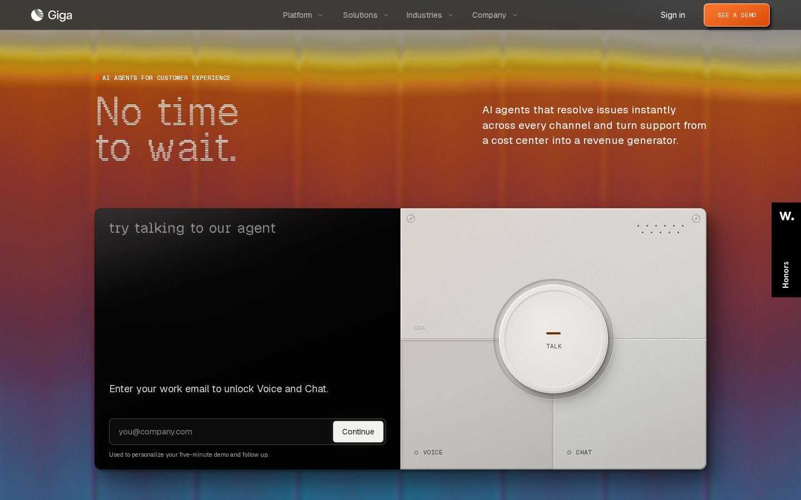
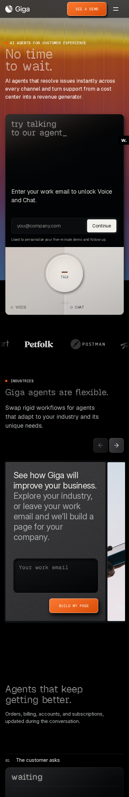

# UI Design System & Master Generation Blueprint: giga-ai

> **Giga: AI support agents that improve your metrics** (https://giga.ai/) — Giga builds enterprise AI agents for customer support that resolve complex conversations across chat, voice, and email. Deployed in weeks...



---

## 1. Executive Visual Persona & Design Archetype

- **Brand Essence & Persona**: **Giga: AI support agents that improve your metrics** (`https://giga.ai/`). Giga builds enterprise AI agents for customer support that resolve complex conversations across chat, voice, and email. Deployed in weeks...
- **Capture Provenance**: Live browser capture (`tier1_fast`, HTTP `200`, captured `2026-11-23`).
- **Visual Archetype**: **Dark-Substrate WebGL / Canvas Interactive Experience (`#000000` / `#0090ff`)**.
- **Anti-AI-Slop Differentiators**:
  - **Live-Computed Chromatic Polarity**: Anchors the viewport in `#000000` (live computed `body` `background-color` (`computed_styles.json`)) paired with `#ffffff` primary typography and `#0090ff` accents.
  - **Grounded Typographic Hierarchy**: Pairs `Geist Pixel Line` for display copy (`No time to wait.`) with `Geist` and `Geist Mono`.
  - **Calibrated Spatial Grid & Motion**: Combines `96rem` container bounds (`gap: normal 32px`, padding `3px`) with `cubic-bezier(0,0,.2,1)` easing and HTML5 `<canvas>` Interactive Viewport Surface.

---

## 2. Spatial Architecture & Modular Grid Mathematics



### Viewport Allocation & Container Geometry
- **Captured Viewport Dimensions**: Desktop `1440×900px` (`assets/desktop.png`, single-viewport 100vh live capture (900px)), Mobile `390×2400px` (`assets/mobile.png`, clamped at 2400px live multi-section capture).
- **Master Container Bounds**: `96rem` (non-`@media` desktop container stylesheet rule).
- **Canvas Lateral Padding & Spacing**: `3px` lateral canvas padding with `normal 32px` grid gap.
- **Border Radius Scale**: `8px`, `.25rem`, `var(--radius-2xl)`, `1px`.

### Responsive Breakpoint Architecture
- **Desktop Layout**: Multi-column CSS Grid / Flexbox layout at `1440px` (`max-width: 96rem`, `gap: normal 32px`).
- **Mobile Layout**: Single-column vertical stack at `390px` viewport width with `3px` horizontal padding.
- **Extracted CSS Media Queries**: `@media (min-width:810px)`, `@media (min-width:1100px)`, `@media (min-width:1200px)`, `@media (min-width:2500px)`.

---

## 3. Color System, Materiality & Atmospheric Lighting

### Semantic Palette & Source Grounding
| Semantic Role | Ground-Truth Value | Extracted Live / CSS Source |
|---|---|---|
| **Primary Canvas Substrate** | `#000000` | live computed `body` `background-color` (`computed_styles.json`) |
| **Primary Typography Ink** | `#ffffff` | live computed `h1` `color` (`computed_styles.json`) |
| **Elevated Surface / Card Substrate** | `#111c22` | `var(--gh-industry-surface)` in `:root` |
| **Interactive Accent / Highlight** | `#0090ff` | `var(--omni-cta)` in `:root` |
| **Secondary / Muted Copy** | `#6e6e6e` | `var(--gba-tool-use-chevron-fg)` in `:root` |
| **Structural Hairline Border** | `#2a2b2b` | `var(--gh-industry-border)` in `:root` (`rgb(232 237 239 / .18)`) |
| **Variable Token (`--orange`)** | `#ef5a00` | `var(--orange)` in `:root` |
| **Variable Token (`--key-face`)** | `#3b3b3e` | `var(--key-face)` in `:root` |
| **Variable Token (`--key-face`)** | `#2a2a2d` | `var(--key-face)` in `:root` |

### Sanitized Root CSS Variables (`ui-ux.md` Ground Truth)
| Variable Name | Extracted Value | Semantic Role |
|---|---|---|
| `--sans` | `"Geist", system-ui, sans-serif` | Typography / Scale Token |
| `--mono` | `"Geist Mono", ui-monospace, monospace` | Typography / Scale Token |
| `--display` | `inter, interExt, "InterVariable", system-ui, sans-serif` | Dimension / Scale Token |
| `--text` | `inter, interExt, "InterVariable", system-ui, sans-serif` | Typography Ink Token |
| `--pixel` | `"Geist Pixel Line", "Geist Mono", monospace` | Design System Custom Token |
| `--orange` | `#ef5a00` | Color / Atmospheric Token |
| `--bar-h` | `calc(54px * max(1, var(--s, 1)))` | Dimension / Scale Token |
| `--key-radius` | `8px` | Elevation / Border Token |
| `--key-face` | `linear-gradient(123.37deg, #3b3b3e 13.97%, #2a2a2d 87.5%)` | Color / Atmospheric Token |
| `--key-edge` | `rgb(255 255 255 / .12)` | Color / Atmospheric Token |
| `--key-lit` | `inset 1px 1px 0 rgb(255 255 255 / .08)` | Color / Atmospheric Token |
| `--key-ink` | `rgb(232 237 239 / .88)` | Typography Ink Token |
| `--key-shadow` | `4px 6px 5px rgb(0 0 0 / .5), 2px 4px 2.5px rgb(0 0 0 / .6)` | Elevation / Border Token |
| `--key-shadow-down` | `1px 2px 2px rgb(0 0 0 / .5), 1px 1px 1px rgb(0 0 0 / .6)` | Elevation / Border Token |
| `--key-hover` | `brightness(1.12)` | Design System Custom Token |
| `--key-ring` | `1.5px solid rgb(232 237 239 / .6)` | Elevation / Border Token |

---

## 4. Typographic Scale & Editorial Hierarchy

### Font Family Stacks
- **Display Typography**: `Geist Pixel Line`.
- **Primary Body Stack**: `Geist`.
- **Technical / Metadata Stack**: `Geist Mono`.

### Typographic Scale & Rules (Live Computed & Stylesheet Grounded)
- **Hero Display (`H1`)**: live computed `h1` (`font-size: 72px`, `line-height: 64px`, `font-weight: 400`); CSS variables `--display: inter, interExt, "InterVariable", system-ui, sans-serif`, `--text-4xl: 2rem`, `--text-4xl--line-height: calc(2.5 / 2.25)`.
- **Section Heading (`H2`)**: live computed `h2` (`font-size: 52.63px`, `line-height: 63.156px`, `font-weight: 400`); CSS variables `--text-2xl: 1.5rem`, `--text-2xl--line-height: calc(2 / 1.5)`, `--text-3xl: 1.875rem`; rule `h2` (`font-size: 2rem`, `line-height: 1.1`, `letter-spacing: var(--tracking-display)`, `font-weight: 400`).
- **Body Copy**: live computed `body` (`font-size: 16px`, `line-height: normal`, `font-weight: 400`); CSS variables `--gh-text-body: 1.125rem`, `--text-base: 1rem`, `--text-base--line-height: calc(1.5 / 1)`; rule `p` (`font-size: 13.5px`, `line-height: 20px`).
- **Metadata & Navigation Labels**: live computed `nav/a` (`font-size: 16px`, `line-height: normal`, `font-weight: 400`); CSS variables `--mono: "Geist Mono", ui-monospace, monospace`, `--key-mono: 400 11px/14px "Geist Mono", geistMono, monospace`, `--gh-text-meta: .875rem`.

---

## 5. Choreographed Motion & Interaction Physics

### Primary Easing Curves
- **Extracted Timing Functions**: `cubic-bezier(0,0,.2,1)`, `cubic-bezier(.4,0,.2,1)`, `cubic-bezier(.65,0,.35,1)`.

### Per-Element Transition & Choreography Rules
- **Selector `layer theme`**: `transition: .15s` extracted from `giga-ai` stylesheet.
- **Selector `.transition`**: `transition: var(--tw-ease,var(--default-transition-timing-function))` extracted from `giga-ai` stylesheet.
- **Selector `border-color\]`**: `transition: var(--tw-ease,var(--default-transition-timing-function))` extracted from `giga-ai` stylesheet.
- **Extracted Easing Curve (`cubic-bezier(0,0,.2,1)`)**: Governs interactive state transitions across `<header.docked>` and `<section.hero-fixed>`.
- **Runtime Interaction Engine**: Integrates HTML5 `<canvas>` Interactive Viewport Surface with `prefers-reduced-motion: reduce` fallback guards.

---

## 6. Component Wireframe & Structural DOM Map

### Visual Layout Schematic — Desktop (`1440px`, Grounded in `dom.html` & Landmark Bounding Boxes)
```
┌────────────────────────────────────────────────────────────────────────┐
│ DESKTOP VIEWPORT (1440px) — Giga: AI support agents that improve your  │
│ ====================================================================== │
│ [ <header.docked> (1440x86px)         | Platform overview · Build ag ] │
│ ---------------------------------------------------------------------- │
│ | HERO STAGE: <section.banner-off> (w=1440px)                        | │
│ | H1: No time to wait.                                               | │
│ | Substrate: #000000 | Ink: #ffffff | Accent: #0090ff                | │
│ ---------------------------------------------------------------------- │
│ | SHOWCASE GRID (<section.hero-fixed>) max-w: 96rem                  | │
│ | +------------------------------+  +------------------------------+ | │
│ | | Giga agents are flexible.    |  | See how Giga will improve yo | | │
│ | +------------------------------+  +------------------------------+ | │
│ ---------------------------------------------------------------------- │
│ | DETAIL MODULE (<section.gh-industries>) — Freight & Logistics      | │
│ ---------------------------------------------------------------------- │
│ [ FOOTER (<footer.giga-cc>    ) | https://giga.ai/                     │
└────────────────────────────────────────────────────────────────────────┘
```

### Visual Layout Schematic — Mobile Reflow (`390px`)
```
┌────────────────────────────────────────────────────────────────────────┐
│ MOBILE VIEWPORT REFLOW (390px) — Single-Column Stack (gap: normal 3)   │
│ ====================================================================== │
│ [ HEADER BAR (<header.docked>         ) | Compact Menu (390px)         │
│ ---------------------------------------------------------------------- │
│ | HERO STAGE (<section.banner-off>) — 390px Vertical Lead            | │
│ | H1: No time to wait.                                               | │
│ ---------------------------------------------------------------------- │
│ | SHOWCASE STACK (<section.hero-fixed>) — 1-Col Stack                | │
│ | [ Item 1: Giga agents are flexible.                              ] | │
│ | [ Item 2: See how Giga will improve your business.               ] | │
│ ---------------------------------------------------------------------- │
│ | DETAIL STACK (<section.gh-industries>) — 1-Col (Freight & Logistic)  │
│ ---------------------------------------------------------------------- │
│ [ FOOTER (<footer.giga-cc>    ) | Stacked 390px Colophon               │
└────────────────────────────────────────────────────────────────────────┘
```

### Granular DOM Region Breakdown
1. **Brand Header & Navigation Bar (<header.docked> — `giga-ai`)**:
   - Landmark `<header class="docked">` (`1440x86px`) hosting `Giga: AI support agents that improve` navigation (`Platform overview · Build agents · Observe outcomes · Improve with Scout · Agent Canvas`), DOM attributes (`data-theme="dark"`, `data-consent-region="gdpr"`, `data-precedence="next"`, `data-precedence="next"`), and stylesheet rule `nter_8d8624c8-module__h29akW__cla... { font-family:inter }`.
2. **Hero Stage & Focal Lead (<section.banner-off> — `No time to wait.`)**:
   - Landmark `<section class="banner-off">` presenting display lead `No time to wait.` and copy excerpt *"AI AGENTS FOR CUSTOMER EXPERIENCE"* over `#000000` canvas and `#ffffff` ink.
3. **Primary Showcase & Content Grid (<section.hero-fixed> — `Giga agents are flexible.`)**:
   - Landmark `<section class="hero-fixed">` rendering section `Giga agents are flexible.` with copy *"AI Agents for Customer Experience"*, asset references (`geist_mono_400_latin-s.p.2qleaeww...`, `geist_pixel_line-s.p.1gvmpev-r-ty...`, `geist_sans_400-s.p.18rrztdh9mmoo....`, `geist_sans_500-s.p.08803r3rti4jl....`), and grid rule `inter_8d8624c8-module__h29akW__va... { --font-sans-source:"inter" }`.
4. **Interactive Detail & Feature Matrix (<section.gh-industries> — `See how Giga will improve your bus`)**:
   - Landmark `<section class="gh-industries">` framing `See how Giga will improve your business.` and `Freight & Logistics` (*"AI agents that resolve issues instantly across every channel and "*) with `#111c22` surface cards, `#0090ff` accents, and `erext_c8633ef-module__Fv8OZW__cla... { font-family:interExt,interExt Fallback }`.
5. **Colophon & Global Directory Footer (<footer.giga-cc> — `https://giga.ai/`)**:
   - Landmark `<footer class="giga-cc">` anchoring `Giga: AI support agents that imp` footer links (`Platform overview · Build agents · Observe outcomes · Improve with Scout · Agent Canvas`), copy *"try talking to our agent _"*, and `#2a2b2b` structural dividers.

---

## 7. Master Zero-Shot AI Generation Prompt

```markdown
# Master Zero-Shot Frontend Generation Prompt: giga-ai (Giga: AI support agents that improve your metrics)

You are a principal frontend architect and design systems engineer. Build a complete, production-ready web application replicating the exact design system, DOM landmarks, typographic hierarchy, color tokens, and motion physics of `giga-ai` (**Giga: AI support agents that improve your metrics** — `https://giga.ai/`).

### 1. Visual Archetype & Anti-AI-Slop Mandates
- **Archetype**: Dark-Substrate WebGL / Canvas Interactive Experience (`#000000` / `#0090ff`).
- **Identity & Domain Context**: Giga builds enterprise AI agents for customer support that resolve complex conversations across chat, voice, and email. Deployed in weeks...
- **Primary Substrate**: `#000000` (live computed `body` `background-color` (`computed_styles.json`)), **Primary Ink**: `#ffffff`, **Accent / Highlight**: `#0090ff`.
- **Site-Specific Differentiators**:
  - **Live-Computed Chromatic Polarity**: Anchors the viewport in `#000000` (live computed `body` `background-color` (`computed_styles.json`)) paired with `#ffffff` primary typography and `#0090ff` accents.
  - **Grounded Typographic Hierarchy**: Pairs `Geist Pixel Line` for display copy (`No time to wait.`) with `Geist` and `Geist Mono`.
  - **Calibrated Spatial Grid & Motion**: Combines `96rem` container bounds (`gap: normal 32px`, padding `3px`) with `cubic-bezier(0,0,.2,1)` easing and HTML5 `<canvas>` Interactive Viewport Surface.

### 2. Ground-Truth CSS Variables (`:root` Token Contract)
Declare and consume these exact custom properties extracted from `giga-ai` in your global stylesheet:

:root {
  /* Giga: AI support agents that improve your metrics (giga-ai) — Live-Grounded CSS Variables */
  --sans: "Geist", system-ui, sans-serif; /* Typography / Scale Token (giga-ai) */
  --mono: "Geist Mono", ui-monospace, monospace; /* Typography / Scale Token (giga-ai) */
  --display: inter, interExt, "InterVariable", system-ui, sans-serif; /* Dimension / Scale Token (giga-ai) */
  --text: inter, interExt, "InterVariable", system-ui, sans-serif; /* Typography Ink Token (giga-ai) */
  --pixel: "Geist Pixel Line", "Geist Mono", monospace; /* Design System Custom Token (giga-ai) */
  --orange: #ef5a00; /* Color / Atmospheric Token (giga-ai) */
  --bar-h: calc(54px * max(1, var(--s, 1))); /* Dimension / Scale Token (giga-ai) */
  --key-radius: 8px; /* Elevation / Border Token (giga-ai) */
  --key-face: linear-gradient(123.37deg, #3b3b3e 13.97%, #2a2a2d 87.5%); /* Color / Atmospheric Token (giga-ai) */
  --key-edge: rgb(255 255 255 / .12); /* Color / Atmospheric Token (giga-ai) */
  --key-lit: inset 1px 1px 0 rgb(255 255 255 / .08); /* Color / Atmospheric Token (giga-ai) */
  --key-ink: rgb(232 237 239 / .88); /* Typography Ink Token (giga-ai) */
  --key-shadow: 4px 6px 5px rgb(0 0 0 / .5), 2px 4px 2.5px rgb(0 0 0 / .6); /* Elevation / Border Token (giga-ai) */
  --key-shadow-down: 1px 2px 2px rgb(0 0 0 / .5), 1px 1px 1px rgb(0 0 0 / .6); /* Elevation / Border Token (giga-ai) */
  --key-hover: brightness(1.12); /* Design System Custom Token (giga-ai) */
  --key-ring: 1.5px solid rgb(232 237 239 / .6); /* Elevation / Border Token (giga-ai) */
}

### 3. Semantic Color & Materiality Contract
Map every surface, ink, and border strictly to these source-grounded tokens:
- **Primary Canvas Substrate**: `#000000` — grounded in live computed `body` `background-color` (`computed_styles.json`)
- **Primary Typography Ink**: `#ffffff` — grounded in live computed `h1` `color` (`computed_styles.json`)
- **Elevated Surface / Card Substrate**: `#111c22` — grounded in `var(--gh-industry-surface)` in `:root`
- **Interactive Accent / Highlight**: `#0090ff` — grounded in `var(--omni-cta)` in `:root`
- **Secondary / Muted Copy**: `#6e6e6e` — grounded in `var(--gba-tool-use-chevron-fg)` in `:root`
- **Structural Hairline Border**: `#2a2b2b` — grounded in `var(--gh-industry-border)` in `:root` (`rgb(232 237 239 / .18)`)
- **Variable Token (`--orange`)**: `#ef5a00` — grounded in `var(--orange)` in `:root`
- **Variable Token (`--key-face`)**: `#3b3b3e` — grounded in `var(--key-face)` in `:root`
- **Variable Token (`--key-face`)**: `#2a2a2d` — grounded in `var(--key-face)` in `:root`

### 4. Spatial Grid, Container Bounds & Responsive Breakpoints
- **Desktop Viewport Reference**: `1440×900px` (single-viewport 100vh live capture (900px), `1440px` standard desktop width).
- **Mobile Viewport Reference**: `390×2400px` (clamped at 2400px live multi-section capture, `390px` standard mobile width).
- **Container Max-Width**: `96rem` (non-`@media` desktop container stylesheet rule)
- **Padding & Gutters**: `3px` lateral canvas padding with `normal 32px` grid gap
- **Desktop Grid**: Multi-column CSS Grid / Flexbox layout at `1440px` (`max-width: 96rem`, `gap: normal 32px`)
- **Mobile Adaptation**: Single-column vertical stack at `390px` viewport width with `3px` horizontal padding
- **Media Queries**: `@media (min-width:810px)`, `@media (min-width:1100px)`, `@media (min-width:1200px)`, `@media (min-width:2500px)`
- **Corner Radii**: `8px`, `.25rem`, `var(--radius-2xl)`, `1px`

### 5. Typography & Editorial Scale Contract
- **Display Font Stack**: `Geist Pixel Line`
- **Body Font Stack**: `Geist`
- **Monospace / Technical Font Stack**: `Geist Mono`
- **H1 Display Rule**: live computed `h1` (`font-size: 72px`, `line-height: 64px`, `font-weight: 400`); CSS variables `--display: inter, interExt, "InterVariable", system-ui, sans-serif`, `--text-4xl: 2rem`, `--text-4xl--line-height: calc(2.5 / 2.25)`
- **H2 Section Rule**: live computed `h2` (`font-size: 52.63px`, `line-height: 63.156px`, `font-weight: 400`); CSS variables `--text-2xl: 1.5rem`, `--text-2xl--line-height: calc(2 / 1.5)`, `--text-3xl: 1.875rem`; rule `h2` (`font-size: 2rem`, `line-height: 1.1`, `letter-spacing: var(--tracking-display)`, `font-weight: 400`)
- **Body Copy Rule**: live computed `body` (`font-size: 16px`, `line-height: normal`, `font-weight: 400`); CSS variables `--gh-text-body: 1.125rem`, `--text-base: 1rem`, `--text-base--line-height: calc(1.5 / 1)`; rule `p` (`font-size: 13.5px`, `line-height: 20px`)
- **Metadata & Index Rule**: live computed `nav/a` (`font-size: 16px`, `line-height: normal`, `font-weight: 400`); CSS variables `--mono: "Geist Mono", ui-monospace, monospace`, `--key-mono: 400 11px/14px "Geist Mono", geistMono, monospace`, `--gh-text-meta: .875rem`

### 6. Component Hierarchy, Verbatim Copy & Real DOM Landmarks
Scaffold `giga-ai` (`Giga: AI support agents that improve your metrics`) with these exact structural regions, extracted copy, and CSS rules from `dom.html`:
1. **Brand Header & Navigation Bar (<header.docked> — `giga-ai`)**:
   - DOM & Selectors: Landmark `<header class="docked">` (`1440x86px`) hosting `Giga: AI support agents that improve` navigation (`Platform overview · Build agents · Observe outcomes · Improve with Scout · Agent Canvas`), DOM attributes (`data-theme="dark"`, `data-consent-region="gdpr"`, `data-precedence="next"`, `data-precedence="next"`), and stylesheet rule `nter_8d8624c8-module__h29akW__cla... { font-family:inter }`.
   - Responsive Contract: Header `Brand Header & Navigation Bar (<header.docked> — `giga-ai`)` (`giga-ai`) adapts across `@media (min-width:810px)`, `@media (min-width:1100px)`, `@media (min-width:1200px)`, `@media (min-width:2500px)` with `cubic-bezier(0,0,.2,1)`, `cubic-bezier(.4,0,.2,1)`, `cubic-bezier(.65,0,.35,1)` transitions and links `Platform overview · Build agents · Observe outcomes · Improve with Scout · Agent Canvas`.
2. **Hero Stage & Focal Lead (<section.banner-off> — `No time to wait.`)**:
   - DOM & Selectors: Landmark `<section class="banner-off">` presenting display lead `No time to wait.` and copy excerpt *"AI AGENTS FOR CUSTOMER EXPERIENCE"* over `#000000` canvas and `#ffffff` ink.
   - Responsive Contract: Hero stage (`1440×900px` desktop / `390×2400px` mobile) sets `#000000` background with `#ffffff` headline `No time to wait.`.
3. **Primary Showcase & Content Grid (<section.hero-fixed> — `Giga agents are flexible.`)**:
   - DOM & Selectors: Landmark `<section class="hero-fixed">` rendering section `Giga agents are flexible.` with copy *"AI Agents for Customer Experience"*, asset references (`geist_mono_400_latin-s.p.2qleaeww...`, `geist_pixel_line-s.p.1gvmpev-r-ty...`, `geist_sans_400-s.p.18rrztdh9mmoo....`, `geist_sans_500-s.p.08803r3rti4jl....`), and grid rule `inter_8d8624c8-module__h29akW__va... { --font-sans-source:"inter" }`.
   - Responsive Contract: Showcase grid `Primary Showcase & Content Grid (<section.hero-fixed> — `Giga agents are flexible.`)` applies Multi-column CSS Grid / Flexbox layout at `1440px` (`max-width: 96rem`, `gap: normal 32px`) on desktop and Single-column vertical stack at `390px` viewport width with `3px` horizontal padding on mobile.
4. **Interactive Detail & Feature Matrix (<section.gh-industries> — `See how Giga will improve your bus`)**:
   - DOM & Selectors: Landmark `<section class="gh-industries">` framing `See how Giga will improve your business.` and `Freight & Logistics` (*"AI agents that resolve issues instantly across every channel and "*) with `#111c22` surface cards, `#0090ff` accents, and `erext_c8633ef-module__Fv8OZW__cla... { font-family:interExt,interExt Fallback }`.
   - Responsive Contract: Detail module `Interactive Detail & Feature Matrix (<section.gh-industries> — `See how Giga will improve your bus`)` uses `8px`, `.25rem`, `var(--radius-2xl)`, `1px` radii, `#0090ff` highlights, and assets (geist_mono_400_latin-s.p.2qleaeww..., geist_pixel_line-s.p.1gvmpev-r-ty..., geist_sans_400-s.p.18rrztdh9mmoo....).
5. **Colophon & Global Directory Footer (<footer.giga-cc> — `https://giga.ai/`)**:
   - DOM & Selectors: Landmark `<footer class="giga-cc">` anchoring `Giga: AI support agents that imp` footer links (`Platform overview · Build agents · Observe outcomes · Improve with Scout · Agent Canvas`), copy *"try talking to our agent _"*, and `#2a2b2b` structural dividers.
   - Responsive Contract: Footer `Colophon & Global Directory Footer (<footer.giga-cc> — `https://giga.ai/`)` aligns to `96rem` (non-`@media` desktop container stylesheet rule) with `3px` lateral canvas padding with `normal 32px` grid gap and attributes (data-theme="dark", data-consent-region="gdpr", data-precedence="next").

#### Verbatim DOM Copy Excerpts (`dom.html`)
- Copy Excerpt 1: *"AI AGENTS FOR CUSTOMER EXPERIENCE"*
- Copy Excerpt 2: *"AI Agents for Customer Experience"*
- Copy Excerpt 3: *"AI agents that resolve issues instantly across every channel and turn support from..."*
- Copy Excerpt 4: *"try talking to our agent _"*

### 7. Motion, Extracted Stylesheet Rules & Interaction Choreography
- **Primary Easing Functions**: `cubic-bezier(0,0,.2,1)`, `cubic-bezier(.4,0,.2,1)`, `cubic-bezier(.65,0,.35,1)`
- **Extracted Stylesheet Rules (`giga-ai`)**:
- `nter_8d8624c8-module__h29akW__cla... { font-family:inter }`
- `inter_8d8624c8-module__h29akW__va... { --font-sans-source:"inter" }`
- `erext_c8633ef-module__Fv8OZW__cla... { font-family:interExt,interExt Fallback }`
- `terext_c8633ef-module__Fv8OZW__va... { --font-sans-ext-source:"interExt", "interExt Fallback" }`
- `mono_bcd76ca0-module__FAAtDG__cla... { font-family:geistMono,geistMono Fallback }`
- **Per-Selector Transition Rules**:
- **Selector `layer theme`**: `transition: .15s` extracted from `giga-ai` stylesheet.
- **Selector `.transition`**: `transition: var(--tw-ease,var(--default-transition-timing-function))` extracted from `giga-ai` stylesheet.
- **Selector `border-color\]`**: `transition: var(--tw-ease,var(--default-transition-timing-function))` extracted from `giga-ai` stylesheet.
- **Extracted Easing Curve (`cubic-bezier(0,0,.2,1)`)**: Governs interactive state transitions across `<header.docked>` and `<section.hero-fixed>`.
- **Runtime Interaction Engine**: Integrates HTML5 `<canvas>` Interactive Viewport Surface with `prefers-reduced-motion: reduce` fallback guards.

### 8. Technical Deliverables
- Implement in Next.js (App Router) with TypeScript and Tailwind CSS consuming the `:root` custom properties defined above for `giga-ai`.
- Reproduce both the `1440px` desktop architecture and `390px` mobile breakpoint transitions, preserving semantic HTML5 landmarks (`<header>`, `<nav>`, `<main>`, `<section>`, `<footer>`) and `prefers-reduced-motion` accessibility guards.
```
