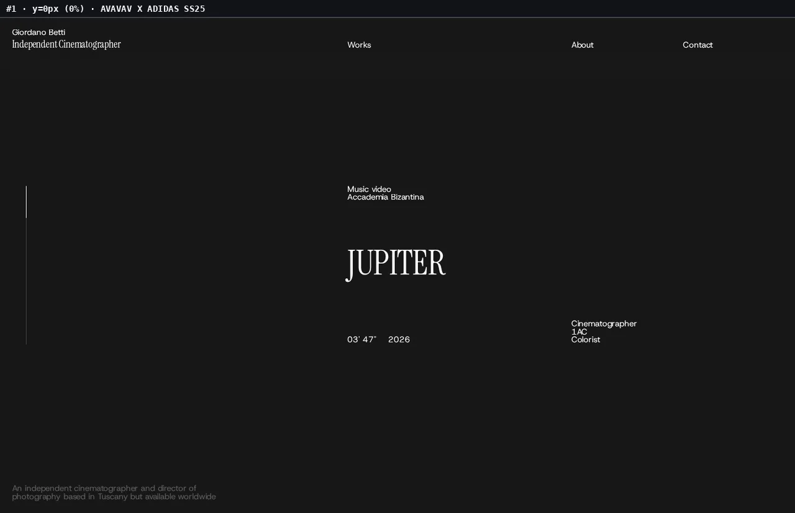
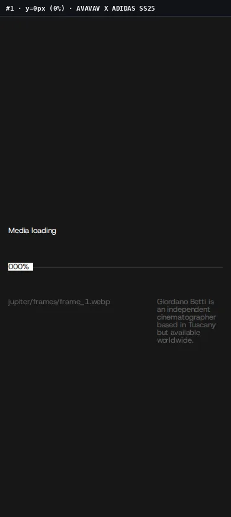

# UI Design System & Master Generation Blueprint: giordanobetti-com

> **Giordano Betti - Independent Cinematographer** (https://giordanobetti.com/) — Giordano Betti is an independent cinematographer and Director of Photography based in Tuscany, Italy.





---

## 1. Executive Visual Persona & Design Archetype

- **Brand Essence & Persona**: **Giordano Betti - Independent Cinematographer** (`https://giordanobetti.com/`). Giordano Betti is an independent cinematographer and Director of Photography based in Tuscany, Italy.
- **Capture Provenance**: Live browser capture (`tier1_fast`, HTTP `200`, captured `2026-11-24`).
- **Visual Archetype**: **Dark-Substrate WebGL / Canvas Interactive Experience (`#171717` / `#ffffff`)**.
- **Anti-AI-Slop Differentiators**:
  - **Live-Computed Chromatic Polarity**: Anchors the viewport in `#171717` (live computed `body` `background-color` (`computed_styles.json`)) paired with `#ffffff` primary typography and `#ffffff` accents.
  - **Grounded Typographic Hierarchy**: Uses `Host Grotesk` across display (`Giordano Betti - Independent Cinemat`) and body copy, paired with `SFMono-Regular` for monospace/code.
  - **Calibrated Spatial Grid & Motion**: Combines `96rem` container bounds (`gap: 21.6px`, padding `21.6px`) with `cubic-bezier(.4,0,.2,1)` easing and Lenis Smooth Scroll (`data-lenis`), HTML5 `<canvas>` Interactive Viewport Surface.

---

## 2. Spatial Architecture & Modular Grid Mathematics

### Viewport Allocation & Container Geometry
- **Captured Journey Filmstrips**: Desktop `1280×828px` (`assets/desktop-journey.webp`, `1` keyframes up to `y=0px` / doc `900px`), Mobile `390×872px` (`assets/mobile-journey.webp`, `1` keyframes).
- **Master Container Bounds**: `96rem` (non-`@media` desktop container stylesheet rule).
- **Canvas Lateral Padding & Spacing**: `21.6px` lateral canvas padding with `21.6px` grid gap.
- **Border Radius Scale**: `0px` (sharp unrounded corners).

### Responsive Breakpoint Architecture
- **Desktop Layout**: Multi-column CSS Grid / Flexbox layout at `1440px` (`max-width: 96rem`, `gap: 21.6px`).
- **Mobile Layout**: Single-column vertical stack at `390px` viewport width with `21.6px` horizontal padding.
- **Extracted CSS Media Queries**: `@media (width>=40rem)`, `@media (width>=48rem)`, `@media (width>=64rem)`, `@media (width>=80rem)`.

---

## 3. Color System, Materiality & Atmospheric Lighting

### Semantic Palette & Source Grounding
| Semantic Role | Ground-Truth Value | Extracted Live / CSS Source |
|---|---|---|
| **Primary Canvas Substrate** | `#171717` | live computed `body` `background-color` (`computed_styles.json`) |
| **Primary Typography Ink** | `#ffffff` | live computed `h1` `color` (`computed_styles.json`) |
| **Elevated Surface / Card Substrate** | `#000000` | `50 { background-color: black }` (`#000000`) |
| **Interactive Accent / Highlight** | `#ffffff` | live computed `a` `background-color` (`computed_styles.json`) |
| **Secondary / Muted Copy** | `#ffffff` | secondary opacity step of live computed `h1` `color` (`computed_styles.json`) |
| **Structural Hairline Border** | `#ffffff` | hairline divider derived from secondary opacity step of live computed `h1` `color` (`computed_styles.json`) |

### Sanitized Root CSS Variables (`ui-ux.md` Ground Truth)
| Variable Name | Extracted Value | Semantic Role |
|---|---|---|
| `--font-sans` | `"Host Grotesk", ui-sans-serif, system-ui, sans-serif` | Typography / Scale Token |
| `--font-serif` | `"Instrument Serif", ui-serif, serif` | Typography / Scale Token |
| `--color-black` | `#000` | Canvas / Surface Token |
| `--color-white` | `#fff` | Canvas / Surface Token |
| `--spacing` | `.25rem` | Layout / Spatial Grid Token |
| `--container-3xl` | `48rem` | Layout / Spatial Grid Token |
| `--font-weight-normal` | `400` | Typography / Scale Token |
| `--blur-lg` | `16px` | Elevation / Border Token |
| `--aspect-video` | `16 / 9` | Design System Custom Token |
| `--default-transition-duration` | `.15s` | Motion / Easing Token |
| `--default-transition-timing-function` | `cubic-bezier(.4, 0, .2, 1)` | Motion / Easing Token |
| `--default-font-family` | `var(--font-sans)` | Typography / Scale Token |
| `--default-mono-font-family` | `var(--font-mono)` | Typography / Scale Token |
| `--color-foreground` | `#fff` | Typography Ink Token |
| `--color-background` | `#171717` | Canvas / Surface Token |
| `--gap` | `clamp(14px, 1.5vw, 32px)` | Layout / Spatial Grid Token |

---

## 4. Typographic Scale & Editorial Hierarchy

### Font Family Stacks
- **Display Typography**: `Host Grotesk`.
- **Primary Body Stack**: `Host Grotesk`.
- **Technical / Metadata Stack**: `SFMono-Regular`.

### Typographic Scale & Rules (Live Computed & Stylesheet Grounded)
- **Hero Display (`H1`)**: live computed `h1` (`font-size: 16px`, `line-height: 24px`, `font-weight: 400`).
- **Section Heading (`H2`)**: live computed `h2` (`font-size: 62.048px`, `line-height: 49.6384px`, `font-weight: 400`, `letter-spacing: -1%`).
- **Body Copy**: live computed `body` (`font-size: 16px`, `line-height: 24px`, `font-weight: 400`).
- **Metadata & Navigation Labels**: live computed `nav/a` (`font-size: 16px`, `line-height: 24px`, `font-weight: 400`); CSS variables `--default-mono-font-family: var(--font-mono)`.

---

## 5. Choreographed Motion & Interaction Physics

### Primary Easing Curves
- **Extracted Timing Functions**: `cubic-bezier(.4,0,.2,1)`.

### Per-Element Transition & Choreography Rules
- **Selector `layer theme`**: `transition: .15s` extracted from `giordanobetti-com` stylesheet.
- **Selector `.transition`**: `transition: var(--tw-ease,var(--default-transition-timing-function))` extracted from `giordanobetti-com` stylesheet.
- **Extracted Easing Curve (`cubic-bezier(.4,0,.2,1)`)**: Governs interactive state transitions across `<header.header>` and `<section.home-content__footer>`.
- **Runtime Interaction Engine**: Integrates Lenis Smooth Scroll (`data-lenis`), HTML5 `<canvas>` Interactive Viewport Surface with `prefers-reduced-motion: reduce` fallback guards.
### Measured Runtime Scroll & Interaction Telemetry (`behavioral_journey_v2`)
- **Scroll Driver Mode**: `native` (max document height `900px`, deepest scrollY reached `0px` across `1` desktop keyframes).
- **Detected Scroll / Motion Libraries**: Native browser scroll / standard CSS transitions.

---

## 6. Component Wireframe & Structural DOM Map

### Visual Layout Schematic — Desktop (`1440px`, Grounded in `dom.html` & Landmark Bounding Boxes)
```
┌────────────────────────────────────────────────────────────────────────┐
│ DESKTOP VIEWPORT (1440px) — Giordano Betti - Independent Cinematograph │
│ ====================================================================== │
│ [ <header.header> (1440x123px)        | instagram instagram · youtub ] │
│ ---------------------------------------------------------------------- │
│ | HERO STAGE: <section.home-content> (w=1440px)                      | │
│ | H1: Giordano Betti - Independent Cinematographer                   | │
│ | Substrate: #171717 | Ink: #ffffff | Accent: #ffffff                | │
│ ---------------------------------------------------------------------- │
│ | SHOWCASE GRID (<section.home-content__foo) max-w: 96rem            | │
│ | +------------------------------+  +------------------------------+ | │
│ | | AVAVAV X ADIDAS SS25         |  | Parlami D'Amore Mariu        | | │
│ | +------------------------------+  +------------------------------+ | │
│ ---------------------------------------------------------------------- │
│ | DETAIL MODULE (<section.f-grid>) — 60 years of Felsina             | │
│ ---------------------------------------------------------------------- │
│ [ FOOTER (<footer.header__sect) | https://giordanobetti.com/           │
└────────────────────────────────────────────────────────────────────────┘
```

### Visual Layout Schematic — Mobile Reflow (`390px`)
```
┌────────────────────────────────────────────────────────────────────────┐
│ MOBILE VIEWPORT REFLOW (390px) — Single-Column Stack (gap: 21.6px)     │
│ ====================================================================== │
│ [ HEADER BAR (<header.header>         ) | Compact Menu (390px)         │
│ ---------------------------------------------------------------------- │
│ | HERO STAGE (<section.home-content>) — 390px Vertical Lead          | │
│ | H1: Giordano Betti - Independent Cinematographer                   | │
│ ---------------------------------------------------------------------- │
│ | SHOWCASE STACK (<section.home-content_) — 1-Col Stack              | │
│ | [ Item 1: AVAVAV X ADIDAS SS25                                   ] | │
│ | [ Item 2: Parlami D'Amore Mariu                                  ] | │
│ ---------------------------------------------------------------------- │
│ | DETAIL STACK (<section.f-grid>) — 1-Col (60 years of Felsin)       | │
│ ---------------------------------------------------------------------- │
│ [ FOOTER (<footer.header__sect) | Stacked 390px Colophon               │
└────────────────────────────────────────────────────────────────────────┘
```

### Granular DOM Region Breakdown
1. **Brand Header & Navigation Bar (<header.header> — `giordanobetti-com`)**:
   - Landmark `<header class="header js-header">` (`1440x123px`) hosting `Giordano Betti - Independent Cinemat` navigation (`instagram instagram · youtube youtube · linkedin linkedin`), DOM attributes (`data-v-ad171e27`, `data-v-67aeeb6a`, `data-v-6d80a5f8`, `data-v-794a89b8`), and stylesheet rule `before { box-sizing:border-box;border:0 solid;margin:0;padding:0 }`.
2. **Hero Stage & Focal Lead (<section.home-content> — `Giordano Betti - Independent Cinem`)**:
   - Landmark `<section class="home-content f-grid">` presenting display lead `Giordano Betti - Independent Cinematographer` and copy excerpt *"Accademia Bizantina"* over `#171717` canvas and `#ffffff` ink.
3. **Primary Showcase & Content Grid (<section.home-content__footer> — `AVAVAV X ADIDAS SS25`)**:
   - Landmark `<section class="home-content__footer f-grid">` rendering section `AVAVAV X ADIDAS SS25` with copy *"Cinematographer 1AC Colorist"*, asset references (`entry.B8GcDMgn.css`, `Footer.BHv6vXkB.css`, `Action.C2i8mHMB.css`, `MoZuWBAS.js`), and grid rule `file-selector-button { box-sizing:border-box;border:0 solid;margin:0;padding:0 }`.
4. **Interactive Detail & Feature Matrix (<section.f-grid> — `Parlami D'Amore Mariu`)**:
   - Landmark `<section class="home-content__footer f-grid">` framing `Parlami D'Amore Mariu` and `60 years of Felsina` (*"Livestream director"*) with `#000000` surface cards, `#ffffff` accents, and `strong { font-weight:bolder }`.
5. **Colophon & Global Directory Footer (<footer.header__section> — `https://giordanobetti.com/`)**:
   - Landmark `<footer class="header__section">` anchoring `Giordano Betti - Independent Cin` footer links (`instagram instagram · youtube youtube · linkedin linkedin`), copy *"An independent cinematographer and director of photography b"*, and `#ffffff` structural dividers.
### Full Vertical Scroll Sequence (Desktop `1440×900` Keyframes)
- **Step 01** (`y=0px`, `0%`): Active landmark `AVAVAV X ADIDAS SS25` · sticky/fixed elements: `7`

---

## 7. Master Zero-Shot AI Generation Prompt

```markdown
# Master Zero-Shot Frontend Generation Prompt: giordanobetti-com (Giordano Betti - Independent Cinematographer)

You are a principal frontend architect and design systems engineer. Build a complete, production-ready web application replicating the exact design system, DOM landmarks, typographic hierarchy, color tokens, and motion physics of `giordanobetti-com` (**Giordano Betti - Independent Cinematographer** — `https://giordanobetti.com/`).

### 1. Visual Archetype & Anti-AI-Slop Mandates
- **Archetype**: Dark-Substrate WebGL / Canvas Interactive Experience (`#171717` / `#ffffff`).
- **Identity & Domain Context**: Giordano Betti is an independent cinematographer and Director of Photography based in Tuscany, Italy.
- **Primary Substrate**: `#171717` (live computed `body` `background-color` (`computed_styles.json`)), **Primary Ink**: `#ffffff`, **Accent / Highlight**: `#ffffff`.
- **Site-Specific Differentiators**:
  - **Live-Computed Chromatic Polarity**: Anchors the viewport in `#171717` (live computed `body` `background-color` (`computed_styles.json`)) paired with `#ffffff` primary typography and `#ffffff` accents.
  - **Grounded Typographic Hierarchy**: Uses `Host Grotesk` across display (`Giordano Betti - Independent Cinemat`) and body copy, paired with `SFMono-Regular` for monospace/code.
  - **Calibrated Spatial Grid & Motion**: Combines `96rem` container bounds (`gap: 21.6px`, padding `21.6px`) with `cubic-bezier(.4,0,.2,1)` easing and Lenis Smooth Scroll (`data-lenis`), HTML5 `<canvas>` Interactive Viewport Surface.

### 2. Ground-Truth CSS Variables (`:root` Token Contract)
Declare and consume these exact custom properties extracted from `giordanobetti-com` in your global stylesheet:

:root {
  /* Giordano Betti - Independent Cinematographer (giordanobetti-com) — Live-Grounded CSS Variables */
  --font-sans: "Host Grotesk", ui-sans-serif, system-ui, sans-serif; /* Typography / Scale Token (giordanobetti-com) */
  --font-serif: "Instrument Serif", ui-serif, serif; /* Typography / Scale Token (giordanobetti-com) */
  --color-black: #000; /* Canvas / Surface Token (giordanobetti-com) */
  --color-white: #fff; /* Canvas / Surface Token (giordanobetti-com) */
  --spacing: .25rem; /* Layout / Spatial Grid Token (giordanobetti-com) */
  --container-3xl: 48rem; /* Layout / Spatial Grid Token (giordanobetti-com) */
  --font-weight-normal: 400; /* Typography / Scale Token (giordanobetti-com) */
  --blur-lg: 16px; /* Elevation / Border Token (giordanobetti-com) */
  --aspect-video: 16 / 9; /* Design System Custom Token (giordanobetti-com) */
  --default-transition-duration: .15s; /* Motion / Easing Token (giordanobetti-com) */
  --default-transition-timing-function: cubic-bezier(.4, 0, .2, 1); /* Motion / Easing Token (giordanobetti-com) */
  --default-font-family: var(--font-sans); /* Typography / Scale Token (giordanobetti-com) */
  --default-mono-font-family: var(--font-mono); /* Typography / Scale Token (giordanobetti-com) */
  --color-foreground: #fff; /* Typography Ink Token (giordanobetti-com) */
  --color-background: #171717; /* Canvas / Surface Token (giordanobetti-com) */
  --gap: clamp(14px, 1.5vw, 32px); /* Layout / Spatial Grid Token (giordanobetti-com) */
}

### 3. Semantic Color & Materiality Contract
Map every surface, ink, and border strictly to these source-grounded tokens:
- **Primary Canvas Substrate**: `#171717` — grounded in live computed `body` `background-color` (`computed_styles.json`)
- **Primary Typography Ink**: `#ffffff` — grounded in live computed `h1` `color` (`computed_styles.json`)
- **Elevated Surface / Card Substrate**: `#000000` — grounded in `50 { background-color: black }` (`#000000`)
- **Interactive Accent / Highlight**: `#ffffff` — grounded in live computed `a` `background-color` (`computed_styles.json`)
- **Secondary / Muted Copy**: `#ffffff` — grounded in secondary opacity step of live computed `h1` `color` (`computed_styles.json`)
- **Structural Hairline Border**: `#ffffff` — grounded in hairline divider derived from secondary opacity step of live computed `h1` `color` (`computed_styles.json`)

### 4. Spatial Grid, Container Bounds & Responsive Breakpoints
- **Desktop Viewport Reference**: `1280×828px` (single-viewport 100vh live capture (900px), `1440px` standard desktop width).
- **Mobile Viewport Reference**: `390×872px` (full-page live capture (872px), `390px` standard mobile width).
- **Container Max-Width**: `96rem` (non-`@media` desktop container stylesheet rule)
- **Padding & Gutters**: `21.6px` lateral canvas padding with `21.6px` grid gap
- **Desktop Grid**: Multi-column CSS Grid / Flexbox layout at `1440px` (`max-width: 96rem`, `gap: 21.6px`)
- **Mobile Adaptation**: Single-column vertical stack at `390px` viewport width with `21.6px` horizontal padding
- **Media Queries**: `@media (width>=40rem)`, `@media (width>=48rem)`, `@media (width>=64rem)`, `@media (width>=80rem)`
- **Corner Radii**: `0px` (sharp unrounded corners)

### 5. Typography & Editorial Scale Contract
- **Display Font Stack**: `Host Grotesk`
- **Body Font Stack**: `Host Grotesk`
- **Monospace / Technical Font Stack**: `SFMono-Regular`
- **H1 Display Rule**: live computed `h1` (`font-size: 16px`, `line-height: 24px`, `font-weight: 400`)
- **H2 Section Rule**: live computed `h2` (`font-size: 62.048px`, `line-height: 49.6384px`, `font-weight: 400`, `letter-spacing: -1%`)
- **Body Copy Rule**: live computed `body` (`font-size: 16px`, `line-height: 24px`, `font-weight: 400`)
- **Metadata & Index Rule**: live computed `nav/a` (`font-size: 16px`, `line-height: 24px`, `font-weight: 400`); CSS variables `--default-mono-font-family: var(--font-mono)`

### 6. Component Hierarchy, Verbatim Copy & Real DOM Landmarks
Scaffold `giordanobetti-com` (`Giordano Betti - Independent Cinematographer`) with these exact structural regions, extracted copy, and CSS rules from `dom.html`:
1. **Brand Header & Navigation Bar (<header.header> — `giordanobetti-com`)**:
   - DOM & Selectors: Landmark `<header class="header js-header">` (`1440x123px`) hosting `Giordano Betti - Independent Cinemat` navigation (`instagram instagram · youtube youtube · linkedin linkedin`), DOM attributes (`data-v-ad171e27`, `data-v-67aeeb6a`, `data-v-6d80a5f8`, `data-v-794a89b8`), and stylesheet rule `before { box-sizing:border-box;border:0 solid;margin:0;padding:0 }`.
   - Responsive Contract: Header `Brand Header & Navigation Bar (<header.header> — `giordanobetti-com`)` (`giordanobetti-com`) adapts across `@media (width>=40rem)`, `@media (width>=48rem)`, `@media (width>=64rem)`, `@media (width>=80rem)` with `cubic-bezier(.4,0,.2,1)` transitions and links `instagram instagram · youtube youtube · linkedin linkedin`.
2. **Hero Stage & Focal Lead (<section.home-content> — `Giordano Betti - Independent Cinem`)**:
   - DOM & Selectors: Landmark `<section class="home-content f-grid">` presenting display lead `Giordano Betti - Independent Cinematographer` and copy excerpt *"Accademia Bizantina"* over `#171717` canvas and `#ffffff` ink.
   - Responsive Contract: Hero stage (`1280×828px` desktop / `390×872px` mobile) sets `#171717` background with `#ffffff` headline `Giordano Betti - Independent Cinematographer`.
3. **Primary Showcase & Content Grid (<section.home-content__footer> — `AVAVAV X ADIDAS SS25`)**:
   - DOM & Selectors: Landmark `<section class="home-content__footer f-grid">` rendering section `AVAVAV X ADIDAS SS25` with copy *"Cinematographer 1AC Colorist"*, asset references (`entry.B8GcDMgn.css`, `Footer.BHv6vXkB.css`, `Action.C2i8mHMB.css`, `MoZuWBAS.js`), and grid rule `file-selector-button { box-sizing:border-box;border:0 solid;margin:0;padding:0 }`.
   - Responsive Contract: Showcase grid `Primary Showcase & Content Grid (<section.home-content__footer> — `AVAVAV X ADIDAS SS25`)` applies Multi-column CSS Grid / Flexbox layout at `1440px` (`max-width: 96rem`, `gap: 21.6px`) on desktop and Single-column vertical stack at `390px` viewport width with `21.6px` horizontal padding on mobile.
4. **Interactive Detail & Feature Matrix (<section.f-grid> — `Parlami D'Amore Mariu`)**:
   - DOM & Selectors: Landmark `<section class="home-content__footer f-grid">` framing `Parlami D'Amore Mariu` and `60 years of Felsina` (*"Livestream director"*) with `#000000` surface cards, `#ffffff` accents, and `strong { font-weight:bolder }`.
   - Responsive Contract: Detail module `Interactive Detail & Feature Matrix (<section.f-grid> — `Parlami D'Amore Mariu`)` uses `0px` (sharp unrounded corners) radii, `#ffffff` highlights, and assets (entry.B8GcDMgn.css, Footer.BHv6vXkB.css, Action.C2i8mHMB.css).
5. **Colophon & Global Directory Footer (<footer.header__section> — `https://giordanobetti.com/`)**:
   - DOM & Selectors: Landmark `<footer class="header__section">` anchoring `Giordano Betti - Independent Cin` footer links (`instagram instagram · youtube youtube · linkedin linkedin`), copy *"An independent cinematographer and director of photography b"*, and `#ffffff` structural dividers.
   - Responsive Contract: Footer `Colophon & Global Directory Footer (<footer.header__section> — `https://giordanobetti.com/`)` aligns to `96rem` (non-`@media` desktop container stylesheet rule) with `21.6px` lateral canvas padding with `21.6px` grid gap and attributes (data-v-ad171e27, data-v-67aeeb6a, data-v-6d80a5f8).

#### Verbatim DOM Copy Excerpts (`dom.html`)
- Copy Excerpt 1: *"Accademia Bizantina"*
- Copy Excerpt 2: *"Cinematographer 1AC Colorist"*
- Copy Excerpt 3: *"Livestream director"*
- Copy Excerpt 4: *"An independent cinematographer and director of photography based in Tuscany but av..."*

### 7. Motion, Extracted Stylesheet Rules & Interaction Choreography
- **Primary Easing Functions**: `cubic-bezier(.4,0,.2,1)`
- **Extracted Stylesheet Rules (`giordanobetti-com`)**:
- `before { box-sizing:border-box;border:0 solid;margin:0;padding:0 }`
- `file-selector-button { box-sizing:border-box;border:0 solid;margin:0;padding:0 }`
- `strong { font-weight:bolder }`
- `small { font-size:80% }`
- `sup { vertical-align:baseline;font-size:75%;line-height:0;position:relative }`
- **Per-Selector Transition Rules**:
- **Selector `layer theme`**: `transition: .15s` extracted from `giordanobetti-com` stylesheet.
- **Selector `.transition`**: `transition: var(--tw-ease,var(--default-transition-timing-function))` extracted from `giordanobetti-com` stylesheet.
- **Extracted Easing Curve (`cubic-bezier(.4,0,.2,1)`)**: Governs interactive state transitions across `<header.header>` and `<section.home-content__footer>`.
- **Runtime Interaction Engine**: Integrates Lenis Smooth Scroll (`data-lenis`), HTML5 `<canvas>` Interactive Viewport Surface with `prefers-reduced-motion: reduce` fallback guards.
### 7b. Full-Page Scroll Choreography, Interactive States & Multi-Page Routes
- **Scroll Mechanics**: Implement `native` vertical progression up to `900px` across 1 distinct viewport chapters.
- **Vertical Chapter Sequence**: AVAVAV X ADIDAS SS25 (0%).

### 8. Technical Deliverables
- Implement in Next.js (App Router) with TypeScript and Tailwind CSS consuming the `:root` custom properties defined above for `giordanobetti-com`.
- Reproduce both the `1440px` desktop architecture and `390px` mobile breakpoint transitions, preserving semantic HTML5 landmarks (`<header>`, `<nav>`, `<main>`, `<section>`, `<footer>`) and `prefers-reduced-motion` accessibility guards.
```
---

## 8. Full-Page Scroll Journey, Interactive States & Subpage Inventory

### Desktop Scroll Keyframes (`1440×900` WebP)
| Step | Scroll Y | Progress | Active Landmark / Section | Sticky/Fixed | Visual Asset |
| :---: | :---: | :---: | :--- | :---: | :--- |
| `#01` | `0px` | `0%` | AVAVAV X ADIDAS SS25 | `7` | [desktop-step-01.webp](assets/desktop-step-01.webp) |

### Mobile Condensed Keyframes (`390×844` WebP)
| Step | Scroll Y | Progress | Active Landmark | Visual Asset |
| :---: | :---: | :---: | :--- | :--- |
| `#01` | `0px` | `0%` | AVAVAV X ADIDAS SS25 | [mobile-step-01.webp](assets/mobile-step-01.webp) |

