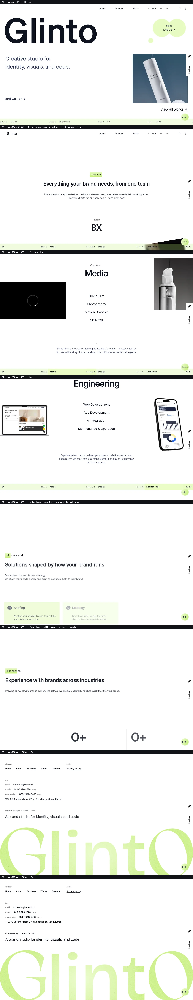
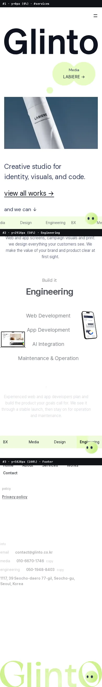

# UI Design System & Master Generation Blueprint: glinto-co-kr

> **Glinto — Creative studio** (https://glinto.co.kr) — Glinto is a creative studio where one team takes brand strategy and identity, film and photography, design, and web and app development f...





---

## 1. Executive Visual Persona & Design Archetype

- **Brand Essence & Persona**: **Glinto — Creative studio** (`https://glinto.co.kr`). Glinto is a creative studio where one team takes brand strategy and identity, film and photography, design, and web and app development f...
- **Capture Provenance**: Live browser capture (`tier1_fast`, HTTP `200`, captured `2026-11-24`).
- **Visual Archetype**: **Light-Gallery WebGL / Canvas Interactive Experience (`#ffffff` / `#ff5c34`)**.
- **Anti-AI-Slop Differentiators**:
  - **Live-Computed Chromatic Polarity**: Anchors the viewport in `#ffffff` (live computed `body` `background-color` (`computed_styles.json`)) paired with `#0f131f` primary typography and `#ff5c34` accents.
  - **Grounded Typographic Hierarchy**: Uses `Pretendard Variable` across display (`Everything your brand needs, from on`) and body copy, paired with `JetBrains Mono` for monospace/code.
  - **Calibrated Spatial Grid & Motion**: Combines `105rem` container bounds (`gap: var(--spacing-1)`, padding `var(--spacing-1)`) with `cubic-bezier(.4,0,1,1)` easing and Lenis Smooth Scroll (`data-lenis`), Three.js / WebGL Canvas Pipeline.

---

## 2. Spatial Architecture & Modular Grid Mathematics

### Viewport Allocation & Container Geometry
- **Captured Journey Filmstrips**: Desktop `1280×6624px` (`assets/desktop-journey.webp`, `8` keyframes up to `y=8517px` / doc `9417px`), Mobile `390×2616px` (`assets/mobile-journey.webp`, `3` keyframes).
- **Master Container Bounds**: `105rem` (non-`@media` desktop container stylesheet rule).
- **Canvas Lateral Padding & Spacing**: `var(--spacing-1)` lateral canvas padding with `var(--spacing-1)` grid gap.
- **Border Radius Scale**: `.25rem`, `var(--pixel-radius)`, `.5rem`, `.75rem`.

### Responsive Breakpoint Architecture
- **Desktop Layout**: Multi-column CSS Grid / Flexbox layout at `1440px` (`max-width: 105rem`, `gap: var(--spacing-1)`).
- **Mobile Layout**: Single-column vertical stack at `390px` viewport width with `var(--spacing-1)` horizontal padding.
- **Extracted CSS Media Queries**: `@media (min-width:40rem)`, `@media (min-width:48rem)`, `@media (min-width:64rem)`, `@media (min-width:80rem)`.

---

## 3. Color System, Materiality & Atmospheric Lighting

### Semantic Palette & Source Grounding
| Semantic Role | Ground-Truth Value | Extracted Live / CSS Source |
|---|---|---|
| **Primary Canvas Substrate** | `#ffffff` | live computed `body` `background-color` (`computed_styles.json`) |
| **Primary Typography Ink** | `#0f131f` | live computed `h1` `color` (`computed_styles.json`) |
| **Elevated Surface / Card Substrate** | `#fdeceb` | `var(--danger-bg)` in `:root` |
| **Interactive Accent / Highlight** | `#ff5c34` | `var(--accent-500)` in `:root` |
| **Secondary / Muted Copy** | `#626880` | `var(--mock-muted)` in `:root` |
| **Structural Hairline Border** | `#626880` | hairline divider derived from `var(--mock-muted)` in `:root` |
| **Variable Token (`--accent-50`)** | `#fff3ee` | `var(--accent-50)` in `:root` |
| **Variable Token (`--accent-100`)** | `#ffe4d9` | `var(--accent-100)` in `:root` |
| **Variable Token (`--accent-200`)** | `#ffc7b0` | `var(--accent-200)` in `:root` |
| **Variable Token (`--accent-300`)** | `#ffa47d` | `var(--accent-300)` in `:root` |
| **Variable Token (`--accent-400`)** | `#ff7f54` | `var(--accent-400)` in `:root` |
| **Variable Token (`--accent-600`)** | `#e8451f` | `var(--accent-600)` in `:root` |
| **Variable Token (`--accent-700`)** | `#c13215` | `var(--accent-700)` in `:root` |
| **Variable Token (`--accent-800`)** | `#922712` | `var(--accent-800)` in `:root` |
| **Variable Token (`--accent-900`)** | `#611a0c` | `var(--accent-900)` in `:root` |
| **Variable Token (`--neutral-50`)** | `#fbf9f7` | `var(--neutral-50)` in `:root` |
| **Variable Token (`--neutral-100`)** | `#f5f1ed` | `var(--neutral-100)` in `:root` |
| **Variable Token (`--neutral-200`)** | `#e8e1da` | `var(--neutral-200)` in `:root` |
| **Variable Token (`--neutral-300`)** | `#d6ccc2` | `var(--neutral-300)` in `:root` |
| **Variable Token (`--neutral-400`)** | `#b3a79c` | `var(--neutral-400)` in `:root` |
| **Variable Token (`--neutral-500`)** | `#8f8177` | `var(--neutral-500)` in `:root` |

### Sanitized Root CSS Variables (`ui-ux.md` Ground Truth)
| Variable Name | Extracted Value | Semantic Role |
|---|---|---|
| `--accent-50` | `#fff3ee` | Brand / Palette Token |
| `--accent-100` | `#ffe4d9` | Brand / Palette Token |
| `--accent-200` | `#ffc7b0` | Brand / Palette Token |
| `--accent-300` | `#ffa47d` | Brand / Palette Token |
| `--accent-400` | `#ff7f54` | Brand / Palette Token |
| `--accent-500` | `#ff5c34` | Brand / Palette Token |
| `--accent-600` | `#e8451f` | Brand / Palette Token |
| `--accent-700` | `#c13215` | Brand / Palette Token |
| `--accent-800` | `#922712` | Brand / Palette Token |
| `--accent-900` | `#611a0c` | Brand / Palette Token |
| `--neutral-50` | `#fbf9f7` | Color / Atmospheric Token |
| `--neutral-100` | `#f5f1ed` | Color / Atmospheric Token |
| `--neutral-200` | `#e8e1da` | Color / Atmospheric Token |
| `--neutral-300` | `#d6ccc2` | Color / Atmospheric Token |
| `--neutral-400` | `#b3a79c` | Color / Atmospheric Token |
| `--neutral-500` | `#8f8177` | Color / Atmospheric Token |

---

## 4. Typographic Scale & Editorial Hierarchy

### Font Family Stacks
- **Display Typography**: `Pretendard Variable`.
- **Primary Body Stack**: `Pretendard Variable`.
- **Technical / Metadata Stack**: `JetBrains Mono`.

### Typographic Scale & Rules (Live Computed & Stylesheet Grounded)
- **Hero Display (`H1`)**: live computed `h1` (`font-size: 16px`, `line-height: 24px`, `font-weight: 400`); CSS variables `--fs-xl: 1.25rem`, `--fs-h1: 1.625rem`, `--fs-display-sans: 2.125rem`.
- **Section Heading (`H2`)**: live computed `h2` (`font-size: 40px`, `line-height: 60px`, `font-weight: 600`, `letter-spacing: -0.6px`); CSS variables `--fs-lg: 1.125rem`, `--fs-h2: 1.375rem`, `--tracking-h2: -.01em`.
- **Body Copy**: live computed `body` (`font-size: 16px`, `line-height: 24px`, `font-weight: 400`); CSS variables `--fs-base: 1rem`, `--fs-body-s: .8125rem`, `--fs-body-m: .875rem`.
- **Metadata & Navigation Labels**: live computed `nav/a` (`font-size: 16px`, `line-height: 24px`, `font-weight: 400`); CSS variables `--label-ink-start: var(--lime-cream-start)`, `--label-ink-end: var(--lime-cream-end)`, `--fs-sm: .875rem`.

---

## 5. Choreographed Motion & Interaction Physics

### Primary Easing Curves
- **Extracted Timing Functions**: `cubic-bezier(.4,0,1,1)`, `cubic-bezier(0,0,.2,1)`, `cubic-bezier(.4,0,.2,1)`.

### Per-Element Transition & Choreography Rules
- **Selector `layer theme`**: `transition: .15s` extracted from `glinto-co-kr` stylesheet.
- **Selector `.transition`**: `transition: var(--tw-ease,var(--default-transition-timing-function))` extracted from `glinto-co-kr` stylesheet.
- **Selector `.transition-\[clip-path\]`**: `transition: var(--tw-ease,var(--default-transition-timing-function))` extracted from `glinto-co-kr` stylesheet.
- **Extracted Easing Curve (`cubic-bezier(.4,0,1,1)`)**: Governs interactive state transitions across `<header.site-header-wrap>` and `<section.pt-24>`.
- **Runtime Interaction Engine**: Integrates Lenis Smooth Scroll (`data-lenis`), Three.js / WebGL Canvas Pipeline with `prefers-reduced-motion: reduce` fallback guards.
### Measured Runtime Scroll & Interaction Telemetry (`behavioral_journey_v2`)
- **Scroll Driver Mode**: `native` (max document height `9417px`, deepest scrollY reached `8517px` across `8` desktop keyframes).
- **Detected Scroll / Motion Libraries**: `Lenis`, `WebGL/Canvas`.
- **Hover Physics (`primary_cta` · `Media Klairs→`)**: Computed transition `0s` / `ease` (no static color/transform shift captured at rest).
- **Theme Toggle Probe (`Switch to dark mode`)**: Toggled body background `rgb(255, 255, 255)` -> `rgb(16, 17, 20)` and ink `rgb(15, 19, 31)` -> `rgb(255, 255, 255)`.
- **Route Transition Architecture**: First internal navigation (`/en/about`) measured as `SPA` in `1745ms`.

---

## 6. Component Wireframe & Structural DOM Map

### Visual Layout Schematic — Desktop (`1440px`, Grounded in `dom.html` & Landmark Bounding Boxes)
```
┌────────────────────────────────────────────────────────────────────────┐
│ DESKTOP VIEWPORT (1440px) — Glinto — Creative studio                   │
│ ====================================================================== │
│ [ <header.site-header-wr (1440x64px)  | About · Services · Glinto.de ] │
│ ---------------------------------------------------------------------- │
│ | HERO STAGE: <section.antialiased> (w=1440px)                       | │
│ | H1: Everything your brand needs, from one team                     | │
│ | Substrate: #ffffff | Ink: #0f131f | Accent: #ff5c34                | │
│ ---------------------------------------------------------------------- │
│ | SHOWCASE GRID (<section.pt-24>) max-w: 105rem                      | │
│ | +------------------------------+  +------------------------------+ | │
│ | | Solutions shaped by how your |  | Launch & care                | | │
│ | +------------------------------+  +------------------------------+ | │
│ ---------------------------------------------------------------------- │
│ | DETAIL MODULE (<section.pt-24:nth(2)>) — Experience with brand     | │
│ ---------------------------------------------------------------------- │
│ [ FOOTER (<footer.mt-24>      ) | https://glinto.co.kr                 │
└────────────────────────────────────────────────────────────────────────┘
```

### Visual Layout Schematic — Mobile Reflow (`390px`)
```
┌────────────────────────────────────────────────────────────────────────┐
│ MOBILE VIEWPORT REFLOW (390px) — Single-Column Stack (gap: var(--sp)   │
│ ====================================================================== │
│ [ HEADER BAR (<header.site-header-wrap) | Compact Menu (390px)         │
│ ---------------------------------------------------------------------- │
│ | HERO STAGE (<section.antialiased>) — 390px Vertical Lead           | │
│ | H1: Everything your brand needs, from one team                     | │
│ ---------------------------------------------------------------------- │
│ | SHOWCASE STACK (<section.pt-24>) — 1-Col Stack                     | │
│ | [ Item 1: Solutions shaped by how your brand runs                ] | │
│ | [ Item 2: Launch & care                                          ] | │
│ ---------------------------------------------------------------------- │
│ | DETAIL STACK (<section.pt-24:nth(2)>) — 1-Col (Experience with br) | │
│ ---------------------------------------------------------------------- │
│ [ FOOTER (<footer.mt-24>      ) | Stacked 390px Colophon               │
└────────────────────────────────────────────────────────────────────────┘
```

### Granular DOM Region Breakdown
1. **Brand Header & Navigation Bar (<header.site-header-wrap> — `glinto-co-kr`)**:
   - Landmark `<header class="site-header-wrap top-0">` (`1440x64px`) hosting `Glinto — Creative studio` navigation (`About · Services · Glinto.dev · Works · Contact`), DOM attributes (`data-theme="light"`, `data-reveal-ready`, `data-progress-ready`, `data-precedence="next"`), and stylesheet rule `sans_efc253b3-module__w1i8Da__cla... { font-family:DM Sans,DM Sans Fallback;font-style:normal }`.
2. **Hero Stage & Focal Lead (<section.antialiased> — `Everything your brand needs, from `)**:
   - Landmark `<section class="antialiased">` presenting display lead `Everything your brand needs, from one team` and copy excerpt *"Creative studio for identity, visuals, and code."* over `#ffffff` canvas and `#0f131f` ink.
3. **Primary Showcase & Content Grid (<section.pt-24> — `Solutions shaped by how your brand`)**:
   - Landmark `<section class="pt-24">` rendering section `Solutions shaped by how your brand runs` with copy *"Engineering Build it"*, asset references (`2f7d2945a32bc936-s.p.0q9pvfn3wr_3...`, `5c285b27cdda1fe8-s.p.0lsanbtneewq...`, `0k1f2nt08p6_n.css`, `3b84er6uv62xn.css`), and grid rule `sans_efc253b3-module__w1i8Da__var... { --font-dm-sans:"DM Sans", "DM Sans Fallback" }`.
4. **Interactive Detail & Feature Matrix (<section.pt-24:nth(2)> — `Launch & care`)**:
   - Landmark `<section class="pt-24">` framing `Launch & care` and `Experience with brands across industries` (*"From brand strategy to design, media and development, specialists"*) with `#fdeceb` surface cards, `#ff5c34` accents, and `host { --header-fill:0;--px-x:80%;--px-y:0% }`.
5. **Colophon & Global Directory Footer (<footer.mt-24> — `https://glinto.co.kr`)**:
   - Landmark `<footer class="mt-24">` anchoring `Glinto — Creative studio` footer links (`About · Services · Glinto.dev · Works · Contact`), copy *"Start small with the one service you need right now."*, and `#626880` structural dividers.
### Full Vertical Scroll Sequence (Desktop `1440×900` Keyframes)
- **Step 01** (`y=0px`, `0%`): Active landmark `Media` · sticky/fixed elements: `3`
- **Step 02** (`y=850px`, `10%`): Active landmark `Everything your brand needs, from one team` · sticky/fixed elements: `5`
- **Step 03** (`y=2550px`, `30%`): Active landmark `Engineering` · sticky/fixed elements: `4`
- **Step 04** (`y=4250px`, `50%`): Active landmark `BX` · sticky/fixed elements: `4`
- **Step 05** (`y=5100px`, `60%`): Active landmark `Solutions shaped by how your brand runs` · sticky/fixed elements: `3`
- **Step 06** (`y=6800px`, `80%`): Active landmark `Experience with brands across industries` · sticky/fixed elements: `2`
- **Step 07** (`y=8500px`, `100%`): Active landmark `BX` · sticky/fixed elements: `2`
- **Step 08** (`y=8517px`, `100%`): Active landmark `BX` · sticky/fixed elements: `2`

### Multi-Page Internal Route Map
- **Detail Route (`/en/about`)**: `https://glinto.co.kr/en/about` — H1: `Creative studio for Identity · Visuals · and Code`, scrollHeight `14531px`, transition `SPA` (`1745ms`)
- **Detail Route (`/en/services`)**: `https://glinto.co.kr/en/services` — H1: `Glinto Services`, scrollHeight `8511px`, transition `direct` (`861ms`)
- **Detail Route (`/en/works`)**: `https://glinto.co.kr/en/works` — H1: `Works`, scrollHeight `3591px`, transition `direct` (`743ms`)

---

## 7. Master Zero-Shot AI Generation Prompt

```markdown
# Master Zero-Shot Frontend Generation Prompt: glinto-co-kr (Glinto — Creative studio)

You are a principal frontend architect and design systems engineer. Build a complete, production-ready web application replicating the exact design system, DOM landmarks, typographic hierarchy, color tokens, and motion physics of `glinto-co-kr` (**Glinto — Creative studio** — `https://glinto.co.kr`).

### 1. Visual Archetype & Anti-AI-Slop Mandates
- **Archetype**: Light-Gallery WebGL / Canvas Interactive Experience (`#ffffff` / `#ff5c34`).
- **Identity & Domain Context**: Glinto is a creative studio where one team takes brand strategy and identity, film and photography, design, and web and app development f...
- **Primary Substrate**: `#ffffff` (live computed `body` `background-color` (`computed_styles.json`)), **Primary Ink**: `#0f131f`, **Accent / Highlight**: `#ff5c34`.
- **Site-Specific Differentiators**:
  - **Live-Computed Chromatic Polarity**: Anchors the viewport in `#ffffff` (live computed `body` `background-color` (`computed_styles.json`)) paired with `#0f131f` primary typography and `#ff5c34` accents.
  - **Grounded Typographic Hierarchy**: Uses `Pretendard Variable` across display (`Everything your brand needs, from on`) and body copy, paired with `JetBrains Mono` for monospace/code.
  - **Calibrated Spatial Grid & Motion**: Combines `105rem` container bounds (`gap: var(--spacing-1)`, padding `var(--spacing-1)`) with `cubic-bezier(.4,0,1,1)` easing and Lenis Smooth Scroll (`data-lenis`), Three.js / WebGL Canvas Pipeline.

### 2. Ground-Truth CSS Variables (`:root` Token Contract)
Declare and consume these exact custom properties extracted from `glinto-co-kr` in your global stylesheet:

:root {
  /* Glinto — Creative studio (glinto-co-kr) — Live-Grounded CSS Variables */
  --accent-50: #fff3ee; /* Brand / Palette Token (glinto-co-kr) */
  --accent-100: #ffe4d9; /* Brand / Palette Token (glinto-co-kr) */
  --accent-200: #ffc7b0; /* Brand / Palette Token (glinto-co-kr) */
  --accent-300: #ffa47d; /* Brand / Palette Token (glinto-co-kr) */
  --accent-400: #ff7f54; /* Brand / Palette Token (glinto-co-kr) */
  --accent-500: #ff5c34; /* Brand / Palette Token (glinto-co-kr) */
  --accent-600: #e8451f; /* Brand / Palette Token (glinto-co-kr) */
  --accent-700: #c13215; /* Brand / Palette Token (glinto-co-kr) */
  --accent-800: #922712; /* Brand / Palette Token (glinto-co-kr) */
  --accent-900: #611a0c; /* Brand / Palette Token (glinto-co-kr) */
  --neutral-50: #fbf9f7; /* Color / Atmospheric Token (glinto-co-kr) */
  --neutral-100: #f5f1ed; /* Color / Atmospheric Token (glinto-co-kr) */
  --neutral-200: #e8e1da; /* Color / Atmospheric Token (glinto-co-kr) */
  --neutral-300: #d6ccc2; /* Color / Atmospheric Token (glinto-co-kr) */
  --neutral-400: #b3a79c; /* Color / Atmospheric Token (glinto-co-kr) */
  --neutral-500: #8f8177; /* Color / Atmospheric Token (glinto-co-kr) */
}

### 3. Semantic Color & Materiality Contract
Map every surface, ink, and border strictly to these source-grounded tokens:
- **Primary Canvas Substrate**: `#ffffff` — grounded in live computed `body` `background-color` (`computed_styles.json`)
- **Primary Typography Ink**: `#0f131f` — grounded in live computed `h1` `color` (`computed_styles.json`)
- **Elevated Surface / Card Substrate**: `#fdeceb` — grounded in `var(--danger-bg)` in `:root`
- **Interactive Accent / Highlight**: `#ff5c34` — grounded in `var(--accent-500)` in `:root`
- **Secondary / Muted Copy**: `#626880` — grounded in `var(--mock-muted)` in `:root`
- **Structural Hairline Border**: `#626880` — grounded in hairline divider derived from `var(--mock-muted)` in `:root`
- **Variable Token (`--accent-50`)**: `#fff3ee` — grounded in `var(--accent-50)` in `:root`
- **Variable Token (`--accent-100`)**: `#ffe4d9` — grounded in `var(--accent-100)` in `:root`
- **Variable Token (`--accent-200`)**: `#ffc7b0` — grounded in `var(--accent-200)` in `:root`
- **Variable Token (`--accent-300`)**: `#ffa47d` — grounded in `var(--accent-300)` in `:root`
- **Variable Token (`--accent-400`)**: `#ff7f54` — grounded in `var(--accent-400)` in `:root`
- **Variable Token (`--accent-600`)**: `#e8451f` — grounded in `var(--accent-600)` in `:root`
- **Variable Token (`--accent-700`)**: `#c13215` — grounded in `var(--accent-700)` in `:root`
- **Variable Token (`--accent-800`)**: `#922712` — grounded in `var(--accent-800)` in `:root`
- **Variable Token (`--accent-900`)**: `#611a0c` — grounded in `var(--accent-900)` in `:root`
- **Variable Token (`--neutral-50`)**: `#fbf9f7` — grounded in `var(--neutral-50)` in `:root`
- **Variable Token (`--neutral-100`)**: `#f5f1ed` — grounded in `var(--neutral-100)` in `:root`
- **Variable Token (`--neutral-200`)**: `#e8e1da` — grounded in `var(--neutral-200)` in `:root`
- **Variable Token (`--neutral-300`)**: `#d6ccc2` — grounded in `var(--neutral-300)` in `:root`
- **Variable Token (`--neutral-400`)**: `#b3a79c` — grounded in `var(--neutral-400)` in `:root`
- **Variable Token (`--neutral-500`)**: `#8f8177` — grounded in `var(--neutral-500)` in `:root`

### 4. Spatial Grid, Container Bounds & Responsive Breakpoints
- **Desktop Viewport Reference**: `1280×6624px` (multi-frame vertical journey filmstrip (6624px), `1440px` standard desktop width).
- **Mobile Viewport Reference**: `390×2616px` (multi-frame vertical journey filmstrip (2616px), `390px` standard mobile width).
- **Container Max-Width**: `105rem` (non-`@media` desktop container stylesheet rule)
- **Padding & Gutters**: `var(--spacing-1)` lateral canvas padding with `var(--spacing-1)` grid gap
- **Desktop Grid**: Multi-column CSS Grid / Flexbox layout at `1440px` (`max-width: 105rem`, `gap: var(--spacing-1)`)
- **Mobile Adaptation**: Single-column vertical stack at `390px` viewport width with `var(--spacing-1)` horizontal padding
- **Media Queries**: `@media (min-width:40rem)`, `@media (min-width:48rem)`, `@media (min-width:64rem)`, `@media (min-width:80rem)`
- **Corner Radii**: `.25rem`, `var(--pixel-radius)`, `.5rem`, `.75rem`

### 5. Typography & Editorial Scale Contract
- **Display Font Stack**: `Pretendard Variable`
- **Body Font Stack**: `Pretendard Variable`
- **Monospace / Technical Font Stack**: `JetBrains Mono`
- **H1 Display Rule**: live computed `h1` (`font-size: 16px`, `line-height: 24px`, `font-weight: 400`); CSS variables `--fs-xl: 1.25rem`, `--fs-h1: 1.625rem`, `--fs-display-sans: 2.125rem`
- **H2 Section Rule**: live computed `h2` (`font-size: 40px`, `line-height: 60px`, `font-weight: 600`, `letter-spacing: -0.6px`); CSS variables `--fs-lg: 1.125rem`, `--fs-h2: 1.375rem`, `--tracking-h2: -.01em`
- **Body Copy Rule**: live computed `body` (`font-size: 16px`, `line-height: 24px`, `font-weight: 400`); CSS variables `--fs-base: 1rem`, `--fs-body-s: .8125rem`, `--fs-body-m: .875rem`
- **Metadata & Index Rule**: live computed `nav/a` (`font-size: 16px`, `line-height: 24px`, `font-weight: 400`); CSS variables `--label-ink-start: var(--lime-cream-start)`, `--label-ink-end: var(--lime-cream-end)`, `--fs-sm: .875rem`

### 6. Component Hierarchy, Verbatim Copy & Real DOM Landmarks
Scaffold `glinto-co-kr` (`Glinto — Creative studio`) with these exact structural regions, extracted copy, and CSS rules from `dom.html`:
1. **Brand Header & Navigation Bar (<header.site-header-wrap> — `glinto-co-kr`)**:
   - DOM & Selectors: Landmark `<header class="site-header-wrap top-0">` (`1440x64px`) hosting `Glinto — Creative studio` navigation (`About · Services · Glinto.dev · Works · Contact`), DOM attributes (`data-theme="light"`, `data-reveal-ready`, `data-progress-ready`, `data-precedence="next"`), and stylesheet rule `sans_efc253b3-module__w1i8Da__cla... { font-family:DM Sans,DM Sans Fallback;font-style:normal }`.
   - Responsive Contract: Header `Brand Header & Navigation Bar (<header.site-header-wrap> — `glinto-co-kr`)` (`glinto-co-kr`) adapts across `@media (min-width:40rem)`, `@media (min-width:48rem)`, `@media (min-width:64rem)`, `@media (min-width:80rem)` with `cubic-bezier(.4,0,1,1)`, `cubic-bezier(0,0,.2,1)`, `cubic-bezier(.4,0,.2,1)` transitions and links `About · Services · Glinto.dev · Works · Contact`.
2. **Hero Stage & Focal Lead (<section.antialiased> — `Everything your brand needs, from `)**:
   - DOM & Selectors: Landmark `<section class="antialiased">` presenting display lead `Everything your brand needs, from one team` and copy excerpt *"Creative studio for identity, visuals, and code."* over `#ffffff` canvas and `#0f131f` ink.
   - Responsive Contract: Hero stage (`1280×6624px` desktop / `390×2616px` mobile) sets `#ffffff` background with `#0f131f` headline `Everything your brand needs, from one team`.
3. **Primary Showcase & Content Grid (<section.pt-24> — `Solutions shaped by how your brand`)**:
   - DOM & Selectors: Landmark `<section class="pt-24">` rendering section `Solutions shaped by how your brand runs` with copy *"Engineering Build it"*, asset references (`2f7d2945a32bc936-s.p.0q9pvfn3wr_3...`, `5c285b27cdda1fe8-s.p.0lsanbtneewq...`, `0k1f2nt08p6_n.css`, `3b84er6uv62xn.css`), and grid rule `sans_efc253b3-module__w1i8Da__var... { --font-dm-sans:"DM Sans", "DM Sans Fallback" }`.
   - Responsive Contract: Showcase grid `Primary Showcase & Content Grid (<section.pt-24> — `Solutions shaped by how your brand`)` applies Multi-column CSS Grid / Flexbox layout at `1440px` (`max-width: 105rem`, `gap: var(--spacing-1)`) on desktop and Single-column vertical stack at `390px` viewport width with `var(--spacing-1)` horizontal padding on mobile.
4. **Interactive Detail & Feature Matrix (<section.pt-24:nth(2)> — `Launch & care`)**:
   - DOM & Selectors: Landmark `<section class="pt-24">` framing `Launch & care` and `Experience with brands across industries` (*"From brand strategy to design, media and development, specialists"*) with `#fdeceb` surface cards, `#ff5c34` accents, and `host { --header-fill:0;--px-x:80%;--px-y:0% }`.
   - Responsive Contract: Detail module `Interactive Detail & Feature Matrix (<section.pt-24:nth(2)> — `Launch & care`)` uses `.25rem`, `var(--pixel-radius)`, `.5rem`, `.75rem` radii, `#ff5c34` highlights, and assets (2f7d2945a32bc936-s.p.0q9pvfn3wr_3..., 5c285b27cdda1fe8-s.p.0lsanbtneewq..., 0k1f2nt08p6_n.css).
5. **Colophon & Global Directory Footer (<footer.mt-24> — `https://glinto.co.kr`)**:
   - DOM & Selectors: Landmark `<footer class="mt-24">` anchoring `Glinto — Creative studio` footer links (`About · Services · Glinto.dev · Works · Contact`), copy *"Start small with the one service you need right now."*, and `#626880` structural dividers.
   - Responsive Contract: Footer `Colophon & Global Directory Footer (<footer.mt-24> — `https://glinto.co.kr`)` aligns to `105rem` (non-`@media` desktop container stylesheet rule) with `var(--spacing-1)` lateral canvas padding with `var(--spacing-1)` grid gap and attributes (data-theme="light", data-reveal-ready, data-progress-ready).

#### Verbatim DOM Copy Excerpts (`dom.html`)
- Copy Excerpt 1: *"Creative studio for identity, visuals, and code."*
- Copy Excerpt 2: *"Engineering Build it"*
- Copy Excerpt 3: *"From brand strategy to design, media and development, specialists in each field wo..."*
- Copy Excerpt 4: *"Start small with the one service you need right now."*

### 7. Motion, Extracted Stylesheet Rules & Interaction Choreography
- **Primary Easing Functions**: `cubic-bezier(.4,0,1,1)`, `cubic-bezier(0,0,.2,1)`, `cubic-bezier(.4,0,.2,1)`
- **Extracted Stylesheet Rules (`glinto-co-kr`)**:
- `sans_efc253b3-module__w1i8Da__cla... { font-family:DM Sans,DM Sans Fallback;font-style:normal }`
- `sans_efc253b3-module__w1i8Da__var... { --font-dm-sans:"DM Sans", "DM Sans Fallback" }`
- `host { --header-fill:0;--px-x:80%;--px-y:0% }`
- `backdrop { box-sizing:border-box;border:0 solid;margin:0;padding:0 }`
- `file-selector-button { box-sizing:border-box;border:0 solid;margin:0;padding:0 }`
- **Per-Selector Transition Rules**:
- **Selector `layer theme`**: `transition: .15s` extracted from `glinto-co-kr` stylesheet.
- **Selector `.transition`**: `transition: var(--tw-ease,var(--default-transition-timing-function))` extracted from `glinto-co-kr` stylesheet.
- **Selector `.transition-\[clip-path\]`**: `transition: var(--tw-ease,var(--default-transition-timing-function))` extracted from `glinto-co-kr` stylesheet.
- **Extracted Easing Curve (`cubic-bezier(.4,0,1,1)`)**: Governs interactive state transitions across `<header.site-header-wrap>` and `<section.pt-24>`.
- **Runtime Interaction Engine**: Integrates Lenis Smooth Scroll (`data-lenis`), Three.js / WebGL Canvas Pipeline with `prefers-reduced-motion: reduce` fallback guards.
### 7b. Full-Page Scroll Choreography, Interactive States & Multi-Page Routes
- **Scroll Mechanics**: Implement `native` vertical progression up to `9417px` across 8 distinct viewport chapters using Lenis, WebGL/Canvas.
- **Vertical Chapter Sequence**: Media (0%) -> Everything your brand needs... (10%) -> Engineering (30%) -> BX (50%) -> Solutions shaped by how you... (60%) -> Experience with brands acro... (80%) -> BX (100%) -> BX (100%).
- **Multi-Page Routes**: Scaffold internal routes `/en/about` (detail, SPA), `/en/services` (detail, direct), `/en/works` (detail, direct) sharing the global header/footer shell and design tokens.

### 8. Technical Deliverables
- Implement in Next.js (App Router) with TypeScript and Tailwind CSS consuming the `:root` custom properties defined above for `glinto-co-kr`.
- Reproduce both the `1440px` desktop architecture and `390px` mobile breakpoint transitions, preserving semantic HTML5 landmarks (`<header>`, `<nav>`, `<main>`, `<section>`, `<footer>`) and `prefers-reduced-motion` accessibility guards.
```
---

## 8. Full-Page Scroll Journey, Interactive States & Subpage Inventory

### Desktop Scroll Keyframes (`1440×900` WebP)
| Step | Scroll Y | Progress | Active Landmark / Section | Sticky/Fixed | Visual Asset |
| :---: | :---: | :---: | :--- | :---: | :--- |
| `#01` | `0px` | `0%` | Media | `3` | [desktop-step-01.webp](assets/desktop-step-01.webp) |
| `#02` | `850px` | `10%` | Everything your brand needs, from one team | `5` | [desktop-step-02.webp](assets/desktop-step-02.webp) |
| `#03` | `2550px` | `30%` | Engineering | `4` | [desktop-step-03.webp](assets/desktop-step-03.webp) |
| `#04` | `4250px` | `50%` | BX | `4` | [desktop-step-04.webp](assets/desktop-step-04.webp) |
| `#05` | `5100px` | `60%` | Solutions shaped by how your brand runs | `3` | [desktop-step-05.webp](assets/desktop-step-05.webp) |
| `#06` | `6800px` | `80%` | Experience with brands across industries | `2` | [desktop-step-06.webp](assets/desktop-step-06.webp) |
| `#07` | `8500px` | `100%` | BX | `2` | [desktop-step-07.webp](assets/desktop-step-07.webp) |
| `#08` | `8517px` | `100%` | BX | `2` | [desktop-step-08.webp](assets/desktop-step-08.webp) |

### Mobile Condensed Keyframes (`390×844` WebP)
| Step | Scroll Y | Progress | Active Landmark | Visual Asset |
| :---: | :---: | :---: | :--- | :--- |
| `#01` | `0px` | `0%` | #services | [mobile-step-01.webp](assets/mobile-step-01.webp) |
| `#02` | `2914px` | `50%` | Engineering | [mobile-step-02.webp](assets/mobile-step-02.webp) |
| `#03` | `5828px` | `100%` | Footer | [mobile-step-03.webp](assets/mobile-step-03.webp) |

### Internal Subpage Filmstrips (`1080px` Wide WebP)
| # | Template | Route URL | H1 / Title | Scroll Height | Transition | Filmstrip Asset |
| :-: | :---: | :--- | :--- | :---: | :---: | :--- |
| `1` | `detail` | `https://glinto.co.kr/en/about` | Creative studio for Identity · Visual... | `14531px` | `SPA` (`1745ms`) | [subpage-01-en-about.webp](assets/subpage-01-en-about.webp) |
| `2` | `detail` | `https://glinto.co.kr/en/services` | Glinto Services | `8511px` | `direct` (`861ms`) | [subpage-02-en-services.webp](assets/subpage-02-en-services.webp) |
| `3` | `detail` | `https://glinto.co.kr/en/works` | Works | `3591px` | `direct` (`743ms`) | [subpage-03-en-works.webp](assets/subpage-03-en-works.webp) |

