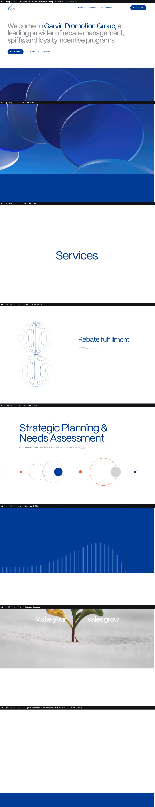
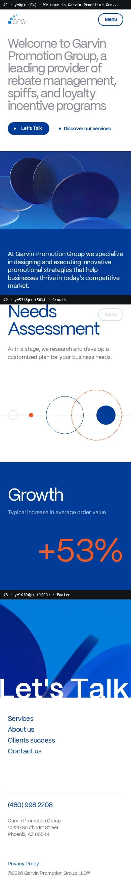

# UI Design System & Master Generation Blueprint: gpg-dops-agency

> **Garvinpromo** (https://gpg.dops.agency/) — Welcome to Garvin Promotion Group, a leading provider of rebate management, spiffs, and loyalty incentive programs





---

## 1. Executive Visual Persona & Design Archetype

- **Brand Essence & Persona**: **Garvinpromo** (`https://gpg.dops.agency/`). Welcome to Garvin Promotion Group, a leading provider of rebate management, spiffs, and loyalty incentive programs
- **Capture Provenance**: Live browser capture (`tier1_fast`, HTTP `200`, captured `2026-11-24`).
- **Visual Archetype**: **Light-Substrate Editorial & Modular Grid System (`#ffffff` canvas, `#003c97` ink, `#7fa1d5` accent)**.
- **Anti-AI-Slop Differentiators**:
  - **Live-Computed Chromatic Polarity**: Anchors the viewport in `#ffffff` (live computed `body` `background-color` (`computed_styles.json`)) paired with `#003c97` primary typography and `#7fa1d5` accents.
  - **Grounded Typographic Hierarchy**: Uses `PPMori` across display (`Welcome to Garvin Promotion Group, a`) and body copy.
  - **Calibrated Spatial Grid & Motion**: Combines `1181px` container bounds (`gap: 13px`, padding `30px`) with `cubic-bezier(.37,0,.63,1)` easing and Lenis Smooth Scroll (`data-lenis`), Lottie Vector Animation Player.

---

## 2. Spatial Architecture & Modular Grid Mathematics

### Viewport Allocation & Container Geometry
- **Captured Journey Filmstrips**: Desktop `1280×6624px` (`assets/desktop-journey.webp`, `8` keyframes up to `y=14400px` / doc `18850px`), Mobile `390×2616px` (`assets/mobile-journey.webp`, `3` keyframes).
- **Master Container Bounds**: `1181px` (measured widest bounded `<section>` landmark width on `1440px` desktop).
- **Canvas Lateral Padding & Spacing**: `30px` lateral canvas padding with `13px` grid gap.
- **Border Radius Scale**: `90px`, `50%`, `4px`, `35px`.

### Responsive Breakpoint Architecture
- **Desktop Layout**: Multi-column CSS Grid / Flexbox layout at `1440px` (`max-width: 1181px`, `gap: 13px`).
- **Mobile Layout**: Single-column vertical stack at `390px` viewport width with `30px` horizontal padding.
- **Extracted CSS Media Queries**: `@media screen and (min-width:1025px)`, `@media screen and (max-width:1850px)`, `@media (max-width:1024px)`, `@media screen and (max-width:960px)`.

---

## 3. Color System, Materiality & Atmospheric Lighting

### Semantic Palette & Source Grounding
| Semantic Role | Ground-Truth Value | Extracted Live / CSS Source |
|---|---|---|
| **Primary Canvas Substrate** | `#ffffff` | live computed `body` `background-color` (`computed_styles.json`) |
| **Primary Typography Ink** | `#003c97` | live computed `a` `color` (`computed_styles.json`) |
| **Elevated Surface / Card Substrate** | `#b0c8eb` | `:before { background-color: #b0c8eb }` |
| **Interactive Accent / Highlight** | `#7fa1d5` | `.btn--point__c { background-color: #7fa1d5 }` |
| **Secondary / Muted Copy** | `#898995` | live computed `h1` `color` (`computed_styles.json`) |
| **Structural Hairline Border** | `#7fa1d5` | `:before { border: #7fa1d5 }` |
| **Variable Token (`--vc-clr-primary`)** | `#000000` | `var(--vc-clr-primary)` in `:root` |
| **Variable Token (`--vc-clr-secondary`)** | `#090f20` | `var(--vc-clr-secondary)` in `:root` |

### Sanitized Root CSS Variables (`ui-ux.md` Ground Truth)
| Variable Name | Extracted Value | Semantic Role |
|---|---|---|
| `--vc-clr-primary` | `#000` | Brand / Palette Token |
| `--vc-clr-secondary` | `#090f207f` | Brand / Palette Token |
| `--vc-clr-white` | `#fff` | Canvas / Surface Token |
| `--vc-icn-width` | `1.2em` | Layout / Spatial Grid Token |
| `--vc-nav-width` | `30px` | Layout / Spatial Grid Token |
| `--vc-nav-height` | `30px` | Layout / Spatial Grid Token |
| `--vc-nav-border-radius` | `0` | Layout / Spatial Grid Token |
| `--vc-nav-color` | `var(--vc-clr-primary)` | Brand / Palette Token |
| `--vc-nav-color-hover` | `var(--vc-clr-secondary)` | Brand / Palette Token |
| `--vc-nav-background` | `transparent` | Canvas / Surface Token |
| `--vc-pgn-width` | `12px` | Layout / Spatial Grid Token |
| `--vc-pgn-height` | `4px` | Layout / Spatial Grid Token |
| `--vc-pgn-margin` | `4px` | Layout / Spatial Grid Token |
| `--vc-pgn-border-radius` | `0` | Elevation / Border Token |
| `--vc-pgn-background-color` | `var(--vc-clr-secondary)` | Canvas / Surface Token |
| `--vc-pgn-active-color` | `var(--vc-clr-primary)` | Brand / Palette Token |

---

## 4. Typographic Scale & Editorial Hierarchy

### Font Family Stacks
- **Display Typography**: `PPMori`.
- **Primary Body Stack**: `PPMori`.
- **Technical / Metadata Stack**: not declared in live computed styles (uses primary stack / `ui-monospace`).

### Typographic Scale & Rules (Live Computed & Stylesheet Grounded)
- **Hero Display (`H1`)**: live computed `h1` (`font-size: 64px`, `line-height: 65.28px`, `font-weight: 400`, `letter-spacing: -3.2px`).
- **Section Heading (`H2`)**: live computed `h2` (`font-size: 96px`, `line-height: 94.08px`, `font-weight: 400`, `letter-spacing: -4.8px`).
- **Body Copy**: live computed `body` (`font-size: 22px`, `line-height: 22px`, `font-weight: 400`).
- **Metadata & Navigation Labels**: live computed `nav/a` (`font-size: 22px`, `line-height: 22px`, `font-weight: 400`).

---

## 5. Choreographed Motion & Interaction Physics

### Primary Easing Curves
- **Extracted Timing Functions**: `cubic-bezier(.37,0,.63,1)`, `cubic-bezier(.22,1,.36,1)`, `cubic-bezier(.16,1,.3,1)`.

### Per-Element Transition & Choreography Rules
- **Selector `media screen and (min-width:1025px)`**: `transition: opacity .4s` extracted from `gpg-dops-agency` stylesheet.
- **Selector `img.lazy-load[data-v-db3a31aa]`**: `transition: filter .3s,opacity .3s` extracted from `gpg-dops-agency` stylesheet.
- **Selector `.btn[data-v-db37a4ce]`**: `transition: opacity .4s` extracted from `gpg-dops-agency` stylesheet.
- **Extracted Easing Curve (`cubic-bezier(.37,0,.63,1)`)**: Governs interactive state transitions across `<header.header>` and `<section.carousel:nth(2)>`.
- **Runtime Interaction Engine**: Integrates Lenis Smooth Scroll (`data-lenis`), Lottie Vector Animation Player with `prefers-reduced-motion: reduce` fallback guards.
### Measured Runtime Scroll & Interaction Telemetry (`behavioral_journey_v2`)
- **Scroll Driver Mode**: `native` (max document height `18850px`, deepest scrollY reached `14400px` across `8` desktop keyframes).
- **Detected Scroll / Motion Libraries**: `Lenis`, `GSAP/ScrollTrigger`.
- **Hover Physics (`primary_cta` · `Services Services`)**: Computed transition `0s` / `ease` (no static color/transform shift captured at rest).
- **Route Transition Architecture**: First internal navigation (`/services`) measured as `SPA` in `3382ms`.

---

## 6. Component Wireframe & Structural DOM Map

### Visual Layout Schematic — Desktop (`1440px`, Grounded in `dom.html` & Landmark Bounding Boxes)
```
┌────────────────────────────────────────────────────────────────────────┐
│ DESKTOP VIEWPORT (1440px) — Garvinpromo                                │
│ ====================================================================== │
│ [ <header.header> (1430x79px)         | Services Services · About us ] │
│ ---------------------------------------------------------------------- │
│ | HERO STAGE: <section.carousel> (w=1440px)                          | │
│ | H1: Welcome to Garvin Promotion Group, a leading prov...           | │
│ | Substrate: #ffffff | Ink: #003c97 | Accent: #7fa1d5                | │
│ ---------------------------------------------------------------------- │
│ | SHOWCASE GRID (<section.carousel:nth(2)>) max-w: 1181px            | │
│ | +------------------------------+  +------------------------------+ | │
│ | | Garvin Promotion Group       |  | Clients success Clients succ | | │
│ | +------------------------------+  +------------------------------+ | │
│ ---------------------------------------------------------------------- │
│ | DETAIL MODULE (<section.preloader--initia) — Garvin Promotion Grou | │
│ ---------------------------------------------------------------------- │
│ [ FOOTER (<footer.footer>     ) | https://gpg.dops.agency/             │
└────────────────────────────────────────────────────────────────────────┘
```

### Visual Layout Schematic — Mobile Reflow (`390px`)
```
┌────────────────────────────────────────────────────────────────────────┐
│ MOBILE VIEWPORT REFLOW (390px) — Single-Column Stack (gap: 13px)       │
│ ====================================================================== │
│ [ HEADER BAR (<header.header>         ) | Compact Menu (390px)         │
│ ---------------------------------------------------------------------- │
│ | HERO STAGE (<section.carousel>) — 390px Vertical Lead              | │
│ | H1: Welcome to Garvin Promotion Group, a leading prov...           | │
│ ---------------------------------------------------------------------- │
│ | SHOWCASE STACK (<section.carousel:nth() — 1-Col Stack              | │
│ | [ Item 1: Garvin Promotion Group                                 ] | │
│ | [ Item 2: Clients success Clients success                        ] | │
│ ---------------------------------------------------------------------- │
│ | DETAIL STACK (<section.preloader--init) — 1-Col (Garvin Promotion G) │
│ ---------------------------------------------------------------------- │
│ [ FOOTER (<footer.footer>     ) | Stacked 390px Colophon               │
└────────────────────────────────────────────────────────────────────────┘
```

### Granular DOM Region Breakdown
1. **Brand Header & Navigation Bar (<header.header> — `gpg-dops-agency`)**:
   - Landmark `<header class="header header--light">` (`1430x79px`) hosting `Garvinpromo` navigation (`Services Services · About us About us · Let's Talk`), DOM attributes (`data-v-537c3597`, `data-v-5f87b270`, `data-v-05812e15`, `data-v-f8de3fbd`), and stylesheet rule `svg { display:block;height:100%;width:100% }`.
2. **Hero Stage & Focal Lead (<section.carousel> — `Welcome to Garvin Promotion Group,`)**:
   - Landmark `<section class="carousel home-strategic__carousel">` presenting display lead `Welcome to Garvin Promotion Group, a leading prov...` and copy excerpt *"Garvin Promotion Group"* over `#ffffff` canvas and `#003c97` ink.
3. **Primary Showcase & Content Grid (<section.carousel:nth(2)> — `Garvin Promotion Group`)**:
   - Landmark `<section class="carousel">` rendering section `Garvin Promotion Group` with copy *"Clients success Clients success"*, asset references (`garvinpromo.com`, `favicon.ico`, `favicon-16x16.png`, `favicon-32x32.png`), and grid rule `ellipse { animation:circle-5f87b270 1.8s ease infinite }`.
4. **Interactive Detail & Feature Matrix (<section.preloader--initial> — `Clients success Clients success`)**:
   - Landmark `<section class="preloader--initial">` framing `Clients success Clients success` and `Garvin Promotion Group 10220 South 51st Street P` (*"Garvin Promotion Group 10220 South 51st Street Phoenix, AZ 85044"*) with `#b0c8eb` surface cards, `#7fa1d5` accents, and `ellipse:first-child { animation-delay:.12s!important }`.
5. **Colophon & Global Directory Footer (<footer.footer> — `https://gpg.dops.agency/`)**:
   - Landmark `<footer class="footer bg-dark">` anchoring `Garvinpromo` footer links (`Services Services · About us About us · Let's Talk`), copy *"Welcome to Garvin Promotion Group, a leading provider of reb"*, and `#7fa1d5` structural dividers.
### Full Vertical Scroll Sequence (Desktop `1440×900` Keyframes)
- **Step 01** (`y=0px`, `0%`): Active landmark `Welcome to Garvin Promotion Group, a leading prov...` · sticky/fixed elements: `1`
- **Step 02** (`y=850px`, `5%`): Active landmark `Section @ 5%` · sticky/fixed elements: `0`
- **Step 03** (`y=3400px`, `21%`): Active landmark `Section @ 21%` · sticky/fixed elements: `1`
- **Step 04** (`y=5100px`, `31%`): Active landmark `Rebate fulfillment` · sticky/fixed elements: `1`
- **Step 05** (`y=8500px`, `52%`): Active landmark `Section @ 52%` · sticky/fixed elements: `1`
- **Step 06** (`y=11050px`, `68%`): Active landmark `Section @ 68%` · sticky/fixed elements: `0`
- **Step 07** (`y=13600px`, `76%`): Active landmark `Clients Success` · sticky/fixed elements: `0`
- **Step 08** (`y=14400px`, `80%`): Active landmark `Liquor Importer Runs Consumer Rebate with Charity...` · sticky/fixed elements: `0`

### Multi-Page Internal Route Map
- **Listing Route (`/services`)**: `https://gpg.dops.agency/services` — H1: `Our Services`, scrollHeight `12248px`, transition `SPA` (`3382ms`)
- **Detail Route (`/clients-success/liquor-importer-runs-consumer-rebate-with-charity-component-1`)**: `https://gpg.dops.agency/clients-success/liquor-importer-runs-consumer-rebate-with-charity-component-1` — H1: `Liquor Importer Runs Consumer Rebate with Charity...`, scrollHeight `8112px`, transition `direct` (`842ms`)
- **About Route (`/about-us`)**: `https://gpg.dops.agency/about-us` — H1: `About us`, scrollHeight `7721px`, transition `direct` (`600ms`)

---

## 7. Master Zero-Shot AI Generation Prompt

```markdown
# Master Zero-Shot Frontend Generation Prompt: gpg-dops-agency (Garvinpromo)

You are a principal frontend architect and design systems engineer. Build a complete, production-ready web application replicating the exact design system, DOM landmarks, typographic hierarchy, color tokens, and motion physics of `gpg-dops-agency` (**Garvinpromo** — `https://gpg.dops.agency/`).

### 1. Visual Archetype & Anti-AI-Slop Mandates
- **Archetype**: Light-Substrate Editorial & Modular Grid System (`#ffffff` canvas, `#003c97` ink, `#7fa1d5` accent).
- **Identity & Domain Context**: Welcome to Garvin Promotion Group, a leading provider of rebate management, spiffs, and loyalty incentive programs
- **Primary Substrate**: `#ffffff` (live computed `body` `background-color` (`computed_styles.json`)), **Primary Ink**: `#003c97`, **Accent / Highlight**: `#7fa1d5`.
- **Site-Specific Differentiators**:
  - **Live-Computed Chromatic Polarity**: Anchors the viewport in `#ffffff` (live computed `body` `background-color` (`computed_styles.json`)) paired with `#003c97` primary typography and `#7fa1d5` accents.
  - **Grounded Typographic Hierarchy**: Uses `PPMori` across display (`Welcome to Garvin Promotion Group, a`) and body copy.
  - **Calibrated Spatial Grid & Motion**: Combines `1181px` container bounds (`gap: 13px`, padding `30px`) with `cubic-bezier(.37,0,.63,1)` easing and Lenis Smooth Scroll (`data-lenis`), Lottie Vector Animation Player.

### 2. Ground-Truth CSS Variables (`:root` Token Contract)
Declare and consume these exact custom properties extracted from `gpg-dops-agency` in your global stylesheet:

:root {
  /* Garvinpromo (gpg-dops-agency) — Live-Grounded CSS Variables */
  --vc-clr-primary: #000; /* Brand / Palette Token (gpg-dops-agency) */
  --vc-clr-secondary: #090f207f; /* Brand / Palette Token (gpg-dops-agency) */
  --vc-clr-white: #fff; /* Canvas / Surface Token (gpg-dops-agency) */
  --vc-icn-width: 1.2em; /* Layout / Spatial Grid Token (gpg-dops-agency) */
  --vc-nav-width: 30px; /* Layout / Spatial Grid Token (gpg-dops-agency) */
  --vc-nav-height: 30px; /* Layout / Spatial Grid Token (gpg-dops-agency) */
  --vc-nav-border-radius: 0; /* Layout / Spatial Grid Token (gpg-dops-agency) */
  --vc-nav-color: var(--vc-clr-primary); /* Brand / Palette Token (gpg-dops-agency) */
  --vc-nav-color-hover: var(--vc-clr-secondary); /* Brand / Palette Token (gpg-dops-agency) */
  --vc-nav-background: transparent; /* Canvas / Surface Token (gpg-dops-agency) */
  --vc-pgn-width: 12px; /* Layout / Spatial Grid Token (gpg-dops-agency) */
  --vc-pgn-height: 4px; /* Layout / Spatial Grid Token (gpg-dops-agency) */
  --vc-pgn-margin: 4px; /* Layout / Spatial Grid Token (gpg-dops-agency) */
  --vc-pgn-border-radius: 0; /* Elevation / Border Token (gpg-dops-agency) */
  --vc-pgn-background-color: var(--vc-clr-secondary); /* Canvas / Surface Token (gpg-dops-agency) */
  --vc-pgn-active-color: var(--vc-clr-primary); /* Brand / Palette Token (gpg-dops-agency) */
}

### 3. Semantic Color & Materiality Contract
Map every surface, ink, and border strictly to these source-grounded tokens:
- **Primary Canvas Substrate**: `#ffffff` — grounded in live computed `body` `background-color` (`computed_styles.json`)
- **Primary Typography Ink**: `#003c97` — grounded in live computed `a` `color` (`computed_styles.json`)
- **Elevated Surface / Card Substrate**: `#b0c8eb` — grounded in `:before { background-color: #b0c8eb }`
- **Interactive Accent / Highlight**: `#7fa1d5` — grounded in `.btn--point__c { background-color: #7fa1d5 }`
- **Secondary / Muted Copy**: `#898995` — grounded in live computed `h1` `color` (`computed_styles.json`)
- **Structural Hairline Border**: `#7fa1d5` — grounded in `:before { border: #7fa1d5 }`
- **Variable Token (`--vc-clr-primary`)**: `#000000` — grounded in `var(--vc-clr-primary)` in `:root`
- **Variable Token (`--vc-clr-secondary`)**: `#090f20` — grounded in `var(--vc-clr-secondary)` in `:root`

### 4. Spatial Grid, Container Bounds & Responsive Breakpoints
- **Desktop Viewport Reference**: `1280×6624px` (multi-frame vertical journey filmstrip (6624px), `1440px` standard desktop width).
- **Mobile Viewport Reference**: `390×2616px` (multi-frame vertical journey filmstrip (2616px), `390px` standard mobile width).
- **Container Max-Width**: `1181px` (measured widest bounded `<section>` landmark width on `1440px` desktop)
- **Padding & Gutters**: `30px` lateral canvas padding with `13px` grid gap
- **Desktop Grid**: Multi-column CSS Grid / Flexbox layout at `1440px` (`max-width: 1181px`, `gap: 13px`)
- **Mobile Adaptation**: Single-column vertical stack at `390px` viewport width with `30px` horizontal padding
- **Media Queries**: `@media screen and (min-width:1025px)`, `@media screen and (max-width:1850px)`, `@media (max-width:1024px)`, `@media screen and (max-width:960px)`
- **Corner Radii**: `90px`, `50%`, `4px`, `35px`

### 5. Typography & Editorial Scale Contract
- **Display Font Stack**: `PPMori`
- **Body Font Stack**: `PPMori`
- **Monospace / Technical Font Stack**: not declared in live computed styles (uses primary stack / `ui-monospace`)
- **H1 Display Rule**: live computed `h1` (`font-size: 64px`, `line-height: 65.28px`, `font-weight: 400`, `letter-spacing: -3.2px`)
- **H2 Section Rule**: live computed `h2` (`font-size: 96px`, `line-height: 94.08px`, `font-weight: 400`, `letter-spacing: -4.8px`)
- **Body Copy Rule**: live computed `body` (`font-size: 22px`, `line-height: 22px`, `font-weight: 400`)
- **Metadata & Index Rule**: live computed `nav/a` (`font-size: 22px`, `line-height: 22px`, `font-weight: 400`)

### 6. Component Hierarchy, Verbatim Copy & Real DOM Landmarks
Scaffold `gpg-dops-agency` (`Garvinpromo`) with these exact structural regions, extracted copy, and CSS rules from `dom.html`:
1. **Brand Header & Navigation Bar (<header.header> — `gpg-dops-agency`)**:
   - DOM & Selectors: Landmark `<header class="header header--light">` (`1430x79px`) hosting `Garvinpromo` navigation (`Services Services · About us About us · Let's Talk`), DOM attributes (`data-v-537c3597`, `data-v-5f87b270`, `data-v-05812e15`, `data-v-f8de3fbd`), and stylesheet rule `svg { display:block;height:100%;width:100% }`.
   - Responsive Contract: Header `Brand Header & Navigation Bar (<header.header> — `gpg-dops-agency`)` (`gpg-dops-agency`) adapts across `@media screen and (min-width:1025px)`, `@media screen and (max-width:1850px)`, `@media (max-width:1024px)`, `@media screen and (max-width:960px)` with `cubic-bezier(.37,0,.63,1)`, `cubic-bezier(.22,1,.36,1)`, `cubic-bezier(.16,1,.3,1)` transitions and links `Services Services · About us About us · Let's Talk`.
2. **Hero Stage & Focal Lead (<section.carousel> — `Welcome to Garvin Promotion Group,`)**:
   - DOM & Selectors: Landmark `<section class="carousel home-strategic__carousel">` presenting display lead `Welcome to Garvin Promotion Group, a leading prov...` and copy excerpt *"Garvin Promotion Group"* over `#ffffff` canvas and `#003c97` ink.
   - Responsive Contract: Hero stage (`1280×6624px` desktop / `390×2616px` mobile) sets `#ffffff` background with `#003c97` headline `Welcome to Garvin Promotion Group, a leading prov...`.
3. **Primary Showcase & Content Grid (<section.carousel:nth(2)> — `Garvin Promotion Group`)**:
   - DOM & Selectors: Landmark `<section class="carousel">` rendering section `Garvin Promotion Group` with copy *"Clients success Clients success"*, asset references (`garvinpromo.com`, `favicon.ico`, `favicon-16x16.png`, `favicon-32x32.png`), and grid rule `ellipse { animation:circle-5f87b270 1.8s ease infinite }`.
   - Responsive Contract: Showcase grid `Primary Showcase & Content Grid (<section.carousel:nth(2)> — `Garvin Promotion Group`)` applies Multi-column CSS Grid / Flexbox layout at `1440px` (`max-width: 1181px`, `gap: 13px`) on desktop and Single-column vertical stack at `390px` viewport width with `30px` horizontal padding on mobile.
4. **Interactive Detail & Feature Matrix (<section.preloader--initial> — `Clients success Clients success`)**:
   - DOM & Selectors: Landmark `<section class="preloader--initial">` framing `Clients success Clients success` and `Garvin Promotion Group 10220 South 51st Street P` (*"Garvin Promotion Group 10220 South 51st Street Phoenix, AZ 85044"*) with `#b0c8eb` surface cards, `#7fa1d5` accents, and `ellipse:first-child { animation-delay:.12s!important }`.
   - Responsive Contract: Detail module `Interactive Detail & Feature Matrix (<section.preloader--initial> — `Clients success Clients success`)` uses `90px`, `50%`, `4px`, `35px` radii, `#7fa1d5` highlights, and assets (garvinpromo.com, favicon.ico, favicon-16x16.png).
5. **Colophon & Global Directory Footer (<footer.footer> — `https://gpg.dops.agency/`)**:
   - DOM & Selectors: Landmark `<footer class="footer bg-dark">` anchoring `Garvinpromo` footer links (`Services Services · About us About us · Let's Talk`), copy *"Welcome to Garvin Promotion Group, a leading provider of reb"*, and `#7fa1d5` structural dividers.
   - Responsive Contract: Footer `Colophon & Global Directory Footer (<footer.footer> — `https://gpg.dops.agency/`)` aligns to `1181px` (measured widest bounded `<section>` landmark width on `1440px` desktop) with `30px` lateral canvas padding with `13px` grid gap and attributes (data-v-537c3597, data-v-5f87b270, data-v-05812e15).

#### Verbatim DOM Copy Excerpts (`dom.html`)
- Copy Excerpt 1: *"Garvin Promotion Group"*
- Copy Excerpt 2: *"Clients success Clients success"*
- Copy Excerpt 3: *"Garvin Promotion Group 10220 South 51st Street Phoenix, AZ 85044"*
- Copy Excerpt 4: *"Welcome to Garvin Promotion Group, a leading provider of rebate management, spiffs..."*

### 7. Motion, Extracted Stylesheet Rules & Interaction Choreography
- **Primary Easing Functions**: `cubic-bezier(.37,0,.63,1)`, `cubic-bezier(.22,1,.36,1)`, `cubic-bezier(.16,1,.3,1)`
- **Extracted Stylesheet Rules (`gpg-dops-agency`)**:
- `svg { display:block;height:100%;width:100% }`
- `ellipse { animation:circle-5f87b270 1.8s ease infinite }`
- `ellipse:first-child { animation-delay:.12s!important }`
- `hover ellipse { animation:circle-5f87b270 1s ease infinite forwards;animation-iteration-... }`
- `before { content:"";display:block;height:100%;position:absolute;top:0;width:100% }`
- **Per-Selector Transition Rules**:
- **Selector `media screen and (min-width:1025px)`**: `transition: opacity .4s` extracted from `gpg-dops-agency` stylesheet.
- **Selector `img.lazy-load[data-v-db3a31aa]`**: `transition: filter .3s,opacity .3s` extracted from `gpg-dops-agency` stylesheet.
- **Selector `.btn[data-v-db37a4ce]`**: `transition: opacity .4s` extracted from `gpg-dops-agency` stylesheet.
- **Extracted Easing Curve (`cubic-bezier(.37,0,.63,1)`)**: Governs interactive state transitions across `<header.header>` and `<section.carousel:nth(2)>`.
- **Runtime Interaction Engine**: Integrates Lenis Smooth Scroll (`data-lenis`), Lottie Vector Animation Player with `prefers-reduced-motion: reduce` fallback guards.
### 7b. Full-Page Scroll Choreography, Interactive States & Multi-Page Routes
- **Scroll Mechanics**: Implement `native` vertical progression up to `18850px` across 8 distinct viewport chapters using Lenis, GSAP/ScrollTrigger.
- **Vertical Chapter Sequence**: Welcome to Garvin Promotion... (0%) -> Section @ 5% (5%) -> Section @ 21% (21%) -> Rebate fulfillment (31%) -> Section @ 52% (52%) -> Section @ 68% (68%) -> Clients Success (76%) -> Liquor Importer Runs Consum... (80%).
- **Multi-Page Routes**: Scaffold internal routes `/services` (listing, SPA), `/clients-success/liquor-importer-runs-consumer-rebate-with-charity-component-1` (detail, direct), `/about-us` (about, direct) sharing the global header/footer shell and design tokens.

### 8. Technical Deliverables
- Implement in Next.js (App Router) with TypeScript and Tailwind CSS consuming the `:root` custom properties defined above for `gpg-dops-agency`.
- Reproduce both the `1440px` desktop architecture and `390px` mobile breakpoint transitions, preserving semantic HTML5 landmarks (`<header>`, `<nav>`, `<main>`, `<section>`, `<footer>`) and `prefers-reduced-motion` accessibility guards.
```
---

## 8. Full-Page Scroll Journey, Interactive States & Subpage Inventory

### Desktop Scroll Keyframes (`1440×900` WebP)
| Step | Scroll Y | Progress | Active Landmark / Section | Sticky/Fixed | Visual Asset |
| :---: | :---: | :---: | :--- | :---: | :--- |
| `#01` | `0px` | `0%` | Welcome to Garvin Promotion Group, a leading... | `1` | [desktop-step-01.webp](assets/desktop-step-01.webp) |
| `#02` | `850px` | `5%` | Section @ 5% | `0` | [desktop-step-02.webp](assets/desktop-step-02.webp) |
| `#03` | `3400px` | `21%` | Section @ 21% | `1` | [desktop-step-03.webp](assets/desktop-step-03.webp) |
| `#04` | `5100px` | `31%` | Rebate fulfillment | `1` | [desktop-step-04.webp](assets/desktop-step-04.webp) |
| `#05` | `8500px` | `52%` | Section @ 52% | `1` | [desktop-step-05.webp](assets/desktop-step-05.webp) |
| `#06` | `11050px` | `68%` | Section @ 68% | `0` | [desktop-step-06.webp](assets/desktop-step-06.webp) |
| `#07` | `13600px` | `76%` | Clients Success | `0` | [desktop-step-07.webp](assets/desktop-step-07.webp) |
| `#08` | `14400px` | `80%` | Liquor Importer Runs Consumer Rebate with Cha... | `0` | [desktop-step-08.webp](assets/desktop-step-08.webp) |

### Mobile Condensed Keyframes (`390×844` WebP)
| Step | Scroll Y | Progress | Active Landmark | Visual Asset |
| :---: | :---: | :---: | :--- | :--- |
| `#01` | `0px` | `0%` | Welcome to Garvin Promotion Group, a lead... | [mobile-step-01.webp](assets/mobile-step-01.webp) |
| `#02` | `5348px` | `50%` | Growth | [mobile-step-02.webp](assets/mobile-step-02.webp) |
| `#03` | `10696px` | `100%` | Footer | [mobile-step-03.webp](assets/mobile-step-03.webp) |

### Internal Subpage Filmstrips (`1080px` Wide WebP)
| # | Template | Route URL | H1 / Title | Scroll Height | Transition | Filmstrip Asset |
| :-: | :---: | :--- | :--- | :---: | :---: | :--- |
| `1` | `listing` | `https://gpg.dops.agency/services` | Our Services | `12248px` | `SPA` (`3382ms`) | [subpage-01-services.webp](assets/subpage-01-services.webp) |
| `2` | `detail` | `https://gpg.dops.agency/clients-success/liquor-importer-runs-consumer-rebate-with-charity-component-1` | Liquor Importer Runs Consumer Rebate... | `8112px` | `direct` (`842ms`) | [subpage-02-clients-success-liquor-importer-runs.webp](assets/subpage-02-clients-success-liquor-importer-runs.webp) |
| `3` | `about` | `https://gpg.dops.agency/about-us` | About us | `7721px` | `direct` (`600ms`) | [subpage-03-about-us.webp](assets/subpage-03-about-us.webp) |

