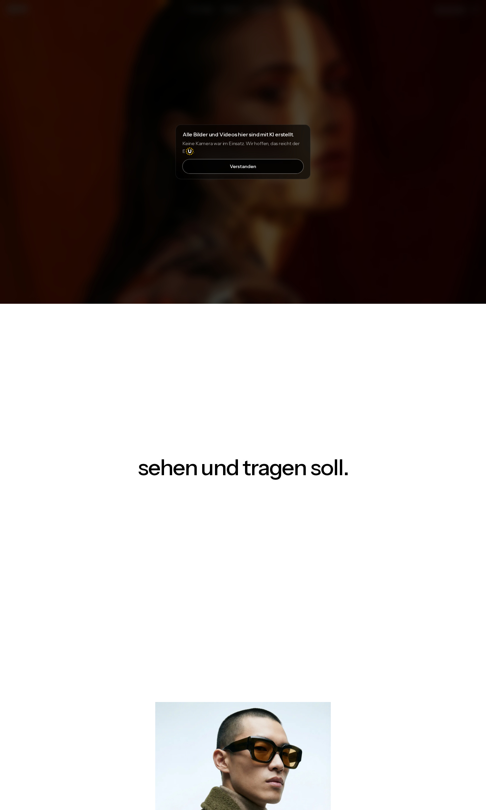
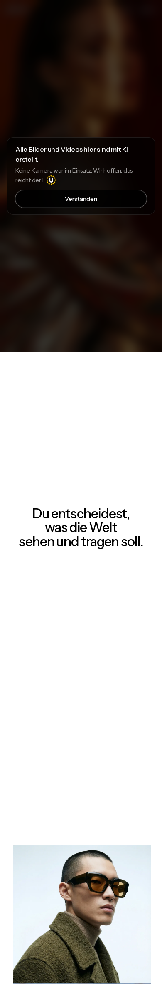

# UI Design System & Master Generation Blueprint: gracefashion-ai

> **KI-Fotostudio für Mode: Bilder ohne Shooting · grace ai** (https://gracefashion.ai) — KI-Modefotografie aus deinen eigenen Teilen: On-Model-Bilder, Kampagnen und Videos. Als Software oder als Service, rund 80 Prozent unter...



---

## 1. Executive Visual Persona & Design Archetype

- **Brand Essence & Persona**: **KI-Fotostudio für Mode: Bilder ohne Shooting · grace ai** (`https://gracefashion.ai`). KI-Modefotografie aus deinen eigenen Teilen: On-Model-Bilder, Kampagnen und Videos. Als Software oder als Service, rund 80 Prozent unter...
- **Capture Provenance**: Live browser capture (`tier1_fast`, HTTP `200`, captured `2026-11-23`).
- **Visual Archetype**: **Light-Substrate Editorial & Modular Grid System (`#ffffff` canvas, `#000000` ink, `#9ca3af` accent)**.
- **Anti-AI-Slop Differentiators**:
  - **Live-Computed Chromatic Polarity**: Anchors the viewport in `#ffffff` (live computed `body` `background-color` (`computed_styles.json`)) paired with `#000000` primary typography and `#9ca3af` accents.
  - **Grounded Typographic Hierarchy**: Pairs `Instrument Sans` for display copy (`KI-Fotostudio für Modemarken: Softwa`) with `Instrument Sans` and `SFMono-Regular`.
  - **Calibrated Spatial Grid & Motion**: Combines `1536px` container bounds (`gap: .125rem`, padding `.25rem`) with `cubic-bezier(.4,0,.6,1)` easing.

---

## 2. Spatial Architecture & Modular Grid Mathematics



### Viewport Allocation & Container Geometry
- **Captured Viewport Dimensions**: Desktop `1440×2400px` (`assets/desktop.png`, clamped at 2400px live multi-section capture), Mobile `390×2400px` (`assets/mobile.png`, clamped at 2400px live multi-section capture).
- **Master Container Bounds**: `1536px` (non-`@media` desktop container stylesheet rule).
- **Canvas Lateral Padding & Spacing**: `.25rem` lateral canvas padding with `.125rem` grid gap.
- **Border Radius Scale**: `.25rem`, `1rem`, `10px`, `22%`.

### Responsive Breakpoint Architecture
- **Desktop Layout**: Multi-column CSS Grid / Flexbox layout at `1440px` (`max-width: 1536px`, `gap: .125rem`).
- **Mobile Layout**: Single-column vertical stack at `390px` viewport width with `.25rem` horizontal padding.
- **Extracted CSS Media Queries**: `@media (min-width:640px)`, `@media (min-width:768px)`, `@media (min-width:1024px)`, `@media (min-width:1280px)`.

---

## 3. Color System, Materiality & Atmospheric Lighting

### Semantic Palette & Source Grounding
| Semantic Role | Ground-Truth Value | Extracted Live / CSS Source |
|---|---|---|
| **Primary Canvas Substrate** | `#ffffff` | live computed `body` `background-color` (`computed_styles.json`) |
| **Primary Typography Ink** | `#000000` | live computed `h1` `color` (`computed_styles.json`) |
| **Elevated Surface / Card Substrate** | `#737373` | `.blog-content ul li:before { background: #737373 }` |
| **Interactive Accent / Highlight** | `#9ca3af` | `textarea::-moz-placeholder { color: #9ca3af }` |
| **Secondary / Muted Copy** | `#737373` | `.blog-content ol li::marker { color: #737373 }` |
| **Structural Hairline Border** | `#fba9a3` | `60 { border-color: #fba9a3 }` |
| **Variable Token (`--color-cool-gray`)** | `#808285` | `var(--color-cool-gray)` in `:root` |
| **Variable Token (`--color-light-gray`)** | `#d1d3d4` | `var(--color-light-gray)` in `:root` |
| **Variable Token (`--color-warm-gray`)** | `#a7a9ac` | `var(--color-warm-gray)` in `:root` |

### Sanitized Root CSS Variables (`ui-ux.md` Ground Truth)
| Variable Name | Extracted Value | Semantic Role |
|---|---|---|
| `--color-black` | `#000` | Canvas / Surface Token |
| `--color-white` | `#fff` | Canvas / Surface Token |
| `--color-cool-gray` | `#808285` | Brand / Palette Token |
| `--color-light-gray` | `#d1d3d4` | Canvas / Surface Token |
| `--color-warm-gray` | `#a7a9ac` | Brand / Palette Token |
| `--font-sans` | `var(--font-instrument-sans), "Instrument Sans", sans-serif` | Typography / Scale Token |
| `--font-display` | `var(--font-sans)` | Typography / Scale Token |
| `--orbit-frame` | `min(21vh, 16vw, 290px)` | Dimension / Scale Token |
| `--font-instrument-sans` | `"Instrument Sans", "Instrument Sans Fallback"` | Typography / Scale Token |
| `--font-space-grotesk` | `"Space Grotesk", "Space Grotesk Fallback"` | Typography / Scale Token |
| `--ai-mark-w` | `70vw` | Dimension / Scale Token |
| `--tw-border-spacing-x` | `0` | Layout / Spatial Grid Token |
| `--tw-border-spacing-y` | `0` | Layout / Spatial Grid Token |
| `--tw-translate-x` | `0` | Design System Custom Token |
| `--gracefashion-ai-bg` | `#ffffff` | Canvas Substrate (from live computed `body` `background-color` (`computed_styles.json`)) |
| `--gracefashion-ai-ink` | `#000000` | Primary Typography Ink (computed-derived) |

---

## 4. Typographic Scale & Editorial Hierarchy

### Font Family Stacks
- **Display Typography**: `Instrument Sans`.
- **Primary Body Stack**: `Instrument Sans`.
- **Technical / Metadata Stack**: `SFMono-Regular`.

### Typographic Scale & Rules (Live Computed & Stylesheet Grounded)
- **Hero Display (`H1`)**: live computed `h1` (`font-size: 16px`, `line-height: 24px`, `font-weight: 400`); CSS variables `--font-display: var(--font-sans)`.
- **Section Heading (`H2`)**: live computed `h2` (`font-size: 66px`, `line-height: 69.3px`, `font-weight: 500`, `letter-spacing: -2.244px`); rule `h2` (`font-size: clamp(21px,16.62px + 1.124vw,...`, `line-height: 1.15`, `letter-spacing: -.026em`, `font-weight: 500`).
- **Body Copy**: live computed `body` (`font-size: 16px`, `line-height: 24px`, `font-weight: 400`); rule `p` (`font-size: 18px`, `line-height: 1.5`, `letter-spacing: -.011em`, `font-weight: 400`).
- **Metadata & Navigation Labels**: live computed `nav/a` (`font-size: 16px`, `line-height: 24px`, `font-weight: 400`).

---

## 5. Choreographed Motion & Interaction Physics

### Primary Easing Curves
- **Extracted Timing Functions**: `cubic-bezier(.4,0,.6,1)`, `cubic-bezier(.4,0,.2,1)`, `cubic-bezier(.16,1,.3,1)`.

### Per-Element Transition & Choreography Rules
- **Selector `.transition`**: `transition: .15s` extracted from `gracefashion-ai` stylesheet.
- **Selector `.transition-\[fill\]`**: `transition: .15s` extracted from `gracefashion-ai` stylesheet.
- **Selector `.transition-\[filter\]`**: `transition: .15s` extracted from `gracefashion-ai` stylesheet.
- **Extracted Easing Curve (`cubic-bezier(.4,0,.6,1)`)**: Governs interactive state transitions across `<nav.top-0>` and `<section.bg-black>`.
- **State & Hover Choreography**: Opacity and transform transitions on `<section.page-surface>` and `<section.bg-black>` interactive targets.

---

## 6. Component Wireframe & Structural DOM Map

### Visual Layout Schematic — Desktop (`1440px`, Grounded in `dom.html` & Landmark Bounding Boxes)
```
┌────────────────────────────────────────────────────────────────────────┐
│ DESKTOP VIEWPORT (1440px) — KI-Fotostudio für Mode: Bilder ohne Shooti │
│ ====================================================================== │
│ [ <nav.top-0> (1440x56px)             | Software · Service · Ratgebe ] │
│ ---------------------------------------------------------------------- │
│ | HERO STAGE: <section.page-surface> (w=1440px)                      | │
│ | H1: KI-Fotostudio für Modemarken: Software und Servic...           | │
│ | Substrate: #ffffff | Ink: #000000 | Accent: #9ca3af                | │
│ ---------------------------------------------------------------------- │
│ | SHOWCASE GRID (<section.bg-black>) max-w: 1536px                   | │
│ | +------------------------------+  +------------------------------+ | │
│ | | Du entscheidest, was die Wel |  | sehen und tragen soll.       | | │
│ | +------------------------------+  +------------------------------+ | │
│ ---------------------------------------------------------------------- │
│ | DETAIL MODULE (<section.bg-neutral-900>) — Aus deinem Produkt wi   | │
│ ---------------------------------------------------------------------- │
│ [ FOOTER (<footer.relative>   ) | https://gracefashion.ai              │
└────────────────────────────────────────────────────────────────────────┘
```

### Visual Layout Schematic — Mobile Reflow (`390px`)
```
┌────────────────────────────────────────────────────────────────────────┐
│ MOBILE VIEWPORT REFLOW (390px) — Single-Column Stack (gap: .125rem)    │
│ ====================================================================== │
│ [ HEADER BAR (<nav.top-0>             ) | Compact Menu (390px)         │
│ ---------------------------------------------------------------------- │
│ | HERO STAGE (<section.page-surface>) — 390px Vertical Lead          | │
│ | H1: KI-Fotostudio für Modemarken: Software und Servic...           | │
│ ---------------------------------------------------------------------- │
│ | SHOWCASE STACK (<section.bg-black>) — 1-Col Stack                  | │
│ | [ Item 1: Du entscheidest, was die Welt sehen und tragen soll.   ] | │
│ | [ Item 2: sehen und tragen soll.                                 ] | │
│ ---------------------------------------------------------------------- │
│ | DETAIL STACK (<section.bg-neutral-900>) — 1-Col (Aus deinem Produkt) │
│ ---------------------------------------------------------------------- │
│ [ FOOTER (<footer.relative>   ) | Stacked 390px Colophon               │
└────────────────────────────────────────────────────────────────────────┘
```

### Granular DOM Region Breakdown
1. **Brand Header & Navigation Bar (<nav.top-0> — `gracefashion-ai`)**:
   - Landmark `<nav class="top-0 left-0">` (`1440x56px`) hosting `KI-Fotostudio für Mode: Bilder ohne ` navigation (`Software · Service · Ratgeber · Team · Demo buchen`), DOM attributes (`data-precedence="next"`, `data-sdkn="@vercel/analytics/react"`, `data-sdkv="2.0.1"`), and stylesheet rule `.vGn8MW_className { font-family:Instrument Sans,Instrument Sans Fallback;font-style:normal }`.
2. **Hero Stage & Focal Lead (<section.page-surface> — `KI-Fotostudio für Modemarken: Soft`)**:
   - Landmark `<section class="page-surface px-8">` presenting display lead `KI-Fotostudio für Modemarken: Software und Servic...` and copy excerpt *"Du entscheidest, was die Welt"* over `#ffffff` canvas and `#000000` ink.
3. **Primary Showcase & Content Grid (<section.bg-black> — `Du entscheidest, was die Welt sehe`)**:
   - Landmark `<section class="bg-black">` rendering section `Du entscheidest, was die Welt sehen und tragen soll.` with copy *"sehen und tragen soll."*, asset references (`237858b39a32779d-s.p.1ii7211jqpzi...`, `4cf231d25563e07b-s.p.3uuun_-7zsf1...`, `62f37606a5bd6f6f-s.p.3wn_q526zaol...`, `92b6de9cb55945e2-s.p.44ks8kcggj01...`), and grid rule `.vGn8MW_variable { --font-instrument-sans:"Instrument Sans", "Instrument Sans Fallback" }`.
4. **Interactive Detail & Feature Matrix (<section.bg-neutral-900> — `sehen und tragen soll.`)**:
   - Landmark `<section class="bg-neutral-900 relative">` framing `sehen und tragen soll.` and `Aus deinem Produkt wird ein ganzes Shooting. In ` (*"Aus deinem Produkt wird ein ganzes Shooting. In Minuten."*) with `#737373` surface cards, `#9ca3af` accents, and `.wdTYSa_className { font-family:Space Grotesk,Space Grotesk Fallback;font-style:normal }`.
5. **Colophon & Global Directory Footer (<footer.relative> — `https://gracefashion.ai`)**:
   - Landmark `<footer class="relative text-white">` anchoring `KI-Fotostudio für Mode: Bilder o` footer links (`Software · Service · Ratgeber · Team · Demo buchen`), copy *"Aus deinem Produkt"*, and `#fba9a3` structural dividers.

---

## 7. Master Zero-Shot AI Generation Prompt

```markdown
# Master Zero-Shot Frontend Generation Prompt: gracefashion-ai (KI-Fotostudio für Mode: Bilder ohne Shooting · grace ai)

You are a principal frontend architect and design systems engineer. Build a complete, production-ready web application replicating the exact design system, DOM landmarks, typographic hierarchy, color tokens, and motion physics of `gracefashion-ai` (**KI-Fotostudio für Mode: Bilder ohne Shooting · grace ai** — `https://gracefashion.ai`).

### 1. Visual Archetype & Anti-AI-Slop Mandates
- **Archetype**: Light-Substrate Editorial & Modular Grid System (`#ffffff` canvas, `#000000` ink, `#9ca3af` accent).
- **Identity & Domain Context**: KI-Modefotografie aus deinen eigenen Teilen: On-Model-Bilder, Kampagnen und Videos. Als Software oder als Service, rund 80 Prozent unter...
- **Primary Substrate**: `#ffffff` (live computed `body` `background-color` (`computed_styles.json`)), **Primary Ink**: `#000000`, **Accent / Highlight**: `#9ca3af`.
- **Site-Specific Differentiators**:
  - **Live-Computed Chromatic Polarity**: Anchors the viewport in `#ffffff` (live computed `body` `background-color` (`computed_styles.json`)) paired with `#000000` primary typography and `#9ca3af` accents.
  - **Grounded Typographic Hierarchy**: Pairs `Instrument Sans` for display copy (`KI-Fotostudio für Modemarken: Softwa`) with `Instrument Sans` and `SFMono-Regular`.
  - **Calibrated Spatial Grid & Motion**: Combines `1536px` container bounds (`gap: .125rem`, padding `.25rem`) with `cubic-bezier(.4,0,.6,1)` easing.

### 2. Ground-Truth CSS Variables (`:root` Token Contract)
Declare and consume these exact custom properties extracted from `gracefashion-ai` in your global stylesheet:

:root {
  /* KI-Fotostudio für Mode: Bilder ohne Shooting · grace ai (gracefashion-ai) — Live-Grounded CSS Variables */
  --color-black: #000; /* Canvas / Surface Token (gracefashion-ai) */
  --color-white: #fff; /* Canvas / Surface Token (gracefashion-ai) */
  --color-cool-gray: #808285; /* Brand / Palette Token (gracefashion-ai) */
  --color-light-gray: #d1d3d4; /* Canvas / Surface Token (gracefashion-ai) */
  --color-warm-gray: #a7a9ac; /* Brand / Palette Token (gracefashion-ai) */
  --font-sans: var(--font-instrument-sans), "Instrument Sans", sans-serif; /* Typography / Scale Token (gracefashion-ai) */
  --font-display: var(--font-sans); /* Typography / Scale Token (gracefashion-ai) */
  --orbit-frame: min(21vh, 16vw, 290px); /* Dimension / Scale Token (gracefashion-ai) */
  --font-instrument-sans: "Instrument Sans", "Instrument Sans Fallback"; /* Typography / Scale Token (gracefashion-ai) */
  --font-space-grotesk: "Space Grotesk", "Space Grotesk Fallback"; /* Typography / Scale Token (gracefashion-ai) */
  --ai-mark-w: 70vw; /* Dimension / Scale Token (gracefashion-ai) */
  --tw-border-spacing-x: 0; /* Layout / Spatial Grid Token (gracefashion-ai) */
  --tw-border-spacing-y: 0; /* Layout / Spatial Grid Token (gracefashion-ai) */
  --tw-translate-x: 0; /* Design System Custom Token (gracefashion-ai) */
  --gracefashion-ai-bg: #ffffff; /* Canvas Substrate (from live computed `body` `background-color` (`computed_styles.json`)) (gracefashion-ai) */
  --gracefashion-ai-ink: #000000; /* Primary Typography Ink (computed-derived) (gracefashion-ai) */
}

### 3. Semantic Color & Materiality Contract
Map every surface, ink, and border strictly to these source-grounded tokens:
- **Primary Canvas Substrate**: `#ffffff` — grounded in live computed `body` `background-color` (`computed_styles.json`)
- **Primary Typography Ink**: `#000000` — grounded in live computed `h1` `color` (`computed_styles.json`)
- **Elevated Surface / Card Substrate**: `#737373` — grounded in `.blog-content ul li:before { background: #737373 }`
- **Interactive Accent / Highlight**: `#9ca3af` — grounded in `textarea::-moz-placeholder { color: #9ca3af }`
- **Secondary / Muted Copy**: `#737373` — grounded in `.blog-content ol li::marker { color: #737373 }`
- **Structural Hairline Border**: `#fba9a3` — grounded in `60 { border-color: #fba9a3 }`
- **Variable Token (`--color-cool-gray`)**: `#808285` — grounded in `var(--color-cool-gray)` in `:root`
- **Variable Token (`--color-light-gray`)**: `#d1d3d4` — grounded in `var(--color-light-gray)` in `:root`
- **Variable Token (`--color-warm-gray`)**: `#a7a9ac` — grounded in `var(--color-warm-gray)` in `:root`

### 4. Spatial Grid, Container Bounds & Responsive Breakpoints
- **Desktop Viewport Reference**: `1440×2400px` (clamped at 2400px live multi-section capture, `1440px` standard desktop width).
- **Mobile Viewport Reference**: `390×2400px` (clamped at 2400px live multi-section capture, `390px` standard mobile width).
- **Container Max-Width**: `1536px` (non-`@media` desktop container stylesheet rule)
- **Padding & Gutters**: `.25rem` lateral canvas padding with `.125rem` grid gap
- **Desktop Grid**: Multi-column CSS Grid / Flexbox layout at `1440px` (`max-width: 1536px`, `gap: .125rem`)
- **Mobile Adaptation**: Single-column vertical stack at `390px` viewport width with `.25rem` horizontal padding
- **Media Queries**: `@media (min-width:640px)`, `@media (min-width:768px)`, `@media (min-width:1024px)`, `@media (min-width:1280px)`
- **Corner Radii**: `.25rem`, `1rem`, `10px`, `22%`

### 5. Typography & Editorial Scale Contract
- **Display Font Stack**: `Instrument Sans`
- **Body Font Stack**: `Instrument Sans`
- **Monospace / Technical Font Stack**: `SFMono-Regular`
- **H1 Display Rule**: live computed `h1` (`font-size: 16px`, `line-height: 24px`, `font-weight: 400`); CSS variables `--font-display: var(--font-sans)`
- **H2 Section Rule**: live computed `h2` (`font-size: 66px`, `line-height: 69.3px`, `font-weight: 500`, `letter-spacing: -2.244px`); rule `h2` (`font-size: clamp(21px,16.62px + 1.124vw,...`, `line-height: 1.15`, `letter-spacing: -.026em`, `font-weight: 500`)
- **Body Copy Rule**: live computed `body` (`font-size: 16px`, `line-height: 24px`, `font-weight: 400`); rule `p` (`font-size: 18px`, `line-height: 1.5`, `letter-spacing: -.011em`, `font-weight: 400`)
- **Metadata & Index Rule**: live computed `nav/a` (`font-size: 16px`, `line-height: 24px`, `font-weight: 400`)

### 6. Component Hierarchy, Verbatim Copy & Real DOM Landmarks
Scaffold `gracefashion-ai` (`KI-Fotostudio für Mode: Bilder ohne Shooting · grace ai`) with these exact structural regions, extracted copy, and CSS rules from `dom.html`:
1. **Brand Header & Navigation Bar (<nav.top-0> — `gracefashion-ai`)**:
   - DOM & Selectors: Landmark `<nav class="top-0 left-0">` (`1440x56px`) hosting `KI-Fotostudio für Mode: Bilder ohne ` navigation (`Software · Service · Ratgeber · Team · Demo buchen`), DOM attributes (`data-precedence="next"`, `data-sdkn="@vercel/analytics/react"`, `data-sdkv="2.0.1"`), and stylesheet rule `.vGn8MW_className { font-family:Instrument Sans,Instrument Sans Fallback;font-style:normal }`.
   - Responsive Contract: Header `Brand Header & Navigation Bar (<nav.top-0> — `gracefashion-ai`)` (`gracefashion-ai`) adapts across `@media (min-width:640px)`, `@media (min-width:768px)`, `@media (min-width:1024px)`, `@media (min-width:1280px)` with `cubic-bezier(.4,0,.6,1)`, `cubic-bezier(.4,0,.2,1)`, `cubic-bezier(.16,1,.3,1)` transitions and links `Software · Service · Ratgeber · Team · Demo buchen`.
2. **Hero Stage & Focal Lead (<section.page-surface> — `KI-Fotostudio für Modemarken: Soft`)**:
   - DOM & Selectors: Landmark `<section class="page-surface px-8">` presenting display lead `KI-Fotostudio für Modemarken: Software und Servic...` and copy excerpt *"Du entscheidest, was die Welt"* over `#ffffff` canvas and `#000000` ink.
   - Responsive Contract: Hero stage (`1440×2400px` desktop / `390×2400px` mobile) sets `#ffffff` background with `#000000` headline `KI-Fotostudio für Modemarken: Software und Servic...`.
3. **Primary Showcase & Content Grid (<section.bg-black> — `Du entscheidest, was die Welt sehe`)**:
   - DOM & Selectors: Landmark `<section class="bg-black">` rendering section `Du entscheidest, was die Welt sehen und tragen soll.` with copy *"sehen und tragen soll."*, asset references (`237858b39a32779d-s.p.1ii7211jqpzi...`, `4cf231d25563e07b-s.p.3uuun_-7zsf1...`, `62f37606a5bd6f6f-s.p.3wn_q526zaol...`, `92b6de9cb55945e2-s.p.44ks8kcggj01...`), and grid rule `.vGn8MW_variable { --font-instrument-sans:"Instrument Sans", "Instrument Sans Fallback" }`.
   - Responsive Contract: Showcase grid `Primary Showcase & Content Grid (<section.bg-black> — `Du entscheidest, was die Welt sehe`)` applies Multi-column CSS Grid / Flexbox layout at `1440px` (`max-width: 1536px`, `gap: .125rem`) on desktop and Single-column vertical stack at `390px` viewport width with `.25rem` horizontal padding on mobile.
4. **Interactive Detail & Feature Matrix (<section.bg-neutral-900> — `sehen und tragen soll.`)**:
   - DOM & Selectors: Landmark `<section class="bg-neutral-900 relative">` framing `sehen und tragen soll.` and `Aus deinem Produkt wird ein ganzes Shooting. In ` (*"Aus deinem Produkt wird ein ganzes Shooting. In Minuten."*) with `#737373` surface cards, `#9ca3af` accents, and `.wdTYSa_className { font-family:Space Grotesk,Space Grotesk Fallback;font-style:normal }`.
   - Responsive Contract: Detail module `Interactive Detail & Feature Matrix (<section.bg-neutral-900> — `sehen und tragen soll.`)` uses `.25rem`, `1rem`, `10px`, `22%` radii, `#9ca3af` highlights, and assets (237858b39a32779d-s.p.1ii7211jqpzi..., 4cf231d25563e07b-s.p.3uuun_-7zsf1..., 62f37606a5bd6f6f-s.p.3wn_q526zaol...).
5. **Colophon & Global Directory Footer (<footer.relative> — `https://gracefashion.ai`)**:
   - DOM & Selectors: Landmark `<footer class="relative text-white">` anchoring `KI-Fotostudio für Mode: Bilder o` footer links (`Software · Service · Ratgeber · Team · Demo buchen`), copy *"Aus deinem Produkt"*, and `#fba9a3` structural dividers.
   - Responsive Contract: Footer `Colophon & Global Directory Footer (<footer.relative> — `https://gracefashion.ai`)` aligns to `1536px` (non-`@media` desktop container stylesheet rule) with `.25rem` lateral canvas padding with `.125rem` grid gap and attributes (data-precedence="next", data-sdkn="@vercel/analytics/react", data-sdkv="2.0.1").

#### Verbatim DOM Copy Excerpts (`dom.html`)
- Copy Excerpt 1: *"Du entscheidest, was die Welt"*
- Copy Excerpt 2: *"sehen und tragen soll."*
- Copy Excerpt 3: *"Aus deinem Produkt wird ein ganzes Shooting. In Minuten."*
- Copy Excerpt 4: *"Aus deinem Produkt"*

### 7. Motion, Extracted Stylesheet Rules & Interaction Choreography
- **Primary Easing Functions**: `cubic-bezier(.4,0,.6,1)`, `cubic-bezier(.4,0,.2,1)`, `cubic-bezier(.16,1,.3,1)`
- **Extracted Stylesheet Rules (`gracefashion-ai`)**:
- `.vGn8MW_className { font-family:Instrument Sans,Instrument Sans Fallback;font-style:normal }`
- `.vGn8MW_variable { --font-instrument-sans:"Instrument Sans", "Instrument Sans Fallback" }`
- `.wdTYSa_className { font-family:Space Grotesk,Space Grotesk Fallback;font-style:normal }`
- `.wdTYSa_variable { --font-space-grotesk:"Space Grotesk", "Space Grotesk Fallback" }`
- `after { box-sizing:border-box;border:0 solid e5e7eb }`
- **Per-Selector Transition Rules**:
- **Selector `.transition`**: `transition: .15s` extracted from `gracefashion-ai` stylesheet.
- **Selector `.transition-\[fill\]`**: `transition: .15s` extracted from `gracefashion-ai` stylesheet.
- **Selector `.transition-\[filter\]`**: `transition: .15s` extracted from `gracefashion-ai` stylesheet.
- **Extracted Easing Curve (`cubic-bezier(.4,0,.6,1)`)**: Governs interactive state transitions across `<nav.top-0>` and `<section.bg-black>`.
- **State & Hover Choreography**: Opacity and transform transitions on `<section.page-surface>` and `<section.bg-black>` interactive targets.

### 8. Technical Deliverables
- Implement in Next.js (App Router) with TypeScript and Tailwind CSS consuming the `:root` custom properties defined above for `gracefashion-ai`.
- Reproduce both the `1440px` desktop architecture and `390px` mobile breakpoint transitions, preserving semantic HTML5 landmarks (`<header>`, `<nav>`, `<main>`, `<section>`, `<footer>`) and `prefers-reduced-motion` accessibility guards.
```
