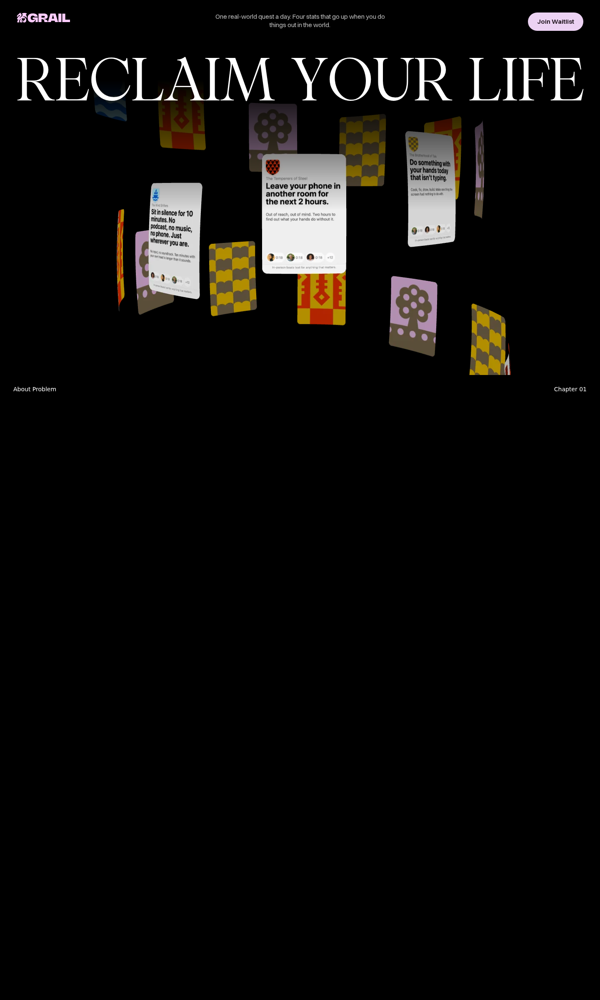
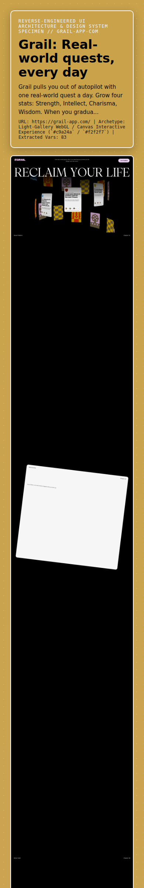

# UI Design System & Master Generation Blueprint: grail-app-com

> **Grail: Real-world quests, every day** (https://grail-app.com/) — Grail pulls you out of autopilot with one real-world quest a day. Grow four stats: Strength, Intellect, Charisma, Wisdom. When you gradua...



---

## 1. Executive Visual Persona & Design Archetype

- **Brand Essence & Persona**: **Grail: Real-world quests, every day** (`https://grail-app.com/`). Grail pulls you out of autopilot with one real-world quest a day. Grow four stats: Strength, Intellect, Charisma, Wisdom. When you gradua...
- **Visual Archetype**: **Light-Gallery WebGL / Canvas Interactive Experience (`#c9a24a` / `#f2f2f7`)**.
- **Anti-AI-Slop Differentiators**:
  - **Source-Grounded Chromatic Polarity**: Anchors the viewport in `#c9a24a` (`var(--accent)` in `:root`) paired with `#000` primary typography and `#f2f2f7` accents.
  - **Extracted Typographic Hierarchy**: Pairs `Switzer` for display copy (`R e c l a i m y o u r l i f e`) with `PP Pangaia` and `SF Mono`.
  - **Calibrated Spatial Grid & Motion**: Combines `340px` container bounds (`gap: 11px`, padding `16px`) with `cubic-bezier(.22,1,.36,1)` easing and Lenis Smooth Scroll (`data-lenis`), Three.js / WebGL Canvas Pipeline.

---

## 2. Spatial Architecture & Modular Grid Mathematics



### Viewport Allocation & Container Geometry
- **Captured Viewport Dimensions**: Desktop `1440×11728px` (`assets/desktop.png`, full-page scroll capture), Mobile `390×2400px` (`assets/mobile.png`, capped at 2400px multi-section capture).
- **Master Container Bounds**: `340px` extracted from `grail-app-com` stylesheet.
- **Canvas Lateral Padding & Spacing**: `16px` lateral canvas padding with `11px` grid gap.
- **Border Radius Scale**: `16px`, `3px`, `50%`, `9px`.

### Responsive Breakpoint Architecture
- **Desktop Layout**: Multi-column CSS Grid / Flexbox layout at `1440px` (`max-width: 340px`, `gap: 11px`).
- **Mobile Layout**: Single-column vertical stack at `390px` viewport width with `16px` horizontal padding.
- **Extracted CSS Media Queries**: `@media (max-width:720px)`, `@media (max-width:768px)`, `@media (min-width:769px) and (max-width:1279px)`, `@media (min-width:769px) and (max-height:760px)`.

---

## 3. Color System, Materiality & Atmospheric Lighting

### Semantic Palette & Source Grounding
| Semantic Role | Ground-Truth Value | Extracted CSS Source / Selector |
|---|---|---|
| **Primary Canvas Substrate** | `#c9a24a` | `var(--accent)` in `:root` |
| **Primary Typography Ink** | `#ffcdff` | `var(--pill-accent)` in `:root` |
| **Elevated Surface / Card Substrate** | `#fff` | `var(--bg-primary)` in `:root` |
| **Interactive Accent / Highlight** | `#f2f2f7` | `var(--bg-secondary)` in `:root` |
| **Secondary / Muted Copy** | `#000` | `var(--text-primary)` in `:root` |
| **Structural Hairline Border** | `#8e8e93` | `var(--text-secondary)` in `:root` |
| **Variable Token (`--pill-btn-bg`)** | `#ffffff24` | `var(--pill-btn-bg)` in `:root` |
| **Variable Token (`--pill-body`)** | `#18181899` | `var(--pill-body)` in `:root` |
| **Variable Token (`--bg-card`)** | `#00000008` | `var(--bg-card)` in `:root` |

### Sanitized Root CSS Variables (`ui-ux.md` Ground Truth)
| Variable Name | Extracted Value | Semantic Role |
|---|---|---|
| `--accent` | `#c9a24a` | Brand / Palette Token |
| `--fill` | `0%` | Dimension / Scale Token |
| `--blurk` | `max(0, 1 - var(--g8off,0) * 4)` | Elevation / Border Token |
| `--out` | `clamp(0, calc((var(--g8morph,0) * 90 - var(--i,0)) / 6), 1)` | Design System Custom Token |
| `--tailx` | `calc(100% - 46px)` | Dimension / Scale Token |
| `--pill-accent` | `#ffcdff` | Brand / Palette Token |
| `--pill-btn-bg` | `#ffffff24` | Canvas / Surface Token |
| `--pill-btn-fg` | `#ffcdff` | Typography Ink Token |
| `--pill-body` | `#18181899` | Color / Atmospheric Token |
| `--pill-border` | `#ffffff24` | Elevation / Border Token |
| `--bg-primary` | `#fff` | Canvas / Surface Token |
| `--bg-secondary` | `#f2f2f7` | Canvas / Surface Token |
| `--bg-grouped` | `#f2f2f7` | Canvas / Surface Token |
| `--bg-card` | `#00000008` | Canvas / Surface Token |
| `--text-primary` | `#000` | Typography Ink Token |
| `--text-secondary` | `#8e8e93` | Typography Ink Token |

---

## 4. Typographic Scale & Editorial Hierarchy

### Font Family Stacks
- **Display Typography**: `Switzer`.
- **Primary Body Stack**: `PP Pangaia`.
- **Technical / Metadata Stack**: `SF Mono`.

### Typographic Scale & Rules (Extracted from Stylesheet & Variables)
- **Hero Display (`H1`)**: rule `h1` (`font-size: 44px`, `line-height: 1.05`, `font-weight: 400`).
- **Section Heading (`H2`)**: not explicitly declared on tag in static CSS (stylesheet font-size ladder: `12px`, `44px`, `14px`, `32px`, `clamp(46px,6vw,92px)`).
- **Body Copy**: CSS variables `--pill-body: #18181899`; rule `p` (`font-size: 14px`, `line-height: 1.45`).
- **Metadata & Navigation Labels**: CSS variables `--font-mono: "SF Mono", ui-monospace, "Menlo", monospace`.

---

## 5. Choreographed Motion & Interaction Physics

### Primary Easing Curves
- **Extracted Timing Functions**: `cubic-bezier(.22,1,.36,1)`, `cubic-bezier(.32,.72,0,1)`.

### Per-Element Transition & Choreography Rules
- **Selector `._kicker_1bp3t_50`**: `transition: color .4s` extracted from `grail-app-com` stylesheet.
- **Selector `._title_1bp3t_40 h1 em`**: `transition: color .4s` extracted from `grail-app-com` stylesheet.
- **Selector `._val_1bp3t_99`**: `transition: color .4s` extracted from `grail-app-com` stylesheet.
- **Extracted Easing Curve (`cubic-bezier(.22,1,.36,1)`)**: Governs interactive state transitions across `<header.lenis>` and `<section.home-root>`.
- **Runtime Interaction Engine**: Integrates Lenis Smooth Scroll (`data-lenis`), Three.js / WebGL Canvas Pipeline with `prefers-reduced-motion: reduce` fallback guards.

---

## 6. Component Wireframe & Structural DOM Map

### Visual Layout Schematic (Grounded in `dom.html` — `1440px` Desktop & `390px` Mobile Reflow)
```
┌────────────────────────────────────────────────────────────────────────┐
│ DESKTOP VIEWPORT (1440px) — Grail: Real-world quests, every day        │
│ ====================================================================== │
│ [ <header.lenis>           | Overview · Index · Archive · About · C ]  │
│ ---------------------------------------------------------------------- │
│ | HERO STAGE: <section.lenis-stopped>                              |   │
│ | H1: R e c l a i m y o u r l i f e                                |   │
│ | Substrate: #c9a24a    | Ink: #000       | Accent: #f2f2f7        |   │
│ ---------------------------------------------------------------------- │
│ | SHOWCASE GRID (<section.home-root>       ) max-w: 340px          |   │
│ | +------------------------------+  +------------------------------+ | │
│ | | Everyone's out living. You'r |  | Quest accepted. Clock's runn | | │
│ | +------------------------------+  +------------------------------+ | │
│ ---------------------------------------------------------------------- │
│ | MOBILE VIEWPORT REFLOW (390px) — Single-Column Stack (gap: 11px  ) | │
│ | [<header.lenis>] -> [<section.lenis-sto] -> [<section.home-root] |   │
│ ---------------------------------------------------------------------- │
│ [ FOOTER (<footer>              ) | https://grail-app.com/             │
└────────────────────────────────────────────────────────────────────────┘
```

### Granular DOM Region Breakdown
1. **Brand Header & Navigation Bar (<header.lenis> — `grail-app-com`)**:
   - Landmark `<header class="lenis">` hosting `Grail: Real-world quests, every day` navigation (`Overview · Index · Archive · About · Contact`), DOM attributes (`data-controls="true"`, `data-guild-title="true"`, `data-tile="true"`, `data-side="right"`), and stylesheet rule `._root_1bp3t_1 { color:efe9f2;font-family:var(--font-sans);--accent:c9a24a;background:000... }`.
2. **Hero Stage & Focal Lead (<section.lenis-stopped> — `R e c l a i m y o u r l i f e`)**:
   - Landmark `<section class="lenis-stopped">` presenting display lead `R e c l a i m y o u r l i f e` and copy excerpt *"One real-world quest a day. Four stats that go up when you do thi"* over `#c9a24a` canvas and `#000` ink.
3. **Primary Showcase & Content Grid (<section.home-root> — `Everyone's out living. You're watc`)**:
   - Landmark `<section class="home-root">` rendering section `Everyone's out living. You're watching them do it...` with copy *"Same week, over and over, until you can't tell them apart. You ke"*, asset references (`Fav.svg`, `Fav.png`, `Switzer-Variable.woff2`, `PPPangaia-Light.woff2`), and grid rule `._embed_1bp3t_12 { --accent:c9a24a;position:absolute;inset:0;overflow:hidden }`.
4. **Interactive Detail & Feature Matrix (<section.sr-only> — `Quest accepted. Clock's running.`)**:
   - Landmark `<section class="sr-only">` framing `Quest accepted. Clock's running.` and `Quest accepted. Clock’s running.` (*"Now there’s a clock on it. Forty-eight hours to go do the thing, "*) with `#fff` surface cards, `#f2f2f7` accents, and `._canvas_1bp3t_19 { touch-action:pan-y;width:100%;height:100%;display:block;position:absolut... }`.
5. **Colophon & Global Directory Footer (<footer> — `https://grail-app.com/`)**:
   - Landmark `<footer>` landmark anchoring `Grail: Real-world quests, every ` footer links (`Overview · Index · Archive · About · Contact`), copy *"Not 24, since a day is too easy to lose to work or weather o"*, and `#8e8e93` structural dividers.

---

## 7. Master Zero-Shot AI Generation Prompt

```markdown
# Master Zero-Shot Frontend Generation Prompt: grail-app-com (Grail: Real-world quests, every day)

You are a principal frontend architect and design systems engineer. Build a complete, production-ready web application replicating the exact design system, DOM landmarks, typographic hierarchy, color tokens, and motion physics of `grail-app-com` (**Grail: Real-world quests, every day** — `https://grail-app.com/`).

### 1. Visual Archetype & Anti-AI-Slop Mandates
- **Archetype**: Light-Gallery WebGL / Canvas Interactive Experience (`#c9a24a` / `#f2f2f7`).
- **Identity & Domain Context**: Grail pulls you out of autopilot with one real-world quest a day. Grow four stats: Strength, Intellect, Charisma, Wisdom. When you gradua...
- **Primary Substrate**: `#c9a24a` (`var(--accent)` in `:root`), **Primary Ink**: `#000`, **Accent / Highlight**: `#f2f2f7`.
- **Site-Specific Differentiators**:
  - **Source-Grounded Chromatic Polarity**: Anchors the viewport in `#c9a24a` (`var(--accent)` in `:root`) paired with `#000` primary typography and `#f2f2f7` accents.
  - **Extracted Typographic Hierarchy**: Pairs `Switzer` for display copy (`R e c l a i m y o u r l i f e`) with `PP Pangaia` and `SF Mono`.
  - **Calibrated Spatial Grid & Motion**: Combines `340px` container bounds (`gap: 11px`, padding `16px`) with `cubic-bezier(.22,1,.36,1)` easing and Lenis Smooth Scroll (`data-lenis`), Three.js / WebGL Canvas Pipeline.

### 2. Ground-Truth CSS Variables (`:root` Token Contract)
Declare and consume these exact custom properties extracted from `grail-app-com` in your global stylesheet:

:root {
  /* Grail: Real-world quests, every day (grail-app-com) — Ground-Truth Extracted CSS Variables */
  --accent: #c9a24a; /* Brand / Palette Token (grail-app-com) */
  --fill: 0%; /* Dimension / Scale Token (grail-app-com) */
  --blurk: max(0, 1 - var(--g8off,0) * 4); /* Elevation / Border Token (grail-app-com) */
  --out: clamp(0, calc((var(--g8morph,0) * 90 - var(--i,0)) / 6), 1); /* Design System Custom Token (grail-app-com) */
  --tailx: calc(100% - 46px); /* Dimension / Scale Token (grail-app-com) */
  --pill-accent: #ffcdff; /* Brand / Palette Token (grail-app-com) */
  --pill-btn-bg: #ffffff24; /* Canvas / Surface Token (grail-app-com) */
  --pill-btn-fg: #ffcdff; /* Typography Ink Token (grail-app-com) */
  --pill-body: #18181899; /* Color / Atmospheric Token (grail-app-com) */
  --pill-border: #ffffff24; /* Elevation / Border Token (grail-app-com) */
  --bg-primary: #fff; /* Canvas / Surface Token (grail-app-com) */
  --bg-secondary: #f2f2f7; /* Canvas / Surface Token (grail-app-com) */
  --bg-grouped: #f2f2f7; /* Canvas / Surface Token (grail-app-com) */
  --bg-card: #00000008; /* Canvas / Surface Token (grail-app-com) */
  --text-primary: #000; /* Typography Ink Token (grail-app-com) */
  --text-secondary: #8e8e93; /* Typography Ink Token (grail-app-com) */
}

### 3. Semantic Color & Materiality Contract
Map every surface, ink, and border strictly to these source-grounded tokens:
- **Primary Canvas Substrate**: `#c9a24a` — grounded in `var(--accent)` in `:root`
- **Primary Typography Ink**: `#ffcdff` — grounded in `var(--pill-accent)` in `:root`
- **Elevated Surface / Card Substrate**: `#fff` — grounded in `var(--bg-primary)` in `:root`
- **Interactive Accent / Highlight**: `#f2f2f7` — grounded in `var(--bg-secondary)` in `:root`
- **Secondary / Muted Copy**: `#000` — grounded in `var(--text-primary)` in `:root`
- **Structural Hairline Border**: `#8e8e93` — grounded in `var(--text-secondary)` in `:root`
- **Variable Token (`--pill-btn-bg`)**: `#ffffff24` — grounded in `var(--pill-btn-bg)` in `:root`
- **Variable Token (`--pill-body`)**: `#18181899` — grounded in `var(--pill-body)` in `:root`
- **Variable Token (`--bg-card`)**: `#00000008` — grounded in `var(--bg-card)` in `:root`

### 4. Spatial Grid, Container Bounds & Responsive Breakpoints
- **Desktop Viewport Reference**: `1440×11728px` (full-page scroll capture, `1440px` standard desktop width).
- **Mobile Viewport Reference**: `390×2400px` (capped at 2400px multi-section capture, `390px` standard mobile width).
- **Container Max-Width**: `340px` extracted from `grail-app-com` stylesheet
- **Padding & Gutters**: `16px` lateral canvas padding with `11px` grid gap
- **Desktop Grid**: Multi-column CSS Grid / Flexbox layout at `1440px` (`max-width: 340px`, `gap: 11px`)
- **Mobile Adaptation**: Single-column vertical stack at `390px` viewport width with `16px` horizontal padding
- **Media Queries**: `@media (max-width:720px)`, `@media (max-width:768px)`, `@media (min-width:769px) and (max-width:1279px)`, `@media (min-width:769px) and (max-height:760px)`
- **Corner Radii**: `16px`, `3px`, `50%`, `9px`

### 5. Typography & Editorial Scale Contract
- **Display Font Stack**: `Switzer`
- **Body Font Stack**: `PP Pangaia`
- **Monospace / Technical Font Stack**: `SF Mono`
- **H1 Display Rule**: rule `h1` (`font-size: 44px`, `line-height: 1.05`, `font-weight: 400`)
- **H2 Section Rule**: not explicitly declared on tag in static CSS (stylesheet font-size ladder: `12px`, `44px`, `14px`, `32px`, `clamp(46px,6vw,92px)`)
- **Body Copy Rule**: CSS variables `--pill-body: #18181899`; rule `p` (`font-size: 14px`, `line-height: 1.45`)
- **Metadata & Index Rule**: CSS variables `--font-mono: "SF Mono", ui-monospace, "Menlo", monospace`

### 6. Component Hierarchy, Verbatim Copy & Real DOM Landmarks
Scaffold `grail-app-com` (`Grail: Real-world quests, every day`) with these exact structural regions, extracted copy, and CSS rules from `dom.html`:
1. **Brand Header & Navigation Bar (<header.lenis> — `grail-app-com`)**:
   - DOM & Selectors: Landmark `<header class="lenis">` hosting `Grail: Real-world quests, every day` navigation (`Overview · Index · Archive · About · Contact`), DOM attributes (`data-controls="true"`, `data-guild-title="true"`, `data-tile="true"`, `data-side="right"`), and stylesheet rule `._root_1bp3t_1 { color:efe9f2;font-family:var(--font-sans);--accent:c9a24a;background:000... }`.
   - Responsive Contract: Header `Brand Header & Navigation Bar (<header.lenis> — `grail-app-com`)` (`grail-app-com`) adapts across `@media (max-width:720px)`, `@media (max-width:768px)`, `@media (min-width:769px) and (max-width:1279px)`, `@media (min-width:769px) and (max-height:760px)` with `cubic-bezier(.22,1,.36,1)`, `cubic-bezier(.32,.72,0,1)` transitions and links `Overview · Index · Archive · About · Contact`.
2. **Hero Stage & Focal Lead (<section.lenis-stopped> — `R e c l a i m y o u r l i f e`)**:
   - DOM & Selectors: Landmark `<section class="lenis-stopped">` presenting display lead `R e c l a i m y o u r l i f e` and copy excerpt *"One real-world quest a day. Four stats that go up when you do thi"* over `#c9a24a` canvas and `#000` ink.
   - Responsive Contract: Hero stage (`1440×11728px` desktop / `390×2400px` mobile) sets `#c9a24a` background with `#000` headline `R e c l a i m y o u r l i f e`.
3. **Primary Showcase & Content Grid (<section.home-root> — `Everyone's out living. You're watc`)**:
   - DOM & Selectors: Landmark `<section class="home-root">` rendering section `Everyone's out living. You're watching them do it...` with copy *"Same week, over and over, until you can't tell them apart. You ke"*, asset references (`Fav.svg`, `Fav.png`, `Switzer-Variable.woff2`, `PPPangaia-Light.woff2`), and grid rule `._embed_1bp3t_12 { --accent:c9a24a;position:absolute;inset:0;overflow:hidden }`.
   - Responsive Contract: Showcase grid `Primary Showcase & Content Grid (<section.home-root> — `Everyone's out living. You're watc`)` applies Multi-column CSS Grid / Flexbox layout at `1440px` (`max-width: 340px`, `gap: 11px`) on desktop and Single-column vertical stack at `390px` viewport width with `16px` horizontal padding on mobile.
4. **Interactive Detail & Feature Matrix (<section.sr-only> — `Quest accepted. Clock's running.`)**:
   - DOM & Selectors: Landmark `<section class="sr-only">` framing `Quest accepted. Clock's running.` and `Quest accepted. Clock’s running.` (*"Now there’s a clock on it. Forty-eight hours to go do the thing, "*) with `#fff` surface cards, `#f2f2f7` accents, and `._canvas_1bp3t_19 { touch-action:pan-y;width:100%;height:100%;display:block;position:absolut... }`.
   - Responsive Contract: Detail module `Interactive Detail & Feature Matrix (<section.sr-only> — `Quest accepted. Clock's running.`)` uses `16px`, `3px`, `50%`, `9px` radii, `#f2f2f7` highlights, and assets (Fav.svg, Fav.png, Switzer-Variable.woff2).
5. **Colophon & Global Directory Footer (<footer> — `https://grail-app.com/`)**:
   - DOM & Selectors: Landmark `<footer>` landmark anchoring `Grail: Real-world quests, every ` footer links (`Overview · Index · Archive · About · Contact`), copy *"Not 24, since a day is too easy to lose to work or weather o"*, and `#8e8e93` structural dividers.
   - Responsive Contract: Footer `Colophon & Global Directory Footer (<footer> — `https://grail-app.com/`)` aligns to `340px` extracted from `grail-app-com` stylesheet with `16px` lateral canvas padding with `11px` grid gap and attributes (data-controls="true", data-guild-title="true", data-tile="true").

#### Verbatim DOM Copy Excerpts (`dom.html`)
- Copy Excerpt 1: *"One real-world quest a day. Four stats that go up when you do things out in the wo..."*
- Copy Excerpt 2: *"Same week, over and over, until you can't tell them apart. You keep meaning to do..."*
- Copy Excerpt 3: *"Now there’s a clock on it. Forty-eight hours to go do the thing, because “later” i..."*
- Copy Excerpt 4: *"Not 24, since a day is too easy to lose to work or weather or a bad mood. Two days..."*

### 7. Motion, Extracted Stylesheet Rules & Interaction Choreography
- **Primary Easing Functions**: `cubic-bezier(.22,1,.36,1)`, `cubic-bezier(.32,.72,0,1)`
- **Extracted Stylesheet Rules (`grail-app-com`)**:
- `._root_1bp3t_1 { color:efe9f2;font-family:var(--font-sans);--accent:c9a24a;background:000... }`
- `._embed_1bp3t_12 { --accent:c9a24a;position:absolute;inset:0;overflow:hidden }`
- `._canvas_1bp3t_19 { touch-action:pan-y;width:100%;height:100%;display:block;position:absolut... }`
- `._kicker_1bp3t_50 { letter-spacing:.18em;text-transform:uppercase;color:var(--accent);font-s... }`
- `._title_1bp3t_40 h1 { font-family:var(--font-serif);color:fff;margin:4px 0 8px;font-size:44px;... }`
- **Per-Selector Transition Rules**:
- **Selector `._kicker_1bp3t_50`**: `transition: color .4s` extracted from `grail-app-com` stylesheet.
- **Selector `._title_1bp3t_40 h1 em`**: `transition: color .4s` extracted from `grail-app-com` stylesheet.
- **Selector `._val_1bp3t_99`**: `transition: color .4s` extracted from `grail-app-com` stylesheet.
- **Extracted Easing Curve (`cubic-bezier(.22,1,.36,1)`)**: Governs interactive state transitions across `<header.lenis>` and `<section.home-root>`.
- **Runtime Interaction Engine**: Integrates Lenis Smooth Scroll (`data-lenis`), Three.js / WebGL Canvas Pipeline with `prefers-reduced-motion: reduce` fallback guards.

### 8. Technical Deliverables
- Implement in Next.js (App Router) with TypeScript and Tailwind CSS consuming the `:root` custom properties defined above for `grail-app-com`.
- Reproduce both the `1440px` desktop architecture and `390px` mobile breakpoint transitions, preserving semantic HTML5 landmarks (`<header>`, `<nav>`, `<main>`, `<section>`, `<footer>`) and `prefers-reduced-motion` accessibility guards.
```
