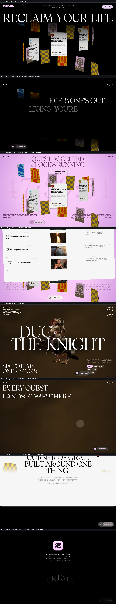
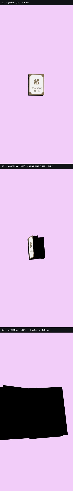

# UI Design System & Master Generation Blueprint: grail-app-com

> **Grail: Real-world quests, every day** (https://grail-app.com/) — Grail pulls you out of autopilot with one real-world quest a day. Grow four stats: Strength, Intellect, Charisma, Wisdom. When you gradua...





---

## 1. Executive Visual Persona & Design Archetype

- **Brand Essence & Persona**: **Grail: Real-world quests, every day** (`https://grail-app.com/`). Grail pulls you out of autopilot with one real-world quest a day. Grow four stats: Strength, Intellect, Charisma, Wisdom. When you gradua...
- **Capture Provenance**: Live browser capture (`tier1_fast`, HTTP `200`, captured `2026-11-24`).
- **Visual Archetype**: **Dark-Substrate WebGL / Canvas Interactive Experience (`#000000` / `#c9a24a`)**.
- **Anti-AI-Slop Differentiators**:
  - **Live-Computed Chromatic Polarity**: Anchors the viewport in `#000000` (live computed `body` `background-color` (`computed_styles.json`)) paired with `#ffffff` primary typography and `#c9a24a` accents.
  - **Grounded Typographic Hierarchy**: Pairs `PP Pangaia` for display copy (`RECLAIMYOURLIFE`) with `Switzer` and `SF Mono`.
  - **Calibrated Spatial Grid & Motion**: Combines `1336px` container bounds (`gap: 24px`, padding `16px`) with `cubic-bezier(.32,.72,0,1)` easing and Lenis Smooth Scroll (`data-lenis`), Three.js / WebGL Canvas Pipeline.

---

## 2. Spatial Architecture & Modular Grid Mathematics

### Viewport Allocation & Container Geometry
- **Captured Journey Filmstrips**: Desktop `1280×6624px` (`assets/desktop-journey.webp`, `8` keyframes up to `y=10828px` / doc `11728px`), Mobile `390×2616px` (`assets/mobile-journey.webp`, `3` keyframes).
- **Master Container Bounds**: `1336px` (measured widest bounded `<section>` landmark width on `1440px` desktop).
- **Canvas Lateral Padding & Spacing**: `16px` lateral canvas padding with `24px` grid gap.
- **Border Radius Scale**: `3px`, `16px`, `999px`, `50%`.

### Responsive Breakpoint Architecture
- **Desktop Layout**: Multi-column CSS Grid / Flexbox layout at `1440px` (`max-width: 1336px`, `gap: 24px`).
- **Mobile Layout**: Single-column vertical stack at `390px` viewport width with `16px` horizontal padding.
- **Extracted CSS Media Queries**: `@media (prefers-reduced-motion:reduce)`, `@media (max-width:768px)`, `@media (max-width:560px)`, `@media (max-width:720px)`.

---

## 3. Color System, Materiality & Atmospheric Lighting

### Semantic Palette & Source Grounding
| Semantic Role | Ground-Truth Value | Extracted Live / CSS Source |
|---|---|---|
| **Primary Canvas Substrate** | `#000000` | live computed `body` `background-color` (`computed_styles.json`) |
| **Primary Typography Ink** | `#ffffff` | live computed `h1` `color` (`computed_styles.json`) |
| **Elevated Surface / Card Substrate** | `#1c1c1e` | `var(--shell-text)` in `:root` |
| **Interactive Accent / Highlight** | `#c9a24a` | `var(--accent)` in `:root` |
| **Secondary / Muted Copy** | `#71717a` | `var(--landing-text-secondary)` in `:root` |
| **Structural Hairline Border** | `#010102` | `var(--landing-border)` in `:root` (`18181b0f`) |
| **Variable Token (`--bg-secondary`)** | `#f2f2f7` | `var(--bg-secondary)` in `:root` |
| **Variable Token (`--text-secondary`)** | `#8e8e93` | `var(--text-secondary)` in `:root` |
| **Variable Token (`--text-tertiary`)** | `#c7c7cc` | `var(--text-tertiary)` in `:root` |
| **Variable Token (`--text-quaternary`)** | `#d1d1d6` | `var(--text-quaternary)` in `:root` |
| **Variable Token (`--tint`)** | `#007aff` | `var(--tint)` in `:root` |
| **Variable Token (`--destructive`)** | `#ff3b30` | `var(--destructive)` in `:root` |
| **Variable Token (`--warning`)** | `#ff9500` | `var(--warning)` in `:root` |
| **Variable Token (`--success`)** | `#34c759` | `var(--success)` in `:root` |
| **Variable Token (`--glass-bg`)** | `#fffc` | `var(--glass-bg)` in `:root` |

### Sanitized Root CSS Variables (`ui-ux.md` Ground Truth)
| Variable Name | Extracted Value | Semantic Role |
|---|---|---|
| `--bg-primary` | `#fff` | Canvas / Surface Token |
| `--bg-secondary` | `#f2f2f7` | Canvas / Surface Token |
| `--bg-grouped` | `#f2f2f7` | Canvas / Surface Token |
| `--bg-card` | `#00000008` | Canvas / Surface Token |
| `--text-primary` | `#000` | Typography Ink Token |
| `--text-secondary` | `#8e8e93` | Typography Ink Token |
| `--text-tertiary` | `#c7c7cc` | Typography Ink Token |
| `--text-quaternary` | `#d1d1d6` | Typography Ink Token |
| `--tint` | `#007aff` | Canvas / Surface Token |
| `--tint-light` | `#007aff1a` | Canvas / Surface Token |
| `--destructive` | `#ff3b30` | Color / Atmospheric Token |
| `--destructive-light` | `#ff3b301a` | Canvas / Surface Token |
| `--warning` | `#ff9500` | Color / Atmospheric Token |
| `--success` | `#34c759` | Color / Atmospheric Token |
| `--glass-bg` | `#fffc` | Canvas / Surface Token |
| `--glass-border` | `#0000000f` | Elevation / Border Token |

---

## 4. Typographic Scale & Editorial Hierarchy

### Font Family Stacks
- **Display Typography**: `PP Pangaia`.
- **Primary Body Stack**: `Switzer`.
- **Technical / Metadata Stack**: `SF Mono`.

### Typographic Scale & Rules (Live Computed & Stylesheet Grounded)
- **Hero Display (`H1`)**: live computed `h1` (`font-size: 145.377px`, `line-height: 127.932px`, `font-weight: 300`, `letter-spacing: -1.45377px`); rule `h1` (`font-size: 44px`, `line-height: 1.05`, `font-weight: 400`).
- **Section Heading (`H2`)**: live computed `h2` (`font-size: 92.16px`, `line-height: 81.1008px`, `font-weight: 300`, `letter-spacing: -0.9216px`).
- **Body Copy**: live computed `body` (`font-size: 16px`, `line-height: normal`, `font-weight: 400`); rule `p` (`font-size: 14px`, `line-height: 1.45`).
- **Metadata & Navigation Labels**: live computed `nav/a` (`font-size: 16px`, `line-height: normal`, `font-weight: 400`); CSS variables `--font-mono: "SF Mono", ui-monospace, "Menlo", monospace`.

---

## 5. Choreographed Motion & Interaction Physics

### Primary Easing Curves
- **Extracted Timing Functions**: `cubic-bezier(.32,.72,0,1)`, `cubic-bezier(.22,1,.36,1)`.

### Per-Element Transition & Choreography Rules
- **Selector `media (prefers-reduced-motion:red...`**: `transition: .001ms!important` extracted from `grail-app-com` stylesheet.
- **Selector `:root`**: `transition: cubic-bezier(.32,.72,0,1)` extracted from `grail-app-com` stylesheet.
- **Selector `._decline_1lt29_49`**: `transition: background .2s,transform .2s,border-color .2s,color .2s` extracted from `grail-app-com` stylesheet.
- **Extracted Easing Curve (`cubic-bezier(.32,.72,0,1)`)**: Governs interactive state transitions across `<header.lenis>` and `<section.sr-only>`.
- **Runtime Interaction Engine**: Integrates Lenis Smooth Scroll (`data-lenis`), Three.js / WebGL Canvas Pipeline with `prefers-reduced-motion: reduce` fallback guards.
### Measured Runtime Scroll & Interaction Telemetry (`behavioral_journey_v2`)
- **Scroll Driver Mode**: `native` (max document height `11728px`, deepest scrollY reached `10828px` across `8` desktop keyframes).
- **Detected Scroll / Motion Libraries**: `Lenis`, `WebGL/Canvas`.
- **Hover Physics (`primary_cta` · `Join Waitlist`)**: `transform`: `none` -> `matrix(1.03, 0, 0, 1.03...`; `backgroundColor`: `rgb(236, 210, 243)` -> `rgb(246, 227, 251)`; `boxShadow`: `none` -> `rgba(236, 210, 243, 0.2...` (`transition-duration: 0.15s, 0.15s`, `timing: ease, ease`).
- **Interactive Control Probe (`tab` · `Cat`)**: Triggered visual diff `18.33` (attr `false -> true`, captured in `assets/state-interactive.webp`).

---

## 6. Component Wireframe & Structural DOM Map

### Visual Layout Schematic — Desktop (`1440px`, Grounded in `dom.html` & Landmark Bounding Boxes)
```
┌────────────────────────────────────────────────────────────────────────┐
│ DESKTOP VIEWPORT (1440px) — Grail: Real-world quests, every day        │
│ ====================================================================== │
│ [ <header.lenis> (1440x900px)         | Overview · Index · Archive · ] │
│ ---------------------------------------------------------------------- │
│ | HERO STAGE: <section.home-root> (w=1440px)                         | │
│ | H1: RECLAIMYOURLIFE                                                | │
│ | Substrate: #000000 | Ink: #ffffff | Accent: #c9a24a                | │
│ ---------------------------------------------------------------------- │
│ | SHOWCASE GRID (<section.sr-only>) max-w: 1336px                    | │
│ | +------------------------------+  +------------------------------+ | │
│ | | Everyone's out living. You'r |  | Same week, over and over, un | | │
│ | +------------------------------+  +------------------------------+ | │
│ ---------------------------------------------------------------------- │
│ | DETAIL MODULE (<section>) — Now there’s a clock o                  | │
│ ---------------------------------------------------------------------- │
│ [ FOOTER (<footer>            ) | https://grail-app.com/               │
└────────────────────────────────────────────────────────────────────────┘
```

### Visual Layout Schematic — Mobile Reflow (`390px`)
```
┌────────────────────────────────────────────────────────────────────────┐
│ MOBILE VIEWPORT REFLOW (390px) — Single-Column Stack (gap: 24px)       │
│ ====================================================================== │
│ [ HEADER BAR (<header.lenis>          ) | Compact Menu (390px)         │
│ ---------------------------------------------------------------------- │
│ | HERO STAGE (<section.home-root>) — 390px Vertical Lead             | │
│ | H1: RECLAIMYOURLIFE                                                | │
│ ---------------------------------------------------------------------- │
│ | SHOWCASE STACK (<section.sr-only>) — 1-Col Stack                   | │
│ | [ Item 1: Everyone's out living. You're watching them do it...   ] | │
│ | [ Item 2: Same week, over and over, until you can't tell t       ] | │
│ ---------------------------------------------------------------------- │
│ | DETAIL STACK (<section>) — 1-Col (Now there’s a cloc)              | │
│ ---------------------------------------------------------------------- │
│ [ FOOTER (<footer>            ) | Stacked 390px Colophon               │
└────────────────────────────────────────────────────────────────────────┘
```

### Granular DOM Region Breakdown
1. **Brand Header & Navigation Bar (<header.lenis> — `grail-app-com`)**:
   - Landmark `<header class="lenis">` (`1440x900px`) hosting `Grail: Real-world quests, every day` navigation (`Overview · Index · Archive · About · Contact`), DOM attributes (`data-controls="true"`, `data-guild-title="true"`, `data-tile="true"`, `data-side="right"`), and stylesheet rule `after { box-sizing:border-box;margin:0;padding:0 }`.
2. **Hero Stage & Focal Lead (<section.home-root> — `RECLAIMYOURLIFE`)**:
   - Landmark `<section class="home-root">` presenting display lead `RECLAIMYOURLIFE` and copy excerpt *"One real-world quest a day. Four stats that go up when you do thi"* over `#000000` canvas and `#ffffff` ink.
3. **Primary Showcase & Content Grid (<section.sr-only> — `Everyone's out living. You're watc`)**:
   - Landmark `<section class="sr-only">` rendering section `Everyone's out living. You're watching them do it...` with copy *"Same week, over and over, until you can't tell them apart. You ke"*, asset references (`Fav.svg`, `Fav.png`, `Switzer-Variable.woff2`, `PPPangaia-Light.woff2`), and grid rule `root { width:100%;height:100% }`.
4. **Interactive Detail & Feature Matrix (<section> — `Same week, over and over, until yo`)**:
   - Landmark `<section>` landmark framing `Same week, over and over, until you can't tell t` and `Now there’s a clock on it. Forty-eight hours to ` (*"Now there’s a clock on it. Forty-eight hours to go do the thing, "*) with `#1c1c1e` surface cards, `#c9a24a` accents, and `button { font-family:var(--font-sans);cursor:pointer;font-size:inherit;background... }`.
5. **Colophon & Global Directory Footer (<footer> — `https://grail-app.com/`)**:
   - Landmark `<footer>` landmark anchoring `Grail: Real-world quests, every ` footer links (`Overview · Index · Archive · About · Contact`), copy *"Not 24, since a day is too easy to lose to work or weather o"*, and `#010102` structural dividers.
### Full Vertical Scroll Sequence (Desktop `1440×900` Keyframes)
- **Step 01** (`y=0px`, `0%`): Active landmark `RECLAIMYOURLIFE` · sticky/fixed elements: `2`
- **Step 02** (`y=850px`, `8%`): Active landmark `QUEST ACCEPTED. CLOCK’S RUNNING.` · sticky/fixed elements: `3`
- **Step 03** (`y=2550px`, `24%`): Active landmark `QUEST ACCEPTED. CLOCK’S RUNNING.` · sticky/fixed elements: `5`
- **Step 04** (`y=4250px`, `39%`): Active landmark `WHAT WAS THAT LIKE?` · sticky/fixed elements: `4`
- **Step 05** (`y=6800px`, `63%`): Active landmark `THEKNIGHT` · sticky/fixed elements: `2`
- **Step 06** (`y=8500px`, `79%`): Active landmark `EVERY QUEST LANDS SOMEWHERE.` · sticky/fixed elements: `2`
- **Step 07** (`y=10200px`, `94%`): Active landmark `QUEST ACCEPTED. CLOCK’S RUNNING.` · sticky/fixed elements: `3`
- **Step 08** (`y=10828px`, `100%`): Active landmark `QUEST ACCEPTED. CLOCK’S RUNNING.` · sticky/fixed elements: `2`

---

## 7. Master Zero-Shot AI Generation Prompt

```markdown
# Master Zero-Shot Frontend Generation Prompt: grail-app-com (Grail: Real-world quests, every day)

You are a principal frontend architect and design systems engineer. Build a complete, production-ready web application replicating the exact design system, DOM landmarks, typographic hierarchy, color tokens, and motion physics of `grail-app-com` (**Grail: Real-world quests, every day** — `https://grail-app.com/`).

### 1. Visual Archetype & Anti-AI-Slop Mandates
- **Archetype**: Dark-Substrate WebGL / Canvas Interactive Experience (`#000000` / `#c9a24a`).
- **Identity & Domain Context**: Grail pulls you out of autopilot with one real-world quest a day. Grow four stats: Strength, Intellect, Charisma, Wisdom. When you gradua...
- **Primary Substrate**: `#000000` (live computed `body` `background-color` (`computed_styles.json`)), **Primary Ink**: `#ffffff`, **Accent / Highlight**: `#c9a24a`.
- **Site-Specific Differentiators**:
  - **Live-Computed Chromatic Polarity**: Anchors the viewport in `#000000` (live computed `body` `background-color` (`computed_styles.json`)) paired with `#ffffff` primary typography and `#c9a24a` accents.
  - **Grounded Typographic Hierarchy**: Pairs `PP Pangaia` for display copy (`RECLAIMYOURLIFE`) with `Switzer` and `SF Mono`.
  - **Calibrated Spatial Grid & Motion**: Combines `1336px` container bounds (`gap: 24px`, padding `16px`) with `cubic-bezier(.32,.72,0,1)` easing and Lenis Smooth Scroll (`data-lenis`), Three.js / WebGL Canvas Pipeline.

### 2. Ground-Truth CSS Variables (`:root` Token Contract)
Declare and consume these exact custom properties extracted from `grail-app-com` in your global stylesheet:

:root {
  /* Grail: Real-world quests, every day (grail-app-com) — Live-Grounded CSS Variables */
  --bg-primary: #fff; /* Canvas / Surface Token (grail-app-com) */
  --bg-secondary: #f2f2f7; /* Canvas / Surface Token (grail-app-com) */
  --bg-grouped: #f2f2f7; /* Canvas / Surface Token (grail-app-com) */
  --bg-card: #00000008; /* Canvas / Surface Token (grail-app-com) */
  --text-primary: #000; /* Typography Ink Token (grail-app-com) */
  --text-secondary: #8e8e93; /* Typography Ink Token (grail-app-com) */
  --text-tertiary: #c7c7cc; /* Typography Ink Token (grail-app-com) */
  --text-quaternary: #d1d1d6; /* Typography Ink Token (grail-app-com) */
  --tint: #007aff; /* Canvas / Surface Token (grail-app-com) */
  --tint-light: #007aff1a; /* Canvas / Surface Token (grail-app-com) */
  --destructive: #ff3b30; /* Color / Atmospheric Token (grail-app-com) */
  --destructive-light: #ff3b301a; /* Canvas / Surface Token (grail-app-com) */
  --warning: #ff9500; /* Color / Atmospheric Token (grail-app-com) */
  --success: #34c759; /* Color / Atmospheric Token (grail-app-com) */
  --glass-bg: #fffc; /* Canvas / Surface Token (grail-app-com) */
  --glass-border: #0000000f; /* Elevation / Border Token (grail-app-com) */
}

### 3. Semantic Color & Materiality Contract
Map every surface, ink, and border strictly to these source-grounded tokens:
- **Primary Canvas Substrate**: `#000000` — grounded in live computed `body` `background-color` (`computed_styles.json`)
- **Primary Typography Ink**: `#ffffff` — grounded in live computed `h1` `color` (`computed_styles.json`)
- **Elevated Surface / Card Substrate**: `#1c1c1e` — grounded in `var(--shell-text)` in `:root`
- **Interactive Accent / Highlight**: `#c9a24a` — grounded in `var(--accent)` in `:root`
- **Secondary / Muted Copy**: `#71717a` — grounded in `var(--landing-text-secondary)` in `:root`
- **Structural Hairline Border**: `#010102` — grounded in `var(--landing-border)` in `:root` (`18181b0f`)
- **Variable Token (`--bg-secondary`)**: `#f2f2f7` — grounded in `var(--bg-secondary)` in `:root`
- **Variable Token (`--text-secondary`)**: `#8e8e93` — grounded in `var(--text-secondary)` in `:root`
- **Variable Token (`--text-tertiary`)**: `#c7c7cc` — grounded in `var(--text-tertiary)` in `:root`
- **Variable Token (`--text-quaternary`)**: `#d1d1d6` — grounded in `var(--text-quaternary)` in `:root`
- **Variable Token (`--tint`)**: `#007aff` — grounded in `var(--tint)` in `:root`
- **Variable Token (`--destructive`)**: `#ff3b30` — grounded in `var(--destructive)` in `:root`
- **Variable Token (`--warning`)**: `#ff9500` — grounded in `var(--warning)` in `:root`
- **Variable Token (`--success`)**: `#34c759` — grounded in `var(--success)` in `:root`
- **Variable Token (`--glass-bg`)**: `#fffc` — grounded in `var(--glass-bg)` in `:root`

### 4. Spatial Grid, Container Bounds & Responsive Breakpoints
- **Desktop Viewport Reference**: `1280×6624px` (multi-frame vertical journey filmstrip (6624px), `1440px` standard desktop width).
- **Mobile Viewport Reference**: `390×2616px` (multi-frame vertical journey filmstrip (2616px), `390px` standard mobile width).
- **Container Max-Width**: `1336px` (measured widest bounded `<section>` landmark width on `1440px` desktop)
- **Padding & Gutters**: `16px` lateral canvas padding with `24px` grid gap
- **Desktop Grid**: Multi-column CSS Grid / Flexbox layout at `1440px` (`max-width: 1336px`, `gap: 24px`)
- **Mobile Adaptation**: Single-column vertical stack at `390px` viewport width with `16px` horizontal padding
- **Media Queries**: `@media (prefers-reduced-motion:reduce)`, `@media (max-width:768px)`, `@media (max-width:560px)`, `@media (max-width:720px)`
- **Corner Radii**: `3px`, `16px`, `999px`, `50%`

### 5. Typography & Editorial Scale Contract
- **Display Font Stack**: `PP Pangaia`
- **Body Font Stack**: `Switzer`
- **Monospace / Technical Font Stack**: `SF Mono`
- **H1 Display Rule**: live computed `h1` (`font-size: 145.377px`, `line-height: 127.932px`, `font-weight: 300`, `letter-spacing: -1.45377px`); rule `h1` (`font-size: 44px`, `line-height: 1.05`, `font-weight: 400`)
- **H2 Section Rule**: live computed `h2` (`font-size: 92.16px`, `line-height: 81.1008px`, `font-weight: 300`, `letter-spacing: -0.9216px`)
- **Body Copy Rule**: live computed `body` (`font-size: 16px`, `line-height: normal`, `font-weight: 400`); rule `p` (`font-size: 14px`, `line-height: 1.45`)
- **Metadata & Index Rule**: live computed `nav/a` (`font-size: 16px`, `line-height: normal`, `font-weight: 400`); CSS variables `--font-mono: "SF Mono", ui-monospace, "Menlo", monospace`

### 6. Component Hierarchy, Verbatim Copy & Real DOM Landmarks
Scaffold `grail-app-com` (`Grail: Real-world quests, every day`) with these exact structural regions, extracted copy, and CSS rules from `dom.html`:
1. **Brand Header & Navigation Bar (<header.lenis> — `grail-app-com`)**:
   - DOM & Selectors: Landmark `<header class="lenis">` (`1440x900px`) hosting `Grail: Real-world quests, every day` navigation (`Overview · Index · Archive · About · Contact`), DOM attributes (`data-controls="true"`, `data-guild-title="true"`, `data-tile="true"`, `data-side="right"`), and stylesheet rule `after { box-sizing:border-box;margin:0;padding:0 }`.
   - Responsive Contract: Header `Brand Header & Navigation Bar (<header.lenis> — `grail-app-com`)` (`grail-app-com`) adapts across `@media (prefers-reduced-motion:reduce)`, `@media (max-width:768px)`, `@media (max-width:560px)`, `@media (max-width:720px)` with `cubic-bezier(.32,.72,0,1)`, `cubic-bezier(.22,1,.36,1)` transitions and links `Overview · Index · Archive · About · Contact`.
2. **Hero Stage & Focal Lead (<section.home-root> — `RECLAIMYOURLIFE`)**:
   - DOM & Selectors: Landmark `<section class="home-root">` presenting display lead `RECLAIMYOURLIFE` and copy excerpt *"One real-world quest a day. Four stats that go up when you do thi"* over `#000000` canvas and `#ffffff` ink.
   - Responsive Contract: Hero stage (`1280×6624px` desktop / `390×2616px` mobile) sets `#000000` background with `#ffffff` headline `RECLAIMYOURLIFE`.
3. **Primary Showcase & Content Grid (<section.sr-only> — `Everyone's out living. You're watc`)**:
   - DOM & Selectors: Landmark `<section class="sr-only">` rendering section `Everyone's out living. You're watching them do it...` with copy *"Same week, over and over, until you can't tell them apart. You ke"*, asset references (`Fav.svg`, `Fav.png`, `Switzer-Variable.woff2`, `PPPangaia-Light.woff2`), and grid rule `root { width:100%;height:100% }`.
   - Responsive Contract: Showcase grid `Primary Showcase & Content Grid (<section.sr-only> — `Everyone's out living. You're watc`)` applies Multi-column CSS Grid / Flexbox layout at `1440px` (`max-width: 1336px`, `gap: 24px`) on desktop and Single-column vertical stack at `390px` viewport width with `16px` horizontal padding on mobile.
4. **Interactive Detail & Feature Matrix (<section> — `Same week, over and over, until yo`)**:
   - DOM & Selectors: Landmark `<section>` landmark framing `Same week, over and over, until you can't tell t` and `Now there’s a clock on it. Forty-eight hours to ` (*"Now there’s a clock on it. Forty-eight hours to go do the thing, "*) with `#1c1c1e` surface cards, `#c9a24a` accents, and `button { font-family:var(--font-sans);cursor:pointer;font-size:inherit;background... }`.
   - Responsive Contract: Detail module `Interactive Detail & Feature Matrix (<section> — `Same week, over and over, until yo`)` uses `3px`, `16px`, `999px`, `50%` radii, `#c9a24a` highlights, and assets (Fav.svg, Fav.png, Switzer-Variable.woff2).
5. **Colophon & Global Directory Footer (<footer> — `https://grail-app.com/`)**:
   - DOM & Selectors: Landmark `<footer>` landmark anchoring `Grail: Real-world quests, every ` footer links (`Overview · Index · Archive · About · Contact`), copy *"Not 24, since a day is too easy to lose to work or weather o"*, and `#010102` structural dividers.
   - Responsive Contract: Footer `Colophon & Global Directory Footer (<footer> — `https://grail-app.com/`)` aligns to `1336px` (measured widest bounded `<section>` landmark width on `1440px` desktop) with `16px` lateral canvas padding with `24px` grid gap and attributes (data-controls="true", data-guild-title="true", data-tile="true").

#### Verbatim DOM Copy Excerpts (`dom.html`)
- Copy Excerpt 1: *"One real-world quest a day. Four stats that go up when you do things out in the wo..."*
- Copy Excerpt 2: *"Same week, over and over, until you can't tell them apart. You keep meaning to do..."*
- Copy Excerpt 3: *"Now there’s a clock on it. Forty-eight hours to go do the thing, because “later” i..."*
- Copy Excerpt 4: *"Not 24, since a day is too easy to lose to work or weather or a bad mood. Two days..."*

### 7. Motion, Extracted Stylesheet Rules & Interaction Choreography
- **Primary Easing Functions**: `cubic-bezier(.32,.72,0,1)`, `cubic-bezier(.22,1,.36,1)`
- **Extracted Stylesheet Rules (`grail-app-com`)**:
- `after { box-sizing:border-box;margin:0;padding:0 }`
- `root { width:100%;height:100% }`
- `button { font-family:var(--font-sans);cursor:pointer;font-size:inherit;background... }`
- `textarea { font-family:var(--font-sans);background:0 0;border:none;outline:none }`
- `focus-visible { outline-offset:2px;border-radius:3px;outline:2px solid fffffff2;box-shad... }`
- **Per-Selector Transition Rules**:
- **Selector `media (prefers-reduced-motion:red...`**: `transition: .001ms!important` extracted from `grail-app-com` stylesheet.
- **Selector `:root`**: `transition: cubic-bezier(.32,.72,0,1)` extracted from `grail-app-com` stylesheet.
- **Selector `._decline_1lt29_49`**: `transition: background .2s,transform .2s,border-color .2s,color .2s` extracted from `grail-app-com` stylesheet.
- **Extracted Easing Curve (`cubic-bezier(.32,.72,0,1)`)**: Governs interactive state transitions across `<header.lenis>` and `<section.sr-only>`.
- **Runtime Interaction Engine**: Integrates Lenis Smooth Scroll (`data-lenis`), Three.js / WebGL Canvas Pipeline with `prefers-reduced-motion: reduce` fallback guards.
### 7b. Full-Page Scroll Choreography, Interactive States & Multi-Page Routes
- **Scroll Mechanics**: Implement `native` vertical progression up to `11728px` across 8 distinct viewport chapters using Lenis, WebGL/Canvas.
- **Vertical Chapter Sequence**: RECLAIMYOURLIFE (0%) -> QUEST ACCEPTED. CLOCK’S RUN... (8%) -> QUEST ACCEPTED. CLOCK’S RUN... (24%) -> WHAT WAS THAT LIKE? (39%) -> THEKNIGHT (63%) -> EVERY QUEST LANDS SOMEWHERE. (79%) -> QUEST ACCEPTED. CLOCK’S RUN... (94%) -> QUEST ACCEPTED. CLOCK’S RUN... (100%).
- **Hover Micro-Interaction (`primary_cta`)**: Animate `transform, backgroundColor, boxShadow` with `0.15s, 0.15s ease, ease`.

### 8. Technical Deliverables
- Implement in Next.js (App Router) with TypeScript and Tailwind CSS consuming the `:root` custom properties defined above for `grail-app-com`.
- Reproduce both the `1440px` desktop architecture and `390px` mobile breakpoint transitions, preserving semantic HTML5 landmarks (`<header>`, `<nav>`, `<main>`, `<section>`, `<footer>`) and `prefers-reduced-motion` accessibility guards.
```
---

## 8. Full-Page Scroll Journey, Interactive States & Subpage Inventory

### Desktop Scroll Keyframes (`1440×900` WebP)
| Step | Scroll Y | Progress | Active Landmark / Section | Sticky/Fixed | Visual Asset |
| :---: | :---: | :---: | :--- | :---: | :--- |
| `#01` | `0px` | `0%` | RECLAIMYOURLIFE | `2` | [desktop-step-01.webp](assets/desktop-step-01.webp) |
| `#02` | `850px` | `8%` | QUEST ACCEPTED. CLOCK’S RUNNING. | `3` | [desktop-step-02.webp](assets/desktop-step-02.webp) |
| `#03` | `2550px` | `24%` | QUEST ACCEPTED. CLOCK’S RUNNING. | `5` | [desktop-step-03.webp](assets/desktop-step-03.webp) |
| `#04` | `4250px` | `39%` | WHAT WAS THAT LIKE? | `4` | [desktop-step-04.webp](assets/desktop-step-04.webp) |
| `#05` | `6800px` | `63%` | THEKNIGHT | `2` | [desktop-step-05.webp](assets/desktop-step-05.webp) |
| `#06` | `8500px` | `79%` | EVERY QUEST LANDS SOMEWHERE. | `2` | [desktop-step-06.webp](assets/desktop-step-06.webp) |
| `#07` | `10200px` | `94%` | QUEST ACCEPTED. CLOCK’S RUNNING. | `3` | [desktop-step-07.webp](assets/desktop-step-07.webp) |
| `#08` | `10828px` | `100%` | QUEST ACCEPTED. CLOCK’S RUNNING. | `2` | [desktop-step-08.webp](assets/desktop-step-08.webp) |

### Mobile Condensed Keyframes (`390×844` WebP)
| Step | Scroll Y | Progress | Active Landmark | Visual Asset |
| :---: | :---: | :---: | :--- | :--- |
| `#01` | `0px` | `0%` | Hero | [mobile-step-01.webp](assets/mobile-step-01.webp) |
| `#02` | `4629px` | `50%` | WHAT WAS THAT LIKE? | [mobile-step-02.webp](assets/mobile-step-02.webp) |
| `#03` | `9258px` | `100%` | Footer / Bottom | [mobile-step-03.webp](assets/mobile-step-03.webp) |

### Interactive UI State Captures (`1440×900` WebP)
| State Type | Trigger / Observation | Visual Asset |
| :--- | :--- | :--- |
| `interactive_control` | Control `tab` (`Cat`, diff `18.33`) | [state-interactive.webp](assets/state-interactive.webp) |

