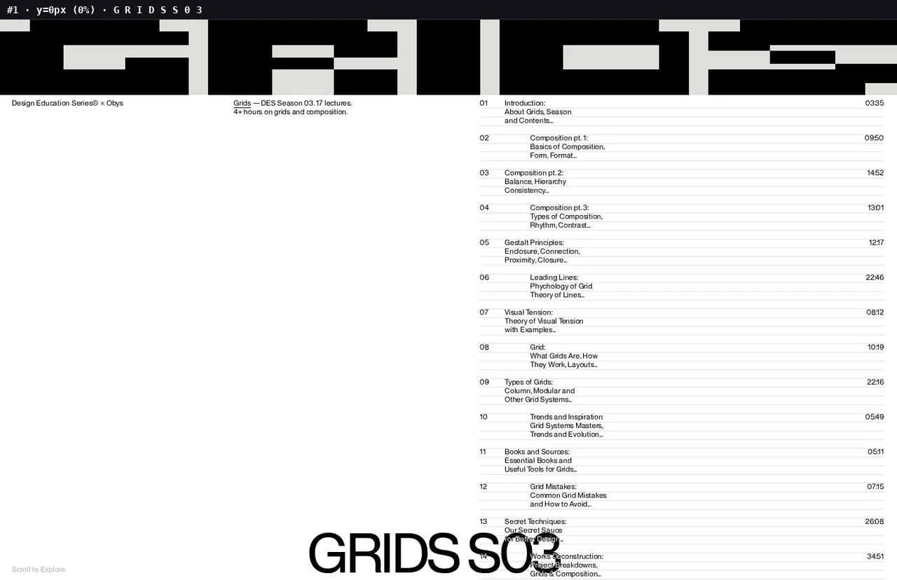
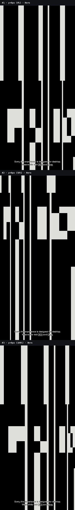

# UI Design System & Master Generation Blueprint: grids03-obys-agency

> **Grids — DES Season 03** (https://grids03.obys.agency/) — Grids is an interactive project exploring grids, composition, and key design principles through visual experiments. First launched in 202...





---

## 1. Executive Visual Persona & Design Archetype

- **Brand Essence & Persona**: **Grids — DES Season 03** (`https://grids03.obys.agency/`). Grids is an interactive project exploring grids, composition, and key design principles through visual experiments. First launched in 202...
- **Capture Provenance**: Live browser capture (`tier1_fast`, HTTP `200`, captured `2026-11-24`).
- **Visual Archetype**: **Light-Gallery WebGL / Canvas Interactive Experience (`#ffffff` / `#000000`)**.
- **Anti-AI-Slop Differentiators**:
  - **Live-Computed Chromatic Polarity**: Anchors the viewport in `#ffffff` (live computed `body` `background-color` (`computed_styles.json`)) paired with `#000000` primary typography and `#000000` accents.
  - **Grounded Typographic Hierarchy**: Uses `Obys Sans` across display (`G R I D S S 0 3`) and body copy.
  - **Calibrated Spatial Grid & Motion**: Combines `1440px` container bounds (`gap: 0px (flush layout)`, padding `4px`) with `cubic-bezier(0.25,0.1,0.25,1)` easing and Lenis Smooth Scroll (`data-lenis`), Three.js / WebGL Canvas Pipeline.

---

## 2. Spatial Architecture & Modular Grid Mathematics

### Viewport Allocation & Container Geometry
- **Captured Journey Filmstrips**: Desktop `1280×828px` (`assets/desktop-journey.webp`, `1` keyframes up to `y=0px` / doc `23462px`), Mobile `390×2616px` (`assets/mobile-journey.webp`, `3` keyframes).
- **Master Container Bounds**: `1440px` (full-bleed `100%` desktop stage measured on `1440px` viewport).
- **Canvas Lateral Padding & Spacing**: `4px` lateral canvas padding with `0px (flush layout)` grid gap.
- **Border Radius Scale**: `50%`.

### Responsive Breakpoint Architecture
- **Desktop Layout**: Multi-column CSS Grid / Flexbox layout at `1440px` (`max-width: 1440px`, `gap: 0px (flush layout)`).
- **Mobile Layout**: Single-column vertical stack at `390px` viewport width with `4px` horizontal padding.
- **Extracted CSS Media Queries**: no `@media` queries in captured stylesheet (fluid viewport scaling).

---

## 3. Color System, Materiality & Atmospheric Lighting

### Semantic Palette & Source Grounding
| Semantic Role | Ground-Truth Value | Extracted Live / CSS Source |
|---|---|---|
| **Primary Canvas Substrate** | `#ffffff` | live computed `body` `background-color` (`computed_styles.json`) |
| **Primary Typography Ink** | `#000000` | live computed `main` `color` (`computed_styles.json`) |
| **Elevated Surface / Card Substrate** | `#d9d9d9` | `.grid-entry__picture { background: #d9d9d9 }` |
| **Interactive Accent / Highlight** | `#000000` | live computed `a` `color` (`computed_styles.json`) |
| **Secondary / Muted Copy** | `#b2b2b2` | `.about__line--quiet i { color: #b2b2b2 }` |
| **Structural Hairline Border** | `#e1e1e1` | `var(--color-rule)` in `:root` |
| **Variable Token (`--color-ground`)** | `#dedfd9` | `var(--color-ground)` in `:root` |

### Sanitized Root CSS Variables (`ui-ux.md` Ground Truth)
| Variable Name | Extracted Value | Semantic Role |
|---|---|---|
| `--color-bg` | `#fff` | Canvas / Surface Token |
| `--color-ink` | `#000` | Typography Ink Token |
| `--color-ground` | `#dedfd9` | Brand / Palette Token |
| `--color-rule` | `#e1e1e1` | Brand / Palette Token |
| `--layer-gl` | `0` | Design System Custom Token |
| `--layer-content` | `2` | Design System Custom Token |
| `--layer-header` | `3` | Layout / Spatial Grid Token |
| `--layer-preloader` | `50` | Design System Custom Token |
| `--grid-columns` | `12` | Layout / Spatial Grid Token |
| `--grid-margin` | `20` | Layout / Spatial Grid Token |
| `--grid-gutter` | `20` | Layout / Spatial Grid Token |
| `--vw` | `1440px` | Layout / Spatial Grid Token |
| `--vh` | `900px` | Layout / Spatial Grid Token |
| `--caption-size` | `90px` | Layout / Spatial Grid Token |
| `--small-size` | `12px` | Layout / Spatial Grid Token |
| `--edge` | `18px` | Dimension / Scale Token |

---

## 4. Typographic Scale & Editorial Hierarchy

### Font Family Stacks
- **Display Typography**: `Obys Sans`.
- **Primary Body Stack**: `Obys Sans`.
- **Technical / Metadata Stack**: not declared in live computed styles (uses primary stack / `ui-monospace`).

### Typographic Scale & Rules (Live Computed & Stylesheet Grounded)
- **Hero Display (`H1`)**: live computed `h1` (`font-size: 90px`, `line-height: 108px`, `font-weight: 400`, `letter-spacing: -5.4px`).
- **Section Heading (`H2`)**: live computed `h2` (`font-size: 90px`, `line-height: 108px`, `font-weight: 400`, `letter-spacing: -5.4px`).
- **Body Copy**: live computed `body` (`font-size: 16px`, `line-height: normal`, `font-weight: 400`).
- **Metadata & Navigation Labels**: live computed `nav/a` (`font-size: 12px`, `line-height: 14px`, `font-weight: 400`, `letter-spacing: -0.24px`); CSS variables `--caption-size: 90px`, `--small-size: 12px`.

---

## 5. Choreographed Motion & Interaction Physics

### Primary Easing Curves
- **Extracted Timing Functions**: `cubic-bezier(0.25,0.1,0.25,1)`.

### Per-Element Transition & Choreography Rules
- **Selector `.intro__link`**: `transition: opacity .3s` extracted from `grids03-obys-agency` stylesheet.
- **Selector `.about__copy .about__link`**: `transition: opacity .3s` extracted from `grids03-obys-agency` stylesheet.
- **Selector `.about__row`**: `transition: opacity .35s` extracted from `grids03-obys-agency` stylesheet.
- **Standard CSS Easing (`cubic-bezier(0.25,0.1,0.25,1)`)**: Default timing curve (no custom `cubic-bezier()` declared in captured CSS).
- **Runtime Interaction Engine**: Integrates Lenis Smooth Scroll (`data-lenis`), Three.js / WebGL Canvas Pipeline with `prefers-reduced-motion: reduce` fallback guards.
### Measured Runtime Scroll & Interaction Telemetry (`behavioral_journey_v2`)
- **Scroll Driver Mode**: `native` (max document height `23462px`, deepest scrollY reached `0px` across `1` desktop keyframes).
- **Detected Scroll / Motion Libraries**: Native browser scroll / standard CSS transitions.

---

## 6. Component Wireframe & Structural DOM Map

### Visual Layout Schematic — Desktop (`1440px`, Grounded in `dom.html` & Landmark Bounding Boxes)
```
┌────────────────────────────────────────────────────────────────────────┐
│ DESKTOP VIEWPORT (1440px) — Grids — DES Season 03                      │
│ ====================================================================== │
│ [ <header.is-up> (1440px)             | Grids · More About Season ·  ] │
│ ---------------------------------------------------------------------- │
│ | HERO STAGE: <section.intro> (w=1440px)                             | │
│ | H1: G R I D S S 0 3                                                | │
│ | Substrate: #ffffff | Ink: #000000 | Accent: #000000                | │
│ ---------------------------------------------------------------------- │
│ | SHOWCASE GRID (<section.grid-block>) max-w: 1440px                 | │
│ | +------------------------------+  +------------------------------+ | │
│ | | G r i d s S 0 3              |  | 4 - C o l u m n              | | │
│ | +------------------------------+  +------------------------------+ | │
│ ---------------------------------------------------------------------- │
│ | DETAIL MODULE (<section.story>) — G r i d                          | │
│ ---------------------------------------------------------------------- │
│ [ FOOTER (<footer.preloader__g) | https://grids03.obys.agency/         │
└────────────────────────────────────────────────────────────────────────┘
```

### Visual Layout Schematic — Mobile Reflow (`390px`)
```
┌────────────────────────────────────────────────────────────────────────┐
│ MOBILE VIEWPORT REFLOW (390px) — Single-Column Stack (gap: 0px (flu)   │
│ ====================================================================== │
│ [ HEADER BAR (<header.is-up>          ) | Compact Menu (390px)         │
│ ---------------------------------------------------------------------- │
│ | HERO STAGE (<section.intro>) — 390px Vertical Lead                 | │
│ | H1: G R I D S S 0 3                                                | │
│ ---------------------------------------------------------------------- │
│ | SHOWCASE STACK (<section.grid-block>) — 1-Col Stack                | │
│ | [ Item 1: G r i d s S 0 3                                        ] | │
│ | [ Item 2: 4 - C o l u m n                                        ] | │
│ ---------------------------------------------------------------------- │
│ | DETAIL STACK (<section.story>) — 1-Col (G r i d)                   | │
│ ---------------------------------------------------------------------- │
│ [ FOOTER (<footer.preloader__g) | Stacked 390px Colophon               │
└────────────────────────────────────────────────────────────────────────┘
```

### Granular DOM Region Breakdown
1. **Brand Header & Navigation Bar (<header.is-up> — `grids03-obys-agency`)**:
   - Landmark `<header class="is-up">` (`1440px`) hosting `Grids — DES Season 03` navigation (`Grids · More About Season · Enroll Now · Learn for Free · Obys`), DOM attributes (`data-preloader`, `data-ground`, `data-bar`, `data-letter="G"`), and stylesheet rule `body { overflow-x:hidden }`.
2. **Hero Stage & Focal Lead (<section.intro> — `G R I D S S 0 3`)**:
   - Landmark `<section class="intro">` presenting display lead `G R I D S S 0 3` and copy excerpt *"Design Education Series®Obys"* over `#ffffff` canvas and `#000000` ink.
3. **Primary Showcase & Content Grid (<section.grid-block> — `G r i d s S 0 3`)**:
   - Landmark `<section class="grid-block">` rendering section `G r i d s S 0 3` with copy *"Design Education Series® Obys"*, asset references (`favicon.svg`, `favicon-32.png`, `favicon-180.png`, `ObysSans-Regular.woff2`), and grid rule `.stage { width:100%;height:100%;z-index:var(--layer-gl);pointer-events:none;posit... }`.
4. **Interactive Detail & Feature Matrix (<section.story> — `4 - C o l u m n`)**:
   - Landmark `<section class="story">` framing `4 - C o l u m n` and `G r i d` (*"Grids — DES Season 03. 17 lectures."*) with `#d9d9d9` surface cards, `#000000` accents, and `.preloader { z-index:var(--layer-preloader);pointer-events:none;position:fixed;inset:... }`.
5. **Colophon & Global Directory Footer (<footer.preloader__ground> — `https://grids03.obys.agency/`)**:
   - Landmark `<footer class="preloader__ground">` anchoring `Grids — DES Season 03` footer links (`Grids · More About Season · Enroll Now · Learn for Free · Obys`), copy *"4+ hours on grids and composition."*, and `#e1e1e1` structural dividers.
### Full Vertical Scroll Sequence (Desktop `1440×900` Keyframes)
- **Step 01** (`y=0px`, `0%`): Active landmark `G R I D S S 0 3` · sticky/fixed elements: `1`

---

## 7. Master Zero-Shot AI Generation Prompt

```markdown
# Master Zero-Shot Frontend Generation Prompt: grids03-obys-agency (Grids — DES Season 03)

You are a principal frontend architect and design systems engineer. Build a complete, production-ready web application replicating the exact design system, DOM landmarks, typographic hierarchy, color tokens, and motion physics of `grids03-obys-agency` (**Grids — DES Season 03** — `https://grids03.obys.agency/`).

### 1. Visual Archetype & Anti-AI-Slop Mandates
- **Archetype**: Light-Gallery WebGL / Canvas Interactive Experience (`#ffffff` / `#000000`).
- **Identity & Domain Context**: Grids is an interactive project exploring grids, composition, and key design principles through visual experiments. First launched in 202...
- **Primary Substrate**: `#ffffff` (live computed `body` `background-color` (`computed_styles.json`)), **Primary Ink**: `#000000`, **Accent / Highlight**: `#000000`.
- **Site-Specific Differentiators**:
  - **Live-Computed Chromatic Polarity**: Anchors the viewport in `#ffffff` (live computed `body` `background-color` (`computed_styles.json`)) paired with `#000000` primary typography and `#000000` accents.
  - **Grounded Typographic Hierarchy**: Uses `Obys Sans` across display (`G R I D S S 0 3`) and body copy.
  - **Calibrated Spatial Grid & Motion**: Combines `1440px` container bounds (`gap: 0px (flush layout)`, padding `4px`) with `cubic-bezier(0.25,0.1,0.25,1)` easing and Lenis Smooth Scroll (`data-lenis`), Three.js / WebGL Canvas Pipeline.

### 2. Ground-Truth CSS Variables (`:root` Token Contract)
Declare and consume these exact custom properties extracted from `grids03-obys-agency` in your global stylesheet:

:root {
  /* Grids — DES Season 03 (grids03-obys-agency) — Live-Grounded CSS Variables */
  --color-bg: #fff; /* Canvas / Surface Token (grids03-obys-agency) */
  --color-ink: #000; /* Typography Ink Token (grids03-obys-agency) */
  --color-ground: #dedfd9; /* Brand / Palette Token (grids03-obys-agency) */
  --color-rule: #e1e1e1; /* Brand / Palette Token (grids03-obys-agency) */
  --layer-gl: 0; /* Design System Custom Token (grids03-obys-agency) */
  --layer-content: 2; /* Design System Custom Token (grids03-obys-agency) */
  --layer-header: 3; /* Layout / Spatial Grid Token (grids03-obys-agency) */
  --layer-preloader: 50; /* Design System Custom Token (grids03-obys-agency) */
  --grid-columns: 12; /* Layout / Spatial Grid Token (grids03-obys-agency) */
  --grid-margin: 20; /* Layout / Spatial Grid Token (grids03-obys-agency) */
  --grid-gutter: 20; /* Layout / Spatial Grid Token (grids03-obys-agency) */
  --vw: 1440px; /* Layout / Spatial Grid Token (grids03-obys-agency) */
  --vh: 900px; /* Layout / Spatial Grid Token (grids03-obys-agency) */
  --caption-size: 90px; /* Layout / Spatial Grid Token (grids03-obys-agency) */
  --small-size: 12px; /* Layout / Spatial Grid Token (grids03-obys-agency) */
  --edge: 18px; /* Dimension / Scale Token (grids03-obys-agency) */
}

### 3. Semantic Color & Materiality Contract
Map every surface, ink, and border strictly to these source-grounded tokens:
- **Primary Canvas Substrate**: `#ffffff` — grounded in live computed `body` `background-color` (`computed_styles.json`)
- **Primary Typography Ink**: `#000000` — grounded in live computed `main` `color` (`computed_styles.json`)
- **Elevated Surface / Card Substrate**: `#d9d9d9` — grounded in `.grid-entry__picture { background: #d9d9d9 }`
- **Interactive Accent / Highlight**: `#000000` — grounded in live computed `a` `color` (`computed_styles.json`)
- **Secondary / Muted Copy**: `#b2b2b2` — grounded in `.about__line--quiet i { color: #b2b2b2 }`
- **Structural Hairline Border**: `#e1e1e1` — grounded in `var(--color-rule)` in `:root`
- **Variable Token (`--color-ground`)**: `#dedfd9` — grounded in `var(--color-ground)` in `:root`

### 4. Spatial Grid, Container Bounds & Responsive Breakpoints
- **Desktop Viewport Reference**: `1280×828px` (single-viewport 100vh live capture (900px), `1440px` standard desktop width).
- **Mobile Viewport Reference**: `390×2616px` (multi-frame vertical journey filmstrip (2616px), `390px` standard mobile width).
- **Container Max-Width**: `1440px` (full-bleed `100%` desktop stage measured on `1440px` viewport)
- **Padding & Gutters**: `4px` lateral canvas padding with `0px (flush layout)` grid gap
- **Desktop Grid**: Multi-column CSS Grid / Flexbox layout at `1440px` (`max-width: 1440px`, `gap: 0px (flush layout)`)
- **Mobile Adaptation**: Single-column vertical stack at `390px` viewport width with `4px` horizontal padding
- **Media Queries**: no `@media` queries in captured stylesheet (fluid viewport scaling)
- **Corner Radii**: `50%`

### 5. Typography & Editorial Scale Contract
- **Display Font Stack**: `Obys Sans`
- **Body Font Stack**: `Obys Sans`
- **Monospace / Technical Font Stack**: not declared in live computed styles (uses primary stack / `ui-monospace`)
- **H1 Display Rule**: live computed `h1` (`font-size: 90px`, `line-height: 108px`, `font-weight: 400`, `letter-spacing: -5.4px`)
- **H2 Section Rule**: live computed `h2` (`font-size: 90px`, `line-height: 108px`, `font-weight: 400`, `letter-spacing: -5.4px`)
- **Body Copy Rule**: live computed `body` (`font-size: 16px`, `line-height: normal`, `font-weight: 400`)
- **Metadata & Index Rule**: live computed `nav/a` (`font-size: 12px`, `line-height: 14px`, `font-weight: 400`, `letter-spacing: -0.24px`); CSS variables `--caption-size: 90px`, `--small-size: 12px`

### 6. Component Hierarchy, Verbatim Copy & Real DOM Landmarks
Scaffold `grids03-obys-agency` (`Grids — DES Season 03`) with these exact structural regions, extracted copy, and CSS rules from `dom.html`:
1. **Brand Header & Navigation Bar (<header.is-up> — `grids03-obys-agency`)**:
   - DOM & Selectors: Landmark `<header class="is-up">` (`1440px`) hosting `Grids — DES Season 03` navigation (`Grids · More About Season · Enroll Now · Learn for Free · Obys`), DOM attributes (`data-preloader`, `data-ground`, `data-bar`, `data-letter="G"`), and stylesheet rule `body { overflow-x:hidden }`.
   - Responsive Contract: Header `Brand Header & Navigation Bar (<header.is-up> — `grids03-obys-agency`)` (`grids03-obys-agency`) adapts across no `@media` queries in captured stylesheet (fluid viewport scaling) with `cubic-bezier(0.25,0.1,0.25,1)` transitions and links `Grids · More About Season · Enroll Now · Learn for Free · Obys`.
2. **Hero Stage & Focal Lead (<section.intro> — `G R I D S S 0 3`)**:
   - DOM & Selectors: Landmark `<section class="intro">` presenting display lead `G R I D S S 0 3` and copy excerpt *"Design Education Series®Obys"* over `#ffffff` canvas and `#000000` ink.
   - Responsive Contract: Hero stage (`1280×828px` desktop / `390×2616px` mobile) sets `#ffffff` background with `#000000` headline `G R I D S S 0 3`.
3. **Primary Showcase & Content Grid (<section.grid-block> — `G r i d s S 0 3`)**:
   - DOM & Selectors: Landmark `<section class="grid-block">` rendering section `G r i d s S 0 3` with copy *"Design Education Series® Obys"*, asset references (`favicon.svg`, `favicon-32.png`, `favicon-180.png`, `ObysSans-Regular.woff2`), and grid rule `.stage { width:100%;height:100%;z-index:var(--layer-gl);pointer-events:none;posit... }`.
   - Responsive Contract: Showcase grid `Primary Showcase & Content Grid (<section.grid-block> — `G r i d s S 0 3`)` applies Multi-column CSS Grid / Flexbox layout at `1440px` (`max-width: 1440px`, `gap: 0px (flush layout)`) on desktop and Single-column vertical stack at `390px` viewport width with `4px` horizontal padding on mobile.
4. **Interactive Detail & Feature Matrix (<section.story> — `4 - C o l u m n`)**:
   - DOM & Selectors: Landmark `<section class="story">` framing `4 - C o l u m n` and `G r i d` (*"Grids — DES Season 03. 17 lectures."*) with `#d9d9d9` surface cards, `#000000` accents, and `.preloader { z-index:var(--layer-preloader);pointer-events:none;position:fixed;inset:... }`.
   - Responsive Contract: Detail module `Interactive Detail & Feature Matrix (<section.story> — `4 - C o l u m n`)` uses `50%` radii, `#000000` highlights, and assets (favicon.svg, favicon-32.png, favicon-180.png).
5. **Colophon & Global Directory Footer (<footer.preloader__ground> — `https://grids03.obys.agency/`)**:
   - DOM & Selectors: Landmark `<footer class="preloader__ground">` anchoring `Grids — DES Season 03` footer links (`Grids · More About Season · Enroll Now · Learn for Free · Obys`), copy *"4+ hours on grids and composition."*, and `#e1e1e1` structural dividers.
   - Responsive Contract: Footer `Colophon & Global Directory Footer (<footer.preloader__ground> — `https://grids03.obys.agency/`)` aligns to `1440px` (full-bleed `100%` desktop stage measured on `1440px` viewport) with `4px` lateral canvas padding with `0px (flush layout)` grid gap and attributes (data-preloader, data-ground, data-bar).

#### Verbatim DOM Copy Excerpts (`dom.html`)
- Copy Excerpt 1: *"Design Education Series®Obys"*
- Copy Excerpt 2: *"Design Education Series® Obys"*
- Copy Excerpt 3: *"Grids — DES Season 03. 17 lectures."*
- Copy Excerpt 4: *"4+ hours on grids and composition."*

### 7. Motion, Extracted Stylesheet Rules & Interaction Choreography
- **Primary Easing Functions**: `cubic-bezier(0.25,0.1,0.25,1)`
- **Extracted Stylesheet Rules (`grids03-obys-agency`)**:
- `body { overflow-x:hidden }`
- `.stage { width:100%;height:100%;z-index:var(--layer-gl);pointer-events:none;posit... }`
- `.preloader { z-index:var(--layer-preloader);pointer-events:none;position:fixed;inset:... }`
- `.preloader__ground { background:var(--color-ground);will-change:transform;width:100%;height:1... }`
- `.preloader__bar { background:var(--color-ink);will-change:transform;height:1px;margin-top:... }`
- **Per-Selector Transition Rules**:
- **Selector `.intro__link`**: `transition: opacity .3s` extracted from `grids03-obys-agency` stylesheet.
- **Selector `.about__copy .about__link`**: `transition: opacity .3s` extracted from `grids03-obys-agency` stylesheet.
- **Selector `.about__row`**: `transition: opacity .35s` extracted from `grids03-obys-agency` stylesheet.
- **Standard CSS Easing (`cubic-bezier(0.25,0.1,0.25,1)`)**: Default timing curve (no custom `cubic-bezier()` declared in captured CSS).
- **Runtime Interaction Engine**: Integrates Lenis Smooth Scroll (`data-lenis`), Three.js / WebGL Canvas Pipeline with `prefers-reduced-motion: reduce` fallback guards.
### 7b. Full-Page Scroll Choreography, Interactive States & Multi-Page Routes
- **Scroll Mechanics**: Implement `native` vertical progression up to `23462px` across 1 distinct viewport chapters.
- **Vertical Chapter Sequence**: G R I D S S 0 3 (0%).

### 8. Technical Deliverables
- Implement in Next.js (App Router) with TypeScript and Tailwind CSS consuming the `:root` custom properties defined above for `grids03-obys-agency`.
- Reproduce both the `1440px` desktop architecture and `390px` mobile breakpoint transitions, preserving semantic HTML5 landmarks (`<header>`, `<nav>`, `<main>`, `<section>`, `<footer>`) and `prefers-reduced-motion` accessibility guards.
```
---

## 8. Full-Page Scroll Journey, Interactive States & Subpage Inventory

### Desktop Scroll Keyframes (`1440×900` WebP)
| Step | Scroll Y | Progress | Active Landmark / Section | Sticky/Fixed | Visual Asset |
| :---: | :---: | :---: | :--- | :---: | :--- |
| `#01` | `0px` | `0%` | G R I D S S 0 3 | `1` | [desktop-step-01.webp](assets/desktop-step-01.webp) |

### Mobile Condensed Keyframes (`390×844` WebP)
| Step | Scroll Y | Progress | Active Landmark | Visual Asset |
| :---: | :---: | :---: | :--- | :--- |
| `#01` | `0px` | `0%` | Hero | [mobile-step-01.webp](assets/mobile-step-01.webp) |
| `#02` | `0px` | `50%` | Hero | [mobile-step-02.webp](assets/mobile-step-02.webp) |
| `#03` | `0px` | `100%` | Hero | [mobile-step-03.webp](assets/mobile-step-03.webp) |

