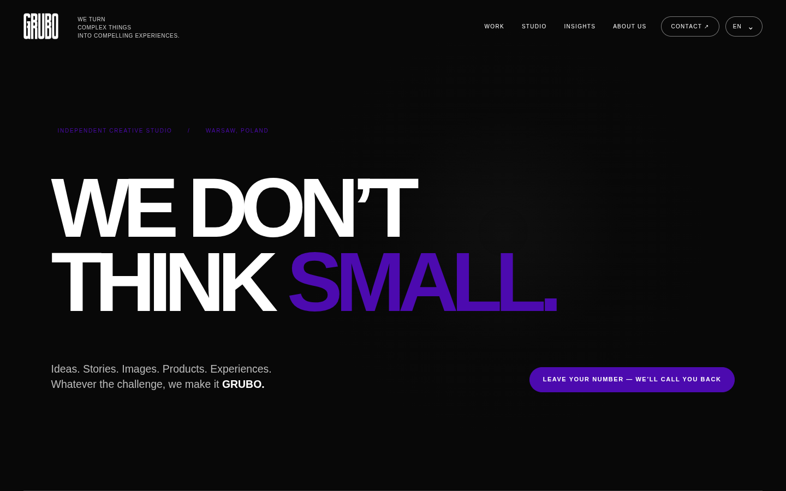

# UI Design System & Master Generation Blueprint: grubogrubo-com

> **GruboGrubo — Creative Ideas & Visual Production Studio · Warsaw** (https://grubogrubo.com) — Independent creative studio in Warsaw: creative concepts, campaigns, storytelling, animation, 3D, CGI and interactive experiences.



---

## 1. Executive Visual Persona & Design Archetype

- **Brand Essence & Persona**: **GruboGrubo — Creative Ideas & Visual Production Studio · Warsaw** (`https://grubogrubo.com`). Independent creative studio in Warsaw: creative concepts, campaigns, storytelling, animation, 3D, CGI and interactive experiences.
- **Capture Provenance**: Live browser capture (`tier2_webgl`, HTTP `200`, captured `2026-11-23`).
- **Visual Archetype**: **Dark-Substrate WebGL / Canvas Interactive Experience (`#050506` / `#5f1bd0`)**.
- **Anti-AI-Slop Differentiators**:
  - **Live-Computed Chromatic Polarity**: Anchors the viewport in `#050506` (live computed `body` `background-color` (`computed_styles.json`)) paired with `#ffffff` primary typography and `#5f1bd0` accents.
  - **Grounded Typographic Hierarchy**: Pairs `Arial Black` for display copy (`AN IDEA WITH CHARACTER.`) with `Impact` and `SFMono-Regular`.
  - **Calibrated Spatial Grid & Motion**: Combines `1680px` container bounds (`gap: 20px`, padding `43.2px`) with `cubic-bezier(.19,1,.22,1)` easing and Three.js / WebGL Canvas Pipeline.

---

## 2. Spatial Architecture & Modular Grid Mathematics


### Viewport Allocation & Container Geometry
- **Captured Viewport Dimensions**: Desktop `1440×900px` (`assets/desktop.png`, single-viewport 100vh live capture (900px)), Mobile `390×844px` (`assets/mobile.png`, single-viewport 100vh live capture (844px)).
- **Master Container Bounds**: `1680px` (non-`@media` desktop container stylesheet rule).
- **Canvas Lateral Padding & Spacing**: `43.2px` lateral canvas padding with `20px` grid gap.
- **Border Radius Scale**: `25px`, `24px`, `100%`, `50%`.

### Responsive Breakpoint Architecture
- **Desktop Layout**: Multi-column CSS Grid / Flexbox layout at `1440px` (`max-width: 1680px`, `gap: 20px`).
- **Mobile Layout**: Single-column vertical stack at `390px` viewport width with `43.2px` horizontal padding.
- **Extracted CSS Media Queries**: `@media (max-width:750px)`, `@media (prefers-reduced-motion:reduce)`, `@media (min-width:1150px) and (max-height:680px)`, `@media (max-width:390px)`.

---

## 3. Color System, Materiality & Atmospheric Lighting

### Semantic Palette & Source Grounding
| Semantic Role | Ground-Truth Value | Extracted Live / CSS Source |
|---|---|---|
| **Primary Canvas Substrate** | `#050506` | live computed `body` `background-color` (`computed_styles.json`) |
| **Primary Typography Ink** | `#ffffff` | live computed `h1` `color` (`computed_styles.json`) |
| **Elevated Surface / Card Substrate** | `#1f1f1f` | `.page-progress { background: #1f1f1f }` |
| **Interactive Accent / Highlight** | `#5f1bd0` | `.gg-cb-btn:hover { background: #5f1bd0 }` |
| **Secondary / Muted Copy** | `#d1d1d1` | live computed `p` `color` (`computed_styles.json`) |
| **Structural Hairline Border** | `#777777` | `.site-header nav a:last-child { border: #777777 }` |
| **Variable Token (`--acid`)** | `#4c0aaf` | `var(--acid)` in `:root` |
| **Variable Token (`--paper`)** | `#f5f4f0` | `var(--paper)` in `:root` |
| **Variable Token (`--fx-accent`)** | `#c3a0ec` | `var(--fx-accent)` in `:root` |

### Sanitized Root CSS Variables (`ui-ux.md` Ground Truth)
| Variable Name | Extracted Value | Semantic Role |
|---|---|---|
| `--acid` | `#4c0aaf` | Color / Atmospheric Token |
| `--paper` | `#f5f4f0` | Canvas / Surface Token |
| `--violet` | `#4c0aaf` | Color / Atmospheric Token |
| `--accent` | `var(--violet)` | Brand / Palette Token |
| `--fx-accent` | `#c3a0ec` | Brand / Palette Token |
| `--mx` | `50%` | Dimension / Scale Token |
| `--my` | `50%` | Dimension / Scale Token |
| `--gg-cb-violet` | `var(--violet,#4c0aaf)` | Color / Atmospheric Token |
| `--reveal-delay` | `0ms` | Motion / Easing Token |
| `--gg-marquee-time` | `136s` | Motion / Timing Token |
| `--grubogrubo-com-bg` | `#050506` | Canvas Substrate (from live computed `body` `background-color` (`computed_styles.json`)) |
| `--grubogrubo-com-ink` | `#ffffff` | Primary Typography Ink (computed-derived) |
| `--grubogrubo-com-surface` | `#1f1f1f` | Surface Substrate (computed-derived) |
| `--grubogrubo-com-accent` | `#5f1bd0` | Interactive Accent (computed-derived) |
| `--grubogrubo-com-muted` | `#d1d1d1` | Secondary Ink (computed-derived) |
| `--grubogrubo-com-border` | `#777777` | Structural Border (computed-derived) |

---

## 4. Typographic Scale & Editorial Hierarchy

### Font Family Stacks
- **Display Typography**: `Arial Black`.
- **Primary Body Stack**: `Impact`.
- **Technical / Metadata Stack**: `SFMono-Regular`.

### Typographic Scale & Rules (Live Computed & Stylesheet Grounded)
- **Hero Display (`H1`)**: live computed `h1` (`font-size: 60.48px`, `line-height: 59.2704px`, `font-weight: 800`, `letter-spacing: -3.6288px`); rule `h1` (`font-size: clamp(33px,3vw,54px)`, `line-height: .89`, `letter-spacing: -.06em`, `font-weight: 800`).
- **Section Heading (`H2`)**: live computed `h2` (`font-size: 144px`, `line-height: 131.04px`, `font-weight: 900`, `letter-spacing: -12.24px`); rule `h2` (`font-size: clamp(70px,12vw,210px)`, `line-height: .84`, `letter-spacing: -.092em`).
- **Body Copy**: live computed `body` (`font-size: 16px`, `line-height: normal`, `font-weight: 400`); rule `p` (`font-size: 13px`, `line-height: 1.5`).
- **Metadata & Navigation Labels**: live computed `nav/a` (`font-size: 10px`, `line-height: normal`, `font-weight: 400`, `letter-spacing: 1.3px`); rule `nav` (`font-size: 10px`, `letter-spacing: .13em`).

---

## 5. Choreographed Motion & Interaction Physics

### Primary Easing Curves
- **Extracted Timing Functions**: `cubic-bezier(.19,1,.22,1)`, `cubic-bezier(.2,.8,.2,1)`, `cubic-bezier(.17,.84,.18,1)`.

### Per-Element Transition & Choreography Rules
- **Selector `.site-header nav a`**: `transition: opacity .2s` extracted from `grubogrubo-com` stylesheet.
- **Selector `.chapter`**: `transition: left .55s ease,right .55s ease,opacity .45s ease` extracted from `grubogrubo-com` stylesheet.
- **Selector `.chapter-enter`**: `transition: background .25s,color .25s,transform .25s` extracted from `grubogrubo-com` stylesheet.
- **Extracted Easing Curve (`cubic-bezier(.19,1,.22,1)`)**: Governs interactive state transitions across `<header.site-header>` and `<section.about>`.
- **Runtime Interaction Engine**: Integrates Three.js / WebGL Canvas Pipeline with `prefers-reduced-motion: reduce` fallback guards.

---

## 6. Component Wireframe & Structural DOM Map

### Visual Layout Schematic — Desktop (`1440px`, Grounded in `dom.html` & Landmark Bounding Boxes)
```
┌────────────────────────────────────────────────────────────────────────┐
│ DESKTOP VIEWPORT (1440px) — GruboGrubo — Creative Ideas & Visual Produ │
│ ====================================================================== │
│ [ <header.site-header> (1440x89px)    | WORK · STUDIO · INSIGHTS · A ] │
│ ---------------------------------------------------------------------- │
│ | HERO STAGE: <section.intro> (w=1440px)                             | │
│ | H1: AN IDEA WITH CHARACTER.                                        | │
│ | Substrate: #050506 | Ink: #ffffff | Accent: #5f1bd0                | │
│ ---------------------------------------------------------------------- │
│ | SHOWCASE GRID (<section.about>) max-w: 1680px                      | │
│ | +------------------------------+  +------------------------------+ | │
│ | | WE DON’T THINK SMALL.        |  | THE IDEA COMES FIRST.        | | │
│ | +------------------------------+  +------------------------------+ | │
│ ---------------------------------------------------------------------- │
│ | DETAIL MODULE (<section.team>) — Advertising films                 | │
│ ---------------------------------------------------------------------- │
│ [ FOOTER (<footer.contact>    ) | https://grubogrubo.com               │
└────────────────────────────────────────────────────────────────────────┘
```

### Visual Layout Schematic — Mobile Reflow (`390px`)
```
┌────────────────────────────────────────────────────────────────────────┐
│ MOBILE VIEWPORT REFLOW (390px) — Single-Column Stack (gap: 20px)       │
│ ====================================================================== │
│ [ HEADER BAR (<header.site-header>    ) | Compact Menu (390px)         │
│ ---------------------------------------------------------------------- │
│ | HERO STAGE (<section.intro>) — 390px Vertical Lead                 | │
│ | H1: AN IDEA WITH CHARACTER.                                        | │
│ ---------------------------------------------------------------------- │
│ | SHOWCASE STACK (<section.about>) — 1-Col Stack                     | │
│ | [ Item 1: WE DON’T THINK SMALL.                                  ] | │
│ | [ Item 2: THE IDEA COMES FIRST.                                  ] | │
│ ---------------------------------------------------------------------- │
│ | DETAIL STACK (<section.team>) — 1-Col (Advertising films)          | │
│ ---------------------------------------------------------------------- │
│ [ FOOTER (<footer.contact>    ) | Stacked 390px Colophon               │
└────────────────────────────────────────────────────────────────────────┘
```

### Granular DOM Region Breakdown
1. **Brand Header & Navigation Bar (<header.site-header> — `grubogrubo-com`)**:
   - Landmark `<header class="site-header">` (`1440x89px`) hosting `GruboGrubo — Creative Ideas & Visual` navigation (`WORK · STUDIO · INSIGHTS · ABOUT US · CONTACT ↗`), DOM attributes (`data-language="en"`, `data-i18n="manifest"`, `data-i18n="navWork"`, `data-i18n="navStudio"`), and stylesheet rule `html { scroll-behavior:smooth }`.
2. **Hero Stage & Focal Lead (<section.intro> — `AN IDEA WITH CHARACTER.`)**:
   - Landmark `<section class="intro">` presenting display lead `AN IDEA WITH CHARACTER.` and copy excerpt *"WE TURN COMPLEX THINGS INTO COMPELLING EXPERIENCES."* over `#050506` canvas and `#ffffff` ink.
3. **Primary Showcase & Content Grid (<section.about> — `WE DON’T THINK SMALL.`)**:
   - Landmark `<section class="about">` rendering section `WE DON’T THINK SMALL.` with copy *"INDEPENDENT CREATIVE STUDIO"*, asset references (`style.css`, `cookie-consent.css`, `callback.css`, `home-sections.css`), and grid rule `body { margin:0;background:050506;color:fff;font-family:Arial,Helvetica,sans-se... }`.
4. **Interactive Detail & Feature Matrix (<section.team> — `THE IDEA COMES FIRST.`)**:
   - Landmark `<section class="team founder-cinematic">` framing `THE IDEA COMES FIRST.` and `Advertising films` (*"Ideas. Stories. Images. Products. Experiences. Whatever the chall"*) with `#1f1f1f` surface cards, `#5f1bd0` accents, and `button { cursor:pointer }`.
5. **Colophon & Global Directory Footer (<footer.contact> — `https://grubogrubo.com`)**:
   - Landmark `<footer class="contact">` anchoring `GruboGrubo — Creative Ideas & Vi` footer links (`WORK · STUDIO · INSIGHTS · ABOUT US · CONTACT ↗`), copy *"We don’t start with technology. We start with a question: wh"*, and `#777777` structural dividers.

---

## 7. Master Zero-Shot AI Generation Prompt

```markdown
# Master Zero-Shot Frontend Generation Prompt: grubogrubo-com (GruboGrubo — Creative Ideas & Visual Production Studio · Warsaw)

You are a principal frontend architect and design systems engineer. Build a complete, production-ready web application replicating the exact design system, DOM landmarks, typographic hierarchy, color tokens, and motion physics of `grubogrubo-com` (**GruboGrubo — Creative Ideas & Visual Production Studio · Warsaw** — `https://grubogrubo.com`).

### 1. Visual Archetype & Anti-AI-Slop Mandates
- **Archetype**: Dark-Substrate WebGL / Canvas Interactive Experience (`#050506` / `#5f1bd0`).
- **Identity & Domain Context**: Independent creative studio in Warsaw: creative concepts, campaigns, storytelling, animation, 3D, CGI and interactive experiences.
- **Primary Substrate**: `#050506` (live computed `body` `background-color` (`computed_styles.json`)), **Primary Ink**: `#ffffff`, **Accent / Highlight**: `#5f1bd0`.
- **Site-Specific Differentiators**:
  - **Live-Computed Chromatic Polarity**: Anchors the viewport in `#050506` (live computed `body` `background-color` (`computed_styles.json`)) paired with `#ffffff` primary typography and `#5f1bd0` accents.
  - **Grounded Typographic Hierarchy**: Pairs `Arial Black` for display copy (`AN IDEA WITH CHARACTER.`) with `Impact` and `SFMono-Regular`.
  - **Calibrated Spatial Grid & Motion**: Combines `1680px` container bounds (`gap: 20px`, padding `43.2px`) with `cubic-bezier(.19,1,.22,1)` easing and Three.js / WebGL Canvas Pipeline.

### 2. Ground-Truth CSS Variables (`:root` Token Contract)
Declare and consume these exact custom properties extracted from `grubogrubo-com` in your global stylesheet:

:root {
  /* GruboGrubo — Creative Ideas & Visual Production Studio · Warsaw (grubogrubo-com) — Live-Grounded CSS Variables */
  --acid: #4c0aaf; /* Color / Atmospheric Token (grubogrubo-com) */
  --paper: #f5f4f0; /* Canvas / Surface Token (grubogrubo-com) */
  --violet: #4c0aaf; /* Color / Atmospheric Token (grubogrubo-com) */
  --accent: var(--violet); /* Brand / Palette Token (grubogrubo-com) */
  --fx-accent: #c3a0ec; /* Brand / Palette Token (grubogrubo-com) */
  --mx: 50%; /* Dimension / Scale Token (grubogrubo-com) */
  --my: 50%; /* Dimension / Scale Token (grubogrubo-com) */
  --gg-cb-violet: var(--violet,#4c0aaf); /* Color / Atmospheric Token (grubogrubo-com) */
  --reveal-delay: 0ms; /* Motion / Easing Token (grubogrubo-com) */
  --gg-marquee-time: 136s; /* Motion / Timing Token (grubogrubo-com) */
  --grubogrubo-com-bg: #050506; /* Canvas Substrate (from live computed `body` `background-color` (`computed_styles.json`)) (grubogrubo-com) */
  --grubogrubo-com-ink: #ffffff; /* Primary Typography Ink (computed-derived) (grubogrubo-com) */
  --grubogrubo-com-surface: #1f1f1f; /* Surface Substrate (computed-derived) (grubogrubo-com) */
  --grubogrubo-com-accent: #5f1bd0; /* Interactive Accent (computed-derived) (grubogrubo-com) */
  --grubogrubo-com-muted: #d1d1d1; /* Secondary Ink (computed-derived) (grubogrubo-com) */
  --grubogrubo-com-border: #777777; /* Structural Border (computed-derived) (grubogrubo-com) */
}

### 3. Semantic Color & Materiality Contract
Map every surface, ink, and border strictly to these source-grounded tokens:
- **Primary Canvas Substrate**: `#050506` — grounded in live computed `body` `background-color` (`computed_styles.json`)
- **Primary Typography Ink**: `#ffffff` — grounded in live computed `h1` `color` (`computed_styles.json`)
- **Elevated Surface / Card Substrate**: `#1f1f1f` — grounded in `.page-progress { background: #1f1f1f }`
- **Interactive Accent / Highlight**: `#5f1bd0` — grounded in `.gg-cb-btn:hover { background: #5f1bd0 }`
- **Secondary / Muted Copy**: `#d1d1d1` — grounded in live computed `p` `color` (`computed_styles.json`)
- **Structural Hairline Border**: `#777777` — grounded in `.site-header nav a:last-child { border: #777777 }`
- **Variable Token (`--acid`)**: `#4c0aaf` — grounded in `var(--acid)` in `:root`
- **Variable Token (`--paper`)**: `#f5f4f0` — grounded in `var(--paper)` in `:root`
- **Variable Token (`--fx-accent`)**: `#c3a0ec` — grounded in `var(--fx-accent)` in `:root`

### 4. Spatial Grid, Container Bounds & Responsive Breakpoints
- **Desktop Viewport Reference**: `1440×900px` (single-viewport 100vh live capture (900px), `1440px` standard desktop width).
- **Mobile Viewport Reference**: `390×844px` (single-viewport 100vh live capture (844px), `390px` standard mobile width).
- **Container Max-Width**: `1680px` (non-`@media` desktop container stylesheet rule)
- **Padding & Gutters**: `43.2px` lateral canvas padding with `20px` grid gap
- **Desktop Grid**: Multi-column CSS Grid / Flexbox layout at `1440px` (`max-width: 1680px`, `gap: 20px`)
- **Mobile Adaptation**: Single-column vertical stack at `390px` viewport width with `43.2px` horizontal padding
- **Media Queries**: `@media (max-width:750px)`, `@media (prefers-reduced-motion:reduce)`, `@media (min-width:1150px) and (max-height:680px)`, `@media (max-width:390px)`
- **Corner Radii**: `25px`, `24px`, `100%`, `50%`

### 5. Typography & Editorial Scale Contract
- **Display Font Stack**: `Arial Black`
- **Body Font Stack**: `Impact`
- **Monospace / Technical Font Stack**: `SFMono-Regular`
- **H1 Display Rule**: live computed `h1` (`font-size: 60.48px`, `line-height: 59.2704px`, `font-weight: 800`, `letter-spacing: -3.6288px`); rule `h1` (`font-size: clamp(33px,3vw,54px)`, `line-height: .89`, `letter-spacing: -.06em`, `font-weight: 800`)
- **H2 Section Rule**: live computed `h2` (`font-size: 144px`, `line-height: 131.04px`, `font-weight: 900`, `letter-spacing: -12.24px`); rule `h2` (`font-size: clamp(70px,12vw,210px)`, `line-height: .84`, `letter-spacing: -.092em`)
- **Body Copy Rule**: live computed `body` (`font-size: 16px`, `line-height: normal`, `font-weight: 400`); rule `p` (`font-size: 13px`, `line-height: 1.5`)
- **Metadata & Index Rule**: live computed `nav/a` (`font-size: 10px`, `line-height: normal`, `font-weight: 400`, `letter-spacing: 1.3px`); rule `nav` (`font-size: 10px`, `letter-spacing: .13em`)

### 6. Component Hierarchy, Verbatim Copy & Real DOM Landmarks
Scaffold `grubogrubo-com` (`GruboGrubo — Creative Ideas & Visual Production Studio · Warsaw`) with these exact structural regions, extracted copy, and CSS rules from `dom.html`:
1. **Brand Header & Navigation Bar (<header.site-header> — `grubogrubo-com`)**:
   - DOM & Selectors: Landmark `<header class="site-header">` (`1440x89px`) hosting `GruboGrubo — Creative Ideas & Visual` navigation (`WORK · STUDIO · INSIGHTS · ABOUT US · CONTACT ↗`), DOM attributes (`data-language="en"`, `data-i18n="manifest"`, `data-i18n="navWork"`, `data-i18n="navStudio"`), and stylesheet rule `html { scroll-behavior:smooth }`.
   - Responsive Contract: Header `Brand Header & Navigation Bar (<header.site-header> — `grubogrubo-com`)` (`grubogrubo-com`) adapts across `@media (max-width:750px)`, `@media (prefers-reduced-motion:reduce)`, `@media (min-width:1150px) and (max-height:680px)`, `@media (max-width:390px)` with `cubic-bezier(.19,1,.22,1)`, `cubic-bezier(.2,.8,.2,1)`, `cubic-bezier(.17,.84,.18,1)` transitions and links `WORK · STUDIO · INSIGHTS · ABOUT US · CONTACT ↗`.
2. **Hero Stage & Focal Lead (<section.intro> — `AN IDEA WITH CHARACTER.`)**:
   - DOM & Selectors: Landmark `<section class="intro">` presenting display lead `AN IDEA WITH CHARACTER.` and copy excerpt *"WE TURN COMPLEX THINGS INTO COMPELLING EXPERIENCES."* over `#050506` canvas and `#ffffff` ink.
   - Responsive Contract: Hero stage (`1440×900px` desktop / `390×844px` mobile) sets `#050506` background with `#ffffff` headline `AN IDEA WITH CHARACTER.`.
3. **Primary Showcase & Content Grid (<section.about> — `WE DON’T THINK SMALL.`)**:
   - DOM & Selectors: Landmark `<section class="about">` rendering section `WE DON’T THINK SMALL.` with copy *"INDEPENDENT CREATIVE STUDIO"*, asset references (`style.css`, `cookie-consent.css`, `callback.css`, `home-sections.css`), and grid rule `body { margin:0;background:050506;color:fff;font-family:Arial,Helvetica,sans-se... }`.
   - Responsive Contract: Showcase grid `Primary Showcase & Content Grid (<section.about> — `WE DON’T THINK SMALL.`)` applies Multi-column CSS Grid / Flexbox layout at `1440px` (`max-width: 1680px`, `gap: 20px`) on desktop and Single-column vertical stack at `390px` viewport width with `43.2px` horizontal padding on mobile.
4. **Interactive Detail & Feature Matrix (<section.team> — `THE IDEA COMES FIRST.`)**:
   - DOM & Selectors: Landmark `<section class="team founder-cinematic">` framing `THE IDEA COMES FIRST.` and `Advertising films` (*"Ideas. Stories. Images. Products. Experiences. Whatever the chall"*) with `#1f1f1f` surface cards, `#5f1bd0` accents, and `button { cursor:pointer }`.
   - Responsive Contract: Detail module `Interactive Detail & Feature Matrix (<section.team> — `THE IDEA COMES FIRST.`)` uses `25px`, `24px`, `100%`, `50%` radii, `#5f1bd0` highlights, and assets (style.css, cookie-consent.css, callback.css).
5. **Colophon & Global Directory Footer (<footer.contact> — `https://grubogrubo.com`)**:
   - DOM & Selectors: Landmark `<footer class="contact">` anchoring `GruboGrubo — Creative Ideas & Vi` footer links (`WORK · STUDIO · INSIGHTS · ABOUT US · CONTACT ↗`), copy *"We don’t start with technology. We start with a question: wh"*, and `#777777` structural dividers.
   - Responsive Contract: Footer `Colophon & Global Directory Footer (<footer.contact> — `https://grubogrubo.com`)` aligns to `1680px` (non-`@media` desktop container stylesheet rule) with `43.2px` lateral canvas padding with `20px` grid gap and attributes (data-language="en", data-i18n="manifest", data-i18n="navWork").

#### Verbatim DOM Copy Excerpts (`dom.html`)
- Copy Excerpt 1: *"WE TURN COMPLEX THINGS INTO COMPELLING EXPERIENCES."*
- Copy Excerpt 2: *"INDEPENDENT CREATIVE STUDIO"*
- Copy Excerpt 3: *"Ideas. Stories. Images. Products. Experiences. Whatever the challenge, we make it..."*
- Copy Excerpt 4: *"We don’t start with technology. We start with a question: what do we actually need..."*

### 7. Motion, Extracted Stylesheet Rules & Interaction Choreography
- **Primary Easing Functions**: `cubic-bezier(.19,1,.22,1)`, `cubic-bezier(.2,.8,.2,1)`, `cubic-bezier(.17,.84,.18,1)`
- **Extracted Stylesheet Rules (`grubogrubo-com`)**:
- `html { scroll-behavior:smooth }`
- `body { margin:0;background:050506;color:fff;font-family:Arial,Helvetica,sans-se... }`
- `button { cursor:pointer }`
- `scene { position:fixed;inset:0;width:100%;height:100%;display:block;z-index:0;to... }`
- `.brand { display:block;width:72px;height:30px;overflow:hidden }`
- **Per-Selector Transition Rules**:
- **Selector `.site-header nav a`**: `transition: opacity .2s` extracted from `grubogrubo-com` stylesheet.
- **Selector `.chapter`**: `transition: left .55s ease,right .55s ease,opacity .45s ease` extracted from `grubogrubo-com` stylesheet.
- **Selector `.chapter-enter`**: `transition: background .25s,color .25s,transform .25s` extracted from `grubogrubo-com` stylesheet.
- **Extracted Easing Curve (`cubic-bezier(.19,1,.22,1)`)**: Governs interactive state transitions across `<header.site-header>` and `<section.about>`.
- **Runtime Interaction Engine**: Integrates Three.js / WebGL Canvas Pipeline with `prefers-reduced-motion: reduce` fallback guards.

### 8. Technical Deliverables
- Implement in Next.js (App Router) with TypeScript and Tailwind CSS consuming the `:root` custom properties defined above for `grubogrubo-com`.
- Reproduce both the `1440px` desktop architecture and `390px` mobile breakpoint transitions, preserving semantic HTML5 landmarks (`<header>`, `<nav>`, `<main>`, `<section>`, `<footer>`) and `prefers-reduced-motion` accessibility guards.
```
