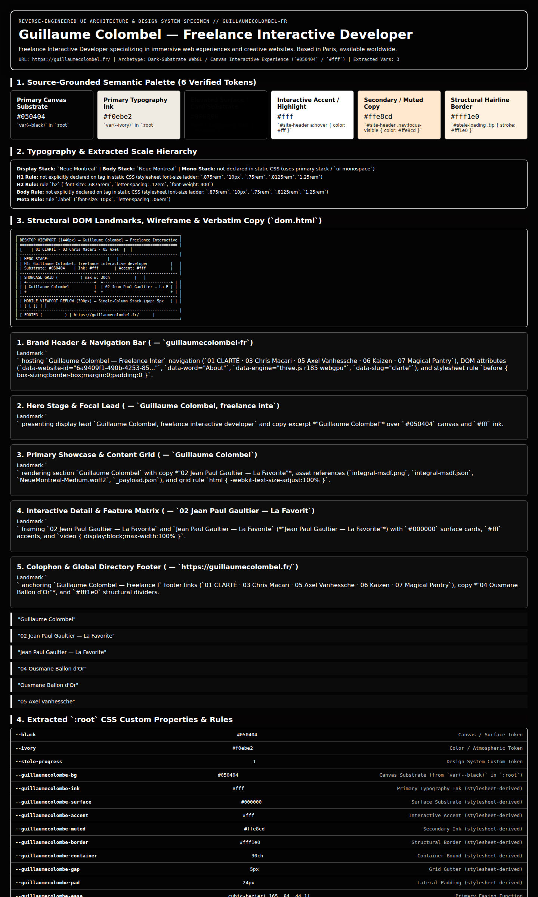
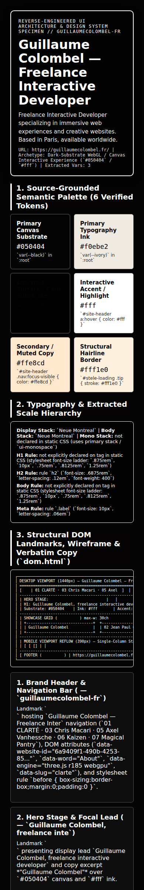

# UI Design System & Master Generation Blueprint: guillaumecolombel-fr

> **Guillaume Colombel — Freelance Interactive Developer** (https://guillaumecolombel.fr/) — Freelance Interactive Developer specializing in immersive web experiences and creative websites. Based in Paris, available worldwide.



---

## 1. Executive Visual Persona & Design Archetype

- **Brand Essence & Persona**: **Guillaume Colombel — Freelance Interactive Developer** (`https://guillaumecolombel.fr/`). Freelance Interactive Developer specializing in immersive web experiences and creative websites. Based in Paris, available worldwide.
- **Visual Archetype**: **Dark-Substrate WebGL / Canvas Interactive Experience (`#050404` / `#fff`)**.
- **Anti-AI-Slop Differentiators**:
  - **Source-Grounded Chromatic Polarity**: Anchors the viewport in `#050404` (`var(--black)` in `:root`) paired with `#fff` primary typography and `#fff` accents.
  - **Extracted Typographic Hierarchy**: Pairs `Neue Montreal` for display copy (`Guillaume Colombel, freelance intera`) with `Neue Montreal` and not declared in static CSS (uses primary stack / `ui-monospace`).
  - **Calibrated Spatial Grid & Motion**: Combines `30ch` container bounds (`gap: 5px`, padding `24px`) with `cubic-bezier(.165,.84,.44,1)` easing and Three.js / WebGL Canvas Pipeline, Locomotive Scroll Parallax.

---

## 2. Spatial Architecture & Modular Grid Mathematics



### Viewport Allocation & Container Geometry
- **Captured Viewport Dimensions**: Desktop `1440×2400px` (`assets/desktop.png`, capped at 2400px multi-section capture), Mobile `390×2400px` (`assets/mobile.png`, capped at 2400px multi-section capture).
- **Master Container Bounds**: `30ch` extracted from `guillaumecolombel-fr` stylesheet.
- **Canvas Lateral Padding & Spacing**: `24px` lateral canvas padding with `5px` grid gap.
- **Border Radius Scale**: `50%`.

### Responsive Breakpoint Architecture
- **Desktop Layout**: Multi-column CSS Grid / Flexbox layout at `1440px` (`max-width: 30ch`, `gap: 5px`).
- **Mobile Layout**: Single-column vertical stack at `390px` viewport width with `24px` horizontal padding.
- **Extracted CSS Media Queries**: `@media (prefers-reduced-motion:reduce)`, `@media (max-aspect-ratio:4/5)`, `@media (max-aspect-ratio:249/500)`, `@media (max-width:768px)`.

---

## 3. Color System, Materiality & Atmospheric Lighting

### Semantic Palette & Source Grounding
| Semantic Role | Ground-Truth Value | Extracted CSS Source / Selector |
|---|---|---|
| **Primary Canvas Substrate** | `#050404` | `var(--black)` in `:root` |
| **Primary Typography Ink** | `#f0ebe2` | `var(--ivory)` in `:root` |
| **Elevated Surface / Card Substrate** | `#000000` | `html { background: black }` (`#000000`) |
| **Interactive Accent / Highlight** | `#fff` | `#site-header a:hover { color: #fff }` |
| **Secondary / Muted Copy** | `#ffe8cd` | `#site-header .nav:focus-visible { color: #ffe8cd }` |
| **Structural Hairline Border** | `#fff1e0` | `#stele-loading .tip { stroke: #fff1e0 }` |

### Sanitized Root CSS Variables (`ui-ux.md` Ground Truth)
| Variable Name | Extracted Value | Semantic Role |
|---|---|---|
| `--black` | `#050404` | Canvas / Surface Token |
| `--ivory` | `#f0ebe2` | Color / Atmospheric Token |
| `--stele-progress` | `1` | Design System Custom Token |
| `--guillaumecolombe-bg` | `#050404` | Canvas Substrate (from `var(--black)` in `:root`) |
| `--guillaumecolombe-ink` | `#fff` | Primary Typography Ink (stylesheet-derived) |
| `--guillaumecolombe-surface` | `#000000` | Surface Substrate (stylesheet-derived) |
| `--guillaumecolombe-accent` | `#fff` | Interactive Accent (stylesheet-derived) |
| `--guillaumecolombe-muted` | `#ffe8cd` | Secondary Ink (stylesheet-derived) |
| `--guillaumecolombe-border` | `#fff1e0` | Structural Border (stylesheet-derived) |
| `--guillaumecolombe-container` | `30ch` | Container Bound (stylesheet-derived) |
| `--guillaumecolombe-gap` | `5px` | Grid Gutter (stylesheet-derived) |
| `--guillaumecolombe-pad` | `24px` | Lateral Padding (stylesheet-derived) |
| `--guillaumecolombe-ease` | `cubic-bezier(.165,.84,.44,1)` | Primary Easing Function |
| `--guillaumecolombe-radius` | `50%` | Corner Radius (stylesheet-derived) |
| `--guillaumecolombe-fs-base` | `.875rem` | Observed Font Size Token |

---

## 4. Typographic Scale & Editorial Hierarchy

### Font Family Stacks
- **Display Typography**: `Neue Montreal`.
- **Primary Body Stack**: `Neue Montreal`.
- **Technical / Metadata Stack**: not declared in static CSS (uses primary stack / `ui-monospace`).

### Typographic Scale & Rules (Extracted from Stylesheet & Variables)
- **Hero Display (`H1`)**: not explicitly declared on tag in static CSS (stylesheet font-size ladder: `.875rem`, `10px`, `.75rem`, `.8125rem`, `1.25rem`).
- **Section Heading (`H2`)**: rule `h2` (`font-size: .6875rem`, `letter-spacing: .12em`, `font-weight: 400`).
- **Body Copy**: not explicitly declared on tag in static CSS (stylesheet font-size ladder: `.875rem`, `10px`, `.75rem`, `.8125rem`, `1.25rem`).
- **Metadata & Navigation Labels**: rule `.label` (`font-size: 10px`, `letter-spacing: .06em`).

---

## 5. Choreographed Motion & Interaction Physics

### Primary Easing Curves
- **Extracted Timing Functions**: `cubic-bezier(.165,.84,.44,1)`, `cubic-bezier(.3,2.2,.45,1)`, `cubic-bezier(.22,1,.36,1)`.

### Per-Element Transition & Choreography Rules
- **Selector `media(prefers-reduced-motion:reduce)`**: `transition: none!important` extracted from `guillaumecolombel-fr` stylesheet.
- **Selector `#site-header a`**: `transition: color .25s ease` extracted from `guillaumecolombel-fr` stylesheet.
- **Selector `#site-header .nav`**: `transition: color .25s ease` extracted from `guillaumecolombel-fr` stylesheet.
- **Extracted Easing Curve (`cubic-bezier(.165,.84,.44,1)`)**: Governs interactive state transitions across `<header.stele-gl-text>` and `<section.awards>`.
- **Runtime Interaction Engine**: Integrates Three.js / WebGL Canvas Pipeline, Locomotive Scroll Parallax with `prefers-reduced-motion: reduce` fallback guards.

---

## 6. Component Wireframe & Structural DOM Map

### Visual Layout Schematic (Grounded in `dom.html` — `1440px` Desktop & `390px` Mobile Reflow)
```
┌────────────────────────────────────────────────────────────────────────┐
│ DESKTOP VIEWPORT (1440px) — Guillaume Colombel — Freelance Interactive │
│ ====================================================================== │
│ [ <header.stele-gl-text>   | 01 CLARTÉ · 03 Chris Macari · 05 Axel  ]  │
│ ---------------------------------------------------------------------- │
│ | HERO STAGE: <section.router-link-active>                         |   │
│ | H1: Guillaume Colombel, freelance interactive developer          |   │
│ | Substrate: #050404    | Ink: #fff       | Accent: #fff           |   │
│ ---------------------------------------------------------------------- │
│ | SHOWCASE GRID (<section.awards>          ) max-w: 30ch           |   │
│ | +------------------------------+  +------------------------------+ | │
│ | | Guillaume Colombel           |  | 02 Jean Paul Gaultier — La F | | │
│ | +------------------------------+  +------------------------------+ | │
│ ---------------------------------------------------------------------- │
│ | MOBILE VIEWPORT REFLOW (390px) — Single-Column Stack (gap: 5px   ) | │
│ | [<header.stele-gl-t] -> [<section.router-li] -> [<section.awards>] | │
│ ---------------------------------------------------------------------- │
│ [ FOOTER (<footer.nav>          ) | https://guillaumecolombel.fr/      │
└────────────────────────────────────────────────────────────────────────┘
```

### Granular DOM Region Breakdown
1. **Brand Header & Navigation Bar (<header.stele-gl-text> — `guillaumecolombel-fr`)**:
   - Landmark `<header class="stele-gl-text">` hosting `Guillaume Colombel — Freelance Inter` navigation (`01 CLARTÉ · 03 Chris Macari · 05 Axel Vanhessche · 06 Kaizen · 07 Magical Pantry`), DOM attributes (`data-website-id="6a9409f1-490b-4253-85..."`, `data-word="About"`, `data-engine="three.js r185 webgpu"`, `data-slug="clarte"`), and stylesheet rule `before { box-sizing:border-box;margin:0;padding:0 }`.
2. **Hero Stage & Focal Lead (<section.router-link-active> — `Guillaume Colombel, freelance inte`)**:
   - Landmark `<section class="router-link-active">` presenting display lead `Guillaume Colombel, freelance interactive developer` and copy excerpt *"Guillaume Colombel"* over `#050404` canvas and `#fff` ink.
3. **Primary Showcase & Content Grid (<section.awards> — `Guillaume Colombel`)**:
   - Landmark `<section class="awards">` rendering section `Guillaume Colombel` with copy *"02 Jean Paul Gaultier — La Favorite"*, asset references (`integral-msdf.png`, `integral-msdf.json`, `NeueMontreal-Medium.woff2`, `_payload.json`), and grid rule `html { -webkit-text-size-adjust:100% }`.
4. **Interactive Detail & Feature Matrix (<section.awards> — `02 Jean Paul Gaultier — La Favorit`)**:
   - Landmark `<section class="awards">` framing `02 Jean Paul Gaultier — La Favorite` and `Jean Paul Gaultier — La Favorite` (*"Jean Paul Gaultier — La Favorite"*) with `#000000` surface cards, `#fff` accents, and `video { display:block;max-width:100% }`.
5. **Colophon & Global Directory Footer (<footer.nav> — `https://guillaumecolombel.fr/`)**:
   - Landmark `<footer class="nav">` anchoring `Guillaume Colombel — Freelance I` footer links (`01 CLARTÉ · 03 Chris Macari · 05 Axel Vanhessche · 06 Kaizen · 07 Magical Pantry`), copy *"04 Ousmane Ballon d'Or"*, and `#fff1e0` structural dividers.

---

## 7. Master Zero-Shot AI Generation Prompt

```markdown
# Master Zero-Shot Frontend Generation Prompt: guillaumecolombel-fr (Guillaume Colombel — Freelance Interactive Developer)

You are a principal frontend architect and design systems engineer. Build a complete, production-ready web application replicating the exact design system, DOM landmarks, typographic hierarchy, color tokens, and motion physics of `guillaumecolombel-fr` (**Guillaume Colombel — Freelance Interactive Developer** — `https://guillaumecolombel.fr/`).

### 1. Visual Archetype & Anti-AI-Slop Mandates
- **Archetype**: Dark-Substrate WebGL / Canvas Interactive Experience (`#050404` / `#fff`).
- **Identity & Domain Context**: Freelance Interactive Developer specializing in immersive web experiences and creative websites. Based in Paris, available worldwide.
- **Primary Substrate**: `#050404` (`var(--black)` in `:root`), **Primary Ink**: `#fff`, **Accent / Highlight**: `#fff`.
- **Site-Specific Differentiators**:
  - **Source-Grounded Chromatic Polarity**: Anchors the viewport in `#050404` (`var(--black)` in `:root`) paired with `#fff` primary typography and `#fff` accents.
  - **Extracted Typographic Hierarchy**: Pairs `Neue Montreal` for display copy (`Guillaume Colombel, freelance intera`) with `Neue Montreal` and not declared in static CSS (uses primary stack / `ui-monospace`).
  - **Calibrated Spatial Grid & Motion**: Combines `30ch` container bounds (`gap: 5px`, padding `24px`) with `cubic-bezier(.165,.84,.44,1)` easing and Three.js / WebGL Canvas Pipeline, Locomotive Scroll Parallax.

### 2. Ground-Truth CSS Variables (`:root` Token Contract)
Declare and consume these exact custom properties extracted from `guillaumecolombel-fr` in your global stylesheet:

:root {
  /* Guillaume Colombel — Freelance Interactive Developer (guillaumecolombel-fr) — Ground-Truth Extracted CSS Variables */
  --black: #050404; /* Canvas / Surface Token (guillaumecolombel-fr) */
  --ivory: #f0ebe2; /* Color / Atmospheric Token (guillaumecolombel-fr) */
  --stele-progress: 1; /* Design System Custom Token (guillaumecolombel-fr) */
  --guillaumecolombe-bg: #050404; /* Canvas Substrate (from `var(--black)` in `:root`) (guillaumecolombel-fr) */
  --guillaumecolombe-ink: #fff; /* Primary Typography Ink (stylesheet-derived) (guillaumecolombel-fr) */
  --guillaumecolombe-surface: #000000; /* Surface Substrate (stylesheet-derived) (guillaumecolombel-fr) */
  --guillaumecolombe-accent: #fff; /* Interactive Accent (stylesheet-derived) (guillaumecolombel-fr) */
  --guillaumecolombe-muted: #ffe8cd; /* Secondary Ink (stylesheet-derived) (guillaumecolombel-fr) */
  --guillaumecolombe-border: #fff1e0; /* Structural Border (stylesheet-derived) (guillaumecolombel-fr) */
  --guillaumecolombe-container: 30ch; /* Container Bound (stylesheet-derived) (guillaumecolombel-fr) */
  --guillaumecolombe-gap: 5px; /* Grid Gutter (stylesheet-derived) (guillaumecolombel-fr) */
  --guillaumecolombe-pad: 24px; /* Lateral Padding (stylesheet-derived) (guillaumecolombel-fr) */
  --guillaumecolombe-ease: cubic-bezier(.165,.84,.44,1); /* Primary Easing Function (guillaumecolombel-fr) */
  --guillaumecolombe-radius: 50%; /* Corner Radius (stylesheet-derived) (guillaumecolombel-fr) */
  --guillaumecolombe-fs-base: .875rem; /* Observed Font Size Token (guillaumecolombel-fr) */
}

### 3. Semantic Color & Materiality Contract
Map every surface, ink, and border strictly to these source-grounded tokens:
- **Primary Canvas Substrate**: `#050404` — grounded in `var(--black)` in `:root`
- **Primary Typography Ink**: `#f0ebe2` — grounded in `var(--ivory)` in `:root`
- **Elevated Surface / Card Substrate**: `#000000` — grounded in `html { background: black }` (`#000000`)
- **Interactive Accent / Highlight**: `#fff` — grounded in `#site-header a:hover { color: #fff }`
- **Secondary / Muted Copy**: `#ffe8cd` — grounded in `#site-header .nav:focus-visible { color: #ffe8cd }`
- **Structural Hairline Border**: `#fff1e0` — grounded in `#stele-loading .tip { stroke: #fff1e0 }`

### 4. Spatial Grid, Container Bounds & Responsive Breakpoints
- **Desktop Viewport Reference**: `1440×2400px` (capped at 2400px multi-section capture, `1440px` standard desktop width).
- **Mobile Viewport Reference**: `390×2400px` (capped at 2400px multi-section capture, `390px` standard mobile width).
- **Container Max-Width**: `30ch` extracted from `guillaumecolombel-fr` stylesheet
- **Padding & Gutters**: `24px` lateral canvas padding with `5px` grid gap
- **Desktop Grid**: Multi-column CSS Grid / Flexbox layout at `1440px` (`max-width: 30ch`, `gap: 5px`)
- **Mobile Adaptation**: Single-column vertical stack at `390px` viewport width with `24px` horizontal padding
- **Media Queries**: `@media (prefers-reduced-motion:reduce)`, `@media (max-aspect-ratio:4/5)`, `@media (max-aspect-ratio:249/500)`, `@media (max-width:768px)`
- **Corner Radii**: `50%`

### 5. Typography & Editorial Scale Contract
- **Display Font Stack**: `Neue Montreal`
- **Body Font Stack**: `Neue Montreal`
- **Monospace / Technical Font Stack**: not declared in static CSS (uses primary stack / `ui-monospace`)
- **H1 Display Rule**: not explicitly declared on tag in static CSS (stylesheet font-size ladder: `.875rem`, `10px`, `.75rem`, `.8125rem`, `1.25rem`)
- **H2 Section Rule**: rule `h2` (`font-size: .6875rem`, `letter-spacing: .12em`, `font-weight: 400`)
- **Body Copy Rule**: not explicitly declared on tag in static CSS (stylesheet font-size ladder: `.875rem`, `10px`, `.75rem`, `.8125rem`, `1.25rem`)
- **Metadata & Index Rule**: rule `.label` (`font-size: 10px`, `letter-spacing: .06em`)

### 6. Component Hierarchy, Verbatim Copy & Real DOM Landmarks
Scaffold `guillaumecolombel-fr` (`Guillaume Colombel — Freelance Interactive Developer`) with these exact structural regions, extracted copy, and CSS rules from `dom.html`:
1. **Brand Header & Navigation Bar (<header.stele-gl-text> — `guillaumecolombel-fr`)**:
   - DOM & Selectors: Landmark `<header class="stele-gl-text">` hosting `Guillaume Colombel — Freelance Inter` navigation (`01 CLARTÉ · 03 Chris Macari · 05 Axel Vanhessche · 06 Kaizen · 07 Magical Pantry`), DOM attributes (`data-website-id="6a9409f1-490b-4253-85..."`, `data-word="About"`, `data-engine="three.js r185 webgpu"`, `data-slug="clarte"`), and stylesheet rule `before { box-sizing:border-box;margin:0;padding:0 }`.
   - Responsive Contract: Header `Brand Header & Navigation Bar (<header.stele-gl-text> — `guillaumecolombel-fr`)` (`guillaumecolombel-fr`) adapts across `@media (prefers-reduced-motion:reduce)`, `@media (max-aspect-ratio:4/5)`, `@media (max-aspect-ratio:249/500)`, `@media (max-width:768px)` with `cubic-bezier(.165,.84,.44,1)`, `cubic-bezier(.3,2.2,.45,1)`, `cubic-bezier(.22,1,.36,1)` transitions and links `01 CLARTÉ · 03 Chris Macari · 05 Axel Vanhessche · 06 Kaizen · 07 Magical Pantry`.
2. **Hero Stage & Focal Lead (<section.router-link-active> — `Guillaume Colombel, freelance inte`)**:
   - DOM & Selectors: Landmark `<section class="router-link-active">` presenting display lead `Guillaume Colombel, freelance interactive developer` and copy excerpt *"Guillaume Colombel"* over `#050404` canvas and `#fff` ink.
   - Responsive Contract: Hero stage (`1440×2400px` desktop / `390×2400px` mobile) sets `#050404` background with `#fff` headline `Guillaume Colombel, freelance interactive developer`.
3. **Primary Showcase & Content Grid (<section.awards> — `Guillaume Colombel`)**:
   - DOM & Selectors: Landmark `<section class="awards">` rendering section `Guillaume Colombel` with copy *"02 Jean Paul Gaultier — La Favorite"*, asset references (`integral-msdf.png`, `integral-msdf.json`, `NeueMontreal-Medium.woff2`, `_payload.json`), and grid rule `html { -webkit-text-size-adjust:100% }`.
   - Responsive Contract: Showcase grid `Primary Showcase & Content Grid (<section.awards> — `Guillaume Colombel`)` applies Multi-column CSS Grid / Flexbox layout at `1440px` (`max-width: 30ch`, `gap: 5px`) on desktop and Single-column vertical stack at `390px` viewport width with `24px` horizontal padding on mobile.
4. **Interactive Detail & Feature Matrix (<section.awards> — `02 Jean Paul Gaultier — La Favorit`)**:
   - DOM & Selectors: Landmark `<section class="awards">` framing `02 Jean Paul Gaultier — La Favorite` and `Jean Paul Gaultier — La Favorite` (*"Jean Paul Gaultier — La Favorite"*) with `#000000` surface cards, `#fff` accents, and `video { display:block;max-width:100% }`.
   - Responsive Contract: Detail module `Interactive Detail & Feature Matrix (<section.awards> — `02 Jean Paul Gaultier — La Favorit`)` uses `50%` radii, `#fff` highlights, and assets (integral-msdf.png, integral-msdf.json, NeueMontreal-Medium.woff2).
5. **Colophon & Global Directory Footer (<footer.nav> — `https://guillaumecolombel.fr/`)**:
   - DOM & Selectors: Landmark `<footer class="nav">` anchoring `Guillaume Colombel — Freelance I` footer links (`01 CLARTÉ · 03 Chris Macari · 05 Axel Vanhessche · 06 Kaizen · 07 Magical Pantry`), copy *"04 Ousmane Ballon d'Or"*, and `#fff1e0` structural dividers.
   - Responsive Contract: Footer `Colophon & Global Directory Footer (<footer.nav> — `https://guillaumecolombel.fr/`)` aligns to `30ch` extracted from `guillaumecolombel-fr` stylesheet with `24px` lateral canvas padding with `5px` grid gap and attributes (data-website-id="6a9409f1-490b-4253-85...", data-word="About", data-engine="three.js r185 webgpu").

#### Verbatim DOM Copy Excerpts (`dom.html`)
- Copy Excerpt 1: *"Guillaume Colombel"*
- Copy Excerpt 2: *"02 Jean Paul Gaultier — La Favorite"*
- Copy Excerpt 3: *"Jean Paul Gaultier — La Favorite"*
- Copy Excerpt 4: *"04 Ousmane Ballon d'Or"*

### 7. Motion, Extracted Stylesheet Rules & Interaction Choreography
- **Primary Easing Functions**: `cubic-bezier(.165,.84,.44,1)`, `cubic-bezier(.3,2.2,.45,1)`, `cubic-bezier(.22,1,.36,1)`
- **Extracted Stylesheet Rules (`guillaumecolombel-fr`)**:
- `before { box-sizing:border-box;margin:0;padding:0 }`
- `html { -webkit-text-size-adjust:100% }`
- `video { display:block;max-width:100% }`
- `textarea { background:none;border:none;color:inherit;font:inherit }`
- `button { cursor:pointer }`
- **Per-Selector Transition Rules**:
- **Selector `media(prefers-reduced-motion:reduce)`**: `transition: none!important` extracted from `guillaumecolombel-fr` stylesheet.
- **Selector `#site-header a`**: `transition: color .25s ease` extracted from `guillaumecolombel-fr` stylesheet.
- **Selector `#site-header .nav`**: `transition: color .25s ease` extracted from `guillaumecolombel-fr` stylesheet.
- **Extracted Easing Curve (`cubic-bezier(.165,.84,.44,1)`)**: Governs interactive state transitions across `<header.stele-gl-text>` and `<section.awards>`.
- **Runtime Interaction Engine**: Integrates Three.js / WebGL Canvas Pipeline, Locomotive Scroll Parallax with `prefers-reduced-motion: reduce` fallback guards.

### 8. Technical Deliverables
- Implement in Next.js (App Router) with TypeScript and Tailwind CSS consuming the `:root` custom properties defined above for `guillaumecolombel-fr`.
- Reproduce both the `1440px` desktop architecture and `390px` mobile breakpoint transitions, preserving semantic HTML5 landmarks (`<header>`, `<nav>`, `<main>`, `<section>`, `<footer>`) and `prefers-reduced-motion` accessibility guards.
```
