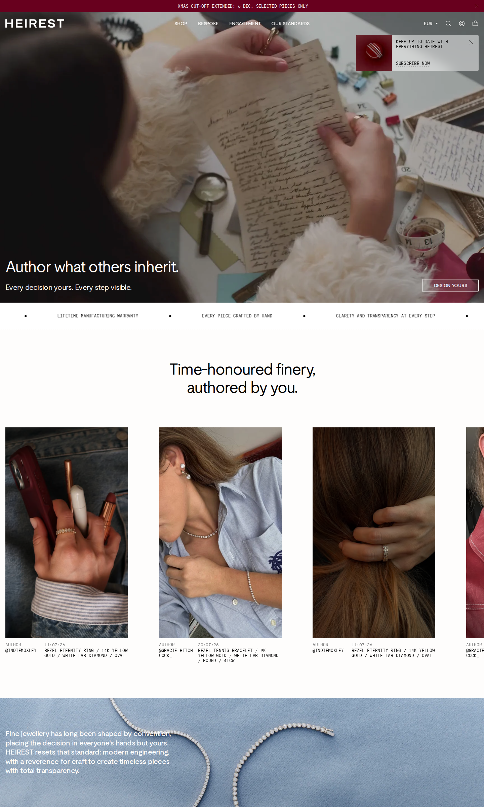
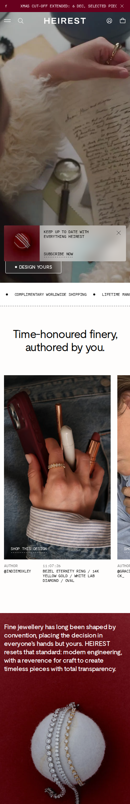

# UI Design System & Master Generation Blueprint: heirest-com

> **HEIREST · Fine Jewellery, Authored By You** (https://heirest.com/) — Fine jewellery for those who choose to author what others inherit. Configured by you and crafted to last.



---

## 1. Executive Visual Persona & Design Archetype

- **Brand Essence & Persona**: **HEIREST · Fine Jewellery, Authored By You** (`https://heirest.com/`). Fine jewellery for those who choose to author what others inherit. Configured by you and crafted to last.
- **Capture Provenance**: Live browser capture (`tier1_fast`, HTTP `200`, captured `2026-11-23`).
- **Visual Archetype**: **Light-Substrate Editorial & Modular Grid System (`#ffffff` canvas, `#000000` ink, `#ffc700` accent)**.
- **Anti-AI-Slop Differentiators**:
  - **Live-Computed Chromatic Polarity**: Anchors the viewport in `#ffffff` (live computed `body` `background-color` (`computed_styles.json`)) paired with `#000000` primary typography and `#ffc700` accents.
  - **Grounded Typographic Hierarchy**: Pairs `Moderat-Regular` for display copy (`Author what others inherit.`) with `Moderat-Regular` and `ModeratMono-Regular`.
  - **Calibrated Spatial Grid & Motion**: Combines `1075px` container bounds (`gap: var(--gap)`, padding `var(--page-margin)`) with `cubic-bezier(.25,.1,.25,1)` easing and GSAP Timeline & ScrollTrigger, Three.js / WebGL Canvas Pipeline.

---

## 2. Spatial Architecture & Modular Grid Mathematics



### Viewport Allocation & Container Geometry
- **Captured Viewport Dimensions**: Desktop `1440×2400px` (`assets/desktop.png`, clamped at 2400px live multi-section capture), Mobile `390×2400px` (`assets/mobile.png`, clamped at 2400px live multi-section capture).
- **Master Container Bounds**: `1075px` (measured widest bounded `<section>` landmark width on `1440px` desktop).
- **Canvas Lateral Padding & Spacing**: `var(--page-margin)` lateral canvas padding with `var(--gap)` grid gap.
- **Border Radius Scale**: `var(--style-border-radius-inputs)`, `var(--border-radius)`, `var(--style-border-radius-popover)`, `var(--style-border-radius-buttons-primary)`.

### Responsive Breakpoint Architecture
- **Desktop Layout**: Multi-column CSS Grid / Flexbox layout at `1440px` (`max-width: 1075px`, `gap: var(--gap)`).
- **Mobile Layout**: Single-column vertical stack at `390px` viewport width with `var(--page-margin)` horizontal padding.
- **Extracted CSS Media Queries**: `@media (max-width:767.98px)`, `@media (any-pointer:fine)and (prefers-reduced-motion:no-preference)`, `@media (prefers-reduced-motion:no-preference)`, `@media screen and (min-width:768px)`.

---

## 3. Color System, Materiality & Atmospheric Lighting

### Semantic Palette & Source Grounding
| Semantic Role | Ground-Truth Value | Extracted Live / CSS Source |
|---|---|---|
| **Primary Canvas Substrate** | `#ffffff` | live computed `body` `background-color` (`computed_styles.json`) |
| **Primary Typography Ink** | `#000000` | live computed `main` `color` (`computed_styles.json`) |
| **Elevated Surface / Card Substrate** | `#fefdfc` | `var(--color-background-default)` in `:root` |
| **Interactive Accent / Highlight** | `#ffc700` | `oduct-review .question-form .ra... { color: #ffc700 }` |
| **Secondary / Muted Copy** | `#606775` | `var(--cs-secondary-text)` in `:root` |
| **Structural Hairline Border** | `#fefdfc` | `var(--color-border-secondary)` in `:root` |
| **Variable Token (`--product-image-tint`)** | `#f9f8f6` | `var(--product-image-tint)` in `:root` |

### Sanitized Root CSS Variables (`ui-ux.md` Ground Truth)
| Variable Name | Extracted Value | Semantic Role |
|---|---|---|
| `--hover-lift-amount` | `4px` | Dimension / Scale Token |
| `--hover-scale-amount` | `1.03` | Design System Custom Token |
| `--hover-subtle-zoom-amount` | `1.015` | Design System Custom Token |
| `--hover-shadow-color` | `var(--color-shadow)` | Brand / Palette Token |
| `--hover-transition-duration` | `var(--global-transition-duration)` | Motion / Easing Token |
| `--hover-transition-timing` | `var(--global-transition-timing-function)` | Motion / Easing Token |
| `--surface-transition-duration` | `var(--global-transition-duration)` | Canvas / Surface Token |
| `--surface-transition-timing` | `var(--global-transition-timing-function)` | Canvas / Surface Token |
| `--submenu-animation-speed` | `.36s` | Motion / Easing Token |
| `--submenu-animation-easing` | `cubic-bezier(.25, .1, .25, 1)` | Motion / Easing Token |
| `--icon-stroke-width` | `1px` | Layout / Spatial Grid Token |
| `--page-margin` | `16px` | Layout / Spatial Grid Token |
| `--product-image-tint` | `#f9f8f6` | Canvas / Surface Token |
| `--sidebar-width` | `25rem` | Layout / Spatial Grid Token |
| `--narrow-content-width` | `36rem` | Layout / Spatial Grid Token |
| `--normal-content-width` | `42rem` | Layout / Spatial Grid Token |

---

## 4. Typographic Scale & Editorial Hierarchy

### Font Family Stacks
- **Display Typography**: `Moderat-Regular`.
- **Primary Body Stack**: `Moderat-Regular`.
- **Technical / Metadata Stack**: `ModeratMono-Regular`.

### Typographic Scale & Rules (Live Computed & Stylesheet Grounded)
- **Hero Display (`H1`)**: CSS variables `--loyalty-shimmer-display: none`, `--font-h1--spacing: var(--font-heading--spacing)`, `--max-width--display-normal: 13em`; rule `h1` (`line-height: var(--line-height--di...`).
- **Section Heading (`H2`)**: live computed `h2` (`font-size: 47px`, `line-height: 54.05px`, `font-weight: 400`, `letter-spacing: -1.88px`); CSS variables `--loyalty-banner-subtitle-size: 14px`, `--font-h2--spacing: var(--font-heading--spacing)`, `--font-h2--weight: 400`; rule `h2` (`font-size: var(--heading-font-size)`, `font-weight: var(--heading...`).
- **Body Copy**: live computed `body` (`font-size: 15px`, `line-height: 21.45px`, `font-weight: 400`, `letter-spacing: -0.195px`); CSS variables `--paragraph-font-size: 16px`, `--paragraph-font-weight: 400`, `--form-paragraph-font-weight: var(--paragraph-font-weight)`; rule `p` (`line-height: var(--line-height--bo...`).
- **Metadata & Navigation Labels**: live computed `nav/a` (`font-size: 15px`, `line-height: 21.45px`, `font-weight: 400`, `letter-spacing: -0.195px`); CSS variables `--section-height-small: 15rem`, `--default-mono-font-family: var(--font-mono)`, `--bundle-product-label-size: 16px`.

---

## 5. Choreographed Motion & Interaction Physics

### Primary Easing Curves
- **Extracted Timing Functions**: `cubic-bezier(.25,.1,.25,1)`, `cubic-bezier(.7,-5,.98,.5)`, `cubic-bezier(.15,.57,.9,1.05)`.

### Per-Element Transition & Choreography Rules
- **Selector `:root`**: `transition: var(--global-transition-duration)` extracted from `heirest-com` stylesheet.
- **Selector `.predictive-search-results__card`**: `transition: transform var(--hover-transition-duration) var(--hover-transit...` extracted from `heirest-com` stylesheet.
- **Selector `ver-effect-subtle-zoom .product-c...`**: `transition: transform var(--hover-transition-duration) var(--hover-transit...` extracted from `heirest-com` stylesheet.
- **Extracted Easing Curve (`cubic-bezier(.25,.1,.25,1)`)**: Governs interactive state transitions across `<header.shopify-section>` and `<section.template-index>`.
- **Runtime Interaction Engine**: Integrates GSAP Timeline & ScrollTrigger, Three.js / WebGL Canvas Pipeline, Swiper Touch Carousel Engine with `prefers-reduced-motion: reduce` fallback guards.

---

## 6. Component Wireframe & Structural DOM Map

### Visual Layout Schematic — Desktop (`1440px`, Grounded in `dom.html` & Landmark Bounding Boxes)
```
┌────────────────────────────────────────────────────────────────────────┐
│ DESKTOP VIEWPORT (1440px) — HEIREST · Fine Jewellery, Authored By You  │
│ ====================================================================== │
│ [ <header.shopify-sectio (1440x0px)   | Bespoke · Engagement · Our S ] │
│ ---------------------------------------------------------------------- │
│ | HERO STAGE: <section.shopify-section> (w=1440px)                   | │
│ | H1: Author what others inherit.                                    | │
│ | Substrate: #ffffff | Ink: #000000 | Accent: #ffc700                | │
│ ---------------------------------------------------------------------- │
│ | SHOWCASE GRID (<section.template-index>) max-w: 1075px             | │
│ | +------------------------------+  +------------------------------+ | │
│ | | Time-honoured finery, author |  | Our Standards                | | │
│ | +------------------------------+  +------------------------------+ | │
│ ---------------------------------------------------------------------- │
│ | DETAIL MODULE (<section.navbar--always-sh) — Start with a category | │
│ ---------------------------------------------------------------------- │
│ [ FOOTER (<footer.announcement) | https://heirest.com/                 │
└────────────────────────────────────────────────────────────────────────┘
```

### Visual Layout Schematic — Mobile Reflow (`390px`)
```
┌────────────────────────────────────────────────────────────────────────┐
│ MOBILE VIEWPORT REFLOW (390px) — Single-Column Stack (gap: var(--ga)   │
│ ====================================================================== │
│ [ HEADER BAR (<header.shopify-section>) | Compact Menu (390px)         │
│ ---------------------------------------------------------------------- │
│ | HERO STAGE (<section.shopify-section) — 390px Vertical Lead        | │
│ | H1: Author what others inherit.                                    | │
│ ---------------------------------------------------------------------- │
│ | SHOWCASE STACK (<section.template-inde) — 1-Col Stack              | │
│ | [ Item 1: Time-honoured finery, authored by you.                 ] | │
│ | [ Item 2: Our Standards                                          ] | │
│ ---------------------------------------------------------------------- │
│ | DETAIL STACK (<section.navbar--always-) — 1-Col (Start with a categ) │
│ ---------------------------------------------------------------------- │
│ [ FOOTER (<footer.announcement) | Stacked 390px Colophon               │
└────────────────────────────────────────────────────────────────────────┘
```

### Granular DOM Region Breakdown
1. **Brand Header & Navigation Bar (<header.shopify-section> — `heirest-com`)**:
   - Landmark `<header class="shopify-section shopify-section-group-header-group">` (`1440x0px`) hosting `HEIREST · Fine Jewellery, Authored B` navigation (`Bespoke · Engagement · Our Standards`), DOM attributes (`data-swym-guest-login-bound="1"`, `data-swym-drawer-close-bound="1"`, `data-swym-evt-bound="1"`, `data-swym-save-click-bound="1"`), and stylesheet rule `body { scrollbar-width:none;-ms-overflow-style:none }`.
2. **Hero Stage & Focal Lead (<section.shopify-section> — `Author what others inherit.`)**:
   - Landmark `<section class="shopify-section featured-blog-posts">` presenting display lead `Author what others inherit.` and copy excerpt *"cookies are used on this site. Privacy Policy"* over `#ffffff` canvas and `#000000` ink.
3. **Primary Showcase & Content Grid (<section.template-index> — `Time-honoured finery, authored by `)**:
   - Landmark `<section class="template-index">` rendering section `Time-honoured finery, authored by you.` with copy *"Every decision yours. Every step visible."*, asset references (`1297080862623390`, `fbevents.js`, `swym-ext-shopify.js`, `clarity.js`), and grid rule `body::-webkit-scrollbar { width:0;height:0;display:none }`.
4. **Interactive Detail & Feature Matrix (<section.navbar--always-show> — `Our Standards`)**:
   - Landmark `<section class="navbar--always-show">` framing `Our Standards` and `Start with a category` (*"Clarity and transparency at every step"*) with `#fefdfc` surface cards, `#ffc700` accents, and `svg { display:block;max-width:100% }`.
5. **Colophon & Global Directory Footer (<footer.announcement-bar--show> — `https://heirest.com/`)**:
   - Landmark `<footer class="announcement-bar--show">` anchoring `HEIREST · Fine Jewellery, Author` footer links (`Bespoke · Engagement · Our Standards`), copy *"Complimentary worldwide shipping"*, and `#fefdfc` structural dividers.

---

## 7. Master Zero-Shot AI Generation Prompt

```markdown
# Master Zero-Shot Frontend Generation Prompt: heirest-com (HEIREST · Fine Jewellery, Authored By You)

You are a principal frontend architect and design systems engineer. Build a complete, production-ready web application replicating the exact design system, DOM landmarks, typographic hierarchy, color tokens, and motion physics of `heirest-com` (**HEIREST · Fine Jewellery, Authored By You** — `https://heirest.com/`).

### 1. Visual Archetype & Anti-AI-Slop Mandates
- **Archetype**: Light-Substrate Editorial & Modular Grid System (`#ffffff` canvas, `#000000` ink, `#ffc700` accent).
- **Identity & Domain Context**: Fine jewellery for those who choose to author what others inherit. Configured by you and crafted to last.
- **Primary Substrate**: `#ffffff` (live computed `body` `background-color` (`computed_styles.json`)), **Primary Ink**: `#000000`, **Accent / Highlight**: `#ffc700`.
- **Site-Specific Differentiators**:
  - **Live-Computed Chromatic Polarity**: Anchors the viewport in `#ffffff` (live computed `body` `background-color` (`computed_styles.json`)) paired with `#000000` primary typography and `#ffc700` accents.
  - **Grounded Typographic Hierarchy**: Pairs `Moderat-Regular` for display copy (`Author what others inherit.`) with `Moderat-Regular` and `ModeratMono-Regular`.
  - **Calibrated Spatial Grid & Motion**: Combines `1075px` container bounds (`gap: var(--gap)`, padding `var(--page-margin)`) with `cubic-bezier(.25,.1,.25,1)` easing and GSAP Timeline & ScrollTrigger, Three.js / WebGL Canvas Pipeline.

### 2. Ground-Truth CSS Variables (`:root` Token Contract)
Declare and consume these exact custom properties extracted from `heirest-com` in your global stylesheet:

:root {
  /* HEIREST · Fine Jewellery, Authored By You (heirest-com) — Live-Grounded CSS Variables */
  --hover-lift-amount: 4px; /* Dimension / Scale Token (heirest-com) */
  --hover-scale-amount: 1.03; /* Design System Custom Token (heirest-com) */
  --hover-subtle-zoom-amount: 1.015; /* Design System Custom Token (heirest-com) */
  --hover-shadow-color: var(--color-shadow); /* Brand / Palette Token (heirest-com) */
  --hover-transition-duration: var(--global-transition-duration); /* Motion / Easing Token (heirest-com) */
  --hover-transition-timing: var(--global-transition-timing-function); /* Motion / Easing Token (heirest-com) */
  --surface-transition-duration: var(--global-transition-duration); /* Canvas / Surface Token (heirest-com) */
  --surface-transition-timing: var(--global-transition-timing-function); /* Canvas / Surface Token (heirest-com) */
  --submenu-animation-speed: .36s; /* Motion / Easing Token (heirest-com) */
  --submenu-animation-easing: cubic-bezier(.25, .1, .25, 1); /* Motion / Easing Token (heirest-com) */
  --icon-stroke-width: 1px; /* Layout / Spatial Grid Token (heirest-com) */
  --page-margin: 16px; /* Layout / Spatial Grid Token (heirest-com) */
  --product-image-tint: #f9f8f6; /* Canvas / Surface Token (heirest-com) */
  --sidebar-width: 25rem; /* Layout / Spatial Grid Token (heirest-com) */
  --narrow-content-width: 36rem; /* Layout / Spatial Grid Token (heirest-com) */
  --normal-content-width: 42rem; /* Layout / Spatial Grid Token (heirest-com) */
}

### 3. Semantic Color & Materiality Contract
Map every surface, ink, and border strictly to these source-grounded tokens:
- **Primary Canvas Substrate**: `#ffffff` — grounded in live computed `body` `background-color` (`computed_styles.json`)
- **Primary Typography Ink**: `#000000` — grounded in live computed `main` `color` (`computed_styles.json`)
- **Elevated Surface / Card Substrate**: `#fefdfc` — grounded in `var(--color-background-default)` in `:root`
- **Interactive Accent / Highlight**: `#ffc700` — grounded in `oduct-review .question-form .ra... { color: #ffc700 }`
- **Secondary / Muted Copy**: `#606775` — grounded in `var(--cs-secondary-text)` in `:root`
- **Structural Hairline Border**: `#fefdfc` — grounded in `var(--color-border-secondary)` in `:root`
- **Variable Token (`--product-image-tint`)**: `#f9f8f6` — grounded in `var(--product-image-tint)` in `:root`

### 4. Spatial Grid, Container Bounds & Responsive Breakpoints
- **Desktop Viewport Reference**: `1440×2400px` (clamped at 2400px live multi-section capture, `1440px` standard desktop width).
- **Mobile Viewport Reference**: `390×2400px` (clamped at 2400px live multi-section capture, `390px` standard mobile width).
- **Container Max-Width**: `1075px` (measured widest bounded `<section>` landmark width on `1440px` desktop)
- **Padding & Gutters**: `var(--page-margin)` lateral canvas padding with `var(--gap)` grid gap
- **Desktop Grid**: Multi-column CSS Grid / Flexbox layout at `1440px` (`max-width: 1075px`, `gap: var(--gap)`)
- **Mobile Adaptation**: Single-column vertical stack at `390px` viewport width with `var(--page-margin)` horizontal padding
- **Media Queries**: `@media (max-width:767.98px)`, `@media (any-pointer:fine)and (prefers-reduced-motion:no-preference)`, `@media (prefers-reduced-motion:no-preference)`, `@media screen and (min-width:768px)`
- **Corner Radii**: `var(--style-border-radius-inputs)`, `var(--border-radius)`, `var(--style-border-radius-popover)`, `var(--style-border-radius-buttons-primary)`

### 5. Typography & Editorial Scale Contract
- **Display Font Stack**: `Moderat-Regular`
- **Body Font Stack**: `Moderat-Regular`
- **Monospace / Technical Font Stack**: `ModeratMono-Regular`
- **H1 Display Rule**: CSS variables `--loyalty-shimmer-display: none`, `--font-h1--spacing: var(--font-heading--spacing)`, `--max-width--display-normal: 13em`; rule `h1` (`line-height: var(--line-height--di...`)
- **H2 Section Rule**: live computed `h2` (`font-size: 47px`, `line-height: 54.05px`, `font-weight: 400`, `letter-spacing: -1.88px`); CSS variables `--loyalty-banner-subtitle-size: 14px`, `--font-h2--spacing: var(--font-heading--spacing)`, `--font-h2--weight: 400`; rule `h2` (`font-size: var(--heading-font-size)`, `font-weight: var(--heading...`)
- **Body Copy Rule**: live computed `body` (`font-size: 15px`, `line-height: 21.45px`, `font-weight: 400`, `letter-spacing: -0.195px`); CSS variables `--paragraph-font-size: 16px`, `--paragraph-font-weight: 400`, `--form-paragraph-font-weight: var(--paragraph-font-weight)`; rule `p` (`line-height: var(--line-height--bo...`)
- **Metadata & Index Rule**: live computed `nav/a` (`font-size: 15px`, `line-height: 21.45px`, `font-weight: 400`, `letter-spacing: -0.195px`); CSS variables `--section-height-small: 15rem`, `--default-mono-font-family: var(--font-mono)`, `--bundle-product-label-size: 16px`

### 6. Component Hierarchy, Verbatim Copy & Real DOM Landmarks
Scaffold `heirest-com` (`HEIREST · Fine Jewellery, Authored By You`) with these exact structural regions, extracted copy, and CSS rules from `dom.html`:
1. **Brand Header & Navigation Bar (<header.shopify-section> — `heirest-com`)**:
   - DOM & Selectors: Landmark `<header class="shopify-section shopify-section-group-header-group">` (`1440x0px`) hosting `HEIREST · Fine Jewellery, Authored B` navigation (`Bespoke · Engagement · Our Standards`), DOM attributes (`data-swym-guest-login-bound="1"`, `data-swym-drawer-close-bound="1"`, `data-swym-evt-bound="1"`, `data-swym-save-click-bound="1"`), and stylesheet rule `body { scrollbar-width:none;-ms-overflow-style:none }`.
   - Responsive Contract: Header `Brand Header & Navigation Bar (<header.shopify-section> — `heirest-com`)` (`heirest-com`) adapts across `@media (max-width:767.98px)`, `@media (any-pointer:fine)and (prefers-reduced-motion:no-preference)`, `@media (prefers-reduced-motion:no-preference)`, `@media screen and (min-width:768px)` with `cubic-bezier(.25,.1,.25,1)`, `cubic-bezier(.7,-5,.98,.5)`, `cubic-bezier(.15,.57,.9,1.05)` transitions and links `Bespoke · Engagement · Our Standards`.
2. **Hero Stage & Focal Lead (<section.shopify-section> — `Author what others inherit.`)**:
   - DOM & Selectors: Landmark `<section class="shopify-section featured-blog-posts">` presenting display lead `Author what others inherit.` and copy excerpt *"cookies are used on this site. Privacy Policy"* over `#ffffff` canvas and `#000000` ink.
   - Responsive Contract: Hero stage (`1440×2400px` desktop / `390×2400px` mobile) sets `#ffffff` background with `#000000` headline `Author what others inherit.`.
3. **Primary Showcase & Content Grid (<section.template-index> — `Time-honoured finery, authored by `)**:
   - DOM & Selectors: Landmark `<section class="template-index">` rendering section `Time-honoured finery, authored by you.` with copy *"Every decision yours. Every step visible."*, asset references (`1297080862623390`, `fbevents.js`, `swym-ext-shopify.js`, `clarity.js`), and grid rule `body::-webkit-scrollbar { width:0;height:0;display:none }`.
   - Responsive Contract: Showcase grid `Primary Showcase & Content Grid (<section.template-index> — `Time-honoured finery, authored by `)` applies Multi-column CSS Grid / Flexbox layout at `1440px` (`max-width: 1075px`, `gap: var(--gap)`) on desktop and Single-column vertical stack at `390px` viewport width with `var(--page-margin)` horizontal padding on mobile.
4. **Interactive Detail & Feature Matrix (<section.navbar--always-show> — `Our Standards`)**:
   - DOM & Selectors: Landmark `<section class="navbar--always-show">` framing `Our Standards` and `Start with a category` (*"Clarity and transparency at every step"*) with `#fefdfc` surface cards, `#ffc700` accents, and `svg { display:block;max-width:100% }`.
   - Responsive Contract: Detail module `Interactive Detail & Feature Matrix (<section.navbar--always-show> — `Our Standards`)` uses `var(--style-border-radius-inputs)`, `var(--border-radius)`, `var(--style-border-radius-popover)`, `var(--style-border-radius-buttons-primary)` radii, `#ffc700` highlights, and assets (1297080862623390, fbevents.js, swym-ext-shopify.js).
5. **Colophon & Global Directory Footer (<footer.announcement-bar--show> — `https://heirest.com/`)**:
   - DOM & Selectors: Landmark `<footer class="announcement-bar--show">` anchoring `HEIREST · Fine Jewellery, Author` footer links (`Bespoke · Engagement · Our Standards`), copy *"Complimentary worldwide shipping"*, and `#fefdfc` structural dividers.
   - Responsive Contract: Footer `Colophon & Global Directory Footer (<footer.announcement-bar--show> — `https://heirest.com/`)` aligns to `1075px` (measured widest bounded `<section>` landmark width on `1440px` desktop) with `var(--page-margin)` lateral canvas padding with `var(--gap)` grid gap and attributes (data-swym-guest-login-bound="1", data-swym-drawer-close-bound="1", data-swym-evt-bound="1").

#### Verbatim DOM Copy Excerpts (`dom.html`)
- Copy Excerpt 1: *"cookies are used on this site. Privacy Policy"*
- Copy Excerpt 2: *"Every decision yours. Every step visible."*
- Copy Excerpt 3: *"Clarity and transparency at every step"*
- Copy Excerpt 4: *"Complimentary worldwide shipping"*

### 7. Motion, Extracted Stylesheet Rules & Interaction Choreography
- **Primary Easing Functions**: `cubic-bezier(.25,.1,.25,1)`, `cubic-bezier(.7,-5,.98,.5)`, `cubic-bezier(.15,.57,.9,1.05)`
- **Extracted Stylesheet Rules (`heirest-com`)**:
- `body { scrollbar-width:none;-ms-overflow-style:none }`
- `body::-webkit-scrollbar { width:0;height:0;display:none }`
- `svg { display:block;max-width:100% }`
- `img { width:100%;height:auto }`
- `select { font:inherit;border-radius:var(--style-border-radius-inputs) }`
- **Per-Selector Transition Rules**:
- **Selector `:root`**: `transition: var(--global-transition-duration)` extracted from `heirest-com` stylesheet.
- **Selector `.predictive-search-results__card`**: `transition: transform var(--hover-transition-duration) var(--hover-transit...` extracted from `heirest-com` stylesheet.
- **Selector `ver-effect-subtle-zoom .product-c...`**: `transition: transform var(--hover-transition-duration) var(--hover-transit...` extracted from `heirest-com` stylesheet.
- **Extracted Easing Curve (`cubic-bezier(.25,.1,.25,1)`)**: Governs interactive state transitions across `<header.shopify-section>` and `<section.template-index>`.
- **Runtime Interaction Engine**: Integrates GSAP Timeline & ScrollTrigger, Three.js / WebGL Canvas Pipeline, Swiper Touch Carousel Engine with `prefers-reduced-motion: reduce` fallback guards.

### 8. Technical Deliverables
- Implement in Next.js (App Router) with TypeScript and Tailwind CSS consuming the `:root` custom properties defined above for `heirest-com`.
- Reproduce both the `1440px` desktop architecture and `390px` mobile breakpoint transitions, preserving semantic HTML5 landmarks (`<header>`, `<nav>`, `<main>`, `<section>`, `<footer>`) and `prefers-reduced-motion` accessibility guards.
```
