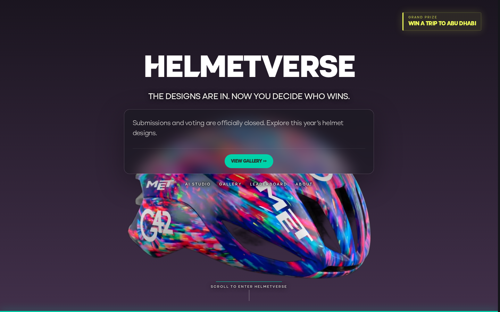
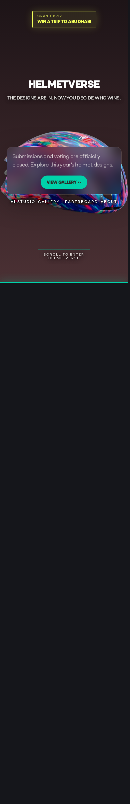

# UI Design System & Master Generation Blueprint: helmetverse-ai

> **Helmetverse · Design yours** (https://helmetverse.ai/) — Type a prompt. The team rides what you imagine.



---

## 1. Executive Visual Persona & Design Archetype

- **Brand Essence & Persona**: **Helmetverse · Design yours** (`https://helmetverse.ai/`). Type a prompt. The team rides what you imagine.
- **Capture Provenance**: Live browser capture (`tier1_fast`, HTTP `200`, captured `2026-11-23`).
- **Visual Archetype**: **Light-Gallery WebGL / Canvas Interactive Experience (`#f7f4f1` / `#00d2aa`)**.
- **Anti-AI-Slop Differentiators**:
  - **Live-Computed Chromatic Polarity**: Anchors the viewport in `#f7f4f1` (live computed `body` `background-color` (`computed_styles.json`)) paired with `#2a312b` primary typography and `#00d2aa` accents.
  - **Grounded Typographic Hierarchy**: Pairs `G42 Sans` for display copy (`HELMETVERSE`) with `G42 Sans` and `SFMono-Regular`.
  - **Calibrated Spatial Grid & Motion**: Combines `1536px` container bounds (`gap: 24px`, padding `var(--spacing-lg)`) with `cubic-bezier(.4,0,.2,1)` easing and Lenis Smooth Scroll (`data-lenis`), Three.js / WebGL Canvas Pipeline.

---

## 2. Spatial Architecture & Modular Grid Mathematics



### Viewport Allocation & Container Geometry
- **Captured Viewport Dimensions**: Desktop `1440×900px` (`assets/desktop.png`, single-viewport 100vh live capture (900px)), Mobile `390×2400px` (`assets/mobile.png`, clamped at 2400px live multi-section capture).
- **Master Container Bounds**: `1536px` (non-`@media` desktop container stylesheet rule).
- **Canvas Lateral Padding & Spacing**: `var(--spacing-lg)` lateral canvas padding with `24px` grid gap.
- **Border Radius Scale**: `999px`, `var(--radius-lg)`, `var(--radius-full)`, `.25rem`.

### Responsive Breakpoint Architecture
- **Desktop Layout**: Multi-column CSS Grid / Flexbox layout at `1440px` (`max-width: 1536px`, `gap: 24px`).
- **Mobile Layout**: Single-column vertical stack at `390px` viewport width with `var(--spacing-lg)` horizontal padding.
- **Extracted CSS Media Queries**: `@media (min-width:375px)`, `@media (min-width:425px)`, `@media (min-width:640px)`, `@media (min-width:768px)`.

---

## 3. Color System, Materiality & Atmospheric Lighting

### Semantic Palette & Source Grounding
| Semantic Role | Ground-Truth Value | Extracted Live / CSS Source |
|---|---|---|
| **Primary Canvas Substrate** | `#f7f4f1` | live computed `body` `background-color` (`computed_styles.json`) |
| **Primary Typography Ink** | `#2a312b` | live computed `body` `color` (`computed_styles.json`) |
| **Elevated Surface / Card Substrate** | `#00d2aa` | live computed `button` `background-color` (`computed_styles.json`) |
| **Interactive Accent / Highlight** | `#00d2aa` | live computed `button` `background-color` (`computed_styles.json`) |
| **Secondary / Muted Copy** | `#00d2aa` | `var(--color-secondary)` in `:root` |
| **Structural Hairline Border** | `#ede9e4` | `var(--color-border-light)` in `:root` |
| **Variable Token (`--color-accent-deep`)** | `#00baa0` | `var(--color-accent-deep)` in `:root` |
| **Variable Token (`--color-yellow`)** | `#f2ff5a` | `var(--color-yellow)` in `:root` |
| **Variable Token (`--color-blue`)** | `#0c56ff` | `var(--color-blue)` in `:root` |
| **Variable Token (`--color-surface-light`)** | `#ffffff` | `var(--color-surface-light)` in `:root` |
| **Variable Token (`--color-border2-light`)** | `#e5e7eb` | `var(--color-border2-light)` in `:root` |
| **Variable Token (`--color-bg-dark`)** | `#15161b` | `var(--color-bg-dark)` in `:root` |
| **Variable Token (`--color-surface-dark`)** | `#1c2620` | `var(--color-surface-dark)` in `:root` |
| **Variable Token (`--color-border-dark`)** | `#2a3830` | `var(--color-border-dark)` in `:root` |

### Sanitized Root CSS Variables (`ui-ux.md` Ground Truth)
| Variable Name | Extracted Value | Semantic Role |
|---|---|---|
| `--color-primary` | `#2a312b` | Brand / Palette Token |
| `--color-accent` | `#00d2aa` | Brand / Palette Token |
| `--color-accent-deep` | `#00baa0` | Brand / Palette Token |
| `--color-yellow` | `#f2ff5a` | Brand / Palette Token |
| `--color-blue` | `#0c56ff` | Brand / Palette Token |
| `--color-bg-light` | `#f7f4f1` | Canvas / Surface Token |
| `--color-surface-light` | `#fff` | Canvas / Surface Token |
| `--color-border-light` | `#ede9e4` | Canvas / Surface Token |
| `--color-border2-light` | `#e5e7eb` | Canvas / Surface Token |
| `--color-bg-dark` | `#15161b` | Canvas / Surface Token |
| `--color-surface-dark` | `#1c2620` | Canvas / Surface Token |
| `--color-border-dark` | `#2a3830` | Canvas / Surface Token |
| `--color-text-primary-light` | `#2a312b` | Canvas / Surface Token |
| `--color-text-secondary-light` | `#2a312b99` | Canvas / Surface Token |
| `--color-text-primary-dark` | `#f7f4f1` | Canvas / Surface Token |
| `--color-text-secondary-dark` | `#f7f4f18c` | Canvas / Surface Token |

---

## 4. Typographic Scale & Editorial Hierarchy

### Font Family Stacks
- **Display Typography**: `G42 Sans`.
- **Primary Body Stack**: `G42 Sans`.
- **Technical / Metadata Stack**: `SFMono-Regular`.

### Typographic Scale & Rules (Live Computed & Stylesheet Grounded)
- **Hero Display (`H1`)**: live computed `h1` (`font-size: 194.4px`, `line-height: 213.84px`, `font-weight: 900`, `letter-spacing: -7.776px`); CSS variables `--text-display: 60px`, `--text-h1: 48px`.
- **Section Heading (`H2`)**: live computed `h2` (`font-size: 36px`, `line-height: 30.6px`, `font-weight: 900`, `letter-spacing: -1.44px`); CSS variables `--text-h2: 36px`; rule `h2` (`font-size: 15px`, `line-height: 1.3`, `letter-spacing: .02em`, `font-weight: 900`).
- **Body Copy**: live computed `body` (`font-size: 16px`, `line-height: 24px`, `font-weight: 400`); CSS variables `--text-base: 1rem`, `--text-base--line-height: calc(1.5 / 1)`, `--text-body-lg: 18px`.
- **Metadata & Navigation Labels**: live computed `nav/a` (`font-size: 16px`, `line-height: 24px`, `font-weight: 400`); CSS variables `--font-mono: "G42 Sans", "Space Grotesk", sans-serif`, `--text-xs: .75rem`, `--text-xs--line-height: calc(1 / .75)`.

---

## 5. Choreographed Motion & Interaction Physics

### Primary Easing Curves
- **Extracted Timing Functions**: `cubic-bezier(.4,0,.2,1)`, `cubic-bezier(.4,0,.6,1)`, `cubic-bezier(.2,.8,.2,1)`.

### Per-Element Transition & Choreography Rules
- **Selector `layer theme`**: `transition: .15s` extracted from `helmetverse-ai` stylesheet.
- **Selector `.transition`**: `transition: var(--tw-ease,var(--default-transition-timing-function))` extracted from `helmetverse-ai` stylesheet.
- **Selector `color\]`**: `transition: var(--tw-ease,var(--default-transition-timing-function))` extracted from `helmetverse-ai` stylesheet.
- **Extracted Easing Curve (`cubic-bezier(.4,0,.2,1)`)**: Governs interactive state transitions across `<nav.jsx-25f90e9ce2076406>` and `<main.text-text-primary-dark>`.
- **Runtime Interaction Engine**: Integrates Lenis Smooth Scroll (`data-lenis`), Three.js / WebGL Canvas Pipeline, Swiper Touch Carousel Engine with `prefers-reduced-motion: reduce` fallback guards.

---

## 6. Component Wireframe & Structural DOM Map

### Visual Layout Schematic — Desktop (`1440px`, Grounded in `dom.html` & Landmark Bounding Boxes)
```
┌────────────────────────────────────────────────────────────────────────┐
│ DESKTOP VIEWPORT (1440px) — Helmetverse · Design yours                 │
│ ====================================================================== │
│ [ <nav.jsx-25f90e9ce2076 (367x12px)   | Home · Gallery · AI Studio · ] │
│ ---------------------------------------------------------------------- │
│ | HERO STAGE: <main.bg-bg-dark> (w=1434px)                           | │
│ | H1: HELMETVERSE                                                    | │
│ | Substrate: #f7f4f1 | Ink: #2a312b | Accent: #00d2aa                | │
│ ---------------------------------------------------------------------- │
│ | SHOWCASE GRID (<main.text-text-primary-da) max-w: 1536px           | │
│ | +------------------------------+  +------------------------------+ | │
│ | | DESIGN WITHOUT LIMITS        |  | A GLOBAL COMPETITION FOR THE | | │
│ | +------------------------------+  +------------------------------+ | │
│ ---------------------------------------------------------------------- │
│ | DETAIL MODULE (<main.relative>) — FEATURED HELMET DESIG            | │
│ ---------------------------------------------------------------------- │
│ [ FOOTER (<footer.text-text-pr) | https://helmetverse.ai/              │
└────────────────────────────────────────────────────────────────────────┘
```

### Visual Layout Schematic — Mobile Reflow (`390px`)
```
┌────────────────────────────────────────────────────────────────────────┐
│ MOBILE VIEWPORT REFLOW (390px) — Single-Column Stack (gap: 24px)       │
│ ====================================================================== │
│ [ HEADER BAR (<nav.jsx-25f90e9ce207640) | Compact Menu (390px)         │
│ ---------------------------------------------------------------------- │
│ | HERO STAGE (<main.bg-bg-dark>) — 390px Vertical Lead               | │
│ | H1: HELMETVERSE                                                    | │
│ ---------------------------------------------------------------------- │
│ | SHOWCASE STACK (<main.text-text-primar) — 1-Col Stack              | │
│ | [ Item 1: DESIGN WITHOUT LIMITS                                  ] | │
│ | [ Item 2: A GLOBAL COMPETITION FOR THE MOST CREATIVE MINDS       ] | │
│ ---------------------------------------------------------------------- │
│ | DETAIL STACK (<main.relative>) — 1-Col (FEATURED HELMET DE)        | │
│ ---------------------------------------------------------------------- │
│ [ FOOTER (<footer.text-text-pr) | Stacked 390px Colophon               │
└────────────────────────────────────────────────────────────────────────┘
```

### Granular DOM Region Breakdown
1. **Brand Header & Navigation Bar (<nav.jsx-25f90e9ce2076406> — `helmetverse-ai`)**:
   - Landmark `<nav class="jsx-25f90e9ce2076406 overflow-hidden">` (`367x12px`) hosting `Helmetverse · Design yours` navigation (`Home · Gallery · AI Studio · Leaderboard · About`), DOM attributes (`data-paper-shader`, `data-precedence="next"`, `data-precedence="next"`, `data-styled-jsx`), and stylesheet rule `.PhoneInput { align-items:center;display:flex }`.
2. **Hero Stage & Focal Lead (<main.bg-bg-dark> — `HELMETVERSE`)**:
   - Landmark `<main class="bg-bg-dark text-text-primary-dark">` presenting display lead `HELMETVERSE` and copy excerpt *"Submissions and voting are officially closed. Explore this year’s"* over `#f7f4f1` canvas and `#2a312b` ink.
3. **Primary Showcase & Content Grid (<main.text-text-primary-dark> — `DESIGN WITHOUT LIMITS`)**:
   - Landmark `<main class="bg-bg-dark text-text-primary-dark">` rendering section `DESIGN WITHOUT LIMITS` with copy *"H E L M E T V E R S E"*, asset references (`6577f91f-ad74-4868-93e8-13027534a...`, `79d7fc46-0103-4a7f-b9f7-d1012c6fa...`, `98da8316-c3f4-4946-adb6-727aa17a0...`, `b241f184-7659-4fb4-bdb4-cdf53d1fc...`), and grid rule `.PhoneInputInput { flex:1;min-width:0 }`.
4. **Interactive Detail & Feature Matrix (<main.relative> — `A GLOBAL COMPETITION FOR THE MOST `)**:
   - Landmark `<main class="bg-bg-dark text-text-primary-dark">` framing `A GLOBAL COMPETITION FOR THE MOST CREATIVE MINDS` and `FEATURED HELMET DESIGNS` (*"Win a trip to Abu Dhabi"*) with `#00d2aa` surface cards, `#00d2aa` accents, and `.PhoneInputCountryIcon--square { width:var(--PhoneInputCountryFlag-height) }`.
5. **Colophon & Global Directory Footer (<footer.text-text-primary-dark> — `https://helmetverse.ai/`)**:
   - Landmark `<footer class="text-text-primary-dark">` anchoring `Helmetverse · Design yours` footer links (`Home · Gallery · AI Studio · Leaderboard · About`), copy *"THE DESIGNS ARE IN. NOW YOU DECIDE WHO WINS."*, and `#ede9e4` structural dividers.

---

## 7. Master Zero-Shot AI Generation Prompt

```markdown
# Master Zero-Shot Frontend Generation Prompt: helmetverse-ai (Helmetverse · Design yours)

You are a principal frontend architect and design systems engineer. Build a complete, production-ready web application replicating the exact design system, DOM landmarks, typographic hierarchy, color tokens, and motion physics of `helmetverse-ai` (**Helmetverse · Design yours** — `https://helmetverse.ai/`).

### 1. Visual Archetype & Anti-AI-Slop Mandates
- **Archetype**: Light-Gallery WebGL / Canvas Interactive Experience (`#f7f4f1` / `#00d2aa`).
- **Identity & Domain Context**: Type a prompt. The team rides what you imagine.
- **Primary Substrate**: `#f7f4f1` (live computed `body` `background-color` (`computed_styles.json`)), **Primary Ink**: `#2a312b`, **Accent / Highlight**: `#00d2aa`.
- **Site-Specific Differentiators**:
  - **Live-Computed Chromatic Polarity**: Anchors the viewport in `#f7f4f1` (live computed `body` `background-color` (`computed_styles.json`)) paired with `#2a312b` primary typography and `#00d2aa` accents.
  - **Grounded Typographic Hierarchy**: Pairs `G42 Sans` for display copy (`HELMETVERSE`) with `G42 Sans` and `SFMono-Regular`.
  - **Calibrated Spatial Grid & Motion**: Combines `1536px` container bounds (`gap: 24px`, padding `var(--spacing-lg)`) with `cubic-bezier(.4,0,.2,1)` easing and Lenis Smooth Scroll (`data-lenis`), Three.js / WebGL Canvas Pipeline.

### 2. Ground-Truth CSS Variables (`:root` Token Contract)
Declare and consume these exact custom properties extracted from `helmetverse-ai` in your global stylesheet:

:root {
  /* Helmetverse · Design yours (helmetverse-ai) — Live-Grounded CSS Variables */
  --color-primary: #2a312b; /* Brand / Palette Token (helmetverse-ai) */
  --color-accent: #00d2aa; /* Brand / Palette Token (helmetverse-ai) */
  --color-accent-deep: #00baa0; /* Brand / Palette Token (helmetverse-ai) */
  --color-yellow: #f2ff5a; /* Brand / Palette Token (helmetverse-ai) */
  --color-blue: #0c56ff; /* Brand / Palette Token (helmetverse-ai) */
  --color-bg-light: #f7f4f1; /* Canvas / Surface Token (helmetverse-ai) */
  --color-surface-light: #fff; /* Canvas / Surface Token (helmetverse-ai) */
  --color-border-light: #ede9e4; /* Canvas / Surface Token (helmetverse-ai) */
  --color-border2-light: #e5e7eb; /* Canvas / Surface Token (helmetverse-ai) */
  --color-bg-dark: #15161b; /* Canvas / Surface Token (helmetverse-ai) */
  --color-surface-dark: #1c2620; /* Canvas / Surface Token (helmetverse-ai) */
  --color-border-dark: #2a3830; /* Canvas / Surface Token (helmetverse-ai) */
  --color-text-primary-light: #2a312b; /* Canvas / Surface Token (helmetverse-ai) */
  --color-text-secondary-light: #2a312b99; /* Canvas / Surface Token (helmetverse-ai) */
  --color-text-primary-dark: #f7f4f1; /* Canvas / Surface Token (helmetverse-ai) */
  --color-text-secondary-dark: #f7f4f18c; /* Canvas / Surface Token (helmetverse-ai) */
}

### 3. Semantic Color & Materiality Contract
Map every surface, ink, and border strictly to these source-grounded tokens:
- **Primary Canvas Substrate**: `#f7f4f1` — grounded in live computed `body` `background-color` (`computed_styles.json`)
- **Primary Typography Ink**: `#2a312b` — grounded in live computed `body` `color` (`computed_styles.json`)
- **Elevated Surface / Card Substrate**: `#00d2aa` — grounded in live computed `button` `background-color` (`computed_styles.json`)
- **Interactive Accent / Highlight**: `#00d2aa` — grounded in live computed `button` `background-color` (`computed_styles.json`)
- **Secondary / Muted Copy**: `#00d2aa` — grounded in `var(--color-secondary)` in `:root`
- **Structural Hairline Border**: `#ede9e4` — grounded in `var(--color-border-light)` in `:root`
- **Variable Token (`--color-accent-deep`)**: `#00baa0` — grounded in `var(--color-accent-deep)` in `:root`
- **Variable Token (`--color-yellow`)**: `#f2ff5a` — grounded in `var(--color-yellow)` in `:root`
- **Variable Token (`--color-blue`)**: `#0c56ff` — grounded in `var(--color-blue)` in `:root`
- **Variable Token (`--color-surface-light`)**: `#ffffff` — grounded in `var(--color-surface-light)` in `:root`
- **Variable Token (`--color-border2-light`)**: `#e5e7eb` — grounded in `var(--color-border2-light)` in `:root`
- **Variable Token (`--color-bg-dark`)**: `#15161b` — grounded in `var(--color-bg-dark)` in `:root`
- **Variable Token (`--color-surface-dark`)**: `#1c2620` — grounded in `var(--color-surface-dark)` in `:root`
- **Variable Token (`--color-border-dark`)**: `#2a3830` — grounded in `var(--color-border-dark)` in `:root`

### 4. Spatial Grid, Container Bounds & Responsive Breakpoints
- **Desktop Viewport Reference**: `1440×900px` (single-viewport 100vh live capture (900px), `1440px` standard desktop width).
- **Mobile Viewport Reference**: `390×2400px` (clamped at 2400px live multi-section capture, `390px` standard mobile width).
- **Container Max-Width**: `1536px` (non-`@media` desktop container stylesheet rule)
- **Padding & Gutters**: `var(--spacing-lg)` lateral canvas padding with `24px` grid gap
- **Desktop Grid**: Multi-column CSS Grid / Flexbox layout at `1440px` (`max-width: 1536px`, `gap: 24px`)
- **Mobile Adaptation**: Single-column vertical stack at `390px` viewport width with `var(--spacing-lg)` horizontal padding
- **Media Queries**: `@media (min-width:375px)`, `@media (min-width:425px)`, `@media (min-width:640px)`, `@media (min-width:768px)`
- **Corner Radii**: `999px`, `var(--radius-lg)`, `var(--radius-full)`, `.25rem`

### 5. Typography & Editorial Scale Contract
- **Display Font Stack**: `G42 Sans`
- **Body Font Stack**: `G42 Sans`
- **Monospace / Technical Font Stack**: `SFMono-Regular`
- **H1 Display Rule**: live computed `h1` (`font-size: 194.4px`, `line-height: 213.84px`, `font-weight: 900`, `letter-spacing: -7.776px`); CSS variables `--text-display: 60px`, `--text-h1: 48px`
- **H2 Section Rule**: live computed `h2` (`font-size: 36px`, `line-height: 30.6px`, `font-weight: 900`, `letter-spacing: -1.44px`); CSS variables `--text-h2: 36px`; rule `h2` (`font-size: 15px`, `line-height: 1.3`, `letter-spacing: .02em`, `font-weight: 900`)
- **Body Copy Rule**: live computed `body` (`font-size: 16px`, `line-height: 24px`, `font-weight: 400`); CSS variables `--text-base: 1rem`, `--text-base--line-height: calc(1.5 / 1)`, `--text-body-lg: 18px`
- **Metadata & Index Rule**: live computed `nav/a` (`font-size: 16px`, `line-height: 24px`, `font-weight: 400`); CSS variables `--font-mono: "G42 Sans", "Space Grotesk", sans-serif`, `--text-xs: .75rem`, `--text-xs--line-height: calc(1 / .75)`

### 6. Component Hierarchy, Verbatim Copy & Real DOM Landmarks
Scaffold `helmetverse-ai` (`Helmetverse · Design yours`) with these exact structural regions, extracted copy, and CSS rules from `dom.html`:
1. **Brand Header & Navigation Bar (<nav.jsx-25f90e9ce2076406> — `helmetverse-ai`)**:
   - DOM & Selectors: Landmark `<nav class="jsx-25f90e9ce2076406 overflow-hidden">` (`367x12px`) hosting `Helmetverse · Design yours` navigation (`Home · Gallery · AI Studio · Leaderboard · About`), DOM attributes (`data-paper-shader`, `data-precedence="next"`, `data-precedence="next"`, `data-styled-jsx`), and stylesheet rule `.PhoneInput { align-items:center;display:flex }`.
   - Responsive Contract: Header `Brand Header & Navigation Bar (<nav.jsx-25f90e9ce2076406> — `helmetverse-ai`)` (`helmetverse-ai`) adapts across `@media (min-width:375px)`, `@media (min-width:425px)`, `@media (min-width:640px)`, `@media (min-width:768px)` with `cubic-bezier(.4,0,.2,1)`, `cubic-bezier(.4,0,.6,1)`, `cubic-bezier(.2,.8,.2,1)` transitions and links `Home · Gallery · AI Studio · Leaderboard · About`.
2. **Hero Stage & Focal Lead (<main.bg-bg-dark> — `HELMETVERSE`)**:
   - DOM & Selectors: Landmark `<main class="bg-bg-dark text-text-primary-dark">` presenting display lead `HELMETVERSE` and copy excerpt *"Submissions and voting are officially closed. Explore this year’s"* over `#f7f4f1` canvas and `#2a312b` ink.
   - Responsive Contract: Hero stage (`1440×900px` desktop / `390×2400px` mobile) sets `#f7f4f1` background with `#2a312b` headline `HELMETVERSE`.
3. **Primary Showcase & Content Grid (<main.text-text-primary-dark> — `DESIGN WITHOUT LIMITS`)**:
   - DOM & Selectors: Landmark `<main class="bg-bg-dark text-text-primary-dark">` rendering section `DESIGN WITHOUT LIMITS` with copy *"H E L M E T V E R S E"*, asset references (`6577f91f-ad74-4868-93e8-13027534a...`, `79d7fc46-0103-4a7f-b9f7-d1012c6fa...`, `98da8316-c3f4-4946-adb6-727aa17a0...`, `b241f184-7659-4fb4-bdb4-cdf53d1fc...`), and grid rule `.PhoneInputInput { flex:1;min-width:0 }`.
   - Responsive Contract: Showcase grid `Primary Showcase & Content Grid (<main.text-text-primary-dark> — `DESIGN WITHOUT LIMITS`)` applies Multi-column CSS Grid / Flexbox layout at `1440px` (`max-width: 1536px`, `gap: 24px`) on desktop and Single-column vertical stack at `390px` viewport width with `var(--spacing-lg)` horizontal padding on mobile.
4. **Interactive Detail & Feature Matrix (<main.relative> — `A GLOBAL COMPETITION FOR THE MOST `)**:
   - DOM & Selectors: Landmark `<main class="bg-bg-dark text-text-primary-dark">` framing `A GLOBAL COMPETITION FOR THE MOST CREATIVE MINDS` and `FEATURED HELMET DESIGNS` (*"Win a trip to Abu Dhabi"*) with `#00d2aa` surface cards, `#00d2aa` accents, and `.PhoneInputCountryIcon--square { width:var(--PhoneInputCountryFlag-height) }`.
   - Responsive Contract: Detail module `Interactive Detail & Feature Matrix (<main.relative> — `A GLOBAL COMPETITION FOR THE MOST `)` uses `999px`, `var(--radius-lg)`, `var(--radius-full)`, `.25rem` radii, `#00d2aa` highlights, and assets (6577f91f-ad74-4868-93e8-13027534a..., 79d7fc46-0103-4a7f-b9f7-d1012c6fa..., 98da8316-c3f4-4946-adb6-727aa17a0...).
5. **Colophon & Global Directory Footer (<footer.text-text-primary-dark> — `https://helmetverse.ai/`)**:
   - DOM & Selectors: Landmark `<footer class="text-text-primary-dark">` anchoring `Helmetverse · Design yours` footer links (`Home · Gallery · AI Studio · Leaderboard · About`), copy *"THE DESIGNS ARE IN. NOW YOU DECIDE WHO WINS."*, and `#ede9e4` structural dividers.
   - Responsive Contract: Footer `Colophon & Global Directory Footer (<footer.text-text-primary-dark> — `https://helmetverse.ai/`)` aligns to `1536px` (non-`@media` desktop container stylesheet rule) with `var(--spacing-lg)` lateral canvas padding with `24px` grid gap and attributes (data-paper-shader, data-precedence="next", data-precedence="next").

#### Verbatim DOM Copy Excerpts (`dom.html`)
- Copy Excerpt 1: *"Submissions and voting are officially closed. Explore this year’s helmet designs."*
- Copy Excerpt 2: *"H E L M E T V E R S E"*
- Copy Excerpt 3: *"Win a trip to Abu Dhabi"*
- Copy Excerpt 4: *"THE DESIGNS ARE IN. NOW YOU DECIDE WHO WINS."*

### 7. Motion, Extracted Stylesheet Rules & Interaction Choreography
- **Primary Easing Functions**: `cubic-bezier(.4,0,.2,1)`, `cubic-bezier(.4,0,.6,1)`, `cubic-bezier(.2,.8,.2,1)`
- **Extracted Stylesheet Rules (`helmetverse-ai`)**:
- `.PhoneInput { align-items:center;display:flex }`
- `.PhoneInputInput { flex:1;min-width:0 }`
- `.PhoneInputCountryIcon--square { width:var(--PhoneInputCountryFlag-height) }`
- `.PhoneInputCountryIconImg { width:100%;height:100%;display:block }`
- `.PhoneInputInternationalIconPhone { opacity:var(--PhoneInputInternationalIconPhone-opacity) }`
- **Per-Selector Transition Rules**:
- **Selector `layer theme`**: `transition: .15s` extracted from `helmetverse-ai` stylesheet.
- **Selector `.transition`**: `transition: var(--tw-ease,var(--default-transition-timing-function))` extracted from `helmetverse-ai` stylesheet.
- **Selector `color\]`**: `transition: var(--tw-ease,var(--default-transition-timing-function))` extracted from `helmetverse-ai` stylesheet.
- **Extracted Easing Curve (`cubic-bezier(.4,0,.2,1)`)**: Governs interactive state transitions across `<nav.jsx-25f90e9ce2076406>` and `<main.text-text-primary-dark>`.
- **Runtime Interaction Engine**: Integrates Lenis Smooth Scroll (`data-lenis`), Three.js / WebGL Canvas Pipeline, Swiper Touch Carousel Engine with `prefers-reduced-motion: reduce` fallback guards.

### 8. Technical Deliverables
- Implement in Next.js (App Router) with TypeScript and Tailwind CSS consuming the `:root` custom properties defined above for `helmetverse-ai`.
- Reproduce both the `1440px` desktop architecture and `390px` mobile breakpoint transitions, preserving semantic HTML5 landmarks (`<header>`, `<nav>`, `<main>`, `<section>`, `<footer>`) and `prefers-reduced-motion` accessibility guards.
```
