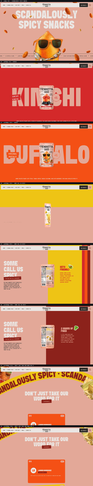
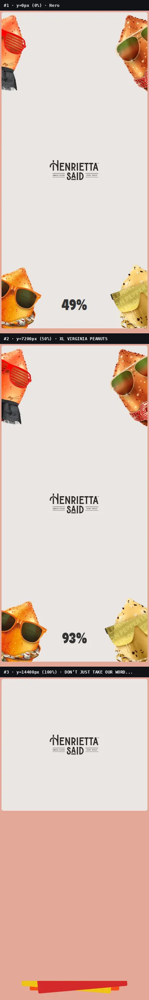

# UI Design System & Master Generation Blueprint: henrietta-wearetattoodigital-com

> **Henrietta Said : Scandalously Spicy** (https://henrietta.wearetattoodigital.com/) — It’s hard to contain this kind of spiciness. That’s why we’re bringing our scandalously spicy selves to the mainstream with bold wing-fla...





---

## 1. Executive Visual Persona & Design Archetype

- **Brand Essence & Persona**: **Henrietta Said : Scandalously Spicy** (`https://henrietta.wearetattoodigital.com/`). It’s hard to contain this kind of spiciness. That’s why we’re bringing our scandalously spicy selves to the mainstream with bold wing-fla...
- **Capture Provenance**: Live browser capture (`tier1_fast`, HTTP `200`, captured `2026-11-24`).
- **Visual Archetype**: **Light-Gallery WebGL / Canvas Interactive Experience (`#e3a898` / `#ffa500`)**.
- **Anti-AI-Slop Differentiators**:
  - **Live-Computed Chromatic Polarity**: Anchors the viewport in `#e3a898` (live computed `body` `background-color` (`computed_styles.json`)) paired with `#333333` primary typography and `#ffa500` accents.
  - **Grounded Typographic Hierarchy**: Pairs `Sink` for display copy (`KIMCHI`) with `Helvetica Neue`.
  - **Calibrated Spatial Grid & Motion**: Combines `1440px` container bounds (`gap: 16px`, padding `9px`) with `cubic-bezier(.68,-.55,.265,1.55)` easing and Lenis Smooth Scroll (`data-lenis`), GSAP Timeline & ScrollTrigger.

---

## 2. Spatial Architecture & Modular Grid Mathematics

### Viewport Allocation & Container Geometry
- **Captured Journey Filmstrips**: Desktop `1280×6624px` (`assets/desktop-journey.webp`, `8` keyframes up to `y=14400px` / doc `19740px`), Mobile `390×2616px` (`assets/mobile-journey.webp`, `3` keyframes).
- **Master Container Bounds**: `1440px` (full-bleed `100%` viewport stage).
- **Canvas Lateral Padding & Spacing**: `9px` lateral canvas padding with `16px` grid gap.
- **Border Radius Scale**: `3px`, `100%`, `50%`, `2px`.

### Responsive Breakpoint Architecture
- **Desktop Layout**: Multi-column CSS Grid / Flexbox layout at `1440px` (`max-width: 1440px`, `gap: 16px`).
- **Mobile Layout**: Single-column vertical stack at `390px` viewport width with `9px` horizontal padding.
- **Extracted CSS Media Queries**: `@media screen and (max-width: 991px)`, `@media screen and (max-width: 767px)`, `@media screen and (max-width: 479px)`, `@media (min-width: 768px)`.

---

## 3. Color System, Materiality & Atmospheric Lighting

### Semantic Palette & Source Grounding
| Semantic Role | Ground-Truth Value | Extracted Live / CSS Source |
|---|---|---|
| **Primary Canvas Substrate** | `#e3a898` | live computed `body` `background-color` (`computed_styles.json`) |
| **Primary Typography Ink** | `#333333` | live computed `body` `color` (`computed_styles.json`) |
| **Elevated Surface / Card Substrate** | `#dddddd` | live computed `nav` `background-color` (`computed_styles.json`) |
| **Interactive Accent / Highlight** | `#ffa500` | `.button-v-1.buffalo { color: orange }` (`#ffa500`) |
| **Secondary / Muted Copy** | `#0082f3` | `.w-dropdown-link.w--current { color: #0082f3 }` |
| **Structural Hairline Border** | `#e2e2e2` | `blockquote { border-left: #e2e2e2 }` |
| **Variable Token (`--kimchi-red`)** | `#d32929` | `var(--kimchi-red)` in `:root` |
| **Variable Token (`--light-grey`)** | `#eae6e3` | `var(--light-grey)` in `:root` |
| **Variable Token (`--brown-chicken`)** | `#8b231a` | `var(--brown-chicken)` in `:root` |
| **Variable Token (`--orange`)** | `#f45016` | `var(--orange)` in `:root` |
| **Variable Token (`--lemon`)** | `#efc415` | `var(--lemon)` in `:root` |
| **Variable Token (`--dark`)** | `#2d2a26` | `var(--dark)` in `:root` |
| **Variable Token (`--white`)** | `#ffffff` | `var(--white)` in `:root` |
| **Variable Token (`--black`)** | `#0e0e0e` | `var(--black)` in `:root` |
| **Variable Token (`--salmon`)** | `#f7894e` | `var(--salmon)` in `:root` |
| **Variable Token (`--dark-red`)** | `#761615` | `var(--dark-red)` in `:root` |

### Sanitized Root CSS Variables (`ui-ux.md` Ground Truth)
| Variable Name | Extracted Value | Semantic Role |
|---|---|---|
| `--body` | `#e3a898` | Color / Atmospheric Token |
| `--kimchi-red` | `#d32929` | Color / Atmospheric Token |
| `--light-grey` | `#eae6e3` | Canvas / Surface Token |
| `--brown-chicken` | `#8b231a` | Color / Atmospheric Token |
| `--orange` | `#f45016` | Color / Atmospheric Token |
| `--lemon` | `#efc415` | Color / Atmospheric Token |
| `--dark` | `#2d2a26` | Canvas / Surface Token |
| `--white` | `#fff` | Canvas / Surface Token |
| `--black` | `#0E0E0E` | Canvas / Surface Token |
| `--salmon` | `#f7894e` | Color / Atmospheric Token |
| `--dark-red` | `#761615` | Canvas / Surface Token |
| `--blush` | `#e3a898` | Color / Atmospheric Token |
| `--hst-duration-exit` | `0.8s` | Motion / Easing Token |
| `--hst-duration-enter` | `0.95s` | Motion / Easing Token |
| `--hst-easing` | `cubic-bezier(0.76, 0, 0.24, 1)` | Motion / Easing Token |
| `--hst-scale` | `0.9` | Design System Custom Token |

---

## 4. Typographic Scale & Editorial Hierarchy

### Font Family Stacks
- **Display Typography**: `Sink`.
- **Primary Body Stack**: `Helvetica Neue`.
- **Technical / Metadata Stack**: not declared in live computed styles (uses primary stack / `ui-monospace`).

### Typographic Scale & Rules (Live Computed & Stylesheet Grounded)
- **Hero Display (`H1`)**: live computed `h1` (`font-size: 403.2px`, `line-height: 362.88px`, `font-weight: 900`, `letter-spacing: 4.32px`); rule `h1` (`font-size: 2em`).
- **Section Heading (`H2`)**: rule `h2` (`font-size: 32px`, `line-height: 36px`).
- **Body Copy**: live computed `body` (`font-size: 14px`, `line-height: 20px`, `font-weight: 400`); rule `body` (`font-size: 14px`, `line-height: 20px`).
- **Metadata & Navigation Labels**: live computed `nav/a` (`font-size: 14px`, `line-height: 20px`, `font-weight: 400`); rule `small` (`font-size: 80%`).

---

## 5. Choreographed Motion & Interaction Physics

### Primary Easing Curves
- **Extracted Timing Functions**: `cubic-bezier(.68,-.55,.265,1.55)`, `cubic-bezier(0.76,0,0.24,1)`, `cubic-bezier(0.215,0.61,0.355,1)`.

### Per-Element Transition & Choreography Rules
- **Selector `.w-webflow-badge > img`**: `transition: unset` extracted from `henrietta-wearetattoodigital-com` stylesheet.
- **Selector `.w-slider-dot`**: `transition: background-color .1s, color .1s` extracted from `henrietta-wearetattoodigital-com` stylesheet.
- **Selector `.w-lightbox-control`**: `transition: all .3s` extracted from `henrietta-wearetattoodigital-com` stylesheet.
- **Extracted Easing Curve (`cubic-bezier(.68,-.55,.265,1.55)`)**: Governs interactive state transitions across `<nav.our-products-list>` and `<div.preloader:nth(2)>`.
- **Runtime Interaction Engine**: Integrates Lenis Smooth Scroll (`data-lenis`), GSAP Timeline & ScrollTrigger, Lottie Vector Animation Player, HTML5 `<canvas>` Interactive Viewport Surface with `prefers-reduced-motion: reduce` fallback guards.
### Measured Runtime Scroll & Interaction Telemetry (`behavioral_journey_v2`)
- **Scroll Driver Mode**: `native` (max document height `19740px`, deepest scrollY reached `14400px` across `8` desktop keyframes).
- **Detected Scroll / Motion Libraries**: `Lenis`, `GSAP/ScrollTrigger`, `WebGL/Canvas`.
- **Route Transition Architecture**: First internal navigation (`/ancho-kimchi`) measured as `direct` in `865ms`.

---

## 6. Component Wireframe & Structural DOM Map

### Visual Layout Schematic — Desktop (`1440px`, Grounded in `dom.html` & Landmark Bounding Boxes)
```
┌────────────────────────────────────────────────────────────────────────┐
│ DESKTOP VIEWPORT (1440px) — Henrietta Said : Scandalously Spicy        │
│ ====================================================================== │
│ [ <nav.our-products-list (1440px)     | ancho kimchi · original buff ] │
│ ---------------------------------------------------------------------- │
│ | HERO STAGE: <div.preloader> (w=1440px)                             | │
│ | H1: KIMCHI                                                         | │
│ | Substrate: #e3a898 | Ink: #333333 | Accent: #ffa500                | │
│ ---------------------------------------------------------------------- │
│ | SHOWCASE GRID (<div.preloader:nth(2)>) max-w: 1440px               | │
│ | +------------------------------+  +------------------------------+ | │
│ | | Jumbo roasted peanuts with a |  | Jumbo roasted peanuts with b | | │
│ | +------------------------------+  +------------------------------+ | │
│ ---------------------------------------------------------------------- │
│ | DETAIL MODULE (<div.preloader:nth(3)>) — Jumbo roasted peanuts     | │
│ ---------------------------------------------------------------------- │
│ [ FOOTER (<footer.w-mod-ix3>  ) | https://henrietta.wearetattoodigita  │
└────────────────────────────────────────────────────────────────────────┘
```

### Visual Layout Schematic — Mobile Reflow (`390px`)
```
┌────────────────────────────────────────────────────────────────────────┐
│ MOBILE VIEWPORT REFLOW (390px) — Single-Column Stack (gap: 16px)       │
│ ====================================================================== │
│ [ HEADER BAR (<nav.our-products-list> ) | Compact Menu (390px)         │
│ ---------------------------------------------------------------------- │
│ | HERO STAGE (<div.preloader>) — 390px Vertical Lead                 | │
│ | H1: KIMCHI                                                         | │
│ ---------------------------------------------------------------------- │
│ | SHOWCASE STACK (<div.preloader:nth(2)>) — 1-Col Stack              | │
│ | [ Item 1: Jumbo roasted peanuts with a fusion of flavorful       ] | │
│ | [ Item 2: Jumbo roasted peanuts with bodaciously bold Nash       ] | │
│ ---------------------------------------------------------------------- │
│ | DETAIL STACK (<div.preloader:nth(3)>) — 1-Col (Jumbo roasted pean) | │
│ ---------------------------------------------------------------------- │
│ [ FOOTER (<footer.w-mod-ix3>  ) | Stacked 390px Colophon               │
└────────────────────────────────────────────────────────────────────────┘
```

### Granular DOM Region Breakdown
1. **Brand Header & Navigation Bar (<nav.our-products-list> — `henrietta-wearetattoodigital-com`)**:
   - Landmark `<nav class="our-products-list w-dropdown-list">` (`1440px`) hosting `Henrietta Said : Scandalously Spicy` navigation (`ancho kimchi · original buffalo · lemon pepper`), DOM attributes (`data-wf-domain="henrietta.wearetattoo..."`, `data-wf-page="69fc9bd508ea045856fc2e42"`, `data-wf-site="69fc9bd208ea045856fc2c0a"`, `data-preloader-counter`), and stylesheet rule `html { -webkit-text-size-adjust: 100%; -ms-text-size-adjust: 100%; font-family:... }`.
2. **Hero Stage & Focal Lead (<div.preloader> — `KIMCHI`)**:
   - Landmark `<div class="preloader">` presenting display lead `KIMCHI` and copy excerpt *"Jumbo roasted peanuts with a fusion of flavorfully fun ancho kimc"* over `#e3a898` canvas and `#333333` ink.
3. **Primary Showcase & Content Grid (<div.preloader:nth(2)> — `Jumbo roasted peanuts with a fusio`)**:
   - Landmark `<div class="preloader">` rendering section `Jumbo roasted peanuts with a fusion of flavorful` with copy *"Jumbo roasted peanuts with bodaciously bold Nashville hot Chicken"*, asset references (`cdn.prod.website-files.com`, `henrietta-said.webflow.shared.afe...`, `fonts.googleapis.com`, `fonts.gstatic.com`), and grid rule `body { margin: 0; }`.
4. **Interactive Detail & Feature Matrix (<div.preloader:nth(3)> — `Jumbo roasted peanuts with bodacio`)**:
   - Landmark `<div class="preloader">` framing `Jumbo roasted peanuts with bodaciously bold Nash` and `Jumbo roasted peanuts with totally twangy buffal` (*"Jumbo roasted peanuts with totally twangy buffalo vinegar seasoni"*) with `#dddddd` surface cards, `#ffa500` accents, and `summary { display: block; }`.
5. **Colophon & Global Directory Footer (<footer.w-mod-ix3> — `https://henrietta.wearetattoodigital.com/`)**:
   - Landmark `<footer class="w-mod-ix3">` anchoring `Henrietta Said : Scandalously Sp` footer links (`ancho kimchi · original buffalo · lemon pepper`), copy *"Jumbo roasted peanuts with primarily primo lemon pepper seas"*, and `#e2e2e2` structural dividers.
### Full Vertical Scroll Sequence (Desktop `1440×900` Keyframes)
- **Step 01** (`y=0px`, `0%`): Active landmark `SCANDALOUSLY SPICY SNACKS` · sticky/fixed elements: `2`
- **Step 02** (`y=850px`, `5%`): Active landmark `KIMCHI` · sticky/fixed elements: `3`
- **Step 03** (`y=3400px`, `18%`): Active landmark `KIMCHI` · sticky/fixed elements: `2`
- **Step 04** (`y=5950px`, `32%`): Active landmark `SOME CALL US SPICY` · sticky/fixed elements: `2`
- **Step 05** (`y=8500px`, `45%`): Active landmark `SOME CALL US SPICY` · sticky/fixed elements: `1`
- **Step 06** (`y=11050px`, `59%`): Active landmark `SOME CALL US SPICY` · sticky/fixed elements: `1`
- **Step 07** (`y=13600px`, `72%`): Active landmark `DON’T JUST TAKE OUR WORD FOR IT` · sticky/fixed elements: `1`
- **Step 08** (`y=14400px`, `76%`): Active landmark `DON’T JUST TAKE OUR WORD FOR IT` · sticky/fixed elements: `1`

### Multi-Page Internal Route Map
- **Other Route (`/ancho-kimchi`)**: `https://henrietta.wearetattoodigital.com/ancho-kimchi` — H1: `home`, scrollHeight `5132px`, transition `direct` (`865ms`)
- **Other Route (`/nashville-hot-chicken`)**: `https://henrietta.wearetattoodigital.com/nashville-hot-chicken` — H1: `home`, scrollHeight `5132px`, transition `direct` (`797ms`)
- **Other Route (`/original-buffalo`)**: `https://henrietta.wearetattoodigital.com/original-buffalo` — H1: `home`, scrollHeight `5132px`, transition `direct` (`496ms`)

---

## 7. Master Zero-Shot AI Generation Prompt

```markdown
# Master Zero-Shot Frontend Generation Prompt: henrietta-wearetattoodigital-com (Henrietta Said : Scandalously Spicy)

You are a principal frontend architect and design systems engineer. Build a complete, production-ready web application replicating the exact design system, DOM landmarks, typographic hierarchy, color tokens, and motion physics of `henrietta-wearetattoodigital-com` (**Henrietta Said : Scandalously Spicy** — `https://henrietta.wearetattoodigital.com/`).

### 1. Visual Archetype & Anti-AI-Slop Mandates
- **Archetype**: Light-Gallery WebGL / Canvas Interactive Experience (`#e3a898` / `#ffa500`).
- **Identity & Domain Context**: It’s hard to contain this kind of spiciness. That’s why we’re bringing our scandalously spicy selves to the mainstream with bold wing-fla...
- **Primary Substrate**: `#e3a898` (live computed `body` `background-color` (`computed_styles.json`)), **Primary Ink**: `#333333`, **Accent / Highlight**: `#ffa500`.
- **Site-Specific Differentiators**:
  - **Live-Computed Chromatic Polarity**: Anchors the viewport in `#e3a898` (live computed `body` `background-color` (`computed_styles.json`)) paired with `#333333` primary typography and `#ffa500` accents.
  - **Grounded Typographic Hierarchy**: Pairs `Sink` for display copy (`KIMCHI`) with `Helvetica Neue`.
  - **Calibrated Spatial Grid & Motion**: Combines `1440px` container bounds (`gap: 16px`, padding `9px`) with `cubic-bezier(.68,-.55,.265,1.55)` easing and Lenis Smooth Scroll (`data-lenis`), GSAP Timeline & ScrollTrigger.

### 2. Ground-Truth CSS Variables (`:root` Token Contract)
Declare and consume these exact custom properties extracted from `henrietta-wearetattoodigital-com` in your global stylesheet:

:root {
  /* Henrietta Said : Scandalously Spicy (henrietta-wearetattoodigital-com) — Live-Grounded CSS Variables */
  --body: #e3a898; /* Color / Atmospheric Token (henrietta-wearetattoodigital-com) */
  --kimchi-red: #d32929; /* Color / Atmospheric Token (henrietta-wearetattoodigital-com) */
  --light-grey: #eae6e3; /* Canvas / Surface Token (henrietta-wearetattoodigital-com) */
  --brown-chicken: #8b231a; /* Color / Atmospheric Token (henrietta-wearetattoodigital-com) */
  --orange: #f45016; /* Color / Atmospheric Token (henrietta-wearetattoodigital-com) */
  --lemon: #efc415; /* Color / Atmospheric Token (henrietta-wearetattoodigital-com) */
  --dark: #2d2a26; /* Canvas / Surface Token (henrietta-wearetattoodigital-com) */
  --white: #fff; /* Canvas / Surface Token (henrietta-wearetattoodigital-com) */
  --black: #0E0E0E; /* Canvas / Surface Token (henrietta-wearetattoodigital-com) */
  --salmon: #f7894e; /* Color / Atmospheric Token (henrietta-wearetattoodigital-com) */
  --dark-red: #761615; /* Canvas / Surface Token (henrietta-wearetattoodigital-com) */
  --blush: #e3a898; /* Color / Atmospheric Token (henrietta-wearetattoodigital-com) */
  --hst-duration-exit: 0.8s; /* Motion / Easing Token (henrietta-wearetattoodigital-com) */
  --hst-duration-enter: 0.95s; /* Motion / Easing Token (henrietta-wearetattoodigital-com) */
  --hst-easing: cubic-bezier(0.76, 0, 0.24, 1); /* Motion / Easing Token (henrietta-wearetattoodigital-com) */
  --hst-scale: 0.9; /* Design System Custom Token (henrietta-wearetattoodigital-com) */
}

### 3. Semantic Color & Materiality Contract
Map every surface, ink, and border strictly to these source-grounded tokens:
- **Primary Canvas Substrate**: `#e3a898` — grounded in live computed `body` `background-color` (`computed_styles.json`)
- **Primary Typography Ink**: `#333333` — grounded in live computed `body` `color` (`computed_styles.json`)
- **Elevated Surface / Card Substrate**: `#dddddd` — grounded in live computed `nav` `background-color` (`computed_styles.json`)
- **Interactive Accent / Highlight**: `#ffa500` — grounded in `.button-v-1.buffalo { color: orange }` (`#ffa500`)
- **Secondary / Muted Copy**: `#0082f3` — grounded in `.w-dropdown-link.w--current { color: #0082f3 }`
- **Structural Hairline Border**: `#e2e2e2` — grounded in `blockquote { border-left: #e2e2e2 }`
- **Variable Token (`--kimchi-red`)**: `#d32929` — grounded in `var(--kimchi-red)` in `:root`
- **Variable Token (`--light-grey`)**: `#eae6e3` — grounded in `var(--light-grey)` in `:root`
- **Variable Token (`--brown-chicken`)**: `#8b231a` — grounded in `var(--brown-chicken)` in `:root`
- **Variable Token (`--orange`)**: `#f45016` — grounded in `var(--orange)` in `:root`
- **Variable Token (`--lemon`)**: `#efc415` — grounded in `var(--lemon)` in `:root`
- **Variable Token (`--dark`)**: `#2d2a26` — grounded in `var(--dark)` in `:root`
- **Variable Token (`--white`)**: `#ffffff` — grounded in `var(--white)` in `:root`
- **Variable Token (`--black`)**: `#0e0e0e` — grounded in `var(--black)` in `:root`
- **Variable Token (`--salmon`)**: `#f7894e` — grounded in `var(--salmon)` in `:root`
- **Variable Token (`--dark-red`)**: `#761615` — grounded in `var(--dark-red)` in `:root`

### 4. Spatial Grid, Container Bounds & Responsive Breakpoints
- **Desktop Viewport Reference**: `1280×6624px` (multi-frame vertical journey filmstrip (6624px), `1440px` standard desktop width).
- **Mobile Viewport Reference**: `390×2616px` (multi-frame vertical journey filmstrip (2616px), `390px` standard mobile width).
- **Container Max-Width**: `1440px` (full-bleed `100%` viewport stage)
- **Padding & Gutters**: `9px` lateral canvas padding with `16px` grid gap
- **Desktop Grid**: Multi-column CSS Grid / Flexbox layout at `1440px` (`max-width: 1440px`, `gap: 16px`)
- **Mobile Adaptation**: Single-column vertical stack at `390px` viewport width with `9px` horizontal padding
- **Media Queries**: `@media screen and (max-width: 991px)`, `@media screen and (max-width: 767px)`, `@media screen and (max-width: 479px)`, `@media (min-width: 768px)`
- **Corner Radii**: `3px`, `100%`, `50%`, `2px`

### 5. Typography & Editorial Scale Contract
- **Display Font Stack**: `Sink`
- **Body Font Stack**: `Helvetica Neue`
- **Monospace / Technical Font Stack**: not declared in live computed styles (uses primary stack / `ui-monospace`)
- **H1 Display Rule**: live computed `h1` (`font-size: 403.2px`, `line-height: 362.88px`, `font-weight: 900`, `letter-spacing: 4.32px`); rule `h1` (`font-size: 2em`)
- **H2 Section Rule**: rule `h2` (`font-size: 32px`, `line-height: 36px`)
- **Body Copy Rule**: live computed `body` (`font-size: 14px`, `line-height: 20px`, `font-weight: 400`); rule `body` (`font-size: 14px`, `line-height: 20px`)
- **Metadata & Index Rule**: live computed `nav/a` (`font-size: 14px`, `line-height: 20px`, `font-weight: 400`); rule `small` (`font-size: 80%`)

### 6. Component Hierarchy, Verbatim Copy & Real DOM Landmarks
Scaffold `henrietta-wearetattoodigital-com` (`Henrietta Said : Scandalously Spicy`) with these exact structural regions, extracted copy, and CSS rules from `dom.html`:
1. **Brand Header & Navigation Bar (<nav.our-products-list> — `henrietta-wearetattoodigital-com`)**:
   - DOM & Selectors: Landmark `<nav class="our-products-list w-dropdown-list">` (`1440px`) hosting `Henrietta Said : Scandalously Spicy` navigation (`ancho kimchi · original buffalo · lemon pepper`), DOM attributes (`data-wf-domain="henrietta.wearetattoo..."`, `data-wf-page="69fc9bd508ea045856fc2e42"`, `data-wf-site="69fc9bd208ea045856fc2c0a"`, `data-preloader-counter`), and stylesheet rule `html { -webkit-text-size-adjust: 100%; -ms-text-size-adjust: 100%; font-family:... }`.
   - Responsive Contract: Header `Brand Header & Navigation Bar (<nav.our-products-list> — `henrietta-wearetattoodigital-com`)` (`henrietta-wearetattoodigital-com`) adapts across `@media screen and (max-width: 991px)`, `@media screen and (max-width: 767px)`, `@media screen and (max-width: 479px)`, `@media (min-width: 768px)` with `cubic-bezier(.68,-.55,.265,1.55)`, `cubic-bezier(0.76,0,0.24,1)`, `cubic-bezier(0.215,0.61,0.355,1)` transitions and links `ancho kimchi · original buffalo · lemon pepper`.
2. **Hero Stage & Focal Lead (<div.preloader> — `KIMCHI`)**:
   - DOM & Selectors: Landmark `<div class="preloader">` presenting display lead `KIMCHI` and copy excerpt *"Jumbo roasted peanuts with a fusion of flavorfully fun ancho kimc"* over `#e3a898` canvas and `#333333` ink.
   - Responsive Contract: Hero stage (`1280×6624px` desktop / `390×2616px` mobile) sets `#e3a898` background with `#333333` headline `KIMCHI`.
3. **Primary Showcase & Content Grid (<div.preloader:nth(2)> — `Jumbo roasted peanuts with a fusio`)**:
   - DOM & Selectors: Landmark `<div class="preloader">` rendering section `Jumbo roasted peanuts with a fusion of flavorful` with copy *"Jumbo roasted peanuts with bodaciously bold Nashville hot Chicken"*, asset references (`cdn.prod.website-files.com`, `henrietta-said.webflow.shared.afe...`, `fonts.googleapis.com`, `fonts.gstatic.com`), and grid rule `body { margin: 0; }`.
   - Responsive Contract: Showcase grid `Primary Showcase & Content Grid (<div.preloader:nth(2)> — `Jumbo roasted peanuts with a fusio`)` applies Multi-column CSS Grid / Flexbox layout at `1440px` (`max-width: 1440px`, `gap: 16px`) on desktop and Single-column vertical stack at `390px` viewport width with `9px` horizontal padding on mobile.
4. **Interactive Detail & Feature Matrix (<div.preloader:nth(3)> — `Jumbo roasted peanuts with bodacio`)**:
   - DOM & Selectors: Landmark `<div class="preloader">` framing `Jumbo roasted peanuts with bodaciously bold Nash` and `Jumbo roasted peanuts with totally twangy buffal` (*"Jumbo roasted peanuts with totally twangy buffalo vinegar seasoni"*) with `#dddddd` surface cards, `#ffa500` accents, and `summary { display: block; }`.
   - Responsive Contract: Detail module `Interactive Detail & Feature Matrix (<div.preloader:nth(3)> — `Jumbo roasted peanuts with bodacio`)` uses `3px`, `100%`, `50%`, `2px` radii, `#ffa500` highlights, and assets (cdn.prod.website-files.com, henrietta-said.webflow.shared.afe..., fonts.googleapis.com).
5. **Colophon & Global Directory Footer (<footer.w-mod-ix3> — `https://henrietta.wearetattoodigital.com/`)**:
   - DOM & Selectors: Landmark `<footer class="w-mod-ix3">` anchoring `Henrietta Said : Scandalously Sp` footer links (`ancho kimchi · original buffalo · lemon pepper`), copy *"Jumbo roasted peanuts with primarily primo lemon pepper seas"*, and `#e2e2e2` structural dividers.
   - Responsive Contract: Footer `Colophon & Global Directory Footer (<footer.w-mod-ix3> — `https://henrietta.wearetattoodigital.com/`)` aligns to `1440px` (full-bleed `100%` viewport stage) with `9px` lateral canvas padding with `16px` grid gap and attributes (data-wf-domain="henrietta.wearetattoo...", data-wf-page="69fc9bd508ea045856fc2e42", data-wf-site="69fc9bd208ea045856fc2c0a").

#### Verbatim DOM Copy Excerpts (`dom.html`)
- Copy Excerpt 1: *"Jumbo roasted peanuts with a fusion of flavorfully fun ancho kimchi seasonings. Sp..."*
- Copy Excerpt 2: *"Jumbo roasted peanuts with bodaciously bold Nashville hot Chicken with pickle seas..."*
- Copy Excerpt 3: *"Jumbo roasted peanuts with totally twangy buffalo vinegar seasoning. Made with ing..."*
- Copy Excerpt 4: *"Jumbo roasted peanuts with primarily primo lemon pepper seasoning. That’s some fin..."*

### 7. Motion, Extracted Stylesheet Rules & Interaction Choreography
- **Primary Easing Functions**: `cubic-bezier(.68,-.55,.265,1.55)`, `cubic-bezier(0.76,0,0.24,1)`, `cubic-bezier(0.215,0.61,0.355,1)`
- **Extracted Stylesheet Rules (`henrietta-wearetattoodigital-com`)**:
- `html { -webkit-text-size-adjust: 100%; -ms-text-size-adjust: 100%; font-family:... }`
- `body { margin: 0; }`
- `summary { display: block; }`
- `video { vertical-align: baseline; display: inline-block; }`
- `template { display: none; }`
- **Per-Selector Transition Rules**:
- **Selector `.w-webflow-badge > img`**: `transition: unset` extracted from `henrietta-wearetattoodigital-com` stylesheet.
- **Selector `.w-slider-dot`**: `transition: background-color .1s, color .1s` extracted from `henrietta-wearetattoodigital-com` stylesheet.
- **Selector `.w-lightbox-control`**: `transition: all .3s` extracted from `henrietta-wearetattoodigital-com` stylesheet.
- **Extracted Easing Curve (`cubic-bezier(.68,-.55,.265,1.55)`)**: Governs interactive state transitions across `<nav.our-products-list>` and `<div.preloader:nth(2)>`.
- **Runtime Interaction Engine**: Integrates Lenis Smooth Scroll (`data-lenis`), GSAP Timeline & ScrollTrigger, Lottie Vector Animation Player, HTML5 `<canvas>` Interactive Viewport Surface with `prefers-reduced-motion: reduce` fallback guards.
### 7b. Full-Page Scroll Choreography, Interactive States & Multi-Page Routes
- **Scroll Mechanics**: Implement `native` vertical progression up to `19740px` across 8 distinct viewport chapters using Lenis, GSAP/ScrollTrigger, WebGL/Canvas.
- **Vertical Chapter Sequence**: SCANDALOUSLY SPICY SNACKS (0%) -> KIMCHI (5%) -> KIMCHI (18%) -> SOME CALL US SPICY (32%) -> SOME CALL US SPICY (45%) -> SOME CALL US SPICY (59%) -> DON’T JUST TAKE OUR WORD FO... (72%) -> DON’T JUST TAKE OUR WORD FO... (76%).
- **Multi-Page Routes**: Scaffold internal routes `/ancho-kimchi` (other, direct), `/nashville-hot-chicken` (other, direct), `/original-buffalo` (other, direct) sharing the global header/footer shell and design tokens.

### 8. Technical Deliverables
- Implement in Next.js (App Router) with TypeScript and Tailwind CSS consuming the `:root` custom properties defined above for `henrietta-wearetattoodigital-com`.
- Reproduce both the `1440px` desktop architecture and `390px` mobile breakpoint transitions, preserving semantic HTML5 landmarks (`<header>`, `<nav>`, `<main>`, `<section>`, `<footer>`) and `prefers-reduced-motion` accessibility guards.
```
---

## 8. Full-Page Scroll Journey, Interactive States & Subpage Inventory

### Desktop Scroll Keyframes (`1440×900` WebP)
| Step | Scroll Y | Progress | Active Landmark / Section | Sticky/Fixed | Visual Asset |
| :---: | :---: | :---: | :--- | :---: | :--- |
| `#01` | `0px` | `0%` | SCANDALOUSLY SPICY SNACKS | `2` | [desktop-step-01.webp](assets/desktop-step-01.webp) |
| `#02` | `850px` | `5%` | KIMCHI | `3` | [desktop-step-02.webp](assets/desktop-step-02.webp) |
| `#03` | `3400px` | `18%` | KIMCHI | `2` | [desktop-step-03.webp](assets/desktop-step-03.webp) |
| `#04` | `5950px` | `32%` | SOME CALL US SPICY | `2` | [desktop-step-04.webp](assets/desktop-step-04.webp) |
| `#05` | `8500px` | `45%` | SOME CALL US SPICY | `1` | [desktop-step-05.webp](assets/desktop-step-05.webp) |
| `#06` | `11050px` | `59%` | SOME CALL US SPICY | `1` | [desktop-step-06.webp](assets/desktop-step-06.webp) |
| `#07` | `13600px` | `72%` | DON’T JUST TAKE OUR WORD FOR IT | `1` | [desktop-step-07.webp](assets/desktop-step-07.webp) |
| `#08` | `14400px` | `76%` | DON’T JUST TAKE OUR WORD FOR IT | `1` | [desktop-step-08.webp](assets/desktop-step-08.webp) |

### Mobile Condensed Keyframes (`390×844` WebP)
| Step | Scroll Y | Progress | Active Landmark | Visual Asset |
| :---: | :---: | :---: | :--- | :--- |
| `#01` | `0px` | `0%` | Hero | [mobile-step-01.webp](assets/mobile-step-01.webp) |
| `#02` | `7200px` | `50%` | XL VIRGINIA PEANUTS | [mobile-step-02.webp](assets/mobile-step-02.webp) |
| `#03` | `14400px` | `100%` | DON’T JUST TAKE OUR WORD FOR IT | [mobile-step-03.webp](assets/mobile-step-03.webp) |

### Internal Subpage Filmstrips (`1080px` Wide WebP)
| # | Template | Route URL | H1 / Title | Scroll Height | Transition | Filmstrip Asset |
| :-: | :---: | :--- | :--- | :---: | :---: | :--- |
| `1` | `other` | `https://henrietta.wearetattoodigital.com/ancho-kimchi` | home | `5132px` | `direct` (`865ms`) | [subpage-01-ancho-kimchi.webp](assets/subpage-01-ancho-kimchi.webp) |
| `2` | `other` | `https://henrietta.wearetattoodigital.com/nashville-hot-chicken` | home | `5132px` | `direct` (`797ms`) | [subpage-02-nashville-hot-chicken.webp](assets/subpage-02-nashville-hot-chicken.webp) |
| `3` | `other` | `https://henrietta.wearetattoodigital.com/original-buffalo` | home | `5132px` | `direct` (`496ms`) | [subpage-03-original-buffalo.webp](assets/subpage-03-original-buffalo.webp) |

