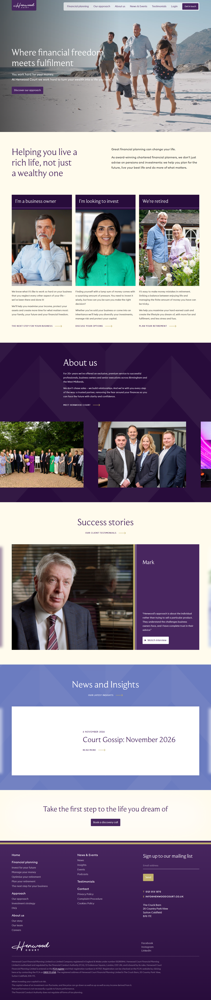
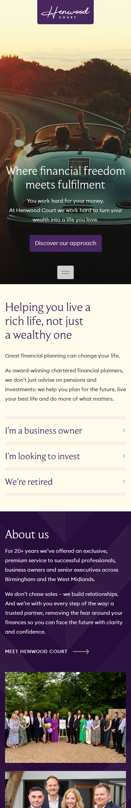

# UI Design System & Master Generation Blueprint: henwoodcourt-co-uk

> **Henwood Court · Where financial freedom meets fulfilment** (https://henwoodcourt.co.uk) — You work hard for your money. At Henwood Court we work hard to turn your wealth into a life you love.



---

## 1. Executive Visual Persona & Design Archetype

- **Brand Essence & Persona**: **Henwood Court · Where financial freedom meets fulfilment** (`https://henwoodcourt.co.uk`). You work hard for your money. At Henwood Court we work hard to turn your wealth into a life you love.
- **Visual Archetype**: **High-Contrast Obsidian / Atmospheric Design System (`#000` canvas, `#fff` ink, `#705583` accent)**.
- **Anti-AI-Slop Differentiators**:
  - **Source-Grounded Chromatic Polarity**: Anchors the viewport in `#000` (`var(--color-black)` in `:root`) paired with `#fff` primary typography and `#705583` accents.
  - **Extracted Typographic Hierarchy**: Pairs `Euclid Circular B` for display copy (`Where financial freedom meets fulfil`) with `Moulin Trial` and `SFMono-Regular`.
  - **Calibrated Spatial Grid & Motion**: Combines `40rem` container bounds (`gap: 24px`, padding `.5rem`) with `cubic-bezier(0,0,.2,1)` easing and Lottie Vector Animation Player.

---

## 2. Spatial Architecture & Modular Grid Mathematics



### Viewport Allocation & Container Geometry
- **Captured Viewport Dimensions**: Desktop `1440×6820px` (`assets/desktop.png`, full-page scroll capture), Mobile `390×2400px` (`assets/mobile.png`, capped at 2400px multi-section capture).
- **Master Container Bounds**: `40rem` extracted from `henwoodcourt-co-uk` stylesheet.
- **Canvas Lateral Padding & Spacing**: `.5rem` lateral canvas padding with `24px` grid gap.
- **Border Radius Scale**: `100%`, `.3125rem`, `.375rem`, `var(--radius-3xl)`.

### Responsive Breakpoint Architecture
- **Desktop Layout**: Multi-column CSS Grid / Flexbox layout at `1440px` (`max-width: 40rem`, `gap: 24px`).
- **Mobile Layout**: Single-column vertical stack at `390px` viewport width with `.5rem` horizontal padding.
- **Extracted CSS Media Queries**: `@media (min-width:48rem)`, `@media (min-width:40rem)`, `@media (min-width:64rem)`, `@media (min-width:80rem)`.

---

## 3. Color System, Materiality & Atmospheric Lighting

### Semantic Palette & Source Grounding
| Semantic Role | Ground-Truth Value | Extracted CSS Source / Selector |
|---|---|---|
| **Primary Canvas Substrate** | `#000` | `var(--color-black)` in `:root` |
| **Primary Typography Ink** | `#fff` | `var(--color-white)` in `:root` |
| **Elevated Surface / Card Substrate** | `#48265f` | `var(--color-med-purple)` in `:root` |
| **Interactive Accent / Highlight** | `#705583` | `var(--color-light-purple)` in `:root` |
| **Secondary / Muted Copy** | `#280c3b` | `var(--color-dark-purple)` in `:root` |
| **Structural Hairline Border** | `#7b7283` | `var(--color-muted-purple)` in `:root` |

### Sanitized Root CSS Variables (`ui-ux.md` Ground Truth)
| Variable Name | Extracted Value | Semantic Role |
|---|---|---|
| `--font-sans` | `var(--font-body)` | Typography / Scale Token |
| `--color-black` | `#000` | Canvas / Surface Token |
| `--color-white` | `#fff` | Canvas / Surface Token |
| `--spacing` | `.25rem` | Layout / Spatial Grid Token |
| `--container-sm` | `24rem` | Layout / Spatial Grid Token |
| `--container-md` | `28rem` | Layout / Spatial Grid Token |
| `--container-lg` | `32rem` | Layout / Spatial Grid Token |
| `--container-xl` | `36rem` | Layout / Spatial Grid Token |
| `--container-2xl` | `42rem` | Layout / Spatial Grid Token |
| `--container-3xl` | `48rem` | Layout / Spatial Grid Token |
| `--container-4xl` | `56rem` | Layout / Spatial Grid Token |
| `--container-5xl` | `64rem` | Layout / Spatial Grid Token |
| `--container-6xl` | `72rem` | Layout / Spatial Grid Token |
| `--font-weight-light` | `300` | Canvas / Surface Token |
| `--font-weight-normal` | `400` | Typography / Scale Token |
| `--font-weight-medium` | `500` | Typography / Scale Token |

---

## 4. Typographic Scale & Editorial Hierarchy

### Font Family Stacks
- **Display Typography**: `Euclid Circular B`.
- **Primary Body Stack**: `Moulin Trial`.
- **Technical / Metadata Stack**: `SFMono-Regular`.

### Typographic Scale & Rules (Extracted from Stylesheet & Variables)
- **Hero Display (`H1`)**: CSS variables `--font-display: "Moulin Trial", Georgia, "Times New Roman", serif`.
- **Section Heading (`H2`)**: not explicitly declared on tag in static CSS (stylesheet font-size ladder: `20px`, `1em`, `80%`, `75%`, `1rem`).
- **Body Copy**: CSS variables `--font-body: "Euclid Circular B", Arial, Helvetica, sans-serif`, `--text-body-small: 14px`.
- **Metadata & Navigation Labels**: CSS variables `--default-mono-font-family: var(--font-mono)`, `--text-body-small: 14px`, `--text-label: 14px`.

---

## 5. Choreographed Motion & Interaction Physics

### Primary Easing Curves
- **Extracted Timing Functions**: `cubic-bezier(0,0,.2,1)`, `cubic-bezier(.4,0,.2,1)`, `cubic-bezier(.22,1,.36,1)`.

### Per-Element Transition & Choreography Rules
- **Selector `.dashicons-before:before`**: `transition: color .1s ease-in` extracted from `henwoodcourt-co-uk` stylesheet.
- **Selector `layer theme`**: `transition: .15s` extracted from `henwoodcourt-co-uk` stylesheet.
- **Selector `.transition`**: `transition: var(--tw-ease,var(--default-transition-timing-function))` extracted from `henwoodcourt-co-uk` stylesheet.
- **Extracted Easing Curve (`cubic-bezier(0,0,.2,1)`)**: Governs interactive state transitions across `<header.fixed>` and `<article.bg-white>`.
- **Runtime Interaction Engine**: Integrates Lottie Vector Animation Player with `prefers-reduced-motion: reduce` fallback guards.

---

## 6. Component Wireframe & Structural DOM Map

### Visual Layout Schematic (Grounded in `dom.html` — `1440px` Desktop & `390px` Mobile Reflow)
```
┌────────────────────────────────────────────────────────────────────────┐
│ DESKTOP VIEWPORT (1440px) — Henwood Court · Where financial freedom me │
│ ====================================================================== │
│ [ <header.fixed>           | Manage your money · Plan your retireme ]  │
│ ---------------------------------------------------------------------- │
│ | HERO STAGE: <article.bg-white>                                   |   │
│ | H1: Where financial freedom meets fulfilment                     |   │
│ | Substrate: #000       | Ink: #fff       | Accent: #705583        |   │
│ ---------------------------------------------------------------------- │
│ | SHOWCASE GRID (<article.bg-white>        ) max-w: 40rem          |   │
│ | +------------------------------+  +------------------------------+ | │
│ | | Helping you live a rich life |  | I’m a business owner         | | │
│ | +------------------------------+  +------------------------------+ | │
│ ---------------------------------------------------------------------- │
│ | MOBILE VIEWPORT REFLOW (390px) — Single-Column Stack (gap: 24px  ) | │
│ | [<header.fixed>] -> [<article.bg-white>] -> [<article.bg-white>] |   │
│ ---------------------------------------------------------------------- │
│ [ FOOTER (<footer.bg-linear-to-b) | https://henwoodcourt.co.uk         │
└────────────────────────────────────────────────────────────────────────┘
```

### Granular DOM Region Breakdown
1. **Brand Header & Navigation Bar (<header.fixed> — `henwoodcourt-co-uk`)**:
   - Landmark `<header class="fixed top-0">` hosting `Henwood Court · Where financial free` navigation (`Manage your money · Plan your retirement · Our approach · Investment strategy · FAQs`), DOM attributes (`data-theme-url="https://henwoodcourt...."`, `data-ajax-url="https://henwoodcourt...."`, `data-ratio="xMidYMid meet"`, `data-path="https://henwoodcourt...."`), and stylesheet rule `.dashicons-admin-appearance:before { content:"\f100" }`.
2. **Hero Stage & Focal Lead (<article.bg-white> — `Where financial freedom meets fulf`)**:
   - Landmark `<article class="bg-white shadow-card">` presenting display lead `Where financial freedom meets fulfilment` and copy excerpt *"Financial planning Manage your money The next step for your busin"* over `#000` canvas and `#fff` ink.
3. **Primary Showcase & Content Grid (<article.bg-white> — `Helping you live a rich life, not `)**:
   - Landmark `<article class="bg-white shadow-card">` rendering section `Helping you live a rich life, not just a wealthy one` with copy *"Financial planning"*, asset references (`euclid-circular-b-regular.woff2`, `euclid-circular-b-medium.woff2`, `moulin-light.woff2`, `player.vimeo.com`), and grid rule `.dashicons-admin-collapse:before { content:"\f148" }`.
4. **Interactive Detail & Feature Matrix (<article.bg-white> — `I’m a business owner`)**:
   - Landmark `<article class="bg-white shadow-card">` framing `I’m a business owner` and `I’m looking to invest` (*"The next step for your business"*) with `#48265f` surface cards, `#705583` accents, and `.dashicons-admin-comments:before { content:"\f101" }`.
5. **Colophon & Global Directory Footer (<footer.bg-linear-to-b> — `https://henwoodcourt.co.uk`)**:
   - Landmark `<footer class="bg-linear-to-b from-med-purple">` anchoring `Henwood Court · Where financial ` footer links (`Manage your money · Plan your retirement · Our approach · Investment strategy · FAQs`), copy *"Invest for your future"*, and `#7b7283` structural dividers.

---

## 7. Master Zero-Shot AI Generation Prompt

```markdown
# Master Zero-Shot Frontend Generation Prompt: henwoodcourt-co-uk (Henwood Court · Where financial freedom meets fulfilment)

You are a principal frontend architect and design systems engineer. Build a complete, production-ready web application replicating the exact design system, DOM landmarks, typographic hierarchy, color tokens, and motion physics of `henwoodcourt-co-uk` (**Henwood Court · Where financial freedom meets fulfilment** — `https://henwoodcourt.co.uk`).

### 1. Visual Archetype & Anti-AI-Slop Mandates
- **Archetype**: High-Contrast Obsidian / Atmospheric Design System (`#000` canvas, `#fff` ink, `#705583` accent).
- **Identity & Domain Context**: You work hard for your money. At Henwood Court we work hard to turn your wealth into a life you love.
- **Primary Substrate**: `#000` (`var(--color-black)` in `:root`), **Primary Ink**: `#fff`, **Accent / Highlight**: `#705583`.
- **Site-Specific Differentiators**:
  - **Source-Grounded Chromatic Polarity**: Anchors the viewport in `#000` (`var(--color-black)` in `:root`) paired with `#fff` primary typography and `#705583` accents.
  - **Extracted Typographic Hierarchy**: Pairs `Euclid Circular B` for display copy (`Where financial freedom meets fulfil`) with `Moulin Trial` and `SFMono-Regular`.
  - **Calibrated Spatial Grid & Motion**: Combines `40rem` container bounds (`gap: 24px`, padding `.5rem`) with `cubic-bezier(0,0,.2,1)` easing and Lottie Vector Animation Player.

### 2. Ground-Truth CSS Variables (`:root` Token Contract)
Declare and consume these exact custom properties extracted from `henwoodcourt-co-uk` in your global stylesheet:

:root {
  /* Henwood Court · Where financial freedom meets fulfilment (henwoodcourt-co-uk) — Ground-Truth Extracted CSS Variables */
  --font-sans: var(--font-body); /* Typography / Scale Token (henwoodcourt-co-uk) */
  --color-black: #000; /* Canvas / Surface Token (henwoodcourt-co-uk) */
  --color-white: #fff; /* Canvas / Surface Token (henwoodcourt-co-uk) */
  --spacing: .25rem; /* Layout / Spatial Grid Token (henwoodcourt-co-uk) */
  --container-sm: 24rem; /* Layout / Spatial Grid Token (henwoodcourt-co-uk) */
  --container-md: 28rem; /* Layout / Spatial Grid Token (henwoodcourt-co-uk) */
  --container-lg: 32rem; /* Layout / Spatial Grid Token (henwoodcourt-co-uk) */
  --container-xl: 36rem; /* Layout / Spatial Grid Token (henwoodcourt-co-uk) */
  --container-2xl: 42rem; /* Layout / Spatial Grid Token (henwoodcourt-co-uk) */
  --container-3xl: 48rem; /* Layout / Spatial Grid Token (henwoodcourt-co-uk) */
  --container-4xl: 56rem; /* Layout / Spatial Grid Token (henwoodcourt-co-uk) */
  --container-5xl: 64rem; /* Layout / Spatial Grid Token (henwoodcourt-co-uk) */
  --container-6xl: 72rem; /* Layout / Spatial Grid Token (henwoodcourt-co-uk) */
  --font-weight-light: 300; /* Canvas / Surface Token (henwoodcourt-co-uk) */
  --font-weight-normal: 400; /* Typography / Scale Token (henwoodcourt-co-uk) */
  --font-weight-medium: 500; /* Typography / Scale Token (henwoodcourt-co-uk) */
}

### 3. Semantic Color & Materiality Contract
Map every surface, ink, and border strictly to these source-grounded tokens:
- **Primary Canvas Substrate**: `#000` — grounded in `var(--color-black)` in `:root`
- **Primary Typography Ink**: `#fff` — grounded in `var(--color-white)` in `:root`
- **Elevated Surface / Card Substrate**: `#48265f` — grounded in `var(--color-med-purple)` in `:root`
- **Interactive Accent / Highlight**: `#705583` — grounded in `var(--color-light-purple)` in `:root`
- **Secondary / Muted Copy**: `#280c3b` — grounded in `var(--color-dark-purple)` in `:root`
- **Structural Hairline Border**: `#7b7283` — grounded in `var(--color-muted-purple)` in `:root`

### 4. Spatial Grid, Container Bounds & Responsive Breakpoints
- **Desktop Viewport Reference**: `1440×6820px` (full-page scroll capture, `1440px` standard desktop width).
- **Mobile Viewport Reference**: `390×2400px` (capped at 2400px multi-section capture, `390px` standard mobile width).
- **Container Max-Width**: `40rem` extracted from `henwoodcourt-co-uk` stylesheet
- **Padding & Gutters**: `.5rem` lateral canvas padding with `24px` grid gap
- **Desktop Grid**: Multi-column CSS Grid / Flexbox layout at `1440px` (`max-width: 40rem`, `gap: 24px`)
- **Mobile Adaptation**: Single-column vertical stack at `390px` viewport width with `.5rem` horizontal padding
- **Media Queries**: `@media (min-width:48rem)`, `@media (min-width:40rem)`, `@media (min-width:64rem)`, `@media (min-width:80rem)`
- **Corner Radii**: `100%`, `.3125rem`, `.375rem`, `var(--radius-3xl)`

### 5. Typography & Editorial Scale Contract
- **Display Font Stack**: `Euclid Circular B`
- **Body Font Stack**: `Moulin Trial`
- **Monospace / Technical Font Stack**: `SFMono-Regular`
- **H1 Display Rule**: CSS variables `--font-display: "Moulin Trial", Georgia, "Times New Roman", serif`
- **H2 Section Rule**: not explicitly declared on tag in static CSS (stylesheet font-size ladder: `20px`, `1em`, `80%`, `75%`, `1rem`)
- **Body Copy Rule**: CSS variables `--font-body: "Euclid Circular B", Arial, Helvetica, sans-serif`, `--text-body-small: 14px`
- **Metadata & Index Rule**: CSS variables `--default-mono-font-family: var(--font-mono)`, `--text-body-small: 14px`, `--text-label: 14px`

### 6. Component Hierarchy, Verbatim Copy & Real DOM Landmarks
Scaffold `henwoodcourt-co-uk` (`Henwood Court · Where financial freedom meets fulfilment`) with these exact structural regions, extracted copy, and CSS rules from `dom.html`:
1. **Brand Header & Navigation Bar (<header.fixed> — `henwoodcourt-co-uk`)**:
   - DOM & Selectors: Landmark `<header class="fixed top-0">` hosting `Henwood Court · Where financial free` navigation (`Manage your money · Plan your retirement · Our approach · Investment strategy · FAQs`), DOM attributes (`data-theme-url="https://henwoodcourt...."`, `data-ajax-url="https://henwoodcourt...."`, `data-ratio="xMidYMid meet"`, `data-path="https://henwoodcourt...."`), and stylesheet rule `.dashicons-admin-appearance:before { content:"\f100" }`.
   - Responsive Contract: Header `Brand Header & Navigation Bar (<header.fixed> — `henwoodcourt-co-uk`)` (`henwoodcourt-co-uk`) adapts across `@media (min-width:48rem)`, `@media (min-width:40rem)`, `@media (min-width:64rem)`, `@media (min-width:80rem)` with `cubic-bezier(0,0,.2,1)`, `cubic-bezier(.4,0,.2,1)`, `cubic-bezier(.22,1,.36,1)` transitions and links `Manage your money · Plan your retirement · Our approach · Investment strategy · FAQs`.
2. **Hero Stage & Focal Lead (<article.bg-white> — `Where financial freedom meets fulf`)**:
   - DOM & Selectors: Landmark `<article class="bg-white shadow-card">` presenting display lead `Where financial freedom meets fulfilment` and copy excerpt *"Financial planning Manage your money The next step for your busin"* over `#000` canvas and `#fff` ink.
   - Responsive Contract: Hero stage (`1440×6820px` desktop / `390×2400px` mobile) sets `#000` background with `#fff` headline `Where financial freedom meets fulfilment`.
3. **Primary Showcase & Content Grid (<article.bg-white> — `Helping you live a rich life, not `)**:
   - DOM & Selectors: Landmark `<article class="bg-white shadow-card">` rendering section `Helping you live a rich life, not just a wealthy one` with copy *"Financial planning"*, asset references (`euclid-circular-b-regular.woff2`, `euclid-circular-b-medium.woff2`, `moulin-light.woff2`, `player.vimeo.com`), and grid rule `.dashicons-admin-collapse:before { content:"\f148" }`.
   - Responsive Contract: Showcase grid `Primary Showcase & Content Grid (<article.bg-white> — `Helping you live a rich life, not `)` applies Multi-column CSS Grid / Flexbox layout at `1440px` (`max-width: 40rem`, `gap: 24px`) on desktop and Single-column vertical stack at `390px` viewport width with `.5rem` horizontal padding on mobile.
4. **Interactive Detail & Feature Matrix (<article.bg-white> — `I’m a business owner`)**:
   - DOM & Selectors: Landmark `<article class="bg-white shadow-card">` framing `I’m a business owner` and `I’m looking to invest` (*"The next step for your business"*) with `#48265f` surface cards, `#705583` accents, and `.dashicons-admin-comments:before { content:"\f101" }`.
   - Responsive Contract: Detail module `Interactive Detail & Feature Matrix (<article.bg-white> — `I’m a business owner`)` uses `100%`, `.3125rem`, `.375rem`, `var(--radius-3xl)` radii, `#705583` highlights, and assets (euclid-circular-b-regular.woff2, euclid-circular-b-medium.woff2, moulin-light.woff2).
5. **Colophon & Global Directory Footer (<footer.bg-linear-to-b> — `https://henwoodcourt.co.uk`)**:
   - DOM & Selectors: Landmark `<footer class="bg-linear-to-b from-med-purple">` anchoring `Henwood Court · Where financial ` footer links (`Manage your money · Plan your retirement · Our approach · Investment strategy · FAQs`), copy *"Invest for your future"*, and `#7b7283` structural dividers.
   - Responsive Contract: Footer `Colophon & Global Directory Footer (<footer.bg-linear-to-b> — `https://henwoodcourt.co.uk`)` aligns to `40rem` extracted from `henwoodcourt-co-uk` stylesheet with `.5rem` lateral canvas padding with `24px` grid gap and attributes (data-theme-url="https://henwoodcourt....", data-ajax-url="https://henwoodcourt....", data-ratio="xMidYMid meet").

#### Verbatim DOM Copy Excerpts (`dom.html`)
- Copy Excerpt 1: *"Financial planning Manage your money The next step for your business Invest for yo..."*
- Copy Excerpt 2: *"Financial planning"*
- Copy Excerpt 3: *"The next step for your business"*
- Copy Excerpt 4: *"Invest for your future"*

### 7. Motion, Extracted Stylesheet Rules & Interaction Choreography
- **Primary Easing Functions**: `cubic-bezier(0,0,.2,1)`, `cubic-bezier(.4,0,.2,1)`, `cubic-bezier(.22,1,.36,1)`
- **Extracted Stylesheet Rules (`henwoodcourt-co-uk`)**:
- `.dashicons-admin-appearance:before { content:"\f100" }`
- `.dashicons-admin-collapse:before { content:"\f148" }`
- `.dashicons-admin-comments:before { content:"\f101" }`
- `.dashicons-admin-customizer:before { content:"\f540" }`
- `.dashicons-admin-generic:before { content:"\f111" }`
- **Per-Selector Transition Rules**:
- **Selector `.dashicons-before:before`**: `transition: color .1s ease-in` extracted from `henwoodcourt-co-uk` stylesheet.
- **Selector `layer theme`**: `transition: .15s` extracted from `henwoodcourt-co-uk` stylesheet.
- **Selector `.transition`**: `transition: var(--tw-ease,var(--default-transition-timing-function))` extracted from `henwoodcourt-co-uk` stylesheet.
- **Extracted Easing Curve (`cubic-bezier(0,0,.2,1)`)**: Governs interactive state transitions across `<header.fixed>` and `<article.bg-white>`.
- **Runtime Interaction Engine**: Integrates Lottie Vector Animation Player with `prefers-reduced-motion: reduce` fallback guards.

### 8. Technical Deliverables
- Implement in Next.js (App Router) with TypeScript and Tailwind CSS consuming the `:root` custom properties defined above for `henwoodcourt-co-uk`.
- Reproduce both the `1440px` desktop architecture and `390px` mobile breakpoint transitions, preserving semantic HTML5 landmarks (`<header>`, `<nav>`, `<main>`, `<section>`, `<footer>`) and `prefers-reduced-motion` accessibility guards.
```
