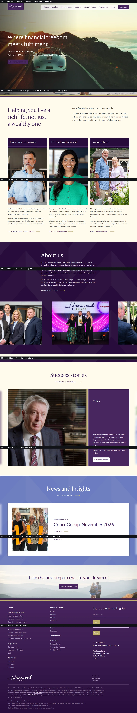
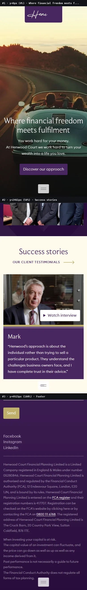

# UI Design System & Master Generation Blueprint: henwoodcourt-co-uk

> **Henwood Court · Where financial freedom meets fulfilment** (https://henwoodcourt.co.uk) — You work hard for your money. At Henwood Court we work hard to turn your wealth into a life you love.





---

## 1. Executive Visual Persona & Design Archetype

- **Brand Essence & Persona**: **Henwood Court · Where financial freedom meets fulfilment** (`https://henwoodcourt.co.uk`). You work hard for your money. At Henwood Court we work hard to turn your wealth into a life you love.
- **Capture Provenance**: Live browser capture (`tier1_fast`, HTTP `200`, captured `2026-11-24`).
- **Visual Archetype**: **Light-Substrate Editorial & Modular Grid System (`#fffbed` canvas, `#48265f` ink, `#383737` accent)**.
- **Anti-AI-Slop Differentiators**:
  - **Live-Computed Chromatic Polarity**: Anchors the viewport in `#fffbed` (live computed `body` `background-color` (`computed_styles.json`)) paired with `#48265f` primary typography and `#383737` accents.
  - **Grounded Typographic Hierarchy**: Pairs `Moulin Trial` for display copy (`Where financial freedom meets fulfil`) with `Euclid Circular B` and `SFMono-Regular`.
  - **Calibrated Spatial Grid & Motion**: Combines `1280px` container bounds (`gap: 24px`, padding `.5rem`) with `cubic-bezier(0,0,.2,1)` easing and Lottie Vector Animation Player.

---

## 2. Spatial Architecture & Modular Grid Mathematics

### Viewport Allocation & Container Geometry
- **Captured Journey Filmstrips**: Desktop `1280×6624px` (`assets/desktop-journey.webp`, `8` keyframes up to `y=5920px` / doc `6820px`), Mobile `390×2616px` (`assets/mobile-journey.webp`, `3` keyframes).
- **Master Container Bounds**: `1280px` (measured widest bounded `<section>` landmark width on `1440px` desktop).
- **Canvas Lateral Padding & Spacing**: `.5rem` lateral canvas padding with `24px` grid gap.
- **Border Radius Scale**: `0px 0px 6px 6px`, `100%`, `.3125rem`, `.375rem`.

### Responsive Breakpoint Architecture
- **Desktop Layout**: Multi-column CSS Grid / Flexbox layout at `1440px` (`max-width: 1280px`, `gap: 24px`).
- **Mobile Layout**: Single-column vertical stack at `390px` viewport width with `.5rem` horizontal padding.
- **Extracted CSS Media Queries**: `@media (min-width:48rem)`, `@media (min-width:40rem)`, `@media (min-width:64rem)`, `@media (min-width:80rem)`.

---

## 3. Color System, Materiality & Atmospheric Lighting

### Semantic Palette & Source Grounding
| Semantic Role | Ground-Truth Value | Extracted Live / CSS Source |
|---|---|---|
| **Primary Canvas Substrate** | `#fffbed` | live computed `body` `background-color` (`computed_styles.json`) |
| **Primary Typography Ink** | `#48265f` | live computed `h2` `color` (`computed_styles.json`) |
| **Elevated Surface / Card Substrate** | `#ffffff` | `select { background-color: #ffffff }` |
| **Interactive Accent / Highlight** | `#383737` | live computed `a` `color` (`computed_styles.json`) |
| **Secondary / Muted Copy** | `#7b7283` | `var(--color-muted-purple)` in `:root` |
| **Structural Hairline Border** | `#6a7282` | `select { border-color: #6a7282 }` |
| **Variable Token (`--color-black`)** | `#000000` | `var(--color-black)` in `:root` |

### Sanitized Root CSS Variables (`ui-ux.md` Ground Truth)
| Variable Name | Extracted Value | Semantic Role |
|---|---|---|
| `--font-sans` | `var(--font-body)` | Typography / Scale Token |
| `--color-black` | `#000` | Canvas / Surface Token |
| `--color-white` | `#fff` | Canvas / Surface Token |
| `--spacing` | `.25rem` | Layout / Spatial Grid Token |
| `--container-sm` | `24rem` | Layout / Spatial Grid Token |
| `--container-md` | `28rem` | Layout / Spatial Grid Token |
| `--container-lg` | `32rem` | Layout / Spatial Grid Token |
| `--container-xl` | `36rem` | Layout / Spatial Grid Token |
| `--container-2xl` | `42rem` | Layout / Spatial Grid Token |
| `--container-3xl` | `48rem` | Layout / Spatial Grid Token |
| `--container-4xl` | `56rem` | Layout / Spatial Grid Token |
| `--container-5xl` | `64rem` | Layout / Spatial Grid Token |
| `--container-6xl` | `72rem` | Layout / Spatial Grid Token |
| `--font-weight-light` | `300` | Canvas / Surface Token |
| `--font-weight-normal` | `400` | Typography / Scale Token |
| `--font-weight-medium` | `500` | Typography / Scale Token |

---

## 4. Typographic Scale & Editorial Hierarchy

### Font Family Stacks
- **Display Typography**: `Moulin Trial`.
- **Primary Body Stack**: `Euclid Circular B`.
- **Technical / Metadata Stack**: `SFMono-Regular`.

### Typographic Scale & Rules (Live Computed & Stylesheet Grounded)
- **Hero Display (`H1`)**: live computed `h1` (`font-size: 60px`, `line-height: 72px`, `font-weight: 300`); CSS variables `--font-display: "Moulin Trial", Georgia, "Times New Roman", serif`.
- **Section Heading (`H2`)**: live computed `h2` (`font-size: 60px`, `line-height: 72px`, `font-weight: 300`).
- **Body Copy**: live computed `body` (`font-size: 17px`, `line-height: 25.5px`, `font-weight: 400`); CSS variables `--font-body: "Euclid Circular B", Arial, Helvetica, sans-serif`, `--text-body-small: 14px`.
- **Metadata & Navigation Labels**: live computed `nav/a` (`font-size: 17px`, `line-height: 25.5px`, `font-weight: 400`); CSS variables `--default-mono-font-family: var(--font-mono)`, `--text-body-small: 14px`, `--text-label: 14px`.

---

## 5. Choreographed Motion & Interaction Physics

### Primary Easing Curves
- **Extracted Timing Functions**: `cubic-bezier(0,0,.2,1)`, `cubic-bezier(.4,0,.2,1)`, `cubic-bezier(.22,1,.36,1)`.

### Per-Element Transition & Choreography Rules
- **Selector `layer theme`**: `transition: .15s` extracted from `henwoodcourt-co-uk` stylesheet.
- **Selector `.transition`**: `transition: var(--tw-ease,var(--default-transition-timing-function))` extracted from `henwoodcourt-co-uk` stylesheet.
- **Selector `visibility\]`**: `transition: var(--tw-ease,var(--default-transition-timing-function))` extracted from `henwoodcourt-co-uk` stylesheet.
- **Extracted Easing Curve (`cubic-bezier(0,0,.2,1)`)**: Governs interactive state transitions across `<header.top-0>` and `<article.p-5>`.
- **Runtime Interaction Engine**: Integrates Lottie Vector Animation Player with `prefers-reduced-motion: reduce` fallback guards.
### Measured Runtime Scroll & Interaction Telemetry (`behavioral_journey_v2`)
- **Scroll Driver Mode**: `native` (max document height `6820px`, deepest scrollY reached `5920px` across `8` desktop keyframes).
- **Detected Scroll / Motion Libraries**: Native browser scroll / standard CSS transitions.
- **Nav / Drawer Probe (`Financial planning`)**: Triggered visual change (pixel diff `52.909`, captured in `assets/state-nav.webp`); revealed links: Manage your money, The next step for you..., Invest for your future, Plan your retirement, Optimise your retirement, Our approach.
- **Hover Physics (`primary_cta` · `Discover our approach`)**: `backgroundColor`: `rgb(72, 38, 95)` -> `rgb(112, 85, 131)` (`transition-duration: 0.3s`, `timing: cubic-bezier(0.4, 0, 0.2, 1)`).
- **Route Transition Architecture**: First internal navigation (`/news`) measured as `direct` in `888ms`.

---

## 6. Component Wireframe & Structural DOM Map

### Visual Layout Schematic — Desktop (`1440px`, Grounded in `dom.html` & Landmark Bounding Boxes)
```
┌────────────────────────────────────────────────────────────────────────┐
│ DESKTOP VIEWPORT (1440px) — Henwood Court · Where financial freedom me │
│ ====================================================================== │
│ [ <header.top-0> (1440x72px)          | Manage your money · Plan you ] │
│ ---------------------------------------------------------------------- │
│ | HERO STAGE: <article.shadow-card> (w=1440px)                       | │
│ | H1: Where financial freedom meets fulfilment                       | │
│ | Substrate: #fffbed | Ink: #48265f | Accent: #383737                | │
│ ---------------------------------------------------------------------- │
│ | SHOWCASE GRID (<article.p-5>) max-w: 1280px                        | │
│ | +------------------------------+  +------------------------------+ | │
│ | | Helping you live a rich life |  | I’m a business owner         | | │
│ | +------------------------------+  +------------------------------+ | │
│ ---------------------------------------------------------------------- │
│ | DETAIL MODULE (<article.bg-white>) — I’m looking to invest         | │
│ ---------------------------------------------------------------------- │
│ [ FOOTER (<footer.bg-linear-to) | https://henwoodcourt.co.uk           │
└────────────────────────────────────────────────────────────────────────┘
```

### Visual Layout Schematic — Mobile Reflow (`390px`)
```
┌────────────────────────────────────────────────────────────────────────┐
│ MOBILE VIEWPORT REFLOW (390px) — Single-Column Stack (gap: 24px)       │
│ ====================================================================== │
│ [ HEADER BAR (<header.top-0>          ) | Compact Menu (390px)         │
│ ---------------------------------------------------------------------- │
│ | HERO STAGE (<article.shadow-card>) — 390px Vertical Lead           | │
│ | H1: Where financial freedom meets fulfilment                       | │
│ ---------------------------------------------------------------------- │
│ | SHOWCASE STACK (<article.p-5>) — 1-Col Stack                       | │
│ | [ Item 1: Helping you live a rich life, not just a wealthy one   ] | │
│ | [ Item 2: I’m a business owner                                   ] | │
│ ---------------------------------------------------------------------- │
│ | DETAIL STACK (<article.bg-white>) — 1-Col (I’m looking to inv)     | │
│ ---------------------------------------------------------------------- │
│ [ FOOTER (<footer.bg-linear-to) | Stacked 390px Colophon               │
└────────────────────────────────────────────────────────────────────────┘
```

### Granular DOM Region Breakdown
1. **Brand Header & Navigation Bar (<header.top-0> — `henwoodcourt-co-uk`)**:
   - Landmark `<header class="top-0 inset-x-0">` (`1440x72px`) hosting `Henwood Court · Where financial free` navigation (`Manage your money · Plan your retirement · Our approach · Investment strategy · FAQs`), DOM attributes (`data-theme-url="https://henwoodcourt...."`, `data-ajax-url="https://henwoodcourt...."`, `data-ratio="xMidYMid meet"`, `data-path="https://henwoodcourt...."`), and stylesheet rule `backdrop { box-sizing:border-box;border:0 solid;margin:0;padding:0 }`.
2. **Hero Stage & Focal Lead (<article.shadow-card> — `Where financial freedom meets fulf`)**:
   - Landmark `<article class="shadow-card p-5">` presenting display lead `Where financial freedom meets fulfilment` and copy excerpt *"You work hard for your money. At Henwood Court we work hard to tu"* over `#fffbed` canvas and `#48265f` ink.
3. **Primary Showcase & Content Grid (<article.p-5> — `Helping you live a rich life, not `)**:
   - Landmark `<article class="shadow-card p-5">` rendering section `Helping you live a rich life, not just a wealthy one` with copy *"Great financial planning can change your life."*, asset references (`euclid-circular-b-regular.woff2`, `euclid-circular-b-medium.woff2`, `moulin-light.woff2`, `player.vimeo.com`), and grid rule `file-selector-button { box-sizing:border-box;border:0 solid;margin:0;padding:0 }`.
4. **Interactive Detail & Feature Matrix (<article.bg-white> — `I’m a business owner`)**:
   - Landmark `<article class="shadow-card p-5">` framing `I’m a business owner` and `I’m looking to invest` (*"As award-winning chartered financial planners, we don’t just advi"*) with `#ffffff` surface cards, `#383737` accents, and `strong { font-weight:bolder }`.
5. **Colophon & Global Directory Footer (<footer.bg-linear-to-b> — `https://henwoodcourt.co.uk`)**:
   - Landmark `<footer class="bg-linear-to-b from-med-purple">` anchoring `Henwood Court · Where financial ` footer links (`Manage your money · Plan your retirement · Our approach · Investment strategy · FAQs`), copy *"We know what it’s like to work so hard on your business that"*, and `#6a7282` structural dividers.
### Full Vertical Scroll Sequence (Desktop `1440×900` Keyframes)
- **Step 01** (`y=0px`, `0%`): Active landmark `Where financial freedom meets fulfilment` · sticky/fixed elements: `1`
- **Step 02** (`y=850px`, `14%`): Active landmark `Helping you live a rich life, not just a wealthy one` · sticky/fixed elements: `0`
- **Step 03** (`y=1700px`, `29%`): Active landmark `About us` · sticky/fixed elements: `0`
- **Step 04** (`y=2550px`, `43%`): Active landmark `Section @ 43%` · sticky/fixed elements: `0`
- **Step 05** (`y=3400px`, `57%`): Active landmark `Success stories` · sticky/fixed elements: `0`
- **Step 06** (`y=4250px`, `72%`): Active landmark `News and Insights` · sticky/fixed elements: `0`
- **Step 07** (`y=5100px`, `86%`): Active landmark `Take the first step to the life you dream of` · sticky/fixed elements: `0`
- **Step 08** (`y=5920px`, `100%`): Active landmark `Footer` · sticky/fixed elements: `0`

### Multi-Page Internal Route Map
- **Listing Route (`/news`)**: `https://henwoodcourt.co.uk/news` — H1: `Henwood Court · News`, scrollHeight `4994px`, transition `direct` (`888ms`)
- **Detail Route (`/financial-planning/manage-your-money`)**: `https://henwoodcourt.co.uk/financial-planning/manage-your-money` — H1: `Plan for the life you want`, scrollHeight `7473px`, transition `direct` (`859ms`)
- **About Route (`/contact`)**: `https://henwoodcourt.co.uk/contact` — H1: `Get in touch`, scrollHeight `3646px`, transition `direct` (`5562ms`)

---

## 7. Master Zero-Shot AI Generation Prompt

```markdown
# Master Zero-Shot Frontend Generation Prompt: henwoodcourt-co-uk (Henwood Court · Where financial freedom meets fulfilment)

You are a principal frontend architect and design systems engineer. Build a complete, production-ready web application replicating the exact design system, DOM landmarks, typographic hierarchy, color tokens, and motion physics of `henwoodcourt-co-uk` (**Henwood Court · Where financial freedom meets fulfilment** — `https://henwoodcourt.co.uk`).

### 1. Visual Archetype & Anti-AI-Slop Mandates
- **Archetype**: Light-Substrate Editorial & Modular Grid System (`#fffbed` canvas, `#48265f` ink, `#383737` accent).
- **Identity & Domain Context**: You work hard for your money. At Henwood Court we work hard to turn your wealth into a life you love.
- **Primary Substrate**: `#fffbed` (live computed `body` `background-color` (`computed_styles.json`)), **Primary Ink**: `#48265f`, **Accent / Highlight**: `#383737`.
- **Site-Specific Differentiators**:
  - **Live-Computed Chromatic Polarity**: Anchors the viewport in `#fffbed` (live computed `body` `background-color` (`computed_styles.json`)) paired with `#48265f` primary typography and `#383737` accents.
  - **Grounded Typographic Hierarchy**: Pairs `Moulin Trial` for display copy (`Where financial freedom meets fulfil`) with `Euclid Circular B` and `SFMono-Regular`.
  - **Calibrated Spatial Grid & Motion**: Combines `1280px` container bounds (`gap: 24px`, padding `.5rem`) with `cubic-bezier(0,0,.2,1)` easing and Lottie Vector Animation Player.

### 2. Ground-Truth CSS Variables (`:root` Token Contract)
Declare and consume these exact custom properties extracted from `henwoodcourt-co-uk` in your global stylesheet:

:root {
  /* Henwood Court · Where financial freedom meets fulfilment (henwoodcourt-co-uk) — Live-Grounded CSS Variables */
  --font-sans: var(--font-body); /* Typography / Scale Token (henwoodcourt-co-uk) */
  --color-black: #000; /* Canvas / Surface Token (henwoodcourt-co-uk) */
  --color-white: #fff; /* Canvas / Surface Token (henwoodcourt-co-uk) */
  --spacing: .25rem; /* Layout / Spatial Grid Token (henwoodcourt-co-uk) */
  --container-sm: 24rem; /* Layout / Spatial Grid Token (henwoodcourt-co-uk) */
  --container-md: 28rem; /* Layout / Spatial Grid Token (henwoodcourt-co-uk) */
  --container-lg: 32rem; /* Layout / Spatial Grid Token (henwoodcourt-co-uk) */
  --container-xl: 36rem; /* Layout / Spatial Grid Token (henwoodcourt-co-uk) */
  --container-2xl: 42rem; /* Layout / Spatial Grid Token (henwoodcourt-co-uk) */
  --container-3xl: 48rem; /* Layout / Spatial Grid Token (henwoodcourt-co-uk) */
  --container-4xl: 56rem; /* Layout / Spatial Grid Token (henwoodcourt-co-uk) */
  --container-5xl: 64rem; /* Layout / Spatial Grid Token (henwoodcourt-co-uk) */
  --container-6xl: 72rem; /* Layout / Spatial Grid Token (henwoodcourt-co-uk) */
  --font-weight-light: 300; /* Canvas / Surface Token (henwoodcourt-co-uk) */
  --font-weight-normal: 400; /* Typography / Scale Token (henwoodcourt-co-uk) */
  --font-weight-medium: 500; /* Typography / Scale Token (henwoodcourt-co-uk) */
}

### 3. Semantic Color & Materiality Contract
Map every surface, ink, and border strictly to these source-grounded tokens:
- **Primary Canvas Substrate**: `#fffbed` — grounded in live computed `body` `background-color` (`computed_styles.json`)
- **Primary Typography Ink**: `#48265f` — grounded in live computed `h2` `color` (`computed_styles.json`)
- **Elevated Surface / Card Substrate**: `#ffffff` — grounded in `select { background-color: #ffffff }`
- **Interactive Accent / Highlight**: `#383737` — grounded in live computed `a` `color` (`computed_styles.json`)
- **Secondary / Muted Copy**: `#7b7283` — grounded in `var(--color-muted-purple)` in `:root`
- **Structural Hairline Border**: `#6a7282` — grounded in `select { border-color: #6a7282 }`
- **Variable Token (`--color-black`)**: `#000000` — grounded in `var(--color-black)` in `:root`

### 4. Spatial Grid, Container Bounds & Responsive Breakpoints
- **Desktop Viewport Reference**: `1280×6624px` (multi-frame vertical journey filmstrip (6624px), `1440px` standard desktop width).
- **Mobile Viewport Reference**: `390×2616px` (multi-frame vertical journey filmstrip (2616px), `390px` standard mobile width).
- **Container Max-Width**: `1280px` (measured widest bounded `<section>` landmark width on `1440px` desktop)
- **Padding & Gutters**: `.5rem` lateral canvas padding with `24px` grid gap
- **Desktop Grid**: Multi-column CSS Grid / Flexbox layout at `1440px` (`max-width: 1280px`, `gap: 24px`)
- **Mobile Adaptation**: Single-column vertical stack at `390px` viewport width with `.5rem` horizontal padding
- **Media Queries**: `@media (min-width:48rem)`, `@media (min-width:40rem)`, `@media (min-width:64rem)`, `@media (min-width:80rem)`
- **Corner Radii**: `0px 0px 6px 6px`, `100%`, `.3125rem`, `.375rem`

### 5. Typography & Editorial Scale Contract
- **Display Font Stack**: `Moulin Trial`
- **Body Font Stack**: `Euclid Circular B`
- **Monospace / Technical Font Stack**: `SFMono-Regular`
- **H1 Display Rule**: live computed `h1` (`font-size: 60px`, `line-height: 72px`, `font-weight: 300`); CSS variables `--font-display: "Moulin Trial", Georgia, "Times New Roman", serif`
- **H2 Section Rule**: live computed `h2` (`font-size: 60px`, `line-height: 72px`, `font-weight: 300`)
- **Body Copy Rule**: live computed `body` (`font-size: 17px`, `line-height: 25.5px`, `font-weight: 400`); CSS variables `--font-body: "Euclid Circular B", Arial, Helvetica, sans-serif`, `--text-body-small: 14px`
- **Metadata & Index Rule**: live computed `nav/a` (`font-size: 17px`, `line-height: 25.5px`, `font-weight: 400`); CSS variables `--default-mono-font-family: var(--font-mono)`, `--text-body-small: 14px`, `--text-label: 14px`

### 6. Component Hierarchy, Verbatim Copy & Real DOM Landmarks
Scaffold `henwoodcourt-co-uk` (`Henwood Court · Where financial freedom meets fulfilment`) with these exact structural regions, extracted copy, and CSS rules from `dom.html`:
1. **Brand Header & Navigation Bar (<header.top-0> — `henwoodcourt-co-uk`)**:
   - DOM & Selectors: Landmark `<header class="top-0 inset-x-0">` (`1440x72px`) hosting `Henwood Court · Where financial free` navigation (`Manage your money · Plan your retirement · Our approach · Investment strategy · FAQs`), DOM attributes (`data-theme-url="https://henwoodcourt...."`, `data-ajax-url="https://henwoodcourt...."`, `data-ratio="xMidYMid meet"`, `data-path="https://henwoodcourt...."`), and stylesheet rule `backdrop { box-sizing:border-box;border:0 solid;margin:0;padding:0 }`.
   - Responsive Contract: Header `Brand Header & Navigation Bar (<header.top-0> — `henwoodcourt-co-uk`)` (`henwoodcourt-co-uk`) adapts across `@media (min-width:48rem)`, `@media (min-width:40rem)`, `@media (min-width:64rem)`, `@media (min-width:80rem)` with `cubic-bezier(0,0,.2,1)`, `cubic-bezier(.4,0,.2,1)`, `cubic-bezier(.22,1,.36,1)` transitions and links `Manage your money · Plan your retirement · Our approach · Investment strategy · FAQs`.
2. **Hero Stage & Focal Lead (<article.shadow-card> — `Where financial freedom meets fulf`)**:
   - DOM & Selectors: Landmark `<article class="shadow-card p-5">` presenting display lead `Where financial freedom meets fulfilment` and copy excerpt *"You work hard for your money. At Henwood Court we work hard to tu"* over `#fffbed` canvas and `#48265f` ink.
   - Responsive Contract: Hero stage (`1280×6624px` desktop / `390×2616px` mobile) sets `#fffbed` background with `#48265f` headline `Where financial freedom meets fulfilment`.
3. **Primary Showcase & Content Grid (<article.p-5> — `Helping you live a rich life, not `)**:
   - DOM & Selectors: Landmark `<article class="shadow-card p-5">` rendering section `Helping you live a rich life, not just a wealthy one` with copy *"Great financial planning can change your life."*, asset references (`euclid-circular-b-regular.woff2`, `euclid-circular-b-medium.woff2`, `moulin-light.woff2`, `player.vimeo.com`), and grid rule `file-selector-button { box-sizing:border-box;border:0 solid;margin:0;padding:0 }`.
   - Responsive Contract: Showcase grid `Primary Showcase & Content Grid (<article.p-5> — `Helping you live a rich life, not `)` applies Multi-column CSS Grid / Flexbox layout at `1440px` (`max-width: 1280px`, `gap: 24px`) on desktop and Single-column vertical stack at `390px` viewport width with `.5rem` horizontal padding on mobile.
4. **Interactive Detail & Feature Matrix (<article.bg-white> — `I’m a business owner`)**:
   - DOM & Selectors: Landmark `<article class="shadow-card p-5">` framing `I’m a business owner` and `I’m looking to invest` (*"As award-winning chartered financial planners, we don’t just advi"*) with `#ffffff` surface cards, `#383737` accents, and `strong { font-weight:bolder }`.
   - Responsive Contract: Detail module `Interactive Detail & Feature Matrix (<article.bg-white> — `I’m a business owner`)` uses `0px 0px 6px 6px`, `100%`, `.3125rem`, `.375rem` radii, `#383737` highlights, and assets (euclid-circular-b-regular.woff2, euclid-circular-b-medium.woff2, moulin-light.woff2).
5. **Colophon & Global Directory Footer (<footer.bg-linear-to-b> — `https://henwoodcourt.co.uk`)**:
   - DOM & Selectors: Landmark `<footer class="bg-linear-to-b from-med-purple">` anchoring `Henwood Court · Where financial ` footer links (`Manage your money · Plan your retirement · Our approach · Investment strategy · FAQs`), copy *"We know what it’s like to work so hard on your business that"*, and `#6a7282` structural dividers.
   - Responsive Contract: Footer `Colophon & Global Directory Footer (<footer.bg-linear-to-b> — `https://henwoodcourt.co.uk`)` aligns to `1280px` (measured widest bounded `<section>` landmark width on `1440px` desktop) with `.5rem` lateral canvas padding with `24px` grid gap and attributes (data-theme-url="https://henwoodcourt....", data-ajax-url="https://henwoodcourt....", data-ratio="xMidYMid meet").

#### Verbatim DOM Copy Excerpts (`dom.html`)
- Copy Excerpt 1: *"You work hard for your money. At Henwood Court we work hard to turn your wealth in..."*
- Copy Excerpt 2: *"Great financial planning can change your life."*
- Copy Excerpt 3: *"As award-winning chartered financial planners, we don’t just advise on pensions an..."*
- Copy Excerpt 4: *"We know what it’s like to work so hard on your business that you neglect every oth..."*

### 7. Motion, Extracted Stylesheet Rules & Interaction Choreography
- **Primary Easing Functions**: `cubic-bezier(0,0,.2,1)`, `cubic-bezier(.4,0,.2,1)`, `cubic-bezier(.22,1,.36,1)`
- **Extracted Stylesheet Rules (`henwoodcourt-co-uk`)**:
- `backdrop { box-sizing:border-box;border:0 solid;margin:0;padding:0 }`
- `file-selector-button { box-sizing:border-box;border:0 solid;margin:0;padding:0 }`
- `strong { font-weight:bolder }`
- `small { font-size:80% }`
- `sup { vertical-align:baseline;font-size:75%;line-height:0;position:relative }`
- **Per-Selector Transition Rules**:
- **Selector `layer theme`**: `transition: .15s` extracted from `henwoodcourt-co-uk` stylesheet.
- **Selector `.transition`**: `transition: var(--tw-ease,var(--default-transition-timing-function))` extracted from `henwoodcourt-co-uk` stylesheet.
- **Selector `visibility\]`**: `transition: var(--tw-ease,var(--default-transition-timing-function))` extracted from `henwoodcourt-co-uk` stylesheet.
- **Extracted Easing Curve (`cubic-bezier(0,0,.2,1)`)**: Governs interactive state transitions across `<header.top-0>` and `<article.p-5>`.
- **Runtime Interaction Engine**: Integrates Lottie Vector Animation Player with `prefers-reduced-motion: reduce` fallback guards.
### 7b. Full-Page Scroll Choreography, Interactive States & Multi-Page Routes
- **Scroll Mechanics**: Implement `native` vertical progression up to `6820px` across 8 distinct viewport chapters.
- **Vertical Chapter Sequence**: Where financial freedom mee... (0%) -> Helping you live a rich lif... (14%) -> About us (29%) -> Section @ 43% (43%) -> Success stories (57%) -> News and Insights (72%) -> Take the first step to the... (86%) -> Footer (100%).
- **Navigation Drawer / Menu State**: Replicate interactive menu toggle (`Financial planning`) with Escape-to-close keyboard handling.
- **Hover Micro-Interaction (`primary_cta`)**: Animate `backgroundColor` with `0.3s cubic-bezier(0.4, 0, 0.2, 1)`.
- **Multi-Page Routes**: Scaffold internal routes `/news` (listing, direct), `/financial-planning/manage-your-money` (detail, direct), `/contact` (about, direct) sharing the global header/footer shell and design tokens.

### 8. Technical Deliverables
- Implement in Next.js (App Router) with TypeScript and Tailwind CSS consuming the `:root` custom properties defined above for `henwoodcourt-co-uk`.
- Reproduce both the `1440px` desktop architecture and `390px` mobile breakpoint transitions, preserving semantic HTML5 landmarks (`<header>`, `<nav>`, `<main>`, `<section>`, `<footer>`) and `prefers-reduced-motion` accessibility guards.
```
---

## 8. Full-Page Scroll Journey, Interactive States & Subpage Inventory

### Desktop Scroll Keyframes (`1440×900` WebP)
| Step | Scroll Y | Progress | Active Landmark / Section | Sticky/Fixed | Visual Asset |
| :---: | :---: | :---: | :--- | :---: | :--- |
| `#01` | `0px` | `0%` | Where financial freedom meets fulfilment | `1` | [desktop-step-01.webp](assets/desktop-step-01.webp) |
| `#02` | `850px` | `14%` | Helping you live a rich life, not just a weal... | `0` | [desktop-step-02.webp](assets/desktop-step-02.webp) |
| `#03` | `1700px` | `29%` | About us | `0` | [desktop-step-03.webp](assets/desktop-step-03.webp) |
| `#04` | `2550px` | `43%` | Section @ 43% | `0` | [desktop-step-04.webp](assets/desktop-step-04.webp) |
| `#05` | `3400px` | `57%` | Success stories | `0` | [desktop-step-05.webp](assets/desktop-step-05.webp) |
| `#06` | `4250px` | `72%` | News and Insights | `0` | [desktop-step-06.webp](assets/desktop-step-06.webp) |
| `#07` | `5100px` | `86%` | Take the first step to the life you dream of | `0` | [desktop-step-07.webp](assets/desktop-step-07.webp) |
| `#08` | `5920px` | `100%` | Footer | `0` | [desktop-step-08.webp](assets/desktop-step-08.webp) |

### Mobile Condensed Keyframes (`390×844` WebP)
| Step | Scroll Y | Progress | Active Landmark | Visual Asset |
| :---: | :---: | :---: | :--- | :--- |
| `#01` | `0px` | `0%` | Where financial freedom meets fulfilment | [mobile-step-01.webp](assets/mobile-step-01.webp) |
| `#02` | `2461px` | `50%` | Success stories | [mobile-step-02.webp](assets/mobile-step-02.webp) |
| `#03` | `4923px` | `100%` | Footer | [mobile-step-03.webp](assets/mobile-step-03.webp) |

### Interactive UI State Captures (`1440×900` WebP)
| State Type | Trigger / Observation | Visual Asset |
| :--- | :--- | :--- |
| `nav_menu` | Nav/Menu opened (`Financial planning`, diff `52.909`) | [state-nav.webp](assets/state-nav.webp) |

### Internal Subpage Filmstrips (`1080px` Wide WebP)
| # | Template | Route URL | H1 / Title | Scroll Height | Transition | Filmstrip Asset |
| :-: | :---: | :--- | :--- | :---: | :---: | :--- |
| `1` | `listing` | `https://henwoodcourt.co.uk/news` | Henwood Court · News | `4994px` | `direct` (`888ms`) | [subpage-01-news.webp](assets/subpage-01-news.webp) |
| `2` | `detail` | `https://henwoodcourt.co.uk/financial-planning/manage-your-money` | Plan for the life you want | `7473px` | `direct` (`859ms`) | [subpage-02-financial-planning-manage-your-money.webp](assets/subpage-02-financial-planning-manage-your-money.webp) |
| `3` | `about` | `https://henwoodcourt.co.uk/contact` | Get in touch | `3646px` | `direct` (`5562ms`) | [subpage-03-contact.webp](assets/subpage-03-contact.webp) |

